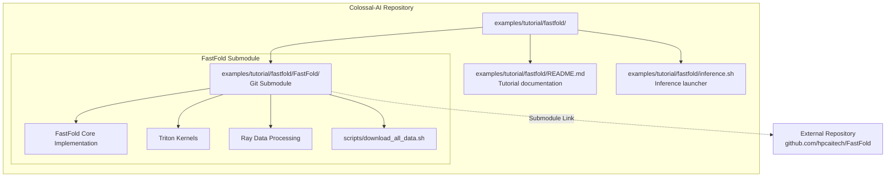
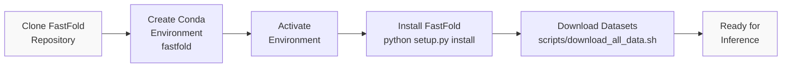
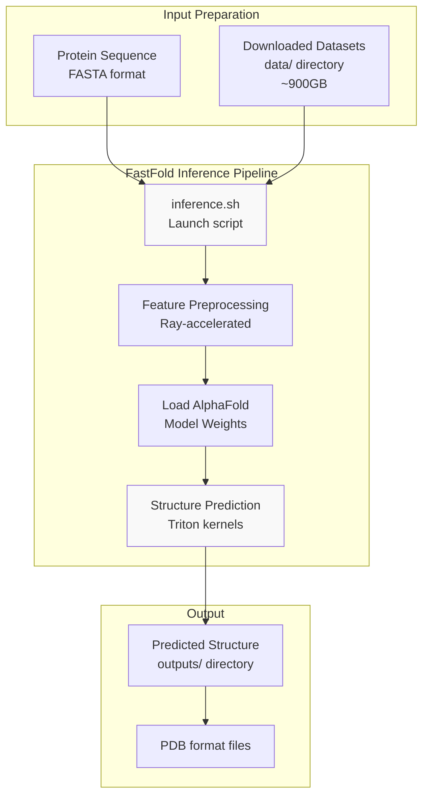
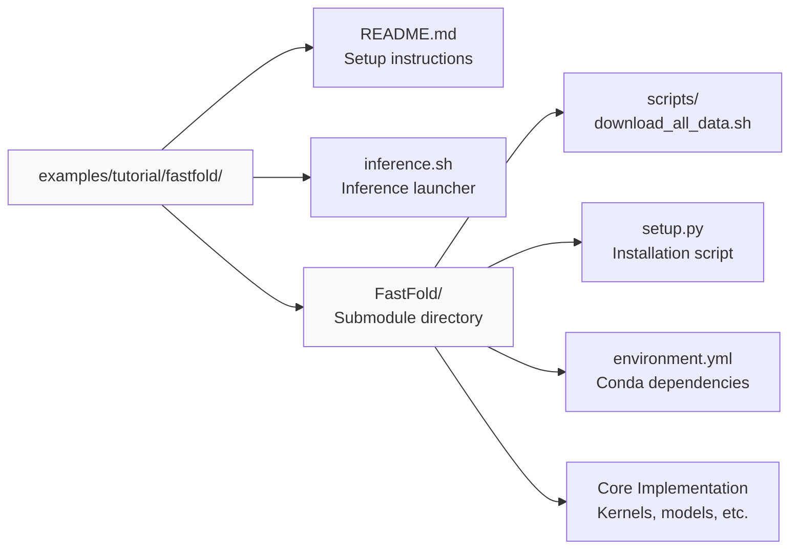

<!-- source: DeepWiki mcp.deepwiki.com · repo hpcaitech/ColossalAI · page 9.3 FastFold for Protein Structure Prediction · fetched 2026-10-21 -->

# FastFold for Protein Structure Prediction

<details>
<summary>Relevant source files</summary>

The following files were used as context for generating this wiki page:

- [.gitmodules](.gitmodules)
- [README.md](README.md)
- [applications/ColossalChat/.gitignore](applications/ColossalChat/.gitignore)
- [applications/README.md](applications/README.md)
- [colossalai/nn/optimizer/README.md](colossalai/nn/optimizer/README.md)
- [docs/README-zh-Hans.md](docs/README-zh-Hans.md)
- [docs/source/en/basics/launch_colossalai.md](docs/source/en/basics/launch_colossalai.md)
- [docs/source/en/get_started/installation.md](docs/source/en/get_started/installation.md)
- [docs/source/zh-Hans/basics/launch_colossalai.md](docs/source/zh-Hans/basics/launch_colossalai.md)
- [docs/source/zh-Hans/get_started/installation.md](docs/source/zh-Hans/get_started/installation.md)
- [examples/README.md](examples/README.md)
- [examples/tutorial/.gitignore](examples/tutorial/.gitignore)
- [examples/tutorial/README.md](examples/tutorial/README.md)
- [examples/tutorial/download_cifar10.py](examples/tutorial/download_cifar10.py)
- [examples/tutorial/fastfold/README.md](examples/tutorial/fastfold/README.md)
- [examples/tutorial/sequence_parallel/data/dummy_dataloader.py](examples/tutorial/sequence_parallel/data/dummy_dataloader.py)

</details>


## Purpose and Scope

This document describes the FastFold integration within Colossal-AI, which provides optimized training and inference for protein structure prediction models based on AlphaFold. FastFold is a separate project integrated as a submodule that leverages Colossal-AI's distributed training capabilities to accelerate biomedicine workloads.

For general parallel training strategies applicable to all model types, see [Parallelism Techniques](#3). For other Colossal-AI applications, see [Applications and Examples](#9).

## Overview

FastFold is an optimization framework for AlphaFold, the groundbreaking protein structure prediction model. It addresses the computational challenges of training and running inference on large protein sequences by integrating multiple acceleration techniques:

- **Optimized Kernels**: Triton-based custom kernels for performance-critical operations
- **Distributed Data Processing**: Ray-based parallel data preprocessing pipeline
- **Extended Sequence Support**: Handles sequences exceeding 10,000 residues
- **Training Acceleration**: Support for distributed training workflows
- **Memory Efficiency**: Optimized memory usage for large-scale protein prediction

FastFold is maintained as an independent repository and integrated into Colossal-AI through a git submodule located at [examples/tutorial/fastfold/FastFold]().

**Sources:** [README.md:282-303](), [applications/README.md:20](), [examples/tutorial/fastfold/README.md:1-50]()

## Repository Structure

FastFold is organized as a submodule within the Colossal-AI repository to provide a tutorial example while maintaining the full FastFold codebase separately:



**Sources:** [.gitmodules:1-4](), [examples/tutorial/fastfold/README.md:1-50]()

## Installation and Setup

### Environment Setup

FastFold requires a conda environment with specific dependencies for protein structure prediction. The installation process differs from standard Colossal-AI examples due to specialized requirements:

| Component | Requirement | Purpose |
|-----------|-------------|---------|
| **Conda** | Required | Package and environment management |
| **FastFold Dependencies** | environment.yml | Protein folding libraries and dependencies |
| **Datasets** | ~900GB storage | Protein databases and feature libraries |
| **GPU** | CUDA-compatible | Accelerated inference |

The installation workflow follows these steps:



The complete installation commands from the tutorial:

```bash
# Clone the FastFold repository
git clone https://github.com/hpcaitech/FastFold
cd FastFold

# Create conda environment from environment.yml
conda env create --name=fastfold -f environment.yml

# Activate environment
conda activate fastfold

# Install FastFold
python setup.py install

# Download required datasets (~900GB)
./scripts/download_all_data.sh data/
```

**Sources:** [examples/tutorial/fastfold/README.md:17-33]()

## Key Optimization Technologies

FastFold achieves significant performance improvements through three primary optimization strategies:

### Triton-Based Kernels

FastFold implements custom GPU kernels using Triton for performance-critical operations in the AlphaFold architecture. These kernels replace standard PyTorch operations with optimized implementations tailored to protein structure prediction workloads.

### Ray-Based Data Processing

The data preprocessing pipeline leverages Ray for distributed processing of protein sequence features. This parallelization significantly reduces the time required to prepare inputs for the neural network, which is traditionally a bottleneck in protein structure prediction.

### Training Support

Unlike the original AlphaFold implementation which focused primarily on inference, FastFold provides full support for distributed training workflows, enabling researchers to train custom protein folding models on their own datasets.

**Sources:** [examples/tutorial/fastfold/README.md:44-47](), [README.md:289]()

## Inference Workflow



The inference process is initiated through a simple shell script:

```bash
bash inference.sh
```

Output predictions are written to the `outputs/` directory in standard PDB format for downstream analysis and visualization.

**Sources:** [examples/tutorial/fastfold/README.md:35-40]()

## Performance Characteristics

FastFold demonstrates substantial performance improvements over baseline AlphaFold implementations across multiple dimensions:

### Inference Acceleration

| Configuration | Speedup | Details |
|---------------|---------|---------|
| **GPU Clusters** | Significant acceleration | Training and inference on distributed GPU infrastructure |
| **Intel Optimization** | 3x faster | Inference acceleration with 39% cost reduction |
| **xTrimoMultimer** | 11x faster | Protein monomer and multimer structure prediction |

### Sequence Length Support

FastFold extends the practical limits of protein structure prediction:

- **Standard AlphaFold**: Limited by memory constraints for long sequences
- **FastFold**: Supports sequences exceeding **10,000 residues**
- **Benefit**: Enables prediction of very large proteins and protein complexes

### Data Processing

The Ray-based preprocessing pipeline provides "much faster data processing" compared to sequential implementations, though specific benchmarks are implementation-dependent.

**Sources:** [README.md:289-301]()

## Integration with Colossal-AI Ecosystem

FastFold integrates with Colossal-AI's broader optimization framework, benefiting from:

| Colossal-AI Component | FastFold Benefit |
|-----------------------|------------------|
| **Booster API** | Simplified distributed training orchestration |
| **Tensor Parallelism** | Model parameter distribution for large networks |
| **Data Parallelism** | Parallel processing of multiple protein sequences |
| **Memory Management** | ZeRO optimization for reduced memory footprint |

While the tutorial focuses on inference, the full FastFold repository supports training workflows that leverage these Colossal-AI primitives for scaling to multi-node GPU clusters.

**Sources:** [README.md:282-303](), [applications/README.md:20]()

## Tutorial Example Structure

The tutorial provided in the Colossal-AI repository serves as an entry point to FastFold's capabilities:



**Key Files:**
- **README.md**: Tutorial documentation with installation and usage instructions
- **inference.sh**: Shell script to launch inference with example configurations
- **FastFold/ submodule**: Complete FastFold implementation from external repository

**Sources:** [examples/tutorial/fastfold/README.md:1-50](), [.gitmodules:1-4]()

## Related Resources

For users interested in FastFold, the following resources provide additional context:

- **FastFold Repository**: [github.com/hpcaitech/FastFold](https://github.com/hpcaitech/FastFold) - Full implementation and documentation
- **Tutorial Video**: Available on YouTube demonstrating FastFold usage
- **xTrimoMultimer**: [github.com/biomap-research/xTrimoMultimer](https://github.com/biomap-research/xTrimoMultimer) - Related project for multimer prediction

For other Colossal-AI applications in different domains:
- **ColossalChat**: See [ColossalChat and RLHF Pipeline](#9.1)
- **Diffusion Models**: See [Diffusion Models](#9.2)

**Sources:** [README.md:282-303](), [examples/tutorial/README.md:31](), [applications/README.md:20]()

---

