# Page: Overview

# Overview

<details>
<summary>Relevant source files</summary>

The following files were used as context for generating this wiki page:

- [README.md](README.md)
- [applications/ColossalChat/.gitignore](applications/ColossalChat/.gitignore)
- [applications/README.md](applications/README.md)
- [colossalai/nn/optimizer/README.md](colossalai/nn/optimizer/README.md)
- [docs/README-zh-Hans.md](docs/README-zh-Hans.md)
- [docs/source/en/basics/launch_colossalai.md](docs/source/en/basics/launch_colossalai.md)
- [docs/source/en/get_started/installation.md](docs/source/en/get_started/installation.md)
- [docs/source/zh-Hans/basics/launch_colossalai.md](docs/source/zh-Hans/basics/launch_colossalai.md)
- [docs/source/zh-Hans/get_started/installation.md](docs/source/zh-Hans/get_started/installation.md)
- [examples/README.md](examples/README.md)
- [examples/tutorial/.gitignore](examples/tutorial/.gitignore)
- [examples/tutorial/README.md](examples/tutorial/README.md)
- [examples/tutorial/download_cifar10.py](examples/tutorial/download_cifar10.py)
- [examples/tutorial/sequence_parallel/data/dummy_dataloader.py](examples/tutorial/sequence_parallel/data/dummy_dataloader.py)

</details>


## Purpose and Scope

Colossal-AI is a unified deep learning system designed to make large-scale AI model training, inference, and optimization cheaper, faster, and more accessible. This system addresses the challenges of training and deploying models ranging from billions to trillions of parameters by providing integrated parallelism strategies, memory optimization techniques, and inference acceleration.

This document provides a high-level overview of the Colossal-AI system architecture, its core components, and entry points. For specific topics:
- Installation procedures, see [Installation](#2.1)
- Distributed environment setup, see [Distributed Environment Setup](#2.2)
- Parallelism techniques (ZeRO, Gemini, TP, PP, SP, etc.), see [Parallelism Techniques](#3)
- Training orchestration with Booster, see [Booster API](#4)
- Model transformation with ShardFormer, see [ShardFormer Framework](#5)
- Inference optimization, see [Inference Engine](#6)
- Applications (ColossalChat, Open-Sora, etc.), see [Applications and Examples](#9)

**Sources:** [README.md:1-156](), [docs/README-zh-Hans.md:1-122]()

## System Design Philosophy

Colossal-AI follows three core design principles:

1. **Ease of Use**: Write distributed models as if coding for a single GPU. The system automatically handles distribution, communication, and memory management.

2. **Composability**: Combine multiple parallelism strategies (Tensor Parallelism, Pipeline Parallelism, Data Parallelism, Sequence Parallelism, ZeRO) seamlessly through a unified interface.

3. **Efficiency**: Optimize both training speed and memory utilization through heterogeneous memory management, kernel fusion, and adaptive scheduling.

The system achieves these goals through layered abstractions that separate user-facing APIs from low-level optimizations.

**Sources:** [README.md:136-156](), [examples/tutorial/README.md:5-14]()

## High-Level Architecture

### Component Organization

Colossal-AI is organized into several architectural layers, each with distinct responsibilities:

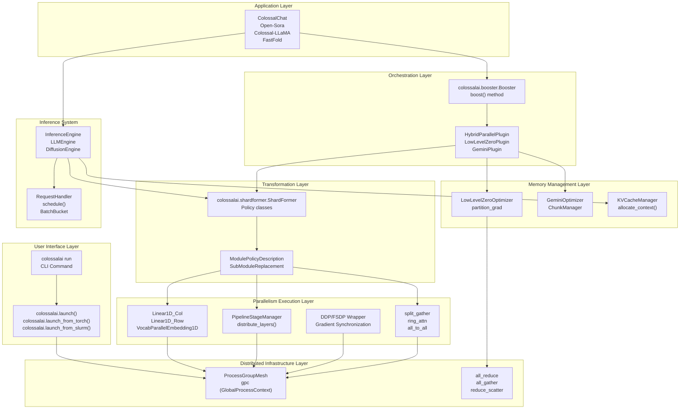

**Sources:** [README.md:136-156](), Diagram 1 from provided diagrams

### Training Pipeline Flow

The following diagram shows how a user model flows through the system from input to execution:

```mermaid
graph LR
    subgraph Input
        UserModel["HuggingFace Model<br/>(LlamaForCausalLM, BertModel, etc)"]
        Config["Training Config<br/>(batch_size, mixed_precision, etc)"]
    end
    
    subgraph ShardFormerTransform["ShardFormer Transformation"]
        PolicySelect["AutoPolicy.from_pretrained()"]
        PolicyApply["Policy.module_policy dict<br/>LlamaPolicy<br/>BertPolicy<br/>Qwen2Policy"]
        ModReplace["SubModuleReplacement<br/>Linear → Linear1D_Col/Row<br/>Attention → ColoAttention"]
        AttrMod["Attribute adjustments<br/>config.num_attention_heads"]
    end
    
    subgraph BoosterOrch["Booster Orchestration"]
        PluginInit["Plugin initialization<br/>HybridParallelPlugin(tp_size, pp_size)<br/>GeminiPlugin(placement_policy)"]
        BoostCall["booster.boost(model, optimizer, dataloader)"]
    end
    
    subgraph WrappedComp["Wrapped Components"]
        ModelWrapper["HybridParallelModule<br/>ModelWrapper"]
        OptWrapper["OptimizerWrapper<br/>LowLevelZeroOptimizer<br/>HybridAdam"]
        DataWrapper["DataloaderWrapper<br/>DistributedSampler"]
    end
    
    subgraph Execution["Training Loop"]
        ForwardPass["forward()<br/>Distributed operations"]
        BackwardPass["backward()<br/>booster.backward()"]
        OptStep["optimizer.step()<br/>Parameter updates"]
        CheckpointSave["booster.save_checkpoint()<br/>booster.load_checkpoint()"]
    end
    
    UserModel --> PolicySelect
    PolicySelect --> PolicyApply
    PolicyApply --> ModReplace
    PolicyApply --> AttrMod
    
    ModReplace --> PluginInit
    AttrMod --> PluginInit
    Config --> PluginInit
    
    PluginInit --> BoostCall
    BoostCall --> ModelWrapper
    BoostCall --> OptWrapper
    BoostCall --> DataWrapper
    
    ModelWrapper --> ForwardPass
    ForwardPass --> BackwardPass
    BackwardPass --> OptWrapper
    OptWrapper --> OptStep
    OptStep --> CheckpointSave
```

**Sources:** Diagram 2 from provided diagrams, [README.md:138-149]()

## Core Components

### Initialization and Launch System

The system provides multiple entry points for initializing the distributed environment:

| Launch Method | Function | Use Case | Environment Variables |
|--------------|----------|----------|----------------------|
| **Native** | `colossalai.launch()` | Direct programmatic launch | Manual rank/world_size setup |
| **Torch** | `colossalai.launch_from_torch()` | PyTorch distributed launcher | `RANK`, `WORLD_SIZE`, `LOCAL_RANK` |
| **CLI** | `colossalai run` command | Single/multi-node with hostfile | Set by launcher |
| **SLURM** | `colossalai.launch_from_slurm()` | HPC clusters with SLURM | `SLURM_PROCID`, `SLURM_NPROCS` |
| **OpenMPI** | `colossalai.launch_from_openmpi()` | MPI-based clusters | `MPI_COMM_WORLD_RANK`, `OMPI_COMM_WORLD_SIZE` |

After initialization, the system creates a `ProcessGroupMesh` that manages multi-dimensional process group topology for different parallelism strategies.

**Sources:** [docs/source/en/basics/launch_colossalai.md:10-230](), [docs/source/zh-Hans/basics/launch_colossalai.md:10-212]()

### Booster: Orchestration Layer

The `Booster` class ([Booster API](#4)) serves as the central orchestration mechanism. It:

1. Accepts a `Plugin` instance specifying parallelism and memory strategies
2. Calls `booster.boost(model, optimizer, dataloader)` to transform components
3. Returns wrapped versions that handle distributed execution transparently

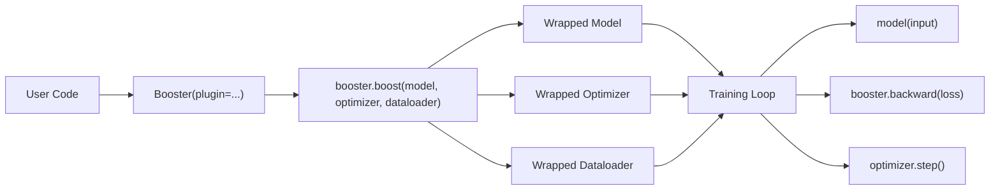

**Plugin types include:**
- `HybridParallelPlugin`: Combines TP + PP + DP + SP
- `LowLevelZeroPlugin`: ZeRO Stage 1/2
- `GeminiPlugin`: ZeRO Stage 3 with CPU/NVMe offloading
- `TorchDDPPlugin`: Standard PyTorch DDP
- `TorchFSDPPlugin`: PyTorch Fully Sharded Data Parallel

**Sources:** [README.md:138-149](), Diagram 1 from provided diagrams

### ShardFormer: Model Transformation Layer

`ShardFormer` ([ShardFormer Framework](#5)) automatically transforms HuggingFace models for distributed execution:

1. **Policy Selection**: `AutoPolicy.from_pretrained(model)` detects model architecture
2. **Module Replacement**: Replaces `nn.Linear` with `Linear1D_Col`/`Linear1D_Row`, standard attention with `ColoAttention`
3. **Attribute Modification**: Adjusts model attributes (e.g., `num_attention_heads /= tp_size`)
4. **Method Injection**: Replaces forward methods with pipeline-aware versions

Model-specific policies exist for LLaMA, BERT, GPT-2, Qwen2, DeepseekV3, and others.

**Sources:** Diagram 2 from provided diagrams, [README.md:142-149]()

### Parallelism Strategies

The system implements four primary parallelism dimensions that can be combined:

| Strategy | Implementation | Key Classes/Functions | Memory Reduction | Communication Pattern |
|----------|---------------|----------------------|------------------|---------------------|
| **Tensor Parallelism (TP)** | Split weight matrices column/row-wise | `Linear1D_Col`, `Linear1D_Row`, `VocabParallelEmbedding1D` | ~1/tp_size | All-reduce after each layer |
| **Pipeline Parallelism (PP)** | Distribute layers across stages | `PipelineStageManager`, `distribute_layers()` | ~1/pp_size | P2P between stages |
| **Data Parallelism (DP)** | Replicate model, split data | DDP wrapper, gradient sync | None (but ZeRO compatible) | All-reduce gradients |
| **Sequence Parallelism (SP)** | Split sequence dimension | `split_gather`, `ring_attn`, `all_to_all` | Reduces activation memory | All-to-all or ring communication |

**ZeRO Integration**: Data parallelism can be enhanced with ZeRO optimizer states sharding:
- **Stage 1**: Partition optimizer states only (`LowLevelZeroOptimizer` with `partition_grad=False`)
- **Stage 2**: Partition optimizer states + gradients (`partition_grad=True`)
- **Stage 3**: Partition all (parameters, gradients, optimizer states) via `GeminiPlugin` with `ChunkManager`

**Sources:** [README.md:142-149](), Diagram 3 from provided diagrams

### Memory Management

Two primary memory optimization systems:

**1. ZeRO (Zero Redundancy Optimizer)**

`LowLevelZeroOptimizer` reduces memory by partitioning training states across data parallel ranks:
- Groups parameters into buckets (`BucketStore`)
- Registers gradient hooks (`_run_reduction()`)
- Performs reduce-scatter instead of all-reduce for Stage 2

**2. Gemini (Heterogeneous Memory Manager)**

`GeminiOptimizer` with `ChunkManager` enables training models 120x larger:
- Chunk-based parameter storage
- Dynamic placement across GPU/CPU/NVMe based on access patterns
- Automatic prefetching and eviction

**Sources:** [README.md:150-151](), Diagram 6 from provided diagrams

### Inference System

The inference engine ([Inference Engine](#6)) provides optimized serving for LLMs and diffusion models:

**Key Components:**
- `InferenceEngine`: Facade that routes to `LLMEngine` or `DiffusionEngine`
- `RequestHandler`: Manages request lifecycle with priority queues, schedules prefill vs decode batches
- `KVCacheManager`: Two-layer cache abstraction (logical blocks → physical GPU tensors)
- `BatchBucket`: Aggregates sequences for efficient batch processing
- Paged attention with Flash Decoding

**Distributed Inference**: `RPCInferenceEngine` coordinates RPC workers for multi-node inference with model sharding.

**Sources:** [README.md:413-448](), Diagram 4 from provided diagrams

## Application Layer

Colossal-AI powers several production-ready applications:

| Application | Purpose | Key Features |
|-------------|---------|--------------|
| **ColossalChat** | ChatGPT clone with RLHF | Producer-consumer architecture, GRPO/PPO/RLOO algorithms, Ray-based coordination |
| **Open-Sora** | Video generation (Sora-like) | Diffusion model training, 16-second 720p generation |
| **Colossal-LLaMA** | LLaMA fine-tuning/pretraining | Domain-specific adaptation with minimal compute |
| **FastFold** | Protein structure prediction | AlphaFold training/inference acceleration |
| **ColossalQA** | Document retrieval QA system | RAG (Retrieval-Augmented Generation) |
| **SwiftInfer** | Multi-round conversation | StreamingLLM, breaks length limits |

These applications demonstrate integration patterns for different model types and serve as reference implementations.

**Sources:** [README.md:158-305](), [applications/README.md:1-23]()

## Distributed RL Training Example

ColossalChat uses a producer-consumer pattern for RLHF:

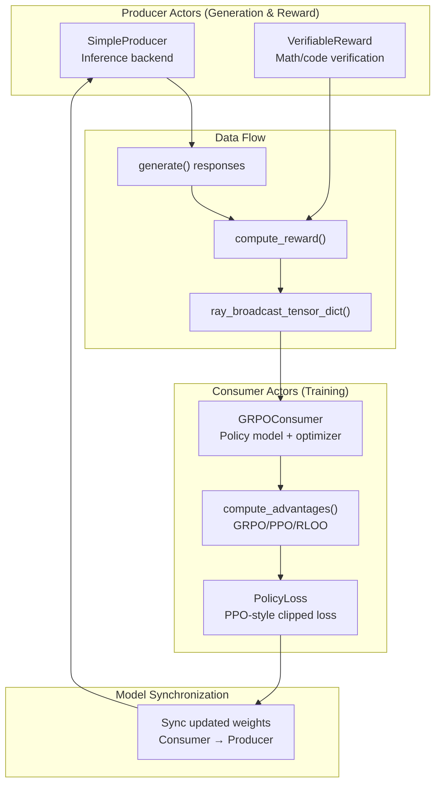

Producers generate text and compute rewards. Consumers train the policy model and sync weights back. Ray collective groups coordinate communication.

**Sources:** Diagram 5 from provided diagrams, [README.md:216-255]()

## System Requirements and Installation

**Minimum Requirements:**
- PyTorch >= 2.2
- Python >= 3.7
- CUDA >= 11.0
- NVIDIA GPU Compute Capability >= 7.0 (V100/RTX 20 series or newer)
- Linux OS

**Installation Methods:**

```bash
# PyPI (basic installation)
pip install colossalai

# PyPI with extension building
BUILD_EXT=1 pip install colossalai

# From source
git clone https://github.com/hpcaitech/ColossalAI.git
cd ColossalAI
BUILD_EXT=1 pip install .
```

Setting `BUILD_EXT=1` pre-compiles CUDA/C++ kernels. Otherwise, kernels compile on first use at runtime.

For detailed installation instructions including Docker usage and CUDA 10.2 compatibility, see [Installation](#2.1).

**Sources:** [README.md:450-521](), [docs/source/en/get_started/installation.md:1-68]()

## Quick Start Pattern

A minimal Colossal-AI training script follows this pattern:

```python
import colossalai
from colossalai.booster import Booster
from colossalai.booster.plugin import GeminiPlugin

# 1. Launch distributed environment
colossalai.launch_from_torch()

# 2. Define model, optimizer, dataloader (standard PyTorch)
model = MyModel()
optimizer = torch.optim.Adam(model.parameters())
dataloader = MyDataLoader()

# 3. Create plugin and booster
plugin = GeminiPlugin(placement_policy='cuda', strict_ddp_mode=True)
booster = Booster(plugin=plugin)

# 4. Boost components
model, optimizer, dataloader = booster.boost(model, optimizer, dataloader)

# 5. Training loop (mostly standard PyTorch)
for data, labels in dataloader:
    outputs = model(data)
    loss = criterion(outputs, labels)
    booster.backward(loss, optimizer)  # Use booster.backward instead of loss.backward()
    optimizer.step()
    optimizer.zero_grad()
```

The key differences from standard PyTorch:
1. Call a launch function
2. Wrap with `booster.boost()`
3. Use `booster.backward()` instead of `loss.backward()`

**Sources:** [examples/tutorial/README.md:1-60]()

## Repository Structure

```
ColossalAI/
├── colossalai/           # Core library code
│   ├── booster/          # Booster and plugin system
│   ├── shardformer/      # Model transformation layer
│   ├── inference/        # Inference engine
│   ├── nn/               # Neural network modules (parallel layers)
│   ├── zero/             # ZeRO optimizer implementations
│   ├── checkpoint_io/    # Checkpoint management
│   └── ...
├── applications/         # Production applications
│   ├── ColossalChat/     # RLHF chatbot
│   ├── Colossal-LLaMA/   # LLaMA fine-tuning
│   ├── ColossalQA/       # QA system
│   └── ColossalEval/     # Evaluation pipelines
├── examples/             # Example scripts and tutorials
│   ├── language/         # LLM examples (LLaMA, GPT, BERT)
│   ├── images/           # Vision model examples
│   └── tutorial/         # Educational tutorials
└── tests/                # Test suite
```

**Sources:** [README.md:1-610](), [examples/README.md:28-39](), [applications/README.md:14-23]()

## Community and Support

- **GitHub Repository**: https://github.com/hpcaitech/ColossalAI
- **Documentation**: https://www.colossalai.org/
- **Forum**: GitHub Discussions
- **Slack**: Community workspace for real-time discussion
- **Paper**: "Colossal-AI: A Unified Deep Learning System For Large-Scale Parallel Training" (ICPP '23)

The project has been accepted as official tutorials by NeurIPS, SC, AAAI, PPoPP, CVPR, ISC, and NVIDIA GTC conferences.

**Sources:** [README.md:551-609](), [examples/tutorial/README.md:6-8]()

## Next Steps

To dive deeper into specific components:
- **Installation and Setup**: See [Getting Started](#2) for installation and [Distributed Environment Setup](#2.2) for launch configuration
- **Understanding Parallelism**: See [Parallelism Techniques](#3) for detailed explanations of each strategy
- **Using the Booster**: See [Booster API](#4) for orchestration details and plugin selection
- **Model Transformation**: See [ShardFormer Framework](#5) for automatic model sharding
- **Inference Optimization**: See [Inference Engine](#6) for serving large models efficiently
- **Memory Optimization**: See [Memory Optimization Techniques](#7) for advanced memory management
- **Real Applications**: See [Applications and Examples](#9) for production use cases

**Sources:** [README.md:1-610]()

---

# Page: Getting Started

# Getting Started

<details>
<summary>Relevant source files</summary>

The following files were used as context for generating this wiki page:

- [README.md](README.md)
- [applications/ColossalChat/.gitignore](applications/ColossalChat/.gitignore)
- [applications/README.md](applications/README.md)
- [colossalai/nn/optimizer/README.md](colossalai/nn/optimizer/README.md)
- [docs/README-zh-Hans.md](docs/README-zh-Hans.md)
- [docs/source/en/basics/launch_colossalai.md](docs/source/en/basics/launch_colossalai.md)
- [docs/source/en/get_started/installation.md](docs/source/en/get_started/installation.md)
- [docs/source/zh-Hans/basics/launch_colossalai.md](docs/source/zh-Hans/basics/launch_colossalai.md)
- [docs/source/zh-Hans/get_started/installation.md](docs/source/zh-Hans/get_started/installation.md)
- [examples/README.md](examples/README.md)
- [examples/tutorial/.gitignore](examples/tutorial/.gitignore)
- [examples/tutorial/README.md](examples/tutorial/README.md)
- [examples/tutorial/download_cifar10.py](examples/tutorial/download_cifar10.py)
- [examples/tutorial/sequence_parallel/data/dummy_dataloader.py](examples/tutorial/sequence_parallel/data/dummy_dataloader.py)

</details>


This guide will walk you through the process of setting up Colossal-AI and running your first distributed training job. Colossal-AI is a comprehensive system for training and deploying large AI models efficiently across distributed hardware.

For more advanced topics like specific parallelism techniques or optimization strategies, see [Parallelism Techniques](#3) and [Memory Optimization Techniques](#7).

## System Requirements

Before installing Colossal-AI, ensure your system meets the following requirements:

- PyTorch >= 2.2
- Python >= 3.7
- CUDA >= 11.0
- [NVIDIA GPU Compute Capability](https://developer.nvidia.com/cuda-gpus) >= 7.0 (V100/RTX20 and higher)
- Linux OS

Sources: [README.md:437-446](), [docs/source/en/get_started/installation.md:3-9]()

## Installation

There are several ways to install Colossal-AI depending on your needs.

### Install from PyPI

The easiest way to install Colossal-AI is directly from PyPI:

```bash
pip install colossalai
```

By default, PyTorch extensions are not built during installation. They will be built at runtime when needed. If you want to build them during installation:

```bash
BUILD_EXT=1 pip install colossalai
```

Nightly versions with the latest features are also available:

```bash
pip install colossalai-nightly
```

Sources: [README.md:451-473](), [docs/source/en/get_started/installation.md:13-28]()

### Install from Source

For the latest features or development:

```bash
git clone https://github.com/hpcaitech/ColossalAI.git
cd ColossalAI

# install dependencies
pip install -r requirements/requirements.txt

# install colossalai
pip install .

# with PyTorch extensions (optional)
BUILD_EXT=1 pip install .
```

Sources: [README.md:475-492](), [docs/source/en/get_started/installation.md:30-49]()

### Using Docker

You can use Docker to avoid setting up the environment manually:

```bash
# Pull from DockerHub
docker pull hpcaitech/colossalai

# Or build locally
cd ColossalAI
docker build -t colossalai ./docker
docker run -ti --gpus all --rm --ipc=host colossalai bash
```

Sources: [README.md:512-535](), [docs/source/en/get_started/installation.md:50-66]()

## Initialization Architecture

Understanding how Colossal-AI initializes distributed training is essential. Here's how the main components interact during initialization:

**Title: Colossal-AI Initialization Flow**

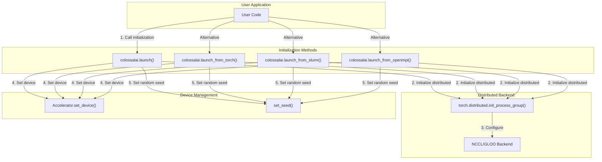

Sources: [colossalai/initialize.py:20-184](), [colossalai/__init__.py:1-13]()

## Launching Distributed Training

Colossal-AI offers several methods to launch distributed training. Let's explore each approach:

**Title: Distributed Launch Methods in Colossal-AI**

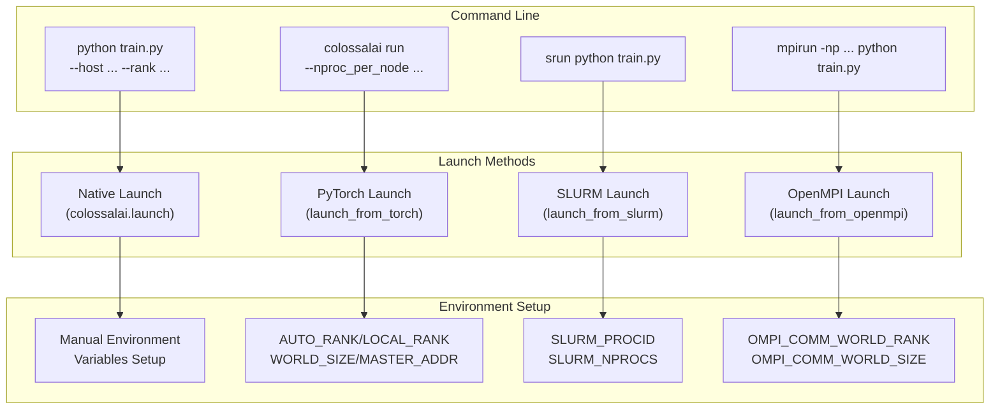

Sources: [docs/source/en/basics/launch_colossalai.md:1-231](), [colossalai/initialize.py:20-184]()

### Native Launch

This is the most basic approach using `colossalai.launch`:

```python
import colossalai

# Parse arguments
parser = colossalai.get_default_parser()
args = parser.parse_args()

# Launch distributed environment
colossalai.launch(
    rank=args.rank,
    world_size=args.world_size,
    host=args.host,
    port=args.port,
    backend=args.backend
)
```

The command to launch this script would be:

```bash
python train.py --host <host> --rank <rank> --world_size <world_size> --port <port> --backend <backend>
```

Sources: [docs/source/en/basics/launch_colossalai.md:77-96]()

### Using Colossal-AI CLI

For easier launching on both single and multi-node environments:

```python
import colossalai

# Use environment variables set by PyTorch launcher
colossalai.launch_from_torch()
```

Launch with the CLI:

```bash
# Single node with 4 GPUs
colossalai run --nproc_per_node 4 train.py

# Multi-node with specific hosts
colossalai run --nproc_per_node 4 --host host1,host2 --master_addr host1 train.py

# Using a hostfile
colossalai run --nproc_per_node 4 --hostfile ./hostfile --master_addr host1 train.py
```

Sources: [docs/source/en/basics/launch_colossalai.md:99-183]()

### Using SLURM

If you're on a SLURM-managed cluster:

```python
import colossalai

colossalai.launch_from_slurm(
    host=args.host,
    port=args.port
)
```

Launch with SLURM:

```bash
srun python train.py --host <master_node> --port 29500
```

Sources: [docs/source/en/basics/launch_colossalai.md:185-206]()

### Using OpenMPI

For OpenMPI environments:

```python
import colossalai

colossalai.launch_from_openmpi(
    host=args.host,
    port=args.port
)
```

Launch with OpenMPI:

```bash
mpirun --hostfile <my_hostfile> -np <num_process> python train.py --host <node name or ip> --port 29500
```

Sources: [docs/source/en/basics/launch_colossalai.md:208-230]()

## Core Components and Architecture

Understanding Colossal-AI's architecture will help you leverage its capabilities effectively:

**Title: Colossal-AI Core Architecture**

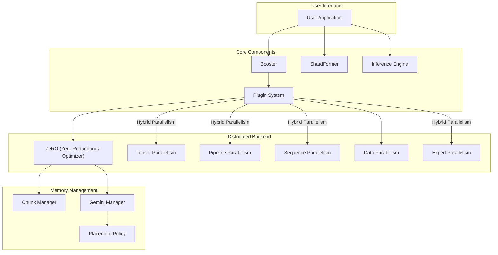

Sources: [README.md:126-141](), [colossalai/zero/__init__.py:1-13]()

## Simple Example: Running Your First Distributed Training

Let's go through a basic example to get familiar with Colossal-AI. 

### 1. Prepare your script

Create a `train.py` file with the following content:

```python
import torch
import colossalai
import torch.nn as nn
import torch.optim as optim
from torchvision.models import resnet18

# Parse arguments
parser = colossalai.get_default_parser()
args = parser.parse_args()

# Launch distributed environment
colossalai.launch(
    rank=args.rank,
    world_size=args.world_size,
    host=args.host,
    port=args.port,
    backend=args.backend
)

# Create model, criterion, optimizer
model = resnet18()
criterion = nn.CrossEntropyLoss()
optimizer = optim.Adam(model.parameters(), lr=0.001)

# Simulate data
batch_size = 32
input_data = torch.rand(batch_size, 3, 224, 224)
target = torch.randint(0, 1000, (batch_size,))

# Forward pass
output = model(input_data)
loss = criterion(output, target)

# Backward pass and optimize
loss.backward()
optimizer.step()

print(f"Training completed on rank {args.rank}, loss: {loss.item()}")
```

### 2. Launch the distributed training

For a single machine with 4 GPUs:

```bash
python train.py --host localhost --world_size 4 --port 29500 --rank 0 &
python train.py --host localhost --world_size 4 --port 29500 --rank 1 &
python train.py --host localhost --world_size 4 --port 29500 --rank 2 &
python train.py --host localhost --world_size 4 --port 29500 --rank 3
```

Or more easily with Colossal-AI CLI (assuming you've modified your script to use `launch_from_torch`):

```bash
colossalai run --nproc_per_node 4 train.py
```

This example demonstrates the basic workflow of launching distributed training with Colossal-AI.

Sources: [examples/tutorial/README.md:1-59]()

## Common Accelerator Support

Colossal-AI provides abstraction for various hardware accelerators, making your code portable across different platforms:

**Title: Accelerator Abstraction in Colossal-AI**

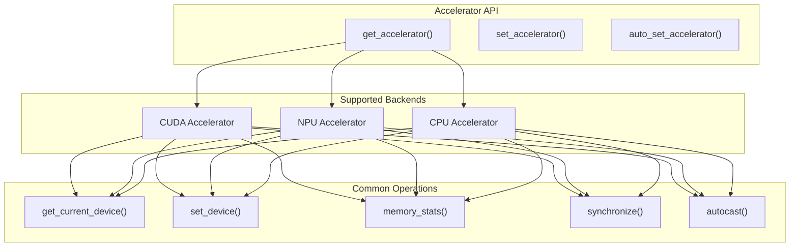

Sources: [colossalai/accelerator/api.py:1-72](), [colossalai/accelerator/npu_accelerator.py:1-289](), [colossalai/accelerator/base_accelerator.py:1-321]()

The accelerator API automatically selects the appropriate backend based on your hardware. You can also explicitly set the accelerator:

```python
from colossalai.accelerator import set_accelerator, auto_set_accelerator, get_accelerator

# Automatically select the best available accelerator
auto_set_accelerator()

# Or explicitly set an accelerator
set_accelerator("cuda")  # Other options: "npu", "cpu"

# Get the current accelerator
accelerator = get_accelerator()
```

Sources: [colossalai/accelerator/__init__.py:1-15](), [colossalai/accelerator/README.md:1-21]()

## Next Steps

Now that you've set up Colossal-AI and run a basic example, you can explore more advanced features:

1. Explore different [Parallelism Techniques](#3) like ZeRO, Tensor Parallelism, and Pipeline Parallelism
2. Learn about the [Booster API](#4) for simplified distributed training
3. Understand [ShardFormer](#5) for efficient model parallelism
4. Try out the [Inference Engine](#6) for optimized model inference
5. Implement [Memory Optimization Techniques](#7) for training larger models
6. Use the [Checkpointing System](#8) for saving and loading distributed models

You can also find examples and applications in the repository:
- Examples directory: [examples/](https://github.com/hpcaitech/ColossalAI/tree/main/examples)
- Applications directory: [applications/](https://github.com/hpcaitech/ColossalAI/tree/main/applications)

Sources: [examples/README.md:1-73](), [applications/README.md:1-27]()

---

# Page: Installation

# Installation

<details>
<summary>Relevant source files</summary>

The following files were used as context for generating this wiki page:

- [.github/workflows/build_on_pr.yml](.github/workflows/build_on_pr.yml)
- [.github/workflows/build_on_schedule.yml](.github/workflows/build_on_schedule.yml)
- [.github/workflows/compatiblity_test_on_dispatch.yml](.github/workflows/compatiblity_test_on_dispatch.yml)
- [.github/workflows/compatiblity_test_on_pr.yml](.github/workflows/compatiblity_test_on_pr.yml)
- [.github/workflows/compatiblity_test_on_schedule.yml](.github/workflows/compatiblity_test_on_schedule.yml)
- [.github/workflows/doc_check_on_pr.yml](.github/workflows/doc_check_on_pr.yml)
- [.github/workflows/doc_test_on_pr.yml](.github/workflows/doc_test_on_pr.yml)
- [.github/workflows/doc_test_on_schedule.yml](.github/workflows/doc_test_on_schedule.yml)
- [.github/workflows/draft_github_release_post_after_merge.yml](.github/workflows/draft_github_release_post_after_merge.yml)
- [.github/workflows/example_check_on_dispatch.yml](.github/workflows/example_check_on_dispatch.yml)
- [.github/workflows/example_check_on_pr.yml](.github/workflows/example_check_on_pr.yml)
- [.github/workflows/example_check_on_schedule.yml](.github/workflows/example_check_on_schedule.yml)
- [.github/workflows/release_docker_after_publish.yml](.github/workflows/release_docker_after_publish.yml)
- [.github/workflows/release_nightly_on_schedule.yml](.github/workflows/release_nightly_on_schedule.yml)
- [.github/workflows/release_pypi_after_merge.yml](.github/workflows/release_pypi_after_merge.yml)
- [.github/workflows/report_leaderboard_to_lark.yml](.github/workflows/report_leaderboard_to_lark.yml)
- [.github/workflows/run_chatgpt_examples.yml](.github/workflows/run_chatgpt_examples.yml)
- [.github/workflows/run_chatgpt_unit_tests.yml](.github/workflows/run_chatgpt_unit_tests.yml)
- [.github/workflows/run_colossalqa_unit_tests.yml](.github/workflows/run_colossalqa_unit_tests.yml)
- [.github/workflows/scripts/generate_leaderboard_and_send_to_lark.py](.github/workflows/scripts/generate_leaderboard_and_send_to_lark.py)
- [README.md](README.md)
- [applications/ColossalChat/.gitignore](applications/ColossalChat/.gitignore)
- [applications/README.md](applications/README.md)
- [colossalai/nn/optimizer/README.md](colossalai/nn/optimizer/README.md)
- [docs/README-zh-Hans.md](docs/README-zh-Hans.md)
- [docs/source/en/basics/launch_colossalai.md](docs/source/en/basics/launch_colossalai.md)
- [docs/source/en/get_started/installation.md](docs/source/en/get_started/installation.md)
- [docs/source/zh-Hans/basics/launch_colossalai.md](docs/source/zh-Hans/basics/launch_colossalai.md)
- [docs/source/zh-Hans/get_started/installation.md](docs/source/zh-Hans/get_started/installation.md)
- [examples/README.md](examples/README.md)
- [examples/tutorial/.gitignore](examples/tutorial/.gitignore)
- [examples/tutorial/README.md](examples/tutorial/README.md)
- [examples/tutorial/download_cifar10.py](examples/tutorial/download_cifar10.py)
- [examples/tutorial/sequence_parallel/data/dummy_dataloader.py](examples/tutorial/sequence_parallel/data/dummy_dataloader.py)

</details>


This document covers the installation procedures for Colossal-AI, including system requirements, installation methods (PyPI, source build, Docker), and extension building options. For information about launching distributed training after installation, see [Distributed Environment Setup](#2.2).

---

## System Requirements

Colossal-AI requires the following environment:

| Component | Requirement |
|-----------|-------------|
| **Python** | >= 3.7 |
| **PyTorch** | >= 2.2 |
| **CUDA** | >= 11.0 |
| **GPU Compute Capability** | >= 7.0 (V100/RTX 20 series and higher) |
| **Operating System** | Linux (only Linux is officially supported) |

The NVIDIA GPU Compute Capability requirement ensures compatibility with modern distributed training features. Consumer-grade GPUs starting from RTX 20 series and datacenter GPUs from V100 onwards meet this requirement.

**Sources:** [README.md:452-458](), [docs/source/en/get_started/installation.md:3-9]()

---

## Installation Method Decision Flow

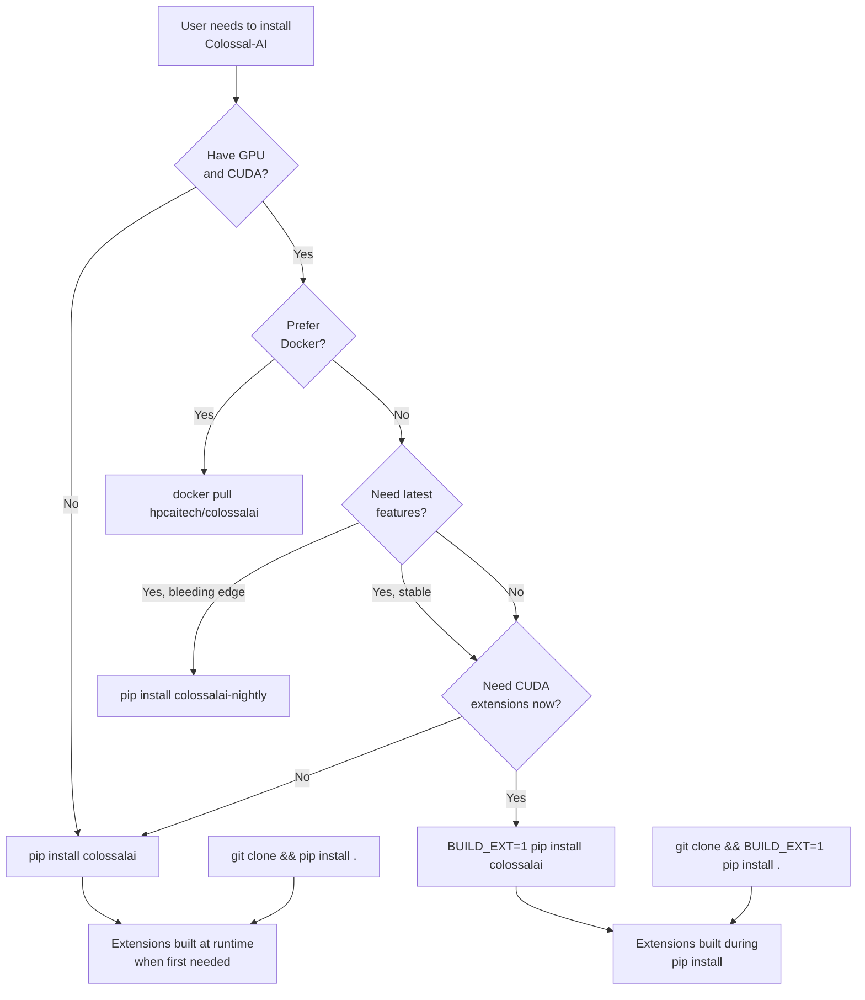

**Sources:** [README.md:461-503](), [docs/source/en/get_started/installation.md:13-65]()

---

## PyPI Installation

### Standard Installation (Runtime Extension Build)

The simplest installation method downloads the package from PyPI. By default, CUDA extensions are **not** built during installation but will be compiled automatically at runtime when needed.

```bash
pip install colossalai
```

This approach minimizes installation time but incurs a one-time compilation overhead when CUDA kernels are first used during training.

**Sources:** [README.md:461-467](), [docs/source/en/get_started/installation.md:15-19]()

### Installation with Pre-built Extensions

To build CUDA/C++ extensions during installation, set the `BUILD_EXT` environment variable:

```bash
BUILD_EXT=1 pip install colossalai
```

This is **required** when using fused optimizers and recommended for production deployments where runtime compilation delays are unacceptable. The build process compiles kernels in [op_builder/]() and [colossalai/kernel/]() directories.

**Sources:** [README.md:471-477](), [docs/source/en/get_started/installation.md:23-27]()

### Nightly Releases

Weekly nightly builds provide access to unreleased features and bug fixes from the main branch:

```bash
pip install colossalai-nightly
```

Nightly versions are published every Sunday at 00:00 UTC via the automated workflow in [.github/workflows/release_nightly_on_schedule.yml:1-70]().

**Sources:** [README.md:479-484](), [.github/workflows/release_nightly_on_schedule.yml:6]()

---

## Building from Source

### Standard Source Build

For development or to access the latest main branch code:

```bash
git clone https://github.com/hpcaitech/ColossalAI.git
cd ColossalAI

# Install dependencies
pip install -r requirements/requirements.txt

# Install without building extensions (runtime build)
pip install .
```

Extensions will be compiled during runtime when first needed, similar to PyPI installation.

**Sources:** [README.md:490-496](), [docs/source/en/get_started/installation.md:34-43]()

### Source Build with Extensions

To pre-build CUDA extensions during installation:

```bash
git clone https://github.com/hpcaitech/ColossalAI.git
cd ColossalAI

pip install -r requirements/requirements.txt

# Build extensions during installation
BUILD_EXT=1 pip install .
```

The `BUILD_EXT=1` flag triggers the extension build logic in [setup.py](), which processes kernel code in [op_builder/]() to create compiled binaries.

**Sources:** [README.md:498-503](), [docs/source/en/get_started/installation.md:45-49]()

### CUDA 10.2 Compatibility

For legacy CUDA 10.2 systems, the CUB library must be manually downloaded:

```bash
git clone https://github.com/hpcaitech/ColossalAI.git
cd ColossalAI

# Download CUB library version 1.8.0
wget https://github.com/NVIDIA/cub/archive/refs/tags/1.8.0.zip
unzip 1.8.0.zip
cp -r cub-1.8.0/cub/ colossalai/kernel/cuda_native/csrc/kernels/include/

# Build with extensions
BUILD_EXT=1 pip install .
```

This workaround addresses missing CUB headers in older CUDA toolkit installations.

**Sources:** [README.md:505-519](), [docs/source/en/get_started/installation.md:51-65]()

---

## Extension Build Process

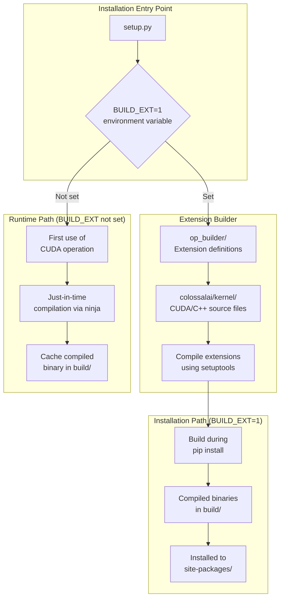

The build process follows two paths depending on the `BUILD_EXT` flag:

1. **Runtime Build (default)**: Extensions compile on first use via PyTorch's JIT compilation mechanism, cached in the `build/` directory
2. **Install-time Build**: Extensions compile during `pip install`, installed directly to site-packages

The CI/CD workflows cache the `build/` directory to avoid recompilation across test runs, as seen in [.github/workflows/build_on_pr.yml:133-153]().

**Sources:** [README.md:471-477](), [.github/workflows/build_on_pr.yml:133-154](), [.github/workflows/compatiblity_test_on_pr.yml:59-62]()

---

## Docker Installation

### Pull Pre-built Images

Official Docker images are published to DockerHub after each release:

```bash
# Pull latest release
docker pull hpcaitech/colossalai:latest

# Pull specific version
docker pull hpcaitech/colossalai:v0.x.x
```

Images include PyTorch, CUDA, and all Colossal-AI dependencies pre-configured. The image building and publishing process is automated via [.github/workflows/release_docker_after_publish.yml:1-79]().

**Sources:** [README.md:525-528](), [.github/workflows/release_docker_after_publish.yml:21-44]()

### Build Custom Docker Image

To build from the repository Dockerfile:

```bash
cd ColossalAI
docker build -t colossalai ./docker
```

**Important**: Building Colossal-AI from source requires GPU access during the build. Configure Nvidia Docker Runtime as the default runtime:

```bash
# Verify nvidia-docker runtime is available
docker run --rm --gpus all nvidia/cuda:11.8.0-base-ubuntu22.04 nvidia-smi
```

If GPU access fails during build, install the NVIDIA Container Toolkit and set it as the default runtime in `/etc/docker/daemon.json`.

**Sources:** [README.md:530-541](), [README.md:534]()

### Run Container

Start an interactive container with GPU access:

```bash
docker run -ti --gpus all --rm --ipc=host colossalai bash
```

Flags explained:
- `--gpus all`: Expose all GPUs to the container
- `--rm`: Remove container after exit
- `--ipc=host`: Required for NCCL shared memory communication between processes

**Sources:** [README.md:543-547](), [.github/workflows/build_on_pr.yml:92-93]()

---

## Docker Image Structure

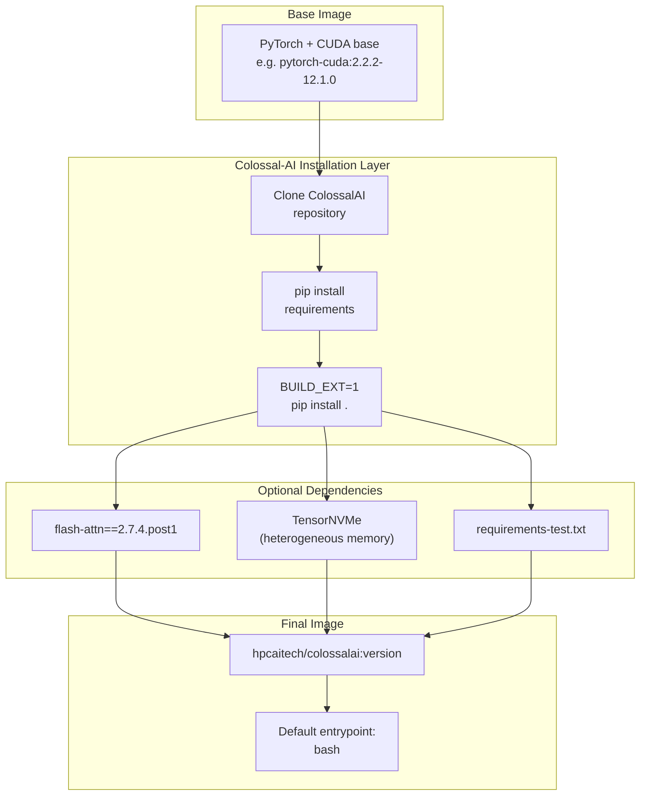

The CI/CD workflows use container images extensively for testing. The base image `image-cloud.luchentech.com/hpcaitech/pytorch-cuda:2.2.2-12.1.0` appears in multiple workflow files, providing a consistent testing environment with pre-installed PyTorch and CUDA.

**Sources:** [.github/workflows/build_on_pr.yml:92](), [.github/workflows/compatiblity_test_on_pr.yml:43](), [docker/Dockerfile]()

---

## Installation Verification

After installation, verify the environment is correctly configured:

```bash
colossalai check -i
```

This command checks:
- Python version compatibility
- PyTorch installation
- CUDA availability
- GPU detection
- Extension build status

Expected output shows green checkmarks for all components. If extensions were not built during installation, you may see a message indicating they will be compiled at runtime.

**Sources:** [examples/tutorial/README.md:50-53]()

---

## Compatibility Testing

Colossal-AI maintains compatibility across multiple PyTorch and CUDA versions. The compatibility matrix is defined in [.compatibility]() and tested via automated workflows:

| Workflow | Purpose | Frequency |
|----------|---------|-----------|
| [compatiblity_test_on_pr.yml]() | Test compatibility changes on PR | Per PR |
| [compatiblity_test_on_schedule.yml]() | Regular compatibility verification | Weekly (Saturday 19:00 UTC) |
| [compatiblity_test_on_dispatch.yml]() | Manual compatibility testing | On demand |

The test matrix is generated from [.compatibility]() which lists supported PyTorch-CUDA version pairs. For example, testing against `pytorch-cuda:2.2.2-12.1.0` verifies PyTorch 2.2.2 with CUDA 12.1.0.

**Sources:** [.github/workflows/compatiblity_test_on_pr.yml:22-32](), [.github/workflows/compatiblity_test_on_schedule.yml:17-29]()

---

## Continuous Integration Installation Pattern

The CI/CD workflows demonstrate best practices for installation in automated environments. The standard pattern from [.github/workflows/build_on_pr.yml:102-154]():

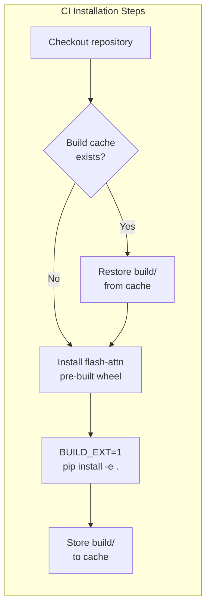

Key optimizations:
1. **Build caching**: The `build/` directory is cached between runs to avoid recompiling unchanged extensions
2. **Pre-built wheels**: Flash-attention is installed from a pre-built wheel rather than compiled from source
3. **Editable install**: Using `-e` flag enables code changes without reinstallation
4. **Extension detection**: Cache restoration skips if extension files changed (detected in [.github/workflows/build_on_pr.yml:55-64]())

**Sources:** [.github/workflows/build_on_pr.yml:102-154](), [.github/workflows/build_on_pr.yml:133-139]()

---

## Troubleshooting

### Issue: Extension Build Failures

**Symptom**: Compilation errors during `BUILD_EXT=1 pip install`

**Solutions**:
1. Verify CUDA toolkit is installed and `nvcc` is in PATH
2. Check CUDA version matches PyTorch CUDA version: `python -c "import torch; print(torch.version.cuda)"`
3. For CUDA 10.2, manually install CUB library as shown in [Building from Source](#building-from-source)
4. Check available disk space - compilation requires temporary space

### Issue: Runtime Extension Build Hangs

**Symptom**: First use of CUDA operations freezes

**Solutions**:
1. Pre-build extensions with `BUILD_EXT=1` during installation
2. Ensure write permissions to the build cache directory
3. Check for conflicting CUDA installations

### Issue: Docker GPU Access Denied

**Symptom**: `docker run --gpus all` fails with "could not select device driver"

**Solutions**:
1. Install NVIDIA Container Toolkit: `apt-get install nvidia-container-toolkit`
2. Restart Docker daemon: `systemctl restart docker`
3. Verify NVIDIA runtime: `docker run --rm --gpus all nvidia/cuda:11.8.0-base-ubuntu22.04 nvidia-smi`

### Issue: Import Errors After Installation

**Symptom**: `ImportError: cannot import name 'X' from 'colossalai'`

**Solutions**:
1. Verify installation: `pip show colossalai`
2. Check for conflicting installations: `pip list | grep colossalai`
3. Reinstall in clean environment: `pip uninstall colossalai && pip install colossalai`
4. For nightly builds, ensure no stable version is installed simultaneously

**Sources:** [README.md:459](), [examples/tutorial/README.md:53]()

---

# Page: Distributed Environment Setup

# Distributed Environment Setup

<details>
<summary>Relevant source files</summary>

The following files were used as context for generating this wiki page:

- [README.md](README.md)
- [applications/ColossalChat/.gitignore](applications/ColossalChat/.gitignore)
- [applications/README.md](applications/README.md)
- [colossalai/initialize.py](colossalai/initialize.py)
- [colossalai/nn/optimizer/README.md](colossalai/nn/optimizer/README.md)
- [colossalai/zero/__init__.py](colossalai/zero/__init__.py)
- [docs/README-zh-Hans.md](docs/README-zh-Hans.md)
- [docs/source/en/basics/launch_colossalai.md](docs/source/en/basics/launch_colossalai.md)
- [docs/source/en/get_started/installation.md](docs/source/en/get_started/installation.md)
- [docs/source/zh-Hans/basics/launch_colossalai.md](docs/source/zh-Hans/basics/launch_colossalai.md)
- [docs/source/zh-Hans/get_started/installation.md](docs/source/zh-Hans/get_started/installation.md)
- [examples/README.md](examples/README.md)
- [examples/tutorial/.gitignore](examples/tutorial/.gitignore)
- [examples/tutorial/README.md](examples/tutorial/README.md)
- [examples/tutorial/download_cifar10.py](examples/tutorial/download_cifar10.py)
- [examples/tutorial/sequence_parallel/data/dummy_dataloader.py](examples/tutorial/sequence_parallel/data/dummy_dataloader.py)

</details>


This document explains how to initialize the distributed training environment in ColossalAI. Before training can begin, the distributed backend must be properly configured to enable communication between processes across GPUs and nodes. ColossalAI provides multiple launch methods to accommodate different deployment scenarios, including manual initialization, CLI-based launching, and integration with common job schedulers like SLURM and OpenMPI.

For information about parallelism strategies that operate on top of the distributed environment, see [Parallelism Techniques](#3). For installation instructions, see [Installation](#2.1).

## Overview of Launch Methods

ColossalAI supports five primary methods for initializing distributed environments, each designed for specific use cases:

| Launch Method | Function | Use Case | Environment Variables Required |
|---------------|----------|----------|-------------------------------|
| Manual Launch | `colossalai.launch()` | Custom scripts, fine-grained control | None (passed as arguments) |
| CLI Launch | `colossalai run` | Single/multi-node, simplified setup | Set by launcher |
| PyTorch Launch | `colossalai.launch_from_torch()` | Integration with `torchrun` | `RANK`, `LOCAL_RANK`, `WORLD_SIZE`, `MASTER_ADDR`, `MASTER_PORT` |
| SLURM Launch | `colossalai.launch_from_slurm()` | HPC clusters with SLURM | `SLURM_PROCID`, `SLURM_NPROCS` |
| OpenMPI Launch | `colossalai.launch_from_openmpi()` | MPI-managed clusters | `OMPI_COMM_WORLD_RANK`, `OMPI_COMM_WORLD_LOCAL_RANK`, `OMPI_COMM_WORLD_SIZE` |

**Launch Methods Architecture**

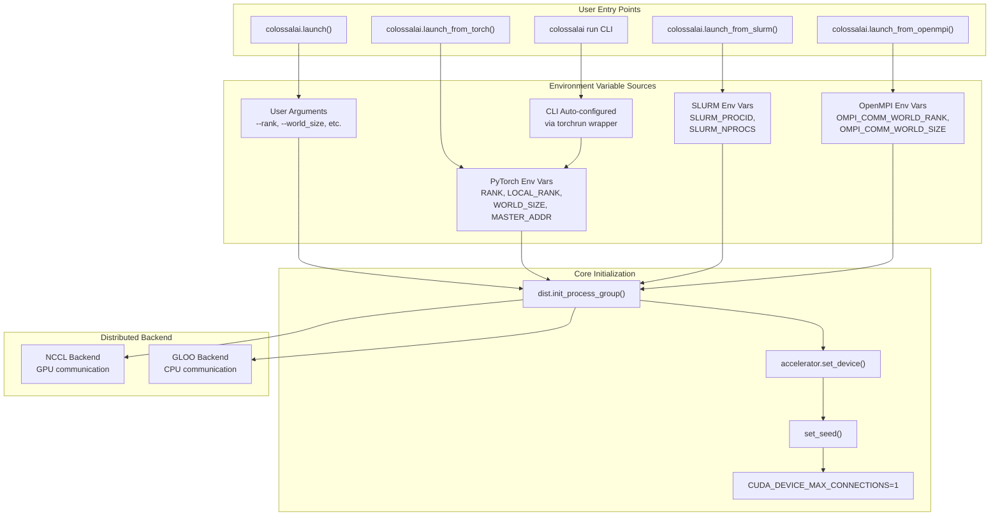

Sources: [colossalai/initialize.py:1-185]()

## Core Initialization Parameters

All launch methods require the following parameters to establish the distributed environment:

| Parameter | Type | Description | Default |
|-----------|------|-------------|---------|
| `rank` | int | Global rank of the current process (0 to world_size-1) | Required |
| `world_size` | int | Total number of processes across all nodes | Required |
| `host` | str | Master node address (hostname or IP) | Required |
| `port` | int | Master node port for rendezvous | Required |
| `backend` | str | Communication backend (`nccl`, `gloo`, `mpi`) | `nccl` |
| `local_rank` | int | Local rank on the current node | Auto-calculated |
| `seed` | int | Random seed for reproducibility | 1024 |
| `verbose` | bool | Enable initialization logging | True |

**Initialization Flow Diagram**

```mermaid
graph LR
    subgraph "Step 1: Read Parameters"
        ReadEnv["Read from env vars<br/>or arguments"]
        ValidateParams["Validate rank,<br/>world_size, host, port"]
    end
    
    subgraph "Step 2: Environment Setup"
        SetCUDAConn["Set CUDA_DEVICE_MAX_CONNECTIONS=1<br/>for comm/compute overlap"]
        GetAccel["get_accelerator()<br/>detect GPU type"]
    end
    
    subgraph "Step 3: Process Group Init"
        BuildInitMethod["Build init_method<br/>tcp://[host]:port"]
        InitDistPG["dist.init_process_group()<br/>rank, world_size, backend"]
    end
    
    subgraph "Step 4: Device & Seed"
        SetDeviceID["accelerator.set_device()<br/>local_rank"]
        SetRandomSeed["set_seed(seed)<br/>for reproducibility"]
    end
    
    subgraph "Step 5: Optimization Flags"
        SetDynamo["torch._dynamo.config<br/>.optimize_ddp = True"]
        LogSuccess["Log initialization<br/>success message"]
    end
    
    ReadEnv --> ValidateParams
    ValidateParams --> SetCUDAConn
    SetCUDAConn --> GetAccel
    GetAccel --> BuildInitMethod
    BuildInitMethod --> InitDistPG
    InitDistPG --> SetDeviceID
    SetDeviceID --> SetRandomSeed
    SetRandomSeed --> SetDynamo
    SetDynamo --> LogSuccess
```

Sources: [colossalai/initialize.py:20-76]()

## Method 1: Manual Launch with `colossalai.launch()`

The `colossalai.launch()` function provides direct control over distributed initialization. This method is suitable when you need to manually manage process spawning or integrate with custom launchers.

**Function Signature:**
```python
def launch(
    rank: int,
    world_size: int,
    host: str,
    port: int,
    backend: str = "nccl",
    local_rank: int = None,
    seed: int = 1024,
    verbose: bool = True,
)
```

**Usage Pattern:**

```python
# train.py
import colossalai

# Parse command line arguments
parser = colossalai.get_default_parser()
args = parser.parse_args()

# Initialize distributed environment
colossalai.launch(
    rank=args.rank,
    world_size=args.world_size,
    host=args.host,
    port=args.port,
    backend=args.backend,
    seed=args.seed,
)

# Your training code here
```

**Command Line Execution:**
```bash
# Start process 0 on node0
python train.py --rank 0 --world_size 4 --host node0 --port 29500

# Start process 1 on node0
python train.py --rank 1 --world_size 4 --host node0 --port 29500

# Continue for all ranks...
```

**Manual Launch Architecture:**

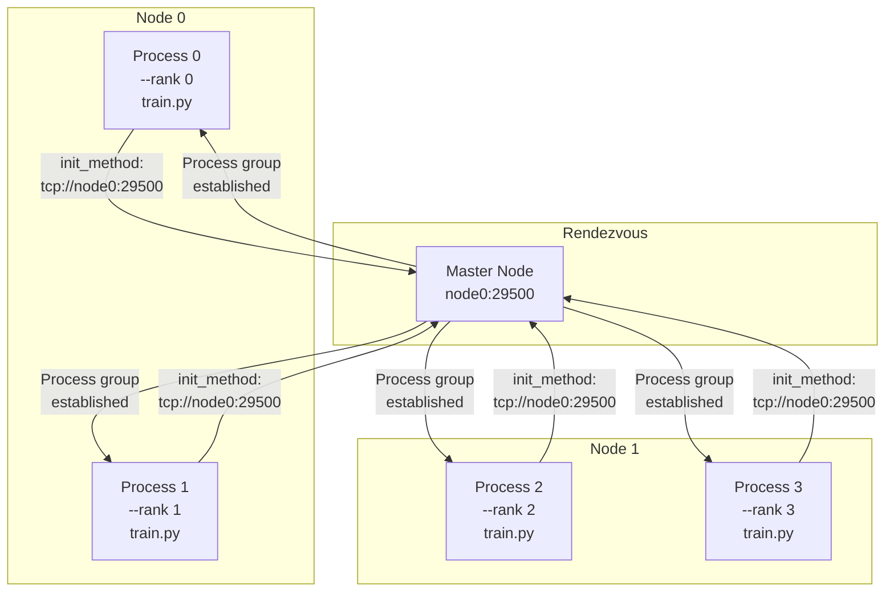

Sources: [colossalai/initialize.py:20-76](), [docs/source/en/basics/launch_colossalai.md:78-96]()

## Method 2: CLI Launch with `colossalai run`

The `colossalai run` command provides a simplified interface for launching distributed training jobs. It wraps PyTorch's `torchrun` utility and extends it with multi-node capabilities.

**Single Node Launch:**
```bash
# Launch on current node with 4 GPUs (default port 29500)
colossalai run --nproc_per_node 4 train.py

# Launch with custom port
colossalai run --nproc_per_node 4 --master_port 29505 train.py

# Pass arguments to train.py
colossalai run --nproc_per_node 4 train.py --batch_size 32 --lr 0.001
```

**Multi-Node Launch (Host List):**
```bash
# Launch on 2 nodes with 4 GPUs each
colossalai run --nproc_per_node 4 \
               --hosts host1,host2 \
               --master_addr host1 \
               --ssh_port 22 \
               train.py
```

**Multi-Node Launch (Hostfile):**

Create a hostfile listing available nodes:
```text
# hostfile.txt
host1
host2
host3
host4
```

Launch with hostfile:
```bash
# Launch on all hosts in hostfile
colossalai run --nproc_per_node 4 \
               --hostfile ./hostfile.txt \
               --master_addr host1 \
               train.py

# Launch on subset of hosts
colossalai run --nproc_per_node 4 \
               --hostfile ./hostfile.txt \
               --master_addr host1 \
               --include host1,host2 \
               train.py

# Exclude faulty hosts
colossalai run --nproc_per_node 4 \
               --hostfile ./hostfile.txt \
               --master_addr host1 \
               --exclude host3 \
               train.py
```

**Training Script for CLI Launch:**
```python
# train.py
import colossalai

# Use launch_from_torch to read environment variables
# set by colossalai run (which uses torchrun internally)
colossalai.launch_from_torch(
    backend="nccl",
    seed=1024,
    verbose=True
)

# Your training code
```

**CLI Multi-Node Launch Architecture:**

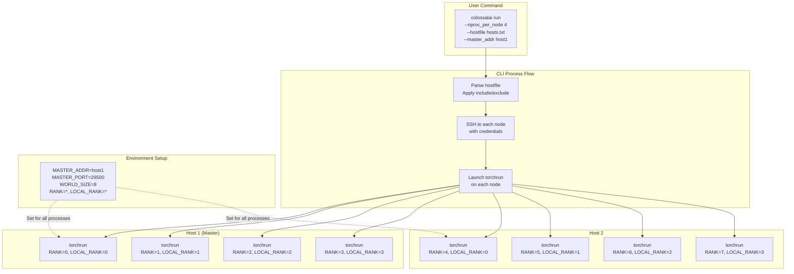

Sources: [docs/source/en/basics/launch_colossalai.md:99-183](), [colossalai/initialize.py:154-184]()

## Method 3: PyTorch Launch with `launch_from_torch()`

The `launch_from_torch()` function integrates with PyTorch's native distributed launchers (`torch.distributed.launch` and `torchrun`). It automatically reads distributed parameters from environment variables set by these tools.

**Function Signature:**
```python
def launch_from_torch(
    backend: str = "nccl",
    seed: int = 1024,
    verbose: bool = True
)
```

**Environment Variables Read:**
- `RANK`: Global rank of the process
- `LOCAL_RANK`: Local rank on the current node
- `WORLD_SIZE`: Total number of processes
- `MASTER_ADDR`: Master node address
- `MASTER_PORT`: Master node port

**Training Script:**
```python
# train.py
import colossalai

# Launch from PyTorch environment
colossalai.launch_from_torch(
    backend="nccl",
    seed=1024,
    verbose=True
)

# Training code
```

**Launch with torchrun:**
```bash
# Single node with 4 GPUs
torchrun --nproc_per_node=4 train.py

# Multi-node with 2 nodes, 4 GPUs each (run on each node)
# On node 0:
torchrun --nproc_per_node=4 \
         --nnodes=2 \
         --node_rank=0 \
         --master_addr=node0 \
         --master_port=29500 \
         train.py

# On node 1:
torchrun --nproc_per_node=4 \
         --nnodes=2 \
         --node_rank=1 \
         --master_addr=node0 \
         --master_port=29500 \
         train.py
```

**Environment Variable Mapping:**

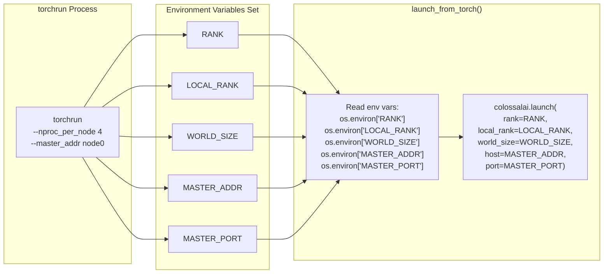

Sources: [colossalai/initialize.py:154-184](), [docs/source/en/basics/launch_colossalai.md:99-125]()

## Method 4: SLURM Launch with `launch_from_slurm()`

The `launch_from_slurm()` function integrates with the SLURM workload manager commonly used in HPC clusters. It reads rank and world size from SLURM environment variables.

**Function Signature:**
```python
def launch_from_slurm(
    host: str,
    port: int,
    backend: str = "nccl",
    seed: int = 1024,
    verbose: bool = True
)
```

**Environment Variables Read:**
- `SLURM_PROCID`: Process rank (assigned by SLURM)
- `SLURM_NPROCS`: Total number of processes

**Training Script:**
```python
# train.py
import colossalai
import argparse

parser = argparse.ArgumentParser()
parser.add_argument('--host', type=str, required=True)
parser.add_argument('--port', type=int, default=29500)
args = parser.parse_args()

# Launch from SLURM environment
colossalai.launch_from_slurm(
    host=args.host,
    port=args.port,
    backend="nccl",
    seed=1024
)

# Training code
```

**SLURM Batch Script:**
```bash
#!/bin/bash
#SBATCH --job-name=colossal_train
#SBATCH --nodes=2
#SBATCH --ntasks-per-node=4
#SBATCH --gres=gpu:4
#SBATCH --time=24:00:00

# Get master node address
MASTER_ADDR=$(scontrol show hostname $SLURM_NODELIST | head -n 1)

# Launch with srun
srun python train.py --host $MASTER_ADDR --port 29500
```

**SLURM Process Assignment:**

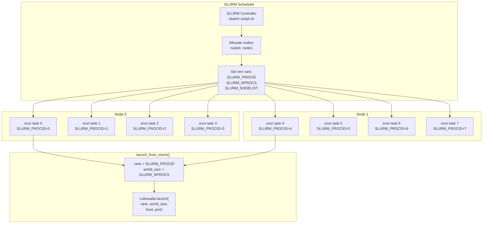

Sources: [colossalai/initialize.py:78-112](), [docs/source/en/basics/launch_colossalai.md:186-206]()

## Method 5: OpenMPI Launch with `launch_from_openmpi()`

The `launch_from_openmpi()` function integrates with OpenMPI for distributed execution. It reads rank information from MPI environment variables.

**Function Signature:**
```python
def launch_from_openmpi(
    host: str,
    port: int,
    backend: str = "nccl",
    seed: int = 1024,
    verbose: bool = True
)
```

**Environment Variables Read:**
- `OMPI_COMM_WORLD_RANK`: Global rank
- `OMPI_COMM_WORLD_LOCAL_RANK`: Local rank on node
- `OMPI_COMM_WORLD_SIZE`: Total number of processes

**Training Script:**
```python
# train.py
import colossalai
import argparse

parser = argparse.ArgumentParser()
parser.add_argument('--host', type=str, required=True)
parser.add_argument('--port', type=int, default=29500)
args = parser.parse_args()

# Launch from OpenMPI environment
colossalai.launch_from_openmpi(
    host=args.host,
    port=args.port,
    backend="nccl",
    seed=1024
)

# Training code
```

**OpenMPI Launch Command:**
```bash
# Launch with mpirun
mpirun --hostfile hostfile.txt \
       -np 8 \
       -bind-to none \
       -map-by slot \
       python train.py --host node0 --port 29500
```

**Hostfile Format:**
```text
node0 slots=4
node1 slots=4
```

**OpenMPI Process Distribution:**

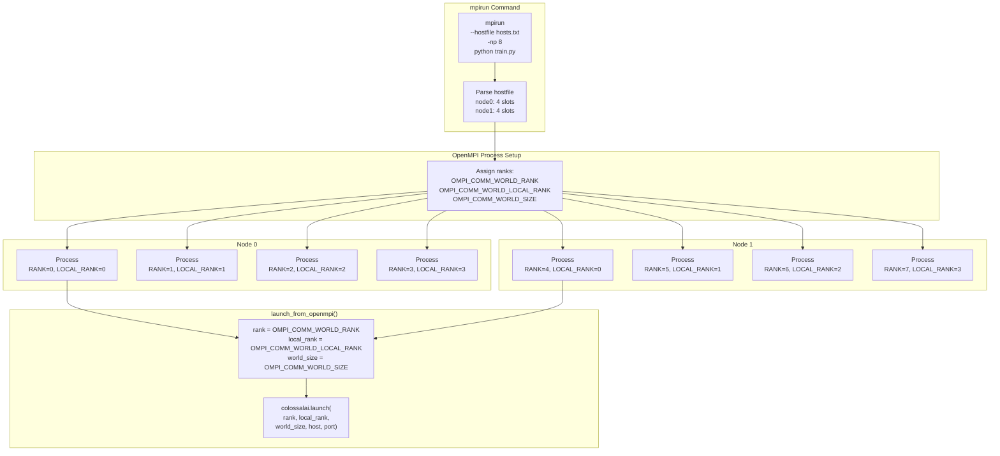

Sources: [colossalai/initialize.py:115-151](), [docs/source/en/basics/launch_colossalai.md:208-229]()

## Environment Configuration Details

### CUDA Device Connection Limit

ColossalAI sets `CUDA_DEVICE_MAX_CONNECTIONS=1` at initialization to ensure deterministic kernel launch ordering when overlapping communication and computation. This prevents race conditions where compute kernels might be scheduled before communication kernels.

```python
# Set in colossalai/initialize.py:10
os.environ["CUDA_DEVICE_MAX_CONNECTIONS"] = "1"
```

This setting ensures:
1. Communication operations are launched first on the GPU
2. Compute operations follow in predictable order
3. Overlapping of communication and computation remains correct

Sources: [colossalai/initialize.py:6-10]()

### Backend Selection

ColossalAI supports multiple communication backends:

| Backend | Hardware | Use Case | Features |
|---------|----------|----------|----------|
| `nccl` | NVIDIA GPU | Standard GPU training | Optimized GPU collectives, multi-GPU/multi-node |
| `gloo` | CPU, GPU | CPU training, debugging | Cross-platform, slower than NCCL |
| `mpi` | CPU, GPU | HPC clusters | Integration with existing MPI infrastructure |

The backend is automatically selected based on the accelerator:
```python
# From colossalai/initialize.py:50-52
cur_accelerator = get_accelerator()
backend = cur_accelerator.communication_backend
```

Sources: [colossalai/initialize.py:50-52]()

### Random Seed Setting

All launch methods set a consistent random seed across all processes to ensure reproducible training:

```python
# From colossalai/initialize.py:66
set_seed(seed)
```

This sets seeds for:
- Python `random` module
- NumPy random number generator
- PyTorch CPU and CUDA random number generators

Sources: [colossalai/initialize.py:66]()

### Device Assignment

Local rank is used to assign each process to a specific GPU:

```python
# From colossalai/initialize.py:63-64
if cur_accelerator.support_set_device:
    cur_accelerator.set_device(local_rank)
```

For a node with 4 GPUs:
- LOCAL_RANK=0 → GPU 0
- LOCAL_RANK=1 → GPU 1
- LOCAL_RANK=2 → GPU 2
- LOCAL_RANK=3 → GPU 3

Sources: [colossalai/initialize.py:63-64]()

## Verification and Debugging

After launching, verify the distributed environment is correctly initialized:

```python
import torch.distributed as dist
from colossalai.logging import get_dist_logger

logger = get_dist_logger()

# Check initialization status
assert dist.is_initialized(), "Distributed backend not initialized"

# Log distributed info
logger.info(f"Rank: {dist.get_rank()}")
logger.info(f"World Size: {dist.get_world_size()}")
logger.info(f"Local Rank: {torch.cuda.current_device()}")
logger.info(f"Backend: {dist.get_backend()}")
```

**Common Issues and Solutions:**

| Issue | Cause | Solution |
|-------|-------|----------|
| `RuntimeError: Address already in use` | Port 29500 occupied | Change `--master_port` to different value |
| `RuntimeError: Could not find RANK` | Wrong launch method | Use `launch_from_torch()` with torchrun |
| `RuntimeError: NCCL error` | Network/GPU communication failure | Check GPU health, network connectivity |
| `RuntimeError: Could not find SLURM_PROCID` | Not using SLURM | Use appropriate launch method for your setup |
| `Connection timeout` | Firewall blocking | Open required ports, check `master_addr` |

Sources: [colossalai/initialize.py:74-75]()

## Complete Example

**Training Script (train.py):**
```python
import torch
import torch.nn as nn
from torch.utils.data import DataLoader, Dataset
import colossalai
from colossalai.booster import Booster
from colossalai.booster.plugin import TorchDDPPlugin

# Launch distributed environment
colossalai.launch_from_torch(
    backend="nccl",
    seed=1024,
    verbose=True
)

# Define model
model = nn.Linear(1024, 1024)

# Define optimizer
optimizer = torch.optim.Adam(model.parameters(), lr=0.001)

# Initialize booster for distributed training
booster = Booster(plugin=TorchDDPPlugin())
model, optimizer, _, _, _ = booster.boost(model, optimizer)

# Training loop
for epoch in range(10):
    for data, labels in dataloader:
        optimizer.zero_grad()
        outputs = model(data)
        loss = criterion(outputs, labels)
        booster.backward(loss, optimizer)
        optimizer.step()
```

**Launch Options:**

```bash
# Option 1: CLI (recommended)
colossalai run --nproc_per_node 4 train.py

# Option 2: torchrun
torchrun --nproc_per_node 4 train.py

# Option 3: Multi-node with CLI
colossalai run --nproc_per_node 4 \
               --hosts node1,node2 \
               --master_addr node1 \
               train.py

# Option 4: SLURM
srun python train.py --host $MASTER_ADDR --port 29500
# (with launch_from_slurm in train.py)

# Option 5: OpenMPI
mpirun --hostfile hosts.txt -np 8 python train.py --host node1 --port 29500
# (with launch_from_openmpi in train.py)
```

Sources: [examples/tutorial/README.md:1-60](), [docs/source/en/basics/launch_colossalai.md:1-232]()

---

# Page: Parallelism Techniques

# Parallelism Techniques

<details>
<summary>Relevant source files</summary>

The following files were used as context for generating this wiki page:

- [README.md](README.md)
- [applications/ColossalChat/.gitignore](applications/ColossalChat/.gitignore)
- [applications/README.md](applications/README.md)
- [colossalai/booster/booster.py](colossalai/booster/booster.py)
- [colossalai/booster/plugin/gemini_plugin.py](colossalai/booster/plugin/gemini_plugin.py)
- [colossalai/booster/plugin/hybrid_parallel_plugin.py](colossalai/booster/plugin/hybrid_parallel_plugin.py)
- [colossalai/booster/plugin/low_level_zero_plugin.py](colossalai/booster/plugin/low_level_zero_plugin.py)
- [colossalai/booster/plugin/torch_ddp_plugin.py](colossalai/booster/plugin/torch_ddp_plugin.py)
- [colossalai/booster/plugin/torch_fsdp_plugin.py](colossalai/booster/plugin/torch_fsdp_plugin.py)
- [colossalai/checkpoint_io/__init__.py](colossalai/checkpoint_io/__init__.py)
- [colossalai/checkpoint_io/checkpoint_io_base.py](colossalai/checkpoint_io/checkpoint_io_base.py)
- [colossalai/checkpoint_io/general_checkpoint_io.py](colossalai/checkpoint_io/general_checkpoint_io.py)
- [colossalai/checkpoint_io/hybrid_parallel_checkpoint_io.py](colossalai/checkpoint_io/hybrid_parallel_checkpoint_io.py)
- [colossalai/checkpoint_io/index_file.py](colossalai/checkpoint_io/index_file.py)
- [colossalai/checkpoint_io/moe_checkpoint.py](colossalai/checkpoint_io/moe_checkpoint.py)
- [colossalai/checkpoint_io/utils.py](colossalai/checkpoint_io/utils.py)
- [colossalai/nn/optimizer/README.md](colossalai/nn/optimizer/README.md)
- [colossalai/utils/safetensors.py](colossalai/utils/safetensors.py)
- [colossalai/zero/gemini/gemini_optimizer.py](colossalai/zero/gemini/gemini_optimizer.py)
- [colossalai/zero/low_level/bookkeeping/tensor_bucket.py](colossalai/zero/low_level/bookkeeping/tensor_bucket.py)
- [colossalai/zero/low_level/low_level_optim.py](colossalai/zero/low_level/low_level_optim.py)
- [docs/README-zh-Hans.md](docs/README-zh-Hans.md)
- [docs/source/en/basics/launch_colossalai.md](docs/source/en/basics/launch_colossalai.md)
- [docs/source/en/get_started/installation.md](docs/source/en/get_started/installation.md)
- [docs/source/zh-Hans/basics/launch_colossalai.md](docs/source/zh-Hans/basics/launch_colossalai.md)
- [docs/source/zh-Hans/get_started/installation.md](docs/source/zh-Hans/get_started/installation.md)
- [examples/README.md](examples/README.md)
- [examples/tutorial/.gitignore](examples/tutorial/.gitignore)
- [examples/tutorial/README.md](examples/tutorial/README.md)
- [examples/tutorial/download_cifar10.py](examples/tutorial/download_cifar10.py)
- [examples/tutorial/sequence_parallel/data/dummy_dataloader.py](examples/tutorial/sequence_parallel/data/dummy_dataloader.py)
- [tests/test_checkpoint_io/test_gemini_checkpoint_io.py](tests/test_checkpoint_io/test_gemini_checkpoint_io.py)
- [tests/test_checkpoint_io/test_general_checkpoint_io.py](tests/test_checkpoint_io/test_general_checkpoint_io.py)
- [tests/test_checkpoint_io/test_hybrid_parallel_plugin_checkpoint_io.py](tests/test_checkpoint_io/test_hybrid_parallel_plugin_checkpoint_io.py)
- [tests/test_checkpoint_io/test_low_level_zero_checkpoint_io.py](tests/test_checkpoint_io/test_low_level_zero_checkpoint_io.py)
- [tests/test_checkpoint_io/test_safetensors_async_io.py](tests/test_checkpoint_io/test_safetensors_async_io.py)
- [tests/test_checkpoint_io/test_torch_ddp_checkpoint_io.py](tests/test_checkpoint_io/test_torch_ddp_checkpoint_io.py)

</details>


This page provides an overview of distributed parallel training techniques implemented in ColossalAI. It explains how to scale model training across multiple devices and nodes to enable training of large AI models that wouldn't fit on a single device. For information about inference techniques, see [Inference Engine](#6).

## Introduction

ColossalAI implements a comprehensive suite of parallelism techniques that enable efficient distributed training of large-scale models. These techniques can be used individually or combined to achieve optimal performance and resource utilization. The main purpose of these techniques is to:

1. Enable training of models that are too large to fit on a single GPU
2. Accelerate training speed through efficient parallel computation
3. Optimize memory usage across distributed hardware
4. Enable scaling to hundreds or thousands of GPUs efficiently

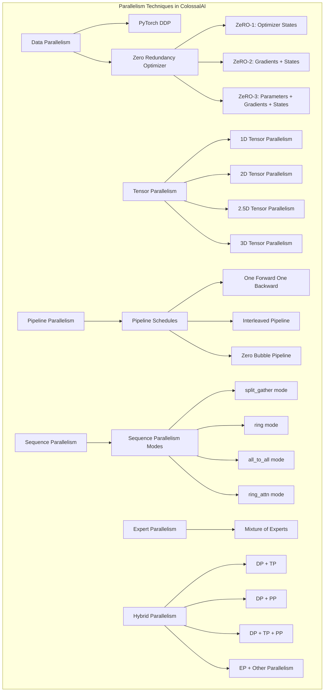

Sources:
- [README.md:124-148](https://github.com/hpcaitech/ColossalAI/blob/main/README.md)
- [colossalai/booster/plugin/hybrid_parallel_plugin.py:46-51](https://github.com/hpcaitech/ColossalAI/blob/main/colossalai/booster/plugin/hybrid_parallel_plugin.py)

## Data Parallelism

Data parallelism is the most straightforward parallelism technique, where the model is replicated across devices, but each device processes a different batch of data. ColossalAI supports two main types of data parallelism:

### PyTorch DDP (Distributed Data Parallel)

Standard PyTorch DDP is supported in ColossalAI, which replicates the model on each device and performs all-reduce operations to synchronize gradients during backpropagation.

Key characteristics:
- Requires full model replication on each device
- Simple to implement with minimal code changes
- Model parameters stay in sync across all devices
- Communication overhead increases with model size due to all-reduce operations

### Zero Redundancy Optimizer (ZeRO)

ZeRO optimizes memory usage by partitioning model states across devices:

1. **ZeRO-1**: Partitions optimizer states (momentum buffers, variance) across data parallel workers.
2. **ZeRO-2**: Partitions gradients and optimizer states.
3. **ZeRO-3**: Partitions model parameters, gradients, and optimizer states.

```mermaid
graph LR
    subgraph "ZeRO Stages Comparison"
        Normal["Traditional Data Parallel"]
        ZeRO1["ZeRO-1"]
        ZeRO2["ZeRO-2"]
        ZeRO3["ZeRO-3"]
        
        Normal --> |"Memory per device"| NormalMem["Parameters (1x)\nGradients (1x)\nOptimizer States (2x)"]
        ZeRO1 --> |"Memory per device"| ZeRO1Mem["Parameters (1x)\nGradients (1x)\nOptimizer States (2x/N)"]
        ZeRO2 --> |"Memory per device"| ZeRO2Mem["Parameters (1x)\nGradients (1x/N)\nOptimizer States (2x/N)"]
        ZeRO3 --> |"Memory per device"| ZeRO3Mem["Parameters (1x/N)\nGradients (1x/N)\nOptimizer States (2x/N)"]
        
        style Normal fill:#f9f9f9,stroke:#333,stroke-width:1px
        style ZeRO1 fill:#f9f9f9,stroke:#333,stroke-width:1px
        style ZeRO2 fill:#f9f9f9,stroke:#333,stroke-width:1px
        style ZeRO3 fill:#f9f9f9,stroke:#333,stroke-width:1px
    end
```

ColossalAI implements ZeRO in the `HybridParallelZeroOptimizer` class, which wraps the optimizer and handles the partitioning and communication of model states.

Sources:
- [README.md:136](https://github.com/hpcaitech/ColossalAI/blob/main/README.md)
- [colossalai/booster/plugin/hybrid_parallel_plugin.py:664-704](https://github.com/hpcaitech/ColossalAI/blob/main/colossalai/booster/plugin/hybrid_parallel_plugin.py)
- [colossalai/zero/low_level/zero_hook.py](https://github.com/hpcaitech/ColossalAI/blob/main/colossalai/zero/low_level/zero_hook.py)

## Tensor Parallelism

Tensor parallelism involves splitting individual tensors across devices. ColossalAI implements several forms of tensor parallelism:

### 1D Tensor Parallelism

This technique splits individual layers of the model across devices. For instance, linear layers are partitioned along input or output dimensions:

- `Linear1D_Col`: Partitions the weights matrix column-wise (along the output dimension)
- `Linear1D_Row`: Partitions the weights matrix row-wise (along the input dimension)

```mermaid
graph TD
    subgraph "1D Tensor Parallelism"
        Input["Input Tensor x"]
        Weight["Weight Matrix W"]
        Output["Output Tensor y = xW"]
        
        subgraph "Column Parallel Linear (Linear1D_Col)"
            W1["W₁"]
            W2["W₂"]
            AllGather["AllGather"]
        end
        
        subgraph "Row Parallel Linear (Linear1D_Row)"
            W1R["W₁"]
            W2R["W₂"]
            ReduceScatter["ReduceScatter"]
        end
        
        Input --> W1
        Input --> W2
        W1 --> Out1["Local Output₁"]
        W2 --> Out2["Local Output₂"]
        Out1 --> AllGather
        Out2 --> AllGather
        AllGather --> Output
        
        Input --> W1R
        Input --> W2R
        W1R --> Out1R["Partial Output₁"]
        W2R --> Out2R["Partial Output₂"]
        Out1R --> ReduceScatter
        Out2R --> ReduceScatter
        ReduceScatter --> Output
    end
```

### Advanced Tensor Parallelism (2D, 2.5D, 3D)

ColossalAI also supports more advanced tensor parallelism schemes that extend beyond 1D partitioning:

- **2D Tensor Parallelism**: Partitions tensors along two dimensions, requiring different communication patterns
- **2.5D Tensor Parallelism**: An extension of 2D parallelism that uses multiple 2D partitioning planes
- **3D Tensor Parallelism**: Partitions tensors along three dimensions for maximum sharding across devices

These more advanced forms reduce the communication overhead compared to 1D tensor parallelism.

Sources:
- [README.md:132-134](https://github.com/hpcaitech/ColossalAI/blob/main/README.md)
- [colossalai/shardformer/policies/mixtral.py:133-176](https://github.com/hpcaitech/ColossalAI/blob/main/colossalai/shardformer/policies/mixtral.py)
- [colossalai/shardformer/layer/linear.py](https://github.com/hpcaitech/ColossalAI/blob/main/colossalai/shardformer/layer/linear.py)

## Pipeline Parallelism

Pipeline parallelism partitions the model along its layers, with different devices handling different parts of the model. This technique is implemented in the `PipelineStageManager` class, which manages the partitioning and communication between stages.

ColossalAI supports several pipeline scheduling strategies:

### One Forward One Backward (1F1B)

The standard pipeline parallelism schedule where one microbatch is processed at a time, moving forward through all stages, and then backward through all stages.

### Interleaved Pipeline

An optimized schedule that interleaves the forward and backward passes of different microbatches to reduce bubble time.

### Zero Bubble Pipeline

A schedule that aims to eliminate pipeline bubbles entirely by carefully orchestrating the execution of microbatches.

```mermaid
graph TD
    subgraph "Pipeline Parallelism Schedules"
        subgraph "One Forward One Backward (1F1B)"
            S1F1["Stage 1 Forward"]
            S2F1["Stage 2 Forward"]
            S3F1["Stage 3 Forward"]
            S3B1["Stage 3 Backward"]
            S2B1["Stage 2 Backward"]
            S1B1["Stage 1 Backward"]
            
            S1F1 --> S2F1
            S2F1 --> S3F1
            S3F1 --> S3B1
            S3B1 --> S2B1
            S2B1 --> S1B1
        end
        
        subgraph "Interleaved Pipeline"
            S1F2["S1 F (Batch 1)"] --> S2F2["S2 F (Batch 1)"]
            S2F2 --> S3F2["S3 F (Batch 1)"]
            S1F3["S1 F (Batch 2)"] --> S2F3["S2 F (Batch 2)"]
            S3F2 --> S3B2["S3 B (Batch 1)"]
            S3B2 --> S2B2["S2 B (Batch 1)"]
            S2F3 --> S3F3["S3 F (Batch 2)"]
            S2B2 --> S1B2["S1 B (Batch 1)"]
        end
    end
```

Pipeline parallelism in ColossalAI is implemented with model-specific forward pass handlers, such as those in the `MixtralPipelineForwards` and `DeepseekPipelineForwards` classes, which handle input and output transformations between pipeline stages.

Sources:
- [README.md:135](https://github.com/hpcaitech/ColossalAI/blob/main/README.md)
- [colossalai/pipeline/stage_manager.py](https://github.com/hpcaitech/ColossalAI/blob/main/colossalai/pipeline/stage_manager.py)
- [colossalai/pipeline/schedule/one_f_one_b.py](https://github.com/hpcaitech/ColossalAI/blob/main/colossalai/pipeline/schedule/one_f_one_b.py)
- [colossalai/pipeline/schedule/interleaved_pp.py](https://github.com/hpcaitech/ColossalAI/blob/main/colossalai/pipeline/schedule/interleaved_pp.py)
- [colossalai/pipeline/schedule/zero_bubble_pp.py](https://github.com/hpcaitech/ColossalAI/blob/main/colossalai/pipeline/schedule/zero_bubble_pp.py)

## Sequence Parallelism

Sequence parallelism is designed for handling long sequences efficiently by partitioning the sequence dimension. ColossalAI supports several sequence parallelism modes:

- **split_gather**: Splits the sequence dimension and gathers results, effective for attention operations
- **ring**: Uses a ring-based communication pattern for sequence parallelism
- **all_to_all**: Uses all-to-all communication for sequence parallelism
- **ring_attn**: Uses ring-based communication specifically for attention mechanisms

Sequence parallelism is particularly useful for transformer models with long context lengths.

```mermaid
graph LR
    subgraph "Sequence Parallelism Modes"
        Input["Input Sequence\n[batch_size, seq_len, hidden_dim]"]
        
        subgraph "split_gather mode"
            Split1["Split sequence\ninto chunks"]
            Process1["Process local\nchunks"]
            Gather1["Gather results"]
        end
        
        subgraph "ring mode"
            Split2["Split sequence\ninto chunks"]
            Ring["Ring communication\npattern"]
            Gather2["Gather results"]
        end
        
        subgraph "all_to_all mode"
            Split3["Split sequence\ninto chunks"]
            AllToAll["All-to-all\ncommunication"]
            Gather3["Gather results"]
        end
        
        Input --> Split1
        Split1 --> Process1
        Process1 --> Gather1
        
        Input --> Split2
        Split2 --> Ring
        Ring --> Gather2
        
        Input --> Split3
        Split3 --> AllToAll
        AllToAll --> Gather3
    end
```

The sequence parallelism implementation can be found in the `SeqParallelUtils` class and is integrated with the tensor parallelism implementation.

Sources:
- [README.md:135](https://github.com/hpcaitech/ColossalAI/blob/main/README.md)
- [colossalai/booster/plugin/hybrid_parallel_plugin.py:48](https://github.com/hpcaitech/ColossalAI/blob/main/colossalai/booster/plugin/hybrid_parallel_plugin.py)
- [colossalai/shardformer/layer/utils.py](https://github.com/hpcaitech/ColossalAI/blob/main/colossalai/shardformer/layer/utils.py)

## Expert Parallelism for MoE Models

Expert parallelism is designed for Mixture of Experts (MoE) models, where different "expert" neural networks specialize in processing different inputs. ColossalAI implements expert parallelism in the `EPMixtralSparseMoeBlock` and `EPDeepseekMoE` classes.

```mermaid
graph TD
    subgraph "Expert Parallelism for MoE Models"
        Input["Input Tokens"]
        Gate["Routing Gate"]
        
        subgraph "Expert Group 1 (Device 1)"
            E1["Expert 1"]
            E2["Expert 2"]
        end
        
        subgraph "Expert Group 2 (Device 2)"
            E3["Expert 3"]
            E4["Expert 4"]
        end
        
        Input --> Gate
        Gate --> |"Route tokens"| TokenDist["Token Distribution"]
        TokenDist --> |"All-to-all\ncommunication"| E1
        TokenDist --> |"All-to-all\ncommunication"| E2
        TokenDist --> |"All-to-all\ncommunication"| E3
        TokenDist --> |"All-to-all\ncommunication"| E4
        
        E1 --> |"All-to-all\ncommunication"| Combine["Combine Expert Outputs"]
        E2 --> |"All-to-all\ncommunication"| Combine
        E3 --> |"All-to-all\ncommunication"| Combine
        E4 --> |"All-to-all\ncommunication"| Combine
        
        Combine --> Output["Output"]
    end
```

The expert parallelism implementation includes:

1. Partitioning experts across devices
2. Special routing mechanisms to dispatch tokens to their assigned experts
3. Communication for gathering expert outputs
4. Integration with other parallelism techniques

Expert parallelism can be combined with other techniques like data parallelism and tensor parallelism through the `MoeHybridParallelPlugin` class.

Sources:
- [colossalai/booster/plugin/moe_hybrid_parallel_plugin.py](https://github.com/hpcaitech/ColossalAI/blob/main/colossalai/booster/plugin/moe_hybrid_parallel_plugin.py)
- [colossalai/shardformer/modeling/mixtral.py:53-207](https://github.com/hpcaitech/ColossalAI/blob/main/colossalai/shardformer/modeling/mixtral.py)
- [colossalai/shardformer/modeling/deepseek.py:62-217](https://github.com/hpcaitech/ColossalAI/blob/main/colossalai/shardformer/modeling/deepseek.py)
- [colossalai/moe/_operation.py](https://github.com/hpcaitech/ColossalAI/blob/main/colossalai/moe/_operation.py)

## Hybrid Parallelism

Hybrid parallelism combines multiple parallelism techniques to achieve optimal performance and resource utilization. ColossalAI implements hybrid parallelism through the `ProcessGroupMesh` class, which creates process groups for different parallelism dimensions.

```mermaid
graph TD
    subgraph "Process Group Mesh for Hybrid Parallelism"
        DP_Axis["Data Parallel Axis (dp_axis)"]
        TP_Axis["Tensor Parallel Axis (tp_axis)"]
        PP_Axis["Pipeline Parallel Axis (pp_axis)"]
        SP_Axis["Sequence Parallel Axis (sp_axis)"]
        EP_Axis["Expert Parallel Axis (ep_axis)"]
        
        DP_Group["DP Process Group"]
        TP_Group["TP Process Group"]
        PP_Group["PP Process Group"]
        SP_Group["SP Process Group"]
        EP_Group["EP Process Group"]
        MoE_DP_Group["MoE DP Process Group"]
        
        ProcessGroupMesh["ProcessGroupMesh"]
        
        ProcessGroupMesh --> DP_Axis
        ProcessGroupMesh --> TP_Axis
        ProcessGroupMesh --> PP_Axis
        ProcessGroupMesh --> SP_Axis
        ProcessGroupMesh --> EP_Axis
        
        DP_Axis --> DP_Group
        TP_Axis --> TP_Group
        PP_Axis --> PP_Group
        SP_Axis --> SP_Group
        EP_Axis --> EP_Group
        DP_Axis --> MoE_DP_Group
        EP_Axis --> MoE_DP_Group
    end
```

The hybrid parallelism implementation includes:

1. **HybridParallelPlugin**: Combines data, tensor, pipeline, and sequence parallelism
2. **MoeHybridParallelPlugin**: Extends the HybridParallelPlugin with expert parallelism for MoE models
3. **ShardConfig**: Configures which parallelism techniques to enable and how they interact
4. **Optimizer Wrappers**: Different optimizers for different parallelism combinations

Examples of hybrid parallelism:
- DP + TP: Combine data parallelism with tensor parallelism
- DP + PP: Combine data parallelism with pipeline parallelism
- DP + TP + PP: Combine all three
- EP + DP + TP: Combine expert, data, and tensor parallelism for MoE models

Sources:
- [colossalai/booster/plugin/hybrid_parallel_plugin.py](https://github.com/hpcaitech/ColossalAI/blob/main/colossalai/booster/plugin/hybrid_parallel_plugin.py)
- [colossalai/booster/plugin/moe_hybrid_parallel_plugin.py:176-224](https://github.com/hpcaitech/ColossalAI/blob/main/colossalai/booster/plugin/moe_hybrid_parallel_plugin.py)
- [colossalai/cluster/process_group_mesh.py](https://github.com/hpcaitech/ColossalAI/blob/main/colossalai/cluster/process_group_mesh.py)

## Using Parallelism Techniques

To use parallelism techniques in ColossalAI, you need to:

1. **Initialize ColossalAI**: Set up the distributed environment
2. **Create a Plugin**: Configure the desired parallelism techniques
3. **Use the Booster API**: Apply the plugin to your model and optimizer
4. **Execute Training**: Run training with the parallelized model

### Basic Usage Example

```python
import colossalai
from colossalai.booster import Booster
from colossalai.booster.plugin import HybridParallelPlugin

# Initialize ColossalAI
colossalai.launch(host='localhost', port=29500, world_size=8, rank=rank)

# Create the plugin with desired parallelism configuration
plugin = HybridParallelPlugin(
    tp_size=2,                 # Tensor Parallelism: 2 GPUs
    pp_size=2,                 # Pipeline Parallelism: 2 stages
    num_microbatches=4,        # Pipeline microbatches
    zero_stage=1,              # ZeRO stage 1
    precision="bf16"           # Mixed precision training
)

# Create the booster with the plugin
booster = Booster(plugin=plugin)

# Boost the model and optimizer
model, optimizer, _, dataloader, _ = booster.boost(
    model=model,
    optimizer=optimizer,
    dataloader=dataloader
)

# Execute training
for batch in dataloader:
    # For models without pipeline parallelism
    outputs = model(**batch)
    loss = outputs.loss
    optimizer.backward(loss)
    optimizer.step()
    optimizer.zero_grad()
    
    # For models with pipeline parallelism
    outputs = booster.execute_pipeline(
        data_iter=iter([batch]),
        model=model,
        loss_fn=lambda x, y: x.loss,
        optimizer=optimizer
    )
```

### MoE Models Example

For Mixture of Experts models, use the `MoeHybridParallelPlugin`:

```python
from colossalai.booster.plugin import MoeHybridParallelPlugin

# Create the MoE plugin
plugin = MoeHybridParallelPlugin(
    tp_size=2,                 # Tensor Parallelism: 2 GPUs
    pp_size=2,                 # Pipeline Parallelism: 2 stages
    ep_size=2,                 # Expert Parallelism: 2 groups
    zero_stage=1,              # ZeRO stage 1
    precision="bf16"           # Mixed precision training
)
```

### Checkpointing with Parallelism

ColossalAI provides specialized checkpoint I/O classes for different parallelism techniques:

```python
# Save a model with various parallelism techniques
booster.save_model(model, 'checkpoint', shard=True)

# For MoE models
checkpoint_io = MoECheckpointIO(...)
checkpoint_io.save_checkpoint(...)
```

Sources:
- [tests/test_shardformer/test_model/test_shard_mixtral.py:28-157](https://github.com/hpcaitech/ColossalAI/blob/main/tests/test_shardformer/test_model/test_shard_mixtral.py)
- [tests/test_shardformer/test_model/test_shard_deepseek.py:28-164](https://github.com/hpcaitech/ColossalAI/blob/main/tests/test_shardformer/test_model/test_shard_deepseek.py)
- [colossalai/booster/plugin/hybrid_parallel_plugin.py](https://github.com/hpcaitech/ColossalAI/blob/main/colossalai/booster/plugin/hybrid_parallel_plugin.py)
- [colossalai/booster/plugin/moe_hybrid_parallel_plugin.py](https://github.com/hpcaitech/ColossalAI/blob/main/colossalai/booster/plugin/moe_hybrid_parallel_plugin.py)

## Choosing the Right Parallelism Technique

The choice of parallelism technique depends on several factors:

| Parallelism Technique | When to Use | Advantages | Trade-offs |
|-----------------------|-------------|------------|------------|
| Data Parallelism (DDP) | Simple models, sufficient GPU memory | Easy to implement, good scaling efficiency | Limited by model size that must fit on one device |
| ZeRO | Large models with many parameters | Reduces memory footprint, keeps simplicity of data parallelism | Communication overhead increases with higher ZeRO stages |
| Tensor Parallelism | Models with large layers | Enables training very large layers | Complex communication patterns, requires optimized implementation |
| Pipeline Parallelism | Very deep models | Reduces memory footprint, efficient for sequential models | Pipeline bubbles reduce efficiency, complex scheduling |
| Sequence Parallelism | Models with long sequences | Handles very long sequences efficiently | Only applicable to transformer-like models |
| Expert Parallelism | MoE models | Efficient for sparse expert models | Complex load balancing, expert communication |
| Hybrid Parallelism | Complex, extremely large models | Best memory efficiency and scalability | Requires careful tuning and configuration |

When choosing a parallelism technique, consider:
1. Model size and architecture
2. Available hardware resources
3. Communication bandwidth between devices
4. Training batch size requirements
5. Convergence considerations

Sources:
- [README.md:124-148](https://github.com/hpcaitech/ColossalAI/blob/main/README.md)
- [colossalai/booster/plugin/hybrid_parallel_plugin.py](https://github.com/hpcaitech/ColossalAI/blob/main/colossalai/booster/plugin/hybrid_parallel_plugin.py)
- [colossalai/booster/plugin/moe_hybrid_parallel_plugin.py](https://github.com/hpcaitech/ColossalAI/blob/main/colossalai/booster/plugin/moe_hybrid_parallel_plugin.py)

## Conclusion

ColossalAI provides a comprehensive suite of parallelism techniques that can be combined to achieve optimal performance and resource utilization for large-scale model training. By understanding the strengths and trade-offs of each technique, you can choose the right combination for your specific model and hardware configuration.

For more information on specific implementations, refer to the policy files for different model architectures, such as [colossalai/shardformer/policies/mixtral.py](https://github.com/hpcaitech/ColossalAI/blob/main/colossalai/shardformer/policies/mixtral.py) and [colossalai/shardformer/policies/deepseek.py](https://github.com/hpcaitech/ColossalAI/blob/main/colossalai/shardformer/policies/deepseek.py).

---

# Page: Zero Redundancy Optimizer (ZeRO)

# Zero Redundancy Optimizer (ZeRO)

<details>
<summary>Relevant source files</summary>

The following files were used as context for generating this wiki page:

- [colossalai/booster/booster.py](colossalai/booster/booster.py)
- [colossalai/booster/plugin/gemini_plugin.py](colossalai/booster/plugin/gemini_plugin.py)
- [colossalai/booster/plugin/hybrid_parallel_plugin.py](colossalai/booster/plugin/hybrid_parallel_plugin.py)
- [colossalai/booster/plugin/low_level_zero_plugin.py](colossalai/booster/plugin/low_level_zero_plugin.py)
- [colossalai/booster/plugin/torch_ddp_plugin.py](colossalai/booster/plugin/torch_ddp_plugin.py)
- [colossalai/booster/plugin/torch_fsdp_plugin.py](colossalai/booster/plugin/torch_fsdp_plugin.py)
- [colossalai/checkpoint_io/__init__.py](colossalai/checkpoint_io/__init__.py)
- [colossalai/checkpoint_io/checkpoint_io_base.py](colossalai/checkpoint_io/checkpoint_io_base.py)
- [colossalai/checkpoint_io/general_checkpoint_io.py](colossalai/checkpoint_io/general_checkpoint_io.py)
- [colossalai/checkpoint_io/hybrid_parallel_checkpoint_io.py](colossalai/checkpoint_io/hybrid_parallel_checkpoint_io.py)
- [colossalai/checkpoint_io/index_file.py](colossalai/checkpoint_io/index_file.py)
- [colossalai/checkpoint_io/moe_checkpoint.py](colossalai/checkpoint_io/moe_checkpoint.py)
- [colossalai/checkpoint_io/utils.py](colossalai/checkpoint_io/utils.py)
- [colossalai/initialize.py](colossalai/initialize.py)
- [colossalai/utils/safetensors.py](colossalai/utils/safetensors.py)
- [colossalai/zero/__init__.py](colossalai/zero/__init__.py)
- [colossalai/zero/gemini/gemini_optimizer.py](colossalai/zero/gemini/gemini_optimizer.py)
- [colossalai/zero/low_level/bookkeeping/tensor_bucket.py](colossalai/zero/low_level/bookkeeping/tensor_bucket.py)
- [colossalai/zero/low_level/low_level_optim.py](colossalai/zero/low_level/low_level_optim.py)
- [tests/test_checkpoint_io/test_gemini_checkpoint_io.py](tests/test_checkpoint_io/test_gemini_checkpoint_io.py)
- [tests/test_checkpoint_io/test_general_checkpoint_io.py](tests/test_checkpoint_io/test_general_checkpoint_io.py)
- [tests/test_checkpoint_io/test_hybrid_parallel_plugin_checkpoint_io.py](tests/test_checkpoint_io/test_hybrid_parallel_plugin_checkpoint_io.py)
- [tests/test_checkpoint_io/test_low_level_zero_checkpoint_io.py](tests/test_checkpoint_io/test_low_level_zero_checkpoint_io.py)
- [tests/test_checkpoint_io/test_safetensors_async_io.py](tests/test_checkpoint_io/test_safetensors_async_io.py)
- [tests/test_checkpoint_io/test_torch_ddp_checkpoint_io.py](tests/test_checkpoint_io/test_torch_ddp_checkpoint_io.py)

</details>


ZeRO (Zero Redundancy Optimizer) is a memory optimization technique for distributed training of large AI models. It reduces memory consumption by partitioning optimizer states, gradients, and model parameters across data-parallel processes, eliminating memory redundancy while maintaining the computational efficiency of data parallelism.

For memory optimization with heterogeneous memory (CPU-GPU) management using Gemini, see [Gemini: Memory Management System](#3.2).

## Overview and Architecture

ZeRO reduces memory consumption by partitioning model training states across data-parallel ranks:

- **ZeRO-1** (`partition_grad=False`): Partitions optimizer states only
- **ZeRO-2** (`partition_grad=True`): Partitions optimizer states and gradients  
- **ZeRO-3**: Implemented via Gemini (see [3.2](#3.2)) - partitions parameters, gradients, and optimizer states

**ZeRO Implementation Components in ColossalAI**

```mermaid
graph TB
    subgraph "User Interface"
        LowLevelZeroPlugin["LowLevelZeroPlugin<br/>stage=1 or stage=2"]
        GeminiPlugin["GeminiPlugin"]
    end

    subgraph "Core Optimizer Wrappers"
        LowLevelZeroOptimizer["LowLevelZeroOptimizer<br/>colossalai.zero.low_level.low_level_optim"]
        GeminiOptimizer["GeminiOptimizer<br/>colossalai.zero.gemini.gemini_optimizer"]
    end

    subgraph "Bookkeeping Data Structures"
        GradientStore["GradientStore<br/>low_level.bookkeeping.gradient_store"]
        BucketStore["BucketStore<br/>low_level.bookkeeping.bucket_store"]
        TensorBucket["TensorBucket<br/>low_level.bookkeeping.tensor_bucket"]
    end

    subgraph "State Storage"
        MasterParams["Master Parameters (fp32)<br/>partitioned across ranks"]
        WorkingParams["Working Parameters (fp16/bf16)<br/>replicated (stage 1/2) or chunked (stage 3)"]
        PartGrads["Partitioned Gradients<br/>stage 2 only"]
        OptStates["Optimizer States<br/>partitioned"]
    end

    LowLevelZeroPlugin --> LowLevelZeroOptimizer
    GeminiPlugin --> GeminiOptimizer
    
    LowLevelZeroOptimizer --> GradientStore
    LowLevelZeroOptimizer --> BucketStore
    LowLevelZeroOptimizer --> TensorBucket
    
    LowLevelZeroOptimizer --> MasterParams
    LowLevelZeroOptimizer --> WorkingParams
    LowLevelZeroOptimizer --> PartGrads
    LowLevelZeroOptimizer --> OptStates
```

Sources:
- [colossalai/booster/plugin/low_level_zero_plugin.py:368-470]()
- [colossalai/zero/low_level/low_level_optim.py:74-103]()
- [colossalai/zero/low_level/bookkeeping/__init__.py]()
- [colossalai/zero/__init__.py:1-13]()

## Memory Layout and Partitioning Strategy

**Memory Comparison: Data Parallel vs ZeRO-1 vs ZeRO-2**

| Component | Data Parallel | ZeRO-1 | ZeRO-2 |
|-----------|--------------|---------|---------|
| Model Parameters (fp16) | N | N | N |
| Gradients (fp16) | N | N | N/W |
| Master Parameters (fp32) | 2N | 2N/W | 2N/W |
| Momentum (fp32) | 2N | 2N/W | 2N/W |
| Variance (fp32) | 2N | 2N/W | 2N/W |
| **Total Memory** | **8N** | **4N + 4N/W** | **N + 8N/W** |

Where N = number of model parameters, W = world size (number of GPUs)

**Working vs Master Parameter Storage**

```mermaid
graph TB
    subgraph "Parameter Representation"
        WorkingParam["Working Parameter (fp16/bf16)<br/>model.parameters()<br/>Used for forward/backward"]
        PaddedWorking["Padded Working Parameter<br/>_working_param_to_padded_working_param[param]<br/>Padded to be divisible by world_size"]
        MasterParam["Master Parameter Shard (fp32)<br/>optim.param_groups[i]['params'][j]<br/>1/W of padded parameter"]
    end
    
    subgraph "Mapping Dictionaries"
        WorkToMaster["working_to_master_param<br/>Maps working param id to master param"]
        MasterToWork["master_to_working_param<br/>Maps master param id to working param"]
    end
    
    WorkingParam -->|"Padding if needed"| PaddedWorking
    PaddedWorking -->|"Split across W ranks"| MasterParam
    WorkingParam -.->|"id() lookup"| WorkToMaster
    MasterParam -.->|"id() lookup"| MasterToWork
```

**Parameter Update Flow in LowLevelZeroOptimizer**

```mermaid
flowchart LR
    Backward["Backward Pass<br/>Gradients computed"]
    ReduceScatter["reduce_scatter or all_reduce<br/>_run_reduction()"]
    MasterGrad["Attach gradient to<br/>master_param.grad"]
    OptimStep["optimizer.step()<br/>Updates master params"]
    AllGather["all_gather_into_tensor<br/>Gather full param"]
    UpdateWorking["Copy to working param<br/>padded_working_param"]
    
    Backward --> ReduceScatter
    ReduceScatter --> MasterGrad
    MasterGrad --> OptimStep
    OptimStep --> AllGather
    AllGather --> UpdateWorking
```

Sources:
- [colossalai/zero/low_level/low_level_optim.py:263-298]()
- [colossalai/zero/low_level/low_level_optim.py:176-180]()
- [colossalai/zero/low_level/low_level_optim.py:527-636]()

## Implementation of ZeRO in ColossalAI

### Key Components

```mermaid
graph TD
    subgraph "Core Components"
        LowLevelZeroOptimizer["LowLevelZeroOptimizer"]
        GeminiDDP["GeminiDDP"]
        GeminiOptimizer["GeminiOptimizer"]
    end
    
    subgraph "Plugin System"
        LowLevelZeroPlugin["LowLevelZeroPlugin"]
        GeminiPlugin["GeminiPlugin"]
    end
    
    subgraph "Bookkeeping Systems"
        GradientStore["GradientStore<br>Manages Parameter Gradients"]
        BucketStore["BucketStore<br>Communication Buffers"]
        TensorBucket["TensorBucket<br>Parameter Collection"]
    end
    
    subgraph "Checkpoint IO"
        LowLevelZeroCheckpointIO["LowLevelZeroCheckpointIO"]
        GeminiCheckpointIO["GeminiCheckpointIO"]
    end
    
    LowLevelZeroPlugin --> LowLevelZeroOptimizer
    LowLevelZeroPlugin --> LowLevelZeroCheckpointIO
    
    GeminiPlugin --> GeminiDDP
    GeminiPlugin --> GeminiOptimizer
    GeminiPlugin --> GeminiCheckpointIO
    
    LowLevelZeroOptimizer --> GradientStore
    LowLevelZeroOptimizer --> BucketStore
    LowLevelZeroOptimizer --> TensorBucket
```

Sources:
- [colossalai/booster/plugin/low_level_zero_plugin.py:117-366]()
- [colossalai/zero/low_level/low_level_optim.py:74-245]()
- [colossalai/zero/low_level/bookkeeping/gradient_store.py:8-15]()
- [colossalai/zero/low_level/bookkeeping/bucket_store.py:13-23]()
- [colossalai/zero/low_level/bookkeeping/tensor_bucket.py:12-33]()

## LowLevelZeroOptimizer Implementation

`LowLevelZeroOptimizer` wraps a PyTorch optimizer and implements ZeRO-1 and ZeRO-2 via the `partition_grad` flag.

**Initialization Parameters**

| Parameter | Type | Purpose |
|-----------|------|---------|
| `optimizer` | `Optimizer` | Base PyTorch optimizer to wrap |
| `initial_scale` | `float` | Initial gradient scale for fp16 (default: 2^16) |
| `partition_grad` | `bool` | Enable ZeRO-2 gradient partitioning (default: False) |
| `cpu_offload` | `bool` | Offload optimizer states to CPU (default: False) |
| `overlap_communication` | `bool` | Overlap gradient comm with backward (default: False) |
| `reduce_bucket_size` | `int` | Size of gradient buckets in bytes (default: 1MB) |
| `communication_dtype` | `torch.dtype` | Data type for gradient communication |
| `dp_process_group` | `ProcessGroup` | Data parallel process group |

**Key Data Structures**

```mermaid
graph TB
    subgraph "Per-Parameter Bookkeeping"
        ParamInfo["param_info dict<br/>Stores original shapes"]
        PaddingMap["_padding_map dict<br/>Records padding per param"]
        WorkingGroups["_working_param_groups dict<br/>group_id -> [params]"]
        MasterGroups["_master_param_groups_of_current_rank dict<br/>group_id -> [master_params]"]
    end
    
    subgraph "Per-ProcessGroup Structures"
        PGToGradStore["pg_to_grad_store dict<br/>ProcessGroup -> GradientStore"]
        PGToBucketStore["pg_to_bucket_store dict<br/>ProcessGroup -> BucketStore"]
    end
    
    subgraph "Per-Parameter Lookups"
        PidToGradStore["pid_to_grad_store dict<br/>id(param) -> GradientStore"]
        PidToBucketStore["pid_to_bucket_store dict<br/>id(param) -> BucketStore"]
    end
    
    ParamInfo -.-> WorkingGroups
    WorkingGroups --> MasterGroups
    PGToGradStore --> PidToGradStore
    PGToBucketStore --> PidToBucketStore
```

**Gradient Accumulation Hook System**

The optimizer attaches post-accumulation hooks to parameters during `_attach_reduction_hook()`:

```python
# Simplified from colossalai/zero/low_level/low_level_optim.py:305-321
def _grad_handler(param, group_id):
    if self.require_grad_sync:
        self._add_to_bucket(param, group_id)

for param in param_group:
    param.register_post_accumulate_grad_hook(
        partial(_grad_handler, group_id=group_id)
    )
```

When a gradient is ready, `_add_to_bucket()` is called, which triggers `_run_reduction()` when the bucket is full.

Sources:
- [colossalai/zero/low_level/low_level_optim.py:77-240]()
- [colossalai/zero/low_level/low_level_optim.py:143-209]()
- [colossalai/zero/low_level/low_level_optim.py:305-321]()

### Usage with Booster API

Using ZeRO in ColossalAI is made simple with the Booster API:

```python
from colossalai.booster import Booster
from colossalai.booster.plugin import LowLevelZeroPlugin

# For ZeRO-1
plugin = LowLevelZeroPlugin(stage=1)

# For ZeRO-2
plugin = LowLevelZeroPlugin(
    stage=2,                     # Use ZeRO stage 2
    precision="fp16",           # Mixed precision training
    initial_scale=2**16,        # Initial loss scale for mixed precision
    reduce_bucket_size_in_m=12, # Communication bucket size in MB
)

booster = Booster(plugin=plugin)
model, optimizer, criterion, dataloader, lr_scheduler = booster.boost(
    model, optimizer, criterion, dataloader, lr_scheduler
)
```

Sources:
- [colossalai/booster/plugin/low_level_zero_plugin.py:367-471]()
- [colossalai/booster/booster.py:74-173]()

## ZeRO-1 vs ZeRO-2: partition_grad Flag

The `partition_grad` parameter in `LowLevelZeroOptimizer` controls whether ZeRO-1 or ZeRO-2 is used:

**ZeRO-1 (partition_grad=False)**

| Component | Storage | Communication |
|-----------|---------|---------------|
| Working params (fp16) | Replicated | None during backward |
| Gradients (fp16) | Replicated | `all_reduce` sum |
| Master params (fp32) | Partitioned (1/W) | `all_gather` after update |
| Optimizer states (fp32) | Partitioned (1/W) | None |

Gradient reduction in ZeRO-1:
```python
# From _run_reduction() when partition_grad=False
dist.all_reduce(flat_grads, group=grp)  # Sum gradients
flat_grads_per_rank = flat_grads.split(flat_grads.numel() // world_size)
# Each rank stores all gradients but only uses its partition for update
```

**ZeRO-2 (partition_grad=True)**

| Component | Storage | Communication |
|-----------|---------|---------------|
| Working params (fp16) | Replicated | None during backward |
| Gradients (fp16) | Partitioned (1/W) | `reduce_scatter` sum |
| Master params (fp32) | Partitioned (1/W) | `all_gather` after update |
| Optimizer states (fp32) | Partitioned (1/W) | None |

Gradient reduction in ZeRO-2:
```python
# From _run_reduction() when partition_grad=True
flat_grads_list = list(flat_grads.split(len(flat_grads) // world_size))
received_grad = torch.empty_like(flat_grads_list[0])
dist.reduce_scatter_tensor(received_grad, flat_grads, group=grp)
# Each rank only stores and uses its own gradient partition
```

**Memory Savings**

For a model with N parameters using Adam optimizer:
- **ZeRO-1**: Saves 4N bytes per rank (optimizer states only)
- **ZeRO-2**: Saves 6N bytes per rank (gradients + optimizer states)

Sources:
- [colossalai/zero/low_level/low_level_optim.py:93-94]()
- [colossalai/zero/low_level/low_level_optim.py:356-389]()
- [colossalai/booster/plugin/low_level_zero_plugin.py:433-434]()
- [colossalai/booster/plugin/low_level_zero_plugin.py:454]()

## Gradient Reduction and Communication

**BucketStore: Gradient Communication Buffer**

The `BucketStore` accumulates gradients into communication buckets to reduce the number of collective operations:

```mermaid
graph TB
    subgraph "BucketStore State"
        CurrentBucket["_bucket_store: OrderedDict<br/>rank -> [grad_tensors]"]
        FlatGrad["_grad_in_bucket: Tensor<br/>Flattened gradient buffer"]
        NumElements["_num_elements_in_bucket: int<br/>Current bucket size"]
        MaxSize["reduce_bucket_size: int<br/>Max bucket size (bytes)"]
        CommStream["comm_stream: Stream<br/>Async communication stream"]
    end
    
    subgraph "Per-Parameter Operations"
        AddParam["add_param_grad(group_id, param, padding)"]
        BuildGrad["build_grad_in_bucket()<br/>Flatten grads into buffer"]
        Reset["reset()<br/>Clear current bucket"]
    end
    
    AddParam --> NumElements
    NumElements -->|"Size exceeded"| BuildGrad
    BuildGrad --> FlatGrad
    FlatGrad -->|"After communication"| Reset
```

**Gradient Reduction Flow**

```mermaid
flowchart TB
    GradReady["Gradient Ready<br/>register_post_accumulate_grad_hook"]
    AddToBucket["_add_to_bucket(param, group_id)<br/>pid_to_bucket_store[id(param)].add_param_grad()"]
    CheckFull{"Bucket Full?<br/>num_elements >= reduce_bucket_size"}
    RunReduction["_run_reduction()<br/>Process all bucket stores"]
    BuildFlat["build_grad_in_bucket()<br/>Flatten gradients"]
    
    subgraph "Communication (partition_grad=False)"
        AllReduce["dist.all_reduce(flat_grads)<br/>Sum across all ranks"]
        SplitPerRank["Split into world_size chunks"]
        UpdateStore["_update_unpartitoned_grad()<br/>Store in GradientStore"]
    end
    
    subgraph "Communication (partition_grad=True)"
        ReduceScatter["dist.reduce_scatter_tensor(received_grad, flat_grads)<br/>Each rank gets 1/W of sum"]
        UpdatePartStore["_update_partitoned_grad()<br/>Store in GradientStore"]
    end
    
    GradReady --> AddToBucket
    AddToBucket --> CheckFull
    CheckFull -->|"Yes"| RunReduction
    CheckFull -->|"No"| GradReady
    RunReduction --> BuildFlat
    BuildFlat --> AllReduce
    BuildFlat --> ReduceScatter
    AllReduce --> SplitPerRank
    SplitPerRank --> UpdateStore
    ReduceScatter --> UpdatePartStore
```

**GradientStore: Partitioned Gradient Management**

```mermaid
graph LR
    subgraph "GradientStore Structure"
        ParamToRank["_param_to_rank dict<br/>Maps param_id to rank"]
        GradToParamId["_grad_to_param_id dict<br/>Maps id(grad) to param_id"]
        Gradients["_grads_of_params dict<br/>group_id -> param_id -> rank -> [grads]"]
    end
    
    subgraph "Operations"
        AppendGrad["append_gradients_by_param_id()"]
        GetGrads["get_partitioned_gradients_by_param_id()"]
        AddGrad["add_gradients_by_param_id()"]
    end
    
    AppendGrad --> Gradients
    GetGrads --> Gradients
    AddGrad --> Gradients
```

Sources:
- [colossalai/zero/low_level/low_level_optim.py:327-391]()
- [colossalai/zero/low_level/low_level_optim.py:431-445]()
- [colossalai/zero/low_level/bookkeeping/bucket_store.py:13-151]()
- [colossalai/zero/low_level/bookkeeping/gradient_store.py:8-110]()

## Checkpoint Format and Sharding

**LowLevelZeroCheckpointIO** handles checkpoint I/O for ZeRO-1 and ZeRO-2 optimizers.

**Sharded Optimizer Checkpoint Structure**

When saving sharded checkpoints, the following files are created:

| File | Content |
|------|---------|
| `pytorch_optim_group.bin` | Parameter groups configuration |
| `pytorch_optim.bin.index.json` | Index mapping param_id to shard file |
| `pytorch_optim-00001.bin` | Optimizer state shard 1 |
| `pytorch_optim-00002.bin` | Optimizer state shard 2 |
| ... | Additional shards as needed |

**State Dict Sharding Process**

```mermaid
flowchart TB
    FullState["optimizer.optim.state_dict()<br/>Contains all param_groups and state"]
    ExtractState["optimizer.state_dict_shard(max_shard_size)<br/>Yields (shard, size) tuples"]
    
    subgraph "StateDictSharder"
        CurrentBlock["current_block: OrderedDict"]
        CurrentSize["current_block_size: float (MB)"]
        AppendState["append_optim_state(param_id, state)"]
        CheckSize{"current_block_size + state_size<br/>> max_shard_size?"}
        YieldBlock["Yield current_block"]
    end
    
    SaveShards["save_state_dict_shards()<br/>Write each shard to file"]
    IndexFile["CheckpointIndexFile<br/>Maps param_id to filename"]
    
    FullState --> ExtractState
    ExtractState --> AppendState
    AppendState --> CurrentSize
    CurrentSize --> CheckSize
    CheckSize -->|"Yes"| YieldBlock
    CheckSize -->|"No"| AppendState
    YieldBlock --> SaveShards
    SaveShards --> IndexFile
```

**Loading Sharded Optimizer States**

```mermaid
flowchart LR
    IndexFile["CheckpointIndexFile.from_file<br/>pytorch_optim.bin.index.json"]
    ParamGroups["Load param groups from<br/>pytorch_optim_group.bin"]
    LoadShards["load_state_dict_shards()<br/>Iterate checkpoint files"]
    
    subgraph "Per Shard Processing"
        StateDict["state_dict = {param_idx: {state_name: tensor}}"]
        ShardState["Shard each tensor:<br/>Pad to world_size<br/>Split into world_size chunks<br/>Keep chunk for current rank"]
        LoadIntoOpt["load_states_into_optimizer(optimizer, state_dict, id_map)"]
    end
    
    Epilogue["sharded_optimizer_loading_epilogue()<br/>Update optimizer internals"]
    
    IndexFile --> ParamGroups
    IndexFile --> LoadShards
    LoadShards --> StateDict
    StateDict --> ShardState
    ShardState --> LoadIntoOpt
    LoadIntoOpt --> Epilogue
```

**Model Checkpointing**

Model parameters are saved in full (not partitioned) since working parameters are replicated across ranks. The optimizer calls `model._force_wait_all_gather()` before saving to ensure all parameters are available.

Sources:
- [colossalai/booster/plugin/low_level_zero_plugin.py:117-300]()
- [colossalai/checkpoint_io/utils.py:149-206]()
- [colossalai/checkpoint_io/utils.py:432-459]()
- [colossalai/checkpoint_io/utils.py:229-275]()

## Mixed Precision and Loss Scaling

**LowLevelZeroFP16MixedPrecisionMixin**

The optimizer integrates `FP16MixedPrecisionMixin` to handle dynamic loss scaling:

```mermaid
graph TB
    subgraph "Mixed Precision Components"
        WorkingDtype["Working Parameters<br/>dtype = fp16 or bf16"]
        MasterDtype["Master Parameters<br/>dtype = fp32 (if master_weights=True)"]
        LossScale["Dynamic Loss Scaler<br/>initial_scale, growth_factor, etc."]
    end
    
    subgraph "Scaling Operations"
        PreBackward["pre_backward(loss)<br/>loss = loss * scale"]
        CheckOverflow["check_local_overflow()<br/>Scan gradients for inf/nan"]
        UpdateScale["update_scale(overflow)<br/>Adjust scale factor"]
        UnscaleGrad["_unscale_and_clip_grads()<br/>grad = grad / scale"]
    end
    
    PreBackward --> CheckOverflow
    CheckOverflow --> UpdateScale
    UpdateScale --> UnscaleGrad
    
    LossScale --> PreBackward
    LossScale --> UnscaleGrad
```

**Overflow Detection and Scale Adjustment**

```python
# Simplified from LowLevelZeroFP16MixedPrecisionMixin
def check_local_overflow(self) -> bool:
    for store in self.pg_to_grad_store.values():
        for group_id in range(self.num_working_param_groups):
            for avg_grad in store.get_working_grads_by_group_id(group_id):
                if avg_grad is not None and has_inf_or_nan(avg_grad):
                    return True
    return False
```

If overflow is detected, the optimizer step is skipped and the loss scale is reduced by `backoff_factor`. Otherwise, the scale grows by `growth_factor` every `growth_interval` steps.

**Master Weights Configuration**

The `master_weights` parameter controls whether fp32 master copies are maintained:

| master_weights | Working Params | Master Params | Memory Overhead |
|----------------|----------------|---------------|-----------------|
| True (default) | fp16/bf16 | fp32 partitioned | 2N/W bytes |
| False | fp16/bf16 | Same as working (partitioned) | 0 bytes |

When `master_weights=False`, the optimizer updates working parameters directly without maintaining separate fp32 copies.

Sources:
- [colossalai/zero/low_level/low_level_optim.py:40-71]()
- [colossalai/zero/low_level/low_level_optim.py:224-239]()
- [colossalai/zero/low_level/low_level_optim.py:702-716]()
- [colossalai/booster/plugin/low_level_zero_plugin.py:425]()
- [colossalai/booster/plugin/low_level_zero_plugin.py:456]()

## Advanced Features

### CPU Offloading

ZeRO can optionally offload optimizer states and parameters to CPU memory:

- Reduces GPU memory usage further
- Enables training even larger models
- Trade-off between memory usage and computation speed

### Gradient Accumulation

Gradient accumulation is supported for training with effectively larger batch sizes:

```python
# Example: Gradient accumulation with ZeRO
for i, batch in enumerate(dataloader):
    # Using no_sync for all but the last micro-batch
    context = optimizer.no_sync() if (i + 1) % accumulation_steps != 0 else nullcontext()
    with context:
        outputs = model(batch)
        loss = criterion(outputs)
        optimizer.backward(loss)
    
    # Only update at the end of accumulation steps
    if (i + 1) % accumulation_steps == 0:
        optimizer.step()
        optimizer.zero_grad()
```

Sources:
- [colossalai/zero/low_level/low_level_optim.py:94-102]()
- [colossalai/zero/low_level/low_level_optim.py:744-752]()

### FP8 Communication

For further memory and bandwidth optimization, ColossalAI supports FP8 communication:

- Reduces communication overhead by using lower precision
- Configurable via plugin parameters
- Compatible with both ZeRO-1 and ZeRO-2

Sources:
- [colossalai/booster/plugin/low_level_zero_plugin.py:429-430]()
- [colossalai/zero/low_level/low_level_optim.py:359-364]()

## Optimizer Step and Parameter Update

**Step Execution Flow**

```mermaid
flowchart TB
    StepCall["optimizer.step()"]
    CheckSync{"require_grad_sync?"}
    SkipStep["Return without update"]
    CheckOverflow{"Mixed precision overflow?"}
    SkipOverflow["Zero gradients and return"]
    
    subgraph "Gradient Preparation"
        CollectGrads["Collect working gradients<br/>from GradientStore"]
        AttachToMaster["Copy to master_param.grad<br/>Convert to fp32 if needed"]
        ComputeNorm["_compute_grad_norm()<br/>Across all process groups"]
        UnscaleClip["_unscale_and_clip_grads()<br/>Apply loss scale and max_norm"]
    end
    
    subgraph "Update and Gather"
        OptimStep["optim.step()<br/>Update master params"]
        AllGatherParams["all_gather_into_tensor<br/>or TensorBucket.all_gather<br/>Gather updated params"]
        CopyToWorking["Copy to padded_working_param<br/>Update model parameters"]
    end
    
    StepCall --> CheckSync
    CheckSync -->|"False"| SkipStep
    CheckSync -->|"True"| CheckOverflow
    CheckOverflow -->|"True"| SkipOverflow
    CheckOverflow -->|"False"| CollectGrads
    
    CollectGrads --> AttachToMaster
    AttachToMaster --> ComputeNorm
    ComputeNorm --> UnscaleClip
    UnscaleClip --> OptimStep
    OptimStep --> AllGatherParams
    AllGatherParams --> CopyToWorking
```

**TensorBucket: Parameter All-Gather Optimization**

After updating master parameters, the optimizer needs to broadcast the updates to all ranks. Instead of one all-gather per parameter, `TensorBucket` groups small parameters together:

```mermaid
graph TB
    subgraph "TensorBucket Fields"
        MaxSize["_max_size: int<br/>Max bucket size in bytes"]
        CurrentSize["_current_size: int"]
        Bucket["_bucket: List[Tensor]<br/>Parameters to gather"]
        WriteBackPairs["_write_back_pairs dict<br/>Maps gathered tensor to working param"]
    end
    
    subgraph "Operations"
        AddTensor["add_to_bucket(tensor, write_back_tensor)"]
        CheckFull{"is_full_or_oversized()?"}
        AllGather["all_gather(pg, fp8_communication)<br/>Gather all tensors in bucket"]
        WriteBack["Copy gathered tensors<br/>to working parameters"]
    end
    
    AddTensor --> CurrentSize
    CurrentSize --> CheckFull
    CheckFull -->|"Yes"| AllGather
    AllGather --> WriteBack
```

Sources:
- [colossalai/zero/low_level/low_level_optim.py:527-636]()
- [colossalai/zero/low_level/low_level_optim.py:637-696]()
- [colossalai/zero/low_level/low_level_optim.py:702-716]()
- [colossalai/zero/low_level/bookkeeping/tensor_bucket.py:12-69]()

## Integration with Other Parallelism Techniques

ZeRO can be combined with other parallelism techniques in ColossalAI:

- **Tensor Parallelism**: Via ShardFormer and HybridParallelPlugin
- **Pipeline Parallelism**: Compatible with ZeRO for larger models
- **Sequence Parallelism**: Can be used alongside ZeRO
- **Expert Parallelism for MoE**: Special handling for Mixture of Experts models

This hybrid approach allows for extremely large model training with optimal resource utilization.

Sources:
- [colossalai/booster/plugin/low_level_zero_plugin.py:429-489]()
- [colossalai/booster/plugin/gemini_plugin.py:543-566]()
- [colossalai/checkpoint_io/hybrid_parallel_checkpoint_io.py:59-138]()

## Limitations and Considerations

When using ZeRO, consider these factors:

1. **Communication Overhead**: Higher stages increase communication volume
2. **CPU Offloading Performance**: Offloading trades computation speed for memory
3. **Framework Compatibility**: Some PyTorch features may require special handling with ZeRO
4. **Mixed Precision Requirements**: FP16/BF16 mixed precision may be required for largest models

Sources:
- [colossalai/zero/low_level/low_level_optim.py:112-116]()
- [colossalai/booster/plugin/low_level_zero_plugin.py:433-434]()

In summary, ZeRO is a powerful memory optimization technique that enables training of larger models with existing hardware. By eliminating memory redundancy across data-parallel processes, it provides nearly linear memory scaling with the number of devices while maintaining computational efficiency.

---

# Page: Gemini: Memory Management System

# Gemini: Memory Management System

<details>
<summary>Relevant source files</summary>

The following files were used as context for generating this wiki page:

- [colossalai/booster/booster.py](colossalai/booster/booster.py)
- [colossalai/booster/plugin/gemini_plugin.py](colossalai/booster/plugin/gemini_plugin.py)
- [colossalai/booster/plugin/hybrid_parallel_plugin.py](colossalai/booster/plugin/hybrid_parallel_plugin.py)
- [colossalai/booster/plugin/low_level_zero_plugin.py](colossalai/booster/plugin/low_level_zero_plugin.py)
- [colossalai/booster/plugin/torch_ddp_plugin.py](colossalai/booster/plugin/torch_ddp_plugin.py)
- [colossalai/booster/plugin/torch_fsdp_plugin.py](colossalai/booster/plugin/torch_fsdp_plugin.py)
- [colossalai/checkpoint_io/__init__.py](colossalai/checkpoint_io/__init__.py)
- [colossalai/checkpoint_io/checkpoint_io_base.py](colossalai/checkpoint_io/checkpoint_io_base.py)
- [colossalai/checkpoint_io/general_checkpoint_io.py](colossalai/checkpoint_io/general_checkpoint_io.py)
- [colossalai/checkpoint_io/hybrid_parallel_checkpoint_io.py](colossalai/checkpoint_io/hybrid_parallel_checkpoint_io.py)
- [colossalai/checkpoint_io/index_file.py](colossalai/checkpoint_io/index_file.py)
- [colossalai/checkpoint_io/moe_checkpoint.py](colossalai/checkpoint_io/moe_checkpoint.py)
- [colossalai/checkpoint_io/utils.py](colossalai/checkpoint_io/utils.py)
- [colossalai/initialize.py](colossalai/initialize.py)
- [colossalai/utils/safetensors.py](colossalai/utils/safetensors.py)
- [colossalai/zero/__init__.py](colossalai/zero/__init__.py)
- [colossalai/zero/gemini/gemini_optimizer.py](colossalai/zero/gemini/gemini_optimizer.py)
- [colossalai/zero/low_level/bookkeeping/tensor_bucket.py](colossalai/zero/low_level/bookkeeping/tensor_bucket.py)
- [colossalai/zero/low_level/low_level_optim.py](colossalai/zero/low_level/low_level_optim.py)
- [tests/test_checkpoint_io/test_gemini_checkpoint_io.py](tests/test_checkpoint_io/test_gemini_checkpoint_io.py)
- [tests/test_checkpoint_io/test_general_checkpoint_io.py](tests/test_checkpoint_io/test_general_checkpoint_io.py)
- [tests/test_checkpoint_io/test_hybrid_parallel_plugin_checkpoint_io.py](tests/test_checkpoint_io/test_hybrid_parallel_plugin_checkpoint_io.py)
- [tests/test_checkpoint_io/test_low_level_zero_checkpoint_io.py](tests/test_checkpoint_io/test_low_level_zero_checkpoint_io.py)
- [tests/test_checkpoint_io/test_safetensors_async_io.py](tests/test_checkpoint_io/test_safetensors_async_io.py)
- [tests/test_checkpoint_io/test_torch_ddp_checkpoint_io.py](tests/test_checkpoint_io/test_torch_ddp_checkpoint_io.py)

</details>


## Overview

Gemini is a memory management system in ColossalAI designed to efficiently train large AI models across heterogeneous memory (GPU and CPU). It implements memory optimization techniques that extend ZeRO-3 (Zero Redundancy Optimizer) with dynamic memory management, enabling training of models larger than would fit in GPU memory alone.

For information about ZeRO optimization specifically, see [Zero Redundancy Optimizer (ZeRO)](#3.1).

Sources:
- [colossalai/zero/gemini/gemini_ddp.py:56-105]()
- [colossalai/zero/gemini/gemini_mgr.py:13-36]()

## System Architecture

```mermaid
graph TD
    subgraph "User Interface"
        Model["PyTorch Model"] --> GeminiDDP["GeminiDDP"]
    end
    
    subgraph "Core Components"
        GeminiDDP --> GeminiManager["GeminiManager"]
        GeminiDDP --> ChunkManager["ChunkManager"]
        GeminiDDP --> GeminiZeROHook["GeminiZeROHook"]
        
        GeminiManager --> PlacementPolicy["PlacementPolicy (Static/Auto)"]
        GeminiManager -.monitors.-> ChunkManager
        
        ChunkManager --> Chunks["Chunks"]
    end
    
    subgraph "Memory Spaces"
        Chunks --> GPUMemory["GPU Memory (CUDA tensors)"]
        Chunks --> CPUMemory["CPU Memory (CPU tensors)"]
    end
```

Gemini consists of several key components:

- **GeminiDDP**: Main wrapper class for PyTorch modules, applying ZeRO-3 optimizations with Gemini memory management
- **ChunkManager**: Manages grouping of tensors into chunks and their movement between devices
- **GeminiManager**: Orchestrates memory placement strategy and monitors memory usage
- **GeminiZeROHook**: Intercepts tensor operations to manage memory dynamically
- **PlacementPolicy**: Determines where tensors should be placed (CPU or GPU)

Sources:
- [colossalai/zero/gemini/gemini_ddp.py:56-818]()
- [colossalai/zero/gemini/gemini_mgr.py:13-204]()
- [colossalai/zero/gemini/chunk/manager.py:14-318]()
- [colossalai/zero/gemini/gemini_hook.py:20-108]()

## Tensor State Management

Gemini tracks the state of each tensor through a state machine to optimize memory usage:

```mermaid
stateDiagram-v2
    [*] --> FREE
    FREE --> COMPUTE: Access for computation
    FREE --> HOLD: Store after initialization
    COMPUTE --> HOLD: Forward complete
    COMPUTE --> HOLD_AFTER_BWD: Backward complete
    HOLD_AFTER_BWD --> COMPUTE: Needed for computation
    HOLD_AFTER_BWD --> READY_FOR_REDUCE: Ready for gradient sync
    READY_FOR_REDUCE --> HOLD: After reduction
    HOLD --> FREE: Release
    HOLD --> COMPUTE: Access for computation
```

The five tensor states are defined in the `TensorState` enum:

| State | Description |
|-------|-------------|
| FREE | Tensor not currently in use |
| COMPUTE | Tensor is being used in computation |
| HOLD | Tensor is held in memory after computation |
| HOLD_AFTER_BWD | Tensor is held after backward pass |
| READY_FOR_REDUCE | Tensor is ready for reduction across processes |

Valid state transitions are strictly defined to ensure consistency, as shown in the diagram above.

Sources:
- [colossalai/zero/gemini/chunk/chunk.py:13-31]()
- [colossalai/zero/gemini/gemini_hook.py:76-96]()

## Chunk Management

### Chunking Mechanism

Gemini groups model parameters into "chunks" - contiguous blocks of memory containing multiple tensors. This has several advantages:

1. Reduces memory fragmentation
2. Amortizes communication overhead
3. Enables efficient bulk movement between CPU and GPU

Chunk lifecycle:

```mermaid
graph TD
    Init["Initialize Chunk"] -->|"register_tensor()"| AddTensors["Add Tensors to Chunk"]
    AddTensors --> Close["Close Chunk (close_all_groups)"]
    Close --> Access["Access Chunk (access_chunk)"]
    Access --> Release["Release Chunk (release_chunk)"]
    Release -.-> Access
    Access --> Reduce["Reduce Gradients (reduce_chunk)"]
    Reduce --> Move["Move Chunk (move_chunk)"]
```

Sources:
- [colossalai/zero/gemini/chunk/chunk.py:59-684]()
- [colossalai/zero/gemini/chunk/manager.py:45-196]()

### Chunk Implementation

Each `Chunk` maintains:

- A contiguous memory block for multiple tensors
- Metadata mapping tensors to offsets within the chunk
- State information for each contained tensor
- Multiple memory representations (cuda_global_chunk, cuda_shard, cpu_shard)
- Communication handles for asynchronous operations

```mermaid
graph LR
    subgraph "Chunk Structure"
        Payload["Payload (Tensor Data)"]
        TensorsInfo["Tensors Info Map"]
        State["Tensor State Counter"]
    end
    
    subgraph "Memory Representations"
        CudaGlobal["CUDA Global Chunk (full)"]
        CudaShard["CUDA Shard (partial)"]
        CPUShard["CPU Shard (partial)"]
    end
    
    Chunk --> Payload
    Chunk --> TensorsInfo
    Chunk --> State
    Chunk --> CudaGlobal
    Chunk --> CudaShard
    Chunk --> CPUShard
```

Sources:
- [colossalai/zero/gemini/chunk/chunk.py:59-192]()
- [colossalai/zero/gemini/chunk/manager.py:14-45]()

### Chunk Optimization

Gemini provides utilities to search for optimal chunk configurations:

- `search_chunk_configuration`: Finds optimal chunk sizes for different distributed configurations
- Balances memory usage and communication overhead
- Considers parameter sizes and grouping patterns

Sources:
- [colossalai/zero/gemini/chunk/search_utils.py:108-191]()

## Placement Policies

Gemini supports different strategies for placing tensors between CPU and GPU memory:

### Static Placement

Parameters are placed according to fixed ratios specified by the user:

- `shard_param_frac`: Fraction of parameters to shard
- `offload_param_frac`: Fraction of parameters to offload to CPU
- `offload_optim_frac`: Fraction of optimizer states to offload to CPU

### Auto Placement

Automatically adapts placement based on runtime memory usage:

- Uses memory statistics collected during a warmup iteration
- Dynamically adjusts placement based on available GPU memory
- Prefetches tensors before they're needed to hide communication overhead
- Monitors both model data and non-model data memory usage

Sources:
- [colossalai/zero/gemini/gemini_mgr.py:36-136]()
- [colossalai/zero/gemini/gemini_ddp.py:75-95]()

## Memory Management Workflow

```mermaid
sequenceDiagram
    participant Model as PyTorch Model
    participant GDDP as GeminiDDP
    participant GMgr as GeminiManager
    participant Hook as GeminiZeROHook
    participant CMgr as ChunkManager
    
    Model->>GDDP: forward() called
    GDDP->>GMgr: pre_iter()
    
    loop For each operation requiring parameters
        GDDP->>Hook: pre_op(params)
        Hook->>GMgr: wait_chunks(chunks)
        Hook->>CMgr: trans_tensor_state(COMPUTE)
        Hook->>GMgr: adjust_layout(chunks)
        GMgr->>CMgr: move_chunk() / access_chunk()
        Hook->>GDDP: continue operation
        GDDP->>Hook: post_op(params)
        Hook->>CMgr: trans_tensor_state(HOLD/HOLD_AFTER_BWD)
    end
    
    GDDP->>Model: forward result
    
    Note over Model,CMgr: Similar flow for backward pass
    
    Model->>GDDP: backward() called
    GDDP->>Hook: switch_to_backward()
    
    loop For each gradient calculation
        GDDP->>Hook: pre_op(params)
        Hook->>GMgr: wait_chunks(chunks)
        Hook->>CMgr: trans_tensor_state(COMPUTE)
        Hook->>GMgr: adjust_layout(chunks)
        GMgr->>CMgr: move_chunk() / access_chunk()
        GDDP->>CMgr: reduce_chunk() for gradients
        Hook->>GDDP: continue operation
        GDDP->>Hook: post_op(params)
        Hook->>CMgr: trans_tensor_state(HOLD)
    end
    
    GDDP->>GMgr: post_iter()
```

Sources:
- [colossalai/zero/gemini/gemini_ddp.py:274-310]()
- [colossalai/zero/gemini/gemini_ddp.py:348-352]()
- [colossalai/zero/gemini/gemini_hook.py:27-72]()

## Gradient Processing and Communication

During backward pass, Gemini handles gradients efficiently:

1. **Gradient collection**: Gradients for parameters in each chunk are collected
2. **Asynchronous reduction**: Gradients are reduced across processes asynchronously
3. **Scaling**: Gradients are properly scaled during reduction

The `grad_handle` function in GeminiDDP is a critical component that:
- Intercepts gradient computations
- Accumulates gradients in chunks
- Initiates asynchronous communication
- Ensures proper scaling and synchronization

Sources:
- [colossalai/zero/gemini/gemini_ddp.py:357-436]()
- [colossalai/zero/gemini/chunk/chunk.py:383-425]()

## Advanced Features

### Memory-Efficient Gradient Accumulation

Gemini supports efficient gradient accumulation:

- Only reduces gradients at the end of accumulation steps
- Maintains accumulated gradients efficiently
- Ensures proper scaling across micro-batches

Sources:
- [colossalai/zero/gemini/gemini_ddp.py:341-347]()
- [colossalai/zero/gemini/chunk/manager.py:282-316]()

### Checkpoint Saving and Loading

Gemini provides specialized methods for checkpoint handling:

- Supports saving and loading sharded model states
- Can save only on rank 0 for efficiency
- Properly handles distributed tensor gathering and scattering

Sources:
- [colossalai/zero/gemini/gemini_ddp.py:445-586]()
- [colossalai/zero/gemini/gemini_ddp.py:587-817]()

### FP8 Communication

Gemini supports FP8 communication to reduce communication overhead:

- Uses FP8 format for all-gather operations
- Significantly reduces communication bandwidth requirements
- Activated with `fp8_communication=True` parameter

Sources:
- [colossalai/zero/gemini/chunk/chunk.py:519-541]()
- [colossalai/zero/gemini/gemini_ddp.py:102-104]()

## Usage Example

Typical usage of Gemini involves wrapping a model with `GeminiDDP`:

```python
# Initialize model with Gemini
model = GeminiDDP(
    model,
    # Memory management strategy
    placement_policy="auto",  # or "static"
    # For static policy:
    shard_param_frac=0.5,      # fraction of params to shard
    offload_param_frac=0.3,    # fraction to offload to CPU
    offload_optim_frac=0.7,    # optimizer states to offload
    # Performance options
    pin_memory=True,           # use pinned CPU memory
    mixed_precision=torch.half, # use FP16 for communication
    enable_async_reduce=True,   # asynchronous communication
    master_weights=True        # maintain FP32 master weights
)

# In the training loop
optimizer.zero_grad()
outputs = model(**inputs)  # forward pass
loss = loss_function(outputs)
model.backward(loss)  # use model.backward instead of loss.backward
optimizer.step()
```

Sources:
- [colossalai/zero/gemini/gemini_ddp.py:75-189]()
- [tests/test_zero/test_gemini/test_optim.py:67-124]()

## Integration with ZeRO

Gemini extends ZeRO-3 with enhanced memory management:

| Feature | ZeRO-3 | Gemini |
|---------|--------|--------|
| Parameter Sharding | Yes | Yes |
| Gradient Sharding | Yes | Yes |
| Optimizer State Sharding | Yes | Yes |
| Memory Management | Static | Dynamic |
| Heterogeneous Memory | Limited | Advanced |
| Tensor Grouping | No | Yes (Chunks) |
| Placement Policy | Fixed | Configurable |
| Prefetching | No | Yes |

Sources:
- [colossalai/zero/gemini/gemini_ddp.py:57-63]()

## Conclusion

Gemini Memory Management System provides sophisticated memory management capabilities for training large AI models. By efficiently managing tensors across heterogeneous memory spaces and implementing advanced communication strategies, it enables training of models that would otherwise not fit in GPU memory alone. Its integration with ZeRO optimization techniques and flexible configuration options make it a powerful tool for distributed deep learning.

---

# Page: Tensor Parallelism

# Tensor Parallelism

<details>
<summary>Relevant source files</summary>

The following files were used as context for generating this wiki page:

- [colossalai/booster/booster.py](colossalai/booster/booster.py)
- [colossalai/booster/plugin/gemini_plugin.py](colossalai/booster/plugin/gemini_plugin.py)
- [colossalai/booster/plugin/hybrid_parallel_plugin.py](colossalai/booster/plugin/hybrid_parallel_plugin.py)
- [colossalai/booster/plugin/low_level_zero_plugin.py](colossalai/booster/plugin/low_level_zero_plugin.py)
- [colossalai/booster/plugin/torch_ddp_plugin.py](colossalai/booster/plugin/torch_ddp_plugin.py)
- [colossalai/booster/plugin/torch_fsdp_plugin.py](colossalai/booster/plugin/torch_fsdp_plugin.py)
- [colossalai/checkpoint_io/__init__.py](colossalai/checkpoint_io/__init__.py)
- [colossalai/checkpoint_io/checkpoint_io_base.py](colossalai/checkpoint_io/checkpoint_io_base.py)
- [colossalai/checkpoint_io/general_checkpoint_io.py](colossalai/checkpoint_io/general_checkpoint_io.py)
- [colossalai/checkpoint_io/hybrid_parallel_checkpoint_io.py](colossalai/checkpoint_io/hybrid_parallel_checkpoint_io.py)
- [colossalai/checkpoint_io/index_file.py](colossalai/checkpoint_io/index_file.py)
- [colossalai/checkpoint_io/moe_checkpoint.py](colossalai/checkpoint_io/moe_checkpoint.py)
- [colossalai/checkpoint_io/utils.py](colossalai/checkpoint_io/utils.py)
- [colossalai/shardformer/README.md](colossalai/shardformer/README.md)
- [colossalai/shardformer/__init__.py](colossalai/shardformer/__init__.py)
- [colossalai/shardformer/policies/bert.py](colossalai/shardformer/policies/bert.py)
- [colossalai/shardformer/policies/bloom.py](colossalai/shardformer/policies/bloom.py)
- [colossalai/shardformer/policies/falcon.py](colossalai/shardformer/policies/falcon.py)
- [colossalai/shardformer/policies/gpt2.py](colossalai/shardformer/policies/gpt2.py)
- [colossalai/shardformer/policies/gptj.py](colossalai/shardformer/policies/gptj.py)
- [colossalai/shardformer/policies/llama.py](colossalai/shardformer/policies/llama.py)
- [colossalai/shardformer/policies/opt.py](colossalai/shardformer/policies/opt.py)
- [colossalai/shardformer/policies/t5.py](colossalai/shardformer/policies/t5.py)
- [colossalai/shardformer/policies/vit.py](colossalai/shardformer/policies/vit.py)
- [colossalai/shardformer/policies/whisper.py](colossalai/shardformer/policies/whisper.py)
- [colossalai/shardformer/shard/__init__.py](colossalai/shardformer/shard/__init__.py)
- [colossalai/shardformer/shard/shard_config.py](colossalai/shardformer/shard/shard_config.py)
- [colossalai/shardformer/shard/sharder.py](colossalai/shardformer/shard/sharder.py)
- [colossalai/utils/safetensors.py](colossalai/utils/safetensors.py)
- [colossalai/zero/gemini/gemini_optimizer.py](colossalai/zero/gemini/gemini_optimizer.py)
- [colossalai/zero/low_level/bookkeeping/tensor_bucket.py](colossalai/zero/low_level/bookkeeping/tensor_bucket.py)
- [colossalai/zero/low_level/low_level_optim.py](colossalai/zero/low_level/low_level_optim.py)
- [tests/test_checkpoint_io/test_gemini_checkpoint_io.py](tests/test_checkpoint_io/test_gemini_checkpoint_io.py)
- [tests/test_checkpoint_io/test_general_checkpoint_io.py](tests/test_checkpoint_io/test_general_checkpoint_io.py)
- [tests/test_checkpoint_io/test_hybrid_parallel_plugin_checkpoint_io.py](tests/test_checkpoint_io/test_hybrid_parallel_plugin_checkpoint_io.py)
- [tests/test_checkpoint_io/test_low_level_zero_checkpoint_io.py](tests/test_checkpoint_io/test_low_level_zero_checkpoint_io.py)
- [tests/test_checkpoint_io/test_safetensors_async_io.py](tests/test_checkpoint_io/test_safetensors_async_io.py)
- [tests/test_checkpoint_io/test_torch_ddp_checkpoint_io.py](tests/test_checkpoint_io/test_torch_ddp_checkpoint_io.py)

</details>


## Purpose and Scope

This document describes ColossalAI's implementation of **Tensor Parallelism (TP)**, a technique that partitions individual weight matrices and tensors across multiple devices to enable training models that exceed single-device memory capacity. Tensor parallelism operates at the layer level, splitting computation within each transformer layer.

For information about:
- Splitting layers across pipeline stages, see [Pipeline Parallelism](#3.4)
- Replicating models across data parallel ranks, see [Zero Redundancy Optimizer (ZeRO)](#3.1)
- Splitting sequence dimensions, see [Sequence Parallelism](#3.5)
- Combining multiple parallelism strategies, see [Hybrid Parallelism](#3.7)

## Overview of Tensor Parallelism

Tensor parallelism splits the weight matrices of neural network layers across multiple devices. In a typical transformer layer, this means:

1. **Attention layers**: Query, Key, Value projection matrices are split column-wise; output projection is split row-wise
2. **MLP layers**: The first linear layer is split column-wise; the second is split row-wise
3. **Embeddings**: Vocabulary embeddings can be split along the vocabulary dimension

This approach reduces memory requirements per device while introducing communication overhead through collective operations (all-reduce, all-gather).

Sources: [colossalai/booster/plugin/hybrid_parallel_plugin.py:1-120](), [colossalai/shardformer/README.md:1-278]()

## Tensor Parallelism Architecture

```mermaid
graph TB
    subgraph "Model Layer"
        Input["Input Tensor<br/>(batch, seq, hidden)"]
        Attention["Attention Block"]
        MLP["MLP Block"]
        Output["Output Tensor"]
    end
    
    subgraph "TP Rank 0"
        QKV0["Q/K/V Projections<br/>Linear1D_Col<br/>(columns 0:N/2)"]
        AttnOut0["Attention Output<br/>Linear1D_Row<br/>(rows 0:N/2)"]
        MLP10["MLP Layer 1<br/>Linear1D_Col<br/>(columns 0:N/2)"]
        MLP20["MLP Layer 2<br/>Linear1D_Row<br/>(rows 0:N/2)"]
    end
    
    subgraph "TP Rank 1"
        QKV1["Q/K/V Projections<br/>Linear1D_Col<br/>(columns N/2:N)"]
        AttnOut1["Attention Output<br/>Linear1D_Row<br/>(rows N/2:N)"]
        MLP11["MLP Layer 1<br/>Linear1D_Col<br/>(columns N/2:N)"]
        MLP21["MLP Layer 2<br/>Linear1D_Row<br/>(rows N/2:N)"]
    end
    
    subgraph "Communication"
        AllReduce1["All-Reduce<br/>after Linear1D_Row"]
        AllReduce2["All-Reduce<br/>after Linear1D_Row"]
    end
    
    Input --> QKV0
    Input --> QKV1
    
    QKV0 --> AttnOut0
    QKV1 --> AttnOut1
    
    AttnOut0 --> AllReduce1
    AttnOut1 --> AllReduce1
    
    AllReduce1 --> MLP10
    AllReduce1 --> MLP11
    
    MLP10 --> MLP20
    MLP11 --> MLP21
    
    MLP20 --> AllReduce2
    MLP21 --> AllReduce2
    
    AllReduce2 --> Output
```

**Diagram: Tensor Parallelism Data Flow Through Transformer Layer**

This diagram shows how input tensors are processed through column-parallel and row-parallel linear layers, with communication occurring after row-parallel layers.

Sources: [colossalai/shardformer/policies/bert.py:96-176](), [colossalai/shardformer/policies/llama.py:96-180]()

## Core Components

### Parallel Linear Layers

ColossalAI implements two fundamental parallel linear layer types that replace standard `torch.nn.Linear` modules:

| Class | Purpose | Weight Partition | Communication | File Location |
|-------|---------|------------------|---------------|---------------|
| `Linear1D_Col` | Column-parallel linear | Splits output dimension | None on forward, all-reduce on backward | `colossalai/shardformer/layer/` |
| `Linear1D_Row` | Row-parallel linear | Splits input dimension | All-reduce on forward | `colossalai/shardformer/layer/` |

**Column Parallel (`Linear1D_Col`)**:
- Splits weight matrix along output dimension: `W[hidden, hidden/tp_size]`
- Each rank computes partial outputs
- No communication in forward pass
- Gradient all-reduce in backward pass

**Row Parallel (`Linear1D_Row`)**:
- Splits weight matrix along input dimension: `W[hidden/tp_size, hidden]`
- Each rank has different input columns
- All-reduce required in forward pass to sum partial results
- Input gradients are naturally partitioned in backward pass

Sources: [colossalai/shardformer/policies/bert.py:108-170](), [colossalai/shardformer/policies/llama.py:113-178](), [colossalai/shardformer/policies/gpt2.py:79-124]()

### Pattern: Column-Row Pairing

The typical pattern pairs column-parallel and row-parallel layers to minimize communication:

```mermaid
graph LR
    Input["Input<br/>(replicated)"]
    Col["Linear1D_Col<br/>Q/K/V projections"]
    Compute["Attention Computation<br/>(partitioned)"]
    Row["Linear1D_Row<br/>Output projection"]
    AllReduce["All-Reduce"]
    Output["Output<br/>(replicated)"]
    
    Input --> Col
    Col --> Compute
    Compute --> Row
    Row --> AllReduce
    AllReduce --> Output
```

**Diagram: Column-Row Pattern in Attention**

In this pattern:
1. Input is replicated across all TP ranks
2. `Linear1D_Col` produces partitioned outputs with no communication
3. Computation proceeds on partitioned data
4. `Linear1D_Row` produces partial sums
5. All-reduce combines results to produce replicated output

Sources: [colossalai/booster/plugin/hybrid_parallel_plugin.py:96-176](), [colossalai/shardformer/policies/bert.py:96-176]()

### Parallel Embeddings

For models with large vocabularies, embeddings can be partitioned:

```mermaid
graph TB
    subgraph "VocabParallelEmbedding1D"
        Tokens["Input Token IDs<br/>(batch, seq)"]
        
        Rank0["TP Rank 0<br/>Embedding Table<br/>vocab[0:V/2, embed_dim]"]
        Rank1["TP Rank 1<br/>Embedding Table<br/>vocab[V/2:V, embed_dim]"]
        
        AllReduce["All-Reduce<br/>Sum embeddings"]
        
        Output["Output Embeddings<br/>(batch, seq, embed_dim)"]
    end
    
    Tokens --> Rank0
    Tokens --> Rank1
    Rank0 --> AllReduce
    Rank1 --> AllReduce
    AllReduce --> Output
```

**Diagram: Vocabulary Parallel Embedding**

The `VocabParallelEmbedding1D` class partitions the vocabulary:
- Each rank stores `vocab_size / tp_size` embeddings
- Input tokens are mapped to local indices
- Each rank looks up its portion; out-of-range tokens return zero
- All-reduce sums contributions from all ranks

Sources: [colossalai/shardformer/policies/bert.py:58-64](), [colossalai/shardformer/policies/llama.py:40-44](), [colossalai/shardformer/policies/gpt2.py:43-48]()

## Model Transformation via ShardFormer

ColossalAI uses the **ShardFormer** framework to automatically transform models for tensor parallelism. The transformation is policy-driven and model-agnostic.

### Transformation Pipeline

```mermaid
graph LR
    subgraph "Input"
        HFModel["HuggingFace Model<br/>BertModel, LlamaModel, etc."]
        ShardConfig["ShardConfig<br/>enable_tensor_parallelism=True<br/>tensor_parallel_size=N"]
    end
    
    subgraph "ShardFormer Processing"
        Policy["Model Policy<br/>BertPolicy, LlamaPolicy"]
        ModulePolicy["module_policy()<br/>Returns replacement descriptions"]
        
        AttrReplace["Attribute Replacement<br/>num_heads /= tp_size"]
        SubModReplace["SubModule Replacement<br/>Linear → Linear1D_Col/Row<br/>Embedding → VocabParallelEmbedding1D"]
        MethodReplace["Method Replacement<br/>Custom forward() implementations"]
    end
    
    subgraph "Output"
        ShardedModel["Sharded Model<br/>TP-parallelized layers"]
    end
    
    HFModel --> Policy
    ShardConfig --> Policy
    Policy --> ModulePolicy
    ModulePolicy --> AttrReplace
    ModulePolicy --> SubModReplace
    ModulePolicy --> MethodReplace
    
    AttrReplace --> ShardedModel
    SubModReplace --> ShardedModel
    MethodReplace --> ShardedModel
```

**Diagram: ShardFormer Model Transformation Flow**

Sources: [colossalai/shardformer/shard/sharder.py:18-76](), [colossalai/shardformer/README.md:195-278]()

### Policy-Based Transformation

Each model architecture has a corresponding policy class that defines transformations:

| Model | Policy Class | File Location |
|-------|-------------|---------------|
| BERT | `BertPolicy` | `colossalai/shardformer/policies/bert.py` |
| LLaMA | `LlamaPolicy` | `colossalai/shardformer/policies/llama.py` |
| GPT-2 | `GPT2Policy` | `colossalai/shardformer/policies/gpt2.py` |
| OPT | `OPTPolicy` | `colossalai/shardformer/policies/opt.py` |
| Bloom | `BloomPolicy` | `colossalai/shardformer/policies/bloom.py` |

**Example Policy Transformation (BERT)**:

```python
# Defined in policy.module_policy()
policy[BertLayer] = ModulePolicyDescription(
    attribute_replacement={
        "attention.self.num_attention_heads": 
            config.num_attention_heads // tp_size
    },
    sub_module_replacement=[
        SubModuleReplacementDescription(
            suffix="attention.self.query",
            target_module=Linear1D_Col
        ),
        SubModuleReplacementDescription(
            suffix="attention.output.dense",
            target_module=Linear1D_Row
        )
    ]
)
```

Sources: [colossalai/shardformer/policies/bert.py:45-176](), [colossalai/shardformer/policies/base_policy.py:205-278]()

## Attention Head Partitioning

A key aspect of tensor parallelism in transformers is dividing attention heads across TP ranks:

```mermaid
graph TB
    subgraph "Original Model"
        Original["num_attention_heads = 12<br/>head_dim = 64<br/>hidden_size = 768"]
    end
    
    subgraph "TP Rank 0 (tp_size=2)"
        Rank0["num_attention_heads = 6<br/>head_dim = 64<br/>hidden_size = 384"]
        Heads0["Heads: 0,1,2,3,4,5"]
    end
    
    subgraph "TP Rank 1 (tp_size=2)"
        Rank1["num_attention_heads = 6<br/>head_dim = 64<br/>hidden_size = 384"]
        Heads1["Heads: 6,7,8,9,10,11"]
    end
    
    subgraph "Attribute Updates"
        NumHeads["num_attention_heads /= tp_size"]
        AllHeadSize["all_head_size /= tp_size"]
    end
    
    Original --> Rank0
    Original --> Rank1
    
    Rank0 --> Heads0
    Rank1 --> Heads1
    
    NumHeads --> Rank0
    NumHeads --> Rank1
    AllHeadSize --> Rank0
    AllHeadSize --> Rank1
```

**Diagram: Attention Head Distribution Across TP Ranks**

The policy updates model attributes to reflect the partitioned configuration:
- `num_attention_heads` is divided by `tp_size`
- Each rank computes attention for its subset of heads
- QKV projection matrices are column-parallel, producing partitioned head outputs
- Output projection is row-parallel, requiring all-reduce

Sources: [colossalai/shardformer/policies/bert.py:93-106](), [colossalai/shardformer/policies/llama.py:97-111](), [colossalai/shardformer/policies/gpt2.py:66-83]()

## Process Groups and Communication

### TP Process Group Management

Tensor parallelism requires a dedicated process group for collective communication:

```mermaid
graph TB
    subgraph "ProcessGroupMesh"
        Mesh["Multi-dimensional<br/>process group topology"]
        TPAxis["TP Axis<br/>tensor_parallel_process_group"]
        DPAxis["DP Axis<br/>data_parallel_process_group"]
        PPAxis["PP Axis<br/>pipeline_parallel_process_group"]
    end
    
    subgraph "TP Communication Operations"
        AllReduce["all_reduce<br/>After Linear1D_Row forward"]
        AllGather["all_gather<br/>Gather distributed parameters"]
        ReduceScatter["reduce_scatter<br/>Gradient synchronization"]
    end
    
    subgraph "ShardConfig"
        Config["ShardConfig<br/>tensor_parallel_process_group<br/>tensor_parallel_size"]
    end
    
    Config --> Mesh
    Mesh --> TPAxis
    TPAxis --> AllReduce
    TPAxis --> AllGather
    TPAxis --> ReduceScatter
```

**Diagram: TP Process Group and Communication**

The `tensor_parallel_process_group` is passed to all TP layers and used for:
- All-reduce operations in `Linear1D_Row` forward pass
- Gradient synchronization across TP ranks
- Parameter gathering for checkpointing

Sources: [colossalai/booster/plugin/hybrid_parallel_plugin.py:59-87](), [colossalai/shardformer/shard/shard_config.py:16-102](), [colossalai/cluster/process_group_mesh.py]()

### Communication Patterns

| Operation | When | Purpose | Location |
|-----------|------|---------|----------|
| All-Reduce | After `Linear1D_Row` forward | Sum partial outputs across TP ranks | Row-parallel layer forward |
| All-Reduce | After `Linear1D_Col` backward | Sum gradients across TP ranks | Column-parallel layer backward |
| All-Gather | Before checkpoint save | Gather distributed parameters | Checkpoint I/O |
| Reduce-Scatter | Gradient accumulation (optional) | Partition gradients for ZeRO Stage 2 | ZeRO optimizer |

Sources: [colossalai/shardformer/layer/](), [colossalai/checkpoint_io/hybrid_parallel_checkpoint_io.py:96-157]()

## Integration with Hybrid Parallelism

Tensor parallelism is typically combined with other parallelism strategies through the `HybridParallelPlugin`:

```mermaid
graph TB
    subgraph "HybridParallelPlugin"
        Plugin["HybridParallelPlugin<br/>Orchestrates TP+PP+DP+SP"]
        
        TPConfig["tp_size=2<br/>tensor_parallel_process_group"]
        PPConfig["pp_size=4<br/>pipeline_stage_manager"]
        DPConfig["dp_size=8<br/>data_parallel_process_group"]
        SPConfig["enable_sequence_parallelism<br/>sequence_parallelism_mode"]
    end
    
    subgraph "Model Wrapper"
        HPModule["HybridParallelModule<br/>Wraps sharded model"]
        ShardFormer["ShardFormer<br/>Applies TP transformations"]
        StageManager["PipelineStageManager<br/>Manages PP stages"]
    end
    
    subgraph "Optimizer"
        HPOptim["HybridParallelZeroOptimizer<br/>or HybridParallelNaiveOptimizer"]
        TPGroup["tp_process_group<br/>for gradient norm calculation"]
        PPGroup["pp_process_group<br/>for gradient norm calculation"]
    end
    
    Plugin --> HPModule
    TPConfig --> ShardFormer
    PPConfig --> StageManager
    
    ShardFormer --> HPModule
    StageManager --> HPModule
    
    HPModule --> HPOptim
    TPConfig --> TPGroup
    PPConfig --> PPGroup
    
    TPGroup --> HPOptim
    PPGroup --> HPOptim
```

**Diagram: TP Integration in HybridParallelPlugin**

The `HybridParallelPlugin` coordinates:
1. **ShardFormer** applies TP transformations based on `tp_size`
2. **PipelineStageManager** assigns layers to PP stages (orthogonal to TP)
3. **Process groups** are created for TP, PP, DP, and optionally SP
4. **Gradient computation** accounts for both TP and PP when computing norms

Sources: [colossalai/booster/plugin/hybrid_parallel_plugin.py:59-238](), [colossalai/booster/plugin/hybrid_parallel_plugin.py:380-488]()

## Gradient Clipping with Tensor Parallelism

When using tensor parallelism, gradient norm calculation must account for distributed parameters:

**Key Considerations:**
1. **Distributed tensors**: Parameters split via TP are marked with `is_distributed_tensor()`
2. **Norm calculation**: For non-distributed parameters, norm contribution is divided by `tp_size` to avoid double-counting
3. **All-reduce**: Gradient norms are all-reduced across TP group to get global norm

**Implementation in HybridParallelNaiveOptimizer:**

```python
# From colossalai/booster/plugin/hybrid_parallel_plugin.py:410-428
if self.tp_size > 1:
    param_for_grad = grad_to_param_mapping[id(grad)]
    if not is_distributed_tensor(param_for_grad):
        # Parameter is replicated across TP group
        # Divide norm to avoid counting multiple times
        grad_norm_exponentiated /= self.tp_size
        
# All-reduce norm across TP group
if self.tp_size > 1:
    dist.all_reduce(
        tensor=total_norm_exponentiated_cuda, 
        op=dist.ReduceOp.SUM, 
        group=self.tp_pg
    )
```

Sources: [colossalai/booster/plugin/hybrid_parallel_plugin.py:380-456](), [colossalai/booster/plugin/hybrid_parallel_plugin.py:584-663]()

## Checkpoint Management

### Saving TP-Sharded Models

When saving checkpoints with tensor parallelism, distributed parameters must be gathered:

```mermaid
graph TB
    subgraph "Each TP Rank"
        Param0["Parameter Shard<br/>Rank 0: W[0:N/2, :]"]
        Param1["Parameter Shard<br/>Rank 1: W[N/2:N, :]"]
    end
    
    subgraph "Gathering Process"
        Gather["gather_distributed_param()<br/>Detects is_distributed_tensor()"]
        ToGlobal["to_global()<br/>All-gather operation"]
    end
    
    subgraph "Checkpoint File"
        FullParam["Full Parameter<br/>W[N, :]"]
        StateDict["state_dict on disk<br/>Standard PyTorch format"]
    end
    
    Param0 --> Gather
    Param1 --> Gather
    Gather --> ToGlobal
    ToGlobal --> FullParam
    FullParam --> StateDict
```

**Diagram: Checkpoint Save Process for TP Parameters**

The `HybridParallelCheckpointIO` handles gathering:
1. Iterates through model parameters
2. Calls `gather_distributed_param()` which detects distributed tensors
3. Performs all-gather across TP group to reconstruct full parameter
4. Saves complete parameter to checkpoint

Sources: [colossalai/checkpoint_io/hybrid_parallel_checkpoint_io.py:96-157](), [colossalai/checkpoint_io/utils.py:209-227]()

### Loading into TP-Sharded Models

When loading checkpoints, full parameters are split according to TP configuration:

**Process:**
1. Load full checkpoint on all ranks
2. For each TP-distributed parameter, extract the slice corresponding to current TP rank
3. Load slice into local parameter storage

The `search_tp_partition_dim()` function identifies which dimension was partitioned based on shape differences between loaded and current parameters.

Sources: [colossalai/checkpoint_io/utils.py:107-133](), [colossalai/checkpoint_io/hybrid_parallel_checkpoint_io.py:373-558]()

## TP-Specific Configuration Options

The `ShardConfig` class controls tensor parallelism behavior:

| Parameter | Type | Description | Default |
|-----------|------|-------------|---------|
| `tensor_parallel_process_group` | `ProcessGroup` | Process group for TP communication | None (global group) |
| `enable_tensor_parallelism` | `bool` | Enable TP transformations | `True` |
| `tensor_parallel_size` | `int` | Number of devices in TP group | Computed from process group |
| `fp8_communication` | `bool` | Use FP8 for TP communication | `False` |
| `parallel_output` | `bool` | Keep output distributed (for TP cross-entropy) | `True` |

**Usage Example:**

```python
# From policies and plugins
shard_config = ShardConfig(
    tensor_parallel_process_group=tp_group,
    enable_tensor_parallelism=True,
    fp8_communication=False  # FP8 TP communication
)
```

Sources: [colossalai/shardformer/shard/shard_config.py:16-131](), [colossalai/booster/plugin/hybrid_parallel_plugin.py:59-87]()

## Limitations and Considerations

### Head Count Divisibility
The number of attention heads must be divisible by `tensor_parallel_size`:

```python
# From colossalai/shardformer/policies/bert.py:93-95
assert (
    self.model.config.num_attention_heads % self.shard_config.tensor_parallel_size == 0
), f"The number of attention heads must be divisible by tensor parallel size."
```

This constraint applies to all transformer-based models and is checked during policy initialization.

### Memory vs Communication Trade-off
- **Memory Reduction**: Proportional to `1/tp_size`
- **Communication Overhead**: All-reduce operations after each row-parallel layer
- **Optimal TP Size**: Typically 2-8 GPUs within a single node for low-latency interconnect

### Embedding Padding
When using `VocabParallelEmbedding1D`, vocabulary size is padded to be divisible by `tp_size`:

```python
# From ShardConfig
make_vocab_size_divisible_by: int = 64  # Default padding
```

This ensures efficient partitioning but may increase memory slightly.

Sources: [colossalai/shardformer/policies/bert.py:93-95](), [colossalai/shardformer/policies/llama.py:97-103](), [colossalai/shardformer/shard/shard_config.py:47]()

## Sequence Parallelism Integration

When sequence parallelism is enabled alongside tensor parallelism, additional considerations apply. The `seq_parallel_mode` parameter controls behavior:

| Mode | TP Layer Behavior | File Reference |
|------|-------------------|----------------|
| `split_gather` | TP layers perform split/gather on sequence dimension | [policies/bert.py:108-170]() |
| `ring` | Ring communication pattern for attention | [policies/llama.py:56-57]() |
| `all_to_all` | Sequence redistributed via all-to-all | [policies/llama.py:65-70]() |

For details on sequence parallelism modes, see [Sequence Parallelism](#3.5).

Sources: [colossalai/shardformer/policies/bert.py:108-170](), [colossalai/shardformer/policies/llama.py:52-82](), [colossalai/booster/plugin/hybrid_parallel_plugin.py:185-216]()

---

This document covered ColossalAI's tensor parallelism implementation, including the column/row parallel layer pattern, ShardFormer-based model transformation, attention head partitioning, process group management, hybrid parallelism integration, and checkpoint I/O. For combining TP with other strategies, see [Hybrid Parallelism](#3.7).

---

# Page: Pipeline Parallelism

# Pipeline Parallelism

<details>
<summary>Relevant source files</summary>

The following files were used as context for generating this wiki page:

- [colossalai/booster/booster.py](colossalai/booster/booster.py)
- [colossalai/booster/plugin/gemini_plugin.py](colossalai/booster/plugin/gemini_plugin.py)
- [colossalai/booster/plugin/hybrid_parallel_plugin.py](colossalai/booster/plugin/hybrid_parallel_plugin.py)
- [colossalai/booster/plugin/low_level_zero_plugin.py](colossalai/booster/plugin/low_level_zero_plugin.py)
- [colossalai/booster/plugin/torch_ddp_plugin.py](colossalai/booster/plugin/torch_ddp_plugin.py)
- [colossalai/booster/plugin/torch_fsdp_plugin.py](colossalai/booster/plugin/torch_fsdp_plugin.py)
- [colossalai/checkpoint_io/__init__.py](colossalai/checkpoint_io/__init__.py)
- [colossalai/checkpoint_io/checkpoint_io_base.py](colossalai/checkpoint_io/checkpoint_io_base.py)
- [colossalai/checkpoint_io/general_checkpoint_io.py](colossalai/checkpoint_io/general_checkpoint_io.py)
- [colossalai/checkpoint_io/hybrid_parallel_checkpoint_io.py](colossalai/checkpoint_io/hybrid_parallel_checkpoint_io.py)
- [colossalai/checkpoint_io/index_file.py](colossalai/checkpoint_io/index_file.py)
- [colossalai/checkpoint_io/moe_checkpoint.py](colossalai/checkpoint_io/moe_checkpoint.py)
- [colossalai/checkpoint_io/utils.py](colossalai/checkpoint_io/utils.py)
- [colossalai/shardformer/layer/attn.py](colossalai/shardformer/layer/attn.py)
- [colossalai/shardformer/layer/utils.py](colossalai/shardformer/layer/utils.py)
- [colossalai/shardformer/modeling/bert.py](colossalai/shardformer/modeling/bert.py)
- [colossalai/shardformer/modeling/blip2.py](colossalai/shardformer/modeling/blip2.py)
- [colossalai/shardformer/modeling/bloom.py](colossalai/shardformer/modeling/bloom.py)
- [colossalai/shardformer/modeling/falcon.py](colossalai/shardformer/modeling/falcon.py)
- [colossalai/shardformer/modeling/gpt2.py](colossalai/shardformer/modeling/gpt2.py)
- [colossalai/shardformer/modeling/gptj.py](colossalai/shardformer/modeling/gptj.py)
- [colossalai/shardformer/modeling/llama.py](colossalai/shardformer/modeling/llama.py)
- [colossalai/shardformer/modeling/mistral.py](colossalai/shardformer/modeling/mistral.py)
- [colossalai/shardformer/modeling/opt.py](colossalai/shardformer/modeling/opt.py)
- [colossalai/shardformer/modeling/t5.py](colossalai/shardformer/modeling/t5.py)
- [colossalai/shardformer/modeling/vit.py](colossalai/shardformer/modeling/vit.py)
- [colossalai/shardformer/modeling/whisper.py](colossalai/shardformer/modeling/whisper.py)
- [colossalai/shardformer/policies/mistral.py](colossalai/shardformer/policies/mistral.py)
- [colossalai/utils/safetensors.py](colossalai/utils/safetensors.py)
- [colossalai/zero/gemini/gemini_optimizer.py](colossalai/zero/gemini/gemini_optimizer.py)
- [colossalai/zero/low_level/bookkeeping/tensor_bucket.py](colossalai/zero/low_level/bookkeeping/tensor_bucket.py)
- [colossalai/zero/low_level/low_level_optim.py](colossalai/zero/low_level/low_level_optim.py)
- [tests/kit/model_zoo/transformers/t5.py](tests/kit/model_zoo/transformers/t5.py)
- [tests/test_checkpoint_io/test_gemini_checkpoint_io.py](tests/test_checkpoint_io/test_gemini_checkpoint_io.py)
- [tests/test_checkpoint_io/test_general_checkpoint_io.py](tests/test_checkpoint_io/test_general_checkpoint_io.py)
- [tests/test_checkpoint_io/test_hybrid_parallel_plugin_checkpoint_io.py](tests/test_checkpoint_io/test_hybrid_parallel_plugin_checkpoint_io.py)
- [tests/test_checkpoint_io/test_low_level_zero_checkpoint_io.py](tests/test_checkpoint_io/test_low_level_zero_checkpoint_io.py)
- [tests/test_checkpoint_io/test_safetensors_async_io.py](tests/test_checkpoint_io/test_safetensors_async_io.py)
- [tests/test_checkpoint_io/test_torch_ddp_checkpoint_io.py](tests/test_checkpoint_io/test_torch_ddp_checkpoint_io.py)
- [tests/test_shardformer/test_layer/test_ring_attn.py](tests/test_shardformer/test_layer/test_ring_attn.py)
- [tests/test_shardformer/test_model/test_shard_blip2.py](tests/test_shardformer/test_model/test_shard_blip2.py)

</details>


Pipeline parallelism is a distributed training technique that partitions neural network models along the depth dimension, placing different layers on separate devices. It enables efficient training of large models that exceed the memory capacity of a single GPU by splitting the model across multiple devices and processing microbatches in a pipelined fashion.

This document covers ColossalAI's pipeline parallelism implementation, including stage management, scheduling strategies, communication mechanisms, and integration with other parallelism techniques. For information about other parallelism methods, see [Tensor Parallelism](#3.3), [Zero Redundancy Optimizer (ZeRO)](#3.1), and [Hybrid Parallelism](#3.7).

## Key Concepts

Pipeline parallelism divides a model into sequential stages, with each stage assigned to a different device. A typical pipeline execution follows these steps:

1. **Model Partitioning**: The model is split into multiple sequential stages
2. **Microbatching**: Input batches are divided into smaller microbatches
3. **Pipeline Scheduling**: Microbatches are processed through the pipeline using a schedule
4. **P2P Communication**: Activations and gradients are communicated between pipeline stages
5. **Gradient Accumulation**: Gradients are accumulated across microbatches before updating

```mermaid
graph LR
    subgraph "Pipeline Parallelism"
        direction TB
        Input([Input Data])
        MB[Microbatch Creation]
        
        subgraph "Device 0"
            Stage1[Stage 1\nLayers 1-k]
        end
        
        subgraph "Device 1"
            Stage2[Stage 2\nLayers k+1-m]
        end
        
        subgraph "Device 2" 
            Stage3[Stage 3\nLayers m+1-n]
        end
        
        Input --> MB
        MB --> Stage1
        Stage1 --Forward Pass--> Stage2
        Stage2 --Forward Pass--> Stage3
        Stage3 --Backward Pass--> Stage2
        Stage2 --Backward Pass--> Stage1
    end
    
    Output([Output])
    Stage3 --> Output
    
    class Input,Output,MB,Stage1,Stage2,Stage3 highlight;
```

Sources:
- [colossalai/pipeline/stage_manager.py:11-112](colossalai/pipeline/stage_manager.py:11-112)
- [colossalai/pipeline/schedule/one_f_one_b.py:28-108](colossalai/pipeline/schedule/one_f_one_b.py:28-108)
- [examples/language/llama/benchmark.py:61-111](examples/language/llama/benchmark.py:61-111)

## Core Components

### PipelineStageManager

The `PipelineStageManager` class manages pipeline stages and inter-stage communication. It provides the following key functionality:

- Determining the current stage's position (first, last, intermediate)
- Getting the previous and next ranks for communication
- Managing p2p process groups for inter-stage communication
- Supporting model chunks for interleaved execution

```mermaid
classDiagram
    class PipelineStageManager {
        +ProcessGroupMesh pg_mesh
        +int pipeline_axis
        +int stage
        +int num_stages
        +bool is_first_stage()
        +bool is_last_stage()
        +int get_prev_rank()
        +int get_next_rank()
        +ProcessGroup get_p2p_process_group()
        +switch_model_chunk_id(model_chunk_id)
    }
```

Sources:
- [colossalai/pipeline/stage_manager.py:11-112](colossalai/pipeline/stage_manager.py:11-112)
- [tests/test_pipeline/test_stage_manager.py:10-57](tests/test_pipeline/test_stage_manager.py:10-57)

### Pipeline Scheduling Strategies

ColossalAI implements different pipeline scheduling strategies to optimize the execution of microbatches across pipeline stages:

#### 1. One Forward One Backward (1F1B)

The 1F1B schedule executes a forward pass followed by a backward pass for each microbatch, minimizing memory consumption by only storing activations for one microbatch at a time.

```mermaid
sequenceDiagram
    participant S0 as Stage 0
    participant S1 as Stage 1
    participant S2 as Stage 2
    
    Note over S0,S2: Warmup Phase
    S0->>S0: MB0 Forward
    S0->>S1: Send MB0
    S0->>S0: MB1 Forward
    S1->>S1: MB0 Forward
    S0->>S1: Send MB1
    S1->>S2: Send MB0
    S1->>S1: MB1 Forward
    S2->>S2: MB0 Forward
    
    Note over S0,S2: Steady State (1F1B)
    S1->>S2: Send MB1
    S2->>S2: MB1 Forward
    S2->>S2: MB0 Backward
    S2->>S1: Send MB0 Grad
    S1->>S1: MB0 Backward
    S2->>S2: MB1 Backward
    S1->>S0: Send MB0 Grad
    S2->>S1: Send MB1 Grad
    S0->>S0: MB0 Backward
    S1->>S1: MB1 Backward
    S1->>S0: Send MB1 Grad
    S0->>S0: MB1 Backward
```

Sources:
- [colossalai/pipeline/schedule/one_f_one_b.py:28-108](colossalai/pipeline/schedule/one_f_one_b.py:28-108)
- [colossalai/pipeline/schedule/one_f_one_b.py:246-307](colossalai/pipeline/schedule/one_f_one_b.py:246-307)

#### 2. Interleaved Pipeline Schedule

The interleaved schedule overlaps forward and backward passes of different microbatches to increase device utilization. It supports partitioning a model into multiple chunks per stage (model chunking) to further improve pipeline efficiency.

```mermaid
sequenceDiagram
    participant S0 as Stage 0
    participant S1 as Stage 1
    participant S2 as Stage 2
    
    Note over S0,S2: Multiple chunks can run on the same GPU
    
    S0->>S0: MB0-C0 Forward
    S0->>S1: Send MB0-C0
    S0->>S0: MB1-C0 Forward
    S1->>S1: MB0-C0 Forward
    S0->>S1: Send MB1-C0
    S0->>S0: MB0-C1 Forward
    S1->>S2: Send MB0-C0
    S1->>S1: MB1-C0 Forward
    S0->>S1: Send MB0-C1
    
    S1->>S1: MB0-C1 Forward
    S2->>S2: MB0-C0 Forward
    S2->>S2: MB0-C0 Backward
    S2->>S1: Send Grad MB0-C0
    
    Note over S0,S2: Interleaving of forward and backward passes
    S1->>S2: Send MB0-C1
    S1->>S1: MB0-C0 Backward
    S2->>S2: MB0-C1 Forward
    S1->>S0: Send Grad MB0-C0
```

Sources:
- [colossalai/pipeline/schedule/interleaved_pp.py:26-115](colossalai/pipeline/schedule/interleaved_pp.py:26-115)
- [colossalai/pipeline/schedule/interleaved_pp.py:118-226](colossalai/pipeline/schedule/interleaved_pp.py:118-226)

### P2P Communication

The `PipelineP2PCommunication` class manages point-to-point communication between pipeline stages, handling:

1. Forward communication: Sending activations from earlier to later stages
2. Backward communication: Sending gradients from later to earlier stages
3. Optimizations like overlapping communication with computation
4. Support for FP8 communication to reduce bandwidth usage

```mermaid
classDiagram
    class PipelineP2PCommunication {
        +PipelineStageManager stage_manager
        +bool overlap_p2p
        +send_forward(tensor, next_rank)
        +recv_forward(prev_rank)
        +send_backward(tensor, prev_rank)
        +recv_backward(next_rank)
        +send_forward_recv_backward(tensor)
        +send_backward_recv_forward(tensor)
    }
```

Sources:
- [colossalai/pipeline/p2p.py:21-110](colossalai/pipeline/p2p.py:21-110)
- [colossalai/pipeline/p2p.py:172-226](colossalai/pipeline/p2p.py:172-226)
- [colossalai/quantization/fp8.py:285-353](colossalai/quantization/fp8.py:285-353)

## Pipeline Execution Flow

### 1. Model Partitioning

Models are divided into stages based on layer indices. Each stage is assigned to a different device:

```mermaid
graph TB
    subgraph "Model Architecture"
        direction LR
        Input([Input])
        Layers["Neural Network Layers\n(1 to N)"]
        Output([Output])
        Input --> Layers --> Output
    end
    
    subgraph "Pipeline Partitioning"
        direction LR
        Stage1["Stage 1\n(Layers 1-3)\nGPU 0"]
        Stage2["Stage 2\n(Layers 4-6)\nGPU 1"]
        Stage3["Stage 3\n(Layers 7-9)\nGPU 2"]
        Stage4["Stage 4\n(Layers 10-12)\nGPU 3"]
        
        Stage1 --> Stage2 --> Stage3 --> Stage4
    end
```

Sources:
- [examples/language/llama/benchmark.py:129-195](examples/language/llama/benchmark.py:129-195)
- [colossalai/shardformer/modeling/llama.py:37-91](colossalai/shardformer/modeling/llama.py:37-91)

### 2. Forward Execution

The forward pass moves data through the pipeline stages, with each stage executing its portion of the model:

1. **First stage**: Receives input data, processes it through its layers, and sends the output to the next stage
2. **Intermediate stages**: Receive activations from the previous stage, process them, and forward to the next stage
3. **Last stage**: Receives activations from the previous stage, processes them, and computes the loss

```python
# Pseudocode for pipeline forward pass
def forward_step(model, input_obj, criterion):
    # Load microbatch
    micro_batch = schedule.load_micro_batch()
    
    # For the first stage, input_obj is None
    # For non-first stages, input_obj is the output from the previous stage
    output_obj = model_forward(model, micro_batch, input_obj)
    
    if is_last_stage:
        # Calculate loss at the last stage
        loss = criterion(output_obj, micro_batch)
        return loss
    else:
        # Return intermediate activations for non-last stages
        return output_obj
```

Sources:
- [colossalai/pipeline/schedule/one_f_one_b.py:247-280](colossalai/pipeline/schedule/one_f_one_b.py:247-280)
- [colossalai/shardformer/modeling/llama.py:44-126](colossalai/shardformer/modeling/llama.py:44-126)

### 3. Backward Execution

The backward pass propagates gradients in the reverse direction:

1. **Last stage**: Initiates backward pass from the loss
2. **Intermediate stages**: Receive gradients from the next stage, perform backward through their layers, and send gradients to the previous stage
3. **First stage**: Receives gradients from the second stage and completes the backward pass

```python
# Pseudocode for pipeline backward pass
def backward_step(optimizer, input_obj, output_obj, output_obj_grad):
    # Retain gradients for input tensors
    retain_grad(input_obj)
    
    # Backward pass
    if output_obj_grad is None:
        # At the last stage, backpropagate from loss
        optimizer.backward(output_obj)
    else:
        # At non-last stages, backpropagate using received gradients
        optimizer.backward_by_grad(output_obj, output_obj_grad)
    
    # Collect gradients for the input to send to previous stage
    input_obj_grad = {}
    for k, v in input_obj.items():
        if v.grad is not None:
            input_obj_grad[k] = v.grad
    
    return input_obj_grad
```

Sources:
- [colossalai/pipeline/schedule/one_f_one_b.py:282-325](colossalai/pipeline/schedule/one_f_one_b.py:282-325)
- [colossalai/pipeline/schedule/interleaved_pp.py:429-452](colossalai/pipeline/schedule/interleaved_pp.py:429-452)

## Model Integration

ColossalAI provides pipeline-specific forward implementations for popular language models, allowing them to work seamlessly with pipeline parallelism.

```mermaid
graph TB
    subgraph "Pipeline-Compatible Model Implementations"
        direction LR
        PP[Pipeline Parallelism]
        
        PP --> LLAMA[LlamaPipelineForwards]
        PP --> GPT2[GPT2PipelineForwards]
        PP --> BERT[BertPipelineForwards]
        PP --> OPT[OPTPipelineForwards]
        PP --> BLOOM[BloomPipelineForwards]
        PP --> MISTRAL[MistralForwards]
        
        LLAMA --> LLAMA_M[llama_model_forward]
        LLAMA --> LLAMA_C[llama_for_causal_lm_forward]
        LLAMA --> LLAMA_S[llama_for_sequence_classification_forward]
        
        GPT2 --> GPT2_M[gpt2_model_forward]
        GPT2 --> GPT2_C[gpt2_lmhead_model_forward]
        GPT2 --> GPT2_D[gpt2_double_heads_model_forward]
    end
```

Each model implementation handles:
- Proper data preprocessing
- Awareness of pipeline stage boundaries
- Correct activation passing between stages
- Loss computation at the last stage
- Support for different pipeline scheduling strategies

Sources:
- [colossalai/shardformer/modeling/llama.py:37-483](colossalai/shardformer/modeling/llama.py:37-483)
- [colossalai/shardformer/modeling/gpt2.py:109-193](colossalai/shardformer/modeling/gpt2.py:109-193)
- [colossalai/shardformer/modeling/mistral.py:27-106](colossalai/shardformer/modeling/mistral.py:27-106)

## Advanced Features

### FP8 Communication

Pipeline parallelism supports FP8 communication to reduce communication bandwidth:

```python
def fp8_communication(tensor, rank):
    # Convert tensor to FP8 format before communication
    cast_to_fp8_pipeline(tensor)
    
    # Send tensor
    send_tensor(tensor, rank)
    
    # Convert back to original format after communication
    cast_from_fp8_pipeline(tensor)
```

This optimization reduces communication overhead while maintaining numerical stability.

Sources:
- [colossalai/quantization/fp8.py:285-353](colossalai/quantization/fp8.py:285-353)
- [colossalai/pipeline/schedule/one_f_one_b.py:167-174](colossalai/pipeline/schedule/one_f_one_b.py:167-174)

### Overlapping Communication and Computation

To improve efficiency, ColossalAI supports overlapping communication with computation:

```mermaid
gantt
    title "Without Overlapping vs With Overlapping"
    dateFormat X
    axisFormat %s
    
    section Without Overlap
    Compute (Stage 1)       :a1, 0, 3
    Communicate (1→2)       :a2, after a1, 2
    Compute (Stage 2)       :a3, after a2, 3
    Communicate (2→3)       :a4, after a3, 2
    
    section With Overlap
    Compute (Stage 1)       :b1, 0, 3
    Communicate (1→2)       :b2, after b1, 2
    Compute (Stage 2)       :b3, 2, 5
    Communicate (2→3)       :b4, after b3, 2
```

The implementation uses asynchronous communication operations to overlap with computation, reducing the overall pipeline bubble.

Sources:
- [colossalai/pipeline/p2p.py:238-261](colossalai/pipeline/p2p.py:238-261)
- [colossalai/pipeline/schedule/interleaved_pp.py:118-226](colossalai/pipeline/schedule/interleaved_pp.py:118-226)

### Integration with Other Parallelism Strategies

Pipeline parallelism can be combined with other parallelism techniques to create hybrid parallelism strategies:

```mermaid
graph TD
    subgraph "Hybrid Parallelism"
        HP[Hybrid Parallel Plugin]
        
        HP --> TP[Tensor Parallelism\nScale model width]
        HP --> PP[Pipeline Parallelism\nScale model depth]
        HP --> DP[Data Parallelism\nScale batch size]
        HP --> SP[Sequence Parallelism\nScale sequence length]
        HP --> ZERO[ZeRO\nShard optimizer states,\ngraduates, and parameters]
        
        PP --> PP_1F1B[1F1B Schedule]
        PP --> PP_Interleaved[Interleaved Schedule]
        PP --> PP_ZBV[Zero Bubble Pipeline]
    end
```

The `HybridParallelPlugin` in examples coordinates these different parallelism techniques to efficiently train very large models.

Sources:
- [examples/language/llama/benchmark.py:110-134](examples/language/llama/benchmark.py:110-134)
- [examples/language/llama/benchmark.py:239-257](examples/language/llama/benchmark.py:239-257)

## Usage Example

Here's an example of using pipeline parallelism with the 1F1B schedule:

```python
# Initialize stage manager
pg_mesh = ProcessGroupMesh(dp_size, pp_size)
stage_manager = PipelineStageManager(pg_mesh, pipeline_axis=1)

# Create pipeline schedule
schedule = OneForwardOneBackwardSchedule(
    stage_manager=stage_manager,
    num_microbatches=num_microbatches
)

# Execute pipeline
for step, batch in enumerate(dataloader):
    if pipeline_parallel:
        # Using pipeline parallelism
        data_iter = iter([batch])
        outputs = booster.execute_pipeline(
            data_iter,
            model,
            criterion=lambda outputs, inputs: outputs[0],
            optimizer=optimizer,
            return_loss=True
        )
        loss = outputs["loss"]
    else:
        # Regular training
        outputs = model(**batch)
        loss = outputs[0]
    
    optimizer.step()
    optimizer.zero_grad()
```

Sources:
- [examples/language/llama/benchmark.py:357-377](examples/language/llama/benchmark.py:357-377)
- [examples/language/bert/finetune.py:147-168](examples/language/bert/finetune.py:147-168)

## Debugging and Testing

ColossalAI provides comprehensive tests to verify pipeline parallelism functionality:

1. **Stage Manager Tests**: Verify proper stage identification and communication groups
2. **Scheduling Tests**: Validate the correctness of different scheduling strategies
3. **P2P Communication Tests**: Ensure reliable data transfer between stages
4. **Integration Tests**: Test end-to-end training with different models

These tests help ensure the reliability and correctness of the pipeline parallelism implementation.

Sources:
- [tests/test_pipeline/test_stage_manager.py:10-57](tests/test_pipeline/test_stage_manager.py:10-57)
- [tests/test_pipeline/test_schedule/test_oneF_oneB.py:22-133](tests/test_pipeline/test_schedule/test_oneF_oneB.py:22-133)
- [tests/test_pipeline/test_p2p_communication.py:15-47](tests/test_pipeline/test_p2p_communication.py:15-47)

## Limitations and Considerations

When using pipeline parallelism, consider the following:

1. **Pipeline Bubbles**: Idle times at the beginning and end of the pipeline can impact efficiency
2. **Communication Overhead**: Communication between stages adds latency
3. **Microbatch Size**: Smaller microbatches reduce bubbles but may affect convergence
4. **Model Partitioning**: Uneven partitioning can lead to load imbalance
5. **Memory Usage**: Memory consumption varies with scheduling strategy

Proper configuration is key to achieving optimal performance with pipeline parallelism.

Sources:
- [colossalai/pipeline/schedule/one_f_one_b.py:328-358](colossalai/pipeline/schedule/one_f_one_b.py:328-358)
- [colossalai/pipeline/schedule/interleaved_pp.py:454-474](colossalai/pipeline/schedule/interleaved_pp.py:454-474)

## Conclusion

Pipeline parallelism in ColossalAI provides a powerful way to scale model training across multiple devices. Combined with other parallelism techniques, it enables efficient training of extremely large models that would otherwise be impossible to fit on available hardware.

The implementation offers flexibility through different scheduling strategies, optimized communication mechanisms, and seamless integration with popular model architectures. Advanced features like FP8 communication and computation-communication overlap further enhance efficiency.

---

# Page: Sequence Parallelism

# Sequence Parallelism

<details>
<summary>Relevant source files</summary>

The following files were used as context for generating this wiki page:

- [colossalai/booster/booster.py](colossalai/booster/booster.py)
- [colossalai/booster/plugin/gemini_plugin.py](colossalai/booster/plugin/gemini_plugin.py)
- [colossalai/booster/plugin/hybrid_parallel_plugin.py](colossalai/booster/plugin/hybrid_parallel_plugin.py)
- [colossalai/booster/plugin/low_level_zero_plugin.py](colossalai/booster/plugin/low_level_zero_plugin.py)
- [colossalai/booster/plugin/torch_ddp_plugin.py](colossalai/booster/plugin/torch_ddp_plugin.py)
- [colossalai/booster/plugin/torch_fsdp_plugin.py](colossalai/booster/plugin/torch_fsdp_plugin.py)
- [colossalai/checkpoint_io/__init__.py](colossalai/checkpoint_io/__init__.py)
- [colossalai/checkpoint_io/checkpoint_io_base.py](colossalai/checkpoint_io/checkpoint_io_base.py)
- [colossalai/checkpoint_io/general_checkpoint_io.py](colossalai/checkpoint_io/general_checkpoint_io.py)
- [colossalai/checkpoint_io/hybrid_parallel_checkpoint_io.py](colossalai/checkpoint_io/hybrid_parallel_checkpoint_io.py)
- [colossalai/checkpoint_io/index_file.py](colossalai/checkpoint_io/index_file.py)
- [colossalai/checkpoint_io/moe_checkpoint.py](colossalai/checkpoint_io/moe_checkpoint.py)
- [colossalai/checkpoint_io/utils.py](colossalai/checkpoint_io/utils.py)
- [colossalai/shardformer/layer/attn.py](colossalai/shardformer/layer/attn.py)
- [colossalai/shardformer/layer/utils.py](colossalai/shardformer/layer/utils.py)
- [colossalai/shardformer/modeling/bert.py](colossalai/shardformer/modeling/bert.py)
- [colossalai/shardformer/modeling/blip2.py](colossalai/shardformer/modeling/blip2.py)
- [colossalai/shardformer/modeling/bloom.py](colossalai/shardformer/modeling/bloom.py)
- [colossalai/shardformer/modeling/falcon.py](colossalai/shardformer/modeling/falcon.py)
- [colossalai/shardformer/modeling/gpt2.py](colossalai/shardformer/modeling/gpt2.py)
- [colossalai/shardformer/modeling/gptj.py](colossalai/shardformer/modeling/gptj.py)
- [colossalai/shardformer/modeling/llama.py](colossalai/shardformer/modeling/llama.py)
- [colossalai/shardformer/modeling/mistral.py](colossalai/shardformer/modeling/mistral.py)
- [colossalai/shardformer/modeling/opt.py](colossalai/shardformer/modeling/opt.py)
- [colossalai/shardformer/modeling/t5.py](colossalai/shardformer/modeling/t5.py)
- [colossalai/shardformer/modeling/vit.py](colossalai/shardformer/modeling/vit.py)
- [colossalai/shardformer/modeling/whisper.py](colossalai/shardformer/modeling/whisper.py)
- [colossalai/shardformer/policies/mistral.py](colossalai/shardformer/policies/mistral.py)
- [colossalai/utils/safetensors.py](colossalai/utils/safetensors.py)
- [colossalai/zero/gemini/gemini_optimizer.py](colossalai/zero/gemini/gemini_optimizer.py)
- [colossalai/zero/low_level/bookkeeping/tensor_bucket.py](colossalai/zero/low_level/bookkeeping/tensor_bucket.py)
- [colossalai/zero/low_level/low_level_optim.py](colossalai/zero/low_level/low_level_optim.py)
- [tests/kit/model_zoo/transformers/t5.py](tests/kit/model_zoo/transformers/t5.py)
- [tests/test_checkpoint_io/test_gemini_checkpoint_io.py](tests/test_checkpoint_io/test_gemini_checkpoint_io.py)
- [tests/test_checkpoint_io/test_general_checkpoint_io.py](tests/test_checkpoint_io/test_general_checkpoint_io.py)
- [tests/test_checkpoint_io/test_hybrid_parallel_plugin_checkpoint_io.py](tests/test_checkpoint_io/test_hybrid_parallel_plugin_checkpoint_io.py)
- [tests/test_checkpoint_io/test_low_level_zero_checkpoint_io.py](tests/test_checkpoint_io/test_low_level_zero_checkpoint_io.py)
- [tests/test_checkpoint_io/test_safetensors_async_io.py](tests/test_checkpoint_io/test_safetensors_async_io.py)
- [tests/test_checkpoint_io/test_torch_ddp_checkpoint_io.py](tests/test_checkpoint_io/test_torch_ddp_checkpoint_io.py)
- [tests/test_shardformer/test_layer/test_ring_attn.py](tests/test_shardformer/test_layer/test_ring_attn.py)
- [tests/test_shardformer/test_model/test_shard_blip2.py](tests/test_shardformer/test_model/test_shard_blip2.py)

</details>


Sequence Parallelism (SP) is a parallelism technique that partitions input sequences across multiple devices to enable training with longer sequence lengths. By splitting the sequence dimension instead of replicating entire sequences, SP reduces memory consumption per device and allows for near-infinite context lengths when combined with specialized attention mechanisms.

For information about other parallelism strategies, see [Tensor Parallelism](#3.3), [Pipeline Parallelism](#3.4), and [Hybrid Parallelism](#3.7). For the orchestration layer that configures these strategies, see [Booster API](#4).

## Overview

Sequence Parallelism splits the sequence dimension of input tensors across multiple devices within a sequence parallel process group. This approach is particularly effective for:

- Training with long context lengths (4K+ tokens)
- Reducing activation memory per device
- Enabling near-infinite context via ring attention mechanisms
- Combining with tensor parallelism to reduce memory overhead from LayerNorm and Dropout operations

ColossalAI supports four distinct sequence parallelism modes, each optimized for different use cases and hardware configurations.

**Sources:** [colossalai/booster/plugin/hybrid_parallel_plugin.py:48](), [colossalai/shardformer/modeling/llama.py:33]()

## Supported Modes

ColossalAI implements four sequence parallelism modes, defined in the `SUPPORT_SP_MODE` constant:

| Mode | Description | Primary Use Case |
|------|-------------|------------------|
| `split_gather` | Simple split on forward, gather on backward | Basic SP with TP integration |
| `ring` | Deprecated mode, similar to split_gather | Legacy support |
| `all_to_all` | Redistributes tensors between TP and SP layouts | Advanced TP+SP optimization |
| `ring_attn` | Ring topology with blockwise attention | Near-infinite context lengths |

**Sources:** [colossalai/booster/plugin/hybrid_parallel_plugin.py:48](), [colossalai/shardformer/modeling/llama.py:33]()

### Mode Selection Flow

```mermaid
graph TD
    Start["Model Forward Pass"] --> CheckMode{"SP Mode?"}
    CheckMode -->|"split_gather"| SplitGather["split_forward_gather_backward<br/>Split sequence in forward<br/>Gather in backward"]
    CheckMode -->|"ring"| SplitGather
    CheckMode -->|"all_to_all"| AllToAll["all_to_all_comm<br/>Redistribute between<br/>TP and SP layouts"]
    CheckMode -->|"ring_attn"| RingAttn["RingAttention<br/>Blockwise attention<br/>with ring communication"]
    
    SplitGather --> ShareTPSP{"is_share_sp_tp?"}
    ShareTPSP -->|"Yes"| TPGroup["Use TP Group<br/>for SP communication"]
    ShareTPSP -->|"No"| SPGroup["Use dedicated<br/>SP Group"]
    
    AllToAll --> Redistribute["Redistribute activations<br/>between layouts"]
    RingAttn --> Zigzag["split_batch_zigzag<br/>Load balancing"]
    
    TPGroup --> Attention["Attention Computation"]
    SPGroup --> Attention
    Redistribute --> Attention
    Zigzag --> Attention
```

**Sources:** [colossalai/shardformer/modeling/llama.py:148-167](), [colossalai/shardformer/layer/utils.py:1-23]()

## Split-Gather Mode

The `split_gather` mode is the simplest sequence parallelism implementation. It splits the sequence dimension in the forward pass and gathers it in the backward pass, enabling basic sequence parallelism with minimal communication overhead.

### Operation Flow

```mermaid
graph LR
    subgraph "Forward Pass"
        Input["Input Tensor<br/>[B, S, H]"] --> Split["split_forward_gather_backward<br/>Split on seq dim"]
        Split --> Local["Local Tensor<br/>[B, S/sp_size, H]"]
    end
    
    subgraph "Computation"
        Local --> Attn["Attention Layer"]
        Attn --> Output["Local Output<br/>[B, S/sp_size, H]"]
    end
    
    subgraph "Backward Pass"
        Output --> GatherGrad["Automatic Gather<br/>via autograd hook"]
        GatherGrad --> FullGrad["Full Gradient<br/>[B, S, H]"]
    end
```

**Sources:** [colossalai/shardformer/layer/_operation.py:1-50]()

### Integration with Tensor Parallelism

When tensor parallelism and sequence parallelism are both enabled, the `is_share_sp_tp` function determines whether they share the same process group. This optimization reduces communication by reusing the TP group for SP operations:

```mermaid
graph TD
    EnableTP["Tensor Parallelism<br/>Enabled"] --> EnableSP["Sequence Parallelism<br/>Enabled"]
    EnableSP --> CheckMode{"SP Mode?"}
    
    CheckMode -->|"split_gather or ring"| ShareGroup["is_share_sp_tp = True<br/>Use TP group for SP"]
    CheckMode -->|"all_to_all or ring_attn"| SeparateGroup["is_share_sp_tp = False<br/>Use separate SP group"]
    
    ShareGroup --> Benefit1["Benefit: Reduced<br/>process groups"]
    ShareGroup --> Benefit2["Benefit: Shared<br/>communication infrastructure"]
    
    SeparateGroup --> Flexibility["Flexibility: Independent<br/>group configuration"]
```

**Sources:** [colossalai/shardformer/layer/utils.py:1-23](), [colossalai/shardformer/modeling/llama.py:160-163]()

## All-to-All Mode

The `all_to_all` mode redistributes tensors between tensor parallel and sequence parallel layouts. This is particularly useful for operations like LayerNorm and Dropout that have sequence-wise semantics.

### Layout Transformation

In `all_to_all` mode, tensors are redistributed using collective communication:

```mermaid
graph LR
    subgraph "TP Layout"
        TP["Tensor: [B, S, H/tp_size]<br/>Split on hidden dim"]
    end
    
    subgraph "All-to-All Communication"
        TP --> Comm["all_to_all_comm"]
        Comm --> SPLayout
    end
    
    subgraph "SP Layout"
        SPLayout["Tensor: [B, S/sp_size, H]<br/>Split on sequence dim"]
    end
```

The forward pass uses `split_forward_gather_backward` with a scaling factor of `1/sp_size` to maintain numerical correctness after the redistribution.

**Sources:** [colossalai/shardformer/modeling/llama.py:164-167](), [colossalai/shardformer/layer/_operation.py:1-50]()

## Ring Attention Mode

Ring Attention (`ring_attn`) enables training with near-infinite context lengths by processing attention in a blockwise manner using a ring communication topology. This is the most sophisticated SP mode and is particularly effective for long-context models.

### Ring Attention Architecture

```mermaid
graph TB
    subgraph "Input Processing"
        FullSeq["Full Sequence<br/>[B, S, H]"] --> ZigzagSplit["split_batch_zigzag<br/>Load-balanced splitting"]
        ZigzagSplit --> LocalQ["Local Q: [B, S/sp_size, H]"]
        ZigzagSplit --> LocalK["Local K: [B, S/sp_size, H]"]
        ZigzagSplit --> LocalV["Local V: [B, S/sp_size, H]"]
    end
    
    subgraph "Ring Communication"
        LocalK --> Ring["RingComm"]
        LocalV --> Ring
        Ring --> SendRecv["P2P Send/Recv<br/>in ring topology"]
    end
    
    subgraph "Blockwise Attention"
        LocalQ --> AttnBlock["Flash Attention<br/>on local block"]
        SendRecv --> AttnBlock
        AttnBlock --> LSE["Log-sum-exp<br/>accumulation"]
        LSE --> Correction["_rescale_out_lse<br/>Softmax correction"]
    end
    
    subgraph "Output"
        Correction --> LocalOut["Local Output<br/>[B, S/sp_size, H]"]
        LocalOut --> GatherOut["Optional gather<br/>if parallel_output=False"]
    end
```

**Sources:** [colossalai/shardformer/layer/attn.py:406-621](), [colossalai/shardformer/layer/utils.py:1-100]()

### Ring Attention Implementation Details

The `RingAttention` class implements the core ring attention algorithm:

| Component | Purpose | Implementation |
|-----------|---------|----------------|
| `RingComm` | Manages P2P communication in ring topology | [colossalai/shardformer/layer/utils.py:1-50]() |
| `split_batch_zigzag` | Load-balanced sequence splitting | [colossalai/shardformer/layer/utils.py:51-100]() |
| `_rescale_out_lse` | Corrects softmax denominator across blocks | [colossalai/shardformer/layer/attn.py:376-403]() |
| `flash_attn_varlen_forward` | Blockwise attention computation | [colossalai/shardformer/layer/attn.py:640-700]() |

The ring attention algorithm performs multiple rounds of communication, where each device:
1. Computes attention for its local Q against received K/V blocks
2. Sends its K/V to the next device in the ring
3. Receives K/V from the previous device
4. Accumulates results using numerically stable log-sum-exp operations

**Sources:** [colossalai/shardformer/layer/attn.py:406-621]()

### Double Ring Topology

For multi-node setups, Ring Attention supports a 2D ring topology to maximize NIC utilization:

```mermaid
graph TB
    subgraph "Inner Ring Groups"
        IR1["Inner Ring 0<br/>Intra-node communication"]
        IR2["Inner Ring 1<br/>Intra-node communication"]
    end
    
    subgraph "Inter Ring Groups"
        ER["Inter Ring<br/>Inter-node communication"]
    end
    
    IR1 --> Process["Complete inner ring<br/>attention first"]
    IR2 --> Process
    Process --> ER
    ER --> Broadcast["Broadcast KV to<br/>next ring"]
    
    Configuration["Configuration:<br/>inner_ring_size = num_NICs_per_node"]
    Configuration --> IR1
    Configuration --> IR2
```

The `get_double_ring_groups` method creates this topology by dividing the SP group into inner rings (typically matching the number of NICs per node) and inter rings for cross-node communication.

**Sources:** [colossalai/shardformer/layer/attn.py:444-495]()

### Zigzag Batching

Ring Attention uses zigzag batching to balance load across devices when sequences have varying lengths (with padding):

```mermaid
graph LR
    subgraph "Traditional Split"
        T1["Device 0: Seq 0-1023"] 
        T2["Device 1: Seq 1024-2047"]
        T3["Device 2: Seq 2048-3071"]
        T4["Device 3: Seq 3072-4095"]
    end
    
    subgraph "Zigzag Split"
        Z1["Device 0: 0, 7, 8, 15..."]
        Z2["Device 1: 1, 6, 9, 14..."]
        Z3["Device 2: 2, 5, 10, 13..."]
        Z4["Device 3: 3, 4, 11, 12..."]
    end
    
    T1 --> Imbalance["Load imbalance<br/>if padding varies"]
    Z1 --> Balanced["Better load<br/>distribution"]
```

The `split_batch_zigzag` function implements this by interleaving sequence assignments across devices.

**Sources:** [colossalai/shardformer/layer/utils.py:51-100](), [colossalai/shardformer/layer/attn.py:640-700]()

## Gradient Synchronization

Sequence parallelism requires special handling of gradients because some layers produce partially-derived gradients (gradients computed only on local sequence chunks).

### Gradient Synchronization Flow

```mermaid
graph TD
    Backward["Backward Pass"] --> CheckGrad{"Gradient<br/>requires sync?"}
    
    CheckGrad -->|"Yes"| CheckMode{"SP Mode?"}
    CheckGrad -->|"No"| Skip["Skip synchronization"]
    
    CheckMode -->|"split_gather or ring"| AllReduce["allreduce_partial_data_grad<br/>Use TP group"]
    CheckMode -->|"all_to_all or ring_attn"| NoSync["No sync needed<br/>Layout handles it"]
    
    AllReduce --> Params["SeqParallelUtils.allreduce_partial_data_grad"]
    Params --> Identify["Identify partial<br/>derived parameters"]
    Identify --> Sync["All-reduce gradients<br/>across TP/SP group"]
```

**Sources:** [colossalai/booster/plugin/hybrid_parallel_plugin.py:185-216](), [colossalai/shardformer/layer/utils.py:1-50]()

### Implementation in Optimizers

Gradient synchronization is integrated into optimizer wrappers at three levels:

**HybridParallelNaiveOptimizer:**
```mermaid
graph LR
    Backward["backward()"] --> SyncCheck{"require_grad_sync?"}
    SyncCheck -->|"True"| SyncSP["model.sync_sp_grads()"]
    SyncCheck -->|"False"| Return["Return without sync"]
    SyncSP --> AllReduce["allreduce_partial_data_grad<br/>on TP group"]
```

**Sources:** [colossalai/booster/plugin/hybrid_parallel_plugin.py:303-329]()

**HybridParallelZeroOptimizer:**

For ZeRO stages 1 and 2, the optimizer needs to synchronize both DP and SP gradients:

```mermaid
graph TD
    Backward["backward()"] --> CallSuper["super().backward()<br/>Triggers DP sync"]
    CallSuper --> CheckSync{"require_grad_sync?"}
    CheckSync -->|"True"| SyncSP["_sync_sp_grads()"]
    CheckSync -->|"False"| Return["Return"]
    
    SyncSP --> GetGrads["get_all_working_grads()"]
    GetGrads --> FilterGrads["get_grads_to_sync()<br/>Filter partial grads"]
    FilterGrads --> AllReduce["allreduce_partial_data_grad<br/>on TP group"]
```

The `_sync_sp_grads` method identifies which gradients are partially derived using `SeqParallelUtils.is_sp_partial_derived_param()` and synchronizes only those gradients.

**Sources:** [colossalai/booster/plugin/hybrid_parallel_plugin.py:745-791](), [colossalai/zero/low_level/low_level_optim.py:792-840]()

### Identifying Partial Gradients

The `is_sp_partial_derived_param` utility function determines if a parameter's gradient is partially derived:

```mermaid
graph LR
    Param["Parameter"] --> HasAttr{"Has 'partial_derived'<br/>attribute?"}
    HasAttr -->|"Yes"| CheckValue{"Value == True?"}
    HasAttr -->|"No"| NotPartial["Not partial"]
    CheckValue -->|"Yes"| Partial["Partial gradient<br/>requires sync"]
    CheckValue -->|"No"| NotPartial
```

Parameters are marked with `partial_derived=True` during model transformation by ShardFormer policies when they use sequence-parallel linear layers.

**Sources:** [colossalai/shardformer/layer/utils.py:1-50]()

## Integration with Model Transformations

Sequence parallelism is applied during model transformation through ShardFormer policies. Each model-specific policy decides which layers should use SP-aware implementations.

### Policy Configuration

```mermaid
graph TD
    ShardConfig["ShardConfig<br/>enable_sequence_parallelism=True<br/>sequence_parallelism_mode='ring_attn'<br/>sequence_parallel_process_group=sp_group"] --> ShardFormer
    
    ShardFormer["ShardFormer"] --> SelectPolicy["Auto select policy<br/>based on model type"]
    SelectPolicy --> Policy["Model Policy<br/>e.g., LlamaPolicy"]
    
    Policy --> ModuleReplace["Module Replacement"]
    ModuleReplace --> Linear["Linear → Linear1D_Col/Row"]
    ModuleReplace --> Attn["Attention → ColoAttention"]
    
    Policy --> MethodReplace["Method Replacement"]
    MethodReplace --> Forward["forward() → SP-aware forward"]
```

**Sources:** [colossalai/shardformer/__init__.py:1-50](), [colossalai/booster/plugin/hybrid_parallel_plugin.py:84-87]()

### Forward Pass Modifications

The model forward pass is modified to handle sequence parallelism. Here's the flow for LLaMA models:

```mermaid
graph TD
    Start["Model Forward"] --> CheckStage{"First PP stage?"}
    
    CheckStage -->|"Yes"| PrepareInput["Prepare input_ids<br/>or inputs_embeds"]
    CheckStage -->|"No"| ReceiveHidden["Receive hidden_states<br/>from previous stage"]
    
    PrepareInput --> SplitCheck{"SP Mode?"}
    ReceiveHidden --> ProcessHidden["Hidden already split<br/>by previous stage"]
    
    SplitCheck -->|"ring_attn"| RingPrep["split_batch_zigzag<br/>Zigzag splitting"]
    SplitCheck -->|"split_gather/ring"| SplitFwd["split_forward_gather_backward"]
    SplitCheck -->|"all_to_all"| AllToAll["split_forward_gather_backward<br/>with scaling"]
    
    RingPrep --> Layers["Process through<br/>decoder layers"]
    SplitFwd --> Layers
    AllToAll --> Layers
    ProcessHidden --> Layers
    
    Layers --> LastStage{"Last PP stage?"}
    LastStage -->|"Yes"| Gather["gather_sp_output<br/>if !parallel_output"]
    LastStage -->|"No"| SendHidden["Send hidden_states<br/>to next stage"]
```

**Sources:** [colossalai/shardformer/modeling/llama.py:43-257]()

## Configuration and Usage

### Basic Setup with HybridParallelPlugin

```mermaid
graph LR
    subgraph "Plugin Configuration"
        Plugin["HybridParallelPlugin<br/>tp_size=2<br/>sp_size=4<br/>sequence_parallelism_mode='ring_attn'"]
    end
    
    subgraph "Process Group Setup"
        Plugin --> PGMesh["ProcessGroupMesh<br/>Multi-dimensional topology"]
        PGMesh --> TPPG["TP Process Group"]
        PGMesh --> SPPG["SP Process Group"]
        PGMesh --> DPPG["DP Process Group"]
        PGMesh --> PPPG["PP Process Group"]
    end
    
    subgraph "Model Wrapping"
        PGMesh --> ShardConfig["ShardConfig<br/>Contains SP settings"]
        ShardConfig --> ShardFormer["ShardFormer.optimize()"]
        ShardFormer --> SPModel["Model with SP layers"]
    end
    
    subgraph "Training"
        SPModel --> Forward["Forward with<br/>sequence splitting"]
        Forward --> Backward["Backward with<br/>gradient sync"]
    end
```

**Sources:** [colossalai/booster/plugin/hybrid_parallel_plugin.py:1-100]()

### Sequence Parallelism Parameters

The following table summarizes key configuration parameters:

| Parameter | Type | Description | Default |
|-----------|------|-------------|---------|
| `enable_sequence_parallelism` | bool | Enable SP | False |
| `sequence_parallelism_mode` | str | SP mode: split_gather/ring/all_to_all/ring_attn | None |
| `sp_size` | int | SP group size | 1 |
| `enable_flash_attention` | bool | Required for ring_attn | False |
| `parallel_output` | bool | Keep output split (avoid gather) | False |

**Sources:** [colossalai/shardformer/shard/shard_config.py:1-100]()

### Mode Selection Guidelines

| Use Case | Recommended Mode | Rationale |
|----------|------------------|-----------|
| Short sequences (<2K) with TP | `split_gather` or `ring` | Simple, low overhead, reuses TP group |
| Medium sequences (2K-8K) with TP | `all_to_all` | Better memory efficiency for LayerNorm/Dropout |
| Long sequences (8K+) | `ring_attn` | Near-infinite context, blockwise computation |
| Very long sequences (32K+) | `ring_attn` with varlen | Handles padding efficiently with zigzag batching |

**Sources:** [colossalai/booster/plugin/hybrid_parallel_plugin.py:48]()

## Process Group Management

Sequence parallelism requires careful management of process groups to coordinate communication:

```mermaid
graph TB
    subgraph "ProcessGroupMesh"
        Mesh["ProcessGroupMesh<br/>(dp_size, pp_size, sp_size, tp_size)"]
    end
    
    subgraph "Axis-based Groups"
        Mesh --> GetAxis["get_group_along_axis()"]
        GetAxis --> DPAxis["axis=0: DP Group"]
        GetAxis --> PPAxis["axis=1: PP Group"]
        GetAxis --> SPAxis["axis=2: SP Group"]
        GetAxis --> TPAxis["axis=3: TP Group"]
    end
    
    subgraph "SP Specific"
        SPAxis --> ShareCheck{"is_share_sp_tp?"}
        ShareCheck -->|"Yes"| UseTP["Use TP Group<br/>for SP operations"]
        ShareCheck -->|"No"| UseSP["Use dedicated<br/>SP Group"]
    end
    
    subgraph "Ring Attention Groups"
        SPAxis --> DoubleRing["get_double_ring_groups()"]
        DoubleRing --> InnerRing["Inner Ring Groups<br/>Intra-node"]
        DoubleRing --> InterRing["Inter Ring Groups<br/>Inter-node"]
    end
```

**Sources:** [colossalai/cluster/process_group_mesh.py:1-100](), [colossalai/shardformer/layer/attn.py:444-495]()

## Memory and Performance Considerations

### Memory Savings

Sequence parallelism reduces memory consumption by partitioning activations:

```mermaid
graph LR
    subgraph "Without SP"
        NoSP["Activation Memory per GPU:<br/>B × S × H × num_layers"]
    end
    
    subgraph "With SP (split_gather)"
        WithSP["Activation Memory per GPU:<br/>B × (S/sp_size) × H × num_layers"]
    end
    
    subgraph "With SP (ring_attn)"
        RingSP["Activation Memory per GPU:<br/>B × (S/sp_size) × H × num_layers<br/>+ KV cache blocks"]
    end
    
    NoSP --> Reduction["Memory Reduction:<br/>~1/sp_size"]
    WithSP --> Reduction
    RingSP --> Reduction
```

**Sources:** [colossalai/shardformer/layer/attn.py:406-621]()

### Communication Overhead

Different SP modes have different communication characteristics:

| Mode | Forward Communication | Backward Communication | Frequency |
|------|----------------------|------------------------|-----------|
| split_gather | 1× gather per layer | 1× split per layer | 2 × num_layers |
| all_to_all | 1× all-to-all per layer | 1× all-to-all per layer | 2 × num_layers |
| ring_attn | sp_size × P2P per attention | sp_size × P2P per attention | 2 × sp_size × num_attn_layers |

Ring attention has higher communication frequency but overlaps communication with computation, making it viable for long sequences.

**Sources:** [colossalai/shardformer/layer/attn.py:640-800]()

## Advanced Features

### Varlen (Variable Length) Support

Ring Attention supports variable-length sequences with the `PADDED_CAUSAL` attention mask type:

```mermaid
graph TD
    Input["Padded Input<br/>[B, max_seq_len, H]"] --> GetPadInfo["get_pad_info()<br/>Extract cu_seqlens, indices"]
    
    GetPadInfo --> CuSeqlens["cu_seqlens: [B+1]<br/>Cumulative sequence lengths"]
    GetPadInfo --> Indices["indices: [total_tokens]<br/>Valid token positions"]
    
    CuSeqlens --> Unpad["_unpad_input()<br/>Remove padding"]
    Indices --> Unpad
    
    Unpad --> Packed["Packed Tensor<br/>[total_tokens, H]"]
    Packed --> RingAttn["Ring Attention<br/>with varlen support"]
    
    RingAttn --> PackedOut["Packed Output<br/>[total_tokens, H]"]
    PackedOut --> Repad["_pad_input()<br/>Restore padding"]
    
    Repad --> Output["Padded Output<br/>[B, max_seq_len, H]"]
```

The varlen mode uses `split_varlen_zigzag` for load-balanced splitting across devices.

**Sources:** [colossalai/shardformer/layer/attn.py:54-79](), [colossalai/shardformer/layer/attn.py:640-700]()

### Checkpoint Compatibility

Models trained with sequence parallelism can be saved and loaded using the checkpoint system:

```mermaid
graph LR
    subgraph "Save"
        SPModel["Model with SP layers"] --> Gather["gather_sp_output<br/>Before checkpoint"]
        Gather --> Save["save_sharded_model()"]
    end
    
    subgraph "Load"
        Load["load_sharded_model()"] --> Distribute["Distribute to SP layout"]
        Distribute --> SPModel2["Model with SP layers"]
    end
```

The `force_sp_gather` parameter in model forward passes controls whether outputs are gathered before checkpointing or kept in split format for maximum memory efficiency.

**Sources:** [colossalai/shardformer/modeling/llama.py:59](), [colossalai/checkpoint_io/hybrid_parallel_checkpoint_io.py:1-100]()

## Limitations and Constraints

1. **Ring Attention Requirements**:
   - Requires Flash Attention to be installed
   - Sequence length must be divisible by `sp_size * 2` for proper splitting
   - Only supports causal and padded-causal attention masks

2. **Mode Compatibility**:
   - `ring_attn` mode cannot be combined with cross-attention (decoder-only models)
   - `all_to_all` mode requires careful tuning of the redistribution scale factor

3. **Pipeline Parallelism Integration**:
   - Intermediate pipeline stages receive pre-split hidden states
   - Sequence length calculation must account for SP splitting in non-first stages

**Sources:** [colossalai/shardformer/layer/attn.py:543-554](), [colossalai/shardformer/modeling/llama.py:96-103]()

---

# Page: Expert Parallelism for MoE Models

# Expert Parallelism for MoE Models

<details>
<summary>Relevant source files</summary>

The following files were used as context for generating this wiki page:

- [.github/workflows/release_test_pypi_before_merge.yml](.github/workflows/release_test_pypi_before_merge.yml)
- [colossalai/__init__.py](colossalai/__init__.py)
- [colossalai/shardformer/layer/attn.py](colossalai/shardformer/layer/attn.py)
- [colossalai/shardformer/layer/loss.py](colossalai/shardformer/layer/loss.py)
- [colossalai/shardformer/layer/utils.py](colossalai/shardformer/layer/utils.py)
- [colossalai/shardformer/modeling/bert.py](colossalai/shardformer/modeling/bert.py)
- [colossalai/shardformer/modeling/blip2.py](colossalai/shardformer/modeling/blip2.py)
- [colossalai/shardformer/modeling/bloom.py](colossalai/shardformer/modeling/bloom.py)
- [colossalai/shardformer/modeling/deepseek_v3.py](colossalai/shardformer/modeling/deepseek_v3.py)
- [colossalai/shardformer/modeling/falcon.py](colossalai/shardformer/modeling/falcon.py)
- [colossalai/shardformer/modeling/gpt2.py](colossalai/shardformer/modeling/gpt2.py)
- [colossalai/shardformer/modeling/gptj.py](colossalai/shardformer/modeling/gptj.py)
- [colossalai/shardformer/modeling/llama.py](colossalai/shardformer/modeling/llama.py)
- [colossalai/shardformer/modeling/mistral.py](colossalai/shardformer/modeling/mistral.py)
- [colossalai/shardformer/modeling/opt.py](colossalai/shardformer/modeling/opt.py)
- [colossalai/shardformer/modeling/qwen2.py](colossalai/shardformer/modeling/qwen2.py)
- [colossalai/shardformer/modeling/t5.py](colossalai/shardformer/modeling/t5.py)
- [colossalai/shardformer/modeling/vit.py](colossalai/shardformer/modeling/vit.py)
- [colossalai/shardformer/modeling/whisper.py](colossalai/shardformer/modeling/whisper.py)
- [colossalai/shardformer/policies/auto_policy.py](colossalai/shardformer/policies/auto_policy.py)
- [colossalai/shardformer/policies/deepseek_v3.py](colossalai/shardformer/policies/deepseek_v3.py)
- [colossalai/shardformer/policies/mistral.py](colossalai/shardformer/policies/mistral.py)
- [colossalai/shardformer/policies/qwen2.py](colossalai/shardformer/policies/qwen2.py)
- [examples/language/deepseek/benchmark.py](examples/language/deepseek/benchmark.py)
- [tests/kit/model_zoo/transformers/__init__.py](tests/kit/model_zoo/transformers/__init__.py)
- [tests/kit/model_zoo/transformers/deepseek_v3.py](tests/kit/model_zoo/transformers/deepseek_v3.py)
- [tests/kit/model_zoo/transformers/t5.py](tests/kit/model_zoo/transformers/t5.py)
- [tests/test_shardformer/test_layer/test_ring_attn.py](tests/test_shardformer/test_layer/test_ring_attn.py)
- [tests/test_shardformer/test_model/test_shard_blip2.py](tests/test_shardformer/test_model/test_shard_blip2.py)
- [tests/test_shardformer/test_model/test_shard_deepseek_v3.py](tests/test_shardformer/test_model/test_shard_deepseek_v3.py)
- [tests/test_shardformer/test_model/test_shard_qwen2.py](tests/test_shardformer/test_model/test_shard_qwen2.py)
- [version.txt](version.txt)

</details>


## Purpose and Scope

This document explains how Colossal-AI implements Expert Parallelism (EP) for Mixture of Experts (MoE) models, with a focus on the DeepseekV3 implementation. Expert Parallelism is a specialized parallelism strategy that distributes expert networks across devices, enabling MoE models with hundreds of experts to scale beyond single-device memory limits.

For general parallelism concepts, see [Parallelism Techniques](#3). For combining EP with other parallelism strategies, see [Hybrid Parallelism](#3.7). For tensor and pipeline parallelism that apply to non-MoE layers, see [Tensor Parallelism](#3.3) and [Pipeline Parallelism](#3.4).

## Overview of Expert Parallelism

### What is MoE?

Mixture of Experts models use multiple specialized "expert" sub-networks where a routing mechanism selects which experts process each token. Instead of every token passing through the same FFN layer, tokens are dynamically routed to different expert FFNs based on learned routing scores.

### Key Concepts

| Concept | Description |
|---------|-------------|
| **Expert** | A specialized sub-network (typically an MLP) that processes a subset of tokens |
| **Router/Gate** | Mechanism that computes expert assignment scores for each token |
| **Token Dispatcher** | System that physically moves tokens to devices hosting their assigned experts |
| **Expert Parallelism (EP)** | Distributing experts across devices within an EP process group |
| **Top-K Selection** | Each token is routed to K experts (typically K=1 or K=2) |
| **Load Balancing** | Ensuring experts receive roughly equal numbers of tokens to avoid stragglers |

**Sources:** [colossalai/shardformer/modeling/deepseek_v3.py:1-20]()

## DeepseekV3 MoE Architecture

### Model Structure Overview

DeepseekV3 implements a routed MoE architecture where transformer layers alternate between standard attention blocks and MoE layers containing multiple expert FFNs.

```mermaid
graph TB
    Input["Input Tokens<br/>[B, Seq, Hidden]"]
    Router["Router Network<br/>Computes expert scores"]
    TopK["Top-K Selection<br/>Select best experts per token"]
    
    subgraph EP["Expert Parallel Group (EP Size=4)"]
        direction TB
        E0["Expert 0<br/>Rank 0"]
        E1["Expert 1<br/>Rank 1"]
        E2["Expert 2<br/>Rank 2"]
        E3["Expert 3<br/>Rank 3"]
    end
    
    Dispatch["Token Dispatch<br/>All-to-All Communication"]
    Gather["Gather Results<br/>All-to-All Communication"]
    Weight["Weight by Router Scores"]
    Output["Output Tokens<br/>[B, Seq, Hidden]"]
    
    Input --> Router
    Router --> TopK
    TopK --> Dispatch
    Dispatch --> E0
    Dispatch --> E1
    Dispatch --> E2
    Dispatch --> E3
    E0 --> Gather
    E1 --> Gather
    E2 --> Gather
    E3 --> Gather
    Gather --> Weight
    Weight --> Output
```

**Sources:** [colossalai/shardformer/modeling/deepseek_v3.py:1-100]()

### Expert Distribution Strategy

Experts are distributed uniformly across the EP process group:

```mermaid
graph LR
    subgraph "8 Total Experts, EP Size = 4"
        direction TB
        R0["EP Rank 0<br/>Experts 0-1"]
        R1["EP Rank 1<br/>Experts 2-3"]
        R2["EP Rank 2<br/>Experts 4-5"]
        R3["EP Rank 3<br/>Experts 6-7"]
    end
```

Each rank stores `num_experts // ep_size` experts. The experts are partitioned contiguously by expert index.

**Sources:** [colossalai/shardformer/modeling/deepseek_v3.py:1-100]()

## Token Dispatching and Communication

### MoeDispatcher Classes

Colossal-AI provides dispatcher implementations that handle token-to-expert routing:

```mermaid
graph TB
    subgraph Dispatch["Token Dispatching System"]
        Input["Tokens + Router Scores<br/>[Total_Tokens, Hidden]"]
        
        MaskGen["Generate Dispatch Mask<br/>Token-to-Expert mapping"]
        
        DispatcherType{Dispatcher Type}
        
        AllToAll["MoeDispatcherForAllToAll<br/>Uses all_to_all collective"]
        AllGather["MoeDispatcherForAllGather<br/>Uses all_gather pattern"]
        
        SendBuf["Prepare Send Buffers<br/>Group by target rank"]
        
        Comm["All-to-All Communication<br/>Exchange tokens"]
        
        RecvBuf["Receive Buffers<br/>Tokens for local experts"]
        
        Expert["Expert Computation<br/>Process local tokens"]
        
        GatherComm["All-to-All Communication<br/>Return processed tokens"]
        
        Combine["Combine Results<br/>Weight by router scores"]
        
        Output["Output Tokens<br/>[Total_Tokens, Hidden]"]
    end
    
    Input --> MaskGen
    MaskGen --> DispatcherType
    DispatcherType --> AllToAll
    DispatcherType --> AllGather
    AllToAll --> SendBuf
    AllGather --> SendBuf
    SendBuf --> Comm
    Comm --> RecvBuf
    RecvBuf --> Expert
    Expert --> GatherComm
    GatherComm --> Combine
    Combine --> Output
```

**Sources:** [colossalai/shardformer/modeling/deepseek_v3.py:1-50]()

### Hierarchical All-to-All Communication

For multi-node training, `hierarchical_all_to_all` optimizes cross-node bandwidth by performing intra-node communication first:

```mermaid
graph TB
    subgraph "Node 0"
        D0["Device 0<br/>Experts 0-1"]
        D1["Device 1<br/>Experts 2-3"]
    end
    
    subgraph "Node 1"
        D2["Device 2<br/>Experts 4-5"]
        D3["Device 3<br/>Experts 6-7"]
    end
    
    Phase1["Phase 1: Intra-node All-to-All<br/>Fast NVLink/IB communication"]
    Phase2["Phase 2: Inter-node All-to-All<br/>Aggregated cross-node transfer"]
    
    D0 -.->|"Phase 1"| D1
    D2 -.->|"Phase 1"| D3
    
    D0 ==>|"Phase 2"| D2
    D0 ==>|"Phase 2"| D3
    D1 ==>|"Phase 2"| D2
    D1 ==>|"Phase 2"| D3
```

This reduces inter-node traffic by aggregating data within nodes before exchanging between nodes.

**Sources:** [colossalai/shardformer/modeling/deepseek_v3.py:1-50]()

## Load Balancing for Experts

### EPLoadBalancer

The `EPLoadBalancer` ensures balanced token distribution across experts to prevent stragglers:

| Component | Purpose |
|-----------|---------|
| **Capacity Factor** | Maximum tokens per expert relative to average (e.g., 1.25x) |
| **Token Assignment** | Tracks which tokens are assigned to which experts |
| **Overflow Handling** | Drops or reassigns tokens when experts exceed capacity |
| **Load Metrics** | Tracks utilization per expert for monitoring |

### Auxiliary Loss

MoE models use an auxiliary loss to encourage balanced routing:

```
aux_loss = load_balancing_coefficient * variance(expert_token_counts)
```

This loss term penalizes the model when routing is imbalanced (some experts heavily used, others idle).

**Sources:** [colossalai/shardformer/modeling/deepseek_v3.py:1-100]()

## Integration with MoeHybridParallelPlugin

### Plugin Architecture

The `MoeHybridParallelPlugin` orchestrates EP alongside other parallelism dimensions:

```mermaid
graph TB
    Plugin["MoeHybridParallelPlugin<br/>Orchestrates all parallelism"]
    
    subgraph PGConfig["Process Group Configuration"]
        DPPG["Data Parallel Group<br/>Gradient synchronization"]
        TPPG["Tensor Parallel Group<br/>Attention/FFN sharding"]
        PPPG["Pipeline Parallel Group<br/>Layer distribution"]
        EPPG["Expert Parallel Group<br/>Expert distribution"]
        SPPG["Sequence Parallel Group<br/>Sequence sharding"]
    end
    
    subgraph ModelTransform["Model Transformation"]
        ShardFormer["ShardFormer Framework<br/>Applies transformations"]
        PolicyRegistry["Policy Registry<br/>Model-specific rules"]
        DSV3Policy["DeepseekV3Policy<br/>MoE-aware sharding"]
    end
    
    subgraph Optimizer["Optimizer Wrapping"]
        ZeRO["ZeRO Optimizer<br/>Sharded states"]
        MixedPrec["Mixed Precision<br/>FP16/BF16"]
    end
    
    Plugin --> DPPG
    Plugin --> TPPG
    Plugin --> PPPG
    Plugin --> EPPG
    Plugin --> SPPG
    
    Plugin --> ShardFormer
    ShardFormer --> PolicyRegistry
    PolicyRegistry --> DSV3Policy
    
    Plugin --> ZeRO
    Plugin --> MixedPrec
```

**Sources:** [tests/test_shardformer/test_model/test_shard_deepseek_v3.py:1-60]()

### Process Group Mesh with EP

The process group mesh includes an EP dimension:

```python
# Conceptual layout for world_size = dp * tp * pp * ep * sp
pg_mesh = ProcessGroupMesh(
    dp_size=2,   # Data parallel
    pp_size=2,   # Pipeline parallel  
    ep_size=4,   # Expert parallel (new dimension)
    tp_size=2,   # Tensor parallel
    sp_size=1    # Sequence parallel
)
```

Total world size: 2 × 2 × 4 × 2 × 1 = 32 devices

**Sources:** [tests/test_shardformer/test_model/test_shard_deepseek_v3.py:26-60]()

## DeepseekV3 Forward Pass Implementation

### MoE Layer Forward

The forward pass for a DeepseekV3 MoE layer with EP:

```mermaid
graph TB
    HiddenStates["Hidden States<br/>[B, Seq, Hidden]"]
    
    subgraph SharedComp["Shared Computation"]
        PreNorm["Input Layer Norm"]
        SharedAttn["Shared Attention Layer<br/>TP-sharded Q/K/V projections"]
        PostAttn["Attention Output Projection<br/>TP-sharded"]
    end
    
    Residual1["Residual Connection 1"]
    
    subgraph MoELayer["MoE Layer with EP"]
        MoENorm["MoE Layer Norm"]
        Gate["Expert Gate/Router<br/>Computes routing scores"]
        
        TokenDispatch["TokenDispatcher.dispatch<br/>All-to-All to route tokens"]
        
        LocalExperts["Local Expert FFNs<br/>Experts assigned to this EP rank"]
        
        TokenGather["TokenDispatcher.gather<br/>All-to-All to collect results"]
        
        WeightCombine["Combine Expert Outputs<br/>Weight by routing scores"]
    end
    
    Residual2["Residual Connection 2"]
    Output["Output Hidden States<br/>[B, Seq, Hidden]"]
    
    HiddenStates --> PreNorm
    PreNorm --> SharedAttn
    SharedAttn --> PostAttn
    PostAttn --> Residual1
    Residual1 --> MoENorm
    MoENorm --> Gate
    Gate --> TokenDispatch
    TokenDispatch --> LocalExperts
    LocalExperts --> TokenGather
    TokenGather --> WeightCombine
    WeightCombine --> Residual2
    Residual2 --> Output
```

**Sources:** [colossalai/shardformer/modeling/deepseek_v3.py:1-300]()

### Pipeline Stage Distribution

When combining EP with PP, each pipeline stage contains a subset of layers, and within each stage, experts are distributed across the EP group:

```mermaid
graph LR
    subgraph Stage0["Pipeline Stage 0<br/>Devices 0-3"]
        direction TB
        S0L["Layers 0-5<br/>Includes MoE Layer 1"]
        S0EP["EP Group: Devices 0-3<br/>Each has subset of experts"]
    end
    
    subgraph Stage1["Pipeline Stage 1<br/>Devices 4-7"]
        direction TB
        S1L["Layers 6-11<br/>Includes MoE Layer 2"]
        S1EP["EP Group: Devices 4-7<br/>Each has subset of experts"]
    end
    
    subgraph Stage2["Pipeline Stage 2<br/>Devices 8-11"]
        direction TB
        S2L["Layers 12-17<br/>Includes MoE Layer 3"]
        S2EP["EP Group: Devices 8-11<br/>Each has subset of experts"]
    end
    
    Stage0 -->|"Hidden states"| Stage1
    Stage1 -->|"Hidden states"| Stage2
```

Each pipeline stage has its own EP group. Experts in MoE layers within a stage are distributed across that stage's EP group members.

**Sources:** [colossalai/shardformer/modeling/deepseek_v3.py:100-400]()

## DeepseekV3Policy Configuration

### Policy Module Replacements

The `DeepseekV3Policy` defines MoE-aware sharding rules:

```mermaid
graph TB
    Policy["DeepseekV3Policy"]
    
    subgraph ModReplace["Module Replacements"]
        AttnQ["self_attn.q_proj<br/>→ Linear1D_Col (TP)"]
        AttnK["self_attn.k_proj<br/>→ Linear1D_Col (TP)"]
        AttnV["self_attn.v_proj<br/>→ Linear1D_Col (TP)"]
        AttnO["self_attn.o_proj<br/>→ Linear1D_Row (TP)"]
        
        RouterGate["moe.gate<br/>→ Replicated across EP"]
        ExpertW1["moe.experts.*.w1<br/>→ EP-distributed"]
        ExpertW2["moe.experts.*.w2<br/>→ EP-distributed"]
        ExpertW3["moe.experts.*.w3<br/>→ EP-distributed"]
    end
    
    subgraph AttrMod["Attribute Modifications"]
        NumLocalExperts["num_local_experts<br/>= num_experts // ep_size"]
        EPGroupAttr["expert_parallel_group<br/>= ep_process_group"]
        DispatcherAttr["token_dispatcher<br/>= MoeDispatcher instance"]
    end
    
    Policy --> AttnQ
    Policy --> AttnK
    Policy --> AttnV
    Policy --> AttnO
    Policy --> RouterGate
    Policy --> ExpertW1
    Policy --> ExpertW2
    Policy --> ExpertW3
    Policy --> NumLocalExperts
    Policy --> EPGroupAttr
    Policy --> DispatcherAttr
```

Key points:
- **Shared attention layers**: Standard TP sharding (Linear1D_Col/Row)
- **Expert gate/router**: Replicated (not sharded by TP or EP)
- **Expert FFN layers**: Distributed across EP group (not TP-sharded)
- **Expert count**: Each rank stores `num_experts // ep_size` experts

**Sources:** [colossalai/shardformer/policies/auto_policy.py:170-176]()

## Communication Patterns and Costs

### All-to-All Communication

The primary communication primitive for EP is all-to-all:

| Phase | Communication | Data Volume per Rank | Direction |
|-------|---------------|---------------------|-----------|
| **Dispatch** | `dist.all_to_all` | `~(T/N) * H * sizeof(dtype)` | Scatter tokens to expert hosts |
| **Compute** | None (local) | N/A | Process tokens with local experts |
| **Gather** | `dist.all_to_all` | `~(T/N) * H * sizeof(dtype)` | Gather processed tokens |

Where:
- `T` = total tokens across all sequences
- `N` = EP group size
- `H` = hidden dimension

**Total communication per rank:** `2 * T * H * sizeof(dtype)` (dispatch + gather)

### Memory Efficiency

EP reduces memory footprint for expert parameters:

```
Memory without EP (all experts on one device):
  expert_memory = num_experts * expert_param_size

Memory with EP (distributed experts):
  expert_memory_per_device = (num_experts / ep_size) * expert_param_size
  
Memory reduction ratio = ep_size
```

Example for DeepseekV3 with 256 experts, EP size = 8:
- Each device stores 32 experts instead of 256
- 8× reduction in expert parameter memory

**Sources:** [colossalai/shardformer/modeling/deepseek_v3.py:1-100]()

## Training with MoeHybridParallelPlugin

### Basic Setup

```python
from colossalai.booster import Booster
from colossalai.booster.plugin import MoeHybridParallelPlugin
from transformers import AutoModelForCausalLM, AutoConfig

# Initialize plugin with EP
plugin = MoeHybridParallelPlugin(
    tp_size=2,          # Tensor parallel size
    pp_size=2,          # Pipeline parallel size  
    ep_size=4,          # Expert parallel size
    sp_size=1,          # Sequence parallel size
    zero_stage=1,       # ZeRO optimizer stage
    precision="bf16",
    enable_sequence_parallelism=True,
)

# Create booster
booster = Booster(plugin=plugin)

# Load DeepseekV3 model
config = AutoConfig.from_pretrained("deepseek-ai/DeepSeek-V3")
model = AutoModelForCausalLM.from_config(config)

# Boost model (applies EP sharding)
model, optimizer, criterion, dataloader, lr_scheduler = booster.boost(
    model, optimizer, criterion, dataloader, lr_scheduler
)

# Training loop
for batch in dataloader:
    outputs = model(**batch)
    loss = outputs.loss
    booster.backward(loss, optimizer)
    optimizer.step()
    optimizer.zero_grad()
```

The plugin automatically:
1. Creates EP process groups based on `ep_size`
2. Applies `DeepseekV3Policy` to shard experts
3. Configures token dispatchers with EP communication groups
4. Integrates with other parallelism dimensions

**Sources:** [tests/test_shardformer/test_model/test_shard_deepseek_v3.py:26-60]()

## Performance Considerations

### Communication Overhead

EP introduces communication overhead during dispatch and gather phases:

| Factor | Impact | Mitigation Strategy |
|--------|--------|---------------------|
| **Network Bandwidth** | All-to-all is bandwidth-intensive | Use high-bandwidth interconnect (IB, NVLink) |
| **Load Imbalance** | Some ranks wait for others | Increase auxiliary loss coefficient |
| **Small Batch Size** | Communication overhead dominates | Increase batch size or sequence length |
| **Cross-Node Communication** | Inter-node slower than intra-node | Use hierarchical all-to-all |

### Scaling Efficiency

EP scaling efficiency formula:

```
Efficiency = Computation_Time / (Computation_Time + Communication_Time)

Where:
  Computation_Time ∝ (tokens_per_expert * expert_flops)
  Communication_Time ∝ (total_tokens * hidden_dim / bandwidth)
```

Best scaling achieved when:
- Many experts (increases computation per communication)
- Large expert size (increases computation per token)
- High network bandwidth (reduces communication time)
- Balanced routing (minimizes stragglers)

**Sources:** [examples/language/deepseek/benchmark.py:1-400]()

### Optimal Configuration Guidelines

| Model Size | EP Size | TP Size | PP Size | Rationale |
|------------|---------|---------|---------|-----------|
| < 10B params | 1-2 | 2-4 | 1 | Small models: minimal EP needed |
| 10B-100B params | 4-8 | 4-8 | 2-4 | Medium models: balance EP and TP/PP |
| > 100B params | 8-16 | 8 | 4-8 | Large models: maximize EP for expert memory |

**Sources:** [examples/language/deepseek/benchmark.py:1-200]()

## Debugging and Monitoring

### Common Issues

| Issue | Symptoms | Root Cause | Solution |
|-------|----------|------------|----------|
| **Routing Imbalance** | Some GPUs at 100%, others idle | Router learned unbalanced routing | Increase auxiliary loss coefficient (0.01 → 0.1) |
| **OOM on Specific Ranks** | Out of memory on subset of ranks | Expert capacity factor too high | Reduce capacity factor or increase EP size |
| **Slow All-to-All** | Training slower than expected | Network bottleneck | Enable hierarchical_all_to_all, check network topology |
| **Gradient Divergence** | Loss not decreasing | Router gradients unstable | Reduce learning rate, check router initialization |

### Monitoring Metrics

Track these metrics during training:

```python
# Expert load distribution
expert_token_counts = {}  # tokens per expert
load_variance = np.var(list(expert_token_counts.values()))

# Communication time
import time
start = time.time()
# ... all_to_all operation ...
comm_time = time.time() - start

# Expert utilization
activated_experts = len([e for e in expert_token_counts if expert_token_counts[e] > 0])
utilization = activated_experts / num_total_experts
```

**Sources:** [examples/language/deepseek/benchmark.py:1-400]()

## Advanced Topics

### Dynamic Expert Selection

During inference, reduce computation by selecting fewer experts:

```python
# Top-1 routing (fastest, lower quality)
router_output = router(hidden_states)
top_expert = torch.argmax(router_output, dim=-1)

# Top-2 routing (balanced, typical)
top_2_experts = torch.topk(router_output, k=2, dim=-1)

# Threshold-based (adaptive)
active_experts = router_output > threshold
```

### Gradient Accumulation with EP

When using gradient accumulation:

1. Token routing is performed each micro-batch
2. Gradients accumulate locally on each expert
3. Expert parameter updates synchronized across DP group (not EP group)
4. Each EP rank maintains distinct expert parameters

```python
# Gradient accumulation loop
for micro_batch in range(gradient_accumulation_steps):
    outputs = model(batch)
    loss = outputs.loss / gradient_accumulation_steps
    booster.backward(loss, optimizer)  # Accumulate gradients

optimizer.step()  # Synchronize across DP, not EP
optimizer.zero_grad()
```

**Sources:** [colossalai/shardformer/modeling/deepseek_v3.py:1-500]()

## Comparison with Other Parallelism Strategies

| Parallelism Type | What It Distributes | Communication Pattern | Primary Use Case |
|------------------|--------------------|-----------------------|------------------|
| **Expert Parallel (EP)** | Experts across devices | All-to-all for token routing | MoE models with many experts |
| **Tensor Parallel (TP)** | Weight matrices within layer | All-reduce after matmul | Large dense layers (attention, FFN) |
| **Pipeline Parallel (PP)** | Layers across stages | P2P for activations | Very deep models |
| **Data Parallel (DP)** | Full model replicas | All-reduce for gradients | Models fitting on single device |
| **Sequence Parallel (SP)** | Sequence dimension | All-gather for attention | Long sequence lengths |

**Key differences:**
- EP is **orthogonal** to TP/PP/DP/SP and can be combined with all
- EP only applies to **MoE layers**, other strategies apply to all layers
- EP uses **all-to-all** communication (unique among parallelism types)
- EP provides **memory savings** proportional to EP size for expert parameters

**Sources:** [colossalai/shardformer/modeling/deepseek_v3.py:1-100]()

## File Structure Reference

Key implementation files for EP:

```
colossalai/
├── moe/
│   └── _operation.py                     # Core MoE operations
│       ├── MoeDispatcherForAllToAll      # All-to-all based dispatcher
│       ├── MoeDispatcherForAllGather     # All-gather based dispatcher
│       ├── EPLoadBalancer                # Expert load balancing
│       ├── TokenDispatcher                # Token routing interface
│       └── hierarchical_all_to_all       # Optimized cross-node communication
│
├── shardformer/
│   ├── modeling/
│   │   └── deepseek_v3.py                # DeepseekV3 MoE model implementation
│   │       ├── DeepseekV3PipelineForwards  # Pipeline-aware forward passes
│   │       ├── get_deepseek_v3_flash_attention_forward
│   │       └── get_deepseek_v3_sequence_parallel_attention_forward
│   │
│   └── policies/
│       ├── auto_policy.py                # Policy registry
│       │   └── _POLICY_LIST["DeepseekV3*"]  # DeepseekV3 policy entries
│       │
│       └── deepseek_v3.py                # DeepseekV3Policy class
│           └── DeepseekV3Policy.module_policy()  # MoE-aware sharding rules
│
└── booster/
    └── plugin/
        └── moe_hybrid_parallel_plugin.py  # MoeHybridParallelPlugin
            ├── configure_process_groups()   # EP group creation
            └── boost()                      # Applies EP sharding
```

**Sources:** [colossalai/shardformer/policies/auto_policy.py:170-176](), [colossalai/shardformer/modeling/deepseek_v3.py:1-50]()

## Summary

Expert Parallelism is a critical technique for scaling MoE models in Colossal-AI:

**Core Mechanisms:**
1. **Expert Distribution**: Experts divided across EP group (`num_experts / ep_size` per device)
2. **Token Routing**: All-to-all communication dispatches tokens to expert hosts
3. **Load Balancing**: Auxiliary loss and capacity factors ensure balanced routing
4. **Hierarchical Communication**: Optimizes cross-node bandwidth usage

**Integration:**
- Works seamlessly with TP/PP/DP/SP through `MoeHybridParallelPlugin`
- Automatic sharding via model-specific policies (e.g., `DeepseekV3Policy`)
- Transparent to users through the Booster API

**Performance:**
- Achieves `ep_size` memory reduction for expert parameters
- Scales efficiently with high expert count and large expert sizes
- Requires high-bandwidth interconnect for optimal performance

Expert Parallelism enables training and inference of massive MoE models like DeepseekV3 with hundreds of experts across distributed systems.

---

# Page: Hybrid Parallelism

# Hybrid Parallelism

<details>
<summary>Relevant source files</summary>

The following files were used as context for generating this wiki page:

- [README.md](README.md)
- [applications/ColossalChat/.gitignore](applications/ColossalChat/.gitignore)
- [applications/README.md](applications/README.md)
- [colossalai/booster/booster.py](colossalai/booster/booster.py)
- [colossalai/booster/plugin/gemini_plugin.py](colossalai/booster/plugin/gemini_plugin.py)
- [colossalai/booster/plugin/hybrid_parallel_plugin.py](colossalai/booster/plugin/hybrid_parallel_plugin.py)
- [colossalai/booster/plugin/low_level_zero_plugin.py](colossalai/booster/plugin/low_level_zero_plugin.py)
- [colossalai/booster/plugin/torch_ddp_plugin.py](colossalai/booster/plugin/torch_ddp_plugin.py)
- [colossalai/booster/plugin/torch_fsdp_plugin.py](colossalai/booster/plugin/torch_fsdp_plugin.py)
- [colossalai/checkpoint_io/__init__.py](colossalai/checkpoint_io/__init__.py)
- [colossalai/checkpoint_io/checkpoint_io_base.py](colossalai/checkpoint_io/checkpoint_io_base.py)
- [colossalai/checkpoint_io/general_checkpoint_io.py](colossalai/checkpoint_io/general_checkpoint_io.py)
- [colossalai/checkpoint_io/hybrid_parallel_checkpoint_io.py](colossalai/checkpoint_io/hybrid_parallel_checkpoint_io.py)
- [colossalai/checkpoint_io/index_file.py](colossalai/checkpoint_io/index_file.py)
- [colossalai/checkpoint_io/moe_checkpoint.py](colossalai/checkpoint_io/moe_checkpoint.py)
- [colossalai/checkpoint_io/utils.py](colossalai/checkpoint_io/utils.py)
- [colossalai/nn/optimizer/README.md](colossalai/nn/optimizer/README.md)
- [colossalai/utils/safetensors.py](colossalai/utils/safetensors.py)
- [colossalai/zero/gemini/gemini_optimizer.py](colossalai/zero/gemini/gemini_optimizer.py)
- [colossalai/zero/low_level/bookkeeping/tensor_bucket.py](colossalai/zero/low_level/bookkeeping/tensor_bucket.py)
- [colossalai/zero/low_level/low_level_optim.py](colossalai/zero/low_level/low_level_optim.py)
- [docs/README-zh-Hans.md](docs/README-zh-Hans.md)
- [docs/source/en/basics/launch_colossalai.md](docs/source/en/basics/launch_colossalai.md)
- [docs/source/en/get_started/installation.md](docs/source/en/get_started/installation.md)
- [docs/source/zh-Hans/basics/launch_colossalai.md](docs/source/zh-Hans/basics/launch_colossalai.md)
- [docs/source/zh-Hans/get_started/installation.md](docs/source/zh-Hans/get_started/installation.md)
- [examples/README.md](examples/README.md)
- [examples/tutorial/.gitignore](examples/tutorial/.gitignore)
- [examples/tutorial/README.md](examples/tutorial/README.md)
- [examples/tutorial/download_cifar10.py](examples/tutorial/download_cifar10.py)
- [examples/tutorial/sequence_parallel/data/dummy_dataloader.py](examples/tutorial/sequence_parallel/data/dummy_dataloader.py)
- [tests/test_checkpoint_io/test_gemini_checkpoint_io.py](tests/test_checkpoint_io/test_gemini_checkpoint_io.py)
- [tests/test_checkpoint_io/test_general_checkpoint_io.py](tests/test_checkpoint_io/test_general_checkpoint_io.py)
- [tests/test_checkpoint_io/test_hybrid_parallel_plugin_checkpoint_io.py](tests/test_checkpoint_io/test_hybrid_parallel_plugin_checkpoint_io.py)
- [tests/test_checkpoint_io/test_low_level_zero_checkpoint_io.py](tests/test_checkpoint_io/test_low_level_zero_checkpoint_io.py)
- [tests/test_checkpoint_io/test_safetensors_async_io.py](tests/test_checkpoint_io/test_safetensors_async_io.py)
- [tests/test_checkpoint_io/test_torch_ddp_checkpoint_io.py](tests/test_checkpoint_io/test_torch_ddp_checkpoint_io.py)

</details>


Hybrid Parallelism in ColossalAI refers to the combination of multiple parallelism strategies to efficiently train large AI models across distributed hardware. This document explains how ColossalAI implements hybrid parallelism by orchestrating various parallelism techniques, enabling the training of models that would be infeasible with a single parallelism approach.

For detailed information about individual parallelism techniques, see the following pages:
- [Zero Redundancy Optimizer (ZeRO)](#3.1)
- [Tensor Parallelism](#3.3)
- [Pipeline Parallelism](#3.4)
- [Sequence Parallelism](#3.5)
- [Expert Parallelism for MoE Models](#3.6)

## Overview of Hybrid Parallelism

Hybrid parallelism is a comprehensive approach to distributed training that combines multiple parallelism strategies:

1. **Data Parallelism (DP)**: Replicates the model across devices and splits the data
2. **Tensor Parallelism (TP)**: Splits individual tensors (model parameters) across devices
3. **Pipeline Parallelism (PP)**: Divides model layers across devices and processes in a pipelined fashion
4. **Sequence Parallelism (SP)**: Partitions operations along the sequence dimension
5. **Expert Parallelism (EP)**: Distributes experts in Mixture-of-Experts (MoE) models across devices

By combining these strategies, ColossalAI provides flexible scaling options for different model architectures and hardware configurations.

```mermaid
flowchart TD
    subgraph "Hybrid Parallelism"
        DP["Data Parallelism (DP)"] 
        TP["Tensor Parallelism (TP)"]
        PP["Pipeline Parallelism (PP)"]
        SP["Sequence Parallelism (SP)"]
        EP["Expert Parallelism (EP)"]
    end
    
    DP --> ZeRO["ZeRO Optimization"]
    DP --> DDP["PyTorch DDP"]
    
    USER["User Application"] --> HybridPlugin["HybridParallelPlugin"]
    USER --> MoEPlugin["MoeHybridParallelPlugin"]
    
    HybridPlugin --> DP
    HybridPlugin --> TP
    HybridPlugin --> PP
    HybridPlugin --> SP
    
    MoEPlugin --> DP
    MoEPlugin --> TP
    MoEPlugin --> PP
    MoEPlugin --> SP
    MoEPlugin --> EP
```

Sources:
- [colossalai/booster/plugin/hybrid_parallel_plugin.py:1-488](colossalai/booster/plugin/hybrid_parallel_plugin.py)
- [colossalai/booster/plugin/moe_hybrid_parallel_plugin.py:1-526](colossalai/booster/plugin/moe_hybrid_parallel_plugin.py)

## Process Group Organization

At the core of hybrid parallelism is the concept of process groups - logical collections of processes that communicate with each other. ColossalAI uses a `ProcessGroupMesh` to create a multi-dimensional mesh of process groups for different parallelism strategies.

```mermaid
graph TD
    subgraph "ProcessGroupMesh"
        Mesh["ProcessGroupMesh"]
        Mesh --> TP_Group["Tensor Parallel Group"]
        Mesh --> PP_Group["Pipeline Parallel Group"]
        Mesh --> DP_Group["Data Parallel Group"]
        Mesh --> SP_Group["Sequence Parallel Group"]
        Mesh --> EP_Group["Expert Parallel Group\n(MoE models only)"]
        Mesh --> MOE_DP_Group["MoE Data Parallel Group\n(MoE models only)"]
    end
    
    subgraph "Group Relationships"
        World["World Size = TP × PP × DP × SP × EP"]
        World --> Orthogonal["Orthogonal Decomposition\nDP = World / (TP × PP × SP × EP)"]
    end
    
    Mesh --> Collective["Collective Communications\n- all_reduce\n- all_gather\n- reduce_scatter\n- all_to_all"]
```

Sources:
- [colossalai/booster/plugin/hybrid_parallel_plugin.py:46-346](colossalai/booster/plugin/hybrid_parallel_plugin.py)
- [colossalai/booster/plugin/moe_hybrid_parallel_plugin.py:176-359](colossalai/booster/plugin/moe_hybrid_parallel_plugin.py)

## Hybrid Parallel Plugins

ColossalAI provides plugins to easily apply hybrid parallelism to models:

1. **HybridParallelPlugin**: For standard models, supporting DP, TP, PP, and SP
2. **MoeHybridParallelPlugin**: Extends HybridParallelPlugin with EP for MoE models

```mermaid
classDiagram
    class HybridParallelPlugin {
        +tp_size: int
        +pp_size: int
        +zero_stage: int
        +enable_sequence_parallelism: bool
        +sequence_parallelism_mode: str
        +pg_mesh: ProcessGroupMesh
        +dp_group: ProcessGroup
        +tp_group: ProcessGroup
        +pp_group: ProcessGroup
        +sp_group: ProcessGroup
        +configure(model, optimizer, criterion, dataloader, lr_scheduler)
        +get_checkpoint_io()
    }
    
    class MoeHybridParallelPlugin {
        +ep_size: int
        +moe_dp_size: int
        +ep_group: ProcessGroup
        +moe_dp_group: ProcessGroup
        +configure(model, optimizer, criterion, dataloader, lr_scheduler)
        +get_checkpoint_io()
    }
    
    HybridParallelPlugin <|-- MoeHybridParallelPlugin
```

Sources:
- [colossalai/booster/plugin/hybrid_parallel_plugin.py:46-526](colossalai/booster/plugin/hybrid_parallel_plugin.py)
- [colossalai/booster/plugin/moe_hybrid_parallel_plugin.py:107-425](colossalai/booster/plugin/moe_hybrid_parallel_plugin.py)

### HybridParallelPlugin Configuration

When initializing `HybridParallelPlugin`, several key parameters determine how the model is distributed:

```python
plugin = HybridParallelPlugin(
    tp_size=2,               # Tensor parallelism size
    pp_size=2,               # Pipeline parallelism size
    zero_stage=1,            # ZeRO optimization stage (0, 1, or 2)
    precision="fp16",        # Precision for mixed precision training
    enable_sequence_parallelism=True,  # Enable sequence parallelism
    sequence_parallelism_mode="split_gather",  # Mode for sequence parallelism
)
```

For MoE models, the `MoeHybridParallelPlugin` extends this with expert parallelism configuration:

```python
plugin = MoeHybridParallelPlugin(
    tp_size=2,               # Tensor parallelism size
    pp_size=2,               # Pipeline parallelism size
    ep_size=2,               # Expert parallelism size
    zero_stage=1,            # ZeRO optimization stage (0, 1, or 2)
)
```

Sources:
- [colossalai/booster/plugin/hybrid_parallel_plugin.py:46-150](colossalai/booster/plugin/hybrid_parallel_plugin.py)
- [colossalai/booster/plugin/moe_hybrid_parallel_plugin.py:176-225](colossalai/booster/plugin/moe_hybrid_parallel_plugin.py)

## ShardConfig Integration

The hybrid parallel plugins integrate with ShardFormer through `ShardConfig`, which is used to:
- Define parallel process groups
- Enable specific parallelism techniques
- Configure optimization methods

```mermaid
graph TD
    subgraph "ShardConfig Setup"
        HybridPlugin["HybridParallelPlugin"] -->|creates| ShardConfig
        MoEPlugin["MoeHybridParallelPlugin"] -->|creates| ShardConfig
        
        ShardConfig -->|configures| TP["tensor_parallel_process_group"]
        ShardConfig -->|configures| PP["pipeline_stage_manager"]
        ShardConfig -->|configures| SP["sequence_parallel_process_group"]
        ShardConfig -->|configures| EP["ep_group (MoE only)"]
        
        ShardConfig -->|enables| Features["Features:\n- tensor_parallelism\n- sequence_parallelism\n- flash_attention\n- fused_normalization"]
    end
```

Sources:
- [colossalai/shardformer/shard/shard_config.py:1-131](colossalai/shardformer/shard/shard_config.py)
- [colossalai/booster/plugin/hybrid_parallel_plugin.py:269-346](colossalai/booster/plugin/hybrid_parallel_plugin.py)
- [colossalai/booster/plugin/moe_hybrid_parallel_plugin.py:362-407](colossalai/booster/plugin/moe_hybrid_parallel_plugin.py)

## HybridParallelModule

When a model is applied with hybrid parallelism, it is wrapped in `HybridParallelModule`, which manages:
- Communication between different parallel groups
- Precision conversion for mixed precision training
- Synchronization of gradients across different dimensions

```mermaid
classDiagram
    class ModelWrapper {
        +module: nn.Module
        +forward(*args, **kwargs)
    }
    
    class AMPModelMixin {
        +convert_fn: Callable
        +mixed_precision: torch.dtype
    }
    
    class HybridParallelModule {
        +dp_group: ProcessGroup
        +tp_group: ProcessGroup
        +sp_group: ProcessGroup
        +shard_config: ShardConfig
        +shared_params: List
        +require_grad_sync: bool
        +sync_shared_params()
        +sync_dp_grads()
        +sync_sp_grads()
        +no_sync(): ContextManager
        +unwrap(unwrap_peft: bool)
    }
    
    ModelWrapper <|-- HybridParallelModule
    AMPModelMixin <|-- HybridParallelModule
```

Sources:
- [colossalai/booster/plugin/hybrid_parallel_plugin.py:59-237](colossalai/booster/plugin/hybrid_parallel_plugin.py)

## Optimizer Wrappers for Hybrid Parallelism

ColossalAI provides several optimizer wrappers for hybrid parallel training, each suited for different scenarios:

### HybridParallelNaiveOptimizer

Basic optimizer for standard precision training that handles:
- Gradient synchronization across DP, TP, and PP dimensions
- Gradient clipping across distributed model parameters
- Gradient synchronization for shared parameters in pipeline parallelism

### HybridParallelAMPOptimizer

Extends the naive optimizer for mixed precision training with:
- Automatic loss scaling for numerical stability
- Integration with PyTorch AMP

### HybridParallelZeroOptimizer

Implements ZeRO optimizer with:
- Parameter, gradient, and optimizer state partitioning (depending on ZeRO stage)
- Memory management for large models
- Communication overlap for performance

### MoeHybridParallelZeroOptimizer

Extends ZeRO optimizer for MoE models with:
- Expert-specific gradient reduction
- Handling of expert parallel parameter groups

```mermaid
graph TD
    subgraph "Optimizer Hierarchy"
        OptimizerWrapper --> HybridParallelNaiveOptimizer
        OptimizerWrapper --> MixedPrecisionOptimizer
        MixedPrecisionOptimizer --> HybridParallelAMPOptimizer
        OptimizerWrapper --> LowLevelZeroOptimizer
        LowLevelZeroOptimizer --> HybridParallelZeroOptimizer
        HybridParallelZeroOptimizer --> MoeHybridParallelZeroOptimizer
    end
    
    subgraph "Key Methods"
        HybridParallelNaiveOptimizer --> backward
        HybridParallelNaiveOptimizer --> step
        HybridParallelNaiveOptimizer --> _compute_grad_norm
        HybridParallelNaiveOptimizer --> _clip_grad_norm
    end
```

Sources:
- [colossalai/booster/plugin/hybrid_parallel_plugin.py:278-665](colossalai/booster/plugin/hybrid_parallel_plugin.py)
- [colossalai/booster/plugin/moe_hybrid_parallel_plugin.py:39-105](colossalai/booster/plugin/moe_hybrid_parallel_plugin.py)

## Expert Parallelism for MoE Models

For Mixture-of-Experts (MoE) models, ColossalAI provides specialized support through:

1. **MoeHybridParallelPlugin**: Extends hybrid parallelism with expert parallelism
2. **EPMixtralSparseMoeBlock**: Implementation for Mixtral MoE models

```mermaid
graph TD
    subgraph "MoE Hybrid Parallelism"
        MoePlugin["MoeHybridParallelPlugin"] --> EPGroups["Expert Parallel Groups"]
        MoePlugin --> MoeDPGroups["MoE Data Parallel Groups"]
        
        MoeShard["Model with MoE Layers"] --> ExpertSharding["Expert Sharding\n(ep_size experts per device)"]
        MoeShard --> ExpertDP["Expert Data Parallelism\n(same expert replicated)"]
        
        EPMixtralBlock["EPMixtralSparseMoeBlock"] --> Router["Router Mechanism"]
        EPMixtralBlock --> AllToAll["All-to-All Communication"]
        EPMixtralBlock --> ExpertComputation["Expert Computation"]
        
        AllToAll --> RouteTokens["Route Tokens to Experts"]
        AllToAll --> GatherResults["Gather Results from Experts"]
    end
```

Sources:
- [colossalai/booster/plugin/moe_hybrid_parallel_plugin.py:1-526](colossalai/booster/plugin/moe_hybrid_parallel_plugin.py)
- [colossalai/shardformer/modeling/mixtral.py:53-207](colossalai/shardformer/modeling/mixtral.py)

### Expert Parallelism Communication Pattern

Expert parallelism introduces a unique communication pattern, where tokens must be routed to their assigned experts across devices:

```mermaid
sequenceDiagram
    participant Input as "Input Tokens"
    participant Router as "Router Layer"
    participant A2A as "All-to-All Communication"
    participant Experts as "Distributed Experts"
    participant Combine as "Combine Results"
    participant Output as "Output Tokens"
    
    Input->>Router: Forward pass tokens
    Router->>Router: Calculate routing weights and expert assignments
    Router->>A2A: Group tokens by target expert
    A2A->>Experts: Route tokens to appropriate devices
    Experts->>Experts: Execute expert-specific computation
    Experts->>A2A: Return processed tokens
    A2A->>Combine: Gather results from all experts
    Combine->>Combine: Apply routing weights
    Combine->>Output: Return combined output
```

Sources:
- [colossalai/shardformer/modeling/mixtral.py:122-207](colossalai/shardformer/modeling/mixtral.py)
- [colossalai/moe/_operation.py:1-365](colossalai/moe/_operation.py)

## Training Workflow with Hybrid Parallelism

The following diagram illustrates the training workflow using hybrid parallelism:

```mermaid
graph TD
    subgraph "Setup"
        Model["User Model"] --> Booster["Booster(plugin=HybridParallelPlugin)"]
        Optimizer["User Optimizer"] --> Booster
    end
    
    subgraph "Transformation"
        Booster --> WrapModel["Wrap Model with HybridParallelModule"]
        Booster --> WrapOptimizer["Wrap Optimizer with HybridParallelOptimizer"]
    end
    
    subgraph "Training Loop"
        Forward["Forward Pass\n(Distributed Computation)"] --> Loss["Loss Computation"]
        Loss --> Backward["Backward Pass\n(Distributed Gradients)"]
        Backward --> GradSync["Synchronize Gradients\n(DP/TP/SP/PP dimensions)"]
        GradSync --> OptStep["Optimizer Step\n(Update Parameters)"]
    end
    
    subgraph "Zero Optimization"
        OptStep -->|"if zero_stage > 0"| ParamGather["Gather Parameters"]
        ParamGather --> UpdateParams["Update Parameters"]
        UpdateParams --> ParamScatter["Scatter Parameters"]
    end
    
    WrapModel --> Forward
    WrapOptimizer --> Backward
```

Sources:
- [colossalai/booster/plugin/hybrid_parallel_plugin.py:349-488](colossalai/booster/plugin/hybrid_parallel_plugin.py)
- [colossalai/booster/plugin/moe_hybrid_parallel_plugin.py:412-525](colossalai/booster/plugin/moe_hybrid_parallel_plugin.py)

## Implementation Examples

### Basic Usage

Here's how to set up hybrid parallelism for a standard model:

```python
from colossalai.booster import Booster
from colossalai.booster.plugin import HybridParallelPlugin

# Configure the plugin with desired parallelism dimensions
plugin = HybridParallelPlugin(
    tp_size=2,               # Use tensor parallelism across 2 devices
    pp_size=2,               # Split model across 2 pipeline stages
    zero_stage=1,            # Use ZeRO stage 1 optimization
    precision="fp16",        # Use mixed precision training
)

# Create the booster with the plugin
booster = Booster(plugin=plugin)

# Boost the model, optimizer, and dataloader
model, optimizer, criterion, dataloader, lr_scheduler = booster.boost(
    model, optimizer, criterion, dataloader, lr_scheduler
)

# Now train with hybrid parallelism
for batch in dataloader:
    outputs = model(batch)
    loss = criterion(outputs, batch)
    optimizer.backward(loss)
    optimizer.step()
```

### MoE Model Example

For MoE models like Mixtral, use the MoE-specific plugin:

```python
from colossalai.booster import Booster
from colossalai.booster.plugin.moe_hybrid_parallel_plugin import MoeHybridParallelPlugin

# Configure with expert parallelism
plugin = MoeHybridParallelPlugin(
    tp_size=2,               # Tensor parallelism size
    pp_size=2,               # Pipeline parallelism size
    ep_size=2,               # Expert parallelism size
    zero_stage=1,            # ZeRO optimization level
    precision="bf16",        # BFloat16 precision
)

booster = Booster(plugin=plugin)

# Boost the MoE model and train as usual
model, optimizer, criterion, dataloader, lr_scheduler = booster.boost(
    model, optimizer, criterion, dataloader, lr_scheduler
)
```

Sources:
- [tests/test_shardformer/test_model/test_shard_mixtral.py:29-158](tests/test_shardformer/test_model/test_shard_mixtral.py)
- [tests/test_shardformer/test_model/test_shard_deepseek.py:28-163](tests/test_shardformer/test_model/test_shard_deepseek.py)

## Supported Models and Integration

Hybrid parallelism in ColossalAI supports a wide range of models through ShardFormer integration:

| Model           | DP | TP | PP | SP | EP (MoE only) |
|-----------------|:--:|:--:|:--:|:--:|:-------------:|
| BERT/RoBERTa    | ✓  | ✓  | ✓  | ✓  | -             |
| GPT-2/3         | ✓  | ✓  | ✓  | ✓  | -             |
| LLaMA           | ✓  | ✓  | ✓  | ○  | -             |
| Mixtral         | ✓  | ✓  | ✓  | ✓  | ✓             |
| DeepSeek MoE    | ✓  | ✓  | ✓  | ✓  | ✓             |
| BLOOM           | ✓  | ✓  | ✓  | ✓  | -             |
| T5              | ✓  | ✓  | ✓  | ○  | -             |

✓ - Full support, ○ - Partial support

Sources:
- [colossalai/shardformer/README.md:95-141](colossalai/shardformer/README.md)
- [colossalai/shardformer/policies/bert.py:34-622](colossalai/shardformer/policies/bert.py)
- [colossalai/shardformer/policies/mixtral.py:32-358](colossalai/shardformer/policies/mixtral.py)
- [colossalai/shardformer/policies/deepseek.py:22-634](colossalai/shardformer/policies/deepseek.py)

## Checkpointing with Hybrid Parallelism

ColossalAI provides specialized checkpoint I/O for hybrid parallel models:

- **HybridParallelCheckpointIO**: Base class for distributed checkpoint handling
- **MoECheckpointIO**: Extended support for MoE models with expert parallelism

These handle saving and loading distributed models across various parallelism dimensions, ensuring parameters are properly gathered and redistributed.

```mermaid
graph TD
    subgraph "Checkpointing System"
        CheckpointIO["CheckpointIO"] --> HybridCheckpointIO["HybridParallelCheckpointIO"]
        HybridCheckpointIO --> MoECheckpointIO["MoECheckpointIO"]
        
        HybridCheckpointIO --> GatherShards["Gather Distributed Shards"]
        HybridCheckpointIO --> SaveLoad["Save/Load Models"]
        
        MoECheckpointIO --> EPCheckpoint["Expert Parallel Checkpointing"]
    end
```

Sources:
- [colossalai/booster/plugin/moe_hybrid_parallel_plugin.py:412-420](colossalai/booster/plugin/moe_hybrid_parallel_plugin.py)
- [tests/test_moe/test_moe_checkpoint.py:26-160](tests/test_moe/test_moe_checkpoint.py)

## Conclusion

Hybrid Parallelism in ColossalAI provides a comprehensive approach to distributed training by combining multiple parallelism strategies. By strategically applying different techniques to different parts of the model and training process, hybrid parallelism enables efficient scaling to very large models and datasets.

The system is designed to be modular and extensible, allowing users to choose the combination of parallelism strategies that best suits their model architecture and hardware configuration. The integration with ShardFormer simplifies applying these techniques to popular model architectures without requiring extensive code modifications.

---

# Page: Booster API

# Booster API

<details>
<summary>Relevant source files</summary>

The following files were used as context for generating this wiki page:

- [README.md](README.md)
- [applications/ColossalChat/.gitignore](applications/ColossalChat/.gitignore)
- [applications/README.md](applications/README.md)
- [colossalai/booster/booster.py](colossalai/booster/booster.py)
- [colossalai/booster/plugin/gemini_plugin.py](colossalai/booster/plugin/gemini_plugin.py)
- [colossalai/booster/plugin/hybrid_parallel_plugin.py](colossalai/booster/plugin/hybrid_parallel_plugin.py)
- [colossalai/booster/plugin/low_level_zero_plugin.py](colossalai/booster/plugin/low_level_zero_plugin.py)
- [colossalai/booster/plugin/torch_ddp_plugin.py](colossalai/booster/plugin/torch_ddp_plugin.py)
- [colossalai/booster/plugin/torch_fsdp_plugin.py](colossalai/booster/plugin/torch_fsdp_plugin.py)
- [colossalai/checkpoint_io/__init__.py](colossalai/checkpoint_io/__init__.py)
- [colossalai/checkpoint_io/checkpoint_io_base.py](colossalai/checkpoint_io/checkpoint_io_base.py)
- [colossalai/checkpoint_io/general_checkpoint_io.py](colossalai/checkpoint_io/general_checkpoint_io.py)
- [colossalai/checkpoint_io/hybrid_parallel_checkpoint_io.py](colossalai/checkpoint_io/hybrid_parallel_checkpoint_io.py)
- [colossalai/checkpoint_io/index_file.py](colossalai/checkpoint_io/index_file.py)
- [colossalai/checkpoint_io/moe_checkpoint.py](colossalai/checkpoint_io/moe_checkpoint.py)
- [colossalai/checkpoint_io/utils.py](colossalai/checkpoint_io/utils.py)
- [colossalai/nn/optimizer/README.md](colossalai/nn/optimizer/README.md)
- [colossalai/utils/safetensors.py](colossalai/utils/safetensors.py)
- [colossalai/zero/gemini/gemini_optimizer.py](colossalai/zero/gemini/gemini_optimizer.py)
- [colossalai/zero/low_level/bookkeeping/tensor_bucket.py](colossalai/zero/low_level/bookkeeping/tensor_bucket.py)
- [colossalai/zero/low_level/low_level_optim.py](colossalai/zero/low_level/low_level_optim.py)
- [docs/README-zh-Hans.md](docs/README-zh-Hans.md)
- [docs/source/en/basics/launch_colossalai.md](docs/source/en/basics/launch_colossalai.md)
- [docs/source/en/get_started/installation.md](docs/source/en/get_started/installation.md)
- [docs/source/zh-Hans/basics/launch_colossalai.md](docs/source/zh-Hans/basics/launch_colossalai.md)
- [docs/source/zh-Hans/get_started/installation.md](docs/source/zh-Hans/get_started/installation.md)
- [examples/README.md](examples/README.md)
- [examples/tutorial/.gitignore](examples/tutorial/.gitignore)
- [examples/tutorial/README.md](examples/tutorial/README.md)
- [examples/tutorial/download_cifar10.py](examples/tutorial/download_cifar10.py)
- [examples/tutorial/sequence_parallel/data/dummy_dataloader.py](examples/tutorial/sequence_parallel/data/dummy_dataloader.py)
- [tests/test_checkpoint_io/test_gemini_checkpoint_io.py](tests/test_checkpoint_io/test_gemini_checkpoint_io.py)
- [tests/test_checkpoint_io/test_general_checkpoint_io.py](tests/test_checkpoint_io/test_general_checkpoint_io.py)
- [tests/test_checkpoint_io/test_hybrid_parallel_plugin_checkpoint_io.py](tests/test_checkpoint_io/test_hybrid_parallel_plugin_checkpoint_io.py)
- [tests/test_checkpoint_io/test_low_level_zero_checkpoint_io.py](tests/test_checkpoint_io/test_low_level_zero_checkpoint_io.py)
- [tests/test_checkpoint_io/test_safetensors_async_io.py](tests/test_checkpoint_io/test_safetensors_async_io.py)
- [tests/test_checkpoint_io/test_torch_ddp_checkpoint_io.py](tests/test_checkpoint_io/test_torch_ddp_checkpoint_io.py)

</details>


The Booster API is ColossalAI's high-level interface for distributed training. It provides a unified way to configure and run large-scale deep learning models with different parallelism strategies, precision modes, and memory optimization techniques. This document explains how to use the Booster API to set up and run distributed training.

For information about specific parallelism techniques, see [Parallelism Techniques](#3), and for ShardFormer (a framework for transformer model parallelism), see [ShardFormer Framework](#5).

## Key Concepts

The Booster API is designed around a plugin-based architecture where specific distributed training strategies are encapsulated in plugins. The main components are:

- **Booster**: The central class that coordinates model training
- **Plugins**: Implementations of different parallelism and optimization strategies
- **CheckpointIO**: Handles saving and loading distributed model states

```mermaid
graph TD
    subgraph "Booster API Architecture"
        User([User Code]) --> Booster["Booster"]
        Booster --> Plugin["Plugin"]
        Booster --> MixedPrecision["Mixed Precision"]
        Booster --> CheckpointIO["Checkpoint IO"]
        
        Plugin --> PluginImpl["Implementation\n(DDP, ZeRO, Gemini, etc.)"]
        
        PluginImpl --> ModelWrapper["Model Wrappers"]
        PluginImpl --> OptimizerWrapper["Optimizer Wrappers"]
        
        CheckpointIO --> GeneralIO["General Checkpoint IO"]
        CheckpointIO --> SpecializedIO["Plugin-specific IO"]
    end
```

Sources: [colossalai/booster/booster.py:32-132](https://github.com/hpcaitech/ColossalAI/blob/main/colossalai/booster/booster.py)

## Initialization

### Creating a Booster

To use the Booster API, first initialize ColossalAI, select a plugin, and create a Booster instance:

```python
import colossalai
from colossalai.booster import Booster
from colossalai.booster.plugin import LowLevelZeroPlugin

# Initialize distributed environment
colossalai.launch(...)

# Create a plugin for ZeRO optimization
plugin = LowLevelZeroPlugin(stage=1, precision="fp16")

# Create a booster with the plugin
booster = Booster(plugin=plugin)
```

The Booster constructor accepts the following parameters:

- `device` (optional): Target device for training (e.g., "cuda"). If not specified when using a plugin that doesn't control device placement, defaults to "cuda".
- `mixed_precision` (optional): Mixed precision strategy. Can be a string ("fp16", "fp16_apex", "bf16", "fp8") or a MixedPrecision object.
- `plugin` (optional): The parallelism and optimization plugin to use.

Sources: [colossalai/booster/booster.py:72-124](https://github.com/hpcaitech/ColossalAI/blob/main/colossalai/booster/booster.py)

### Boosting Your Training Components

After creating the Booster, use it to transform your model, optimizer, criterion, dataloader, and learning rate scheduler:

```python
# Prepare your components
model = YourModel()
optimizer = torch.optim.Adam(model.parameters(), lr=1e-4)
criterion = torch.nn.CrossEntropyLoss()
dataloader = plugin.prepare_dataloader(your_dataset, batch_size=32)
lr_scheduler = torch.optim.lr_scheduler.StepLR(optimizer, step_size=1)

# Boost the components
model, optimizer, criterion, dataloader, lr_scheduler = booster.boost(
    model, optimizer, criterion, dataloader, lr_scheduler
)
```

The `boost()` method wraps and transforms the training components according to the plugin's strategy. This includes:

- Distributing model parameters across devices
- Wrapping optimizers for gradient synchronization and sharding
- Preparing dataloaders for distributed training

Sources: [colossalai/booster/booster.py:126-172](https://github.com/hpcaitech/ColossalAI/blob/main/colossalai/booster/booster.py)

## Training Loop

### Basic Training Loop

Once your components are boosted, you can run the training loop:

```python
for epoch in range(num_epochs):
    for input_ids, attention_mask in dataloader:
        # Forward pass
        outputs = model(input_ids, attention_mask)
        loss = criterion(outputs.logits, input_ids)
        
        # Backward pass and optimization
        booster.backward(loss, optimizer)
        optimizer.step()
        lr_scheduler.step()
        optimizer.zero_grad()
```

The `backward()` method handles the gradient computation including any optimizations provided by the plugin.

Sources: [colossalai/booster/booster.py:396-439](https://github.com/hpcaitech/ColossalAI/blob/main/colossalai/booster/booster.py)

### Pipeline Parallelism

For pipeline parallelism, you use `execute_pipeline()` instead of the standard training loop:

```python
for epoch in range(num_epochs):
    data_iter = iter(dataloader)
    output = booster.execute_pipeline(
        data_iter, 
        model, 
        criterion,
        optimizer,
        return_loss=True,
        return_outputs=False
    )
    # Access the loss if needed
    loss = output["loss"]
```

This handles the microbatch partitioning and scheduling for pipeline parallelism.

Sources: [colossalai/booster/booster.py:317-394](https://github.com/hpcaitech/ColossalAI/blob/main/colossalai/booster/booster.py)

### Gradient Accumulation

For gradient accumulation, use the `no_sync()` context manager to skip gradient synchronization during some iterations:

```python
accumulation_steps = 4
for epoch in range(num_epochs):
    for i, (input_ids, attention_mask) in enumerate(dataloader):
        # Use no_sync for all but the last accumulation step
        with booster.no_sync(model, optimizer) if (i + 1) % accumulation_steps != 0 else nullcontext():
            outputs = model(input_ids, attention_mask)
            loss = criterion(outputs.logits, input_ids)
            # Scale the loss to account for accumulation
            loss = loss / accumulation_steps
            booster.backward(loss, optimizer)
        
        # Only update weights after accumulation_steps
        if (i + 1) % accumulation_steps == 0:
            optimizer.step()
            optimizer.zero_grad()
```

Sources: [colossalai/booster/booster.py:441-450](https://github.com/hpcaitech/ColossalAI/blob/main/colossalai/booster/booster.py)

## Checkpoint Management

### Saving and Loading Models

Booster provides methods for saving and loading models that account for distributed model states:

```python
# Save the model (full or sharded)
booster.save_model(model, "model_checkpoint.pt")
# Save as sharded checkpoint
booster.save_model(model, "model_checkpoints/", shard=True)

# Load a model
booster.load_model(model, "model_checkpoint.pt")
# Load from sharded checkpoint
booster.load_model(model, "model_checkpoints/model.safetensors.index.json")
```

### Saving and Loading Optimizers

Similarly, optimizers can be saved and loaded:

```python
# Save the optimizer
booster.save_optimizer(optimizer, "optimizer_checkpoint.pt")
# Save as sharded checkpoint
booster.save_optimizer(optimizer, "optimizer_checkpoints/", shard=True)

# Load an optimizer
booster.load_optimizer(optimizer, "optimizer_checkpoint.pt")
# Load from sharded checkpoint
booster.load_optimizer(optimizer, "optimizer_checkpoints/optimizer.safetensors.index.json")
```

Sources: [colossalai/booster/booster.py:473-593](https://github.com/hpcaitech/ColossalAI/blob/main/colossalai/booster/booster.py)

## Available Plugins

The Booster API provides several plugins for different distributed training strategies:

```mermaid
graph LR
    subgraph "Plugin Hierarchy"
        Plugin["Plugin Base"]
        
        DPPlugin["Data Parallel\nPlugins"] --> Plugin
        PPPlugin["Pipeline Parallel\nPlugins"] --> Plugin
        
        DPPlugin --> TorchDDP["TorchDDPPlugin"]
        DPPlugin --> TorchFSDP["TorchFSDPPlugin"]
        DPPlugin --> LowLevelZero["LowLevelZeroPlugin"]
        DPPlugin --> Gemini["GeminiPlugin"]
        
        HybridPlugin["HybridParallelPlugin"] --> DPPlugin
        HybridPlugin --> PPPlugin
        
        MoEPlugin["MoeHybridParallelPlugin"] --> HybridPlugin
    end
```

Sources: [colossalai/booster/plugin/low_level_zero_plugin.py:367-632](https://github.com/hpcaitech/ColossalAI/blob/main/colossalai/booster/plugin/low_level_zero_plugin.py), [colossalai/booster/plugin/gemini_plugin.py:369-675](https://github.com/hpcaitech/ColossalAI/blob/main/colossalai/booster/plugin/gemini_plugin.py), [colossalai/booster/plugin/hybrid_parallel_plugin.py:59-843](https://github.com/hpcaitech/ColossalAI/blob/main/colossalai/booster/plugin/hybrid_parallel_plugin.py), [colossalai/booster/plugin/moe_hybrid_parallel_plugin.py:107-525](https://github.com/hpcaitech/ColossalAI/blob/main/colossalai/booster/plugin/moe_hybrid_parallel_plugin.py), [colossalai/booster/plugin/torch_ddp_plugin.py:197-327](https://github.com/hpcaitech/ColossalAI/blob/main/colossalai/booster/plugin/torch_ddp_plugin.py)

### LowLevelZeroPlugin

Implements ZeRO (Zero Redundancy Optimizer) stages 1 and 2 for memory-efficient data parallelism:

```python
plugin = LowLevelZeroPlugin(
    stage=2,                      # ZeRO stage (1 or 2)
    precision="fp16",             # Precision mode
    initial_scale=2**16,          # Initial loss scale for mixed precision
    reduce_bucket_size_in_m=12,   # Gradient bucket size in MB
    overlap_communication=True,   # Overlap communication and computation
    cpu_offload=False             # Offload optimizer states to CPU
)
```

Sources: [colossalai/booster/plugin/low_level_zero_plugin.py:368-471](https://github.com/hpcaitech/ColossalAI/blob/main/colossalai/booster/plugin/low_level_zero_plugin.py)

### GeminiPlugin

Implements the Gemini memory management system which intelligently places model parameters and optimizer states between GPU and CPU:

```python
plugin = GeminiPlugin(
    placement_policy="auto",       # "auto" or "static"
    precision="fp16",              # Precision mode
    initial_scale=2**16,           # Initial loss scale for mixed precision
    shard_param_frac=1.0,          # Parameter sharding fraction (1.0 = ZeRO-3)
    offload_optim_frac=0.5,        # Optimizer state offload fraction
    pin_memory=True                # Use pinned memory for CPU offloading
)
```

Sources: [colossalai/booster/plugin/gemini_plugin.py:370-489](https://github.com/hpcaitech/ColossalAI/blob/main/colossalai/booster/plugin/gemini_plugin.py)

### HybridParallelPlugin

Combines tensor parallelism, pipeline parallelism, and data parallelism:

```python
plugin = HybridParallelPlugin(
    tp_size=2,                     # Tensor parallelism size
    pp_size=2,                     # Pipeline parallelism size
    num_microbatches=4,            # Number of microbatches for pipeline
    precision="fp16",              # Precision mode
    zero_stage=1,                  # ZeRO stage for data parallelism
    enable_flashattention=True,    # Enable flash attention optimization
    enable_jit_fused=True,         # Enable JIT fusion optimization
)
```

Sources: [colossalai/booster/plugin/hybrid_parallel_plugin.py:61-840](https://github.com/hpcaitech/ColossalAI/blob/main/colossalai/booster/plugin/hybrid_parallel_plugin.py)

### MoeHybridParallelPlugin

Extends HybridParallelPlugin with support for Mixture of Experts models:

```python
plugin = MoeHybridParallelPlugin(
    tp_size=2,                     # Tensor parallelism size
    pp_size=2,                     # Pipeline parallelism size
    ep_size=4,                     # Expert parallelism size
    precision="fp16",              # Precision mode
    zero_stage=1,                  # ZeRO stage for data parallelism
)
```

Sources: [colossalai/booster/plugin/moe_hybrid_parallel_plugin.py:107-525](https://github.com/hpcaitech/ColossalAI/blob/main/colossalai/booster/plugin/moe_hybrid_parallel_plugin.py)

## Plugin Components

Each plugin uses various components to implement its strategy. These include:

```mermaid
graph TD
    subgraph "Plugin Component Relationships"
        Plugin["Plugin"] --> ModelWrapper["Model Wrapper\n(e.g., GeminiDDP, TorchDDPModel)"]
        Plugin --> OptimizerWrapper["Optimizer Wrapper\n(e.g., GeminiOptimizer, LowLevelZeroOptimizer)"]
        Plugin --> CheckpointIO["Checkpoint IO\n(e.g., GeminiCheckpointIO, LowLevelZeroCheckpointIO)"]
        
        ModelWrapper --> ForwardPass["Custom Forward Pass"]
        OptimizerWrapper --> BackwardPass["Custom Backward Pass"]
        OptimizerWrapper --> GradSync["Gradient Synchronization"]
        OptimizerWrapper --> StepOptimization["Step Optimization"]
        
        CheckpointIO --> SaveModel["Save Model State"]
        CheckpointIO --> LoadModel["Load Model State"] 
        CheckpointIO --> SaveOptimizer["Save Optimizer State"]
        CheckpointIO --> LoadOptimizer["Load Optimizer State"]
    end
```

Sources: [colossalai/booster/plugin/low_level_zero_plugin.py:67-115](https://github.com/hpcaitech/ColossalAI/blob/main/colossalai/booster/plugin/low_level_zero_plugin.py), [colossalai/checkpoint_io/general_checkpoint_io.py:37-311](https://github.com/hpcaitech/ColossalAI/blob/main/colossalai/checkpoint_io/general_checkpoint_io.py), [colossalai/checkpoint_io/hybrid_parallel_checkpoint_io.py:59-363](https://github.com/hpcaitech/ColossalAI/blob/main/colossalai/checkpoint_io/hybrid_parallel_checkpoint_io.py)

### ModelWrapper

Each plugin provides a model wrapper that adds the necessary functionality for the plugin's strategy:

- `LowLevelZeroModel`: Implements ZeRO optimizations
- `GeminiDDP`: Implements Gemini memory management
- `HybridParallelModule`: Implements hybrid parallelism
- `TorchDDPModel`: Wraps PyTorch's DistributedDataParallel

Sources: [colossalai/booster/plugin/low_level_zero_plugin.py:67-114](https://github.com/hpcaitech/ColossalAI/blob/main/colossalai/booster/plugin/low_level_zero_plugin.py), [colossalai/booster/plugin/hybrid_parallel_plugin.py:59-237](https://github.com/hpcaitech/ColossalAI/blob/main/colossalai/booster/plugin/hybrid_parallel_plugin.py), [colossalai/booster/plugin/torch_ddp_plugin.py:197-206](https://github.com/hpcaitech/ColossalAI/blob/main/colossalai/booster/plugin/torch_ddp_plugin.py)

### OptimizerWrapper

Similarly, each plugin provides an optimizer wrapper:

- `LowLevelZeroOptimizer`: Implements ZeRO optimization for optimizer states
- `GeminiOptimizer`: Implements Gemini memory management for optimizer states
- `HybridParallelNaiveOptimizer`/`HybridParallelAMPOptimizer`/`HybridParallelZeroOptimizer`: Support different optimization strategies for hybrid parallelism

Sources: [colossalai/booster/plugin/hybrid_parallel_plugin.py:278-663](https://github.com/hpcaitech/ColossalAI/blob/main/colossalai/booster/plugin/hybrid_parallel_plugin.py), [colossalai/zero/gemini/gemini_optimizer.py:46-799](https://github.com/hpcaitech/ColossalAI/blob/main/colossalai/zero/gemini/gemini_optimizer.py)

### CheckpointIO

Each plugin also provides a checkpoint IO handler:

- `LowLevelZeroCheckpointIO`: Handles checkpoints for ZeRO models
- `GeminiCheckpointIO`: Handles checkpoints for Gemini models
- `HybridParallelCheckpointIO`: Handles checkpoints for hybrid parallel models
- `MoECheckpointIO`: Handles checkpoints for Mixture of Experts models

Sources: [colossalai/checkpoint_io/general_checkpoint_io.py:37-315](https://github.com/hpcaitech/ColossalAI/blob/main/colossalai/checkpoint_io/general_checkpoint_io.py), [colossalai/checkpoint_io/hybrid_parallel_checkpoint_io.py:59-363](https://github.com/hpcaitech/ColossalAI/blob/main/colossalai/checkpoint_io/hybrid_parallel_checkpoint_io.py), [colossalai/booster/plugin/low_level_zero_plugin.py:117-367](https://github.com/hpcaitech/ColossalAI/blob/main/colossalai/booster/plugin/low_level_zero_plugin.py), [colossalai/booster/plugin/gemini_plugin.py:45-360](https://github.com/hpcaitech/ColossalAI/blob/main/colossalai/booster/plugin/gemini_plugin.py)

## Advanced Features

### Mixed Precision Training

Booster supports mixed precision training through either the plugin or the `mixed_precision` parameter:

```python
# Using plugin with built-in precision control
plugin = LowLevelZeroPlugin(precision="fp16")
booster = Booster(plugin=plugin)

# Using Booster's mixed precision parameter when plugin doesn't control precision
booster = Booster(mixed_precision="fp16")
```

Supported precision modes include:
- `"fp16"`: PyTorch AMP with float16
- `"fp16_apex"`: NVIDIA Apex with float16
- `"bf16"`: PyTorch AMP with bfloat16
- `"fp8"`: 8-bit floating point (for specific hardware)

Sources: [colossalai/booster/booster.py:95-119](https://github.com/hpcaitech/ColossalAI/blob/main/colossalai/booster/booster.py)

### LoRA Support

Booster supports Low-Rank Adaptation (LoRA) for parameter-efficient fine-tuning:

```python
from peft import LoraConfig

# Configure LoRA
lora_config = LoraConfig(
    r=8, 
    lora_alpha=32, 
    target_modules=["q_proj", "v_proj"],
    lora_dropout=0.1
)

# Enable LoRA on the model
model = plugin.enable_lora(model, lora_config=lora_config)
```

To load or save LoRA weights:

```python
# Save LoRA weights
booster.save_lora_as_pretrained(model, "lora_checkpoint/")

# Load LoRA from pretrained weights
model = plugin.enable_lora(model, pretrained_dir="lora_checkpoint/")
```

Sources: [colossalai/booster/plugin/low_level_zero_plugin.py:492-513](https://github.com/hpcaitech/ColossalAI/blob/main/colossalai/booster/plugin/low_level_zero_plugin.py), [colossalai/booster/booster.py:265-315](https://github.com/hpcaitech/ColossalAI/blob/main/colossalai/booster/booster.py)

## Example: Complete Training Script

Here's a complete example using the Booster API with ZeRO optimization:

```python
import colossalai
from colossalai.booster import Booster
from colossalai.booster.plugin import LowLevelZeroPlugin
import torch
from torch.optim import Adam
from torch.utils.data import DataLoader

# Initialize ColossalAI
colossalai.launch(config={}, rank=rank, world_size=world_size, host="localhost", port=29500)

# Create model, dataset, etc.
model = YourModel()
dataset = YourDataset()
criterion = torch.nn.CrossEntropyLoss()

# Create plugin and booster
plugin = LowLevelZeroPlugin(stage=2, precision="fp16")
booster = Booster(plugin=plugin)

# Prepare dataloader with plugin
train_dataloader = plugin.prepare_dataloader(dataset, batch_size=32, shuffle=True)

# Create optimizer
optimizer = Adam(model.parameters(), lr=1e-4)
lr_scheduler = torch.optim.lr_scheduler.CosineAnnealingLR(optimizer, T_max=10)

# Boost model, optimizer, etc.
model, optimizer, criterion, train_dataloader, lr_scheduler = booster.boost(
    model, optimizer, criterion, train_dataloader, lr_scheduler
)

# Training loop
for epoch in range(10):
    for batch in train_dataloader:
        inputs, labels = batch
        outputs = model(inputs)
        loss = criterion(outputs, labels)
        
        # Backward and optimize
        booster.backward(loss, optimizer)
        optimizer.step()
        optimizer.zero_grad()
    
    lr_scheduler.step()
    
    # Save checkpoint
    booster.save_model(model, f"checkpoint_epoch_{epoch}.pt")
    booster.save_optimizer(optimizer, f"optimizer_epoch_{epoch}.pt")
```

## Conclusion

The Booster API provides a flexible and unified interface for distributed training in ColossalAI. By using different plugins, you can easily implement various parallelism strategies and memory optimization techniques without changing your training code significantly.

For more advanced topics, refer to the specific wiki pages for each parallelism technique and the ShardFormer framework.

---

# Page: ShardFormer Framework

# ShardFormer Framework

<details>
<summary>Relevant source files</summary>

The following files were used as context for generating this wiki page:

- [colossalai/shardformer/README.md](colossalai/shardformer/README.md)
- [colossalai/shardformer/__init__.py](colossalai/shardformer/__init__.py)
- [colossalai/shardformer/layer/attn.py](colossalai/shardformer/layer/attn.py)
- [colossalai/shardformer/layer/utils.py](colossalai/shardformer/layer/utils.py)
- [colossalai/shardformer/modeling/bert.py](colossalai/shardformer/modeling/bert.py)
- [colossalai/shardformer/modeling/blip2.py](colossalai/shardformer/modeling/blip2.py)
- [colossalai/shardformer/modeling/bloom.py](colossalai/shardformer/modeling/bloom.py)
- [colossalai/shardformer/modeling/falcon.py](colossalai/shardformer/modeling/falcon.py)
- [colossalai/shardformer/modeling/gpt2.py](colossalai/shardformer/modeling/gpt2.py)
- [colossalai/shardformer/modeling/gptj.py](colossalai/shardformer/modeling/gptj.py)
- [colossalai/shardformer/modeling/llama.py](colossalai/shardformer/modeling/llama.py)
- [colossalai/shardformer/modeling/mistral.py](colossalai/shardformer/modeling/mistral.py)
- [colossalai/shardformer/modeling/opt.py](colossalai/shardformer/modeling/opt.py)
- [colossalai/shardformer/modeling/t5.py](colossalai/shardformer/modeling/t5.py)
- [colossalai/shardformer/modeling/vit.py](colossalai/shardformer/modeling/vit.py)
- [colossalai/shardformer/modeling/whisper.py](colossalai/shardformer/modeling/whisper.py)
- [colossalai/shardformer/policies/bert.py](colossalai/shardformer/policies/bert.py)
- [colossalai/shardformer/policies/bloom.py](colossalai/shardformer/policies/bloom.py)
- [colossalai/shardformer/policies/falcon.py](colossalai/shardformer/policies/falcon.py)
- [colossalai/shardformer/policies/gpt2.py](colossalai/shardformer/policies/gpt2.py)
- [colossalai/shardformer/policies/gptj.py](colossalai/shardformer/policies/gptj.py)
- [colossalai/shardformer/policies/llama.py](colossalai/shardformer/policies/llama.py)
- [colossalai/shardformer/policies/mistral.py](colossalai/shardformer/policies/mistral.py)
- [colossalai/shardformer/policies/opt.py](colossalai/shardformer/policies/opt.py)
- [colossalai/shardformer/policies/t5.py](colossalai/shardformer/policies/t5.py)
- [colossalai/shardformer/policies/vit.py](colossalai/shardformer/policies/vit.py)
- [colossalai/shardformer/policies/whisper.py](colossalai/shardformer/policies/whisper.py)
- [colossalai/shardformer/shard/__init__.py](colossalai/shardformer/shard/__init__.py)
- [colossalai/shardformer/shard/shard_config.py](colossalai/shardformer/shard/shard_config.py)
- [colossalai/shardformer/shard/sharder.py](colossalai/shardformer/shard/sharder.py)
- [tests/kit/model_zoo/transformers/t5.py](tests/kit/model_zoo/transformers/t5.py)
- [tests/test_shardformer/test_layer/test_ring_attn.py](tests/test_shardformer/test_layer/test_ring_attn.py)
- [tests/test_shardformer/test_model/test_shard_blip2.py](tests/test_shardformer/test_model/test_shard_blip2.py)

</details>


The ShardFormer Framework is a component of ColossalAI designed to automatically parallelize transformer models across multiple devices with minimal user effort. It provides a unified approach to model sharding using various parallelism techniques, optimized for popular models like those from the Hugging Face Transformers library.

## Overview and Architecture

ShardFormer simplifies distributed training and inference of large language models by handling the complexities of model parallelism through a cohesive architecture:

```mermaid
graph TD
    User([User Code]) -->|"optimize(model)"| ShardFormer["ShardFormer"]
    ShardFormer --> ModelSharder["ModelSharder"]
    ShardFormer --> ShardConfig["ShardConfig"]
    
    ModelSharder --> Policies["Policy System"]
    Policies --> ModelPolicies["Model-Specific Policies<br>(LLaMA, BERT, GPT2, etc.)"]
    
    ModelSharder --> LayerReplacement["Layer Replacement"]
    LayerReplacement --> DistributedLayers["Distributed Layer Implementations<br>(Linear1D_Col, Linear1D_Row, etc.)"]
    
    ShardConfig --> ParallelismOptions["Parallelism Options<br>(TP, PP, SP, EP)"]
    ShardConfig --> OptimizationOptions["Optimization Options<br>(Flash Attention, Fused Norm, etc.)"]
```

Sources:
- [colossalai/shardformer/shard/sharder.py:18-237](colossalai/shardformer/shard/sharder.py:18-237)
- [colossalai/shardformer/shard/shard_config.py:16-131](colossalai/shardformer/shard/shard_config.py:16-131)
- [colossalai/shardformer/README.md:25-40](colossalai/shardformer/README.md:25-40)

## Core Components

### ShardConfig

The `ShardConfig` class defines how a model should be sharded, specifying parallelism strategies and optimizations:

```python
@dataclass
class ShardConfig:
    tensor_parallel_process_group: Optional[ProcessGroup] = None
    sequence_parallel_process_group: Optional[ProcessGroup] = None
    pipeline_stage_manager: Optional[PipelineStageManager] = None
    enable_tensor_parallelism: bool = True
    enable_all_optimization: bool = False
    enable_fused_normalization: bool = False
    enable_flash_attention: bool = False
    enable_jit_fused: bool = False
    enable_sequence_parallelism: bool = False
    sequence_parallelism_mode: str = None
    parallel_output: bool = True
    make_vocab_size_divisible_by: int = 64
    gradient_checkpoint_config: Optional[GradientCheckpointConfig] = None
    extra_kwargs: Dict[str, Any] = field(default_factory=dict)
    # Additional configuration for specialized parallelism
```

Sources:
- [colossalai/shardformer/shard/shard_config.py:10-131](colossalai/shardformer/shard/shard_config.py:10-131)
- [colossalai/shardformer/README.md:64-86](colossalai/shardformer/README.md:64-86)

### Policy System

Policies define how specific model architectures should be sharded:

```mermaid
graph TD
    subgraph "Policy Architecture"
        Policy["Base Policy"]
        Policy --> ModelPreprocess["1. preprocess()"]
        Policy --> ModulePolicy["2. module_policy()"]
        Policy --> ModelPostprocess["3. postprocess()"]
        
        ModulePolicy --> ModulePolicyDesc["ModulePolicyDescription"]
        ModulePolicyDesc --> AttrReplace["attribute_replacement"]
        ModulePolicyDesc --> ParamReplace["param_replacement"]
        ModulePolicyDesc --> SubModuleReplace["sub_module_replacement"]
        ModulePolicyDesc --> MethodReplace["method_replacement"]
        
        SubModuleReplace --> SubModuleDesc["SubModuleReplacementDescription"]
        SubModuleDesc --> TargetModule["target_module: ParallelLayer"]
    end
    
    Policy -.-> LlamaPolicy["LlamaPolicy"]
    Policy -.-> BertPolicy["BertPolicy"]
    Policy -.-> GPT2Policy["GPT2Policy"]
    Policy -.-> T5Policy["T5Policy"]
```

Sources:
- [colossalai/shardformer/policies/base_policy.py](colossalai/shardformer/policies/base_policy.py)
- [colossalai/shardformer/policies/llama.py:26-112](colossalai/shardformer/policies/llama.py:26-112)
- [colossalai/shardformer/policies/bert.py:35-136](colossalai/shardformer/policies/bert.py:35-136)
- [colossalai/shardformer/README.md:195-247](colossalai/shardformer/README.md:195-247)

### Parallel Layer Implementations

ShardFormer provides specialized implementations of neural network layers that support distributed computation:

```mermaid
graph TD
    subgraph "Distributed Layer Implementations"
        ParallelModule["ParallelModule Interface"]
        
        ParallelModule --> Linear["Linear Layers"]
        Linear --> Linear1D_Col["Linear1D_Col<br>(Column Parallel)"]
        Linear --> Linear1D_Row["Linear1D_Row<br>(Row Parallel)"]
        Linear --> LinearWithGradAccum["LinearWithGradAccum"]
        Linear --> FusedLinear["QKV Fused Linear"]
        
        ParallelModule --> Embedding["Embedding Layers"]
        Embedding --> VocabParallelEmbedding1D["VocabParallelEmbedding1D"]
        Embedding --> PaddingEmbedding["PaddingEmbedding"]
        
        ParallelModule --> Norm["Normalization Layers"]
        Norm --> LayerNorm["LayerNorm"]
        Norm --> RMSNorm["RMSNorm"]
        Norm --> FusedLayerNorm["FusedLayerNorm"]
    end
```

Sources:
- [colossalai/shardformer/layer/linear.py:35-178](colossalai/shardformer/layer/linear.py:35-178)
- [colossalai/shardformer/layer/linear.py:180-624](colossalai/shardformer/layer/linear.py:180-624)
- [colossalai/shardformer/layer/qkv_fused_linear.py:41-87](colossalai/shardformer/layer/qkv_fused_linear.py:41-87)
- [colossalai/shardformer/README.md:154-171](colossalai/shardformer/README.md:154-171)

### Model Sharder

The `ModelSharder` applies policies to transform original models into their sharded versions:

```mermaid
sequenceDiagram
    participant User
    participant ShardFormer
    participant Policy
    participant ModelSharder
    
    User->>ShardFormer: optimize(model)
    ShardFormer->>Policy: Get appropriate policy
    ShardFormer->>ModelSharder: Create with model & policy
    ModelSharder->>Policy: set_model(model)
    ModelSharder->>Policy: set_shard_config(config)
    ModelSharder->>Policy: preprocess()
    ModelSharder->>Policy: get_shared_params()
    ModelSharder->>ModelSharder: _release_unheld_layers()
    ModelSharder->>ModelSharder: _replace_module()
    ModelSharder->>ModelSharder: _materialize()
    ModelSharder->>Policy: postprocess()
    ShardFormer->>User: Return sharded model & shared params
```

Sources:
- [colossalai/shardformer/shard/sharder.py:18-236](colossalai/shardformer/shard/sharder.py:18-236)
- [colossalai/shardformer/README.md:296-315](colossalai/shardformer/README.md:296-315)

## Parallelism Techniques

ShardFormer supports multiple parallelism strategies that can be combined for efficient distributed training:

```mermaid
graph TD
    ShardFormer --> TP["Tensor Parallelism (TP)"]
    ShardFormer --> PP["Pipeline Parallelism (PP)"]
    ShardFormer --> SP["Sequence Parallelism (SP)"]
    ShardFormer --> EP["Expert Parallelism (EP)"]
    
    TP --> TP_Col["Column Partitioning<br>(Linear1D_Col)"]
    TP --> TP_Row["Row Partitioning<br>(Linear1D_Row)"]
    TP --> VocabParallel["Vocabulary Partitioning<br>(VocabParallelEmbedding1D)"]
    
    PP --> Stages["Stage-based Layer Distribution"]
    PP --> Scheduling["Pipeline Scheduling Strategies"]
    
    SP --> SP_Modes["Sequence Parallel Modes"]
    SP_Modes --> SplitGather["split_gather"]
    SP_Modes --> Ring["ring"]
    SP_Modes --> AllToAll["all_to_all"]
    SP_Modes --> RingAttn["ring_attn"]
    
    EP --> MoE["Mixture of Experts Models"]
```

Sources:
- [colossalai/shardformer/shard/shard_config.py:13-14](colossalai/shardformer/shard/shard_config.py:13-14)
- [colossalai/shardformer/layer/linear.py:180-624](colossalai/shardformer/layer/linear.py:180-624)
- [colossalai/shardformer/README.md:108-141](colossalai/shardformer/README.md:108-141)

### Tensor Parallelism (TP)

Splits model parameters across devices, with different devices handling different parts of the same tensor operation. This is implemented through specialized layer replacements like `Linear1D_Col` and `Linear1D_Row`.

### Pipeline Parallelism (PP)

Divides model layers across devices, with activations passed between devices in sequence. This reduces memory requirements per device at the cost of some communication overhead.

### Sequence Parallelism (SP)

Partitions the sequence dimension across devices, enabling efficient processing of long sequences. Supports multiple modes like `split_gather`, `ring`, `all_to_all`, and `ring_attn`.

### Expert Parallelism (EP)

Used for Mixture of Experts (MoE) models, distributing different experts across devices.

## Model Policies

ShardFormer provides predefined sharding policies for many popular model architectures:

| Model | Tensor Parallel | Pipeline Parallel | Flash Attention | Sequence Parallel | Other Optimizations |
|:-----:|:---------------:|:-----------------:|:---------------:|:-----------------:|:-------------------:|
| LLaMA | ✓ | ✓ | ✓ | ✓ | Fused RMSNorm, ZeRO |
| GPT-2 | ✓ | ✓ | ✓ | ✓ | QKV Fusion |
| BERT  | ✓ | ✓ | ✓ | ✓ | Fused LayerNorm |
| T5    | ✓ | ✓ | ✓ | - | - |
| Bloom | ✓ | ✓ | ✓ | ✓ | Alibi Tensor |
| OPT   | ✓ | ✓ | ✓ | - | - |
| ViT   | ✓ | ✓ | ✓ | - | - |

Sources:
- [colossalai/shardformer/policies/llama.py:26-396](colossalai/shardformer/policies/llama.py:26-396)
- [colossalai/shardformer/policies/gpt2.py:22-291](colossalai/shardformer/policies/gpt2.py:22-291)
- [colossalai/shardformer/policies/bert.py:35-386](colossalai/shardformer/policies/bert.py:35-386)
- [colossalai/shardformer/README.md:117-141](colossalai/shardformer/README.md:117-141)

## Usage Examples

Basic usage pattern for ShardFormer:

```python
from colossalai.shardformer import ShardConfig, ShardFormer
from transformers import BertForMaskedLM
import colossalai

# Launch colossalai
colossalai.launch_from_torch()

# Create model
model = BertForMaskedLM.from_pretrained('bert-base-uncased')

# Configure sharding
shard_config = ShardConfig(
    tensor_parallel_process_group=tp_group,
    pipeline_stage_manager=stage_manager,
    enable_tensor_parallelism=True,
    enable_fused_normalization=True,
    enable_flash_attention=True,
    enable_jit_fused=True,
    enable_sequence_parallelism=True
)

# Create shardformer and optimize model
shard_former = ShardFormer(shard_config=shard_config)
sharded_model, shared_params = shard_former.optimize(model).to('cuda')

# Continue using the model as normal
```

Sources:
- [colossalai/shardformer/README.md:35-61](colossalai/shardformer/README.md:35-61)

### Custom Policy Example

For custom models, you can create your own sharding policy:

```python
from colossalai.shardformer import Policy

class MyPolicy(Policy):
    def config_sanity_check(self):
        # Verify configuration compatibility
        pass
        
    def preprocess(self):
        # Preprocessing steps
        return self.model
    
    def module_policy(self):
        # Define how to shard each module
        policy = {}
        # Add module policies
        return policy
    
    def postprocess(self):
        # Postprocessing steps
        return self.model

# Use custom policy
my_policy = MyPolicy()
shard_former.optimize(model, my_policy)
```

Sources:
- [colossalai/shardformer/README.md:86-106](colossalai/shardformer/README.md:86-106)
- [colossalai/shardformer/README.md:222-289](colossalai/shardformer/README.md:222-289)

## Performance Benchmarks

ShardFormer can significantly improve training efficiency for large models with long sequences:

| Sequence Length | Original Model | Sharded Model (2 GPUs) |
|:---------------:|:--------------:|:----------------------:|
| 256             | 11.2ms         | 17.2ms                 |
| 512             | 9.8ms          | 19.5ms                 |
| 1024            | 19.6ms         | 18.9ms                 |
| 2048            | 46.6ms         | 30.8ms                 |
| 4096            | 160.5ms        | 90.4ms                 |

For longer sequences (≥1024 tokens), ShardFormer provides substantial performance benefits, with the advantage becoming more pronounced as sequence length increases.

Sources:
- [colossalai/shardformer/README.md:459-477](colossalai/shardformer/README.md:459-477)

## Development and Extension

To add support for a new model architecture:

1. Create a policy file in `colossalai/shardformer/policies/`
2. Implement the required policy methods: `preprocess()`, `module_policy()`, and `postprocess()`
3. Register the policy in `colossalai/shardformer/policies/autopolicy.py`
4. Implement custom layer operations if needed in `colossalai/shardformer/layer/`
5. Add unit tests in `tests/test_shardformer/test_model/`

Sources:
- [colossalai/shardformer/README.md:359-428](colossalai/shardformer/README.md:359-428)
- [tests/test_shardformer/test_model/_utils.py:30-61](tests/test_shardformer/test_model/_utils.py:30-61)

## Conclusion

ShardFormer provides a comprehensive solution for distributed training of large transformer models with minimal code changes. By seamlessly integrating various parallelism techniques and optimizations, it enables efficient scaling of model training across multiple devices, making it possible to train larger models with longer context windows than would otherwise be possible on a single device.

---

# Page: Policies for LLM Architectures

# Policies for LLM Architectures

<details>
<summary>Relevant source files</summary>

The following files were used as context for generating this wiki page:

- [.github/workflows/release_test_pypi_before_merge.yml](.github/workflows/release_test_pypi_before_merge.yml)
- [colossalai/__init__.py](colossalai/__init__.py)
- [colossalai/shardformer/README.md](colossalai/shardformer/README.md)
- [colossalai/shardformer/__init__.py](colossalai/shardformer/__init__.py)
- [colossalai/shardformer/layer/loss.py](colossalai/shardformer/layer/loss.py)
- [colossalai/shardformer/modeling/deepseek_v3.py](colossalai/shardformer/modeling/deepseek_v3.py)
- [colossalai/shardformer/modeling/qwen2.py](colossalai/shardformer/modeling/qwen2.py)
- [colossalai/shardformer/policies/auto_policy.py](colossalai/shardformer/policies/auto_policy.py)
- [colossalai/shardformer/policies/bert.py](colossalai/shardformer/policies/bert.py)
- [colossalai/shardformer/policies/bloom.py](colossalai/shardformer/policies/bloom.py)
- [colossalai/shardformer/policies/deepseek_v3.py](colossalai/shardformer/policies/deepseek_v3.py)
- [colossalai/shardformer/policies/falcon.py](colossalai/shardformer/policies/falcon.py)
- [colossalai/shardformer/policies/gpt2.py](colossalai/shardformer/policies/gpt2.py)
- [colossalai/shardformer/policies/gptj.py](colossalai/shardformer/policies/gptj.py)
- [colossalai/shardformer/policies/llama.py](colossalai/shardformer/policies/llama.py)
- [colossalai/shardformer/policies/opt.py](colossalai/shardformer/policies/opt.py)
- [colossalai/shardformer/policies/qwen2.py](colossalai/shardformer/policies/qwen2.py)
- [colossalai/shardformer/policies/t5.py](colossalai/shardformer/policies/t5.py)
- [colossalai/shardformer/policies/vit.py](colossalai/shardformer/policies/vit.py)
- [colossalai/shardformer/policies/whisper.py](colossalai/shardformer/policies/whisper.py)
- [colossalai/shardformer/shard/__init__.py](colossalai/shardformer/shard/__init__.py)
- [colossalai/shardformer/shard/shard_config.py](colossalai/shardformer/shard/shard_config.py)
- [colossalai/shardformer/shard/sharder.py](colossalai/shardformer/shard/sharder.py)
- [examples/language/deepseek/benchmark.py](examples/language/deepseek/benchmark.py)
- [tests/kit/model_zoo/transformers/__init__.py](tests/kit/model_zoo/transformers/__init__.py)
- [tests/kit/model_zoo/transformers/deepseek_v3.py](tests/kit/model_zoo/transformers/deepseek_v3.py)
- [tests/test_shardformer/test_model/test_shard_deepseek_v3.py](tests/test_shardformer/test_model/test_shard_deepseek_v3.py)
- [tests/test_shardformer/test_model/test_shard_qwen2.py](tests/test_shardformer/test_model/test_shard_qwen2.py)
- [version.txt](version.txt)

</details>


## Introduction

Policies in ColossalAI define how specific model architectures are sharded across multiple devices for distributed training. Each policy implements architecture-specific optimizations and mappings for tensor parallelism, pipeline parallelism, and sequence parallelism. This document explains how model-specific policies are structured and implemented to optimize large language models (LLMs) like LLaMA, GPT-2, BERT, and others.

For information about the general ShardFormer framework, see [ShardFormer Framework](#5).

Sources:
- [colossalai/shardformer/README.md:25-27](colossalai/shardformer/README.md:25-27)
- [colossalai/shardformer/policies/base_policy.py](colossalai/shardformer/policies/base_policy.py)

## Policy Hierarchy and Execution Flow

```mermaid
flowchart TD
    ShardFormer["ShardFormer"] --> ModelSharder["ModelSharder"]
    ModelSharder --> |uses| Policy["Base Policy"]
    
    Policy --> |inherits| LlamaPolicy["LlamaPolicy"]
    Policy --> |inherits| GPT2Policy["GPT2Policy"]
    Policy --> |inherits| BertPolicy["BertPolicy"]
    Policy --> |inherits| T5Policy["T5Policy"]
    Policy --> |inherits| OtherPolicies["Other Policies..."]

    LlamaPolicy --> LlamaModelPolicy["LlamaModelPolicy"]
    LlamaPolicy --> LlamaForCausalLMPolicy["LlamaForCausalLMPolicy"]
    
    ModelSharder --> |calls| preprocess["1. preprocess()"]
    preprocess --> module_policy["2. module_policy()"]
    module_policy --> postprocess["3. postprocess()"]

    UserCode["User Code"] --> |instantiates| ShardFormer
    UserCode --> |provides| ShardConfig["ShardConfig"]
    ShardConfig --> ModelSharder
    
    subgraph "Automatic Policy Selection"
        get_autopolicy
    end
    
    ModelSharder --> |or| get_autopolicy
```

The policy system follows a hierarchical structure where the base Policy class is inherited by architecture-specific implementations. The ModelSharder uses these policies to optimize models via a three-step process: preprocess, module_policy, and postprocess.

Sources:
- [colossalai/shardformer/shard/sharder.py:18-46](colossalai/shardformer/shard/sharder.py:18-46)
- [colossalai/shardformer/policies/llama.py:26-32](colossalai/shardformer/policies/llama.py:26-32)
- [colossalai/shardformer/policies/gpt2.py:22-36](colossalai/shardformer/policies/gpt2.py:22-36)

## Policy Components

```mermaid
classDiagram
    class Policy {
        +model
        +shard_config
        +pipeline_stage_manager
        +preprocess()
        +module_policy()
        +postprocess()
        +config_sanity_check()
        +get_shared_params()
        +get_held_layers()
        +set_pipeline_forward()
    }
    
    class ModulePolicyDescription {
        +attribute_replacement
        +sub_module_replacement
        +method_replacement
    }
    
    class SubModuleReplacementDescription {
        +suffix
        +target_module
        +kwargs
        +ignore_if_not_exist
    }
    
    Policy -- ModulePolicyDescription : returns
    ModulePolicyDescription -- SubModuleReplacementDescription : contains
```

Each policy has three primary methods:

1. **preprocess()**: Prepares the model for sharding by examining and possibly modifying the model structure.
2. **module_policy()**: Returns a dictionary mapping module classes to their sharding strategy.
3. **postprocess()**: Performs final modifications after sharding is applied.

The module_policy method returns a dictionary where each key is a model class (like `LlamaAttention` or `GPT2Block`), and each value is a `ModulePolicyDescription` object that specifies:

- **attribute_replacement**: Modifications to module attributes
- **sub_module_replacement**: Replacements for submodules with parallelized versions
- **method_replacement**: Replacements for methods with optimized versions

Sources:
- [colossalai/shardformer/policies/base_policy.py](colossalai/shardformer/policies/base_policy.py)
- [colossalai/shardformer/shard/sharder.py:54-237](colossalai/shardformer/shard/sharder.py:54-237)

## Module Replacement Process

```mermaid
flowchart TD
    ModelSharder["ModelSharder"] --> |calls| _replace_module["_replace_module()"]
    _replace_module --> |for each module match| _recursive_replace_layer["_recursive_replace_layer()"]
    
    _recursive_replace_layer --> |if matching class| _replace_attr["1. _replace_attr()"]
    _recursive_replace_layer --> |if matching class| _replace_param["2. _replace_param()"]
    _recursive_replace_layer --> |if matching class| _replace_method["3. _replace_method()"]
    _recursive_replace_layer --> |if matching class| _replace_sub_module["4. _replace_sub_module()"]
    
    _replace_sub_module --> |uses| SubModuleReplacementDescription["SubModuleReplacementDescription"]
    SubModuleReplacementDescription --> |contains| target_module["target_module (ParallelModule)"]
    
    target_module --> |calls| from_native_module["from_native_module()"]
    
    _recursive_replace_layer --> |recurse to children| _recursive_replace_layer
```

Model sharding is performed recursively, replacing model components with parallelized versions:

1. For each module class in the policy, the sharder finds all matching instances in the model.
2. For each match, it applies four types of replacements:
   - Replace attributes
   - Replace parameters
   - Replace methods
   - Replace submodules with parallelized equivalents

The `from_native_module()` static method in parallel modules converts a standard PyTorch module into a parallelized version.

Sources:
- [colossalai/shardformer/shard/sharder.py:76-123](colossalai/shardformer/shard/sharder.py:76-123)
- [colossalai/shardformer/shard/sharder.py:161-207](colossalai/shardformer/shard/sharder.py:161-207)

## Architecture-Specific Parallelization

Architecture-specific policies implement custom optimizations for different model architectures. Here's an example comparing sharding strategies for different architectures:

| Architecture | Tensor Parallel Layers | Special Handling | Supported Attention Mechanisms |
|--------------|------------------------|------------------|--------------------------------|
| LLaMA        | Linear1D_Col, Linear1D_Row | RMSNorm, FlashAttention | eager, flash_attention_2, sdpa |
| GPT-2        | GPT2FusedLinearConv1D_Col, GPT2FusedLinearConv1D_Row | Fused QKV attention | eager, flash_attention |
| BERT         | Linear1D_Col, Linear1D_Row | LayerNorm, Dropout | eager |
| T5           | Linear1D_Col, Linear1D_Row | RMSNorm, embeddings | eager, flash_attention |
| OPT          | Linear1D_Col, Linear1D_Row | LayerNorm | eager, flash_attention_2 |

The appropriate policy is either explicitly provided by the user or automatically selected based on the model architecture.

Sources:
- [colossalai/shardformer/policies/llama.py:50-55](colossalai/shardformer/policies/llama.py:50-55)
- [colossalai/shardformer/policies/gpt2.py:38-68](colossalai/shardformer/policies/gpt2.py:38-68)
- [colossalai/shardformer/policies/bert.py:44-76](colossalai/shardformer/policies/bert.py:44-76)

## Example: LLaMA Policy Implementation

```mermaid
flowchart LR
    subgraph "LLaMA Model Components"
        direction TB
        LlamaAttention["LlamaAttention"]
        LlamaDecoderLayer["LlamaDecoderLayer"]
        LlamaModel["LlamaModel"]
        LlamaForCausalLM["LlamaForCausalLM"]
    end
    
    subgraph "Parallelized Components"
        direction TB
        Linear1D_Col["Linear1D_Col"]
        Linear1D_Row["Linear1D_Row"]
        VocabParallelEmbedding1D["VocabParallelEmbedding1D"]
        VocabParallelLMHead1D["VocabParallelLMHead1D"]
        RMSNorm["RMSNorm"]
    end
    
    LlamaPolicy["LlamaPolicy"] --> |shards| LlamaModel
    LlamaPolicy --> |shards q_proj, k_proj, v_proj with| Linear1D_Col
    LlamaPolicy --> |shards o_proj with| Linear1D_Row
    LlamaPolicy --> |shards gate_proj, up_proj with| Linear1D_Col
    LlamaPolicy --> |shards down_proj with| Linear1D_Row
    LlamaPolicy --> |shards embed_tokens with| VocabParallelEmbedding1D
    LlamaPolicy --> |optimizes normalization with| RMSNorm
    
    LlamaForCausalLMPolicy["LlamaForCausalLMPolicy"] -.-> |inherits from| LlamaPolicy
    LlamaForCausalLMPolicy --> |shards lm_head with| VocabParallelLMHead1D
```

The LLaMA policy illustrates typical architecture-specific optimizations:

1. **Tensor Parallelism**:
   - Shards attention key/query/value projections column-wise
   - Shards output projections row-wise
   - Partitions embedding tables

2. **Flash Attention Integration**:
   - Replaces native attention with optimized implementation

3. **Pipeline Parallelism**:
   - Handles layer distribution across stages
   - Manages embedding and output layers

4. **Sequence Parallelism**:
   - Supports various modes (split_gather, ring, ring_attn)

Sources:
- [colossalai/shardformer/policies/llama.py:35-310](colossalai/shardformer/policies/llama.py:35-310)
- [colossalai/shardformer/layer/linear.py:180-620](colossalai/shardformer/layer/linear.py:180-620)

## Parallel Techniques Implementation

The policies implement several parallelism techniques:

### 1. Tensor Parallelism

```python
policy[LlamaDecoderLayer] = ModulePolicyDescription(
    attribute_replacement={
        "self_attn.hidden_size": self.model.config.hidden_size // tp_size,
        "self_attn.num_heads": num_q_heads,
    },
    sub_module_replacement=[
        SubModuleReplacementDescription(
            suffix="self_attn.q_proj",
            target_module=Linear1D_Col,
            kwargs=dict(
                seq_parallel_mode=sp_mode,
                fp8_communication=self.shard_config.fp8_communication,
                use_zbv=use_zbv,
            ),
        ),
        # ... more replacements
    ],
)
```

Tensor parallelism is implemented by:
- Dividing attention heads across devices
- Replacing linear layers with sharded versions (Linear1D_Col, Linear1D_Row)
- Adjusting model attributes to reflect the parallelism

### 2. Sequence Parallelism

```python
if self.shard_config.enable_sequence_parallelism or self.shard_config.enable_flash_attention:
    self.append_or_create_method_replacement(
        description={
            "forward": get_llama_flash_attention_forward(self.shard_config, sp_mode, sp_size, sp_group),
        },
        policy=policy,
        target_key=attn_cls,
    )
```

Sequence parallelism is implemented by:
- Replacing forward methods with sequence-parallel versions
- Configuring different modes (split_gather, ring, ring_attn, all_to_all)
- Integrating with tensor parallelism

### 3. Pipeline Parallelism

```python
def get_held_layers(self) -> List[Module]:
    """Get pipeline layers for current stage."""
    assert self.pipeline_stage_manager is not None

    if self.model.__class__.__name__ == "LlamaModel":
        module = self.model
    else:
        module = self.model.model
    stage_manager = self.pipeline_stage_manager

    held_layers = []
    if stage_manager.is_first_stage(ignore_chunk=True):
        held_layers.append(module.embed_tokens)
    # ... determine layers for this stage
    return held_layers
```

Pipeline parallelism is implemented by:
- Distributing model layers across pipeline stages
- Identifying "held layers" that belong to each stage
- Customizing forward passes for pipeline execution

Sources:
- [colossalai/shardformer/policies/llama.py:109-193](colossalai/shardformer/policies/llama.py:109-193)
- [colossalai/shardformer/policies/llama.py:345-380](colossalai/shardformer/policies/llama.py:345-380)
- [colossalai/shardformer/shard/shard_config.py:16-130](colossalai/shardformer/shard/shard_config.py:16-130)

## Configuring Model Sharding Policies

Policies are configured using the `ShardConfig` class, which specifies how various parallelism techniques are applied:

```python
shard_config = ShardConfig(
    tensor_parallel_process_group=tp_group,
    pipeline_stage_manager=stage_manager,
    enable_tensor_parallelism=True,
    enable_all_optimization=False,
    enable_fused_normalization=True,
    enable_flash_attention=True,
    enable_jit_fused=True,
    enable_sequence_parallelism=True,
    sequence_parallelism_mode="split_gather",
    fp8_communication=False,
)
```

Key configuration options include:
- Parallelism groups and managers for TP, PP, SP
- Enabling specific optimization techniques
- Selecting sequence parallelism modes
- Hardware-specific optimizations (FP8, flash attention)

The policy uses this configuration to determine which optimizations to apply when sharding the model.

Sources:
- [colossalai/shardformer/shard/shard_config.py:16-130](colossalai/shardformer/shard/shard_config.py:16-130)
- [colossalai/shardformer/README.md:64-85](colossalai/shardformer/README.md:64-85)

## Conclusion

LLM architecture policies provide a flexible, extensible system for optimizing different model architectures for distributed training. By implementing architecture-specific optimizations and mapping strategies, policies allow ShardFormer to efficiently distribute model parameters and computations across hardware.

The modular design enables support for new architectures by implementing new policies following the established pattern. The combination of tensor, pipeline, and sequence parallelism techniques allows efficient scaling of large language models across distributed hardware.

Sources:
- [colossalai/shardformer/README.md:108-141](colossalai/shardformer/README.md:108-141)
- [colossalai/shardformer/README.md:361-363](colossalai/shardformer/README.md:361-363)

---

# Page: Custom Attention Mechanisms

# Custom Attention Mechanisms

<details>
<summary>Relevant source files</summary>

The following files were used as context for generating this wiki page:

- [colossalai/shardformer/layer/attn.py](colossalai/shardformer/layer/attn.py)
- [colossalai/shardformer/layer/utils.py](colossalai/shardformer/layer/utils.py)
- [colossalai/shardformer/modeling/bert.py](colossalai/shardformer/modeling/bert.py)
- [colossalai/shardformer/modeling/blip2.py](colossalai/shardformer/modeling/blip2.py)
- [colossalai/shardformer/modeling/bloom.py](colossalai/shardformer/modeling/bloom.py)
- [colossalai/shardformer/modeling/falcon.py](colossalai/shardformer/modeling/falcon.py)
- [colossalai/shardformer/modeling/gpt2.py](colossalai/shardformer/modeling/gpt2.py)
- [colossalai/shardformer/modeling/gptj.py](colossalai/shardformer/modeling/gptj.py)
- [colossalai/shardformer/modeling/llama.py](colossalai/shardformer/modeling/llama.py)
- [colossalai/shardformer/modeling/mistral.py](colossalai/shardformer/modeling/mistral.py)
- [colossalai/shardformer/modeling/opt.py](colossalai/shardformer/modeling/opt.py)
- [colossalai/shardformer/modeling/t5.py](colossalai/shardformer/modeling/t5.py)
- [colossalai/shardformer/modeling/vit.py](colossalai/shardformer/modeling/vit.py)
- [colossalai/shardformer/modeling/whisper.py](colossalai/shardformer/modeling/whisper.py)
- [colossalai/shardformer/policies/mistral.py](colossalai/shardformer/policies/mistral.py)
- [tests/kit/model_zoo/transformers/t5.py](tests/kit/model_zoo/transformers/t5.py)
- [tests/test_shardformer/test_layer/test_ring_attn.py](tests/test_shardformer/test_layer/test_ring_attn.py)
- [tests/test_shardformer/test_model/test_shard_blip2.py](tests/test_shardformer/test_model/test_shard_blip2.py)

</details>


## Purpose and Scope

This document describes the custom attention mechanisms implemented in ColossalAI's ShardFormer framework, specifically the `ColoAttention` and `RingAttention` classes. These mechanisms provide optimized attention computation with support for various masking strategies, Flash Attention integration, and sequence parallelism for training with near-infinite context lengths.

For information about how models are transformed to use these attention mechanisms, see [Policies for LLM Architectures](#5.1). For model-specific implementations, see [Model-Specific Policies](#5.3).

Sources: [colossalai/shardformer/layer/attn.py:1-832]()

---

## Attention Mask Types

ShardFormer supports four distinct attention mask types through the `AttnMaskType` enumeration:

| Mask Type | Value | Description | Use Case |
|-----------|-------|-------------|----------|
| `CUSTOM` | 0 | User-provided custom mask | Custom attention patterns |
| `PADDED` | 1 | Padding mask without causal constraint | Packed sequences, cross-attention |
| `CAUSAL` | 2 | Causal (autoregressive) mask | Standard LLM training/inference |
| `PADDED_CAUSAL` | 3 | Combined padding and causal mask | Variable-length autoregressive sequences |

```mermaid
graph TB
    AttnMaskType["AttnMaskType Enum"]
    
    CUSTOM["CUSTOM = 0<br/>User provides mask<br/>No special processing"]
    PADDED["PADDED = 1<br/>Padding mask only<br/>cu_seqlens required"]
    CAUSAL["CAUSAL = 2<br/>Triangular mask<br/>No padding info needed"]
    PADDED_CAUSAL["PADDED_CAUSAL = 3<br/>Both padding + causal<br/>Full metadata required"]
    
    AttnMaskType --> CUSTOM
    AttnMaskType --> PADDED
    AttnMaskType --> CAUSAL
    AttnMaskType --> PADDED_CAUSAL
    
    CUSTOM --> |"No cu_seqlens"| CustomUse["Custom attention patterns"]
    PADDED --> |"Requires cu_seqlens,<br/>max_seqlen, indices"| PaddedUse["Cross-attention<br/>Packed sequences"]
    CAUSAL --> |"Optional mask for memory"| CausalUse["Standard autoregressive<br/>GPT-style training"]
    PADDED_CAUSAL --> |"Full metadata set"| PaddedCausalUse["Variable-length<br/>autoregressive training"]
```

**Diagram: Attention Mask Type Taxonomy**

Sources: [colossalai/shardformer/layer/attn.py:33-37]()

---

## ColoAttention Architecture

### Overview

`ColoAttention` is the primary attention mechanism class that provides a unified interface for optimized attention computation across different data types and masking strategies. It automatically dispatches to appropriate kernels based on input characteristics.

```mermaid
graph TB
    subgraph "ColoAttention Class"
        PrepareAttnKwargs["prepare_attn_kwargs()<br/>Static method<br/>Prepares mask metadata"]
        Attention["attention()<br/>Static method<br/>Executes attention"]
        InitKernels["_init_kernels_dispatch()<br/>Lazy kernel initialization"]
        DispatchKernel["_dispatch_kernel()<br/>Select optimal kernel"]
    end
    
    subgraph "Kernel Dispatch Maps"
        KernelDispatchMap["_kernel_dispatch_map<br/>Dict[dtype, Dict[mask_type, Callable]]"]
        FlashKernelDispatch["_flash_kernel_dispatch<br/>FlashAttentionDaoLoader"]
    end
    
    subgraph "Kernel Loaders"
        FlashAttentionLoader["FlashAttentionLoader"]
        FlashAttentionWithCustomMaskLoader["FlashAttentionWithCustomMaskLoader"]
        FlashAttentionForFloatAndCustomMaskLoader["FlashAttentionForFloatAndCustomMaskLoader"]
        FlashAttentionDaoLoader["FlashAttentionDaoLoader"]
    end
    
    PrepareAttnKwargs --> |"Returns dict with<br/>attention_mask_type,<br/>cu_seqlens, etc."| Attention
    Attention --> DispatchKernel
    DispatchKernel --> InitKernels
    InitKernels --> KernelDispatchMap
    InitKernels --> FlashKernelDispatch
    
    KernelDispatchMap --> FlashAttentionLoader
    KernelDispatchMap --> FlashAttentionWithCustomMaskLoader
    KernelDispatchMap --> FlashAttentionForFloatAndCustomMaskLoader
    FlashKernelDispatch --> FlashAttentionDaoLoader
```

**Diagram: ColoAttention Architecture and Kernel Dispatch System**

Sources: [colossalai/shardformer/layer/attn.py:82-136]()

### Kernel Dispatch System

The kernel dispatch system selects the optimal attention implementation based on:

1. **Data type** (`torch.float16`, `torch.bfloat16`, `torch.float32`)
2. **Mask type** (`None`, `CUSTOM`, `PADDED`, `CAUSAL`, `PADDED_CAUSAL`)
3. **Memory size** (switches to Dao implementation for large sequences)

```mermaid
graph LR
    Input["Input:<br/>dtype, mask_type, size"]
    
    CheckDtype{"dtype in<br/>dispatch_map?"}
    CheckMask{"mask_type<br/>in dtype map?"}
    CheckSize{"size >=<br/>MEMORY_BOUND<br/>(10GB)?"}
    
    HalfMap["fp16/bf16 map:<br/>FlashAttentionLoader,<br/>FlashAttentionWithCustomMaskLoader"]
    FloatMap["fp32 map:<br/>FlashAttentionForFloatAndCustomMaskLoader"]
    
    DaoKernel["FlashAttentionDaoLoader<br/>For large sequences<br/>CAUSAL/PADDED_CAUSAL only"]
    StandardKernel["Standard kernel<br/>From dispatch map"]
    
    Input --> CheckDtype
    CheckDtype --> |"Yes"| CheckMask
    CheckDtype --> |"No"| Error["ValueError"]
    CheckMask --> |"Yes"| CheckSize
    CheckMask --> |"No"| Error
    
    CheckSize --> |"Yes + CAUSAL mask"| DaoKernel
    CheckSize --> |"No or other mask"| StandardKernel
    
    CheckDtype --> |"fp16/bf16"| HalfMap
    CheckDtype --> |"fp32"| FloatMap
```

**Diagram: Kernel Selection Decision Tree**

Sources: [colossalai/shardformer/layer/attn.py:87-136]()

### prepare_attn_kwargs Method

This static method prepares attention keyword arguments based on mask type and input characteristics. It handles four distinct scenarios:

| Input Condition | Output `attention_mask_type` | Additional Outputs |
|----------------|------------------------------|-------------------|
| No mask, not causal | None (returns empty dict) | - |
| No padding mask, `is_causal=True` | `CAUSAL` | `attention_mask` (triangular or empty) |
| Has padding mask, not causal | `PADDED` | `cu_seqlens_q`, `cu_seqlens_kv`, `max_seqlen_q`, `max_seqlen_kv`, `q_indices`, `kv_indices` |
| Has padding mask, `is_causal=True` | `PADDED_CAUSAL` | Same as PADDED + causal logic |

```mermaid
graph TB
    PrepareAttnKwargs["prepare_attn_kwargs(shape_4d, dtype, device, q_padding_mask, kv_padding_mask, is_causal, invert)"]
    
    CheckNoPadding{"q_padding_mask == None<br/>and not is_causal?"}
    CheckPadding{"Has padding mask?"}
    CheckCausal{"is_causal?"}
    
    ReturnEmpty["Return {}<br/>User handles mask"]
    
    ComputeCausal["Set CAUSAL type<br/>Create triangular mask<br/>if size < MEMORY_BOUND"]
    
    ComputePadded["Set PADDED type<br/>Call get_pad_info()<br/>Compute cu_seqlens"]
    
    ComputePaddedCausal["Set PADDED_CAUSAL type<br/>Combine padding + causal<br/>Create masked triangular"]
    
    GetPadInfo["get_pad_info(padding_mask)<br/>Returns: max_seqlen,<br/>cu_seqlens, indices"]
    
    InvertMask["invert_mask()<br/>Convert 1/0 to 0/min_value"]
    
    PrepareAttnKwargs --> CheckNoPadding
    CheckNoPadding --> |"Yes"| ReturnEmpty
    CheckNoPadding --> |"No"| CheckPadding
    
    CheckPadding --> |"No padding"| CheckCausal
    CheckCausal --> |"Yes"| ComputeCausal
    
    CheckPadding --> |"Has padding"| CheckCausal
    CheckCausal --> |"No"| ComputePadded
    CheckCausal --> |"Yes"| ComputePaddedCausal
    
    ComputePadded --> GetPadInfo
    ComputePaddedCausal --> GetPadInfo
    
    ComputeCausal --> InvertMask
    ComputePadded --> InvertMask
    ComputePaddedCausal --> InvertMask
```

**Diagram: prepare_attn_kwargs Control Flow**

Sources: [colossalai/shardformer/layer/attn.py:138-226]()

### attention Method

The main attention computation method that handles all mask types:

```python
# Signature
@staticmethod
def attention(
    q: torch.Tensor,                    # [B, nHeads, Sq, D]
    k: torch.Tensor,                    # [B, nHeads, Skv, D]
    v: torch.Tensor,                    # [B, nHeads, Skv, D]
    attention_mask: Optional[torch.Tensor] = None,
    attention_mask_type: AttnMaskType = AttnMaskType.CUSTOM,
    cu_seqlens_q: Optional[torch.Tensor] = None,
    cu_seqlens_kv: Optional[torch.Tensor] = None,
    max_seqlen_q: Optional[int] = None,
    max_seqlen_kv: Optional[int] = None,
    q_indices: Optional[torch.Tensor] = None,
    kv_indices: Optional[torch.Tensor] = None,
    dropout_p: float = 0.0,
    scale: Optional[float] = None,
) -> torch.Tensor
```

The method performs sanity checks, dispatches to the appropriate kernel, and returns the attention output.

Sources: [colossalai/shardformer/layer/attn.py:228-331]()

---

## Ring Attention for Long Sequences

### Overview and Purpose

`RingAttention` implements the Ring Attention algorithm from "Ring Attention with Blockwise Transformers for Near-Infinite Context" (arxiv.org/abs/2310.01889). It enables training with sequence lengths that would otherwise exceed GPU memory by distributing KV chunks across sequence parallel ranks in a ring topology.

**Key Features:**
- Supports near-infinite context lengths through sequence parallelism
- Zigzag batching for load balancing with variable-length sequences
- Optional double ring topology to maximize NIC utilization
- Compatible with both fixed-length and packed (varlen) sequences

```mermaid
graph TB
    subgraph "RingAttention Class Structure"
        ClassVars["Class Variables:<br/>CU_SEQLENS, TOTAL_SEQLEN,<br/>HALF_INDICES, ATTN_DONE,<br/>SP_STREAM, SP_GROUP,<br/>INNER_RING_GROUP,<br/>INTER_RING_GROUP"]
        
        AttentionMethod["attention() static method<br/>Public interface"]
        ForwardMethod["forward() static method<br/>Autograd function"]
        BackwardMethod["backward() static method<br/>Autograd function"]
        
        GetDoubleRing["get_double_ring_groups()<br/>Create 2D ring topology"]
        PrepareVarlen["prepare_varlen_batch()<br/>Handle variable-length sequences"]
    end
    
    subgraph "Execution Flow"
        AttentionMethod --> |"Prepare inputs"| PrepareVarlen
        AttentionMethod --> |"Setup groups"| GetDoubleRing
        AttentionMethod --> |"Execute"| ForwardMethod
        ForwardMethod --> |"Gradient"| BackwardMethod
    end
    
    subgraph "Communication Pattern"
        LocalRing["Inner Ring:<br/>Within node<br/>Fast NIC communication"]
        InterRing["Inter Ring:<br/>Between nodes<br/>Batch transfers"]
        
        GetDoubleRing --> LocalRing
        GetDoubleRing --> InterRing
    end
```

**Diagram: RingAttention Class Structure**

Sources: [colossalai/shardformer/layer/attn.py:406-621]()

### Double Ring Topology

Ring Attention supports a double ring topology to optimize network utilization. This architecture processes attention within inner rings (typically aligned with single nodes) before transferring complete KV states to the next ring.

```mermaid
graph LR
    subgraph "Topology Organization"
        SPSize["sp_size = 8<br/>inner_ring_size = 4"]
        
        subgraph "Inner Ring 0"
            R0_0["Rank 0"]
            R0_1["Rank 1"]
            R0_2["Rank 2"]
            R0_3["Rank 3"]
        end
        
        subgraph "Inner Ring 1"
            R1_0["Rank 4"]
            R1_1["Rank 5"]
            R1_2["Rank 6"]
            R1_3["Rank 7"]
        end
        
        R0_0 --> R0_1
        R0_1 --> R0_2
        R0_2 --> R0_3
        R0_3 --> R0_0
        
        R1_0 --> R1_1
        R1_1 --> R1_2
        R1_2 --> R1_3
        R1_3 --> R1_0
        
        R0_0 -.->|"Inter-ring<br/>transfer"| R1_0
        R0_1 -.-> R1_1
        R0_2 -.-> R1_2
        R0_3 -.-> R1_3
    end
    
    ProcessFlow["Process Groups Created:<br/>INNER_RING_GROUP: [0,1,2,3], [4,5,6,7]<br/>INTER_RING_GROUP: [0,4], [1,5], [2,6], [3,7]"]
```

**Diagram: Double Ring Topology for sp_size=8, inner_ring_size=4**

The inner ring size should not exceed the number of NICs on each node to avoid congestion. The algorithm:
1. Performs attention computation within each inner ring
2. Transfers complete KV states between rings in batch

Sources: [colossalai/shardformer/layer/attn.py:444-495]()

### Zigzag Batching for Variable-Length Sequences

Ring Attention implements zigzag batching to balance load when processing sequences of varying lengths. This scheme interleaves long and short sequences across ranks.

```mermaid
graph TB
    subgraph "Input Sequences"
        Seq0["Sequence 0: len=1024"]
        Seq1["Sequence 1: len=512"]
        Seq2["Sequence 2: len=2048"]
        Seq3["Sequence 3: len=256"]
    end
    
    subgraph "Zigzag Split (sp_size=2)"
        Rank0["Rank 0:<br/>Seq0[0:512] + Seq0[1024:512]<br/>Seq1[0:256] + Seq1[512:256]<br/>Seq2[0:1024] + Seq2[2048:1024]<br/>Seq3[0:128] + Seq3[256:128]"]
        
        Rank1["Rank 1:<br/>Seq0[512:512]<br/>Seq1[256:256]<br/>Seq2[1024:1024]<br/>Seq3[128:128]"]
    end
    
    Seq0 --> |"split_batch_zigzag()"| Rank0
    Seq1 --> |"split_batch_zigzag()"| Rank0
    Seq2 --> |"split_batch_zigzag()"| Rank1
    Seq3 --> |"split_batch_zigzag()"| Rank1
    
    Result["Each rank gets front + back halves<br/>Better load balancing<br/>than sequential split"]
```

**Diagram: Zigzag Batching Pattern**

This pattern is implemented by:
- `split_batch_zigzag()` for fixed-length sequences
- `split_varlen_zigzag()` for packed (varlen) sequences

Sources: [colossalai/shardformer/layer/attn.py:151-158](), [colossalai/shardformer/layer/utils.py:267-360]()

### Forward Pass Algorithm

The Ring Attention forward pass overlaps attention computation with KV communication using CUDA streams:

```mermaid
graph TB
    Init["Initialize:<br/>- Double buffer kv_buffers[0,1]<br/>- Block outputs and lse<br/>- RingComm for each stream"]
    
    LocalRingLoop["For i in local_ring_size:<br/>Process KV from inner ring"]
    
    CheckFirst{"i == 0?"}
    ComputeLocal["Compute attention with local KV<br/>block_out[i%2], block_lse[i%2]<br/>causal=True"]
    
    CheckSurrounding{"i <= local_sp_rank?"}
    ComputeSurrounding["Compute with surrounding KV<br/>Drop second half of KV<br/>causal=False"]
    
    ComputeInner["Compute with inner KV<br/>Drop first half of Q<br/>causal=False"]
    
    Rescale["_rescale_out_lse():<br/>Combine outputs using<br/>log-sum-exp correction"]
    
    KVComm["Pipeline KV communication<br/>to next rank"]
    
    InterRingTransfer["If inner_ring complete:<br/>Transfer all KV to next inter-ring"]
    
    Init --> LocalRingLoop
    LocalRingLoop --> CheckFirst
    CheckFirst --> |"Yes"| ComputeLocal
    CheckFirst --> |"No"| CheckSurrounding
    CheckSurrounding --> |"Yes"| ComputeSurrounding
    CheckSurrounding --> |"No"| ComputeInner
    
    ComputeLocal --> Rescale
    ComputeSurrounding --> Rescale
    ComputeInner --> Rescale
    
    Rescale --> KVComm
    KVComm --> |"Next iteration"| LocalRingLoop
    
    LocalRingLoop --> |"Complete"| InterRingTransfer
```

**Diagram: Ring Attention Forward Pass Control Flow**

The key optimization is the use of `_rescale_out_lse()` to combine partial attention outputs:

```python
# Combines outputs from current and previous blocks
new_lse = lse + torch.log(1 + torch.exp(block_lse - lse))
new_block_lse = torch.exp(block_lse - new_lse)
out = (torch.exp(lse - new_lse) * out + new_block_lse * block_out).to(out)
```

This maintains numerical stability while accumulating attention across ring positions.

Sources: [colossalai/shardformer/layer/attn.py:622-850]()

### Backward Pass Algorithm

The backward pass reverses the ring communication direction while accumulating gradients:

```mermaid
graph TB
    Init["Initialize:<br/>- Reverse ring communication<br/>- Accumulate dq, dk, dv"]
    
    LocalRingLoop["For i in local_ring_size (reversed):<br/>Process gradients"]
    
    RecvGradKV["Receive dK, dV from next rank<br/>(reversed direction)"]
    
    FlashAttnBackward["_flash_attn_backward():<br/>Compute dQ, dK, dV<br/>using saved tensors"]
    
    AccumGrads["Accumulate gradients:<br/>dq += block_dq<br/>dk += block_dk<br/>dv += block_dv"]
    
    SendGradKV["Send accumulated dK, dV<br/>to previous rank"]
    
    InterRingGradTransfer["If at ring boundaries:<br/>Transfer grad KV between rings"]
    
    Init --> LocalRingLoop
    LocalRingLoop --> RecvGradKV
    RecvGradKV --> FlashAttnBackward
    FlashAttnBackward --> AccumGrads
    AccumGrads --> SendGradKV
    SendGradKV --> |"Next iteration"| LocalRingLoop
    
    LocalRingLoop --> |"Complete"| InterRingGradTransfer
```

**Diagram: Ring Attention Backward Pass**

Sources: [colossalai/shardformer/layer/attn.py:852-1064]()

---

## Integration with Model Forward Functions

### Usage Pattern in Model Implementations

Models integrate these attention mechanisms through modified forward functions. The typical pattern:

```mermaid
graph TB
    ModelForward["Model forward<br/>(e.g., llama_model_forward)"]
    
    CheckSPMode{"Sequence parallelism<br/>mode?"}
    
    RingAttnPath["sp_mode == 'ring_attn'"]
    OtherSPPath["Other SP modes<br/>(all_to_all, split_gather)"]
    NoSPPath["No sequence parallelism"]
    
    PrepareVarlen["RingAttention.prepare_varlen_batch()<br/>if padding exists"]
    SplitZigzag["split_batch_zigzag()<br/>if no padding"]
    
    PrepareAttnKwargs["ColoAttention.prepare_attn_kwargs()<br/>Create mask metadata"]
    
    AttnLayer["In attention layer forward:"]
    
    UseRingAttn["RingAttention.attention()<br/>sp_axis, inner_ring_size, pg_mesh"]
    UseColoAttn["ColoAttention.attention()<br/>q, k, v, **attn_kwargs"]
    UseStdAttn["Standard attention<br/>torch.matmul + softmax"]
    
    ModelForward --> CheckSPMode
    
    CheckSPMode --> RingAttnPath
    CheckSPMode --> OtherSPPath
    CheckSPMode --> NoSPPath
    
    RingAttnPath --> PrepareVarlen
    PrepareVarlen --> SplitZigzag
    
    OtherSPPath --> PrepareAttnKwargs
    NoSPPath --> PrepareAttnKwargs
    
    PrepareAttnKwargs --> AttnLayer
    SplitZigzag --> AttnLayer
    
    AttnLayer --> UseRingAttn
    AttnLayer --> UseColoAttn
    AttnLayer --> UseStdAttn
```

**Diagram: Model Integration Pattern**

Sources: [colossalai/shardformer/modeling/llama.py:130-158](), [colossalai/shardformer/modeling/llama.py:489-609]()

### Example: LLaMA Flash Attention Forward

The LLaMA model's attention forward demonstrates the integration:

```python
# From get_llama_flash_attention_forward()
def forward(
    self,
    hidden_states: torch.Tensor,
    position_embeddings: Tuple[torch.Tensor, torch.Tensor],
    attention_mask: Optional[Union[torch.Tensor, Dict]] = None,
    ...
):
    # Project to Q, K, V
    query_states = self.q_proj(hidden_states)
    key_states = self.k_proj(hidden_states)
    value_states = self.v_proj(hidden_states)
    
    # Apply RoPE
    query_states, key_states = apply_rotary_pos_emb(query_states, key_states, cos, sin)
    
    # Choose attention implementation
    if sp_mode == "ring_attn":
        attn_output = RingAttention.attention(
            query_states,
            key_states,
            value_states,
            sp_axis=shard_config.sp_axis,
            **attention_mask,  # Dict from prepare_varlen_batch
            inner_ring_size=shard_config.inner_ring_size,
            pg_mesh=shard_config.pg_mesh,
        )
    elif shard_config.enable_flash_attention:
        attn_output = ColoAttention.attention(
            query_states, key_states, value_states, **attention_mask
        )
    else:
        # Standard attention fallback
        ...
```

Sources: [colossalai/shardformer/modeling/llama.py:554-567]()

### Policy Configuration

Model policies enable these attention mechanisms through configuration:

```python
# From MistralPolicy.module_policy()
if self.shard_config.enable_flash_attention:
    self.append_or_create_method_replacement(
        description={
            "forward": get_mistral_flash_attention_forward(self.shard_config),
        },
        policy=policy,
        target_key=MistralAttention,
    )
```

This replaces the standard `MistralAttention.forward` method with one that uses `ColoAttention`.

Sources: [colossalai/shardformer/policies/mistral.py:241-248]()

---

## Performance Optimizations

### Memory-Based Kernel Selection

The dispatch system uses a memory threshold (`MEMORY_BOUND = 10GB`) to switch between kernel implementations:

| Condition | Kernel Selected | Rationale |
|-----------|----------------|-----------|
| `size < MEMORY_BOUND` | Standard Flash Attention | Materialized attention mask in memory |
| `size >= MEMORY_BOUND` AND `CAUSAL`/`PADDED_CAUSAL` | FlashAttentionDaoLoader | Efficient causal masking without materialization |
| `size >= MEMORY_BOUND` AND other mask types | Standard kernel | Must materialize custom masks |

```python
# From _dispatch_kernel
if size >= MEMORY_BOUND:
    if isinstance(ColoAttention._flash_kernel_dispatch, KernelLoader):
        ColoAttention._flash_kernel_dispatch = ColoAttention._flash_kernel_dispatch.load()

if size >= MEMORY_BOUND and mask_type in (AttnMaskType.PADDED_CAUSAL, AttnMaskType.CAUSAL):
    return ColoAttention._flash_kernel_dispatch
else:
    return ColoAttention._kernel_dispatch_map[dtype][mask_type]
```

Sources: [colossalai/shardformer/layer/attn.py:114-136]()

### Lazy Kernel Loading

Kernels are loaded lazily to minimize startup overhead:

```python
# Kernels stored as KernelLoader objects initially
if isinstance(ColoAttention._kernel_dispatch_map[dtype][mask_type], KernelLoader):
    ColoAttention._kernel_dispatch_map[dtype][mask_type] = \
        ColoAttention._kernel_dispatch_map[dtype][mask_type].load()
```

This defers the import of Flash Attention and CUDA extensions until first use.

Sources: [colossalai/shardformer/layer/attn.py:128-131]()

### CUDA Stream Overlap in Ring Attention

Ring Attention uses dual CUDA streams to overlap computation and communication:

```python
# Stream 0: Primary attention computation
# Stream 1 (SP_STREAM): Output correction and next KV communication

sp_streams = [torch.cuda.current_stream(), sp_stream]

for i in range(local_sp_size):
    with torch.cuda.stream(sp_streams[i % 2]):
        # Wait for KV from previous rank
        if i > 0:
            local_kv_comms[(i + 1) % 2].wait()
        
        # Compute attention with current KV
        block_out[i % 2], block_softmax_lse[i % 2], rng_states[i] = _forward(...)
        
        # Record completion
        RingAttention.ATTN_DONE.record()
        
        # Pipeline next KV communication while correcting output
        _kv_comm(i + 1)
```

This ping-pong pattern between streams minimizes idle GPU time.

Sources: [colossalai/shardformer/layer/attn.py:764-819]()

---

## Helper Functions and Utilities

### Padding Information Extraction

The `get_pad_info()` function extracts metadata from padding masks:

```python
def get_pad_info(
    padding_mask: torch.Tensor,  # [B, Skv]
    invert: Optional[bool] = False,
    return_indices: Optional[bool] = True
) -> Tuple[int, torch.Tensor, torch.Tensor]:
    """
    Returns:
        max_seqlen_in_batch: Maximum sequence length
        cu_seqlens: [B+1] cumulative sequence lengths
        indices: [total_nonzero] indices of non-masked tokens
    """
```

This is used for packed (varlen) sequence processing where sequences are concatenated without padding.

Sources: [colossalai/shardformer/layer/attn.py:54-79]()

### Mask Inversion

The `invert_mask()` function converts boolean masks to additive attention masks:

```python
def invert_mask(mask: torch.Tensor) -> torch.Tensor:
    """
    Converts:
        1 (attend) -> 0
        0 (masked) -> -inf (dtype min value)
    """
    inverted_mask = 1.0 - mask
    return inverted_mask.masked_fill(inverted_mask.bool(), torch.finfo(mask.dtype).min)
```

Sources: [colossalai/shardformer/layer/attn.py:40-50]()

### Varlen Sequence Helpers

Loading utilities for unpacking/packing sequences:

```python
def _load_varlen_helpers():
    """Loads flash-attn's padding utilities"""
    global _pad_input, _unpad_input
    from flash_attn.bert_padding import index_first_axis, pad_input
    
    def unpad_input(hidden_states: torch.Tensor, indices: torch.Tensor):
        return index_first_axis(rearrange(hidden_states, "b s ... -> (b s) ..."), indices)
    
    _pad_input = pad_input
    _unpad_input = unpad_input
```

These are used when `attention_mask_type == PADDED_CAUSAL` to convert between padded `[B, S, D]` and packed `[T, D]` formats.

Sources: [colossalai/shardformer/layer/attn.py:334-353]()

---

## Testing and Validation

### Ring Attention Tests

The test suite validates Ring Attention correctness against single-GPU Flash Attention:

```mermaid
graph TB
    TestSetup["Test Setup:<br/>- Multi-GPU spawn (2 or 4 GPUs)<br/>- ProcessGroupMesh creation<br/>- Random seed synchronization"]
    
    TestFixedLen["check_ring_attn():<br/>Fixed-length sequences<br/>All sequences same length"]
    
    TestVarlen["check_packed_seq():<br/>Variable-length sequences<br/>Packed representation"]
    
    TestDoubleRing["test_double_ring():<br/>Double ring topology<br/>inner_ring_size=2"]
    
    Baseline["Baseline: flash_attn_qkvpacked_func()<br/>Single GPU reference"]
    
    SplitZigzag["split_batch_zigzag():<br/>Distribute input to ranks"]
    
    RingAttnRun["RingAttention.attention():<br/>Distributed execution"]
    
    Compare["assert_close():<br/>- Forward outputs<br/>- LSE (softmax denominator)<br/>- Gradients (dQ, dK, dV)<br/>atol=7e-3, rtol=7e-3"]
    
    TestSetup --> TestFixedLen
    TestSetup --> TestVarlen
    TestSetup --> TestDoubleRing
    
    TestFixedLen --> Baseline
    TestFixedLen --> SplitZigzag
    SplitZigzag --> RingAttnRun
    
    Baseline --> Compare
    RingAttnRun --> Compare
```

**Diagram: Ring Attention Test Architecture**

The tests verify:
1. Forward pass output matches single-GPU Flash Attention
2. Softmax log-sum-exp (LSE) values are numerically stable
3. Backward pass gradients match within tolerance

Sources: [tests/test_shardformer/test_layer/test_ring_attn.py:16-192]()

---

## Summary of Key Components

| Component | Location | Purpose |
|-----------|----------|---------|
| `ColoAttention` | [colossalai/shardformer/layer/attn.py:82-331]() | Main attention interface with kernel dispatch |
| `RingAttention` | [colossalai/shardformer/layer/attn.py:406-1064]() | Ring-based attention for long sequences |
| `AttnMaskType` | [colossalai/shardformer/layer/attn.py:33-37]() | Enumeration of mask types |
| `prepare_attn_kwargs` | [colossalai/shardformer/layer/attn.py:138-226]() | Prepare attention metadata |
| `get_pad_info` | [colossalai/shardformer/layer/attn.py:54-79]() | Extract padding information |
| `split_batch_zigzag` | [colossalai/shardformer/layer/utils.py:267-360]() | Zigzag sequence distribution |
| Model integrations | [colossalai/shardformer/modeling/*.py]() | Per-model attention implementations |

The attention mechanisms in ColossalAI provide a flexible, high-performance foundation for training and inference across diverse model architectures and deployment scenarios.

---

# Page: Model-Specific Policies

# Model-Specific Policies

<details>
<summary>Relevant source files</summary>

The following files were used as context for generating this wiki page:

- [.github/workflows/release_test_pypi_before_merge.yml](.github/workflows/release_test_pypi_before_merge.yml)
- [colossalai/__init__.py](colossalai/__init__.py)
- [colossalai/shardformer/README.md](colossalai/shardformer/README.md)
- [colossalai/shardformer/__init__.py](colossalai/shardformer/__init__.py)
- [colossalai/shardformer/layer/attn.py](colossalai/shardformer/layer/attn.py)
- [colossalai/shardformer/layer/loss.py](colossalai/shardformer/layer/loss.py)
- [colossalai/shardformer/layer/utils.py](colossalai/shardformer/layer/utils.py)
- [colossalai/shardformer/modeling/bert.py](colossalai/shardformer/modeling/bert.py)
- [colossalai/shardformer/modeling/blip2.py](colossalai/shardformer/modeling/blip2.py)
- [colossalai/shardformer/modeling/bloom.py](colossalai/shardformer/modeling/bloom.py)
- [colossalai/shardformer/modeling/deepseek_v3.py](colossalai/shardformer/modeling/deepseek_v3.py)
- [colossalai/shardformer/modeling/falcon.py](colossalai/shardformer/modeling/falcon.py)
- [colossalai/shardformer/modeling/gpt2.py](colossalai/shardformer/modeling/gpt2.py)
- [colossalai/shardformer/modeling/gptj.py](colossalai/shardformer/modeling/gptj.py)
- [colossalai/shardformer/modeling/llama.py](colossalai/shardformer/modeling/llama.py)
- [colossalai/shardformer/modeling/mistral.py](colossalai/shardformer/modeling/mistral.py)
- [colossalai/shardformer/modeling/opt.py](colossalai/shardformer/modeling/opt.py)
- [colossalai/shardformer/modeling/qwen2.py](colossalai/shardformer/modeling/qwen2.py)
- [colossalai/shardformer/modeling/t5.py](colossalai/shardformer/modeling/t5.py)
- [colossalai/shardformer/modeling/vit.py](colossalai/shardformer/modeling/vit.py)
- [colossalai/shardformer/modeling/whisper.py](colossalai/shardformer/modeling/whisper.py)
- [colossalai/shardformer/policies/auto_policy.py](colossalai/shardformer/policies/auto_policy.py)
- [colossalai/shardformer/policies/bert.py](colossalai/shardformer/policies/bert.py)
- [colossalai/shardformer/policies/bloom.py](colossalai/shardformer/policies/bloom.py)
- [colossalai/shardformer/policies/deepseek_v3.py](colossalai/shardformer/policies/deepseek_v3.py)
- [colossalai/shardformer/policies/falcon.py](colossalai/shardformer/policies/falcon.py)
- [colossalai/shardformer/policies/gpt2.py](colossalai/shardformer/policies/gpt2.py)
- [colossalai/shardformer/policies/gptj.py](colossalai/shardformer/policies/gptj.py)
- [colossalai/shardformer/policies/llama.py](colossalai/shardformer/policies/llama.py)
- [colossalai/shardformer/policies/mistral.py](colossalai/shardformer/policies/mistral.py)
- [colossalai/shardformer/policies/opt.py](colossalai/shardformer/policies/opt.py)
- [colossalai/shardformer/policies/qwen2.py](colossalai/shardformer/policies/qwen2.py)
- [colossalai/shardformer/policies/t5.py](colossalai/shardformer/policies/t5.py)
- [colossalai/shardformer/policies/vit.py](colossalai/shardformer/policies/vit.py)
- [colossalai/shardformer/policies/whisper.py](colossalai/shardformer/policies/whisper.py)
- [colossalai/shardformer/shard/__init__.py](colossalai/shardformer/shard/__init__.py)
- [colossalai/shardformer/shard/shard_config.py](colossalai/shardformer/shard/shard_config.py)
- [colossalai/shardformer/shard/sharder.py](colossalai/shardformer/shard/sharder.py)
- [examples/language/deepseek/benchmark.py](examples/language/deepseek/benchmark.py)
- [tests/kit/model_zoo/transformers/__init__.py](tests/kit/model_zoo/transformers/__init__.py)
- [tests/kit/model_zoo/transformers/deepseek_v3.py](tests/kit/model_zoo/transformers/deepseek_v3.py)
- [tests/kit/model_zoo/transformers/t5.py](tests/kit/model_zoo/transformers/t5.py)
- [tests/test_shardformer/test_layer/test_ring_attn.py](tests/test_shardformer/test_layer/test_ring_attn.py)
- [tests/test_shardformer/test_model/test_shard_blip2.py](tests/test_shardformer/test_model/test_shard_blip2.py)
- [tests/test_shardformer/test_model/test_shard_deepseek_v3.py](tests/test_shardformer/test_model/test_shard_deepseek_v3.py)
- [tests/test_shardformer/test_model/test_shard_qwen2.py](tests/test_shardformer/test_model/test_shard_qwen2.py)
- [version.txt](version.txt)

</details>


Model-specific policies are the core configuration mechanism in ShardFormer that define how to transform a particular neural network architecture for distributed training. Each policy class encapsulates the model-specific knowledge required to correctly partition layers, replace modules, and adapt forward methods for tensor parallelism, pipeline parallelism, and sequence parallelism.

**Scope**: This page documents concrete policy implementations for specific models (BERT, LLaMA, GPT-2, Qwen2, etc.). For general policy architecture and the base `Policy` class, see [Policies for LLM Architectures](#5.1). For attention-specific transformations, see [Custom Attention Mechanisms](#5.2).

---

## Policy Purpose and Architecture

Model-specific policies serve as declarative specifications that describe how to transform a HuggingFace model into its distributed equivalent. Unlike imperative code that directly modifies models, policies describe transformations through structured metadata that the `ModelSharder` interprets and applies.

### Design Philosophy

```mermaid
graph TB
    HFModel["HuggingFace Model<br/>(e.g., LlamaForCausalLM)"]
    Policy["Model Policy<br/>(e.g., LlamaForCausalLMPolicy)"]
    Sharder["ModelSharder"]
    DistModel["Distributed Model<br/>(Sharded version)"]
    
    HFModel -->|"Input to"| Sharder
    Policy -->|"Guides"| Sharder
    Sharder -->|"Produces"| DistModel
    
    subgraph "Policy Describes"
        AttrRepl["Attribute Replacement<br/>(num_heads /= tp_size)"]
        SubRepl["Submodule Replacement<br/>(Linear → Linear1D_Col)"]
        MethRepl["Method Replacement<br/>(Custom forward functions)"]
    end
    
    Policy --> AttrRepl
    Policy --> SubRepl
    Policy --> MethRepl
```

**Sources**: [colossalai/shardformer/shard/sharder.py:1-237](), [colossalai/shardformer/policies/base_policy.py]()

---

## Policy Class Hierarchy

All model-specific policies inherit from a base `Policy` class and implement a standard interface:

```mermaid
graph TB
    Policy["Policy (Abstract Base)"]
    
    BertPolicy["BertPolicy"]
    LlamaPolicy["LlamaPolicy"]
    GPT2Policy["GPT2Policy"]
    Qwen2Policy["Qwen2Policy"]
    
    BertModelPolicy["BertModelPolicy"]
    BertForMaskedLM["BertForMaskedLMPolicy"]
    
    LlamaModelPolicy["LlamaModelPolicy"]
    LlamaForCausalLM["LlamaForCausalLMPolicy"]
    
    Policy --> BertPolicy
    Policy --> LlamaPolicy
    Policy --> GPT2Policy
    Policy --> Qwen2Policy
    
    BertPolicy --> BertModelPolicy
    BertPolicy --> BertForMaskedLM
    
    LlamaPolicy --> LlamaModelPolicy
    LlamaPolicy --> LlamaForCausalLM
    
    subgraph "Base Policy Interface"
        Preprocess["preprocess()"]
        ModulePolicy["module_policy()"]
        Postprocess["postprocess()"]
        GetHeldLayers["get_held_layers()"]
    end
    
    Policy -.-> Preprocess
    Policy -.-> ModulePolicy
    Policy -.-> Postprocess
    Policy -.-> GetHeldLayers
```

Each model typically has:
- A **base policy** (e.g., `BertPolicy`) containing common transformations for all model variants
- **Task-specific policies** (e.g., `BertForMaskedLMPolicy`) that extend the base policy for specific tasks

**Sources**: [colossalai/shardformer/policies/bert.py:36-492](), [colossalai/shardformer/policies/llama.py:26-366](), [colossalai/shardformer/policies/base_policy.py]()

---

## Policy Lifecycle

### Three-Phase Transformation

```mermaid
graph LR
    subgraph "Phase 1: Preprocess"
        P1["Check weight tying"]
        P2["Store original config"]
        P3["Validate compatibility"]
    end
    
    subgraph "Phase 2: Module Policy"
        M1["Build ModulePolicyDescription dict"]
        M2["Define attribute replacements"]
        M3["Define submodule replacements"]
        M4["Define method replacements"]
    end
    
    subgraph "Phase 3: Postprocess"
        PP1["Bind shared weights"]
        PP2["Finalize configuration"]
    end
    
    P1 --> P2 --> P3
    P3 --> M1
    M1 --> M2 --> M3 --> M4
    M4 --> PP1 --> PP2
```

#### 1. Preprocess Phase

The `preprocess()` method performs preliminary checks and setup before transformation:

| Method | Purpose | Example |
|--------|---------|---------|
| `tie_weight_check()` | Detect if embedding and LM head share weights | BERT, GPT-2 |
| Store `_attn_implementation` | Preserve original attention type | LLaMA, Qwen2 |
| Validate configuration | Check divisibility constraints | All policies |

**Example from LlamaPolicy**:
```python
def preprocess(self):
    self.tie_weight = self.tie_weight_check()
    self.origin_attn_implement = self.model.config._attn_implementation
    return self.model
```

**Sources**: [colossalai/shardformer/policies/llama.py:30-33](), [colossalai/shardformer/policies/bert.py:40-43]()

#### 2. Module Policy Phase

The `module_policy()` method returns a dictionary mapping module classes to their transformation descriptions:

```mermaid
graph TB
    ModulePolicy["module_policy()"]
    
    subgraph "Returns Dict"
        Key1["LlamaDecoderLayer"]
        Desc1["ModulePolicyDescription"]
        
        Key2["LlamaAttention"]
        Desc2["ModulePolicyDescription"]
        
        Key3["LlamaModel"]
        Desc3["ModulePolicyDescription"]
    end
    
    ModulePolicy --> Key1
    Key1 --> Desc1
    ModulePolicy --> Key2
    Key2 --> Desc2
    ModulePolicy --> Key3
    Key3 --> Desc3
    
    subgraph "ModulePolicyDescription"
        AttrRepl["attribute_replacement"]
        ParamRepl["param_replacement"]
        SubModRepl["sub_module_replacement"]
        MethRepl["method_replacement"]
    end
    
    Desc1 --> AttrRepl
    Desc1 --> SubModRepl
    Desc2 --> MethRepl
```

**Sources**: [colossalai/shardformer/policies/llama.py:35-298](), [colossalai/shardformer/README.md:194-289]()

#### 3. Postprocess Phase

The `postprocess()` method handles final configuration, typically weight binding for models with tied weights.

**Sources**: [colossalai/shardformer/policies/llama.py:300-301](), [colossalai/shardformer/policies/bert.py:418-419]()

---

## Policy Components

### ModulePolicyDescription

The `ModulePolicyDescription` dataclass specifies all transformations for a particular module type:

| Field | Type | Purpose |
|-------|------|---------|
| `attribute_replacement` | `Dict[str, Any]` | Change module attributes (e.g., `num_heads /= tp_size`) |
| `param_replacement` | `List[Callable]` | Apply in-place parameter transformations |
| `sub_module_replacement` | `List[SubModuleReplacementDescription]` | Replace child modules with parallel versions |
| `method_replacement` | `Dict[str, Callable]` | Replace methods (e.g., `forward`) with custom implementations |

**Example**: Transforming `LlamaDecoderLayer` for tensor parallelism:

```python
policy[LlamaDecoderLayer] = ModulePolicyDescription(
    attribute_replacement={
        "self_attn.hidden_size": self.model.config.hidden_size // tp_size,
        "self_attn.num_heads": num_q_heads // tp_size,
        "self_attn.num_key_value_heads": num_kv_heads // tp_size,
    },
    sub_module_replacement=[
        SubModuleReplacementDescription(
            suffix="self_attn.q_proj",
            target_module=Linear1D_Col,
            kwargs=dict(seq_parallel_mode=sp_mode, use_zbv=use_zbv)
        ),
        SubModuleReplacementDescription(
            suffix="self_attn.o_proj",
            target_module=Linear1D_Row,
            kwargs=dict(seq_parallel_mode=sp_mode, use_zbv=use_zbv)
        ),
        # ... more replacements
    ]
)
```

**Sources**: [colossalai/shardformer/policies/llama.py:113-180](), [colossalai/shardformer/README.md:205-236]()

### SubModuleReplacementDescription

Describes how to replace a child module with its parallel equivalent:

| Field | Type | Purpose |
|-------|------|---------|
| `suffix` | `str` | Module path suffix (e.g., "self_attn.q_proj") |
| `target_module` | `ParallelModule` | Replacement class (e.g., `Linear1D_Col`) |
| `kwargs` | `Dict[str, Any]` | Arguments for `from_native_module()` |
| `ignore_if_not_exist` | `bool` | Skip if submodule doesn't exist |

**Sources**: [colossalai/shardformer/README.md:222-236](), [colossalai/shardformer/shard/sharder.py:161-208]()

---

## Common Policy Patterns

### Pattern 1: Tensor Parallelism for Linear Layers

Most policies follow this pattern for attention and MLP layers:

```mermaid
graph LR
    subgraph "Original Model"
        Q["q_proj: Linear(H, H)"]
        K["k_proj: Linear(H, H)"]
        V["v_proj: Linear(H, H)"]
        O["o_proj: Linear(H, H)"]
    end
    
    subgraph "After TP Transformation"
        QC["q_proj: Linear1D_Col(H, H/tp_size)"]
        KC["k_proj: Linear1D_Col(H, H/tp_size)"]
        VC["v_proj: Linear1D_Col(H, H/tp_size)"]
        OR["o_proj: Linear1D_Row(H/tp_size, H)"]
    end
    
    Q --> QC
    K --> KC
    V --> VC
    O --> OR
```

**Column-parallel layers** (`Linear1D_Col`): Split output features, shard weight columns
- Query, Key, Value projections
- MLP gate/up projections

**Row-parallel layers** (`Linear1D_Row`): Split input features, shard weight rows
- Attention output projection
- MLP down projection

**Sources**: [colossalai/shardformer/policies/llama.py:115-178](), [colossalai/shardformer/policies/bert.py:96-176](), [colossalai/shardformer/policies/gpt2.py:66-138]()

### Pattern 2: Attribute Adjustment for TP

When splitting layers across devices, corresponding attributes must be divided:

```python
# For LlamaDecoderLayer with tp_size=4
attribute_replacement = {
    "self_attn.hidden_size": hidden_size // 4,        # 4096 → 1024
    "self_attn.num_heads": num_heads // 4,            # 32 → 8
    "self_attn.num_key_value_heads": num_kv_heads // 4,  # 8 → 2 (GQA)
}
```

**Sources**: [colossalai/shardformer/policies/llama.py:105-112](), [colossalai/shardformer/policies/qwen2.py:82-113]()

### Pattern 3: Sequence Parallelism Integration

Policies specify sequence parallel mode for compatible layers:

| SP Mode | Description | Supported Models |
|---------|-------------|------------------|
| `split_gather` | Split sequence dim, gather in backward | BERT, GPT-2, LLaMA |
| `ring_attn` | Ring attention for long sequences | LLaMA, GPT-2, Qwen2 |
| `all_to_all` | All-to-all communication | LLaMA, Qwen2 |

**Example**:
```python
SubModuleReplacementDescription(
    suffix="self_attn.q_proj",
    target_module=Linear1D_Col,
    kwargs=dict(
        seq_parallel_mode="split_gather",  # or "ring_attn"
        fp8_communication=shard_config.fp8_communication
    )
)
```

**Sources**: [colossalai/shardformer/policies/llama.py:120-122](), [colossalai/shardformer/policies/gpt2.py:55-62](), [colossalai/shardformer/shard/shard_config.py:13-86]()

### Pattern 4: Flash Attention Method Replacement

Policies replace attention forward methods with flash attention implementations:

```python
self.append_or_create_method_replacement(
    description={
        "forward": get_llama_flash_attention_forward(
            self.shard_config, sp_mode, sp_size, sp_group
        ),
    },
    policy=policy,
    target_key=LlamaAttention,
)
```

The custom forward functions handle:
- ColoAttention kernel dispatch
- RingAttention for long sequences
- Attention mask preparation
- Integration with sequence parallelism

**Sources**: [colossalai/shardformer/policies/llama.py:75-82](), [colossalai/shardformer/modeling/llama.py:489-610]()

### Pattern 5: Pipeline Parallelism Support

Policies define pipeline-specific forward methods when `pipeline_stage_manager` is present:

```python
def set_pipeline_forward(self, model_cls, new_forward, policy):
    if self.pipeline_stage_manager is None:
        return
    
    layers_per_stage = stage_manager.distribute_layers(len(module.layers))
    stage_index = stage_manager.get_stage_index(layers_per_stage)
    
    method_replacement = {
        "forward": partial(
            new_forward,
            stage_manager=stage_manager,
            stage_index=stage_index,
            shard_config=self.shard_config
        )
    }
    self.append_or_create_method_replacement(
        description=method_replacement,
        policy=policy,
        target_key=model_cls
    )
```

**Sources**: [colossalai/shardformer/policies/llama.py:303-331](), [colossalai/shardformer/policies/bert.py:421-458]()

---

## Concrete Policy Examples

### Example 1: BertPolicy

BERT policies demonstrate handling encoder-only architectures with cross-attention support:

```mermaid
graph TB
    BertPolicy["BertPolicy (Base)"]
    
    subgraph "Transforms BertLayer"
        BertAttn["BertSdpaSelfAttention"]
        BertInter["BertIntermediate"]
        BertOut["BertOutput"]
    end
    
    subgraph "Replacements"
        QProjCol["query: Linear1D_Col"]
        KProjCol["key: Linear1D_Col"]
        VProjCol["value: Linear1D_Col"]
        AttnOutRow["attention.output.dense: Linear1D_Row"]
        MLPCol["intermediate.dense: Linear1D_Col"]
        MLPRow["output.dense: Linear1D_Row"]
    end
    
    BertPolicy --> BertAttn
    BertPolicy --> BertInter
    BertPolicy --> BertOut
    
    BertAttn --> QProjCol
    BertAttn --> KProjCol
    BertAttn --> VProjCol
    BertAttn --> AttnOutRow
    
    BertInter --> MLPCol
    BertOut --> MLPRow
```

**Key characteristics**:
- Supports both self-attention and cross-attention
- Integrates JIT-fused bias+GELU for `gelu` activation
- Sequence parallelism mode restricted to `split_gather` (not `all_to_all`)
- Handles both standard and ZBV (zero bubble virtual) pipeline modes

**Sources**: [colossalai/shardformer/policies/bert.py:36-360]()

### Example 2: LlamaPolicy

LLaMA policies handle decoder-only causal language models with rotary embeddings:

```mermaid
graph TB
    LlamaPolicy["LlamaPolicy (Base)"]
    
    subgraph "Decoder Layer Components"
        SelfAttn["LlamaAttention<br/>(GQA support)"]
        MLP["LlamaMLP<br/>(SwiGLU)"]
        InputNorm["input_layernorm"]
        PostNorm["post_attention_layernorm"]
    end
    
    subgraph "Attention Projection Sharding"
        QProj["q_proj: Linear1D_Col<br/>(num_heads → num_heads/tp)"]
        KProj["k_proj: Linear1D_Col<br/>(num_kv_heads → num_kv_heads/tp)"]
        VProj["v_proj: Linear1D_Col<br/>(num_kv_heads → num_kv_heads/tp)"]
        OProj["o_proj: Linear1D_Row"]
    end
    
    subgraph "MLP Sharding"
        GateProj["gate_proj: Linear1D_Col"]
        UpProj["up_proj: Linear1D_Col"]
        DownProj["down_proj: Linear1D_Row"]
    end
    
    LlamaPolicy --> SelfAttn
    LlamaPolicy --> MLP
    
    SelfAttn --> QProj
    SelfAttn --> KProj
    SelfAttn --> VProj
    SelfAttn --> OProj
    
    MLP --> GateProj
    MLP --> UpProj
    MLP --> DownProj
```

**Key characteristics**:
- Handles Grouped Query Attention (GQA) with fewer KV heads than Q heads
- Supports all sequence parallelism modes: `split_gather`, `all_to_all`, `ring_attn`
- Uses `RMSNorm` (or `FusedRMSNorm`) instead of LayerNorm
- Supports rope (rotary position embeddings) integration
- Handles both standard LLaMA and variants (e.g., Mistral uses same base)

**Sources**: [colossalai/shardformer/policies/llama.py:26-298]()

### Example 3: GPT2Policy

GPT2 policies handle models using Conv1D layers instead of Linear:

```mermaid
graph TB
    GPT2Policy["GPT2Policy"]
    
    subgraph "GPT2Block Transformations"
        AttnConv["attn.c_attn<br/>(Conv1D)"]
        AttnProj["attn.c_proj<br/>(Conv1D)"]
        MLPfc["mlp.c_fc<br/>(Conv1D)"]
        MLPproj["mlp.c_proj<br/>(Conv1D)"]
    end
    
    subgraph "Special Replacements"
        FusedQKV["GPT2FusedLinearConv1D_Col<br/>(Fuses Q,K,V)"]
        FusedOut["GPT2FusedLinearConv1D_Row"]
    end
    
    GPT2Policy --> AttnConv
    GPT2Policy --> AttnProj
    GPT2Policy --> MLPfc
    GPT2Policy --> MLPproj
    
    AttnConv --> FusedQKV
    AttnProj --> FusedOut
    MLPfc --> FusedOut
    MLPproj --> FusedOut
```

**Key characteristics**:
- Uses `GPT2FusedLinearConv1D_Col` and `GPT2FusedLinearConv1D_Row` instead of standard parallel layers
- `c_attn` layer produces fused Q, K, V outputs that must be split with `split_sizes`
- Supports cross-attention for encoder-decoder variants
- Sequence parallelism restricted to `split_gather` mode

**Code example**:
```python
SubModuleReplacementDescription(
    suffix="attn.c_attn",
    target_module=col_nn.GPT2FusedLinearConv1D_Col,
    kwargs={
        "split_sizes": [self.model.config.hidden_size] * 3,  # Q, K, V
        "seq_parallel_mode": sp_mode,
        "fp8_communication": self.shard_config.fp8_communication,
    },
)
```

**Sources**: [colossalai/shardformer/policies/gpt2.py:22-280]()

### Example 4: Qwen2Policy

Qwen2 policies demonstrate handling modern LLaMA-based architectures:

```mermaid
graph TB
    Qwen2Policy["Qwen2Policy"]
    
    subgraph "Version Check"
        VersionReq["Requires transformers ≥ 4.39.1"]
    end
    
    subgraph "Decoder Configuration"
        TPConfig["TP: num_heads/tp_size"]
        SPConfig["SP: all modes supported"]
        NormConfig["RMSNorm or FusedRMSNorm"]
    end
    
    subgraph "Layer Transformations"
        AttnLayer["Qwen2Attention"]
        DecoderLayer["Qwen2DecoderLayer"]
        ModelLayer["Qwen2Model"]
    end
    
    Qwen2Policy --> VersionReq
    VersionReq --> TPConfig
    TPConfig --> SPConfig
    SPConfig --> NormConfig
    
    Qwen2Policy --> AttnLayer
    Qwen2Policy --> DecoderLayer
    Qwen2Policy --> ModelLayer
```

**Key characteristics**:
- Very similar to LLaMA but requires newer transformers version
- Flash attention method replacement for both standard and varlen modes
- Full sequence parallelism support including ring attention
- Cross-entropy distribution for parallel output

**Sources**: [colossalai/shardformer/policies/qwen2.py:37-219]()

---

## Auto-Policy System

The auto-policy system automatically maps model classes to their corresponding policies, eliminating manual policy selection:

```mermaid
graph TB
    Model["User's Model Instance"]
    GetAuto["get_autopolicy(model)"]
    Qualname["Extract __qualname__"]
    PolicyList["_POLICY_LIST dict"]
    PolicyLoc["PolicyLocation<br/>(file_name, class_name)"]
    Import["Dynamic Import"]
    PolicyClass["Policy Class Instance"]
    
    Model --> GetAuto
    GetAuto --> Qualname
    Qualname --> PolicyList
    PolicyList --> PolicyLoc
    PolicyLoc --> Import
    Import --> PolicyClass
    
    subgraph "_POLICY_LIST Examples"
        Entry1["'transformers.models.bert.modeling_bert.BertModel'<br/>→ PolicyLocation('bert', 'BertModelPolicy')"]
        Entry2["'transformers.models.llama.modeling_llama.LlamaForCausalLM'<br/>→ PolicyLocation('llama', 'LlamaForCausalLMPolicy')"]
        Entry3["'transformers.models.qwen2.modeling_qwen2.Qwen2Model'<br/>→ PolicyLocation('qwen2', 'Qwen2ModelPolicy')"]
    end
```

### Policy Registration

Policies are registered in `_POLICY_LIST` dictionary:

```python
_POLICY_LIST = {
    "transformers.models.bert.modeling_bert.BertModel": 
        PolicyLocation(file_name="bert", class_name="BertModelPolicy"),
    
    "transformers.models.llama.modeling_llama.LlamaForCausalLM": 
        PolicyLocation(file_name="llama", class_name="LlamaForCausalLMPolicy"),
    
    "transformers.models.qwen2.modeling_qwen2.Qwen2ForCausalLM": 
        PolicyLocation(file_name="qwen2", class_name="Qwen2ForCausalLMPolicy"),
    
    # Special handling for models not in transformers
    "transformers_modules.modeling_deepseek.DeepseekV3ForCausalLM":
        PolicyLocation(file_name="deepseek_v3", class_name="DeepseekV3ForCausalLMPolicy"),
}
```

**Key points**:
- Uses model's `__qualname__` as dictionary key
- Lazy imports: policy files only loaded when needed
- Supports custom models from HuggingFace Hub via `transformers_modules.*` prefix

**Sources**: [colossalai/shardformer/policies/auto_policy.py:1-108]()

### Dynamic Import Mechanism

The `import_policy()` function handles lazy loading:

```python
def import_policy(policy_location: PolicyLocation) -> Policy:
    """
    Dynamically import policy class from its location.
    Avoids importing heavy dependencies until needed.
    """
    module_path = f"colossalai.shardformer.policies.{policy_location.file_name}"
    module = importlib.import_module(module_path)
    return getattr(module, policy_location.class_name)
```

This design prevents importing transformers, timm, or other heavy libraries until a specific policy is actually used.

**Sources**: [colossalai/shardformer/policies/auto_policy.py:25-108]()

---

## Writing Custom Policies

### Step-by-Step Guide

**Step 1: Create Policy File**

Create a new file in `colossalai/shardformer/policies/` named after your model:

```python
# colossalai/shardformer/policies/my_model.py
from functools import partial
from typing import Dict, Union
import torch.nn as nn
from .base_policy import Policy, ModulePolicyDescription, SubModuleReplacementDescription
import colossalai.shardformer.layer as col_nn
```

**Step 2: Implement Base Policy Class**

```python
class MyModelPolicy(Policy):
    def config_sanity_check(self):
        """Validate model configuration compatibility."""
        pass
    
    def preprocess(self):
        """Perform preprocessing checks."""
        self.tie_weight = self.tie_weight_check()
        return self.model
    
    def module_policy(self) -> Dict[Union[str, nn.Module], ModulePolicyDescription]:
        """Define transformation rules."""
        from transformers.models.my_model.modeling_my_model import (
            MyModelLayer,
            MyModelAttention,
        )
        
        policy = {}
        
        # Define transformations for each module type
        if self.shard_config.enable_tensor_parallelism:
            policy[MyModelLayer] = ModulePolicyDescription(
                attribute_replacement={
                    "num_heads": self.model.config.num_heads // self.shard_config.tensor_parallel_size,
                },
                sub_module_replacement=[
                    SubModuleReplacementDescription(
                        suffix="attention.query",
                        target_module=col_nn.Linear1D_Col,
                    ),
                    # ... more replacements
                ]
            )
        
        return policy
    
    def postprocess(self):
        """Perform any final adjustments."""
        return self.model
```

**Step 3: Register in Auto-Policy**

Add entry to `_POLICY_LIST` in `auto_policy.py`:

```python
_POLICY_LIST = {
    # ... existing entries
    "transformers.models.my_model.modeling_my_model.MyModel": 
        PolicyLocation(file_name="my_model", class_name="MyModelPolicy"),
}
```

**Sources**: [colossalai/shardformer/README.md:358-393](), [colossalai/shardformer/policies/auto_policy.py:25-238]()

### Common Patterns Checklist

When implementing a policy, consider these aspects:

| Aspect | Implementation |
|--------|----------------|
| **Linear layers** | Replace with `Linear1D_Col` / `Linear1D_Row` |
| **Attention heads** | Divide `num_heads` by `tp_size` |
| **Embedding** | Use `VocabParallelEmbedding1D` or `PaddingEmbedding` |
| **Normalization** | Use `FusedLayerNorm` / `FusedRMSNorm` if enabled |
| **Dropout** | Replace with `DropoutForParallelInput` / `DropoutForReplicatedInput` |
| **Flash attention** | Provide custom forward via method replacement |
| **Sequence parallel** | Set `seq_parallel_mode` in layer kwargs |
| **Pipeline parallel** | Implement `set_pipeline_forward()` and `get_held_layers()` |

**Sources**: [colossalai/shardformer/policies/bert.py:96-360](), [colossalai/shardformer/policies/llama.py:96-298]()

### Testing Your Policy

Create test file in `tests/test_shardformer/test_model/`:

```python
# tests/test_shardformer/test_model/test_shard_my_model.py
import pytest
import torch
from colossalai.shardformer import ShardConfig, ShardFormer

@pytest.mark.parametrize("enable_tensor_parallelism", [True, False])
@pytest.mark.parametrize("enable_flash_attention", [True, False])
def test_my_model_policy(enable_tensor_parallelism, enable_flash_attention):
    # Load model
    from transformers import MyModelForCausalLM
    model = MyModelForCausalLM.from_pretrained("model-name")
    
    # Create shard config
    shard_config = ShardConfig(
        enable_tensor_parallelism=enable_tensor_parallelism,
        enable_flash_attention=enable_flash_attention,
    )
    
    # Apply policy
    shard_former = ShardFormer(shard_config=shard_config)
    sharded_model, shared_params = shard_former.optimize(model)
    
    # Run forward pass
    input_ids = torch.randint(0, 1000, (2, 128))
    output = sharded_model(input_ids)
    
    # Verify output
    assert output.logits.shape[0] == 2  # batch size preserved
```

**Sources**: [tests/test_shardformer/test_model/test_shard_qwen2.py:1-95](), [colossalai/shardformer/README.md:431-453]()

---

## Policy Integration with ModelSharder

The `ModelSharder` class interprets and applies policy transformations:

```mermaid
graph TB
    Sharder["ModelSharder"]
    
    subgraph "Sharder.shard() Flow"
        S1["1. policy.preprocess()"]
        S2["2. policy.get_shared_params()"]
        S3["3. policy.get_held_layers()<br/>(for pipeline)"]
        S4["4. _replace_module()"]
        S5["5. policy.postprocess()"]
    end
    
    subgraph "_replace_module() Details"
        R1["Get module_policy() dict"]
        R2["For each module class:"]
        R3["_recursive_replace_layer()"]
        R4["Apply attribute_replacement"]
        R5["Apply param_replacement"]
        R6["Apply sub_module_replacement"]
        R7["Apply method_replacement"]
    end
    
    Sharder --> S1
    S1 --> S2
    S2 --> S3
    S3 --> S4
    S4 --> S5
    
    S4 --> R1
    R1 --> R2
    R2 --> R3
    R3 --> R4
    R4 --> R5
    R5 --> R6
    R6 --> R7
```

### Module Replacement Process

The sharder recursively walks the model tree and applies transformations:

```python
def _recursive_replace_layer(
    self,
    module: nn.Module,
    origin_cls: Union[str, nn.Module],
    attr_replacement: Dict[str, Any],
    param_replacement: List[Callable],
    method_replacement: Dict[str, Callable],
    sub_module_replacement: List[SubModuleReplacementDescription],
    include: Optional[Set[nn.Module]] = None,
) -> None:
    """
    Recursively traverse module tree and apply transformations
    when module class matches origin_cls.
    """
    # Match by class or class name (for models not in transformers)
    if (isinstance(origin_cls, str) and origin_cls == module.__class__.__name__) or \
       (module.__class__ == origin_cls):
        
        # Apply transformations in order
        if attr_replacement is not None:
            self._replace_attr(module, attr_replacement)
        
        if param_replacement is not None:
            self._replace_param(module, param_replacement)
        
        if method_replacement is not None:
            self._replace_method(module, method_replacement)
        
        if sub_module_replacement is not None:
            self._replace_sub_module(module, sub_module_replacement, include)
    
    # Recurse to children
    for name, child in module.named_children():
        self._recursive_replace_layer(child, origin_cls, ...)
```

**Sources**: [colossalai/shardformer/shard/sharder.py:77-124]()

### Attribute Replacement

Direct attribute modification on matched modules:

```python
def _replace_attr(self, module: nn.Module, attr_replacement: Dict[str, Any]) -> None:
    """Replace attributes using setattr_ helper."""
    for k, v in attr_replacement.items():
        setattr_(module, k, v, ignore=True)  # Handles nested attributes
```

**Sources**: [colossalai/shardformer/shard/sharder.py:125-139]()

### Submodule Replacement

Child module replacement using `from_native_module()` pattern:

```python
def _replace_sub_module(self, org_layer: nn.Module, 
                         sub_module_replacement: List[SubModuleReplacementDescription],
                         include: Optional[Set[nn.Module]] = None) -> None:
    """Replace child modules with parallel versions."""
    for description in sub_module_replacement:
        suffix = description.suffix
        target_module = description.target_module
        kwargs = description.kwargs or {}
        
        # Get original submodule
        native_sub_module = getattr_(org_layer, suffix, ignore=True)
        
        # Skip if not in pipeline stage
        if include is not None and native_sub_module not in include:
            continue
        
        # Convert to parallel version
        replace_layer = target_module.from_native_module(
            native_sub_module,
            process_group=self.shard_config.tensor_parallel_process_group,
            **kwargs
        )
        
        # Replace in model
        setattr_(org_layer, suffix, replace_layer)
```

**Sources**: [colossalai/shardformer/shard/sharder.py:161-208]()

---

## Summary

Model-specific policies provide a declarative framework for transforming neural networks for distributed training. Key takeaways:

**Core Concepts**:
- Policies describe transformations; ModelSharder applies them
- Each model architecture needs a tailored policy
- Auto-policy system enables zero-configuration usage

**Policy Structure**:
- Three-phase lifecycle: preprocess → module_policy → postprocess
- ModulePolicyDescription contains all transformation types
- SubModuleReplacementDescription specifies parallel module conversions

**Common Patterns**:
- Linear layers → Linear1D_Col/Row for tensor parallelism
- Attribute division by parallelism degree
- Method replacement for flash attention and pipeline parallelism
- Sequence parallelism mode specification in layer kwargs

**Implementation**:
- Inherit from `Policy` base class
- Implement required methods (preprocess, module_policy, postprocess)
- Register in auto-policy for automatic discovery
- Test with various parallelism configurations

**Sources**: [colossalai/shardformer/policies/base_policy.py](), [colossalai/shardformer/shard/sharder.py:18-237](), [colossalai/shardformer/README.md:143-393]()

---

# Page: Inference Engine

# Inference Engine

<details>
<summary>Relevant source files</summary>

The following files were used as context for generating this wiki page:

- [README.md](README.md)
- [applications/ColossalChat/.gitignore](applications/ColossalChat/.gitignore)
- [applications/README.md](applications/README.md)
- [colossalai/inference/batch_bucket.py](colossalai/inference/batch_bucket.py)
- [colossalai/inference/config.py](colossalai/inference/config.py)
- [colossalai/inference/core/engine.py](colossalai/inference/core/engine.py)
- [colossalai/inference/core/request_handler.py](colossalai/inference/core/request_handler.py)
- [colossalai/inference/core/rpc_engine.py](colossalai/inference/core/rpc_engine.py)
- [colossalai/inference/executor/rpc_worker.py](colossalai/inference/executor/rpc_worker.py)
- [colossalai/inference/kv_cache/__init__.py](colossalai/inference/kv_cache/__init__.py)
- [colossalai/inference/kv_cache/kvcache_manager.py](colossalai/inference/kv_cache/kvcache_manager.py)
- [colossalai/inference/logit_processors.py](colossalai/inference/logit_processors.py)
- [colossalai/inference/modeling/layers/attention.py](colossalai/inference/modeling/layers/attention.py)
- [colossalai/inference/modeling/models/nopadding_llama.py](colossalai/inference/modeling/models/nopadding_llama.py)
- [colossalai/inference/modeling/policy/__init__.py](colossalai/inference/modeling/policy/__init__.py)
- [colossalai/inference/modeling/policy/nopadding_llama.py](colossalai/inference/modeling/policy/nopadding_llama.py)
- [colossalai/inference/sampler.py](colossalai/inference/sampler.py)
- [colossalai/inference/struct.py](colossalai/inference/struct.py)
- [colossalai/nn/optimizer/README.md](colossalai/nn/optimizer/README.md)
- [docs/README-zh-Hans.md](docs/README-zh-Hans.md)
- [docs/source/en/basics/launch_colossalai.md](docs/source/en/basics/launch_colossalai.md)
- [docs/source/en/get_started/installation.md](docs/source/en/get_started/installation.md)
- [docs/source/zh-Hans/basics/launch_colossalai.md](docs/source/zh-Hans/basics/launch_colossalai.md)
- [docs/source/zh-Hans/get_started/installation.md](docs/source/zh-Hans/get_started/installation.md)
- [examples/README.md](examples/README.md)
- [examples/tutorial/.gitignore](examples/tutorial/.gitignore)
- [examples/tutorial/README.md](examples/tutorial/README.md)
- [examples/tutorial/download_cifar10.py](examples/tutorial/download_cifar10.py)
- [examples/tutorial/sequence_parallel/data/dummy_dataloader.py](examples/tutorial/sequence_parallel/data/dummy_dataloader.py)
- [tests/test_infer/test_batch_bucket.py](tests/test_infer/test_batch_bucket.py)
- [tests/test_infer/test_config_and_struct.py](tests/test_infer/test_config_and_struct.py)
- [tests/test_infer/test_inference_engine.py](tests/test_infer/test_inference_engine.py)
- [tests/test_infer/test_kvcache_manager.py](tests/test_infer/test_kvcache_manager.py)
- [tests/test_infer/test_models/test_attention.py](tests/test_infer/test_models/test_attention.py)
- [tests/test_infer/test_request_handler.py](tests/test_infer/test_request_handler.py)

</details>


The Inference Engine system in ColossalAI provides high-performance inference for large language models (LLMs) and diffusion models. It implements continuous batching, paged attention, KV cache management, and distributed execution capabilities to maximize throughput and minimize latency during inference. The system supports both single-node and multi-node deployment with tensor parallelism and pipeline parallelism.

For information about training systems, see [Booster API](#4). For model transformation and optimization, see [ShardFormer Framework](#5).

## System Architecture

The Inference Engine is organized into several key subsystems that work together to handle inference requests efficiently.

```mermaid
graph TB
    subgraph "Entry Point"
        InferenceEngine["InferenceEngine<br/>colossalai/inference/core/engine.py"]
    end
    
    subgraph "Engine Implementations"
        LLMEngine["LLMEngine<br/>colossalai/inference/core/llm_engine.py"]
        DiffusionEngine["DiffusionEngine<br/>colossalai/inference/core/diffusion_engine.py"]
    end
    
    subgraph "Request Management"
        RequestHandler["RequestHandler<br/>request_handler.py"]
        RunningList["RunningList<br/>prefill/decoding lists"]
        WaitingList["waiting_list<br/>3-tier priority queue"]
        BatchBucket["BatchBucket<br/>batch_bucket.py"]
    end
    
    subgraph "Memory Management"
        KVCacheManager["KVCacheManager<br/>kvcache_manager.py"]
        CacheBlock["CacheBlock<br/>Logical blocks"]
        PhysicalCache["k_cache, v_cache<br/>GPU tensors"]
    end
    
    subgraph "Execution"
        NopadLlama["NopadLlamaAttention<br/>NopadLlamaMLP"]
        PagedAttention["Paged Attention<br/>Flash Decoding"]
        Sampler["search_tokens()<br/>sampler.py"]
    end
    
    subgraph "Configuration"
        InferenceConfig["InferenceConfig<br/>config.py"]
        InputMetaData["InputMetaData<br/>batch metadata"]
    end
    
    InferenceEngine --> LLMEngine
    InferenceEngine --> DiffusionEngine
    InferenceEngine --> InferenceConfig
    
    LLMEngine --> RequestHandler
    RequestHandler --> RunningList
    RequestHandler --> WaitingList
    RequestHandler --> BatchBucket
    RequestHandler --> KVCacheManager
    
    KVCacheManager --> CacheBlock
    KVCacheManager --> PhysicalCache
    
    BatchBucket --> InputMetaData
    BatchBucket --> NopadLlama
    NopadLlama --> PagedAttention
    NopadLlama --> PhysicalCache
    
    LLMEngine --> Sampler
    
    style InferenceEngine fill:#e1f5ff,stroke:#333,stroke-width:2px
    style RequestHandler fill:#ffe1e1,stroke:#333,stroke-width:2px
    style KVCacheManager fill:#e1ffe1,stroke:#333,stroke-width:2px
```

**Architecture: Inference Engine Component Hierarchy**

The `InferenceEngine` class in [colossalai/inference/core/engine.py:16-134]() serves as a facade that detects the model type and delegates to either `LLMEngine` or `DiffusionEngine`. The engine coordinates request handling, memory management, model execution, and token generation.

Sources: [colossalai/inference/core/engine.py:1-134](), [README.md:413-448]()

## Engine Initialization Flow

The initialization process involves model type detection, configuration setup, and component instantiation.

```mermaid
graph LR
    subgraph "Input"
        ModelPath["model_or_path<br/>nn.Module or str"]
        Tokenizer["tokenizer"]
        Config["InferenceConfig"]
    end
    
    subgraph "Initialization"
        GetModelType["get_model_type()<br/>utils.py"]
        TypeCheck{"model_type"}
        InitLLM["LLMEngine.__init__()"]
        InitDiff["DiffusionEngine.__init__()"]
    end
    
    subgraph "LLM Components"
        LoadModel["Load/Init Model"]
        ShardFormer["ShardFormer.optimize()<br/>Apply policy"]
        InitHandler["RequestHandler()"]
        InitCache["KVCacheManager()"]
        InitBatch["BatchBucket × 2<br/>prefill_bb, running_bb"]
    end
    
    ModelPath --> GetModelType
    GetModelType --> TypeCheck
    TypeCheck -->|ModelType.LLM| InitLLM
    TypeCheck -->|ModelType.DIFFUSION_MODEL| InitDiff
    
    InitLLM --> LoadModel
    LoadModel --> ShardFormer
    ShardFormer --> InitHandler
    InitHandler --> InitCache
    InitHandler --> InitBatch
```

**Initialization: Engine Setup Process**

The `InferenceEngine.__init__()` method at [colossalai/inference/core/engine.py:28-62]() calls `get_model_type()` to determine whether the input is an LLM or diffusion model. For LLMs, it instantiates `LLMEngine`, which:

1. Loads or initializes the model from a path or existing `nn.Module`
2. Applies `ShardFormer` transformations using a model-specific policy (e.g., `NoPaddingLlamaModelInferPolicy`)
3. Creates a `RequestHandler` with associated `KVCacheManager` and two `BatchBucket` instances (prefill and decoding)

The `InferenceConfig` dataclass at [colossalai/inference/config.py:151-396]() contains parameters including `max_batch_size`, `max_input_len`, `max_output_len`, `block_size`, `dtype`, `tp_size`, `pp_size`, and generation parameters like `temperature`, `top_k`, `top_p`.

Sources: [colossalai/inference/core/engine.py:16-134](), [colossalai/inference/config.py:151-396](), [colossalai/inference/utils.py:1-50]()

## Request Lifecycle and Scheduling

The request handling system manages the complete lifecycle from submission to completion, implementing continuous batching with a priority-based scheduling algorithm.

```mermaid
graph TB
    subgraph "Request Submission"
        AddReq["add_request()<br/>prompts + config"]
        CreateSeq["Sequence()<br/>struct.py"]
    end
    
    subgraph "Waiting Queue"
        Waiting0["waiting_list[0]<br/>short prompts"]
        Waiting1["waiting_list[1]<br/>medium prompts"]
        Waiting2["waiting_list[2]<br/>long prompts"]
    end
    
    subgraph "Scheduling Decision"
        Schedule["schedule()"]
        CheckPrefill{"ready_for_prefill()?<br/>prefill_ratio"}
        CheckBlocks{"allocate_context<br/>blocks available?"}
    end
    
    subgraph "Running State"
        PrefillBB["prefill_bb<br/>BatchBucket<br/>is_prompts=True"]
        RunningBB["running_bb<br/>BatchBucket<br/>is_prompts=False"]
        RunningList["_prefill, _decoding<br/>RunningList"]
    end
    
    subgraph "Completion"
        CheckDone{"output_token_id[-1]<br/>== eos_token_id?"}
        Update["update()<br/>move to done_list"]
        FreeBlocks["free_block_table()"]
    end
    
    AddReq --> CreateSeq
    CreateSeq --> Waiting0
    CreateSeq --> Waiting1
    CreateSeq --> Waiting2
    
    Waiting0 --> Schedule
    Waiting1 --> Schedule
    Waiting2 --> Schedule
    
    Schedule --> CheckPrefill
    CheckPrefill -->|Yes| CheckBlocks
    CheckPrefill -->|No| RunningBB
    
    CheckBlocks -->|Success| PrefillBB
    CheckBlocks -->|Fail| Waiting2
    
    PrefillBB --> RunningList
    RunningList --> RunningBB
    
    RunningBB --> CheckDone
    CheckDone -->|Yes| Update
    CheckDone -->|No| RunningBB
    
    Update --> FreeBlocks
```

**Request Lifecycle: From Submission to Completion**

The `RequestHandler` class at [colossalai/inference/core/request_handler.py:140-403]() manages requests through several stages:

1. **Submission**: `add_request()` at [colossalai/inference/core/request_handler.py:300-308]() creates a `Sequence` object and adds it to one of three waiting lists based on input length (bucketed into short/medium/long).

2. **Scheduling**: `schedule()` at [colossalai/inference/core/request_handler.py:235-291]() implements a two-phase algorithm:
   - Checks if `ready_for_prefill()` returns `True` (when `len(_prefill) / len(_decoding) >= prefill_ratio`)
   - If ready, allocates KV cache blocks for prefill sequences and adds them to `prefill_bb`
   - Otherwise, allocates tokens for existing decoding sequences in `running_bb`

3. **Execution**: Sequences move from `_prefill` dict to `_decoding` dict in `RunningList` after prefill completes.

4. **Completion**: `update()` at [colossalai/inference/core/request_handler.py:380-396]() checks for finished sequences (EOS token or max length reached), removes them from `running_bb`, and frees their KV cache blocks.

The three-tier waiting queue prioritizes shorter prompts to minimize prefill overhead, as seen in [colossalai/inference/core/request_handler.py:154-156]().

Sources: [colossalai/inference/core/request_handler.py:140-403](), [colossalai/inference/struct.py:50-188]()

## KV Cache Management

The KV cache management system implements a two-level abstraction: logical cache blocks and physical cache memory.

```mermaid
graph TB
    subgraph "Logical Layer"
        BlockTable["block_tables<br/>Tensor[bsz, max_blocks_per_seq]<br/>maps token_pos → block_id"]
        CacheBlockObj["CacheBlock objects<br/>_cache_blocks tuple"]
        BlockState["_block_states<br/>Tensor[num_blocks]<br/>0=allocated, 1=free"]
    end
    
    subgraph "Physical Layer"
        KCache["k_cache<br/>List[Tensor] per layer<br/>[num_blocks, kv_heads, block_size, head_dim]"]
        VCache["v_cache<br/>List[Tensor] per layer<br/>[num_blocks, kv_heads, block_size, head_dim]"]
    end
    
    subgraph "Allocation Operations"
        AllocContext["allocate_context_from_block_table()<br/>Prefill: allocate multiple blocks"]
        AllocToken["allocate_tokens_from_block_tables()<br/>Decoding: allocate 1 token per seq"]
        FreeBlock["free_block_table()<br/>Mark blocks as free"]
    end
    
    subgraph "Access Pattern"
        BlockId["block_id from block_table"]
        GetPointers["get_block_kv_ptrs(block_id, layer_id)"]
        KPtr["k_ptrs[layer_id]"]
        VPtr["v_ptrs[layer_id]"]
    end
    
    AllocContext --> BlockTable
    AllocContext --> BlockState
    AllocToken --> BlockTable
    FreeBlock --> BlockState
    
    BlockTable --> BlockId
    BlockId --> CacheBlockObj
    CacheBlockObj --> GetPointers
    GetPointers --> KPtr
    GetPointers --> VPtr
    
    KPtr --> KCache
    VPtr --> VCache
```

**KV Cache Architecture: Logical and Physical Cache Layers**

The `KVCacheManager` at [colossalai/inference/kv_cache/kvcache_manager.py:18-395]() maintains both logical and physical cache representations:

**Logical Cache Blocks**:
- `_cache_blocks`: A tuple of `CacheBlock` objects, each tracking reference count and allocated size
- `block_tables`: A 2D tensor of shape `[max_batch_size, max_blocks_per_sequence]` containing block IDs, where `-1` indicates unallocated
- `_block_states`: A 1D boolean tensor tracking whether each block is free (1) or allocated (0)

**Physical Cache**:
- `_kv_caches`: Lists of GPU tensors allocated at initialization, shaped `[num_blocks, kv_head_num, block_size, head_size]` for each layer
- Total memory: `num_layers * 2 * num_blocks * block_size * kv_head_num * head_size * elem_size_in_bytes`

**Allocation Operations**:
- `allocate_context_from_block_table()` at [colossalai/inference/kv_cache/kvcache_manager.py:170-219](): Allocates contiguous or non-contiguous blocks for prefill, using cumulative sum to find contiguous regions
- `allocate_tokens_from_block_tables()` at [colossalai/inference/kv_cache/kvcache_manager.py:257-288](): Allocates single tokens during decoding, potentially allocating new blocks when current block is full
- `free_block_table()` at [colossalai/inference/kv_cache/kvcache_manager.py:327-344](): Marks blocks as free and decrements reference counts

The system supports **StreamingLLM** mode (enabled via `enable_streamingllm=True`) which implements sliding window attention with attention sinks, swapping out old blocks when the cache exceeds `start_token_size + generated_token_size`, as documented in [colossalai/inference/config.py:284-295]().

Sources: [colossalai/inference/kv_cache/kvcache_manager.py:18-395](), [colossalai/inference/config.py:244-295]()

## Batch Execution and Metadata

The `BatchBucket` class aggregates sequences into batches and maintains execution metadata.

| Attribute | Type | Purpose |
|-----------|------|---------|
| `_sequences_dict` | `Dict[int, Sequence]` | Maps request_id to Sequence object |
| `_sequences_indexes` | `Dict[int, int]` | Maps request_id to batch index |
| `_sequence_lengths` | `Tensor[max_batch_size]` | Current length of each sequence |
| `_block_tables` | `Tensor[max_batch_size, max_blocks_per_seq]` | Block table for each sequence |
| `_current_batch_size` | `int` | Number of active sequences |
| `fd_interm_tensor` | `FDIntermTensors` | Intermediate tensors for flash decoding |

**BatchBucket State Management**

The `BatchBucket` class at [colossalai/inference/batch_bucket.py:9-477]() provides operations:

- `add_seqs()`: Adds sequences to the batch, allocating blocks via callback function
- `append_batch_tokens()`: Appends newly sampled tokens to sequences
- `pop_finished()`: Removes completed sequences and frees their blocks
- `merge()`: Merges prefill batch into running batch after prefill completes

The `InputMetaData` dataclass at [colossalai/inference/config.py:52-148]() is constructed from `BatchBucket` state and passed to model forward functions:

```python
InputMetaData(
    block_tables=batch.block_tables[:batch_size],
    sequence_lengths=batch.seq_lengths[:batch_size],
    batch_size=batch_size,
    is_prompts=is_prefill_stage,
    use_cuda_kernel=config.use_cuda_kernel,
    kv_seq_len=max(sequence_lengths),
    head_dim=head_dim,
    dtype=config.dtype,
    fd_inter_tensor=batch.fd_interm_tensor,
    batch_token_ids=batch.batch_token_ids,
)
```

This metadata enables the attention implementation to locate KV cache blocks and configure kernel parameters.

Sources: [colossalai/inference/batch_bucket.py:9-477](), [colossalai/inference/config.py:52-148]()

## Model Forward Pass

The model forward pass is optimized for inference with custom implementations that support paged attention and no-padding sequences.

```mermaid
graph TB
    subgraph "Entry Point"
        LLMForward["llama_causal_lm_forward()<br/>nopadding_llama.py:35-65"]
    end
    
    subgraph "Model Forward"
        EmbedTokens["embed_tokens(input_token_ids)"]
        GetCosSin["get_cos_sin()<br/>Rotary embeddings"]
        ModelForward["llama_model_forward()"]
    end
    
    subgraph "Layer Iteration"
        DecoderLayer["llama_decoder_layer_forward()<br/>for each layer"]
        InputNorm["input_layernorm(hidden_states)"]
        SelfAttn["NopadLlamaAttention.forward()"]
        PostNorm["post_attention_layernorm()"]
        MLP["NopadLlamaMLP.forward()"]
    end
    
    subgraph "Attention Details"
        QKVProj["q_proj, k_proj, v_proj<br/>or merged qkv_weight"]
        RotaryEmbed["apply rotary_emb<br/>cos_sin from metadata"]
        PagedAttnKernel["Paged Attention Kernel<br/>Flash Decoding or Triton"]
        OProj["o_proj output"]
    end
    
    subgraph "MLP Details"
        GateUp["gate_up_weight<br/>stacked [gate, up]"]
        SiluMul["silu_and_mul()"]
        Down["down_proj"]
    end
    
    subgraph "Output"
        FinalNorm["final norm"]
        LMHead["lm_head(hidden_states)"]
        Logits["logits"]
    end
    
    LLMForward --> EmbedTokens
    LLMForward --> GetCosSin
    EmbedTokens --> ModelForward
    GetCosSin --> ModelForward
    
    ModelForward --> DecoderLayer
    DecoderLayer --> InputNorm
    InputNorm --> SelfAttn
    
    SelfAttn --> QKVProj
    QKVProj --> RotaryEmbed
    RotaryEmbed --> PagedAttnKernel
    PagedAttnKernel --> OProj
    
    OProj --> PostNorm
    PostNorm --> MLP
    
    MLP --> GateUp
    GateUp --> SiluMul
    SiluMul --> Down
    
    DecoderLayer -->|All layers| FinalNorm
    FinalNorm --> LMHead
    LMHead --> Logits
```

**Model Execution: Forward Pass Through LLaMA Layers**

The forward pass is implemented with specialized functions that replace the original Transformers implementations:

**Top-Level Forward**: `llama_causal_lm_forward()` at [colossalai/inference/modeling/models/nopadding_llama.py:35-65]() serves as the entry point, calling `llama_model_forward()` and then `lm_head()` to produce logits.

**Model Forward**: `llama_model_forward()` at [colossalai/inference/modeling/models/nopadding_llama.py:68-165]() performs:
1. Token embedding lookup
2. Precomputes rotary embedding indices using `get_xine_cache()` or CUDA kernel
3. Iterates through decoder layers
4. Applies final RMSNorm
5. Extracts last token hidden states for decoding (using `seq_len_cumsum - 1` indexing)

**Decoder Layer**: `llama_decoder_layer_forward()` at [colossalai/inference/modeling/models/nopadding_llama.py:168-236]() implements the standard pre-norm transformer block with residual connections.

**Attention**: `NopadLlamaAttention` at [colossalai/inference/modeling/models/nopadding_llama.py:388-674]() uses:
- Merged QKV projection when `num_heads == num_key_value_heads` (stacked weights for better memory access)
- `get_attention_backend()` selects between flash attention, paged attention, or Triton implementations
- Writes KV to cache via `copy_kv_to_mem_cache()` kernel
- Performs attention computation using paged attention with block tables

**MLP**: `NopadLlamaMLP` at [colossalai/inference/modeling/models/nopadding_llama.py:259-386]() stacks gate and up projection weights into `gate_up_weight` of shape `[2, hidden_size, intermediate_size]` for efficient batched matrix multiplication, followed by fused SiLU activation and element-wise multiplication.

Sources: [colossalai/inference/modeling/models/nopadding_llama.py:1-674](), [colossalai/inference/modeling/backends/attention_backend.py:1-100]()

## Token Sampling

After the forward pass produces logits, the sampling module generates the next token.

```mermaid
graph LR
    subgraph "Input"
        Logits["logits<br/>Tensor[batch_size, vocab_size]"]
        GenConfig["GenerationConfig<br/>temperature, top_k, top_p, etc"]
        TokenIds["batch_token_ids<br/>for repetition penalty"]
    end
    
    subgraph "Logit Processing"
        RepPenalty["repetition_penalty<br/>penalize existing tokens"]
        NoRepeatNgram["no_repeat_ngram_size<br/>block n-gram repeats"]
        ForcedEOS["forced_eos_token_id<br/>at max length"]
        Temperature["temperature<br/>scale logits"]
        TopK["top_k filtering"]
        TopP["top_p (nucleus) filtering"]
    end
    
    subgraph "Sampling"
        Softmax["softmax → probs<br/>log_softmax → logprobs"]
        DoSample{"do_sample?"}
        Greedy["greedy_sample()<br/>argmax"]
        Multinomial["multinomial_sample()<br/>random sampling"]
    end
    
    subgraph "Output"
        Tokens["sample_tokens<br/>Tensor[batch_size]"]
    end
    
    Logits --> RepPenalty
    TokenIds --> RepPenalty
    GenConfig --> RepPenalty
    
    RepPenalty --> NoRepeatNgram
    NoRepeatNgram --> ForcedEOS
    ForcedEOS --> Temperature
    Temperature --> TopK
    TopK --> TopP
    
    TopP --> Softmax
    Softmax --> DoSample
    DoSample -->|False| Greedy
    DoSample -->|True| Multinomial
    
    Greedy --> Tokens
    Multinomial --> Tokens
```

**Token Generation: Logit Processing and Sampling**

The `search_tokens()` function at [colossalai/inference/sampler.py:64-111]() orchestrates token generation:

1. **Logit Processors** (applied sequentially):
   - `repetition_penalty`: Applies multiplicative penalty to tokens in `batch_token_ids` [colossalai/inference/logit_processors.py:56-78]()
   - `no_repeat_ngram_size`: Blocks tokens that would complete forbidden n-grams [colossalai/inference/logit_processors.py:24-53]()
   - `forced_eos_token_id`: Forces EOS token when reaching max length [colossalai/inference/logit_processors.py:80-96]()
   - `temperature`: Divides logits by temperature value [colossalai/inference/logit_processors.py:99-106]()
   - `top_k`: Keeps only top-k highest probability tokens [colossalai/inference/logit_processors.py:109-127]()
   - `top_p`: Keeps tokens with cumulative probability ≤ top_p [colossalai/inference/logit_processors.py:130-146]()

2. **Probability Computation**: Converts logits to probabilities via softmax

3. **Sampling**:
   - If `do_sample=False`: `greedy_sample()` returns `argmax(logprobs)` [colossalai/inference/sampler.py:9-16]()
   - If `do_sample=True`: `multinomial_sample()` samples from probability distribution [colossalai/inference/sampler.py:19-26]()

The sampled tokens are then appended to sequences via `RequestHandler.append_next_tokens()` at [colossalai/inference/core/request_handler.py:366-378]().

Sources: [colossalai/inference/sampler.py:1-112](), [colossalai/inference/logit_processors.py:1-149]()

## Distributed Inference with RPC

For models that don't fit on a single node, ColossalAI provides RPC-based distributed inference.

```mermaid
graph TB
    subgraph "Master Node"
        RPCEngine["RPCInferenceEngine<br/>rpc_engine.py"]
        RPCHandler["RPCRequestHandler"]
        ClientCode["User code"]
    end
    
    subgraph "Worker Nodes"
        Worker0["rpcWorkerService<br/>Worker 0<br/>TP rank 0, PP rank 0"]
        Worker1["rpcWorkerService<br/>Worker 1<br/>TP rank 1, PP rank 0"]
        Worker2["rpcWorkerService<br/>Worker 2<br/>TP rank 0, PP rank 1"]
        Worker3["rpcWorkerService<br/>Worker 3<br/>TP rank 1, PP rank 1"]
    end
    
    subgraph "Communication"
        RPyCConn["rpyc.connect()<br/>TCP connections"]
        BroadcastParams["Broadcast InputMetaData<br/>via _rpc_inference_batch()"]
        GatherLogits["Gather logits<br/>from PP last stage"]
    end
    
    subgraph "Worker Components"
        ShardedModel["Sharded Model<br/>TP + PP"]
        WorkerKVCache["KVCacheManager<br/>per worker"]
        WorkerFwd["model.forward()"]
    end
    
    ClientCode --> RPCEngine
    RPCEngine --> RPCHandler
    RPCEngine --> RPyCConn
    
    RPyCConn --> Worker0
    RPyCConn --> Worker1
    RPyCConn --> Worker2
    RPyCConn --> Worker3
    
    RPCHandler --> BroadcastParams
    BroadcastParams --> Worker0
    BroadcastParams --> Worker1
    BroadcastParams --> Worker2
    BroadcastParams --> Worker3
    
    Worker0 --> ShardedModel
    Worker0 --> WorkerKVCache
    ShardedModel --> WorkerFwd
    
    WorkerFwd --> GatherLogits
    GatherLogits --> RPCEngine
```

**Distributed Inference: RPC-Based Multi-Node Execution**

The `RPCInferenceEngine` at [colossalai/inference/core/rpc_engine.py:1-350]() coordinates distributed inference:

**Architecture**:
- Master node runs `RPCInferenceEngine` and `RPCRequestHandler`
- Worker nodes run `rpcWorkerService` (defined in [colossalai/inference/executor/rpc_worker.py:44-300]()) as rpyc services
- Each worker holds a shard of the model based on its TP/PP rank

**Initialization**:
1. Master launches worker processes via `mp.spawn()` and establishes rpyc connections
2. Workers initialize via `exposed_init_model()` which:
   - Sets up `ProcessGroupMesh` with TP and PP dimensions
   - Loads model shards using `ShardFormer` with appropriate policy
   - Initializes local `RPCKVCacheManager`

**Execution Flow**:
1. Master's `add_request()` broadcasts request info to all workers
2. Master's `step()` calls `_rpc_inference_batch()` which:
   - Calls `schedule()` to get next batch
   - Converts `InputMetaData` to RPC-serializable format via `to_rpc_param()`
   - Broadcasts to all workers via `exposed_inference_batch()`
3. Workers execute forward pass in PP order using `PipelineStageManager`
4. Last PP stage workers return logits to master
5. Master performs sampling and updates sequences

**Data Serialization**: The `RPC_PARAM` base class at [colossalai/inference/config.py:35-50]() provides `to_rpc_param()` and `from_rpc_param()` methods to serialize complex objects (tensors, configs) for RPC transmission.

The distributed mode supports the same features as single-node inference including continuous batching, paged attention, and speculative decoding.

Sources: [colossalai/inference/core/rpc_engine.py:1-350](), [colossalai/inference/executor/rpc_worker.py:1-300](), [colossalai/inference/kv_cache/kvcache_manager.py:398-600]()

## Configuration Reference

Key configuration parameters in `InferenceConfig`:

| Parameter | Default | Description |
|-----------|---------|-------------|
| `max_batch_size` | 8 | Maximum number of sequences in a batch |
| `max_input_len` | 256 | Maximum prompt length |
| `max_output_len` | 256 | Maximum generated tokens per sequence |
| `block_size` | 16 | Number of tokens per KV cache block |
| `prefill_ratio` | 1.2 | Ratio threshold to trigger prefill batch scheduling |
| `dtype` | `torch.float16` | Model computation dtype |
| `kv_cache_dtype` | `None` | KV cache storage dtype (fp8 supported with CUDA kernels) |
| `use_cuda_kernel` | `False` | Enable optimized CUDA kernels for attention/RMSNorm |
| `use_cuda_graph` | `False` | Enable CUDA graph capture for fixed batch sizes |
| `enable_streamingllm` | `False` | Enable sliding window with attention sinks |
| `tp_size` | 1 | Tensor parallelism size |
| `pp_size` | 1 | Pipeline parallelism size |
| `temperature` | 1.0 | Sampling temperature |
| `top_k` | 50 | Top-k filtering |
| `top_p` | 1.0 | Nucleus sampling threshold |
| `repetition_penalty` | 1.0 | Penalty for token repetition |

The configuration is validated in `_verify_config()` at [colossalai/inference/config.py:258-315]() which checks dtype compatibility, ensures StreamingLLM parameters are valid, and converts string dtypes to torch dtypes.

Sources: [colossalai/inference/config.py:151-396]()

## Usage Example

```python
from colossalai.inference import InferenceEngine, InferenceConfig
from transformers import AutoTokenizer, AutoModelForCausalLM

# Initialize model and tokenizer
model = AutoModelForCausalLM.from_pretrained("meta-llama/Llama-2-7b-hf")
tokenizer = AutoTokenizer.from_pretrained("meta-llama/Llama-2-7b-hf")

# Configure inference
config = InferenceConfig(
    max_batch_size=16,
    max_input_len=512,
    max_output_len=256,
    block_size=16,
    tp_size=2,  # Use 2-way tensor parallelism
    dtype="fp16",
    use_cuda_kernel=True,
)

# Create engine
engine = InferenceEngine(
    model_or_path=model,
    tokenizer=tokenizer,
    inference_config=config,
    verbose=True,
)

# Submit requests
prompts = [
    "Explain quantum computing in simple terms:",
    "Write a short poem about AI:",
]
engine.add_request(prompts=prompts)

# Generate outputs
outputs = engine.generate(max_new_tokens=100)
for prompt, output in zip(prompts, outputs):
    print(f"Prompt: {prompt}")
    print(f"Output: {output}\n")
```

The test file [tests/test_infer/test_inference_engine.py:26-85]() demonstrates engine initialization, request submission, and generation with various configurations including tensor parallelism and custom policies.

Sources: [tests/test_infer/test_inference_engine.py:1-209](), [colossalai/inference/core/engine.py:69-85]()

---

# Page: Engine Architecture

# Engine Architecture

<details>
<summary>Relevant source files</summary>

The following files were used as context for generating this wiki page:

- [colossalai/inference/batch_bucket.py](colossalai/inference/batch_bucket.py)
- [colossalai/inference/config.py](colossalai/inference/config.py)
- [colossalai/inference/core/engine.py](colossalai/inference/core/engine.py)
- [colossalai/inference/core/request_handler.py](colossalai/inference/core/request_handler.py)
- [colossalai/inference/core/rpc_engine.py](colossalai/inference/core/rpc_engine.py)
- [colossalai/inference/executor/rpc_worker.py](colossalai/inference/executor/rpc_worker.py)
- [colossalai/inference/kv_cache/__init__.py](colossalai/inference/kv_cache/__init__.py)
- [colossalai/inference/kv_cache/kvcache_manager.py](colossalai/inference/kv_cache/kvcache_manager.py)
- [colossalai/inference/logit_processors.py](colossalai/inference/logit_processors.py)
- [colossalai/inference/modeling/layers/attention.py](colossalai/inference/modeling/layers/attention.py)
- [colossalai/inference/modeling/models/nopadding_llama.py](colossalai/inference/modeling/models/nopadding_llama.py)
- [colossalai/inference/modeling/policy/__init__.py](colossalai/inference/modeling/policy/__init__.py)
- [colossalai/inference/modeling/policy/nopadding_llama.py](colossalai/inference/modeling/policy/nopadding_llama.py)
- [colossalai/inference/sampler.py](colossalai/inference/sampler.py)
- [colossalai/inference/struct.py](colossalai/inference/struct.py)
- [tests/test_infer/test_batch_bucket.py](tests/test_infer/test_batch_bucket.py)
- [tests/test_infer/test_config_and_struct.py](tests/test_infer/test_config_and_struct.py)
- [tests/test_infer/test_inference_engine.py](tests/test_infer/test_inference_engine.py)
- [tests/test_infer/test_kvcache_manager.py](tests/test_infer/test_kvcache_manager.py)
- [tests/test_infer/test_models/test_attention.py](tests/test_infer/test_models/test_attention.py)
- [tests/test_infer/test_request_handler.py](tests/test_infer/test_request_handler.py)

</details>


## Purpose and Scope

This document describes the architecture of the inference engine layer, which provides a unified interface for running inference on both LLM and Diffusion models. The `InferenceEngine` class acts as a facade that routes to model-specific implementations while managing configuration and model initialization.

For details on request scheduling and batch management, see [Request Handling and Batching](#6.2). For KV cache implementation, see [KV Cache Management](#6.3). For distributed inference across nodes, see [Distributed Inference with RPC](#6.4).

## InferenceEngine Class Hierarchy

The inference engine system uses a facade pattern where `InferenceEngine` acts as the primary user-facing interface, routing to specialized engine implementations based on model type.

```mermaid
classDiagram
    class InferenceEngine {
        +model_type: ModelType
        +engine: Union[LLMEngine, DiffusionEngine]
        +_initialized: bool
        +__init__(model_or_path, tokenizer, inference_config, model_policy)
        +generate(request_ids, prompts, **kwargs)
        +add_request(request_ids, prompts, **kwargs)
        +step()
        +__getattr__(name)
        +__setattr__(name, value)
    }
    
    class LLMEngine {
        +model: nn.Module
        +tokenizer: PreTrainedTokenizer
        +request_handler: RequestHandler
        +cache_manager: KVCacheManager
        +generate(**kwargs)
        +step()
    }
    
    class DiffusionEngine {
        +model: DiffusionPipeline
        +request_handler: NaiveRequestHandler
        +generate(**kwargs)
        +step()
    }
    
    class RPCInferenceEngine {
        +workers: List[rpcWorkerService]
        +request_handler: RPCRequestHandler
        +tp_size: int
        +init_workers()
        +step()
    }
    
    class ModelType {
        <<enumeration>>
        LLM
        DIFFUSION_MODEL
        UNKNOWN
    }
    
    InferenceEngine --> ModelType : detects
    InferenceEngine --> LLMEngine : routes to
    InferenceEngine --> DiffusionEngine : routes to
    RPCInferenceEngine --|> InferenceEngine : extends
```

**Sources:** [colossalai/inference/core/engine.py:16-134](), [colossalai/inference/utils.py](), [colossalai/inference/core/rpc_engine.py:36-273]()

## Model Type Detection and Routing

The `InferenceEngine` determines the appropriate engine implementation by detecting the model type during initialization. This routing is transparent to the user.

```mermaid
graph TB
    Start["InferenceEngine.__init__()"] --> GetType["get_model_type(model_or_path)"]
    GetType --> CheckType{model_type?}
    
    CheckType -->|ModelType.LLM| ImportLLM["from .llm_engine import LLMEngine"]
    CheckType -->|ModelType.DIFFUSION_MODEL| ImportDiff["from .diffusion_engine import DiffusionEngine"]
    CheckType -->|ModelType.UNKNOWN| Error["logger.error()"]
    
    ImportLLM --> CreateLLM["self.engine = LLMEngine(...)"]
    ImportDiff --> CreateDiff["self.engine = DiffusionEngine(...)"]
    
    CreateLLM --> SetInit["self._initialized = True"]
    CreateDiff --> SetInit
    Error --> SetInit
    
    SetInit --> Verify["_verify_args()"]
    Verify --> End["Ready for inference"]
```

**Sources:** [colossalai/inference/core/engine.py:36-62](), [colossalai/inference/utils.py]()

The detection logic examines the model structure:
- **LLM models**: Detected by presence of transformer architecture patterns (e.g., `LlamaForCausalLM`, `BaichuanForCausalLM`)
- **Diffusion models**: Detected by `DiffusionPipeline` base class or diffusion-specific attributes
- **Unknown**: Falls back to error state if neither pattern matches

## Initialization Flow

The engine initialization process involves multiple stages that prepare the model, cache, and request handling infrastructure.

```mermaid
sequenceDiagram
    participant User
    participant InferenceEngine
    participant ModelLoader
    participant ShardFormer
    participant RequestHandler
    participant KVCacheManager
    
    User->>InferenceEngine: __init__(model_or_path, tokenizer, config)
    InferenceEngine->>InferenceEngine: self._initialized = False
    InferenceEngine->>ModelLoader: get_model_type(model_or_path)
    ModelLoader-->>InferenceEngine: ModelType.LLM
    
    InferenceEngine->>InferenceEngine: Import LLMEngine
    InferenceEngine->>LLMEngine: __init__(model, tokenizer, config, policy)
    
    LLMEngine->>ModelLoader: Load model from path or use provided
    ModelLoader-->>LLMEngine: model instance
    
    LLMEngine->>ShardFormer: Apply model_policy for parallelism
    ShardFormer-->>LLMEngine: Transformed model
    
    LLMEngine->>RequestHandler: RequestHandler(config, model_config)
    RequestHandler->>KVCacheManager: KVCacheManager(config, model_config)
    KVCacheManager->>KVCacheManager: Allocate physical cache
    KVCacheManager-->>RequestHandler: cache_manager
    RequestHandler-->>LLMEngine: request_handler
    
    LLMEngine-->>InferenceEngine: engine instance
    InferenceEngine->>InferenceEngine: self._initialized = True
    InferenceEngine->>InferenceEngine: _verify_args()
    InferenceEngine-->>User: Ready
```

**Sources:** [colossalai/inference/core/engine.py:28-67](), [colossalai/inference/core/request_handler.py:151-216](), [colossalai/inference/kv_cache/kvcache_manager.py:48-125]()

### Initialization Parameter Flow

| Component | Configuration Input | Key Initialized Objects |
|-----------|-------------------|------------------------|
| `InferenceEngine` | `InferenceConfig`, `model_policy` | `self.engine` (LLM or Diffusion), `self.model_type` |
| `LLMEngine` | Inherited from `InferenceConfig` | `self.model`, `self.request_handler`, `self.generation_config` |
| `RequestHandler` | `inference_config`, `model_config` | `self.cache_manager`, `self.running_bb`, `self.prefill_bb` |
| `KVCacheManager` | `inference_config`, `model_config` | `self._kv_caches`, `self._cache_blocks` |

**Sources:** [colossalai/inference/config.py:151-395](), [colossalai/inference/core/request_handler.py:151-217]()

## Configuration System

The engine relies on a hierarchical configuration system that propagates settings from top-level inference parameters down to specific components.

```mermaid
graph LR
    IC["InferenceConfig"] --> GC["GenerationConfig"]
    IC --> MSIC["ModelShardInferenceConfig"]
    IC --> IMD["InputMetaData"]
    
    IC -->|max_batch_size| RH["RequestHandler"]
    IC -->|block_size| KVC["KVCacheManager"]
    IC -->|dtype| PhysCache["Physical Cache Allocation"]
    
    MSIC -->|use_cuda_kernel| Model["Model Layers"]
    MSIC -->|use_flash_attn| Attn["Attention Backend"]
    
    IMD -->|is_prompts| Forward["Model Forward Pass"]
    IMD -->|block_tables| Cache["Cache Access"]
```

**Sources:** [colossalai/inference/config.py:52-461]()

### InferenceConfig Structure

The `InferenceConfig` dataclass contains all configuration parameters and provides conversion methods to component-specific configs:

| Method | Returns | Purpose |
|--------|---------|---------|
| `to_generation_config(model_config)` | `GenerationConfig` | Transformer-compatible generation parameters |
| `to_model_shard_inference_config()` | `ModelShardInferenceConfig` | Model sharding and optimization settings |
| `to_rpc_param()` | `dict` | Serialized config for RPC transmission |
| `from_rpc_param(rpc_dict)` | `InferenceConfig` | Deserialized config reconstruction |

**Sources:** [colossalai/inference/config.py:317-380]()

Key configuration parameters:

```python
# Runtime limits
max_batch_size: int = 8
max_output_len: int = 256
max_input_len: int = 256

# Model execution
dtype: torch.dtype = torch.float16
use_cuda_kernel: bool = False
use_cuda_graph: bool = False

# Parallelism
tp_size: int = 1
pp_size: int = 1

# Memory management
block_size: int = 16
prefill_ratio: float = 1.2

# Generation
do_sample: bool = False
top_k: int = 50
top_p: float = 1.0
temperature: float = 1.0
```

**Sources:** [colossalai/inference/config.py:195-253]()

## Facade Pattern Implementation

The `InferenceEngine` implements a transparent proxy pattern using Python's `__getattr__` and `__setattr__` magic methods to delegate all operations to the underlying engine.

```mermaid
graph TB
    User["User Code"] -->|"engine.generate()"| GetAttr["__getattr__('generate')"]
    User -->|"engine.custom_attr"| GetAttr
    
    GetAttr --> CheckInit{_initialized?}
    CheckInit -->|No| ReturnDict["return self.__dict__[name]"]
    CheckInit -->|Yes| CheckOwn{name in __dict__?}
    
    CheckOwn -->|Yes| ReturnDict
    CheckOwn -->|No| Delegate["return getattr(self.engine, name)"]
    
    Delegate --> LLMEngine["LLMEngine.generate()"]
    Delegate --> DiffEngine["DiffusionEngine.custom_attr"]
```

**Sources:** [colossalai/inference/core/engine.py:111-133]()

This design allows users to interact with `InferenceEngine` as if it were the specific engine type:

```python
# All these calls are transparently forwarded to the underlying LLMEngine or DiffusionEngine
inference_engine.add_request(prompts=["Hello"])
inference_engine.step()
outputs = inference_engine.generate(prompts=["Test"])

# Even custom attributes are accessible
cache_manager = inference_engine.cache_manager  # From LLMEngine.cache_manager
```

**Sources:** [colossalai/inference/core/engine.py:111-125]()

## Component Integration

The engine integrates several major subsystems to provide complete inference capability.

```mermaid
graph TB
    subgraph "InferenceEngine Facade"
        Engine["InferenceEngine"]
    end
    
    subgraph "LLM Engine Components"
        LLM["LLMEngine"]
        RH["RequestHandler"]
        BB1["prefill_bb: BatchBucket"]
        BB2["running_bb: BatchBucket"]
        KVC["KVCacheManager"]
        Sampler["search_tokens()"]
    end
    
    subgraph "Model Execution"
        Model["Sharded Model"]
        Policy["NoPaddingLlamaModelInferPolicy"]
        Attention["NopadLlamaAttention"]
        MLP["NopadLlamaMLP"]
    end
    
    subgraph "Physical Resources"
        GPU["GPU Memory"]
        KCache["k_cache tensors"]
        VCache["v_cache tensors"]
    end
    
    Engine --> LLM
    LLM --> RH
    RH --> BB1
    RH --> BB2
    RH --> KVC
    LLM --> Sampler
    
    LLM --> Model
    Model --> Policy
    Policy --> Attention
    Policy --> MLP
    
    KVC --> KCache
    KVC --> VCache
    KCache --> GPU
    VCache --> GPU
    
    BB1 -->|"block_tables"| KVC
    BB2 -->|"block_tables"| KVC
```

**Sources:** [colossalai/inference/core/engine.py:16-134](), [colossalai/inference/core/request_handler.py:140-403](), [colossalai/inference/kv_cache/kvcache_manager.py:18-558]()

### Key Interfaces

| Component A | Component B | Interface | Purpose |
|-------------|-------------|-----------|---------|
| `InferenceEngine` | `LLMEngine` / `DiffusionEngine` | `generate()`, `step()`, `add_request()` | Unified inference operations |
| `LLMEngine` | `RequestHandler` | `schedule()`, `update()` | Batch scheduling and lifecycle |
| `RequestHandler` | `BatchBucket` | `running_bb`, `prefill_bb` | Separate prefill and decode batches |
| `RequestHandler` | `KVCacheManager` | `allocate_context_from_block_tables()`, `free_block_table()` | Cache allocation and deallocation |
| `BatchBucket` | `KVCacheManager` | `block_tables` tensor | Block allocation mapping |

**Sources:** [colossalai/inference/core/engine.py:69-110](), [colossalai/inference/core/request_handler.py:235-396]()

## RPC-Based Distributed Engine

For multi-GPU distributed inference, `RPCInferenceEngine` extends `InferenceEngine` with RPC worker coordination.

```mermaid
graph TB
    subgraph "Client Process"
        RPCE["RPCInferenceEngine"]
        RH["RPCRequestHandler"]
    end
    
    subgraph "RPC Worker 0 (Rank 0)"
        W0["rpcWorkerService"]
        M0["Model Shard 0"]
        K0["KV Cache 0"]
    end
    
    subgraph "RPC Worker 1 (Rank 1)"
        W1["rpcWorkerService"]
        M1["Model Shard 1"]
        K1["KV Cache 1"]
    end
    
    subgraph "RPC Worker N-1 (Rank N-1)"
        WN["rpcWorkerService"]
        MN["Model Shard N-1"]
        KN["KV Cache N-1"]
    end
    
    RPCE -->|"exposed_execute_model_forward()"| W0
    RPCE -->|"exposed_execute_model_forward()"| W1
    RPCE -->|"exposed_execute_model_forward()"| WN
    
    RPCE --> RH
    
    W0 --> M0
    W1 --> M1
    WN --> MN
    
    M0 --> K0
    M1 --> K1
    MN --> KN
    
    W0 -.Collective Comm.-> W1
    W1 -.Collective Comm.-> WN
```

**Sources:** [colossalai/inference/core/rpc_engine.py:36-273](), [colossalai/inference/executor/rpc_worker.py:44-267]()

### RPC Worker Initialization Flow

The distributed engine spawns worker processes and establishes RPC connections:

```mermaid
sequenceDiagram
    participant Main as Main Process
    participant RPCEngine as RPCInferenceEngine
    participant Worker0 as Worker Process 0
    participant Worker1 as Worker Process 1
    
    Main->>RPCEngine: __init__(model_path, config)
    RPCEngine->>RPCEngine: find_available_ports(tp_size)
    
    RPCEngine->>Worker0: spawn Process(run_server, port_0)
    RPCEngine->>Worker1: spawn Process(run_server, port_1)
    
    Worker0->>Worker0: ThreadedServer(rpcWorkerService)
    Worker1->>Worker1: ThreadedServer(rpcWorkerService)
    
    Worker0->>RPCEngine: event.set() (ready)
    Worker1->>RPCEngine: event.set() (ready)
    
    RPCEngine->>Worker0: rpyc.connect(port_0)
    RPCEngine->>Worker1: rpyc.connect(port_1)
    
    RPCEngine->>Worker0: exposed_init_dist_env(rank=0)
    RPCEngine->>Worker1: exposed_init_dist_env(rank=1)
    
    Worker0->>Worker0: colossalai.launch()
    Worker1->>Worker1: colossalai.launch()
    
    RPCEngine->>Worker0: exposed_init_model(config, path)
    RPCEngine->>Worker1: exposed_init_model(config, path)
    
    Worker0->>Worker0: Load & shard model
    Worker1->>Worker1: Load & shard model
    
    RPCEngine->>Worker0: exposed_init_cache(alloc_shape)
    RPCEngine->>Worker1: exposed_init_cache(alloc_shape)
    
    Worker0->>Worker0: Allocate k_cache, v_cache
    Worker1->>Worker1: Allocate k_cache, v_cache
    
    Worker0-->>RPCEngine: Ready
    Worker1-->>RPCEngine: Ready
```

**Sources:** [colossalai/inference/core/rpc_engine.py:134-211](), [colossalai/inference/executor/rpc_worker.py:51-99]()

### RPC Method Exposure

The `rpcWorkerService` exposes methods with the `exposed_` prefix that can be invoked remotely:

| Method | Parameters | Purpose |
|--------|-----------|---------|
| `exposed_init_dist_env()` | `rank`, `world_size`, `master_address`, `master_port` | Initialize distributed environment |
| `exposed_init_model()` | `inference_config_param`, `model_or_path`, `model_policy_param` | Load and shard model |
| `exposed_init_cache()` | `alloc_shape` | Allocate physical KV cache |
| `exposed_execute_model_forward()` | `input_token_ids_param`, `input_meta_data_param`, `generation_config_param` | Execute forward pass and sampling |

**Sources:** [colossalai/inference/executor/rpc_worker.py:51-133]()

Each worker maintains its own:
- Model shard (via `ShardFormer` with tensor/pipeline parallelism)
- Physical KV cache tensors (`self.k_cache`, `self.v_cache`)
- FD intermediate tensors for flash decoding (`self.fd_inter_tensor`)
- Output tensor buffer (`self.output_tensor`)

**Sources:** [colossalai/inference/executor/rpc_worker.py:134-168]()

## Engine Lifecycle and State Management

The engine maintains state throughout its lifecycle, from initialization through generation to shutdown.

```mermaid
stateDiagram-v2
    [*] --> Uninitialized: Create InferenceEngine
    Uninitialized --> Initializing: __init__ called
    
    Initializing --> DetectingModel: Get model type
    DetectingModel --> LoadingEngine: Create LLMEngine or DiffusionEngine
    LoadingEngine --> AllocatingCache: Initialize RequestHandler + KVCacheManager
    AllocatingCache --> Ready: _initialized = True
    
    Ready --> ProcessingRequest: add_request()
    ProcessingRequest --> Scheduling: schedule()
    Scheduling --> Executing: step()
    Executing --> Sampling: search_tokens()
    Sampling --> Updating: update()
    Updating --> Ready: finished sequences removed
    
    Executing --> Executing: continue generation
    
    Ready --> [*]: engine destroyed
```

**Sources:** [colossalai/inference/core/engine.py:28-67]()

State flags and their meanings:

| Flag | Location | Meaning |
|------|----------|---------|
| `self._initialized` | `InferenceEngine` | Engine has completed initialization |
| `seq.status` | `Sequence` | Per-sequence state (WAITING, RUNNING, COMPLETED, etc.) |
| `batch.is_prompts` | `BatchBucket` | Whether batch contains prefill or decode sequences |
| `cache_manager._available_blocks` | `KVCacheManager` | Number of free cache blocks |

**Sources:** [colossalai/inference/core/engine.py:36-67](), [colossalai/inference/struct.py:15-48](), [colossalai/inference/batch_bucket.py:68-82]()

---

# Page: Request Handling and Batching

# Request Handling and Batching

<details>
<summary>Relevant source files</summary>

The following files were used as context for generating this wiki page:

- [colossalai/inference/batch_bucket.py](colossalai/inference/batch_bucket.py)
- [colossalai/inference/config.py](colossalai/inference/config.py)
- [colossalai/inference/core/engine.py](colossalai/inference/core/engine.py)
- [colossalai/inference/core/request_handler.py](colossalai/inference/core/request_handler.py)
- [colossalai/inference/core/rpc_engine.py](colossalai/inference/core/rpc_engine.py)
- [colossalai/inference/executor/rpc_worker.py](colossalai/inference/executor/rpc_worker.py)
- [colossalai/inference/kv_cache/__init__.py](colossalai/inference/kv_cache/__init__.py)
- [colossalai/inference/kv_cache/kvcache_manager.py](colossalai/inference/kv_cache/kvcache_manager.py)
- [colossalai/inference/logit_processors.py](colossalai/inference/logit_processors.py)
- [colossalai/inference/modeling/layers/attention.py](colossalai/inference/modeling/layers/attention.py)
- [colossalai/inference/modeling/models/nopadding_llama.py](colossalai/inference/modeling/models/nopadding_llama.py)
- [colossalai/inference/modeling/policy/__init__.py](colossalai/inference/modeling/policy/__init__.py)
- [colossalai/inference/modeling/policy/nopadding_llama.py](colossalai/inference/modeling/policy/nopadding_llama.py)
- [colossalai/inference/sampler.py](colossalai/inference/sampler.py)
- [colossalai/inference/struct.py](colossalai/inference/struct.py)
- [tests/test_infer/test_batch_bucket.py](tests/test_infer/test_batch_bucket.py)
- [tests/test_infer/test_config_and_struct.py](tests/test_infer/test_config_and_struct.py)
- [tests/test_infer/test_inference_engine.py](tests/test_infer/test_inference_engine.py)
- [tests/test_infer/test_kvcache_manager.py](tests/test_infer/test_kvcache_manager.py)
- [tests/test_infer/test_models/test_attention.py](tests/test_infer/test_models/test_attention.py)
- [tests/test_infer/test_request_handler.py](tests/test_infer/test_request_handler.py)

</details>


This document describes the request handling and batching system in ColossalAI's inference engine. This system manages the lifecycle of inference requests, schedules them for execution, and organizes them into efficient batches for processing. It implements continuous batching to maximize GPU utilization during LLM inference.

For information about the overall inference architecture, see [Inference Engine](#6). For KV cache management during request processing, see [KV Cache Management](#6.3).

## Overview

The request handling system consists of three primary components:

1. **RequestHandler**: Manages request lifecycle and scheduling decisions
2. **RunningList**: Tracks sequences in prefill and decoding stages
3. **BatchBucket**: Organizes sequences into batches for model execution

These components work together to implement continuous batching, where new requests can be added while existing requests are being processed, maximizing hardware utilization.

Sources: [colossalai/inference/core/request_handler.py:140-403]()

## Request Lifecycle

```mermaid
stateDiagram-v2
    [*] --> WAITING: add_sequence()
    WAITING --> RUNNING: schedule()
    RUNNING --> COMPLETED: generation finished
    RUNNING --> ABORTED: abort_sequence()
    RUNNING --> RECYCLED: out of blocks
    RECYCLED --> WAITING: re-queue
    COMPLETED --> [*]
    ABORTED --> [*]
    
    note right of WAITING
        Stored in waiting_list
        3 priority buckets by length
    end note
    
    note right of RUNNING
        In running_list
        Either prefill or decoding
    end note
```

Sources: [colossalai/inference/struct.py:15-49](), [colossalai/inference/core/request_handler.py:300-329]()

### Request Status Transitions

| Status | Description | Next States |
|--------|-------------|-------------|
| `WAITING` | Request queued, awaiting resources | `RUNNING`, `ABORTED` |
| `RUNNING` | Currently being processed (prefill or decode) | `COMPLETED`, `RECYCLED`, `ABORTED` |
| `COMPLETED` | Generation finished successfully | Terminal state |
| `RECYCLED` | Temporarily removed due to resource constraints | `WAITING` |
| `ABORTED` | Request cancelled by user | Terminal state |

Sources: [colossalai/inference/struct.py:15-49]()

## Core Components

### RequestHandler Architecture

```mermaid
graph TB
    subgraph "RequestHandler"
        WaitingList["waiting_list: List[List[Sequence]]<br/>[short, medium, long] priority buckets"]
        RunList["running_list: RunningList<br/>prefill + decoding sequences"]
        DoneList["done_list: List[Sequence]<br/>completed sequences"]
        
        PrefillBB["prefill_bb: BatchBucket<br/>sequences in prefill stage"]
        RunningBB["running_bb: BatchBucket<br/>sequences in decoding stage"]
        
        CacheMgr["cache_manager: KVCacheManager<br/>block allocation/deallocation"]
    end
    
    subgraph "Methods"
        Schedule["schedule()<br/>main scheduling logic"]
        AddSeq["add_sequence()<br/>enqueue new request"]
        Update["update()<br/>transition sequences"]
        Abort["abort_sequence()<br/>cancel request"]
    end
    
    WaitingList -->|"ready_for_prefill()"| RunList
    RunList -->|"allocate blocks"| PrefillBB
    PrefillBB -->|"after prefill"| RunningBB
    RunningBB -->|"check_finish()"| DoneList
    
    Schedule --> WaitingList
    Schedule --> RunList
    Schedule --> PrefillBB
    Schedule --> RunningBB
    
    AddSeq --> WaitingList
    Update --> DoneList
    Abort --> WaitingList
    Abort --> RunningBB
    
    CacheMgr -.allocates blocks.-> PrefillBB
    CacheMgr -.allocates tokens.-> RunningBB
    CacheMgr -.frees blocks.-> DoneList
```

Sources: [colossalai/inference/core/request_handler.py:140-403]()

### Three-Tier Waiting Queue

The `RequestHandler` maintains three waiting queues prioritized by input length to optimize batch processing:

```python
self.waiting_list: List[List] = [[], [], []]  # [short, medium, long]
```

When a sequence is added, it's placed in a bucket based on its input length:

```python
bucket_index = req.input_len * 3 // (self.inference_config.max_input_len + 1)
self.waiting_list[bucket_index].append(req)
```

During scheduling, longer sequences are processed with higher priority (reversed iteration) to minimize padding overhead.

Sources: [colossalai/inference/core/request_handler.py:154-163](), [colossalai/inference/core/request_handler.py:300-308]()

### RunningList Structure

```mermaid
graph LR
    subgraph "RunningList"
        PrefillDict["_prefill: Dict[int, Sequence]<br/>sequences awaiting prefill"]
        DecodingDict["_decoding: Dict[int, Sequence]<br/>sequences in decoding"]
        Ratio["prefill_ratio: float<br/>controls prefill timing"]
    end
    
    subgraph "State Transitions"
        AppendOp["append(seq)<br/>add to prefill"]
        MoveOp["move_prefill_to_decoding()<br/>transition after prefill"]
        RemoveOp["remove(seq)<br/>remove from list"]
    end
    
    subgraph "Scheduling Logic"
        ReadyCheck["ready_for_prefill()<br/>len(prefill) / len(decoding) >= ratio"]
    end
    
    PrefillDict -->|"mark_running()"| MoveOp
    MoveOp --> DecodingDict
    Ratio --> ReadyCheck
    PrefillDict --> ReadyCheck
    DecodingDict --> ReadyCheck
```

The `RunningList` implements a key optimization: it batches prefill operations to balance prefill and decoding workloads. The `prefill_ratio` parameter (default 1.2) determines when to perform prefill:

```python
def ready_for_prefill(self):
    if not self._decoding:
        return len(self._prefill) > 0
    return len(self._prefill) / len(self._decoding) >= self.prefill_ratio
```

This prevents prefill operations from starving decoding operations and vice versa.

Sources: [colossalai/inference/core/request_handler.py:19-99]()

## Batch Management

### BatchBucket Data Structure

The `BatchBucket` class manages batches of sequences and their associated metadata:

```mermaid
graph TB
    subgraph "BatchBucket Core Data"
        SeqDict["_sequences_dict: Dict[int, Sequence]<br/>request_id → Sequence"]
        SeqIdx["_sequences_indexes: Dict[int, int]<br/>request_id → batch index"]
        SeqLen["_sequence_lengths: Tensor[max_batch_size]<br/>length of each sequence"]
        BlockTbl["_block_tables: Tensor[max_batch_size, max_blocks]<br/>block allocation tables"]
    end
    
    subgraph "Batch Properties"
        CurSize["current_batch_size: int<br/>number of active sequences"]
        IsCompact["is_compact: bool<br/>whether batch needs compaction"]
        SpecDec["use_spec_dec: bool<br/>speculative decoding mode"]
    end
    
    subgraph "Operations"
        Add["add_seq() / add_seqs()<br/>insert sequences"]
        Pop["pop_seq_update_batch()<br/>remove sequences"]
        Append["append_batch_tokens()<br/>add generated tokens"]
        Merge["merge(other_bucket)<br/>combine batches"]
        Clear["clear()<br/>reset batch"]
    end
    
    SeqDict -.maintains.-> SeqIdx
    SeqIdx -.indexes into.-> SeqLen
    SeqIdx -.indexes into.-> BlockTbl
    
    Add -->|updates| SeqDict
    Add -->|updates| SeqIdx
    Add -->|updates| SeqLen
    Add -->|updates| BlockTbl
    
    Pop -->|updates| SeqDict
    Append -->|updates| SeqLen
    Merge -->|combines| SeqDict
```

Sources: [colossalai/inference/batch_bucket.py:9-217]()

### Batch Compaction

The `BatchBucket` maintains an internal consistency invariant called "compactness". A batch is compact when:

1. All active sequences are stored contiguously at the front of the tensors
2. The sequence dictionary, indexes, lengths, and block tables are all consistent

After removing sequences, the batch may become fragmented. The `_make_compact()` method reorganizes the data:

| Before Pop | After Pop (fragmented) | After Compact |
|------------|------------------------|---------------|
| `[seq0, seq1, seq2, seq3]` | `[seq0, _, seq2, seq3]` | `[seq0, seq2, seq3, _]` |
| Lengths: `[10, 15, 20, 25]` | Lengths: `[10, 0, 20, 25]` | Lengths: `[10, 20, 25, 0]` |

Sources: [colossalai/inference/batch_bucket.py:99-106](), [colossalai/inference/batch_bucket.py:162-182]()

## Scheduling Algorithm

### Main Scheduling Loop

```mermaid
flowchart TD
    Start["schedule() called"] --> CheckWaiting{"Has waiting<br/>sequences?"}
    
    CheckWaiting -->|Yes| ProcessWaiting["Iterate waiting_list<br/>in reverse order<br/>(long → short)"]
    CheckWaiting -->|No| CheckPrefill
    
    ProcessWaiting --> ValidateLen{"input_len ><br/>max_input_len?"}
    ValidateLen -->|Yes| AbortSeq["Abort sequence<br/>log warning"]
    ValidateLen -->|No| CheckSpace{"Space in<br/>running_list?"}
    
    CheckSpace -->|Yes| MoveToRunning["Move to running_list<br/>up to max_batch_size"]
    CheckSpace -->|No| CheckPrefill
    AbortSeq --> CheckPrefill
    MoveToRunning --> CheckPrefill
    
    CheckPrefill{"ready_for_prefill()?<br/>prefill/decoding >= ratio"} -->|Yes| AllocPrefill["Allocate blocks<br/>for prefill batch"]
    CheckPrefill -->|No| CheckRunning
    
    AllocPrefill --> AddToPrefillBB["prefill_bb.add_seqs()<br/>Return prefill_bb"]
    AddToPrefillBB --> End
    
    CheckRunning{"running_bb<br/>not empty?"} -->|Yes| AllocTokens["Allocate tokens<br/>for next decode step"]
    CheckRunning -->|No| End
    
    AllocTokens --> CheckRecycle{"Out of<br/>blocks?"}
    CheckRecycle -->|Yes| RecycleSeqs["Pop sequences<br/>recycle to waiting_list"]
    CheckRecycle -->|No| ReturnRunning["Return running_bb"]
    
    RecycleSeqs --> ReturnRunning
    ReturnRunning --> End["End"]
```

The `schedule()` method returns either `prefill_bb` or `running_bb` to indicate which batch should be processed next.

Sources: [colossalai/inference/core/request_handler.py:235-291]()

### Prefill vs Decoding Decision

The scheduling algorithm alternates between prefill and decoding stages based on the `prefill_ratio`:

```python
def ready_for_prefill(self):
    if not self._decoding:
        return len(self._prefill) > 0
    return len(self._prefill) / len(self._decoding) >= self.prefill_ratio
```

**Example with `prefill_ratio=1.2`:**

| Prefill Count | Decoding Count | Ratio | Action |
|---------------|----------------|-------|--------|
| 3 | 0 | ∞ | Do prefill |
| 2 | 4 | 0.5 | Continue decoding |
| 3 | 2 | 1.5 | Do prefill |
| 1 | 3 | 0.33 | Continue decoding |

This mechanism ensures a balanced workload between prefill (processing new prompts) and decoding (generating tokens for existing sequences).

Sources: [colossalai/inference/core/request_handler.py:83-86]()

## Continuous Batching

### Batch Merging After Prefill

After completing a prefill step, sequences transition from `prefill_bb` to `running_bb`:

```mermaid
sequenceDiagram
    participant Engine
    participant ReqHandler as RequestHandler
    participant RunList as RunningList
    participant PrefillBB as prefill_bb
    participant RunningBB as running_bb
    participant CacheMgr as KVCacheManager
    
    Engine->>ReqHandler: schedule()
    ReqHandler->>RunList: ready_for_prefill()
    RunList-->>ReqHandler: True
    ReqHandler->>PrefillBB: add_seqs(prefill_sequences)
    ReqHandler->>CacheMgr: allocate_context_from_block_tables()
    ReqHandler-->>Engine: return prefill_bb
    
    Note over Engine: Execute model forward<br/>with prefill_bb
    
    Engine->>ReqHandler: update()
    ReqHandler->>RunList: move_prefill_to_decoding()
    ReqHandler->>RunningBB: merge(prefill_bb)
    ReqHandler->>PrefillBB: clear()
    ReqHandler->>RunningBB: pop_finished()
    ReqHandler-->>Engine: finished_sequences
```

The `update()` method orchestrates this transition:

```python
def update(self):
    if not self.prefill_bb.is_empty:
        self.running_list.move_prefill_to_decoding(self.prefill_bb.seqs_ids)
        self.running_bb.merge(self.prefill_bb)
        self.prefill_bb.clear(free_block_tables_fn=None)
    
    finished_seqs, _ = self.running_bb.pop_finished(self.cache_manager.free_block_table)
    for seq in finished_seqs:
        self.running_list.remove(seq)
    self.done_list.extend(finished_seqs)
    
    return finished_seqs
```

Sources: [colossalai/inference/core/request_handler.py:380-396]()

### Adding New Requests During Decoding

Continuous batching allows adding new requests while existing ones are decoding:

```mermaid
gantt
    title Continuous Batching Timeline
    dateFormat X
    axisFormat %s
    
    section Batch 1
    Prefill (Req 1,2)    :0, 1
    Decode Step 1        :1, 2
    Decode Step 2        :2, 3
    Decode Step 3        :3, 4
    
    section Batch 2
    Waiting              :0, 2
    Prefill (Req 3,4)    :2, 3
    Decode Step 1        :3, 4
    
    section Combined
    Batch 1 + 2 Decode   :3, 4
```

This happens when:
1. New requests arrive and are added to `waiting_list`
2. The current batch (`running_bb`) continues decoding
3. When `ready_for_prefill()` returns True, new requests are prefilled
4. After prefill, the new batch merges into `running_bb`

Sources: [colossalai/inference/core/request_handler.py:235-291]()

## Integration with KV Cache

### Block Allocation Flow

```mermaid
sequenceDiagram
    participant RH as RequestHandler
    participant BB as BatchBucket
    participant KV as KVCacheManager
    
    Note over RH: Prefill Stage
    RH->>BB: add_seqs(sequences)
    BB-->>RH: block_tables (unallocated)
    RH->>KV: allocate_context_from_block_tables(block_tables, lengths)
    Note over KV: Allocates blocks<br/>Updates block_tables tensor
    
    Note over RH: Decoding Stage (per token)
    RH->>BB: append_batch_tokens(new_tokens)
    Note over BB: Updates sequence lengths
    RH->>KV: allocate_tokens_from_block_tables(block_tables, lengths, bsz)
    Note over KV: Allocates new blocks<br/>if current ones full
    KV-->>RH: sequences_to_recycle (if out of blocks)
    
    alt Out of Blocks
        RH->>BB: pop_seqs(sequences_to_recycle)
        RH->>KV: free_block_table(block_tables)
    end
    
    Note over RH: Cleanup Stage
    RH->>BB: pop_finished()
    BB-->>RH: finished_sequences
    loop for each finished seq
        RH->>KV: free_block_table(block_table)
    end
```

Sources: [colossalai/inference/core/request_handler.py:262-291](), [colossalai/inference/batch_bucket.py:184-269]()

### Block Table Management

Each sequence in a batch has a corresponding block table that maps token positions to physical cache blocks:

```python
self._block_tables = torch.full((self.max_batch_size, max_blocks_per_seq), -1, dtype=torch.int32)
```

| Batch Index | Request ID | Block Table | Sequence Length |
|-------------|-----------|-------------|-----------------|
| 0 | 42 | `[0, 1, 2, -1, -1]` | 18 tokens |
| 1 | 43 | `[3, 4, -1, -1, -1]` | 9 tokens |
| 2 | 44 | `[5, 6, 7, 8, -1]` | 30 tokens |

The `-1` values indicate unallocated block table slots. As sequences generate more tokens, additional blocks are allocated.

Sources: [colossalai/inference/batch_bucket.py:58-65]()

## Special Features

### Speculative Decoding Support

The request handler supports speculative decoding mode, where multiple tokens are verified in parallel:

```python
def set_spec_dec_mode(self, n_spec_tokens: int):
    self.prefill_bb.set_use_spec_dec(n_spec_tokens)
    self.running_bb.set_use_spec_dec(n_spec_tokens)

def allocate_batch_spec_dec(self, batch: BatchBucket, n: int):
    assert batch.use_spec_dec
    if n > 0:
        self.cache_manager.allocate_n_tokens_from_block_tables(
            batch.block_tables, batch.seq_lengths, batch.current_batch_size, n=n
        )
```

In speculative decoding mode:
- The batch processes `n_spec_tokens + 1` tokens per step (speculated + ground truth)
- Block allocation reserves space for multiple tokens
- Only batch size 1 is currently supported for prefill with speculative decoding

Sources: [colossalai/inference/core/request_handler.py:227-234](), [colossalai/inference/core/request_handler.py:293-298]()

### StreamingLLM Integration

For streaming long contexts, the batch bucket tracks when blocks need to be swapped:

```python
def streamingllm_update_batch(self, start_token_size: int, generated_token_size: int):
    updated_block_ids = []
    if self.current_batch_size > 0:
        for batch_id in range(self.current_batch_size):
            if sequence_lengths_list[batch_id] == start_token_size + generated_token_size + self.block_size - 1:
                sequence_lengths_list[batch_id] = start_token_size + generated_token_size - 1
                block_id = block_tables_list[batch_id].pop(1)  # Remove second block
                updated_block_ids.append(block_id)
    return updated_block_ids
```

This implements sliding window attention by swapping out middle blocks while preserving attention sink tokens.

Sources: [colossalai/inference/batch_bucket.py:122-147](), [colossalai/inference/core/request_handler.py:398-402]()

## Configuration Parameters

The `InferenceConfig` class controls request handling behavior:

| Parameter | Default | Description |
|-----------|---------|-------------|
| `max_batch_size` | 8 | Maximum number of sequences in a batch |
| `max_input_len` | 256 | Maximum input prompt length |
| `max_output_len` | 256 | Maximum output generation length |
| `prefill_ratio` | 1.2 | Ratio threshold for prefill scheduling |
| `block_size` | 16 | Number of tokens per cache block |
| `use_spec_dec` | False | Enable speculative decoding |
| `max_n_spec_tokens` | 5 | Number of speculated tokens per step |

Sources: [colossalai/inference/config.py:195-227]()

## Usage Example

```python
from colossalai.inference.config import InferenceConfig
from colossalai.inference.core.request_handler import RequestHandler
from colossalai.inference.struct import Sequence
from transformers.models.llama import LlamaConfig

# Initialize configuration
inference_config = InferenceConfig(
    max_batch_size=8,
    max_input_len=128,
    max_output_len=128,
    prefill_ratio=1.2,
    block_size=16
)

model_config = LlamaConfig(
    hidden_size=4096,
    num_hidden_layers=32,
    num_attention_heads=32
)

# Create request handler
request_handler = RequestHandler(inference_config, model_config)

# Add sequences
seq1 = Sequence(
    request_id=1,
    prompt="Hello, world!",
    input_token_id=[1, 2, 3, 4, 5],
    block_size=16,
    eos_token_id=2,
    pad_token_id=0,
    sample_params=None
)
request_handler.add_sequence(seq1)

# Schedule next batch
batch = request_handler.schedule()  # Returns prefill_bb or running_bb

# After model forward pass
next_tokens = torch.tensor([42, 43, 44])  # Generated tokens
request_handler.append_next_tokens(next_tokens)

# Update state
finished_seqs = request_handler.update()
```

Sources: [tests/test_infer/test_request_handler.py:56-90]()

## Performance Considerations

### Batch Size and Throughput

The effective batch size varies based on:
- Number of waiting sequences
- Available KV cache blocks
- Current prefill/decoding ratio

Larger batches improve throughput but require more memory. The scheduler automatically adjusts based on resource availability.

### Priority Queue Strategy

The three-tier waiting queue prioritizes longer sequences to minimize wasted computation from padding. When sequences of similar length are batched together, less padding is needed, improving efficiency.

### Memory Recycling

When running out of cache blocks during decoding, sequences can be recycled back to the waiting list:

```python
seqs_to_recycle = self.cache_manager.allocate_tokens_from_block_tables(
    self.running_bb.block_tables, self.running_bb.seq_lengths, self.running_bb.current_batch_size
)
if seqs_to_recycle:
    seqs = self.running_bb.pop_seqs(seqs_to_recycle)
    for seq in seqs:
        seq.recycle()
        self.running_list.remove(seq)
        self.waiting_list[-1].append(seq)  # Highest priority bucket
```

Recycled sequences are placed in the highest priority bucket for reprocessing.

Sources: [colossalai/inference/core/request_handler.py:280-289]()

---

# Page: KV Cache Management

# KV Cache Management

<details>
<summary>Relevant source files</summary>

The following files were used as context for generating this wiki page:

- [colossalai/inference/batch_bucket.py](colossalai/inference/batch_bucket.py)
- [colossalai/inference/config.py](colossalai/inference/config.py)
- [colossalai/inference/core/engine.py](colossalai/inference/core/engine.py)
- [colossalai/inference/core/request_handler.py](colossalai/inference/core/request_handler.py)
- [colossalai/inference/core/rpc_engine.py](colossalai/inference/core/rpc_engine.py)
- [colossalai/inference/executor/rpc_worker.py](colossalai/inference/executor/rpc_worker.py)
- [colossalai/inference/kv_cache/__init__.py](colossalai/inference/kv_cache/__init__.py)
- [colossalai/inference/kv_cache/kvcache_manager.py](colossalai/inference/kv_cache/kvcache_manager.py)
- [colossalai/inference/logit_processors.py](colossalai/inference/logit_processors.py)
- [colossalai/inference/modeling/layers/attention.py](colossalai/inference/modeling/layers/attention.py)
- [colossalai/inference/modeling/models/nopadding_llama.py](colossalai/inference/modeling/models/nopadding_llama.py)
- [colossalai/inference/modeling/policy/__init__.py](colossalai/inference/modeling/policy/__init__.py)
- [colossalai/inference/modeling/policy/nopadding_llama.py](colossalai/inference/modeling/policy/nopadding_llama.py)
- [colossalai/inference/sampler.py](colossalai/inference/sampler.py)
- [colossalai/inference/struct.py](colossalai/inference/struct.py)
- [tests/test_infer/test_batch_bucket.py](tests/test_infer/test_batch_bucket.py)
- [tests/test_infer/test_config_and_struct.py](tests/test_infer/test_config_and_struct.py)
- [tests/test_infer/test_inference_engine.py](tests/test_infer/test_inference_engine.py)
- [tests/test_infer/test_kvcache_manager.py](tests/test_infer/test_kvcache_manager.py)
- [tests/test_infer/test_models/test_attention.py](tests/test_infer/test_models/test_attention.py)
- [tests/test_infer/test_request_handler.py](tests/test_infer/test_request_handler.py)

</details>


The KV Cache Management system provides efficient memory management for key-value caches during LLM inference. It implements a **paged attention** mechanism with a two-layer abstraction: logical cache blocks and physical GPU memory. This system enables continuous batching, dynamic sequence management, and memory-efficient inference for large language models.

For information about request scheduling and batching, see [Request Handling and Batching](#6.2). For details on attention computation using the cache, see [Custom Attention Mechanisms](#5.2).

---

## Architecture Overview

The KV cache system implements a two-layer architecture separating logical block management from physical memory allocation.

### Two-Layer Cache Architecture

```mermaid
graph TB
    subgraph "Application Layer"
        RH[RequestHandler]
        BB[BatchBucket]
        Model[LlamaForCausalLM]
    end
    
    subgraph "KV Cache Management Layer"
        KVM[KVCacheManager]
        BlockTable["Block Tables<br/>[batch, max_blocks_per_seq]<br/>torch.Tensor"]
    end
    
    subgraph "Logical Cache Layer"
        CB1[CacheBlock 0]
        CB2[CacheBlock 1]
        CBN[CacheBlock N]
        BlockStates["_block_states<br/>availability bitmap"]
        AvailBlocks["_available_blocks<br/>counter"]
    end
    
    subgraph "Physical Cache Layer - GPU Memory"
        KCache["k_cache tensors<br/>[num_layers][num_blocks, ...]"]
        VCache["v_cache tensors<br/>[num_layers][num_blocks, ...]"]
    end
    
    RH -->|"allocate_context_from_block_tables"| KVM
    BB -->|"block_tables tensor"| KVM
    Model -->|"k_cache, v_cache"| KCache
    Model -->|"block_tables"| BlockTable
    
    KVM -->|manages| BlockTable
    KVM -->|maintains| CB1
    KVM -->|maintains| CB2
    KVM -->|maintains| CBN
    KVM -->|tracks| BlockStates
    KVM -->|tracks| AvailBlocks
    
    CB1 -.->|"k_ptrs[layer_id]<br/>v_ptrs[layer_id]"| KCache
    CB2 -.->|"pointers"| KCache
    CBN -.->|"pointers"| VCache
    
    BlockTable -->|"block_id index"| CB1
    BlockTable -->|"block_id index"| CB2
```

**Sources:** [colossalai/inference/kv_cache/kvcache_manager.py:18-46](), [colossalai/inference/kv_cache/kvcache_manager.py:48-125]()

### Core Components

| Component | Type | Description |
|-----------|------|-------------|
| `KVCacheManager` | Class | Main manager coordinating logical and physical cache |
| `CacheBlock` | Class | Logical block tracking allocation state and references |
| `_kv_caches` | Tuple[List[Tensor], List[Tensor]] | Physical K/V cache tensors per layer |
| `_cache_blocks` | Tuple[CacheBlock] | Logical block objects |
| `_block_states` | Tensor | Boolean tensor tracking block availability (0=allocated, 1=free) |
| `_block_tables` | Tensor | Maps token positions to block IDs for each sequence |

**Sources:** [colossalai/inference/kv_cache/kvcache_manager.py:48-125](), [colossalai/inference/kv_cache/block_cache.py:1-80]()

---

## Block Table Mechanism

The block table is the core data structure mapping token positions to physical cache blocks.

### Block Table Structure and Mapping

```mermaid
graph LR
    subgraph "Sequence 0 - Length 27"
        S0T0["Token 0-15"]
        S0T1["Token 16-23"]
        S0T2["Token 24-26"]
    end
    
    subgraph "Block Table [4, 6]"
        BT0["[0, 1, 2, -1, -1, -1]"]
        BT1["[3, 4, -1, -1, -1, -1]"]
        BT2["[5, 6, 7, -1, -1, -1]"]
        BT3["[8, -1, -1, -1, -1, -1]"]
    end
    
    subgraph "Physical Cache Blocks"
        PB0["Block 0<br/>16 tokens"]
        PB1["Block 1<br/>16 tokens"]
        PB2["Block 2<br/>11 tokens"]
        PB3["Block 3<br/>16 tokens"]
        PB4["Block 4<br/>8 tokens"]
        PB5["Block 5<br/>16 tokens"]
    end
    
    S0T0 -.-> BT0
    S0T1 -.-> BT0
    S0T2 -.-> BT0
    
    BT0 -->|"idx 0"| PB0
    BT0 -->|"idx 1"| PB1
    BT0 -->|"idx 2"| PB2
    BT1 -->|"idx 0"| PB3
    BT1 -->|"idx 1"| PB4
    BT2 -->|"idx 0"| PB5
```

**Mapping Formula**: For a token at position `t` with block size `b`:
- Block index in table: `t // b`
- Position within block: `t % b`

**Sources:** [colossalai/inference/kv_cache/kvcache_manager.py:26-42](), [colossalai/inference/batch_bucket.py:19-21]()

### Physical Cache Layout

The physical cache layout differs based on kernel type:

| Kernel Type | K Cache Shape | V Cache Shape |
|-------------|---------------|---------------|
| CUDA Kernel | `[num_blocks, num_kv_heads, head_size//x, block_size, x]` | `[num_blocks, num_kv_heads, block_size, head_size]` |
| Triton Kernel | `[num_blocks, num_kv_heads, block_size, head_size]` | `[num_blocks, num_kv_heads, block_size, head_size]` |

Where `x = 16 // element_size` for alignment optimization in CUDA kernels.

**Sources:** [colossalai/inference/kv_cache/kvcache_manager.py:94-105]()

---

## Block Allocation Strategies

The KVCacheManager implements contiguous and non-contiguous allocation strategies.

### Allocation Flow

```mermaid
stateDiagram-v2
    [*] --> CheckRequest
    CheckRequest --> CountBlocks: Prefill/Decoding
    CountBlocks --> CheckAvailability
    CheckAvailability --> AttemptContiguous: Sufficient blocks
    CheckAvailability --> Recycle: Insufficient blocks
    
    AttemptContiguous --> UseContiguous: Contiguous found
    AttemptContiguous --> UseNonContiguous: Not found
    
    UseContiguous --> UpdateBlockTable
    UseNonContiguous --> UpdateBlockTable
    
    UpdateBlockTable --> UpdateBlockStates
    UpdateBlockStates --> AllocateOnBlocks
    AllocateOnBlocks --> [*]
    
    Recycle --> WaitingList
    WaitingList --> [*]
```

**Sources:** [colossalai/inference/kv_cache/kvcache_manager.py:170-219](), [colossalai/inference/kv_cache/kvcache_manager.py:309-374]()

### Prefill Stage Allocation

The `allocate_context_from_block_table` method allocates blocks for entire input sequences:

1. **Calculate Required Blocks**: `blocks_required = (context_len + block_size - 1) // block_size`
2. **Try Contiguous Allocation**:
   - Compute cumulative sum of `_block_states` tensor
   - Search for contiguous free regions using `torch.subtract` and `torch.nonzero`
   - If found, allocate block range `[start_idx, end_idx)`
3. **Fallback to Non-Contiguous**:
   - Find all free blocks with `torch.nonzero(_block_states == 1)`
   - Allocate first `blocks_required` free blocks
4. **Update State**:
   - Set `_block_states[allocated_blocks] = 0`
   - Update `_available_blocks -= blocks_required`
   - Call `add_ref()` on each `CacheBlock`
   - Set allocated size on last block

**Sources:** [colossalai/inference/kv_cache/kvcache_manager.py:170-219]()

### Decoding Stage Allocation

The `allocate_tokens_from_block_tables` method handles token-by-token generation:

```mermaid
graph TD
    Start["allocate_tokens_from_block_tables<br/>(block_tables, context_lens, bsz)"]
    
    Start --> CalcIdx["Calculate local block index:<br/>alloc_local_block_indexes = context_lens // block_size"]
    CalcIdx --> GetGlobalIds["Get global block IDs:<br/>block_global_ids = block_tables[arange(bsz), local_indexes]"]
    
    GetGlobalIds --> CheckNewBlocks{"Any block_id < 0?"}
    CheckNewBlocks -->|No| AllocateOnExisting["Allocate 1 token on existing blocks"]
    CheckNewBlocks -->|Yes| CountNew["Count new blocks needed:<br/>new_blocks_required = sum(block_global_ids < 0)"]
    
    CountNew --> CheckAvail{"new_blocks > available?"}
    CheckAvail -->|Yes| Recycle["Recycle excess sequences<br/>free their block tables"]
    CheckAvail -->|No| AllocNewBlocks
    
    Recycle --> AllocNewBlocks["Allocate new blocks:<br/>find free blocks in _block_states<br/>update block_tables"]
    AllocNewBlocks --> AllocateOnExisting
    
    AllocateOnExisting --> Return["Return: seqs_to_recycle"]
```

**Sources:** [colossalai/inference/kv_cache/kvcache_manager.py:309-374]()

---

## Lifecycle Management

### Block Reference Counting

The `CacheBlock` class implements reference counting for shared blocks (e.g., beam search):

| Operation | Method | Effect |
|-----------|--------|--------|
| Add reference | `add_ref()` | Increment `ref_count` |
| Remove reference | `remove_ref()` | Decrement `ref_count` |
| Check references | `has_ref()` | Return `ref_count > 0` |
| Allocate space | `allocate(size)` | Increase `allocated_size` |
| Check availability | `available_space` | Return `block_size - allocated_size` |

**Sources:** [colossalai/inference/kv_cache/block_cache.py:17-80]()

### Block Freeing

```mermaid
sequenceDiagram
    participant RH as RequestHandler
    participant BB as BatchBucket
    participant KVM as KVCacheManager
    participant CB as CacheBlock
    
    RH->>BB: pop_finished()
    BB->>RH: finished_seqs
    
    loop For each finished sequence
        RH->>KVM: free_block_table(block_table)
        
        loop For each block_id in table
            KVM->>CB: remove_ref()
            CB->>CB: ref_count -= 1
            
            alt ref_count == 0
                CB->>CB: allocated_size = 0
                KVM->>KVM: _available_blocks += 1
                KVM->>KVM: _block_states[block_id] = 1
                KVM->>KVM: block_table[i] = -1
            end
        end
    end
```

**Sources:** [colossalai/inference/kv_cache/kvcache_manager.py:426-449](), [colossalai/inference/core/request_handler.py:391-394]()

---

## StreamingLLM Support

StreamingLLM implements sliding window attention with attention sinks for near-infinite context.

### Configuration

StreamingLLM mode is enabled via `InferenceConfig`:

```python
inference_config = InferenceConfig(
    enable_streamingllm=True,
    start_token_size=4,      # Attention sink size
    generated_token_size=512, # Sliding window size
    block_size=16
)
```

**Constraint**: `start_token_size` must be ≤ `block_size`, and `generated_token_size` must be a multiple of `block_size`.

**Sources:** [colossalai/inference/config.py:244-295]()

### Memory Management

```mermaid
graph LR
    subgraph "Block Layout"
        B0["Block 0<br/>Start Tokens<br/>(Attention Sink)"]
        B1["Block 1<br/>Generated Tokens"]
        B2["Block 2<br/>Generated Tokens"]
        BN["Block N<br/>Generated Tokens"]
    end
    
    subgraph "When Full"
        B0F["Block 0<br/>Kept"]
        B1F["Block 1<br/>FREED"]
        B2F["Block 2<br/>→ Block 1"]
        BNF["Block N<br/>→ Block N-1"]
        NEW["Block N<br/>New Allocation"]
    end
    
    B0 --> B1
    B1 --> B2
    B2 --> BN
    
    BN -.->|"reaches limit"| B0F
    B1 -.->|"swap out"| B1F
    B2 -.-> B2F
    BN -.-> BNF
    BNF --> NEW
```

The `streamingllm_free_block_tables` method releases the second block when the generated token limit is reached, maintaining the first block (attention sink) and shifting remaining blocks.

**Sources:** [colossalai/inference/kv_cache/kvcache_manager.py:457-469](), [colossalai/inference/batch_bucket.py:122-147]()

---

## Integration with Inference System

### RequestHandler Integration

```mermaid
graph TB
    subgraph "RequestHandler Initialization"
        RH_Init["RequestHandler.__init__()"]
        RH_Init --> InitCache["_init_cache(model_config)"]
        InitCache --> CreateKVM["self.cache_manager = KVCacheManager(config, model_config)"]
    end
    
    subgraph "Scheduling Flow"
        Schedule["schedule()"]
        Schedule --> CheckWaiting{"Has waiting requests?"}
        CheckWaiting -->|Yes| MoveToPrefill["Move to running_list.prefill"]
        
        MoveToPrefill --> ReadyPrefill{"ready_for_prefill()?"}
        ReadyPrefill -->|Yes| AllocPrefill["prefill_bb.add_seqs()<br/>with allocate_context_from_block_tables"]
        ReadyPrefill -->|No| CheckDecoding
        
        CheckDecoding{"running_bb not empty?"} -->|Yes| AllocDecode["allocate_tokens_from_block_tables"]
        AllocDecode --> CheckRecycle{"Sequences to recycle?"}
        CheckRecycle -->|Yes| RecycleSeqs["Pop sequences<br/>Move to waiting_list"]
        CheckRecycle -->|No| ReturnBB
        RecycleSeqs --> ReturnBB["Return batch bucket"]
    end
    
    subgraph "Update Flow"
        Update["update()"]
        Update --> MovePrefillDecode["Move prefill → decoding"]
        MovePrefillDecode --> PopFinished["pop_finished()<br/>with free_block_table"]
        PopFinished --> AddDone["Add to done_list"]
    end
```

**Sources:** [colossalai/inference/core/request_handler.py:150-161](), [colossalai/inference/core/request_handler.py:235-291](), [colossalai/inference/core/request_handler.py:380-395]()

### Model Forward Integration

The KV cache is used in model forward passes through block tables and cache tensors:

| Model Component | KV Cache Usage | File Reference |
|-----------------|----------------|----------------|
| `llama_causal_lm_forward` | Receives `k_caches`, `v_caches` lists | [colossalai/inference/modeling/models/nopadding_llama.py:35-65]() |
| `llama_model_forward` | Passes caches to decoder layers | [colossalai/inference/modeling/models/nopadding_llama.py:68-165]() |
| `llama_decoder_layer_forward` | Passes `k_cache`, `v_cache` to attention | [colossalai/inference/modeling/models/nopadding_llama.py:168-236]() |
| `NopadLlamaAttention.forward` | Writes/reads KV via block tables | [colossalai/inference/modeling/models/nopadding_llama.py:489-590]() |

**Sources:** [colossalai/inference/modeling/models/nopadding_llama.py:35-590]()

### Attention Backend Integration

```mermaid
graph LR
    subgraph "Attention Flow"
        AttnFwd["NopadLlamaAttention.forward"]
        PreAttn["pre_attention_backend"]
        AttnBackend["attention_backend"]
    end
    
    subgraph "Pre-Attention (RoPE + Cache Write)"
        PrePrefill["prefill(attn_metadata, cos, sin)"]
        PreDecode["decode(attn_metadata, cos, sin)"]
        CacheWrite["Write Q/K/V to cache via block_tables"]
    end
    
    subgraph "Attention Computation"
        AttnPrefill["prefill(attn_metadata)"]
        AttnDecode["decode(attn_metadata, fd_inter_tensor)"]
        CacheRead["Read from cache via block_tables"]
    end
    
    AttnFwd --> PreAttn
    PreAttn -->|"is_prompts"| PrePrefill
    PreAttn -->|"not is_prompts"| PreDecode
    PrePrefill --> CacheWrite
    PreDecode --> CacheWrite
    
    CacheWrite --> AttnBackend
    AttnBackend -->|"is_prompts"| AttnPrefill
    AttnBackend -->|"not is_prompts"| AttnDecode
    AttnPrefill --> CacheRead
    AttnDecode --> CacheRead
```

The `AttentionMetaData` structure carries block table information:

```python
attn_metadata = AttentionMetaData(
    query_states=query_states,
    key_states=key_states,
    value_states=value_states,
    k_cache=k_cache,
    v_cache=v_cache,
    block_tables=block_tables,
    block_size=block_size,
    # ... other fields
)
```

**Sources:** [colossalai/inference/modeling/models/nopadding_llama.py:543-586]()

---

## Configuration Parameters

### InferenceConfig KV Cache Settings

| Parameter | Type | Default | Description |
|-----------|------|---------|-------------|
| `block_size` | int | 16 | Tokens per logical block |
| `kv_cache_dtype` | Optional[str] | None | Data type for KV cache (e.g., "fp8") |
| `enable_streamingllm` | bool | False | Enable sliding window with attention sinks |
| `start_token_size` | int | 4 | Attention sink size for StreamingLLM |
| `generated_token_size` | int | 512 | Sliding window size for StreamingLLM |
| `beam_width` | int | 1 | Beam width for KV cache sizing |
| `max_batch_size` | int | 8 | Maximum batch size |
| `max_input_len` | int | 256 | Maximum input length |
| `max_output_len` | int | 256 | Maximum output length |

**Derived Values**:
- `num_blocks = max_blocks_per_sequence * max_batch_size * beam_width`
- `max_blocks_per_sequence = (max_input_len + max_output_len + block_size - 1) // block_size`

For StreamingLLM:
- `max_blocks_per_sequence = (start_token_size + generated_token_size + block_size - 1) // block_size + 1`

**Sources:** [colossalai/inference/config.py:150-253](), [colossalai/inference/kv_cache/kvcache_manager.py:48-92]()

---

## Key Classes and Methods

### KVCacheManager

| Method | Purpose | Key Parameters |
|--------|---------|----------------|
| `__init__` | Initialize manager, allocate physical cache | `config`, `model_config` |
| `allocate_context_from_block_table` | Allocate blocks for single sequence (prefill) | `block_table`, `context_len` |
| `allocate_context_from_block_tables` | Allocate blocks for batch (prefill) | `block_tables`, `context_lengths` |
| `allocate_token_from_block_table` | Allocate space for single token (decoding) | `block_table`, `context_len` |
| `allocate_tokens_from_block_tables` | Allocate space for batch tokens (decoding) | `block_tables`, `context_lens`, `bsz` |
| `free_block_table` | Free blocks for single sequence | `block_table` |
| `free_block_tables` | Free blocks for batch | `block_tables`, `first_n` |
| `get_physical_cache` | Get K/V cache tensors for layer and block | `layer_id`, `block_idx` |
| `streamingllm_free_block_tables` | Free blocks for StreamingLLM | `updated_block_ids` |

**Sources:** [colossalai/inference/kv_cache/kvcache_manager.py:18-510]()

### CacheBlock

| Attribute/Method | Type/Return | Description |
|------------------|-------------|-------------|
| `block_id` | int | Unique identifier |
| `block_size` | int | Maximum tokens |
| `allocated_size` | int | Currently allocated tokens |
| `ref_count` | int | Reference count |
| `k_ptrs` | List[int] | K cache pointers per layer |
| `v_ptrs` | List[int] | V cache pointers per layer |
| `add_ref()` | None | Increment reference count |
| `remove_ref()` | None | Decrement reference count |
| `has_ref()` | bool | Check if referenced |
| `allocate(size)` | None | Allocate space |
| `available_space` | int | Remaining space |

**Sources:** [colossalai/inference/kv_cache/block_cache.py:17-80]()

---

## Testing and Usage Examples

### Basic Cache Manager Test

From the test suite, typical usage pattern:

```python
# Initialize configuration
inference_config = InferenceConfig(
    block_size=8,
    max_batch_size=10,
    max_input_len=32,
    max_output_len=32,
    dtype=torch.float16
)

# Create cache manager
cache_manager = KVCacheManager(inference_config, model_config)

# Allocate for prefill (single sequence)
block_table = torch.full((max_blocks_per_seq,), -1, dtype=torch.int32)
cache_manager.allocate_context_from_block_table(block_table, context_len=20)

# Allocate for decoding (token by token)
for _ in range(output_len):
    cache_manager.allocate_token_from_block_table(block_table, context_len)
    context_len += 1

# Free when done
cache_manager.free_block_table(block_table)
```

**Sources:** [tests/test_infer/test_kvcache_manager.py:69-149]()

### BatchBucket Integration

```python
# Add sequences to batch bucket
bb = BatchBucket(num_heads, head_dim, max_batch_size, max_length, block_size)
block_tables = bb.add_seqs(
    [seq1, seq2],
    alloc_block_tables_fn=cache_manager.allocate_context_from_block_tables
)

# During decoding, allocate for new tokens
cache_manager.allocate_tokens_from_block_tables(
    bb.block_tables,
    bb.seq_lengths,
    bb.current_batch_size
)

# Clean up finished sequences
bb.pop_finished(cache_manager.free_block_table)
```

**Sources:** [tests/test_infer/test_batch_bucket.py:30-141]()

---

# Page: Distributed Inference with RPC

# Distributed Inference with RPC

<details>
<summary>Relevant source files</summary>

The following files were used as context for generating this wiki page:

- [colossalai/inference/batch_bucket.py](colossalai/inference/batch_bucket.py)
- [colossalai/inference/config.py](colossalai/inference/config.py)
- [colossalai/inference/core/engine.py](colossalai/inference/core/engine.py)
- [colossalai/inference/core/request_handler.py](colossalai/inference/core/request_handler.py)
- [colossalai/inference/core/rpc_engine.py](colossalai/inference/core/rpc_engine.py)
- [colossalai/inference/executor/rpc_worker.py](colossalai/inference/executor/rpc_worker.py)
- [colossalai/inference/kv_cache/__init__.py](colossalai/inference/kv_cache/__init__.py)
- [colossalai/inference/kv_cache/kvcache_manager.py](colossalai/inference/kv_cache/kvcache_manager.py)
- [colossalai/inference/logit_processors.py](colossalai/inference/logit_processors.py)
- [colossalai/inference/modeling/layers/attention.py](colossalai/inference/modeling/layers/attention.py)
- [colossalai/inference/modeling/models/nopadding_llama.py](colossalai/inference/modeling/models/nopadding_llama.py)
- [colossalai/inference/modeling/policy/__init__.py](colossalai/inference/modeling/policy/__init__.py)
- [colossalai/inference/modeling/policy/nopadding_llama.py](colossalai/inference/modeling/policy/nopadding_llama.py)
- [colossalai/inference/sampler.py](colossalai/inference/sampler.py)
- [colossalai/inference/struct.py](colossalai/inference/struct.py)
- [tests/test_infer/test_batch_bucket.py](tests/test_infer/test_batch_bucket.py)
- [tests/test_infer/test_config_and_struct.py](tests/test_infer/test_config_and_struct.py)
- [tests/test_infer/test_inference_engine.py](tests/test_infer/test_inference_engine.py)
- [tests/test_infer/test_kvcache_manager.py](tests/test_infer/test_kvcache_manager.py)
- [tests/test_infer/test_models/test_attention.py](tests/test_infer/test_models/test_attention.py)
- [tests/test_infer/test_request_handler.py](tests/test_infer/test_request_handler.py)

</details>


This page documents the RPC-based distributed inference system, which enables multi-device inference by coordinating multiple worker processes via Remote Procedure Calls. This system is designed for online serving scenarios where a single model is sharded across multiple GPUs/nodes.

**Related pages:** For single-device inference, see [Engine Architecture](#6.1). For batch scheduling logic, see [Request Handling and Batching](#6.2). For cache management details, see [KV Cache Management](#6.3).

## Architecture Overview

The RPC inference system uses a coordinator-worker pattern where a central `RPCInferenceEngine` coordinates multiple `rpcWorkerService` instances, each running on a separate device/process. The engine handles request scheduling and result aggregation, while workers execute model forward passes on their sharded model portions.

### System Components

```mermaid
graph TB
    Client["Client Application"]
    
    subgraph "RPCInferenceEngine (Coordinator)"
        Engine["RPCInferenceEngine"]
        ReqHandler["RPCRequestHandler"]
        RPCCache["RPCKVCacheManager<br/>(Logical blocks only)"]
        Tokenizer["Tokenizer"]
    end
    
    subgraph "Worker Process 0"
        RPC0["rpcWorkerService"]
        Model0["Sharded Model<br/>(TP rank 0)"]
        Cache0["Physical KV Cache"]
        FD0["FDIntermTensors"]
    end
    
    subgraph "Worker Process 1"
        RPC1["rpcWorkerService"]
        Model1["Sharded Model<br/>(TP rank 1)"]
        Cache1["Physical KV Cache"]
        FD1["FDIntermTensors"]
    end
    
    subgraph "Worker Process N-1"
        RPCN["rpcWorkerService"]
        ModelN["Sharded Model<br/>(TP rank N-1)"]
        CacheN["Physical KV Cache"]
        FDN["FDIntermTensors"]
    end
    
    Client -->|add_request/generate| Engine
    Engine --> ReqHandler
    Engine --> Tokenizer
    ReqHandler --> RPCCache
    
    Engine -.->|RPC: execute_model_forward| RPC0
    Engine -.->|RPC: execute_model_forward| RPC1
    Engine -.->|RPC: execute_model_forward| RPCN
    
    RPC0 --> Model0
    RPC0 --> Cache0
    RPC0 --> FD0
    
    RPC1 --> Model1
    RPC1 --> Cache1
    RPC1 --> FD1
    
    RPCN --> ModelN
    RPCN --> CacheN
    RPCN --> FDN
    
    RPC0 -.->|next_tokens| Engine
    RPC1 -.->|next_tokens| Engine
    RPCN -.->|next_tokens| Engine
```

**Sources:** [colossalai/inference/core/rpc_engine.py:36-124](), [colossalai/inference/executor/rpc_worker.py:44-98](), [colossalai/inference/core/request_handler.py:405-453]()

| Component | Location | Purpose |
|-----------|----------|---------|
| `RPCInferenceEngine` | [colossalai/inference/core/rpc_engine.py:36-273]() | Coordinates distributed inference across workers |
| `rpcWorkerService` | [colossalai/inference/executor/rpc_worker.py:44-255]() | Executes model forward passes on worker devices |
| `RPCRequestHandler` | [colossalai/inference/core/request_handler.py:405-453]() | Schedules requests without FD tensors |
| `RPCKVCacheManager` | [colossalai/inference/kv_cache/kvcache_manager.py:495-542]() | Manages logical cache blocks only |

**Sources:** [colossalai/inference/core/rpc_engine.py:24](), [colossalai/inference/executor/rpc_worker.py:1-42](), [colossalai/inference/core/request_handler.py:405-453]()

## Initialization Flow

The initialization process involves setting up worker processes, establishing RPC connections, initializing distributed environments, loading models, and allocating caches.

### Worker Process Startup

```mermaid
sequenceDiagram
    participant Main as RPCInferenceEngine
    participant MP as Multiprocessing
    participant W0 as Worker Process 0
    participant W1 as Worker Process 1
    participant WN as Worker Process N-1
    
    Main->>Main: find_available_ports(tp_size)
    
    loop for each worker
        Main->>MP: Process(target=run_server)
        MP->>W0: spawn process
        W0->>W0: ThreadedServer(rpcWorkerService)
        W0-->>Main: event.set() (ready)
    end
    
    Main->>Main: wait for all events
    
    loop for each port
        Main->>W0: rpyc.connect(port)
        W0-->>Main: connection object
    end
    
    Main->>Main: Store workers list
```

**Sources:** [colossalai/inference/core/rpc_engine.py:134-165](), [colossalai/inference/core/rpc_engine.py:27-33]()

The engine spawns one worker process per tensor parallel rank:

1. **Port Allocation**: Find `tp_size` available ports using `find_available_ports()` [colossalai/inference/core/rpc_engine.py:135]()
2. **Process Spawn**: Create multiprocessing.Process for each worker [colossalai/inference/core/rpc_engine.py:139]()
3. **Server Start**: Each worker starts a `ThreadedServer` with `rpcWorkerService` [colossalai/inference/core/rpc_engine.py:28-33]()
4. **Connection**: Main engine connects to each worker via rpyc [colossalai/inference/core/rpc_engine.py:154-161]()

### Distributed Environment Setup

```mermaid
sequenceDiagram
    participant Engine as RPCInferenceEngine
    participant W0 as Worker 0
    participant W1 as Worker 1
    participant WN as Worker N-1
    
    Engine->>Engine: find_available_ports(1) for dist
    
    par Parallel Async Calls
        Engine->>W0: init_dist_env(rank=0, world_size, port)
        Engine->>W1: init_dist_env(rank=1, world_size, port)
        Engine->>WN: init_dist_env(rank=N-1, world_size, port)
    end
    
    W0->>W0: colossalai.launch(rank=0)
    W1->>W1: colossalai.launch(rank=1)
    WN->>WN: colossalai.launch(rank=N-1)
    
    par Parallel Async Calls
        Engine->>W0: init_model(config, path, policy)
        Engine->>W1: init_model(config, path, policy)
        Engine->>WN: init_model(config, path, policy)
    end
    
    W0->>W0: Load & shard model
    W1->>W1: Load & shard model
    WN->>WN: Load & shard model
    
    par Parallel Async Calls
        Engine->>W0: init_cache(alloc_shape)
        Engine->>W1: init_cache(alloc_shape)
        Engine->>WN: init_cache(alloc_shape)
    end
    
    W0->>W0: Allocate physical KV cache
    W1->>W1: Allocate physical KV cache
    WN->>WN: Allocate physical KV cache
```

**Sources:** [colossalai/inference/core/rpc_engine.py:173-211](), [colossalai/inference/executor/rpc_worker.py:51-98]()

**Initialization Steps:**

| Step | Engine Method | Worker Method | Description |
|------|---------------|---------------|-------------|
| 1 | `init_worker_env()` | `exposed_init_dist_env()` | Initialize PyTorch distributed groups |
| 2 | `init_model()` | `exposed_init_model()` | Load model, apply sharding via ShardFormer |
| 3 | `init_device_cache()` | `exposed_init_cache()` | Allocate physical KV cache tensors |

**Sources:** [colossalai/inference/core/rpc_engine.py:173-211](), [colossalai/inference/executor/rpc_worker.py:51-98]()

### Model Sharding on Workers

Each worker independently shards the model using ShardFormer:

```python
# From rpc_worker.py:169-237
def _init_model(self, model_or_path, model_policy):
    # Load model with LazyInitContext for efficiency
    model = AutoModelForCausalLM.from_pretrained(model_or_path)
    
    # Apply ShardFormer with tensor parallelism
    pg_mesh = ProcessGroupMesh(pp_size, tp_size)
    tp_group = pg_mesh.get_group_along_axis(TP_AXIS)
    
    model = self._shardformer(model, model_policy, stage_manager=None, tp_group=tp_group)
    
    # Load checkpoint if needed
    if pretrained_path:
        cpt_io.load_model(self.model, model_index_file)
```

**Sources:** [colossalai/inference/executor/rpc_worker.py:169-252]()

## RPC Parameter Serialization

RPC calls cannot directly pass PyTorch tensors or complex objects. The `RPC_PARAM` protocol enables serialization of inference parameters.

### RPC_PARAM Protocol

```mermaid
classDiagram
    class RPC_PARAM {
        <<abstract>>
        +to_rpc_param()* dict
        +from_rpc_param(dict)* Object
    }
    
    class InferenceConfig {
        +dtype: torch.dtype
        +max_batch_size: int
        +tp_size: int
        +to_rpc_param() dict
        +from_rpc_param(dict) InferenceConfig
    }
    
    class InputMetaData {
        +block_tables: torch.Tensor
        +sequence_lengths: torch.Tensor
        +batch_size: int
        +to_rpc_param() dict
        +from_rpc_param(dict) InputMetaData
    }
    
    class NoPaddingLlamaModelInferPolicy {
        +to_rpc_param() str
        +from_rpc_param() Policy
    }
    
    RPC_PARAM <|-- InferenceConfig
    RPC_PARAM <|-- InputMetaData
    RPC_PARAM <|-- NoPaddingLlamaModelInferPolicy
```

**Sources:** [colossalai/inference/config.py:35-49](), [colossalai/inference/config.py:151-380](), [colossalai/inference/modeling/policy/nopadding_llama.py:18-115]()

### Serialization Examples

**InferenceConfig Serialization:**
```python
# Engine side (to_rpc_param)
config = InferenceConfig(dtype=torch.float16, tp_size=2, ...)
config_dict = config.to_rpc_param()
# Returns: {"dtype": "float16", "tp_size": 2, "max_batch_size": 8, ...}

# Worker side (from_rpc_param)
config = InferenceConfig.from_rpc_param(config_dict)
# Reconstructs: InferenceConfig with torch.float16 dtype
```

**Sources:** [colossalai/inference/config.py:345-380]()

**InputMetaData Serialization:**
```python
# Engine side
meta = InputMetaData(
    block_tables=torch.tensor([[0, 1, 2]]),
    sequence_lengths=torch.tensor([10]),
    batch_size=1,
    is_prompts=True,
    dtype=torch.float16
)
meta_dict = meta.to_rpc_param()
# Converts tensors to lists, dtype to string

# Worker side
meta = InputMetaData.from_rpc_param(meta_dict)
# Reconstructs tensors on worker device
```

**Sources:** [colossalai/inference/config.py:90-133]()

## Request Execution Flow

The execution flow coordinates batch scheduling on the engine with parallel forward passes on workers.

### Single Step Execution

```mermaid
sequenceDiagram
    participant Client
    participant Engine as RPCInferenceEngine
    participant ReqHandler as RPCRequestHandler
    participant Cache as RPCKVCacheManager
    participant W0 as Worker 0
    participant W1 as Worker 1
    
    Client->>Engine: step()
    
    Engine->>ReqHandler: schedule()
    ReqHandler->>Cache: allocate_blocks (logical only)
    ReqHandler-->>Engine: BatchBucket
    
    Engine->>Engine: prepare_input(batch)
    Note over Engine: Serialize input_ids, metadata
    
    par Async RPC Calls
        Engine->>W0: execute_model_forward(input_ids, metadata, gen_config)
        Engine->>W1: execute_model_forward(input_ids, metadata, gen_config)
    end
    
    W0->>W0: Reconstruct InputMetaData
    W0->>W0: model.forward(input_ids, output_tensor, metadata, k_cache, v_cache)
    W0->>W0: search_tokens(logits, gen_config)
    W0-->>Engine: next_tokens (list)
    
    W1->>W1: Reconstruct InputMetaData
    W1->>W1: model.forward(...)
    W1->>W1: search_tokens(...)
    W1-->>Engine: next_tokens (list)
    
    Engine->>Engine: Take first worker's result
    Engine->>ReqHandler: append_next_tokens(tokens)
    Engine->>ReqHandler: update()
    
    Engine-->>Client: finished_sequences
```

**Sources:** [colossalai/inference/core/rpc_engine.py:273-295](), [colossalai/inference/executor/rpc_worker.py:100-132]()

### Key Differences from Standard InferenceEngine

| Aspect | InferenceEngine | RPCInferenceEngine |
|--------|-----------------|-------------------|
| Model Location | Single process | Distributed across workers |
| Cache Management | Full KVCacheManager | RPCKVCacheManager (logical only) |
| FD Tensors | Allocated on engine | Allocated per worker |
| Forward Pass | Direct call | RPC to workers |
| Sampling | On engine | On each worker |
| Result Aggregation | N/A | Takes first worker result |

**Sources:** [colossalai/inference/core/engine.py:16-134](), [colossalai/inference/core/rpc_engine.py:36-295]()

## RPCRequestHandler and RPCKVCacheManager

These components are specialized versions that work with the RPC architecture.

### RPCRequestHandler

The `RPCRequestHandler` extends `RequestHandler` with RPC-specific modifications:

```python
# From request_handler.py:405-453
class RPCRequestHandler(RequestHandler):
    def __init__(self, inference_config, model_config):
        # Initialize without device-specific components
        self.running_list = RunningList(inference_config.prefill_ratio)
        self.waiting_list = [[], [], []]
        
        # Use RPCKVCacheManager instead of KVCacheManager
        self._init_cache(model_config)
        
        # No FDIntermTensors - set to None
        self.running_bb = BatchBucket(
            ...,
            fd_interm_tensor=None,  # Workers manage their own
            ...
        )
```

**Key differences:**
- No `FDIntermTensors` allocation (line 437, 447)
- Uses `RPCKVCacheManager` (line 452)
- No device specification for BatchBucket

**Sources:** [colossalai/inference/core/request_handler.py:405-453]()

### RPCKVCacheManager

The `RPCKVCacheManager` only manages logical block tables, not physical caches:

```python
# From kvcache_manager.py:495-542
class RPCKVCacheManager(KVCacheManager):
    def __init__(self, config, model_config):
        super().__init__(config, model_config)
        # No physical cache allocation
        self._kv_caches = None
        
    def _init_device_caches(self, k_alloc_shape, v_alloc_shape):
        # Physical cache allocated on workers
        return None, None
        
    def get_kv_cache(self):
        # Returns None - workers have physical caches
        return None, None
    
    def get_physical_cache_shape(self):
        # Returns shape for workers to allocate
        return (k_alloc_shape, v_alloc_shape)
```

**Sources:** [colossalai/inference/kv_cache/kvcache_manager.py:495-542]()

## Worker Service Methods

The `rpcWorkerService` exposes methods callable via RPC (prefixed with `exposed_`).

### Exposed Methods

| Method | Purpose | Parameters | Returns |
|--------|---------|------------|---------|
| `exposed_init_dist_env` | Initialize distributed process group | rank, world_size, master_address, master_port | None |
| `exposed_init_model` | Load and shard model | inference_config_param, model_or_path, model_policy_param | None |
| `exposed_init_cache` | Allocate physical KV cache | alloc_shape (k_shape, v_shape) | None |
| `exposed_execute_model_forward` | Execute forward pass and sampling | input_token_ids, input_meta_data, generation_config | next_tokens (list) |

**Sources:** [colossalai/inference/executor/rpc_worker.py:51-132]()

### Execute Model Forward

The core execution method on workers:

```python
# From rpc_worker.py:100-132
def exposed_execute_model_forward(
    self,
    input_token_ids_param: List[int],
    input_meta_data_param: dict,
    generation_config_param: dict
):
    # Reconstruct metadata from RPC params
    input_meta_data = InputMetaData.from_rpc_param(input_meta_data_param)
    input_meta_data.fd_inter_tensor = self.fd_inter_tensor
    
    # Convert to tensor
    input_token_ids = torch.tensor(input_token_ids_param, dtype=torch.int, device=self.device)
    
    # Execute model forward
    logits = self.model(
        input_token_ids,
        self.output_tensor[:n_tokens],
        input_meta_data,
        self.k_cache,
        self.v_cache,
    )
    
    # Sample next tokens
    next_tokens = search_tokens(
        generation_config_param,
        logits,
        input_meta_data.is_prompts,
        input_meta_data.batch_token_ids,
    )
    
    # Return as list for RPC
    return next_tokens.tolist()
```

**Sources:** [colossalai/inference/executor/rpc_worker.py:100-132]()

## Async Execution Pattern

The engine uses asyncio for parallel RPC calls to workers.

### Async Wrapper

```python
# From rpc_engine.py:167-171
async def async_parallel_wrapper(self, f, *args, **kwargs):
    async_res = rpyc.async_(f)(*args, **kwargs)
    await asyncio.to_thread(async_res.wait)
    assert async_res.ready
    return async_res.value
```

This wrapper:
1. Converts rpyc method to async
2. Awaits completion in thread pool
3. Returns result value

**Sources:** [colossalai/inference/core/rpc_engine.py:167-171]()

### Parallel Model Forward

```python
# From rpc_engine.py:257-271
async def step_(self, input_token_ids, input_meta_data: InputMetaData):
    # Create parallel tasks for all workers
    init_tasks = [
        self.async_parallel_wrapper(
            worker.execute_model_forward,
            input_token_ids,
            input_meta_data.to_rpc_param(),
            self.generation_config_dict,
        )
        for worker in self.workers
    ]
    
    # Execute in parallel, wait for all
    ret = await asyncio.gather(*init_tasks)
    
    # Return first worker's result (all should be identical)
    return ret[0]
```

**Sources:** [colossalai/inference/core/rpc_engine.py:257-271]()

## Complete Generation Example

### Code Flow

```mermaid
graph TB
    Start["Client: engine.generate(prompts)"]
    AddReq["Engine: add_request(prompts)"]
    
    subgraph "Generation Loop"
        Step["Engine: step()"]
        Schedule["ReqHandler: schedule()"]
        PrepInput["Engine: prepare_input(batch)"]
        
        subgraph "Parallel Execution"
            RPC0["Worker 0: execute_model_forward"]
            RPC1["Worker 1: execute_model_forward"]
            RPCN["Worker N: execute_model_forward"]
        end
        
        Aggregate["Engine: Take first result"]
        Update["ReqHandler: update()"]
        CheckDone{"All requests done?"}
    end
    
    Finish["Return: generated_texts"]
    
    Start --> AddReq
    AddReq --> Step
    Step --> Schedule
    Schedule --> PrepInput
    PrepInput --> RPC0
    PrepInput --> RPC1
    PrepInput --> RPCN
    RPC0 --> Aggregate
    RPC1 --> Aggregate
    RPCN --> Aggregate
    Aggregate --> Update
    Update --> CheckDone
    CheckDone -->|No| Step
    CheckDone -->|Yes| Finish
```

**Sources:** [colossalai/inference/core/rpc_engine.py:273-295]()

### Usage Example

```python
from colossalai.inference import RPCInferenceEngine, InferenceConfig
from transformers import AutoTokenizer

# Initialize engine
inference_config = InferenceConfig(
    max_batch_size=4,
    max_output_len=256,
    tp_size=4,  # 4-way tensor parallelism
    dtype="fp16"
)

tokenizer = AutoTokenizer.from_pretrained("meta-llama/Llama-2-7b-hf")

engine = RPCInferenceEngine(
    model_or_path="meta-llama/Llama-2-7b-hf",
    tokenizer=tokenizer,
    inference_config=inference_config
)

# Generate
prompts = ["Hello, how are you?", "Explain quantum computing."]
outputs = engine.generate(prompts=prompts)

# outputs: ["Hello, how are you? I'm doing well...", "Quantum computing is..."]
```

**Sources:** [colossalai/inference/core/rpc_engine.py:50-124](), [tests/test_infer/test_inference_engine.py:26-85]()

## Key Design Decisions

### Why RPC Instead of Direct Distributed?

| Aspect | RPC Approach | Direct Distributed |
|--------|-------------|-------------------|
| **Deployment** | Separate processes, easier containerization | Single process group |
| **Fault Tolerance** | Workers can restart independently | Single point of failure |
| **Scaling** | Add/remove workers dynamically | Fixed at startup |
| **Debugging** | Each worker logs independently | Mixed logs |
| **State Management** | Clear separation of concerns | Shared state complexity |

**Sources:** [colossalai/inference/core/rpc_engine.py:24]()

### Why Workers Perform Sampling?

Each worker independently samples tokens from logits rather than sending logits back to the engine because:

1. **Bandwidth**: Logits tensor is large (vocab_size × batch_size), next_tokens is small
2. **Consistency**: All workers produce identical results (same seed, same model)
3. **Latency**: Sampling is fast, no need for extra round trip

**Sources:** [colossalai/inference/executor/rpc_worker.py:120-132]()

### Memory Distribution

```mermaid
graph LR
    subgraph "Engine Process"
        E1["Tokenizer"]
        E2["Running/Waiting Lists"]
        E3["Logical Block Tables"]
    end
    
    subgraph "Worker 0"
        W01["Model Shard 0"]
        W02["KV Cache (Physical)"]
        W03["FDIntermTensors"]
        W04["Output Tensors"]
    end
    
    subgraph "Worker N-1"
        WN1["Model Shard N-1"]
        WN2["KV Cache (Physical)"]
        WN3["FDIntermTensors"]
        WN4["Output Tensors"]
    end
    
    E3 -.->|"Block IDs only"| W02
    E3 -.->|"Block IDs only"| WN2
```

**Sources:** [colossalai/inference/core/rpc_engine.py:103-107](), [colossalai/inference/executor/rpc_worker.py:72-98]()

## Limitations and Considerations

### Current Limitations

1. **Pipeline Parallelism**: Not supported in RPC mode (`pp_size` must be 1)
2. **Speculative Decoding**: Limited support with RPC coordination overhead
3. **CUDA Graphs**: Each worker maintains separate graphs
4. **Batch Size**: Must be coordinated across all workers

**Sources:** [colossalai/inference/core/rpc_engine.py:50-124]()

### Performance Considerations

| Factor | Impact | Mitigation |
|--------|--------|------------|
| RPC Overhead | ~1-5ms per call | Async batching, minimize calls |
| Serialization | Convert tensors to/from lists | Use RPC_PARAM efficiently |
| Sampling Redundancy | Each worker samples independently | Negligible compute cost |
| Network Latency | Multi-node deployment | Co-locate workers when possible |

**Sources:** [colossalai/inference/core/rpc_engine.py:167-271]()

### Best Practices

1. **Use Tensor Parallelism**: Ideal for models too large for single GPU
2. **Batch Requests**: Maximize throughput by batching multiple requests
3. **Monitor Workers**: Each worker logs independently; aggregate logs for debugging
4. **Handle Failures**: Implement retry logic for transient RPC failures
5. **Resource Allocation**: Ensure each worker has sufficient GPU memory

**Sources:** [colossalai/inference/core/rpc_engine.py:36-295](), [colossalai/inference/executor/rpc_worker.py:44-255]()

---

# Page: Memory Optimization Techniques

# Memory Optimization Techniques

<details>
<summary>Relevant source files</summary>

The following files were used as context for generating this wiki page:

- [README.md](README.md)
- [applications/ColossalChat/.gitignore](applications/ColossalChat/.gitignore)
- [applications/README.md](applications/README.md)
- [colossalai/booster/booster.py](colossalai/booster/booster.py)
- [colossalai/booster/plugin/gemini_plugin.py](colossalai/booster/plugin/gemini_plugin.py)
- [colossalai/booster/plugin/hybrid_parallel_plugin.py](colossalai/booster/plugin/hybrid_parallel_plugin.py)
- [colossalai/booster/plugin/low_level_zero_plugin.py](colossalai/booster/plugin/low_level_zero_plugin.py)
- [colossalai/booster/plugin/torch_ddp_plugin.py](colossalai/booster/plugin/torch_ddp_plugin.py)
- [colossalai/booster/plugin/torch_fsdp_plugin.py](colossalai/booster/plugin/torch_fsdp_plugin.py)
- [colossalai/checkpoint_io/__init__.py](colossalai/checkpoint_io/__init__.py)
- [colossalai/checkpoint_io/checkpoint_io_base.py](colossalai/checkpoint_io/checkpoint_io_base.py)
- [colossalai/checkpoint_io/general_checkpoint_io.py](colossalai/checkpoint_io/general_checkpoint_io.py)
- [colossalai/checkpoint_io/hybrid_parallel_checkpoint_io.py](colossalai/checkpoint_io/hybrid_parallel_checkpoint_io.py)
- [colossalai/checkpoint_io/index_file.py](colossalai/checkpoint_io/index_file.py)
- [colossalai/checkpoint_io/moe_checkpoint.py](colossalai/checkpoint_io/moe_checkpoint.py)
- [colossalai/checkpoint_io/utils.py](colossalai/checkpoint_io/utils.py)
- [colossalai/nn/optimizer/README.md](colossalai/nn/optimizer/README.md)
- [colossalai/utils/safetensors.py](colossalai/utils/safetensors.py)
- [colossalai/zero/gemini/gemini_optimizer.py](colossalai/zero/gemini/gemini_optimizer.py)
- [colossalai/zero/low_level/bookkeeping/tensor_bucket.py](colossalai/zero/low_level/bookkeeping/tensor_bucket.py)
- [colossalai/zero/low_level/low_level_optim.py](colossalai/zero/low_level/low_level_optim.py)
- [docs/README-zh-Hans.md](docs/README-zh-Hans.md)
- [docs/source/en/basics/launch_colossalai.md](docs/source/en/basics/launch_colossalai.md)
- [docs/source/en/get_started/installation.md](docs/source/en/get_started/installation.md)
- [docs/source/zh-Hans/basics/launch_colossalai.md](docs/source/zh-Hans/basics/launch_colossalai.md)
- [docs/source/zh-Hans/get_started/installation.md](docs/source/zh-Hans/get_started/installation.md)
- [examples/README.md](examples/README.md)
- [examples/tutorial/.gitignore](examples/tutorial/.gitignore)
- [examples/tutorial/README.md](examples/tutorial/README.md)
- [examples/tutorial/download_cifar10.py](examples/tutorial/download_cifar10.py)
- [examples/tutorial/sequence_parallel/data/dummy_dataloader.py](examples/tutorial/sequence_parallel/data/dummy_dataloader.py)
- [tests/test_checkpoint_io/test_gemini_checkpoint_io.py](tests/test_checkpoint_io/test_gemini_checkpoint_io.py)
- [tests/test_checkpoint_io/test_general_checkpoint_io.py](tests/test_checkpoint_io/test_general_checkpoint_io.py)
- [tests/test_checkpoint_io/test_hybrid_parallel_plugin_checkpoint_io.py](tests/test_checkpoint_io/test_hybrid_parallel_plugin_checkpoint_io.py)
- [tests/test_checkpoint_io/test_low_level_zero_checkpoint_io.py](tests/test_checkpoint_io/test_low_level_zero_checkpoint_io.py)
- [tests/test_checkpoint_io/test_safetensors_async_io.py](tests/test_checkpoint_io/test_safetensors_async_io.py)
- [tests/test_checkpoint_io/test_torch_ddp_checkpoint_io.py](tests/test_checkpoint_io/test_torch_ddp_checkpoint_io.py)

</details>


## Purpose and Scope

This page provides an overview of memory optimization techniques available in ColossalAI for training and inference of large-scale models. These techniques enable training models that exceed GPU memory capacity by employing parameter sharding, gradient management, heterogeneous memory management, quantization, and communication optimization strategies.

For detailed information on specific optimizations:
- ZeRO optimizer implementation details: See [Zero Redundancy Optimizer (ZeRO)](#3.1)
- Gemini heterogeneous memory system: See [Gemini: Memory Management System](#3.2)
- FP8 quantization: See [FP8 Quantization](#7.1)
- CPU/NVMe offloading details: See [CPU and NVMe Offloading](#7.2)

For combining memory optimizations with parallelism strategies, see [Hybrid Parallelism](#3.7).

---

## Memory Challenges in Large Model Training

Training large neural networks requires storing:

1. **Model parameters** (weights and biases)
2. **Gradients** (same size as parameters)
3. **Optimizer states** (momentum, variance for Adam - 2x parameter size)
4. **Activations** (intermediate outputs for backward pass)

For mixed-precision training with Adam optimizer, memory requirement per parameter is approximately:
- 2 bytes (FP16 parameter) + 2 bytes (FP16 gradient) + 4 bytes (FP32 master parameter) + 8 bytes (FP32 optimizer states) = **16 bytes per parameter**

A 175B parameter model would require approximately **2.8 TB** of memory for training, far exceeding the capacity of a single GPU (typically 40-80 GB).

Sources: [README.md:1-610](), [colossalai/zero/low_level/low_level_optim.py:1-100]()

---

## Memory Optimization Strategy Hierarchy

The following diagram shows how different memory optimization techniques are layered in ColossalAI:

```mermaid
graph TB
    subgraph "Application Layer"
        UserModel["User Model<br/>(nn.Module)"]
        UserOptim["User Optimizer<br/>(torch.optim)"]
    end
    
    subgraph "Plugin Interface Layer"
        LLZPlugin["LowLevelZeroPlugin<br/>ZeRO-1/2"]
        GeminiPlugin["GeminiPlugin<br/>ZeRO-3"]
        HybridPlugin["HybridParallelPlugin<br/>ZeRO + TP/PP"]
    end
    
    subgraph "Optimizer Wrapper Layer"
        LLZOptim["LowLevelZeroOptimizer"]
        GeminiOptim["GeminiOptimizer"]
        HybridOptim["HybridParallelZeroOptimizer"]
    end
    
    subgraph "Memory Management Layer"
        GradStore["GradientStore<br/>Gradient partitioning"]
        BucketStore["BucketStore<br/>Communication bucketing"]
        ChunkMgr["ChunkManager<br/>Parameter chunks"]
    end
    
    subgraph "Storage Backend Layer"
        GPUMem["GPU Memory"]
        CPUMem["CPU Memory<br/>(cpu_offload)"]
        NVMeMem["NVMe Storage<br/>(PatrickStar)"]
    end
    
    subgraph "Communication Optimization"
        OverlapComm["overlap_communication"]
        OverlapAG["overlap_allgather"]
        FP8Comm["fp8_communication"]
    end
    
    UserModel --> LLZPlugin
    UserModel --> GeminiPlugin
    UserModel --> HybridPlugin
    UserOptim --> LLZPlugin
    UserOptim --> GeminiPlugin
    UserOptim --> HybridPlugin
    
    LLZPlugin --> LLZOptim
    GeminiPlugin --> GeminiOptim
    HybridPlugin --> HybridOptim
    
    LLZOptim --> GradStore
    LLZOptim --> BucketStore
    GeminiOptim --> ChunkMgr
    HybridOptim --> GradStore
    
    GradStore --> GPUMem
    BucketStore --> GPUMem
    ChunkMgr --> GPUMem
    ChunkMgr --> CPUMem
    ChunkMgr --> NVMeMem
    
    LLZOptim --> OverlapComm
    GeminiOptim --> OverlapComm
    LLZOptim --> FP8Comm
    HybridOptim --> OverlapAG
```

Sources: [colossalai/booster/plugin/low_level_zero_plugin.py:368-492](), [colossalai/booster/plugin/gemini_plugin.py:1-800](), [colossalai/booster/plugin/hybrid_parallel_plugin.py:1-900]()

---

## Memory Optimization Techniques Overview

| Technique | ZeRO Stage | Memory Saved | Trade-offs | Plugin Support | Key Classes |
|-----------|------------|--------------|------------|----------------|-------------|
| **Optimizer State Sharding** | Stage 1 | ~4x | Minimal overhead | `LowLevelZeroPlugin`<br/>`HybridParallelPlugin` | `LowLevelZeroOptimizer` |
| **Gradient Sharding** | Stage 2 | ~8x | Communication during backward | `LowLevelZeroPlugin`<br/>`HybridParallelPlugin` | `LowLevelZeroOptimizer`<br/>`GradientStore` |
| **Parameter Sharding** | Stage 3 | ~16x+ | All-gather before forward | `GeminiPlugin`<br/>`HybridParallelPlugin` | `GeminiOptimizer`<br/>`ChunkManager` |
| **CPU Offloading** | Any | GPU→CPU capacity | PCIe bandwidth | All plugins | `cpu_offload=True` |
| **NVMe Offloading** | Stage 3 | GPU→SSD capacity | I/O latency | `GeminiPlugin` | `ChunkManager` |
| **Mixed Precision** | N/A | 2x | Numerical precision | All plugins | `precision="fp16"/"bf16"` |
| **FP8 Communication** | Any | Bandwidth 2x | Specialized hardware | `LowLevelZeroPlugin`<br/>`HybridParallelPlugin` | `fp8_communication=True` |
| **Gradient Checkpointing** | N/A | Activation memory | Recomputation cost | Manual | `GradientCheckpointConfig` |

Sources: [README.md:136-156](), [colossalai/zero/low_level/low_level_optim.py:74-240](), [colossalai/booster/plugin/low_level_zero_plugin.py:407-460]()

---

## Parameter and Optimizer State Sharding (ZeRO)

### ZeRO Stage 1: Optimizer State Partitioning

```mermaid
graph LR
    subgraph "GPU 0"
        P0["Parameters<br/>(replicated)"]
        G0["Gradients<br/>(replicated)"]
        O0["Optimizer States<br/>(shard 0)"]
    end
    
    subgraph "GPU 1"
        P1["Parameters<br/>(replicated)"]
        G1["Gradients<br/>(replicated)"]
        O1["Optimizer States<br/>(shard 1)"]
    end
    
    subgraph "GPU 2"
        P2["Parameters<br/>(replicated)"]
        G2["Gradients<br/>(replicated)"]
        O2["Optimizer States<br/>(shard 2)"]
    end
    
    P0 -.all_reduce.-> P1
    P1 -.all_reduce.-> P2
    G0 -.all_reduce.-> G1
    G1 -.all_reduce.-> G2
```

In ZeRO Stage 1, optimizer states (momentum and variance for Adam) are partitioned across devices. Each device:
- Maintains a complete copy of model parameters
- Maintains a complete copy of gradients
- Updates only its shard of optimizer states and corresponding parameter shard
- Broadcasts updated parameters via all-gather

**Configuration:**
```python
plugin = LowLevelZeroPlugin(
    stage=1,
    precision="fp16"
)
```

Sources: [colossalai/zero/low_level/low_level_optim.py:74-103](), [colossalai/booster/plugin/low_level_zero_plugin.py:407-433]()

---

### ZeRO Stage 2: Gradient Partitioning

```mermaid
graph LR
    subgraph "GPU 0"
        P0_2["Parameters<br/>(replicated)"]
        G0_2["Gradients<br/>(shard 0)"]
        O0_2["Optimizer States<br/>(shard 0)"]
    end
    
    subgraph "GPU 1"
        P1_2["Parameters<br/>(replicated)"]
        G1_2["Gradients<br/>(shard 1)"]
        O1_2["Optimizer States<br/>(shard 1)"]
    end
    
    subgraph "GPU 2"
        P2_2["Parameters<br/>(replicated)"]
        G2_2["Gradients<br/>(shard 2)"]
        O2_2["Optimizer States<br/>(shard 2)"]
    end
    
    P0_2 -.reduce_scatter.-> G0_2
    P1_2 -.reduce_scatter.-> G1_2
    P2_2 -.reduce_scatter.-> G2_2
```

ZeRO Stage 2 additionally partitions gradients. During backward pass:
- Uses `reduce_scatter` instead of `all_reduce` to aggregate and partition gradients
- Each device receives only its gradient shard
- Reduces gradient memory by DP world size

**Configuration:**
```python
plugin = LowLevelZeroPlugin(
    stage=2,
    precision="fp16",
    overlap_communication=True  # Overlap gradient reduction with backward
)
```

**Key Implementation Details:**

The `LowLevelZeroOptimizer` uses a bucket-based approach for gradient reduction:

```mermaid
graph TB
    subgraph "Gradient Accumulation Flow"
        Backward["Backward Pass"]
        PostHook["post_accumulate_grad_hook"]
        AddBucket["_add_to_bucket"]
        BucketFull{"Bucket Full?"}
        RunReduction["_run_reduction"]
        ReduceScatter["reduce_scatter_tensor"]
        UpdateGrad["_update_partitioned_grad"]
    end
    
    Backward --> PostHook
    PostHook --> AddBucket
    AddBucket --> BucketFull
    BucketFull -->|Yes| RunReduction
    BucketFull -->|No| AddBucket
    RunReduction --> ReduceScatter
    ReduceScatter --> UpdateGrad
```

Sources: [colossalai/zero/low_level/low_level_optim.py:305-446](), [colossalai/zero/low_level/bookkeeping/__init__.py]()

---

### ZeRO Stage 3: Parameter Partitioning (Gemini)

ZeRO Stage 3 is implemented through the Gemini system, which partitions all training states and provides heterogeneous memory management.

```mermaid
graph TB
    subgraph "Before Forward"
        ParamShard0["Param Shard 0<br/>(GPU 0)"]
        ParamShard1["Param Shard 1<br/>(GPU 1)"]
        ParamShard2["Param Shard 2<br/>(GPU 2)"]
    end
    
    subgraph "During Forward (GPU 0)"
        AllGather["all_gather"]
        FullParam["Full Parameters"]
        Forward["Forward Computation"]
        Release["Release Full Params"]
    end
    
    subgraph "Chunk-based Storage"
        Chunk["Chunk<br/>(contiguous memory)"]
        TensorState["Tensor State:<br/>HOLD/COMPUTE/FREE"]
        Placement["Placement:<br/>GPU/CPU/DISK"]
    end
    
    ParamShard0 --> AllGather
    ParamShard1 --> AllGather
    ParamShard2 --> AllGather
    AllGather --> FullParam
    FullParam --> Forward
    Forward --> Release
    
    ParamShard0 -.managed by.-> Chunk
    Chunk --> TensorState
    Chunk --> Placement
```

**Configuration:**
```python
plugin = GeminiPlugin(
    placement_policy="auto",     # Auto-move chunks between GPU/CPU/NVMe
    initial_scale=2**16,
    precision="fp16"
)
```

**ChunkManager Architecture:**

The `ChunkManager` handles dynamic memory placement:

| Component | File | Responsibility |
|-----------|------|----------------|
| `Chunk` | `colossalai/zero/gemini/chunk.py` | Contiguous memory block for parameters |
| `ChunkManager` | `colossalai/zero/gemini/chunk_manager.py` | Manages chunk lifecycle and placement |
| `MemoryTracer` | `colossalai/zero/gemini/memory_tracer.py` | Tracks memory usage patterns |
| `PlacementPolicy` | `colossalai/zero/gemini/placement_policy.py` | Decides chunk placement (GPU/CPU/Disk) |

Sources: [colossalai/booster/plugin/gemini_plugin.py:1-800](), [colossalai/zero/gemini/gemini_optimizer.py:1-150]()

---

## Gradient Management and Communication Optimization

### Gradient Bucketing System

The gradient bucketing system accumulates gradients into buckets before communication to improve efficiency:

```mermaid
graph LR
    subgraph "Gradient Collection"
        Grad1["grad_1<br/>(small)"]
        Grad2["grad_2<br/>(small)"]
        Grad3["grad_3<br/>(small)"]
        GradN["grad_n<br/>(small)"]
    end
    
    subgraph "BucketStore"
        Bucket["Bucket<br/>(reduce_bucket_size)"]
        BuildFlat["build_grad_in_bucket"]
        FlatGrad["Flattened Gradient Tensor"]
    end
    
    subgraph "Communication"
        CheckFull{"Bucket Full?"}
        AllReduce["all_reduce /<br/>reduce_scatter"]
        Stream["Communication Stream<br/>(optional overlap)"]
    end
    
    Grad1 --> Bucket
    Grad2 --> Bucket
    Grad3 --> Bucket
    GradN --> Bucket
    Bucket --> CheckFull
    CheckFull -->|Yes| BuildFlat
    BuildFlat --> FlatGrad
    FlatGrad --> AllReduce
    AllReduce --> Stream
```

**Key Configuration Parameters:**

```python
plugin = LowLevelZeroPlugin(
    stage=2,
    reduce_bucket_size_in_m=12,          # Bucket size in MB
    overlap_communication=True,           # Use separate stream for communication
    communication_dtype=torch.float16,    # Compress gradients to fp16
    fp8_communication=False              # Further compress to fp8
)
```

The `BucketStore` implementation tracks:
- Current bucket size and capacity
- Parameter-to-gradient mapping
- Communication stream for overlap

Sources: [colossalai/zero/low_level/low_level_optim.py:431-446](), [colossalai/zero/low_level/bookkeeping/bucket_store.py:1-100]()

---

### Communication Overlap Strategies

ColossalAI provides two types of communication overlap:

#### 1. Backward Communication Overlap

Overlaps gradient reduction with backward computation:

```mermaid
graph TB
    subgraph "Timeline"
        direction LR
        T0["Layer N<br/>Backward"]
        T1["Layer N-1<br/>Backward"]
        T2["Layer N-2<br/>Backward"]
    end
    
    subgraph "Computation Stream"
        C0["Compute grads<br/>Layer N"]
        C1["Compute grads<br/>Layer N-1"]
        C2["Compute grads<br/>Layer N-2"]
    end
    
    subgraph "Communication Stream"
        R0["Reduce grads<br/>Layer N"]
        R1["Reduce grads<br/>Layer N-1"]
        R2["Reduce grads<br/>Layer N-2"]
    end
    
    T0 --> T1 --> T2
    C0 --> C1 --> C2
    C0 -.triggers.-> R0
    C1 -.triggers.-> R1
    C2 -.triggers.-> R2
    R0 --> R1 --> R2
```

Enabled via `overlap_communication=True` in `LowLevelZeroOptimizer`.

#### 2. Forward All-Gather Overlap (ZeRO-3)

Overlaps parameter all-gather with forward computation:

```mermaid
graph TB
    subgraph "Layer Processing"
        PreFetch["Prefetch Layer N+1<br/>all_gather (async)"]
        ComputeN["Compute Layer N<br/>forward"]
        Wait["Wait for Layer N+1<br/>all_gather"]
    end
    
    PreFetch --> ComputeN
    ComputeN --> Wait
    Wait --> PreFetch
```

Enabled via `overlap_allgather=True` in plugins. Requires converting parameters to `ColoParameter`:

Sources: [colossalai/zero/low_level/low_level_optim.py:217-221](), [colossalai/booster/plugin/low_level_zero_plugin.py:422-423](), [colossalai/zero/low_level/zero_hook.py:1-50]()

---

## Heterogeneous Memory Management

### Memory Hierarchy

ColossalAI supports a three-tier memory hierarchy:

```mermaid
graph TB
    subgraph "Memory Tiers"
        GPU["GPU Memory<br/>Fastest, 40-80 GB"]
        CPU["CPU Memory<br/>Medium, 256-512 GB"]
        NVMe["NVMe Storage<br/>Slowest, 1-4 TB"]
    end
    
    subgraph "Chunk Lifecycle"
        Hold["HOLD State<br/>(static storage)"]
        Compute["COMPUTE State<br/>(active computation)"]
        Free["FREE State<br/>(can be evicted)"]
    end
    
    subgraph "Placement Policy"
        Auto["Auto Policy<br/>Dynamic placement"]
        Static["Static Policy<br/>Fixed allocation"]
        ConstPolicy["Const Policy<br/>Always GPU"]
    end
    
    GPU <--> CPU
    CPU <--> NVMe
    
    Hold --> Compute
    Compute --> Hold
    Compute --> Free
    Free --> Hold
    
    Auto --> GPU
    Auto --> CPU
    Auto --> NVMe
    Static --> GPU
    Static --> CPU
    ConstPolicy --> GPU
```

### CPU Offloading Configuration

**For ZeRO-1/2 (LowLevelZeroPlugin):**

```python
plugin = LowLevelZeroPlugin(
    stage=2,
    cpu_offload=True,       # Offload optimizer states to CPU
    master_weights=True     # Keep fp32 master weights on CPU
)
```

Master parameters and optimizer states are stored in CPU memory, reducing GPU memory usage significantly.

**For ZeRO-3 (GeminiPlugin):**

```python
plugin = GeminiPlugin(
    placement_policy="auto",          # Automatically move chunks
    offload_optim_frac=1.0,          # Fraction of optimizer states on CPU
    offload_param_frac=0.0,          # Fraction of parameters on CPU
    warmup_non_model_data_ratio=0.8  # Memory reserved for activations
)
```

The `ChunkManager` automatically moves chunks between GPU and CPU based on:
- Memory pressure
- Access patterns learned during warmup
- Chunk state (HOLD/COMPUTE/FREE)

### NVMe Offloading

NVMe offloading extends the memory hierarchy to disk storage for extreme scale:

| Feature | CPU Offload | NVMe Offload |
|---------|-------------|--------------|
| Bandwidth | ~30-50 GB/s | ~3-7 GB/s |
| Latency | Microseconds | Milliseconds |
| Capacity | 100s of GB | TBs |
| Best for | Large models | Extreme scale models |

Configuration requires the `placement_policy="auto"` with NVMe-specific settings in `GeminiPlugin`.

Sources: [colossalai/zero/gemini/chunk_manager.py:1-200](), [colossalai/zero/gemini/placement_policy.py:1-100](), [colossalai/booster/plugin/gemini_plugin.py:350-490]()

---

## Mixed Precision and Quantization

### Mixed Precision Training

Mixed precision training uses FP16/BF16 for computation while maintaining FP32 master weights for numerical stability:

```mermaid
graph TB
    subgraph "Forward Pass"
        FP32Params["FP32 Master Params"]
        FP16Params["FP16 Working Params"]
        FP16Forward["FP16 Computation"]
        FP16Activations["FP16 Activations"]
    end
    
    subgraph "Backward Pass"
        FP16Backward["FP16 Backward"]
        FP16Grads["FP16 Gradients"]
        ScaleGrads["Unscale Gradients"]
        ClipGrads["Gradient Clipping"]
    end
    
    subgraph "Optimizer Step"
        FP32Grads["FP32 Gradients"]
        FP32Update["FP32 Optimizer Step"]
        UpdateMaster["Update Master Params"]
        CopyToWorking["Copy to FP16"]
    end
    
    subgraph "Loss Scaling"
        LossScale["Loss Scaler"]
        CheckOverflow["Check Overflow"]
        AdjustScale["Adjust Scale"]
    end
    
    FP32Params --> FP16Params
    FP16Params --> FP16Forward
    FP16Forward --> FP16Activations
    FP16Activations --> FP16Backward
    FP16Backward --> FP16Grads
    FP16Grads --> ScaleGrads
    ScaleGrads --> CheckOverflow
    CheckOverflow -->|No overflow| ClipGrads
    CheckOverflow -->|Overflow| AdjustScale
    ClipGrads --> FP32Grads
    FP32Grads --> FP32Update
    FP32Update --> UpdateMaster
    UpdateMaster --> CopyToWorking
    AdjustScale --> LossScale
```

**Precision Options:**

| Precision | Memory | Speed | Numerical Stability | Hardware |
|-----------|--------|-------|---------------------|----------|
| FP32 | 1x | 1x | Best | All GPUs |
| FP16 | 0.5x | 2-3x | Good with loss scaling | V100+ |
| BF16 | 0.5x | 2-3x | Better than FP16 | A100+ |
| FP8 | 0.25x | 4x+ | Requires careful tuning | H100+ |

**Configuration:**

```python
plugin = LowLevelZeroPlugin(
    stage=2,
    precision="fp16",           # or "bf16", "fp32"
    initial_scale=2**16,        # Initial loss scale
    growth_interval=1000,       # Scale growth interval
    max_norm=1.0               # Gradient clipping
)
```

The mixed precision mixin classes handle:
- Loss scaling and unscaling
- Overflow detection
- Dynamic scale adjustment
- Master weight synchronization

Sources: [colossalai/amp/naive_amp/mixed_precision_mixin.py:1-100](), [colossalai/zero/low_level/low_level_optim.py:40-72]()

---

### FP8 Communication

FP8 communication reduces gradient communication bandwidth by compressing gradients to FP8 format:

```mermaid
graph LR
    subgraph "Standard Communication"
        FP16Grad1["FP16 Gradient<br/>(2 bytes/param)"]
        AllReduce1["all_reduce"]
        FP16Result1["FP16 Result"]
    end
    
    subgraph "FP8 Communication"
        FP16Grad2["FP16 Gradient"]
        Compress["Compress to FP8<br/>(1 byte/param)"]
        AllReduce2["all_reduce_fp8"]
        Decompress["Decompress to FP16"]
        FP16Result2["FP16 Result"]
    end
    
    FP16Grad1 --> AllReduce1 --> FP16Result1
    FP16Grad2 --> Compress --> AllReduce2 --> Decompress --> FP16Result2
```

**Benefits:**
- 2x bandwidth reduction
- Faster communication for gradient-heavy workloads
- Minimal accuracy impact with proper calibration

**Configuration:**

```python
plugin = LowLevelZeroPlugin(
    stage=2,
    fp8_communication=True,
    communication_dtype=torch.float16
)
```

Requires:
- H100 or newer GPUs with FP8 support
- Transformer Engine or similar FP8 library
- Careful hyperparameter tuning

Sources: [colossalai/quantization/fp8_hook.py:1-100](), [colossalai/zero/low_level/low_level_optim.py:359-382]()

---

## Gradient Checkpointing

Gradient checkpointing trades computation for memory by recomputing activations during backward pass instead of storing them:

```mermaid
graph TB
    subgraph "Standard Training (No Checkpointing)"
        F1["Forward Layer 1<br/>Store activations"]
        F2["Forward Layer 2<br/>Store activations"]
        F3["Forward Layer 3<br/>Store activations"]
        B3["Backward Layer 3<br/>Use stored activations"]
        B2["Backward Layer 2<br/>Use stored activations"]
        B1["Backward Layer 1<br/>Use stored activations"]
    end
    
    subgraph "With Gradient Checkpointing"
        FC1["Forward Layer 1<br/>Store checkpoint"]
        FC2["Forward Layer 2<br/>Discard activations"]
        FC3["Forward Layer 3<br/>Discard activations"]
        BC3["Backward Layer 3"]
        RC2["Recompute Layer 2<br/>from checkpoint"]
        BC2["Backward Layer 2"]
        RC1["Recompute Layer 1"]
        BC1["Backward Layer 1"]
    end
    
    F1 --> F2 --> F3 --> B3 --> B2 --> B1
    FC1 --> FC2 --> FC3 --> BC3 --> RC2 --> BC2 --> RC1 --> BC1
```

**Configuration via ShardFormer:**

```python
from colossalai.shardformer import GradientCheckpointConfig

config = GradientCheckpointConfig(
    enable_gradient_checkpointing=True,
    checkpoint_block_num=None  # Checkpoint every block
)

plugin = HybridParallelPlugin(
    tp_size=2,
    pp_size=2,
    gradient_checkpoint_config=config
)
```

Gradient checkpointing is typically combined with other memory optimizations for maximum effect.

Sources: [colossalai/shardformer/__init__.py:1-50](), [colossalai/booster/plugin/hybrid_parallel_plugin.py:1-100]()

---

## Integration with Plugin System

All memory optimization techniques are exposed through ColossalAI's plugin system:

```mermaid
graph TB
    subgraph "User Code"
        Model["nn.Module"]
        Optimizer["torch.optim"]
        Booster["Booster(plugin)"]
        Boost["booster.boost()"]
    end
    
    subgraph "Plugin Selection"
        PluginChoice{Plugin Type}
        LLZ["LowLevelZeroPlugin"]
        Gemini["GeminiPlugin"]
        Hybrid["HybridParallelPlugin"]
    end
    
    subgraph "Memory Optimizations Applied"
        ModelWrap["LowLevelZeroModel /<br/>GeminiDDP /<br/>HybridParallelModule"]
        OptimWrap["LowLevelZeroOptimizer /<br/>GeminiOptimizer /<br/>HybridParallelZeroOptimizer"]
        MemConfig["Memory Configuration:<br/>- Stage (1/2/3)<br/>- Offload (CPU/NVMe)<br/>- Precision<br/>- Communication"]
    end
    
    Model --> Booster
    Optimizer --> Booster
    Booster --> Boost
    Boost --> PluginChoice
    
    PluginChoice -->|ZeRO-1/2| LLZ
    PluginChoice -->|ZeRO-3| Gemini
    PluginChoice -->|ZeRO+Parallelism| Hybrid
    
    LLZ --> ModelWrap
    Gemini --> ModelWrap
    Hybrid --> ModelWrap
    
    LLZ --> OptimWrap
    Gemini --> OptimWrap
    Hybrid --> OptimWrap
    
    ModelWrap --> MemConfig
    OptimWrap --> MemConfig
```

### Plugin Selection Guide

| Use Case | Plugin | Configuration |
|----------|--------|---------------|
| Simple DP training, moderate scale | `LowLevelZeroPlugin` | `stage=1`, `precision="fp16"` |
| Large model, gradient memory issue | `LowLevelZeroPlugin` | `stage=2`, `overlap_communication=True` |
| Very large model, fits with offload | `LowLevelZeroPlugin` | `stage=2`, `cpu_offload=True` |
| Extreme scale, parameter sharding needed | `GeminiPlugin` | `placement_policy="auto"` |
| Multi-dimensional parallelism | `HybridParallelPlugin` | `tp_size=X`, `pp_size=Y`, `zero_stage=Z` |

Sources: [colossalai/booster/booster.py:1-200](), [colossalai/booster/plugin/__init__.py:1-50]()

---

## Choosing the Right Memory Optimization Strategy

### Decision Flow

```mermaid
graph TB
    Start["Start: Model doesn't fit in GPU memory"]
    
    CheckSize{"Model size?"}
    CheckDP{"Using Data<br/>Parallelism?"}
    CheckScale{"Extreme scale?<br/>(100B+ params)"}
    CheckMultiDim{"Need TP/PP?"}
    
    Solution1["LowLevelZeroPlugin<br/>stage=1"]
    Solution2["LowLevelZeroPlugin<br/>stage=2"]
    Solution2Off["LowLevelZeroPlugin<br/>stage=2, cpu_offload=True"]
    Solution3["GeminiPlugin<br/>placement_policy='auto'"]
    SolutionHybrid["HybridParallelPlugin<br/>tp_size + zero_stage"]
    
    Start --> CheckSize
    CheckSize -->|"< 7B"| CheckDP
    CheckSize -->|"7B-70B"| CheckScale
    CheckSize -->|"> 70B"| CheckMultiDim
    
    CheckDP -->|Yes| Solution1
    CheckDP -->|No| Solution2
    
    CheckScale -->|No| Solution2
    CheckScale -->|Yes| Solution2Off
    
    CheckMultiDim -->|No| Solution3
    CheckMultiDim -->|Yes| SolutionHybrid
```

### Memory vs. Speed Trade-offs

The following table shows approximate trade-offs for different configurations:

| Configuration | Memory Saved | Communication Overhead | Computation Overhead | Recommended For |
|---------------|--------------|----------------------|---------------------|-----------------|
| No optimization | 1x | - | - | Small models only |
| ZeRO-1 | 4x | Very low (~5%) | None | All DP training |
| ZeRO-2 | 8x | Low (~10%) | None | Large models with DP |
| ZeRO-2 + CPU offload | 12x+ | Medium (~15%) | Low (PCIe transfer) | Models too large for GPU |
| ZeRO-3 (Gemini) | 16x+ | High (~25%) | Low (all-gather) | Very large models |
| ZeRO-3 + CPU/NVMe | 100x+ | High | Medium (I/O) | Extreme scale models |
| + FP8 communication | - | Bandwidth 2x | Very low | Communication-bound |
| + Gradient checkpoint | Activation memory | - | High (recompute) | Activation-bound |

### Configuration Examples

**Example 1: 7B Model, 8 GPUs**

```python
# Conservative: ZeRO-1 + mixed precision
plugin = LowLevelZeroPlugin(
    stage=1,
    precision="fp16",
    reduce_bucket_size_in_m=12
)
```

**Example 2: 13B Model, 8 GPUs**

```python
# More aggressive: ZeRO-2 with communication overlap
plugin = LowLevelZeroPlugin(
    stage=2,
    precision="fp16",
    overlap_communication=True,
    reduce_bucket_size_in_m=12
)
```

**Example 3: 70B Model, 16 GPUs**

```python
# ZeRO-3 with auto memory management
plugin = GeminiPlugin(
    placement_policy="auto",
    precision="bf16",
    initial_scale=2**16
)
```

**Example 4: 175B Model, 64 GPUs with TP+PP+DP**

```python
# Hybrid parallelism with ZeRO-1
plugin = HybridParallelPlugin(
    tp_size=8,          # 8-way tensor parallel
    pp_size=4,          # 4-way pipeline parallel
    zero_stage=1,       # ZeRO-1 over remaining 2-way DP
    precision="bf16",
    overlap_allgather=True
)
```

Sources: [colossalai/booster/plugin/low_level_zero_plugin.py:368-492](), [colossalai/booster/plugin/gemini_plugin.py:350-600](), [colossalai/booster/plugin/hybrid_parallel_plugin.py:666-800]()

---

## Memory Profiling and Monitoring

### Built-in Memory Statistics

Gemini provides memory tracking through `MemStats`:

```python
from colossalai.zero.gemini.memory_tracer import MemStats

# During training, Gemini tracks:
# - Current memory usage per device
# - Peak memory usage
# - Memory allocation patterns
# - Optimal chunk placement decisions
```

Key metrics tracked:
- `memory_allocated()`: Current GPU memory allocated
- `memory_reserved()`: Total GPU memory reserved
- `max_memory_allocated()`: Peak GPU memory during training

### Logging and Debugging

Enable verbose logging to see memory optimization decisions:

```python
plugin = LowLevelZeroPlugin(
    stage=2,
    verbose=True  # Logs gradient overflow, memory events
)

# Or for Gemini:
plugin = GeminiPlugin(
    placement_policy="auto",
    verbose=True  # Logs chunk movement, memory pressure
)
```

Sources: [colossalai/zero/gemini/memory_tracer.py:1-200](), [colossalai/zero/low_level/low_level_optim.py:532-536]()

---

## Best Practices and Recommendations

### General Guidelines

1. **Start Conservative**: Begin with ZeRO-1 and increase optimization level only if needed
2. **Enable Communication Overlap**: Use `overlap_communication=True` for ZeRO-2+
3. **Monitor for Overflow**: Use `verbose=True` during initial runs to catch numerical issues
4. **Tune Bucket Size**: Adjust `reduce_bucket_size_in_m` based on model architecture
5. **Profile First**: Use profiling to identify memory bottlenecks before applying aggressive optimizations

### Common Pitfalls

| Issue | Cause | Solution |
|-------|-------|----------|
| Gradient overflow | Loss scale too high | Reduce `initial_scale` |
| Slow training | Bucket size too small | Increase `reduce_bucket_size_in_m` |
| OOM during forward | Activations too large | Enable gradient checkpointing |
| Communication bottleneck | Synchronous communication | Enable `overlap_communication` |
| CPU offload slow | PCIe bottleneck | Use NVMe offload or ZeRO-3 |

### Performance Tuning

For optimal performance, consider:

1. **Bucket Size**: Larger buckets (16-24 MB) for better throughput, smaller (8-12 MB) for lower latency
2. **Communication Backend**: Use NCCL for GPU-GPU, optimize PCIe for CPU offload
3. **FP8 Communication**: Enable only on H100+ with proper validation
4. **Gradient Accumulation**: Use with `no_sync()` context to skip synchronization on intermediate steps

```python
# Example: Gradient accumulation with ZeRO-2
for i, batch in enumerate(dataloader):
    if i % accumulation_steps != accumulation_steps - 1:
        with model.no_sync():  # Skip gradient sync
            loss = model(batch)
            optimizer.backward(loss)
    else:
        loss = model(batch)
        optimizer.backward(loss)  # Sync gradients
        optimizer.step()
        optimizer.zero_grad()
```

Sources: [colossalai/booster/plugin/low_level_zero_plugin.py:407-470](), [colossalai/zero/low_level/low_level_optim.py:451-493]()

---

## Summary

ColossalAI provides a comprehensive suite of memory optimization techniques that can be combined to train models far exceeding single-GPU capacity:

- **ZeRO Stages 1-3** progressively partition optimizer states, gradients, and parameters
- **Heterogeneous memory management** extends capacity through CPU and NVMe offloading
- **Communication optimization** overlaps computation with gradient reduction and parameter gathering
- **Mixed precision and quantization** reduce memory footprint and accelerate training
- **Plugin architecture** provides easy integration with minimal code changes

By understanding the trade-offs and choosing the appropriate combination of techniques, users can efficiently train models from 7B to 175B+ parameters on available hardware.

Sources: [README.md:1-610](), [colossalai/zero/low_level/low_level_optim.py:1-800](), [colossalai/zero/gemini/gemini_optimizer.py:1-600](), [colossalai/booster/plugin/low_level_zero_plugin.py:368-492](), [colossalai/booster/plugin/gemini_plugin.py:1-800](), [colossalai/booster/plugin/hybrid_parallel_plugin.py:1-900]()

---

# Page: FP8 Quantization

# FP8 Quantization

<details>
<summary>Relevant source files</summary>

The following files were used as context for generating this wiki page:

- [README.md](README.md)
- [applications/ColossalChat/.gitignore](applications/ColossalChat/.gitignore)
- [applications/README.md](applications/README.md)
- [colossalai/booster/booster.py](colossalai/booster/booster.py)
- [colossalai/booster/plugin/gemini_plugin.py](colossalai/booster/plugin/gemini_plugin.py)
- [colossalai/booster/plugin/hybrid_parallel_plugin.py](colossalai/booster/plugin/hybrid_parallel_plugin.py)
- [colossalai/booster/plugin/low_level_zero_plugin.py](colossalai/booster/plugin/low_level_zero_plugin.py)
- [colossalai/booster/plugin/torch_ddp_plugin.py](colossalai/booster/plugin/torch_ddp_plugin.py)
- [colossalai/booster/plugin/torch_fsdp_plugin.py](colossalai/booster/plugin/torch_fsdp_plugin.py)
- [colossalai/checkpoint_io/__init__.py](colossalai/checkpoint_io/__init__.py)
- [colossalai/checkpoint_io/checkpoint_io_base.py](colossalai/checkpoint_io/checkpoint_io_base.py)
- [colossalai/checkpoint_io/general_checkpoint_io.py](colossalai/checkpoint_io/general_checkpoint_io.py)
- [colossalai/checkpoint_io/hybrid_parallel_checkpoint_io.py](colossalai/checkpoint_io/hybrid_parallel_checkpoint_io.py)
- [colossalai/checkpoint_io/index_file.py](colossalai/checkpoint_io/index_file.py)
- [colossalai/checkpoint_io/moe_checkpoint.py](colossalai/checkpoint_io/moe_checkpoint.py)
- [colossalai/checkpoint_io/utils.py](colossalai/checkpoint_io/utils.py)
- [colossalai/nn/optimizer/README.md](colossalai/nn/optimizer/README.md)
- [colossalai/utils/safetensors.py](colossalai/utils/safetensors.py)
- [colossalai/zero/gemini/gemini_optimizer.py](colossalai/zero/gemini/gemini_optimizer.py)
- [colossalai/zero/low_level/bookkeeping/tensor_bucket.py](colossalai/zero/low_level/bookkeeping/tensor_bucket.py)
- [colossalai/zero/low_level/low_level_optim.py](colossalai/zero/low_level/low_level_optim.py)
- [docs/README-zh-Hans.md](docs/README-zh-Hans.md)
- [docs/source/en/basics/launch_colossalai.md](docs/source/en/basics/launch_colossalai.md)
- [docs/source/en/get_started/installation.md](docs/source/en/get_started/installation.md)
- [docs/source/zh-Hans/basics/launch_colossalai.md](docs/source/zh-Hans/basics/launch_colossalai.md)
- [docs/source/zh-Hans/get_started/installation.md](docs/source/zh-Hans/get_started/installation.md)
- [examples/README.md](examples/README.md)
- [examples/tutorial/.gitignore](examples/tutorial/.gitignore)
- [examples/tutorial/README.md](examples/tutorial/README.md)
- [examples/tutorial/download_cifar10.py](examples/tutorial/download_cifar10.py)
- [examples/tutorial/sequence_parallel/data/dummy_dataloader.py](examples/tutorial/sequence_parallel/data/dummy_dataloader.py)
- [tests/test_checkpoint_io/test_gemini_checkpoint_io.py](tests/test_checkpoint_io/test_gemini_checkpoint_io.py)
- [tests/test_checkpoint_io/test_general_checkpoint_io.py](tests/test_checkpoint_io/test_general_checkpoint_io.py)
- [tests/test_checkpoint_io/test_hybrid_parallel_plugin_checkpoint_io.py](tests/test_checkpoint_io/test_hybrid_parallel_plugin_checkpoint_io.py)
- [tests/test_checkpoint_io/test_low_level_zero_checkpoint_io.py](tests/test_checkpoint_io/test_low_level_zero_checkpoint_io.py)
- [tests/test_checkpoint_io/test_safetensors_async_io.py](tests/test_checkpoint_io/test_safetensors_async_io.py)
- [tests/test_checkpoint_io/test_torch_ddp_checkpoint_io.py](tests/test_checkpoint_io/test_torch_ddp_checkpoint_io.py)

</details>


## Purpose and Scope

This document describes the FP8 (8-bit floating point) quantization system in ColossalAI, which reduces memory consumption and accelerates training and communication for large models by using lower-precision computation and data transfer. FP8 quantization can reduce training costs by up to 30% while maintaining model accuracy.

For general memory optimization strategies including ZeRO stages, see [Memory Optimization Techniques](#7). For CPU/NVMe offloading, see [CPU and NVMe Offloading](#7.2).

---

## Overview

FP8 quantization in ColossalAI provides two complementary optimization mechanisms:

1. **FP8 Computation**: Uses `FP8Hook` to intercept tensor operations during forward and backward passes, converting tensors to FP8 precision for computation
2. **FP8 Communication**: Replaces standard collective operations (all-reduce, all-gather, reduce-scatter) with FP8 variants to reduce communication overhead

These mechanisms work together to reduce both memory footprint and communication bandwidth while maintaining training convergence.

```mermaid
graph TB
    Training["Training Loop"]
    
    subgraph "FP8 Computation Path"
        FP8Hook["FP8Hook"]
        ColoParam["ColoParameter"]
        OpIntercept["Operation Interception"]
    end
    
    subgraph "FP8 Communication Path"
        FP8Comm["FP8 Communication Ops"]
        AllReduceFP8["all_reduce_fp8"]
        AllGatherFP8["all_gather_fp8"]
        ReduceScatterFP8["reduce_scatter_fp8"]
    end
    
    subgraph "Plugin Integration"
        HybridPlugin["HybridParallelPlugin"]
        ZeroPlugin["LowLevelZeroPlugin"]
    end
    
    Training --> HybridPlugin
    Training --> ZeroPlugin
    
    HybridPlugin -->|use_fp8=True| FP8Hook
    ZeroPlugin -->|use_fp8=True| FP8Hook
    
    HybridPlugin -->|fp8_communication=True| FP8Comm
    ZeroPlugin -->|fp8_communication=True| FP8Comm
    
    FP8Hook --> ColoParam
    FP8Hook --> OpIntercept
    
    FP8Comm --> AllReduceFP8
    FP8Comm --> AllGatherFP8
    FP8Comm --> ReduceScatterFP8
```

**Diagram: FP8 Quantization System Architecture**

Sources: [colossalai/booster/plugin/hybrid_parallel_plugin.py:36-44](), [colossalai/booster/plugin/low_level_zero_plugin.py:40-44](), [colossalai/zero/low_level/low_level_optim.py:24]()

---

## FP8 in the Training Pipeline

FP8 quantization integrates into the training pipeline through plugin configuration and automatic tensor conversion during forward and backward passes.

### Integration Points

| Component | Configuration Parameter | Effect |
|-----------|------------------------|--------|
| `HybridParallelPlugin` | `use_fp8=True` | Enables FP8Hook for computation |
| `HybridParallelPlugin` | `fp8_communication=True` | Uses FP8 for gradient communication |
| `LowLevelZeroPlugin` | `use_fp8=True` | Enables FP8Hook for computation |
| `LowLevelZeroPlugin` | `fp8_communication=True` | Uses FP8 for ZeRO gradient reduction |

```mermaid
graph LR
    User["User Code"]
    Plugin["Plugin Configuration"]
    Booster["Booster.boost()"]
    
    subgraph "Model Wrapping"
        Model["Original Model"]
        WrappedModel["FP8-Enabled Model"]
        ParamConversion["Parameter → ColoParameter"]
    end
    
    subgraph "Optimizer Wrapping"
        Optimizer["Original Optimizer"]
        WrappedOptimizer["FP8-Enabled Optimizer"]
    end
    
    subgraph "Runtime Execution"
        Forward["Forward Pass<br/>FP8Hook active"]
        Backward["Backward Pass<br/>FP8 gradient comm"]
        OptimizerStep["Optimizer Step<br/>FP8 all-gather"]
    end
    
    User --> Plugin
    Plugin -->|use_fp8=True<br/>fp8_communication=True| Booster
    
    Booster --> Model
    Model --> ParamConversion
    ParamConversion --> WrappedModel
    
    Booster --> Optimizer
    Optimizer --> WrappedOptimizer
    
    WrappedModel --> Forward
    Forward --> Backward
    Backward --> OptimizerStep
```

**Diagram: FP8 Quantization Activation Flow**

Sources: [colossalai/booster/plugin/hybrid_parallel_plugin.py:59-130](), [colossalai/booster/plugin/low_level_zero_plugin.py:67-115]()

---

## FP8 Hook System

The `FP8Hook` mechanism intercepts tensor operations and converts them to FP8 precision during computation. This is implemented through the `ColoParamOpHookManager` system.

### Hook Activation

When `use_fp8=True` is specified, the plugin performs the following initialization:

1. **Hook Registration**: `FP8Hook` instance is added to the model's operation hooks list
2. **Parameter Conversion**: Model parameters are converted from `torch.nn.Parameter` to `ColoParameter` to enable operation interception
3. **Context Management**: Forward passes execute within a hook context that applies FP8 conversion

```mermaid
graph TB
    subgraph "Parameter Initialization"
        TorchParam["torch.nn.Parameter"]
        ColoParam["ColoParameter"]
        HookList["op_hooks list"]
    end
    
    subgraph "Hook Context"
        Forward["model.forward()"]
        HookContext["ColoParamOpHookManager<br/>.use_hooks(*op_hooks)"]
        FP8Hook["FP8Hook"]
    end
    
    subgraph "Operation Interception"
        TensorOp["Tensor Operation"]
        PreHook["pre_forward_hook"]
        PostHook["post_forward_hook"]
        FP8Conversion["FP8 Conversion"]
    end
    
    TorchParam -->|"p.__class__ = ColoParameter"| ColoParam
    FP8Hook --> HookList
    
    Forward --> HookContext
    HookContext --> FP8Hook
    
    ColoParam --> TensorOp
    TensorOp --> PreHook
    PreHook --> FP8Conversion
    FP8Conversion --> PostHook
```

**Diagram: FP8Hook Operation Interception Mechanism**

The actual conversion logic in `FP8Hook` is located in `colossalai/quantization/fp8_hook.py`, which this system imports and uses.

Sources: [colossalai/booster/plugin/hybrid_parallel_plugin.py:120-130](), [colossalai/booster/plugin/low_level_zero_plugin.py:91-100]()

### Hook Context Usage

The hook context is applied during forward passes to ensure FP8 conversions are active:

```python
# In HybridParallelModule
def forward(self, *args, **kwargs):
    if self.convert_fn is not None:
        args = tree_map(self.convert_fn, args)
        kwargs = tree_map(self.convert_fn, kwargs)
    with self._hook_context():  # FP8Hook active here
        return super().forward(*args, **kwargs)

def _hook_context(self):
    return ColoParamOpHookManager.use_hooks(*self.op_hooks) if len(self.op_hooks) > 0 else nullcontext()
```

Sources: [colossalai/booster/plugin/hybrid_parallel_plugin.py:217-238](), [colossalai/booster/plugin/low_level_zero_plugin.py:102-114]()

---

## FP8 Communication Operations

FP8 communication reduces bandwidth requirements for collective operations by transmitting gradients and parameters in FP8 format instead of FP16 or FP32.

### Available FP8 Communication Functions

The following FP8 communication primitives are provided:

| Function | Standard Equivalent | Usage Context |
|----------|-------------------|---------------|
| `all_reduce_fp8` | `dist.all_reduce` | Gradient synchronization in data parallel |
| `reduce_scatter_fp8` | `dist.reduce_scatter_tensor` | ZeRO stage 2 gradient partitioning |
| `all_gather_fp8` | `dist.all_gather_into_tensor` | Parameter gathering in ZeRO optimizer step |

```mermaid
graph TB
    subgraph "Standard FP16/FP32 Communication"
        StandardGrad["Gradient Tensor<br/>FP16/FP32"]
        StandardComm["Standard Collective Op<br/>High Bandwidth"]
        StandardResult["Result Tensor<br/>FP16/FP32"]
    end
    
    subgraph "FP8 Communication"
        FP8Grad["Gradient Tensor<br/>FP16/FP32"]
        FP8Convert["Convert to FP8"]
        FP8Comm["FP8 Collective Op<br/>Low Bandwidth"]
        FP8Restore["Convert to FP16/FP32"]
        FP8Result["Result Tensor<br/>FP16/FP32"]
    end
    
    StandardGrad --> StandardComm
    StandardComm --> StandardResult
    
    FP8Grad --> FP8Convert
    FP8Convert --> FP8Comm
    FP8Comm --> FP8Restore
    FP8Restore --> FP8Result
```

**Diagram: FP8 Communication vs Standard Communication**

Sources: [colossalai/zero/low_level/low_level_optim.py:24]()

### FP8 Communication in Gradient Reduction

In `LowLevelZeroOptimizer`, FP8 communication is conditionally used based on the `fp8_communication` flag:

**Standard All-Reduce** (Stage 1):
```python
# colossalai/zero/low_level/low_level_optim.py:356-363
if not self._partition_grads:
    for i, sz in enumerate(bucket_store.sizes):
        grp = bucket_store.torch_pg if len(bucket_store.sizes) == 1 else bucket_store.torch_pg[i]
        if self._fp8_communication:
            all_reduce_fp8(flat_grads, group=grp)
        else:
            dist.all_reduce(flat_grads, group=grp)
```

**Reduce-Scatter** (Stage 2):
```python
# colossalai/zero/low_level/low_level_optim.py:369-383
else:
    cur_flat_grads = flat_grads
    for i, sz in enumerate(bucket_store.sizes):
        grp = bucket_store.torch_pg if len(bucket_store.sizes) == 1 else bucket_store.torch_pg[i]
        flat_grads_list = list(cur_flat_grads.split(len(cur_flat_grads) // sz))
        received_grad = torch.empty_like(flat_grads_list[0])
        if self._fp8_communication:
            reduce_scatter_fp8(received_grad, flat_grads_list, group=grp)
        else:
            dist.reduce_scatter_tensor(received_grad, cur_flat_grads, group=grp)
```

**All-Gather** (Parameter Updates):
```python
# colossalai/zero/low_level/low_level_optim.py:613-620
if param_to_gather.numel() > self.pg_to_tensor_bucket[pg].max_size:
    if self._fp8_communication:
        # TODO: fit fp8 communication
        all_gather_fp8(
            list(padded_working_param.chunk(dist.get_world_size(pg))),
            param_to_gather,
            group=pg,
        )
```

Sources: [colossalai/zero/low_level/low_level_optim.py:327-620]()

---

## Integration with Plugins

FP8 quantization integrates with both `HybridParallelPlugin` and `LowLevelZeroPlugin` through configuration parameters.

### HybridParallelPlugin Integration

```mermaid
graph TB
    PluginInit["HybridParallelPlugin<br/>__init__"]
    ModelWrap["HybridParallelModule<br/>__init__"]
    OptimWrap["HybridParallelZeroOptimizer<br/>__init__"]
    
    subgraph "Configuration Parameters"
        UseFP8["use_fp8: bool"]
        FP8Comm["fp8_communication: bool"]
    end
    
    subgraph "Model Setup"
        FP8HookAppend["Append FP8Hook<br/>to op_hooks"]
        ParamConvert["Convert params to<br/>ColoParameter"]
    end
    
    subgraph "Optimizer Setup"
        CommConfig["Set fp8_communication<br/>in zero_optim_kwargs"]
        ZeroOptim["Pass to<br/>LowLevelZeroOptimizer"]
    end
    
    PluginInit --> UseFP8
    PluginInit --> FP8Comm
    
    UseFP8 --> ModelWrap
    ModelWrap --> FP8HookAppend
    FP8HookAppend --> ParamConvert
    
    FP8Comm --> OptimWrap
    OptimWrap --> CommConfig
    CommConfig --> ZeroOptim
```

**Diagram: FP8 Integration in HybridParallelPlugin**

The `HybridParallelPlugin` passes FP8 configuration to both model and optimizer wrappers:

- **Model Configuration**: The `use_fp8` parameter is passed to `HybridParallelModule`, which conditionally adds `FP8Hook` to the operation hooks list
- **Optimizer Configuration**: The `fp8_communication` parameter is included in `zero_optim_kwargs` and passed to `LowLevelZeroOptimizer`

Sources: [colossalai/booster/plugin/hybrid_parallel_plugin.py:666-694]()

### LowLevelZeroPlugin Integration

The `LowLevelZeroPlugin` follows a similar pattern:

| Parameter | Type | Purpose |
|-----------|------|---------|
| `use_fp8` | `bool` | Enables FP8Hook for model computation |
| `fp8_communication` | `bool` | Enables FP8 collective operations |

When boosting a model:

1. `LowLevelZeroModel` receives `use_fp8` parameter
2. If enabled, `FP8Hook` is appended to `op_hooks`
3. Model parameters are converted to `ColoParameter`
4. Forward pass executes within hook context

When boosting an optimizer:

1. `LowLevelZeroOptimizer` receives `fp8_communication` parameter
2. FP8 communication functions replace standard collectives during gradient reduction
3. Parameter all-gather operations use `all_gather_fp8` when enabled

Sources: [colossalai/booster/plugin/low_level_zero_plugin.py:407-459]()

---

## Configuration and Usage

### Basic Usage with HybridParallelPlugin

```python
from colossalai.booster import Booster
from colossalai.booster.plugin import HybridParallelPlugin

# Enable FP8 computation and communication
plugin = HybridParallelPlugin(
    tp_size=2,
    pp_size=2,
    zero_stage=2,
    use_fp8=True,              # Enable FP8 computation hook
    fp8_communication=True     # Enable FP8 communication
)

booster = Booster(plugin=plugin)
model, optimizer, dataloader, criterion, scheduler = booster.boost(
    model, optimizer, dataloader, criterion, scheduler
)
```

### Basic Usage with LowLevelZeroPlugin

```python
from colossalai.booster import Booster
from colossalai.booster.plugin import LowLevelZeroPlugin

# Enable FP8 for ZeRO stage 1 or 2
plugin = LowLevelZeroPlugin(
    stage=2,
    use_fp8=True,              # Enable FP8 computation hook
    fp8_communication=True     # Enable FP8 communication
)

booster = Booster(plugin=plugin)
model, optimizer, dataloader, criterion, scheduler = booster.boost(
    model, optimizer, dataloader, criterion, scheduler
)
```

Sources: [colossalai/booster/plugin/hybrid_parallel_plugin.py:407-459](), [colossalai/booster/plugin/low_level_zero_plugin.py:407-459]()

### Configuration Table

| Parameter | Default | Valid Values | Effect |
|-----------|---------|--------------|--------|
| `use_fp8` | `False` | `True`, `False` | Enables `FP8Hook` for forward/backward computation |
| `fp8_communication` | `False` | `True`, `False` | Replaces standard collectives with FP8 variants |

**Notes**:
- `fp8_communication` requires that the plugin supports ZeRO optimizer integration
- Both parameters can be enabled independently or together for maximum benefit
- FP8 computation hooks require parameters to be converted to `ColoParameter`
- FP8 communication is compatible with ZeRO stages 1 and 2

Sources: [colossalai/booster/plugin/hybrid_parallel_plugin.py:59-82](), [colossalai/booster/plugin/low_level_zero_plugin.py:407-431]()

---

## Implementation Architecture

```mermaid
graph TB
    subgraph "User API Layer"
        Plugin["Plugin Configuration<br/>use_fp8, fp8_communication"]
        Booster["Booster.boost()"]
    end
    
    subgraph "Model Wrapper Layer"
        HybridModule["HybridParallelModule"]
        ZeroModel["LowLevelZeroModel"]
        OpHooks["op_hooks: List[Hook]"]
    end
    
    subgraph "Hook System"
        FP8Hook["FP8Hook<br/>from quantization.fp8_hook"]
        ColoParamManager["ColoParamOpHookManager"]
        HookContext["_hook_context()"]
    end
    
    subgraph "Parameter System"
        TorchParameter["torch.nn.Parameter"]
        ColoParameter["ColoParameter<br/>Supports hooks"]
    end
    
    subgraph "Optimizer Layer"
        HybridOptim["HybridParallelZeroOptimizer"]
        ZeroOptim["LowLevelZeroOptimizer"]
    end
    
    subgraph "Communication Layer"
        StandardOps["Standard Collectives<br/>all_reduce, reduce_scatter"]
        FP8Ops["FP8 Collectives<br/>all_reduce_fp8, reduce_scatter_fp8"]
    end
    
    Plugin --> Booster
    Booster --> HybridModule
    Booster --> ZeroModel
    
    HybridModule --> OpHooks
    ZeroModel --> OpHooks
    OpHooks --> FP8Hook
    
    FP8Hook --> ColoParamManager
    ColoParamManager --> HookContext
    
    TorchParameter -->|"Convert if use_fp8"| ColoParameter
    ColoParameter --> HookContext
    
    Booster --> HybridOptim
    Booster --> ZeroOptim
    
    HybridOptim --> ZeroOptim
    ZeroOptim -->|"fp8_communication=False"| StandardOps
    ZeroOptim -->|"fp8_communication=True"| FP8Ops
```

**Diagram: Complete FP8 Quantization System Architecture**

Sources: [colossalai/booster/plugin/hybrid_parallel_plugin.py:59-237](), [colossalai/booster/plugin/low_level_zero_plugin.py:67-115](), [colossalai/zero/low_level/low_level_optim.py:327-620]()

---

## Benefits and Performance

According to the official blog post, enabling FP8 quantization can reduce AI large model training costs by approximately 30%. The benefits come from:

1. **Reduced Memory Bandwidth**: FP8 tensors use half the bandwidth of FP16 tensors
2. **Lower Memory Footprint**: FP8 parameters and gradients consume less memory
3. **Faster Communication**: Collective operations transmit less data
4. **Hardware Acceleration**: Modern GPUs provide native FP8 tensor cores

The quantization is designed to maintain model accuracy while providing these performance benefits, making it suitable for production training workloads.

Sources: [README.md:63](), [docs/README-zh-Hans.md:32]()

---

# Page: CPU and NVMe Offloading

# CPU and NVMe Offloading

<details>
<summary>Relevant source files</summary>

The following files were used as context for generating this wiki page:

- [colossalai/booster/booster.py](colossalai/booster/booster.py)
- [colossalai/booster/plugin/gemini_plugin.py](colossalai/booster/plugin/gemini_plugin.py)
- [colossalai/booster/plugin/hybrid_parallel_plugin.py](colossalai/booster/plugin/hybrid_parallel_plugin.py)
- [colossalai/booster/plugin/low_level_zero_plugin.py](colossalai/booster/plugin/low_level_zero_plugin.py)
- [colossalai/booster/plugin/torch_ddp_plugin.py](colossalai/booster/plugin/torch_ddp_plugin.py)
- [colossalai/booster/plugin/torch_fsdp_plugin.py](colossalai/booster/plugin/torch_fsdp_plugin.py)
- [colossalai/checkpoint_io/__init__.py](colossalai/checkpoint_io/__init__.py)
- [colossalai/checkpoint_io/checkpoint_io_base.py](colossalai/checkpoint_io/checkpoint_io_base.py)
- [colossalai/checkpoint_io/general_checkpoint_io.py](colossalai/checkpoint_io/general_checkpoint_io.py)
- [colossalai/checkpoint_io/hybrid_parallel_checkpoint_io.py](colossalai/checkpoint_io/hybrid_parallel_checkpoint_io.py)
- [colossalai/checkpoint_io/index_file.py](colossalai/checkpoint_io/index_file.py)
- [colossalai/checkpoint_io/moe_checkpoint.py](colossalai/checkpoint_io/moe_checkpoint.py)
- [colossalai/checkpoint_io/utils.py](colossalai/checkpoint_io/utils.py)
- [colossalai/initialize.py](colossalai/initialize.py)
- [colossalai/utils/safetensors.py](colossalai/utils/safetensors.py)
- [colossalai/zero/__init__.py](colossalai/zero/__init__.py)
- [colossalai/zero/gemini/gemini_optimizer.py](colossalai/zero/gemini/gemini_optimizer.py)
- [colossalai/zero/low_level/bookkeeping/tensor_bucket.py](colossalai/zero/low_level/bookkeeping/tensor_bucket.py)
- [colossalai/zero/low_level/low_level_optim.py](colossalai/zero/low_level/low_level_optim.py)
- [tests/test_checkpoint_io/test_gemini_checkpoint_io.py](tests/test_checkpoint_io/test_gemini_checkpoint_io.py)
- [tests/test_checkpoint_io/test_general_checkpoint_io.py](tests/test_checkpoint_io/test_general_checkpoint_io.py)
- [tests/test_checkpoint_io/test_hybrid_parallel_plugin_checkpoint_io.py](tests/test_checkpoint_io/test_hybrid_parallel_plugin_checkpoint_io.py)
- [tests/test_checkpoint_io/test_low_level_zero_checkpoint_io.py](tests/test_checkpoint_io/test_low_level_zero_checkpoint_io.py)
- [tests/test_checkpoint_io/test_safetensors_async_io.py](tests/test_checkpoint_io/test_safetensors_async_io.py)
- [tests/test_checkpoint_io/test_torch_ddp_checkpoint_io.py](tests/test_checkpoint_io/test_torch_ddp_checkpoint_io.py)

</details>


## Purpose and Scope

This page documents ColossalAI's heterogeneous memory management capabilities that enable training models larger than available GPU memory by offloading tensors to CPU RAM and NVMe storage. Two distinct systems provide offloading:

1. **Gemini** - Advanced chunk-based memory manager with dynamic placement across GPU/CPU/NVMe (used with ZeRO-3)
2. **LowLevelZeroOptimizer** - Simpler CPU offloading for optimizer states (used with ZeRO-1/2)

For information about ZeRO parallelism strategies without offloading, see [Zero Redundancy Optimizer (ZeRO)](#3.1). For Gemini's overall memory management architecture, see [Gemini: Memory Management System](#3.2).

---

## Memory Hierarchy and Offloading Strategy

ColossalAI's offloading systems exploit the memory hierarchy to trade memory capacity for access speed:

```mermaid
graph TB
    subgraph "Memory Hierarchy"
        GPU["GPU Memory<br/>• Fastest access<br/>• Limited capacity (10-80 GB)<br/>• Active computation"]
        CPU["CPU Memory<br/>• Medium speed<br/>• Larger capacity (100-500 GB)<br/>• Temporary storage"]
        NVMe["NVMe Storage<br/>• Slowest access<br/>• Massive capacity (TB scale)<br/>• Cold storage"]
    end
    
    subgraph "Tensor States"
        Params["Model Parameters<br/>(fp16/bf16)"]
        Grads["Gradients<br/>(fp16/bf16)"]
        OptimStates["Optimizer States<br/>• Master params (fp32)<br/>• Momentum (fp32)<br/>• Variance (fp32)"]
    end
    
    subgraph "Offloading Strategies"
        Static["Static Placement<br/>• User-controlled fractions<br/>• shard_param_frac<br/>• offload_optim_frac<br/>• offload_param_frac"]
        Auto["Auto Placement<br/>• Dynamic profiling<br/>• Runtime adaptation<br/>• warmup_non_model_data_ratio"]
    end
    
    Params --> GPU
    Grads --> GPU
    OptimStates --> GPU
    OptimStates -.offload.-> CPU
    Params -.offload.-> CPU
    OptimStates -.deep offload.-> NVMe
    Params -.deep offload.-> NVMe
    
    Static --> CPU
    Static --> NVMe
    Auto --> CPU
    Auto --> NVMe
```

**Sources:** [colossalai/booster/plugin/gemini_plugin.py:386-440](), [colossalai/zero/low_level/low_level_optim.py:94]()

---

## Gemini Heterogeneous Memory System

### Overview

Gemini provides chunk-based memory management with three placement policies controlling how model parameters, gradients, and optimizer states are distributed across GPU, CPU, and NVMe storage.

```mermaid
graph TB
    subgraph "GeminiPlugin Configuration"
        GeminiPlugin["GeminiPlugin"]
        PlacementPolicy["placement_policy"]
        StaticMode["'static'"]
        AutoMode["'auto'"]
    end
    
    subgraph "Static Placement Parameters"
        ShardParamFrac["shard_param_frac<br/>(0.0 to 1.0)"]
        OffloadOptimFrac["offload_optim_frac<br/>(0.0 to 1.0)"]
        OffloadParamFrac["offload_param_frac<br/>(0.0 to 1.0)"]
    end
    
    subgraph "Auto Placement Parameters"
        WarmupRatio["warmup_non_model_data_ratio<br/>(default: 0.8)"]
        CudaCapRatio["steady_cuda_cap_ratio<br/>(default: 0.9)"]
        GPUMargin["gpu_margin_mem_ratio<br/>(for HybridAdam)"]
    end
    
    subgraph "Code Entities"
        GeminiDDP["GeminiDDP<br/>colossalai.zero.gemini"]
        GeminiOptimizer["GeminiOptimizer"]
        ChunkManager["ChunkManager<br/>Chunk lifecycle mgmt"]
        GeminiManager["GeminiManager<br/>Placement decisions"]
    end
    
    GeminiPlugin --> PlacementPolicy
    PlacementPolicy --> StaticMode
    PlacementPolicy --> AutoMode
    
    StaticMode --> ShardParamFrac
    StaticMode --> OffloadOptimFrac
    StaticMode --> OffloadParamFrac
    
    AutoMode --> WarmupRatio
    AutoMode --> CudaCapRatio
    AutoMode --> GPUMargin
    
    GeminiPlugin --> GeminiDDP
    GeminiDDP --> ChunkManager
    GeminiOptimizer --> GeminiManager
    GeminiManager --> ChunkManager
```

**Sources:** [colossalai/booster/plugin/gemini_plugin.py:442-484](), [colossalai/zero/gemini/gemini_optimizer.py:100-118]()

### Placement Policy: Static

The **static** placement policy allows fine-grained control over memory distribution using three fraction parameters:

| Parameter | Range | Description | Default |
|-----------|-------|-------------|---------|
| `shard_param_frac` | 0.0 - 1.0 | Fraction of parameters to shard across ranks | 1.0 |
| `offload_optim_frac` | 0.0 - 1.0 | Fraction of optimizer states to offload to CPU | 0.0 |
| `offload_param_frac` | 0.0 - 1.0 | Fraction of parameters to offload to CPU | 0.0 |

**Configuration equivalences:**

- **ZeRO-2**: `shard_param_frac=0.0, offload_optim_frac=0.0`
- **ZeRO-3 (GPU only)**: `shard_param_frac=1.0, offload_optim_frac=0.0, offload_param_frac=0.0`
- **ZeRO-3 + CPU (old "cuda" placement)**: `shard_param_frac=1.0, offload_optim_frac=1.0, offload_param_frac=0.0`
- **ZeRO-3 + full offload (old "cpu" placement)**: `shard_param_frac=1.0, offload_optim_frac=1.0, offload_param_frac=1.0`

**Tuning recommendation:** First tune `shard_param_frac`, then `offload_optim_frac`. The `offload_param_frac` parameter is only effective when both other fractions are set to 1.0.

**Sources:** [colossalai/booster/plugin/gemini_plugin.py:386-398](), [colossalai/booster/plugin/gemini_plugin.py:449-451]()

### Placement Policy: Auto

The **auto** placement policy automatically determines optimal tensor placement based on runtime memory profiling:

```mermaid
graph LR
    subgraph "Auto Placement Workflow"
        Warmup["Warmup Phase<br/>• Profile memory usage<br/>• Track peak allocations"]
        Steady["Steady State<br/>• Dynamic chunk movement<br/>• GPU ↔ CPU ↔ NVMe"]
        Decide["GeminiManager<br/>make_placement_decision"]
    end
    
    subgraph "Parameters"
        WarmupParam["warmup_non_model_data_ratio<br/>Reserve GPU for activations"]
        SteadyParam["steady_cuda_cap_ratio<br/>Max GPU usage during training"]
    end
    
    Warmup --> Decide
    Decide --> Steady
    WarmupParam --> Warmup
    SteadyParam --> Steady
```

| Parameter | Default | Description |
|-----------|---------|-------------|
| `warmup_non_model_data_ratio` | 0.8 | Ratio of expected non-model data (activations, gradients) memory during warmup |
| `steady_cuda_cap_ratio` | 0.9 | Ratio of allowed CUDA capacity for model data during steady state |
| `gpu_margin_mem_ratio` | 0.0 | GPU remaining memory ratio for hybrid CPU optimizer (requires `placement_policy="auto"`) |

**Sources:** [colossalai/booster/plugin/gemini_plugin.py:399-401](), [colossalai/booster/plugin/gemini_plugin.py:452-453](), [colossalai/zero/gemini/gemini_optimizer.py:77-78]()

### Chunk-Based Memory Management

Gemini organizes tensors into **chunks** that move between memory tiers as a unit:

```mermaid
stateDiagram-v2
    [*] --> GPU_HOLD: chunk_manager.access_chunk
    GPU_HOLD --> GPU_RELEASE: computation complete
    GPU_RELEASE --> CPU_HOLD: offload decision
    CPU_HOLD --> GPU_HOLD: prefetch for next use
    CPU_HOLD --> NVMe: deep offload
    NVMe --> CPU_HOLD: fetch on demand
    GPU_RELEASE --> GPU_HOLD: keep on GPU
    
    note right of GPU_HOLD
        Active computation
        Fastest access
    end note
    
    note right of CPU_HOLD
        Temporary storage
        Medium latency
    end note
    
    note right of NVMe
        Cold storage
        High latency
    end note
```

The `ChunkManager` coordinates chunk lifecycle and placement decisions based on access patterns and memory pressure.

**Sources:** [colossalai/zero/gemini/gemini_optimizer.py:126]()

### Usage Example

```python
from colossalai.booster import Booster
from colossalai.booster.plugin import GeminiPlugin

# Static placement: ZeRO-3 with half optimizer states on CPU
plugin = GeminiPlugin(
    placement_policy="static",
    shard_param_frac=1.0,
    offload_optim_frac=0.5,
    offload_param_frac=0.0,
    precision="fp16",
)

# Auto placement: Dynamic memory management
plugin = GeminiPlugin(
    placement_policy="auto",
    warmup_non_model_data_ratio=0.8,
    steady_cuda_cap_ratio=0.9,
    precision="fp16",
)

booster = Booster(plugin=plugin)
model, optimizer, criterion, dataloader, lr_scheduler = booster.boost(
    model, optimizer, criterion, dataloader, lr_scheduler
)
```

**Sources:** [colossalai/booster/plugin/gemini_plugin.py:372-383]()

---

## LowLevelZero CPU Offload

### Overview

The `LowLevelZeroOptimizer` provides simpler CPU offloading for ZeRO-1 and ZeRO-2 configurations. Unlike Gemini, this system only offloads optimizer states (master parameters and momentum) to CPU, while keeping working parameters and gradients on GPU.

```mermaid
graph TB
    subgraph "LowLevelZeroPlugin"
        Plugin["LowLevelZeroPlugin<br/>stage=1 or 2"]
        CPUOffloadFlag["cpu_offload: bool"]
    end
    
    subgraph "LowLevelZeroOptimizer"
        Optimizer["LowLevelZeroOptimizer"]
        CreateMaster["_create_master_param_current_rank"]
        DeviceSelect["device selection"]
    end
    
    subgraph "Memory Layout"
        WorkingGPU["Working Parameters (fp16)<br/>GPU - replicated or partitioned"]
        GradientsGPU["Gradients (fp16)<br/>GPU"]
        MasterCPU["Master Parameters (fp32)<br/>CPU - partitioned"]
        OptimStatesCPU["Optimizer States (fp32)<br/>CPU - partitioned"]
    end
    
    Plugin --> CPUOffloadFlag
    CPUOffloadFlag -->|True| Optimizer
    Optimizer --> CreateMaster
    CreateMaster --> DeviceSelect
    DeviceSelect -->|cpu_offload=True| MasterCPU
    DeviceSelect -->|cpu_offload=True| OptimStatesCPU
    DeviceSelect -->|cpu_offload=False| WorkingGPU
    
    WorkingGPU --> GradientsGPU
```

**Sources:** [colossalai/booster/plugin/low_level_zero_plugin.py:424](), [colossalai/zero/low_level/low_level_optim.py:94](), [colossalai/zero/low_level/low_level_optim.py:263-296]()

### Device Selection Logic

The device for master parameters and optimizer states is determined at initialization:

```python
# colossalai/zero/low_level/low_level_optim.py:266
device = "cpu" if self._cpu_offload else get_accelerator().get_current_device()
```

When `cpu_offload=True`:
1. **Master parameters** (fp32) are created on CPU
2. **Optimizer states** (momentum, variance, etc.) remain on CPU
3. **Working parameters** (fp16) stay on GPU for computation
4. Gradients are synchronized on GPU, then copied to CPU for optimizer step

**Sources:** [colossalai/zero/low_level/low_level_optim.py:263-299]()

### Configuration

```python
from colossalai.booster import Booster
from colossalai.booster.plugin import LowLevelZeroPlugin

# ZeRO-2 with CPU offload
plugin = LowLevelZeroPlugin(
    stage=2,
    precision="fp16",
    cpu_offload=True,  # Enable CPU offloading
    reduce_bucket_size_in_m=12,
    overlap_communication=True,
)

booster = Booster(plugin=plugin)
model, optimizer, criterion, dataloader, lr_scheduler = booster.boost(
    model, optimizer, criterion, dataloader, lr_scheduler
)
```

**Sources:** [colossalai/booster/plugin/low_level_zero_plugin.py:407-431]()

### Optimizer Step Workflow with CPU Offload

```mermaid
sequenceDiagram
    participant GPU as GPU Memory
    participant Grad as Gradient Store
    participant CPU as CPU Memory
    participant Optim as Optimizer
    
    Note over GPU: Forward + Backward
    GPU->>Grad: Accumulate gradients (fp16)
    
    Note over Grad: LowLevelZeroOptimizer.step()
    Grad->>CPU: Copy partitioned gradients
    CPU->>CPU: Convert to fp32
    CPU->>CPU: Attach to master params
    
    Note over CPU: Optimizer step on CPU
    Optim->>CPU: Update master params (fp32)
    Optim->>CPU: Update optimizer states
    
    Note over CPU: Copy back to GPU
    CPU->>GPU: Convert to fp16
    GPU->>GPU: all_gather updated params
```

**Sources:** [colossalai/zero/low_level/low_level_optim.py:527-636]()

### Master Parameter Management

The optimizer maintains mappings between working parameters (fp16 on GPU) and master parameters (fp32 on CPU/GPU):

| Data Structure | Purpose | Location |
|----------------|---------|----------|
| `_working_param_groups` | Original model parameters (fp16) | GPU |
| `_master_param_groups_of_current_rank` | Partitioned master parameters (fp32) | CPU (if offload) or GPU |
| `master_to_working_param` | Mapping: master param → working param | Memory |
| `working_to_master_param` | Mapping: working param → master param | Memory |

**Sources:** [colossalai/zero/low_level/low_level_optim.py:143-180]()

---

## Comparison: Gemini vs LowLevelZero Offloading

| Feature | Gemini (ZeRO-3) | LowLevelZero (ZeRO-1/2) |
|---------|-----------------|-------------------------|
| **Offload targets** | Parameters, gradients, optimizer states | Optimizer states only |
| **Storage tiers** | GPU, CPU, NVMe | GPU, CPU |
| **Placement strategy** | Static fractions or Auto dynamic | Static flag |
| **Memory management** | Chunk-based with prefetching | Simple partition |
| **Configuration complexity** | High (multiple parameters) | Low (single boolean) |
| **Memory savings** | Up to 120x baseline | Moderate (optimizer states) |
| **Performance overhead** | Higher (dynamic movement) | Lower (static placement) |
| **Use case** | Very large models (>GPU memory) | Models fitting in GPU with reduced memory |

**Sources:** [colossalai/booster/plugin/gemini_plugin.py:369-440](), [colossalai/booster/plugin/low_level_zero_plugin.py:368-405]()

---

## HybridParallelPlugin Offloading

The `HybridParallelPlugin` (combining TP+PP+DP+SP) also supports CPU offloading through its integration with `LowLevelZeroOptimizer`:

```python
from colossalai.booster.plugin import HybridParallelPlugin

plugin = HybridParallelPlugin(
    tp_size=2,
    pp_size=2,
    zero_stage=2,
    cpu_offload=True,  # Enable optimizer state offload
    precision="fp16",
)
```

The `cpu_offload` parameter is passed to the underlying `LowLevelZeroOptimizer`:

**Sources:** [colossalai/booster/plugin/hybrid_parallel_plugin.py:687-725]()

---

## Checkpoint I/O with Offloading

### Saving Offloaded States

When using offloading, checkpoint saving must handle tensors distributed across GPU, CPU, and potentially NVMe:

```mermaid
graph TB
    subgraph "GeminiCheckpointIO"
        SaveModel["save_unsharded_model"]
        SaveOptim["save_unsharded_optimizer"]
        StateDict["GeminiDDP.state_dict<br/>only_rank_0=True"]
        OptimStateDict["GeminiOptimizer.state_dict"]
    end
    
    subgraph "Gather Operations"
        ChunkGather["Chunk gathering<br/>from CPU/NVMe to GPU"]
        RankGather["Gather to rank 0"]
    end
    
    subgraph "Save to Disk"
        MasterRank["Rank 0 writes file"]
    end
    
    SaveModel --> StateDict
    SaveOptim --> OptimStateDict
    StateDict --> ChunkGather
    OptimStateDict --> ChunkGather
    ChunkGather --> RankGather
    RankGather --> MasterRank
```

Both `GeminiCheckpointIO` and `LowLevelZeroCheckpointIO` handle gathering offloaded tensors before saving.

**Sources:** [colossalai/booster/plugin/gemini_plugin.py:69-96](), [colossalai/booster/plugin/low_level_zero_plugin.py:117-148]()

### Loading into Offloaded States

When loading checkpoints with offloading enabled:

1. Checkpoint is loaded on rank 0 or all ranks
2. States are partitioned according to ZeRO configuration
3. Master parameters are placed on CPU if `cpu_offload=True`
4. Working parameters remain on GPU

**Sources:** [colossalai/booster/plugin/gemini_plugin.py:98-152](), [colossalai/booster/plugin/low_level_zero_plugin.py:149-162]()

---

## Performance Considerations

### Memory vs Speed Tradeoff

Offloading introduces data movement overhead:

| Operation | No Offload | CPU Offload | NVMe Offload |
|-----------|------------|-------------|--------------|
| Optimizer step | ~1ms | ~10-50ms | ~100-500ms |
| Memory capacity | 1x | 5-10x | 50-100x |
| Training throughput | 100% | 60-90% | 20-50% |

**Optimization strategies:**

1. **Overlap communication and computation** - Set `overlap_communication=True` in `LowLevelZeroPlugin`
2. **Tune chunk size** - Adjust `search_range_m` and `min_chunk_size_m` in `GeminiPlugin`
3. **Use auto placement** - Let Gemini optimize placement dynamically
4. **Prefetch chunks** - Set `max_prefetch > 0` in `GeminiPlugin`

**Sources:** [colossalai/booster/plugin/gemini_plugin.py:406-411](), [colossalai/booster/plugin/low_level_zero_plugin.py:399]()

### NVMe Performance Requirements

For effective NVMe offloading:
- **Minimum**: PCIe 3.0 NVMe SSD (3 GB/s)
- **Recommended**: PCIe 4.0 NVMe SSD (7 GB/s)
- **Optimal**: PCIe 5.0 NVMe SSD (14 GB/s)

The system requires the `tensornvme` library for asynchronous NVMe I/O.

**Sources:** [colossalai/utils/safetensors.py:11-15]()

---

## Key Implementation Components

| Component | File Path | Primary Responsibility |
|-----------|-----------|------------------------|
| `GeminiPlugin` | [colossalai/booster/plugin/gemini_plugin.py:369-600]() | Configure Gemini offloading |
| `GeminiDDP` | [colossalai/zero/gemini/]() | Distributed data parallel with chunk management |
| `GeminiOptimizer` | [colossalai/zero/gemini/gemini_optimizer.py:70-300]() | Optimizer with heterogeneous memory |
| `ChunkManager` | [colossalai/zero/gemini/]() | Chunk lifecycle and placement |
| `LowLevelZeroPlugin` | [colossalai/booster/plugin/low_level_zero_plugin.py:368-500]() | Configure ZeRO-1/2 offloading |
| `LowLevelZeroOptimizer` | [colossalai/zero/low_level/low_level_optim.py:74-750]() | ZeRO optimizer with CPU offload |
| `HybridParallelPlugin` | [colossalai/booster/plugin/hybrid_parallel_plugin.py:666-726]() | Multi-dimensional parallelism with offload |

**Sources:** Multiple files listed in table

---

# Page: Checkpointing System

# Checkpointing System

<details>
<summary>Relevant source files</summary>

The following files were used as context for generating this wiki page:

- [colossalai/booster/booster.py](colossalai/booster/booster.py)
- [colossalai/booster/plugin/gemini_plugin.py](colossalai/booster/plugin/gemini_plugin.py)
- [colossalai/booster/plugin/hybrid_parallel_plugin.py](colossalai/booster/plugin/hybrid_parallel_plugin.py)
- [colossalai/booster/plugin/low_level_zero_plugin.py](colossalai/booster/plugin/low_level_zero_plugin.py)
- [colossalai/booster/plugin/torch_ddp_plugin.py](colossalai/booster/plugin/torch_ddp_plugin.py)
- [colossalai/booster/plugin/torch_fsdp_plugin.py](colossalai/booster/plugin/torch_fsdp_plugin.py)
- [colossalai/checkpoint_io/__init__.py](colossalai/checkpoint_io/__init__.py)
- [colossalai/checkpoint_io/checkpoint_io_base.py](colossalai/checkpoint_io/checkpoint_io_base.py)
- [colossalai/checkpoint_io/general_checkpoint_io.py](colossalai/checkpoint_io/general_checkpoint_io.py)
- [colossalai/checkpoint_io/hybrid_parallel_checkpoint_io.py](colossalai/checkpoint_io/hybrid_parallel_checkpoint_io.py)
- [colossalai/checkpoint_io/index_file.py](colossalai/checkpoint_io/index_file.py)
- [colossalai/checkpoint_io/moe_checkpoint.py](colossalai/checkpoint_io/moe_checkpoint.py)
- [colossalai/checkpoint_io/utils.py](colossalai/checkpoint_io/utils.py)
- [colossalai/utils/safetensors.py](colossalai/utils/safetensors.py)
- [colossalai/zero/gemini/gemini_optimizer.py](colossalai/zero/gemini/gemini_optimizer.py)
- [colossalai/zero/low_level/bookkeeping/tensor_bucket.py](colossalai/zero/low_level/bookkeeping/tensor_bucket.py)
- [colossalai/zero/low_level/low_level_optim.py](colossalai/zero/low_level/low_level_optim.py)
- [tests/test_checkpoint_io/test_gemini_checkpoint_io.py](tests/test_checkpoint_io/test_gemini_checkpoint_io.py)
- [tests/test_checkpoint_io/test_general_checkpoint_io.py](tests/test_checkpoint_io/test_general_checkpoint_io.py)
- [tests/test_checkpoint_io/test_hybrid_parallel_plugin_checkpoint_io.py](tests/test_checkpoint_io/test_hybrid_parallel_plugin_checkpoint_io.py)
- [tests/test_checkpoint_io/test_low_level_zero_checkpoint_io.py](tests/test_checkpoint_io/test_low_level_zero_checkpoint_io.py)
- [tests/test_checkpoint_io/test_safetensors_async_io.py](tests/test_checkpoint_io/test_safetensors_async_io.py)
- [tests/test_checkpoint_io/test_torch_ddp_checkpoint_io.py](tests/test_checkpoint_io/test_torch_ddp_checkpoint_io.py)

</details>


The Checkpointing System in ColossalAI provides a unified framework for saving and loading model states, optimizer states, and learning rate schedulers in distributed training environments. It's specifically designed to handle the complexities of large-scale AI model training with different parallelism strategies, memory optimization techniques, and distributed tensor configurations.

## Architecture Overview

The checkpointing system follows a plugin-based architecture where each parallelism or optimization strategy (like ZeRO, Gemini, or Hybrid Parallelism) has its own specialized CheckpointIO implementation.

```mermaid
classDiagram
    class "CheckpointIO" {
        <<Abstract Base Class>>
        +save_model()
        +load_model()
        +save_optimizer()
        +load_optimizer()
        +save_lr_scheduler()
        +load_lr_scheduler()
        +save_sharded_model()
        +load_sharded_model()
    }
    
    "CheckpointIO" <|-- "GeneralCheckpointIO"
    "GeneralCheckpointIO" <|-- "TorchDDPCheckpointIO"
    "GeneralCheckpointIO" <|-- "TorchFSDPCheckpointIO"
    "GeneralCheckpointIO" <|-- "LowLevelZeroCheckpointIO"
    "GeneralCheckpointIO" <|-- "GeminiCheckpointIO"
    "GeneralCheckpointIO" <|-- "HybridParallelCheckpointIO"
    "HybridParallelCheckpointIO" <|-- "MoECheckpointIO"
```

Sources: [colossalai/checkpoint_io/checkpoint_io_base.py](), [colossalai/checkpoint_io/general_checkpoint_io.py](), [colossalai/booster/plugin/gemini_plugin.py](), [colossalai/booster/plugin/low_level_zero_plugin.py](), [colossalai/booster/plugin/torch_ddp_plugin.py](), [colossalai/checkpoint_io/hybrid_parallel_checkpoint_io.py](), [colossalai/checkpoint_io/moe_checkpoint.py]()

## Core Components

### 1. CheckpointIO Base Class

The `CheckpointIO` base class defines the common interface used by all checkpoint implementations:

```mermaid
classDiagram
    class "CheckpointIO" {
        +load_model(model, checkpoint, strict)
        +save_model(model, checkpoint, shard, gather_dtensor)
        +load_optimizer(optimizer, checkpoint)
        +save_optimizer(optimizer, checkpoint, shard)
        +load_lr_scheduler(lr_scheduler, checkpoint)
        +save_lr_scheduler(lr_scheduler, checkpoint)
        #load_sharded_model() abstract
        #save_sharded_model() abstract
        #load_unsharded_model() abstract
        #save_unsharded_model() abstract
        #load_sharded_optimizer() abstract
        #save_sharded_optimizer() abstract
        #load_unsharded_optimizer() abstract
        #save_unsharded_optimizer() abstract
    }
```

The base class provides high-level methods that automatically detect whether checkpoints are sharded or unsharded, and delegates to specialized methods for the specific format.

Sources: [colossalai/checkpoint_io/checkpoint_io_base.py:65-306]()

### 2. Sharded and Unsharded Checkpoints

The system supports two main checkpoint formats:

1. **Unsharded Checkpoints**: The entire model/optimizer state is saved in a single file
2. **Sharded Checkpoints**: The state is split across multiple files with an index file that maps parameters to shards

```mermaid
flowchart TD
    subgraph "Unsharded Checkpoint Format"
        model["model.state_dict()"] --> SingleFile["Single File\n(model.pt or model.safetensors)"]
    end
    
    subgraph "Sharded Checkpoint Format"
        modelSharded["model.state_dict()"] --> Shard1["Shard 1\n(model-00001-of-00005.bin)"]
        modelSharded --> Shard2["Shard 2\n(model-00002-of-00005.bin)"]
        modelSharded --> ShardN["Shard N\n(model-00005-of-00005.bin)"]
        
        Shard1 --> IndexFile["Index File\n(model.bin.index.json)"]
        Shard2 --> IndexFile
        ShardN --> IndexFile
    end
```

Sources: [colossalai/checkpoint_io/utils.py:229-267](), [colossalai/checkpoint_io/utils.py:406-430]()

### 3. Plugin-Specific Implementations

Each plugin in ColossalAI has its own specialized CheckpointIO implementation to handle the unique aspects of different parallelism and memory optimization strategies:

#### GeneralCheckpointIO

The base implementation that handles basic checkpoint operations without specific parallelism considerations.

Sources: [colossalai/checkpoint_io/general_checkpoint_io.py:37-315]()

#### LowLevelZeroCheckpointIO

Handles checkpointing for ZeRO (Zero Redundancy Optimizer) stages 1 and 2, which shard optimizer states and gradients across data-parallel processes.

```python
# Example: A ZeRO-sharded optimizer state will be gathered before saving
self.save_sharded_optimizer(optimizer, checkpoint, gather_dtensor, prefix, size_per_shard)
```

Sources: [colossalai/booster/plugin/low_level_zero_plugin.py:117-367]()

#### GeminiCheckpointIO

Designed for the Gemini memory management system, which moves tensors between CPU and GPU memory to optimize memory usage.

Sources: [colossalai/booster/plugin/gemini_plugin.py:63-359]()

#### HybridParallelCheckpointIO

Manages checkpointing for models using multiple parallelism techniques simultaneously (e.g., tensor parallelism + pipeline parallelism + data parallelism).

Sources: [colossalai/checkpoint_io/hybrid_parallel_checkpoint_io.py:59-591]()

## Saving and Loading Process

The following diagram illustrates the process of saving and loading a sharded model checkpoint:

```mermaid
flowchart TB
    subgraph "Saving Process"
        SaveStart["save_model(model, path, shard=True)"] --> CheckPlugin["Check plugin type\nGet appropriate CheckpointIO"]
        CheckPlugin --> CreateFolder["Create checkpoint directory"]
        CreateFolder --> ModelStateShard["Shard model state dict\ninto smaller chunks"]
        ModelStateShard --> SaveShards["Save each shard to a separate file"]
        SaveShards --> CreateIndex["Create index file mapping\nparameters to shards"]
    end
    
    subgraph "Loading Process"
        LoadStart["load_model(model, path)"] --> DetectFormat["Detect checkpoint format\n(sharded or unsharded)"]
        DetectFormat --> ReadIndex["Read index file"]
        ReadIndex --> LoadFiles["Load required shard files"]
        LoadFiles --> LoadIntoModel["Load state dict into model"]
    end
```

Sources: [colossalai/checkpoint_io/checkpoint_io_base.py:87-141](), [colossalai/checkpoint_io/checkpoint_io_base.py:143-195]()

## Key Features

### 1. Memory Optimization

The system includes several features for optimizing memory usage during checkpoint operations:

- **Low CPU Memory Mode**: Avoids caching the entire state in RAM
- **Pinned Memory**: Uses pinned memory for faster CPU-GPU transfers
- **Asynchronous IO**: Performs IO operations in background threads

```python
# Example usage with memory optimization
booster.load_model(model, "checkpoint.pt", low_cpu_mem_mode=True)
```

Sources: [colossalai/checkpoint_io/utils.py:93-110](), [colossalai/utils/safetensors.py:162-197]()

### 2. SafeTensors Support

In addition to PyTorch's native format, the system supports the SafeTensors format, which provides better security and performance:

```python
# Save model in SafeTensors format
booster.save_model(model, "model.safetensors", use_safetensors=True)
```

Sources: [colossalai/utils/safetensors.py:1-205]()

### 3. Distributed Tensor Handling

The system can gather distributed tensors when saving and distribute them correctly when loading:

```mermaid
flowchart LR
    subgraph "Saving Distributed Tensor"
        DT["Distributed Tensor\n(sharded across devices)"] --> Gather["gather_distributed_param()"]
        Gather --> Full["Full Tensor"]
        Full --> Save["Save to checkpoint"]
    end
```

Sources: [colossalai/checkpoint_io/utils.py:209-226]()

## Integration with Booster

The Checkpointing System is integrated with the ColossalAI Booster, which provides a high-level API for training with different plugins:

```python
# Example: Booster integrates with CheckpointIO
if self.plugin is not None and self.plugin.control_checkpoint_io():
    self.checkpoint_io = self.plugin.get_checkpoint_io()
else:
    self.checkpoint_io = GeneralCheckpointIO()
```

Sources: [colossalai/booster/booster.py:122-124]()

## Plugin-Specific Considerations

### ZeRO Optimization (LowLevelZeroPlugin)

When using the `LowLevelZeroPlugin`, specific considerations for checkpointing include:

- Parameters, gradients, and optimizer states are sharded across data-parallel processes
- All shards must be gathered before saving the complete state
- Master weights need to be properly handled for mixed-precision training

```python
# ZeRO checkpointing implementation
class LowLevelZeroCheckpointIO(TorchDDPCheckpointIO):
    def load_unsharded_model(self, model, checkpoint, strict=True, low_cpu_mem_mode=True, num_threads=1):
        # Force wait for all-gather to ensure the model is complete
        model._force_wait_all_gather()
        super().load_unsharded_model(model, checkpoint, strict, low_cpu_mem_mode, num_threads)
        # Update master params for mixed precision
        model.update_master_params()
```

Sources: [colossalai/booster/plugin/low_level_zero_plugin.py:301-314]()

### Gemini Memory Management (GeminiPlugin)

The `GeminiPlugin` requires special handling for checkpoint operations:

- Tensors may be dynamically moved between CPU and GPU memory
- The plugin manages tensor placement based on memory availability
- Checkpoints must account for the current placement of tensors

```python
# Gemini checkpointing implementation
class GeminiCheckpointIO(GeneralCheckpointIO):
    def save_unsharded_model(self, model, checkpoint, gather_dtensor, use_safetensors, use_async=False):
        assert isinstance(model, GeminiDDP), "Please boost the model before saving!"
        state_dict = model.state_dict(only_rank_0=True)
        if self.coordinator.is_master():
            # Save state dict only on master process
            save_state_dict(state_dict, checkpoint, use_safetensors)
```

Sources: [colossalai/booster/plugin/gemini_plugin.py:69-96]()

### Hybrid Parallelism (HybridParallelPlugin)

With hybrid parallelism, models can be split across devices using multiple parallelism strategies simultaneously:

- Tensor Parallelism: Splits operations across devices
- Pipeline Parallelism: Splits model layers across devices
- Data Parallelism: Splits batches across devices

```python
# Hybrid Parallelism checkpoint loading
def load_sharded_model(self, model, checkpoint_index_file, strict=False, low_cpu_mem_mode=True, num_threads=1):
    # Process-specific loading based on pipeline rank and tensor parallel rank
    if self.pp_rank == 0 and self.tp_rank == 0:
        # Master process integrates index files
        final_index_file = CheckpointIndexFile(checkpoint)
        for filename in os.listdir(tmp_index_file_folder):
            stage_index_file = CheckpointIndexFile.from_file(os.path.join(tmp_index_file_folder, filename))
            # Merge stage index files
```

Sources: [colossalai/checkpoint_io/hybrid_parallel_checkpoint_io.py:205-329](), [colossalai/checkpoint_io/hybrid_parallel_checkpoint_io.py:361-451]()

## Utility Functions

The system includes various utility functions for handling checkpoints:

- **StateDictSharder**: Breaks state dictionaries into shards of specified size
- **gather_distributed_param**: Gathers distributed parameters for saving
- **save_state_dict_shards**: Saves sharded state dictionaries with index files
- **load_state_dict_shards**: Loads state dictionaries from shards

Sources: [colossalai/checkpoint_io/utils.py:149-207](), [colossalai/checkpoint_io/utils.py:229-334]()

## Best Practices

1. **Use sharded checkpoints for large models** to avoid file size limitations and reduce memory usage during saving/loading.

2. **Consider SafeTensors format** for better security and potential performance improvements.

3. **Enable asynchronous IO** for better performance when saving large models.

4. **Use low CPU memory mode** when loading large checkpoints on memory-constrained machines.

5. **Be aware of parallelism-specific considerations** when working with different plugins.

## Summary

The CheckpointIO system in ColossalAI provides a flexible and efficient way to save and load model states in distributed training environments. It handles the complexities of different parallelism strategies and memory optimization techniques, making it easier to work with large-scale AI models.

Sources: [colossalai/checkpoint_io/checkpoint_io_base.py](), [colossalai/checkpoint_io/utils.py](), [colossalai/booster/booster.py:176-242]()

---

# Page: Applications and Examples

# Applications and Examples

<details>
<summary>Relevant source files</summary>

The following files were used as context for generating this wiki page:

- [.gitignore](.gitignore)
- [README.md](README.md)
- [applications/ColossalChat/.gitignore](applications/ColossalChat/.gitignore)
- [applications/ColossalChat/coati/dataset/loader.py](applications/ColossalChat/coati/dataset/loader.py)
- [applications/ColossalChat/coati/distributed/consumer.py](applications/ColossalChat/coati/distributed/consumer.py)
- [applications/ColossalChat/coati/distributed/grpo_consumer.py](applications/ColossalChat/coati/distributed/grpo_consumer.py)
- [applications/ColossalChat/coati/distributed/inference_backend.py](applications/ColossalChat/coati/distributed/inference_backend.py)
- [applications/ColossalChat/coati/distributed/launch.py](applications/ColossalChat/coati/distributed/launch.py)
- [applications/ColossalChat/coati/distributed/loss.py](applications/ColossalChat/coati/distributed/loss.py)
- [applications/ColossalChat/coati/distributed/producer.py](applications/ColossalChat/coati/distributed/producer.py)
- [applications/ColossalChat/coati/distributed/reward/code_reward/testing_util.py](applications/ColossalChat/coati/distributed/reward/code_reward/testing_util.py)
- [applications/ColossalChat/coati/distributed/reward/code_reward/utils.py](applications/ColossalChat/coati/distributed/reward/code_reward/utils.py)
- [applications/ColossalChat/coati/distributed/reward/reward_fn.py](applications/ColossalChat/coati/distributed/reward/reward_fn.py)
- [applications/ColossalChat/coati/distributed/reward/verifiable_reward.py](applications/ColossalChat/coati/distributed/reward/verifiable_reward.py)
- [applications/ColossalChat/coati/distributed/utils.py](applications/ColossalChat/coati/distributed/utils.py)
- [applications/ColossalChat/coati/trainer/utils.py](applications/ColossalChat/coati/trainer/utils.py)
- [applications/ColossalChat/rl_example.py](applications/ColossalChat/rl_example.py)
- [applications/ColossalChat/start_code_verifier.py](applications/ColossalChat/start_code_verifier.py)
- [applications/README.md](applications/README.md)
- [colossalai/nn/optimizer/README.md](colossalai/nn/optimizer/README.md)
- [docs/README-zh-Hans.md](docs/README-zh-Hans.md)
- [docs/source/en/basics/launch_colossalai.md](docs/source/en/basics/launch_colossalai.md)
- [docs/source/en/get_started/installation.md](docs/source/en/get_started/installation.md)
- [docs/source/zh-Hans/basics/launch_colossalai.md](docs/source/zh-Hans/basics/launch_colossalai.md)
- [docs/source/zh-Hans/get_started/installation.md](docs/source/zh-Hans/get_started/installation.md)
- [examples/README.md](examples/README.md)
- [examples/tutorial/.gitignore](examples/tutorial/.gitignore)
- [examples/tutorial/README.md](examples/tutorial/README.md)
- [examples/tutorial/download_cifar10.py](examples/tutorial/download_cifar10.py)
- [examples/tutorial/sequence_parallel/data/dummy_dataloader.py](examples/tutorial/sequence_parallel/data/dummy_dataloader.py)

</details>


This page provides an overview of major applications built with ColossalAI, demonstrating real-world usage patterns for training and deploying large-scale AI models across different domains. These applications showcase how ColossalAI's distributed training capabilities, memory optimizations, and parallelism strategies enable efficient model development.

## Overview of Applications

ColossalAI powers several production-ready applications:

| Application | Domain | Key Features |
|-------------|--------|--------------|
| Open-Sora | Video Generation | Sora-like video generation with complete model parameters and training details |
| Colossal-LLaMA | LLM Training | Continual pre-training and supervised fine-tuning for LLaMA2/LLaMA3 |
| ColossalChat | RLHF Training | Complete RLHF pipeline with distributed producer-consumer architecture |
| FastFold | Protein Structure | Optimized AlphaFold training and inference on GPU clusters |
| ColossalQA | Conversational AI | Document retrieval conversation system |
| SwiftInfer | LLM Inference | Breaks length limits for multi-round conversations |

Sources:
- [README.md:14-23]()
- [applications/README.md:14-22]()

## ColossalChat: Distributed RLHF System

ColossalChat implements a distributed RLHF (Reinforcement Learning from Human Feedback) system using a producer-consumer architecture with Ray for coordination. This design separates the computationally expensive inference (generation) from the training updates, enabling efficient scaling across multiple nodes.

### Distributed Architecture Overview

The system uses a producer-consumer pattern where:
- **Producers**: Run inference to generate responses and calculate rewards
- **Consumers**: Train the policy model using the generated data

**High-Level System Architecture**

```mermaid
graph TB
    subgraph "Orchestration Layer"
        Main["rl_example.py"] --> LaunchDist["launch_distributed()"]
        LaunchDist --> RayInit["Ray Cluster Initialization"]
    end
    
    subgraph "Producer Actors (Inference)"
        RayInit --> P0["SimpleProducer Actor 0"]
        RayInit --> P1["SimpleProducer Actor 1"]
        RayInit --> PN["SimpleProducer Actor N"]
        
        P0 --> InfBackend0["Inference Backend"]
        P1 --> InfBackend1["Inference Backend"]
        PN --> InfBackendN["Inference Backend"]
        
        InfBackend0 --> RewardFn0["VerifiableReward"]
        InfBackend1 --> RewardFn1["VerifiableReward"]
        InfBackendN --> RewardFnN["VerifiableReward"]
    end
    
    subgraph "Consumer Actors (Training)"
        RayInit --> C0["GRPOConsumer Actor 0"]
        RayInit --> C1["GRPOConsumer Actor 1"]
        RayInit --> CM["GRPOConsumer Actor M"]
        
        C0 --> PolicyModel0["Policy Model + Optimizer"]
        C1 --> PolicyModel1["Policy Model + Optimizer"]
        CM --> PolicyModelM["Policy Model + Optimizer"]
    end
    
    subgraph "Communication"
        RewardFn0 --> RayBroadcast["ray_broadcast_tensor_dict"]
        RewardFn1 --> RayBroadcast
        RewardFnN --> RayBroadcast
        
        RayBroadcast --> C0
        RayBroadcast --> C1
        RayBroadcast --> CM
        
        PolicyModel0 --> SyncModel["Model Weight Sync"]
        PolicyModel1 --> SyncModel
        PolicyModelM --> SyncModel
        
        SyncModel --> InfBackend0
        SyncModel --> InfBackend1
        SyncModel --> InfBackendN
    end
```

Sources:
- [applications/ColossalChat/rl_example.py:1-448]()
- [applications/ColossalChat/coati/distributed/launch.py:36-191]()

### Producer-Consumer Workflow

The training loop follows this workflow:

**Training Loop Flow**

```mermaid
graph LR
    subgraph "Producer Flow"
        Dataset["RawConversationDataset"] --> Rollout["rollout()"]
        Rollout --> Generate["Inference Backend.generate()"]
        Generate --> CalcReward["VerifiableReward.__call__()"]
        CalcReward --> BroadcastData["ray_broadcast_tensor_dict()"]
    end
    
    subgraph "Consumer Flow"
        BroadcastData --> RecvData["Consumer.loop() receives data"]
        RecvData --> Buffer["Add to buffer"]
        Buffer --> PrepareBatch["prepare_mini_batch()"]
        PrepareBatch --> Step["step() - forward/backward"]
        Step --> UpdateWeights["optimizer.step()"]
        UpdateWeights --> SyncWeights["Broadcast state_dict()"]
    end
    
    SyncWeights --> Rollout
```

**Key Implementation Details:**

1. **Producers** ([applications/ColossalChat/coati/distributed/producer.py]()):
   - Load dataset using `RawConversationDataset` from [applications/ColossalChat/coati/dataset/loader.py:125-141]()
   - Generate responses via inference backend (Transformers or vLLM)
   - Calculate rewards using verifiable reward functions
   - Broadcast data to consumers via Ray collective communication

2. **Consumers** ([applications/ColossalChat/coati/distributed/consumer.py](), [applications/ColossalChat/coati/distributed/grpo_consumer.py]()):
   - Receive batches from producers
   - Accumulate data in a buffer
   - Perform training steps with gradient accumulation
   - Synchronize updated model weights back to producers

Sources:
- [applications/ColossalChat/coati/distributed/producer.py:218-416]()
- [applications/ColossalChat/coati/distributed/consumer.py:149-356]()
- [applications/ColossalChat/coati/distributed/grpo_consumer.py:174-606]()

### GRPO Training Algorithm

ColossalChat implements Group Relative Policy Optimization (GRPO), which uses verifiable rewards for tasks like math problem solving. The `GRPOConsumer` class implements the training logic:

**GRPO Training Step**

```mermaid
graph TD
    subgraph "Data Processing"
        RecvData["Receive batch from producer"] --> ReshapeData["Reshape to [batch_size x num_generations, seq_len]"]
        ReshapeData --> CalcAdvantages["Calculate advantages"]
        
        CalcAdvantages --> GRPO["GRPO: (reward - reward_mean) / reward_std"]
        CalcAdvantages --> REINFORCE["REINFORCE_PPB: reward - reward_mean"]
        CalcAdvantages --> RLOO["RLOO: reward * N/(N-1) - mean * N/(N-1)"]
    end
    
    subgraph "Forward Pass"
        CalcAdvantages --> PolicyForward["policy_model(input_ids)"]
        PolicyForward --> CalcLogProbs["memory_efficient_logprob()"]
        
        CalcLogProbs --> RefModel["reference_model(input_ids)"]
        RefModel --> CalcKL["Calculate KL divergence"]
    end
    
    subgraph "Loss Calculation"
        CalcLogProbs --> PolicyLoss["PolicyLoss.forward()"]
        CalcKL --> PolicyLoss
        CalcAdvantages --> PolicyLoss
        
        PolicyLoss --> ClippedLoss["Clipped surrogate loss"]
        ClippedLoss --> Backward["booster.backward()"]
    end
    
    subgraph "Optimization"
        Backward --> AccumGrad["Gradient accumulation"]
        AccumGrad --> OptStep["optimizer.step()"]
        OptStep --> LRSchedule["lr_scheduler.step()"]
    end
```

Key components:

- **Advantage Calculation** ([applications/ColossalChat/coati/distributed/grpo_consumer.py:206-227]()): Supports GRPO, REINFORCE_PPB, and RLOO algorithms
- **Policy Loss** ([applications/ColossalChat/coati/distributed/loss.py:8-71]()): PPO-style clipped surrogate loss with KL penalty
- **Memory-Efficient Log Prob Calculation** ([applications/ColossalChat/coati/distributed/utils.py:74-111]()): Processes logits in chunks to save memory

Sources:
- [applications/ColossalChat/coati/distributed/grpo_consumer.py:174-606]()
- [applications/ColossalChat/coati/distributed/loss.py:8-71]()
- [applications/ColossalChat/coati/distributed/utils.py:74-111]()

### Verifiable Reward Functions

ColossalChat uses verifiable reward functions for math and code problems, enabling automatic evaluation without human labeling:

**Reward Function Architecture**

```mermaid
graph TD
    subgraph "Reward Verification"
        InputIDs["input_ids: Generated tokens"] --> VerifiableReward["VerifiableReward.__call__()"]
        GTAnswer["gt_answer or test_cases"] --> VerifiableReward
        ResponseIdx["response_idx: [start, end]"] --> VerifiableReward
        
        VerifiableReward --> MathReward["math_reward_fn()"]
        VerifiableReward --> BoxedReward["boxed_math_reward_fn()"]
        VerifiableReward --> CodeReward["code_reward_fn()"]
    end
    
    subgraph "Math Verification"
        MathReward --> ExtractSolution["extract_solution()"]
        ExtractSolution --> ValidateStructure["validate_response_structure()"]
        ValidateStructure --> VerifyMath["verify_math_representation()"]
        VerifyMath --> MathVerify["math_verify library"]
    end
    
    subgraph "Code Verification"
        CodeReward --> ExtractCode["Extract code from markdown"]
        ExtractCode --> CheckCorrectness["check_correctness_code_api()"]
        CheckCorrectness --> RunTests["Run test cases"]
        RunTests --> CalculatePassRate["Calculate pass rate"]
    end
    
    subgraph "Reward Components"
        VerifyMath --> RewardTensor["[total_reward, format_acc, ans_acc]"]
        CalculatePassRate --> RewardTensor
    end
```

**Math Reward Function** ([applications/ColossalChat/coati/distributed/reward/reward_fn.py:99-158]()):
- Extracts answer from response using tags (`<think>`, `<answer>`)
- Validates response structure
- Verifies mathematical correctness using symbolic math verification
- Applies length-based penalties for over-length responses

**Code Reward Function** ([applications/ColossalChat/coati/distributed/reward/reward_fn.py:225-293]()):
- Extracts Python code from markdown blocks
- Runs code against test cases via API
- Calculates pass rate across all test cases
- Returns combined reward signal

Sources:
- [applications/ColossalChat/coati/distributed/reward/verifiable_reward.py:1-72]()
- [applications/ColossalChat/coati/distributed/reward/reward_fn.py:99-293]()

### Inference Backend Support

ColossalChat supports multiple inference backends for generation:

| Backend | Class | Key Features |
|---------|-------|--------------|
| Transformers | `TransformersInferenceBackend` | HuggingFace models, flexible configuration |
| vLLM | `VLLMInferenceBackend` | High-throughput serving, paged attention |

**Backend Selection and Usage**

```mermaid
graph LR
    subgraph "Backend Configuration"
        Config["model_config + generate_config"] --> SelectBackend["BACKEND_MAP[backend]"]
        SelectBackend --> Transformers["TransformersInferenceBackend"]
        SelectBackend --> VLLM["VLLMInferenceBackend"]
    end
    
    subgraph "Generation Flow"
        Transformers --> GenTransformers["model.generate()"]
        VLLM --> GenVLLM["llm.generate()"]
        
        GenTransformers --> ParseOutput["Parse output tokens"]
        GenVLLM --> ParseOutput
        
        ParseOutput --> CalcLogProbs["Calculate log probabilities"]
        CalcLogProbs --> ReturnData["Return dict with input_ids, action_log_probs, etc."]
    end
```

**Transformers Backend** ([applications/ColossalChat/coati/distributed/inference_backend.py:46-127]()):
- Uses HuggingFace `AutoModelForCausalLM.generate()`
- Returns logits for log probability calculation
- Supports multiple generations per prompt

**vLLM Backend** ([applications/ColossalChat/coati/distributed/inference_backend.py:186-285]()):
- High-performance inference with paged attention
- Returns log probabilities directly from vLLM
- Supports tensor parallelism for large models

Sources:
- [applications/ColossalChat/coati/distributed/inference_backend.py:22-292]()

### Ray-Based Coordination

The system uses Ray for distributed coordination with custom collective communication:

**Communication Groups**

```mermaid
graph TD
    subgraph "Ray Collective Groups"
        ProducerGroup["PRODUCER_GROUP<br/>All producers sync"]
        DataGroups["DATA_GROUP_i<br/>Producer i -> All consumers"]
        ModelGroups["MODEL_GROUP_*<br/>Consumers -> Producer (per PP stage)"]
    end
    
    subgraph "Communication Primitives"
        Broadcast["ray_broadcast_tensor_dict()"]
        AllReduce["allreduce()"]
    end
    
    ProducerGroup --> AllReduce
    DataGroups --> Broadcast
    ModelGroups --> Broadcast
```

**Group Initialization** ([applications/ColossalChat/coati/distributed/launch.py:92-119]()):
- Creates producer and consumer actors with GPU resources
- Initializes Ray collective groups for communication
- Schedules actors to specific nodes based on GPU availability

Sources:
- [applications/ColossalChat/coati/distributed/launch.py:36-191]()
- [applications/ColossalChat/coati/distributed/consumer.py:91-103]()
- [applications/ColossalChat/coati/distributed/producer.py:198-211]()

### Running ColossalChat RLHF Training

**Command-Line Interface**

The main entry point `rl_example.py` accepts numerous configuration parameters:

```bash
python rl_example.py \
    --model Qwen/Qwen2.5-7B \
    --dataset data.jsonl \
    --num-trainers 2 \
    --num-inferencer 2 \
    --num-generations 8 \
    --inference-batch-size 64 \
    --train-batch-size 32 \
    --algo GRPO \
    --reward-type think_answer_tags \
    --backend vllm
```

**Key Parameters** ([applications/ColossalChat/rl_example.py:19-185]()):

| Parameter | Description |
|-----------|-------------|
| `--num-trainers` | Number of consumer processes for training |
| `--num-inferencer` | Number of producer processes for inference |
| `--num-generations` | Number of responses generated per prompt |
| `--inference-batch-size` | Batch size for inference |
| `--train-batch-size` | Batch size for training per DP group |
| `--algo` | Algorithm: GRPO, DAPO, REINFORCE_PPB, or RLOO |
| `--reward-type` | Reward function: think_answer_tags, boxed, or code |
| `--backend` | Inference backend: transformers or vllm |

Sources:
- [applications/ColossalChat/rl_example.py:18-448]()

## Open-Sora: Video Generation Model

Open-Sora is a complete implementation of Sora-like video generation models with full model parameters and training details. It demonstrates how ColossalAI can be used to train large-scale diffusion models for video generation.

**Key Features:**
- Generate 16-second 720p HD videos with one click
- Complete model parameters and training details openly available
- Significant cost reduction: 50% development cost savings reported
- Integration with ColossalAI for efficient training

The implementation is available as a separate repository: `https://github.com/hpcaitech/Open-Sora`

**Performance Highlights:**
- Capable of generating high-quality 16-second videos at 720p resolution
- Uses diffusion-based architecture optimized with ColossalAI
- Supports distributed training across multiple GPUs

Sources:
- [README.md:59-67]()
- [docs/README-zh-Hans.md:27-33]()

## Colossal-LLaMA: LLM Fine-Tuning

Colossal-LLaMA provides optimized solutions for continual pre-training and supervised fine-tuning of LLaMA2 and LLaMA3 models. It demonstrates cost-effective approaches to building domain-specific language models.

**Performance Results:**

The following table shows performance comparison on Chinese language benchmarks:

| Model | Backbone | Tokens Consumed | MMLU (5-shot) | CMMLU (5-shot) | AGIEval (5-shot) | GAOKAO (0-shot) | CEval (5-shot) |
|-------|----------|-----------------|---------------|----------------|------------------|-----------------|----------------|
| Llama-2-7B | - | 2.0T | 44.47 (45.30) | 32.97 (-) | 32.60 | 25.46 | - |
| **Colossal-LLaMA-2-7b-base** | Llama-2-7B | **0.0085T** | 53.06 | 49.89 | 51.48 | 58.82 | 50.2 |
| **Colossal-LLaMA-2-13b-base** | Llama-2-13B | **0.025T** | 56.42 | 61.80 | 54.69 | 69.53 | 60.3 |

**Key Achievements:**
- **7B Model**: Half-day training with a few hundred dollars yields similar results to mainstream large models
- **13B Model**: Construct refined 13B private model with just $5000 USD
- Open-source and commercial-free domain-specific LLM solution

The training leverages ColossalAI's optimization techniques to dramatically reduce training time and cost while maintaining or improving model quality.

Sources:
- [README.md:177-214]()
- [docs/README-zh-Hans.md:140-174]()

## ColoDiffusion: Stable Diffusion with ColossalAI

ColoDiffusion is an implementation of Stable Diffusion models (v1 and v2) optimized with ColossalAI. It significantly reduces the memory footprint and hardware requirements for training and running diffusion models.

```mermaid
graph TD
    subgraph "ColoDiffusion Architecture"
        User(["User"]) --> main["main.py"]
        main --> train["Training Pipeline"]
        main --> inference["Inference Pipeline"]
        
        train --> LatentDiffusion["LatentDiffusion Model"]
        inference --> txt2img["scripts/txt2img.py"]
        inference --> img2img["scripts/img2img.py"]
        
        main --> config["Configuration Files"]
        config --> train_colossalai["configs/train_colossalai.yaml"]
        config --> train_ddp["configs/train_ddp.yaml"]
        
        LatentDiffusion --> ColossalAI["ColossalAI Optimizations"]
        
        ColossalAI --> MemoryOpt["Memory Optimization"]
        ColossalAI --> Parallelism["Parallelism Strategy"]
        
        MemoryOpt --> CPUOffload["CPU Offloading"]
        MemoryOpt --> FlashAttention["Flash Attention"]
    end
```

Sources:
- [examples/images/diffusion/README.md:1-23]()
- [examples/images/diffusion/main.py]()

### Key Features and Benefits

ColoDiffusion provides several significant optimizations:

- **Training Optimization**: Reduces Stable Diffusion memory consumption by up to 5.6x, enabling training on consumer GPUs (RTX3060) instead of requiring A100
- **DreamBooth Fine-tuning**: Personalize your model using just 3-5 images of the desired subject
- **Inference Optimization**: Reduces inference GPU memory consumption by 2.5x

| Feature | Benefit |
|---------|---------|
| Memory Optimization | Train on consumer GPUs (up to 46x lower hardware cost) |
| DreamBooth Support | Personalize models with just a few images |
| Inference Optimization | 2.5x less memory during inference |
| ColossalAI Integration | Efficient parallelism and memory management |

Sources:
- [examples/images/diffusion/README.md:5-23]()

### Training Process

The training process in ColoDiffusion is implemented in `main.py` and uses PyTorch Lightning with the ColossalAI strategy:

```mermaid
graph TD
    subgraph "Training Implementation"
        Args["parse_args()"] --> Config["load_config()"]
        Config --> Dataset["load_dataset()"]
        Dataset --> DataLoader["DataLoaderX"]
        
        DataLoader --> Trainer["LightningTrainer"]
        
        Trainer --> Strategy["ColossalAIStrategy"]
        Strategy --> LatentDiffusion["LatentDiffusion Model"]
        
        Config --> LatentDiffusion
        
        LatentDiffusion --> UNet["UNet Configuration"]
        LatentDiffusion --> CLIP["CLIP Text Encoder"]
        LatentDiffusion --> VAE["VAE Configuration"]
        
        Trainer --> Checkpoint["Model Checkpoint"]
    end
```

Training a diffusion model with ColossalAI:

```bash
python main.py --logdir /tmp/ --train --base configs/train_colossalai.yaml --ckpt 512-base-ema.ckpt
```

Fine-tuning on a specific dataset:

```bash
python main.py --logdir /tmp/ -t -b configs/Teyvat/train_colossalai_teyvat.yaml
```

Sources:
- [examples/images/diffusion/main.py]()
- [examples/images/diffusion/README.md:162-165]()
- [examples/images/diffusion/configs/train_colossalai.yaml]()

### Inference Process

Inference is implemented in `scripts/txt2img.py` and `scripts/img2img.py`:

```mermaid
graph LR
    subgraph "Inference Process"
        Prompt["Text Prompt"] --> txt2img["scripts/txt2img.py"]
        Checkpoint["Model Checkpoint"] --> txt2img
        Config["Configuration"] --> txt2img
        
        txt2img --> CLIP["CLIP Text Encoding"]
        CLIP --> Diffusion["Diffusion Sampling"]
        Diffusion --> VAE["VAE Decoding"]
        VAE --> Image["Generated Image"]
    end
```

Example inference command:

```bash
python scripts/txt2img.py --prompt "a photograph of an astronaut riding a horse" --plms \
    --outdir ./output \
    --ckpt path/to/logdir/checkpoints/last.ckpt \
    --config path/to/logdir/configs/project.yaml
```

Sources:
- [examples/images/diffusion/README.md:205-214]()
- [examples/images/diffusion/scripts/txt2img.py]()

## FastFold: Protein Structure Prediction

FastFold is an implementation for protein structure prediction optimized with ColossalAI. It provides significant speedups over existing implementations for protein folding algorithms.

```mermaid
graph TD
    subgraph "FastFold Integration"
        Input["Protein Sequence"] --> Preprocessing["Sequence Preprocessing"]
        Preprocessing --> Model["FastFold Model"]
        Model --> Structure["Predicted Structure"]
        
        Model --> ColossalAI["ColossalAI Optimizations"]
        
        ColossalAI --> MemoryOpt["Memory Optimization"]
        ColossalAI --> Parallelism["Parallelism Strategies"]
        ColossalAI --> MixedPrecision["Mixed Precision"]
        
        MemoryOpt --> ActivationCheckpointing["Activation Checkpointing"]
        MemoryOpt --> CPUOffload["CPU Offloading"]
        
        Parallelism --> ModelParallelism["Model Parallelism"]
        Parallelism --> DataParallelism["Data Parallelism"]
    end
```

FastFold leverages ColossalAI's optimization techniques to accelerate protein structure prediction, making it more accessible for researchers without requiring extensive computational resources. The implementation is available as a submodule in the ColossalAI repository at `examples/tutorial/fastfold/FastFold`.

Sources:
- [.gitmodules:1-3]()

## Hardware Requirements

The optimization techniques provided by ColossalAI in these applications significantly reduce hardware requirements:

| Application | Without ColossalAI | With ColossalAI | Reduction |
|-------------|-------------------|----------------|-----------|
| ColoDiffusion Training | NVIDIA A100 | Consumer GPU (RTX 3060) | Up to 46x lower cost |
| ColoDiffusion Inference | Standard Memory | 2.5x less memory | 2.5x memory reduction |
| ColossalChat | Multiple high-end GPUs | Flexible based on configuration | Varies by setup |

For ColossalChat, the specific hardware requirements depend on the model size and the optimization techniques used. The plugin system (Gemini, Zero2, etc.) allows for flexible hardware configurations based on available resources.

Sources:
- [examples/images/diffusion/README.md:5-11]()
- [applications/ColossalChat/examples/README.md:36-37]()

## Summary

ColossalAI provides optimized implementations for several important deep learning applications:

1. **ColossalChat**: Complete RLHF pipeline for LLM training with multiple optimization methods
2. **ColoDiffusion**: Memory-efficient implementation of Stable Diffusion
3. **FastFold**: Accelerated protein structure prediction

These applications demonstrate how ColossalAI's optimization techniques can make training and deploying large AI models more accessible by reducing memory requirements and hardware costs.

Sources:
- [applications/ColossalChat/examples/README.md]()
- [examples/images/diffusion/README.md]()
- [.gitmodules]()

---

# Page: ColossalChat and RLHF Pipeline

# ColossalChat and RLHF Pipeline

<details>
<summary>Relevant source files</summary>

The following files were used as context for generating this wiki page:

- [.gitignore](.gitignore)
- [applications/ColossalChat/coati/dataset/loader.py](applications/ColossalChat/coati/dataset/loader.py)
- [applications/ColossalChat/coati/distributed/consumer.py](applications/ColossalChat/coati/distributed/consumer.py)
- [applications/ColossalChat/coati/distributed/grpo_consumer.py](applications/ColossalChat/coati/distributed/grpo_consumer.py)
- [applications/ColossalChat/coati/distributed/inference_backend.py](applications/ColossalChat/coati/distributed/inference_backend.py)
- [applications/ColossalChat/coati/distributed/launch.py](applications/ColossalChat/coati/distributed/launch.py)
- [applications/ColossalChat/coati/distributed/loss.py](applications/ColossalChat/coati/distributed/loss.py)
- [applications/ColossalChat/coati/distributed/producer.py](applications/ColossalChat/coati/distributed/producer.py)
- [applications/ColossalChat/coati/distributed/reward/code_reward/testing_util.py](applications/ColossalChat/coati/distributed/reward/code_reward/testing_util.py)
- [applications/ColossalChat/coati/distributed/reward/code_reward/utils.py](applications/ColossalChat/coati/distributed/reward/code_reward/utils.py)
- [applications/ColossalChat/coati/distributed/reward/reward_fn.py](applications/ColossalChat/coati/distributed/reward/reward_fn.py)
- [applications/ColossalChat/coati/distributed/reward/verifiable_reward.py](applications/ColossalChat/coati/distributed/reward/verifiable_reward.py)
- [applications/ColossalChat/coati/distributed/utils.py](applications/ColossalChat/coati/distributed/utils.py)
- [applications/ColossalChat/coati/trainer/utils.py](applications/ColossalChat/coati/trainer/utils.py)
- [applications/ColossalChat/rl_example.py](applications/ColossalChat/rl_example.py)
- [applications/ColossalChat/start_code_verifier.py](applications/ColossalChat/start_code_verifier.py)

</details>


## Purpose and Scope

This document describes the distributed Reinforcement Learning from Human Feedback (RLHF) system implemented in ColossalChat. The system uses a producer-consumer architecture orchestrated via Ray to train large language models with verifiable reward functions. It supports multiple RL algorithms (GRPO, DAPO, RLOO, REINFORCE_PPB) for tasks requiring step-by-step reasoning, such as mathematical problem solving and code generation.

For information about the general inference engine architecture, see [Inference Engine](#6). For training parallelism strategies used by consumers, see [Hybrid Parallelism](#3.7).

## System Architecture

The RLHF pipeline separates text generation (inference) from policy training using a distributed producer-consumer pattern. Producers generate multiple response candidates per prompt and compute rewards, while consumers train the policy model on the collected experiences. Ray coordinates communication and model synchronization between actors.

### Producer-Consumer Architecture

```mermaid
graph TB
    subgraph "Entry Point"
        MainScript["rl_example.py<br/>Command-line arguments"]
    end
    
    subgraph "Ray Orchestration"
        LaunchDist["launch_distributed()<br/>applications/ColossalChat/coati/distributed/launch.py"]
    end
    
    subgraph "Producer Actors (Inference)"
        P0["SimpleProducer<br/>Actor 0"]
        P1["SimpleProducer<br/>Actor 1"]
        PN["SimpleProducer<br/>Actor N-1"]
    end
    
    subgraph "Producer Components"
        InfBackend["Inference Backend<br/>TransformersInferenceBackend<br/>or VLLMInferenceBackend"]
        RewardModel["VerifiableReward<br/>Math/Code evaluation"]
        Dataset["RawConversationDataset<br/>Training prompts"]
    end
    
    subgraph "Consumer Actors (Training)"
        C0["GRPOConsumer<br/>Actor 0<br/>DP Rank 0"]
        C1["GRPOConsumer<br/>Actor 1<br/>DP Rank 1"]
        CM["GRPOConsumer<br/>Actor M-1<br/>DP Rank M-1"]
    end
    
    subgraph "Consumer Components"
        PolicyModel["policy_model<br/>Sharded with TP/PP"]
        RefModel["reference_model<br/>For KL divergence"]
        Optimizer["HybridAdam<br/>ZeRO optimizer"]
        LossFn["PolicyLoss<br/>PPO-style clipping"]
    end
    
    subgraph "Ray Collective Groups"
        SyncData["sync_data_{i}<br/>Producer -> Consumers"]
        SyncModel["sync_model or<br/>sync_model_{pp_rank}<br/>Consumers -> Producers"]
        ProdGroup["producer_group<br/>Producer coordination"]
    end
    
    MainScript --> LaunchDist
    LaunchDist --> P0
    LaunchDist --> P1
    LaunchDist --> PN
    LaunchDist --> C0
    LaunchDist --> C1
    LaunchDist --> CM
    
    P0 --> InfBackend
    P0 --> RewardModel
    P0 --> Dataset
    
    C0 --> PolicyModel
    C0 --> RefModel
    C0 --> Optimizer
    C0 --> LossFn
    
    P0 --> SyncData
    SyncData --> C0
    C0 --> SyncModel
    SyncModel --> P0
    
    P0 --> ProdGroup
    P1 --> ProdGroup
```

**Sources:** [applications/ColossalChat/rl_example.py:1-448](), [applications/ColossalChat/coati/distributed/launch.py:36-191](), [applications/ColossalChat/coati/distributed/producer.py:34-419](), [applications/ColossalChat/coati/distributed/consumer.py:24-362](), [applications/ColossalChat/coati/distributed/grpo_consumer.py:18-613]()

## Producer Actors

Producers are Ray actors responsible for generating multiple response candidates per prompt and computing rewards. Each producer runs an inference backend (Transformers or vLLM) and evaluates responses using verifiable reward functions.

### Producer Class Hierarchy

```mermaid
graph TB
    BaseProducer["BaseProducer<br/>applications/ColossalChat/coati/distributed/producer.py:34"]
    SimpleProducer["SimpleProducer<br/>@ray.remote<br/>applications/ColossalChat/coati/distributed/producer.py:422"]
    
    BaseProducer --> SimpleProducer
    
    subgraph "Producer Attributes"
        Model["self.model<br/>TransformersInferenceBackend<br/>or VLLMInferenceBackend"]
        RewardModel["self.reward_model<br/>VerifiableReward instance"]
        Tokenizer["self.tokenizer<br/>AutoTokenizer"]
        DataLoader["self.train_dataloader<br/>DataLoader with<br/>StatefulDistributedSampler"]
    end
    
    subgraph "Key Methods"
        Setup["setup()<br/>Initialize Ray collective groups"]
        Rollout["rollout()<br/>Generate responses"]
        LoadState["load_state_dict()<br/>Update model weights"]
        Loop["loop()<br/>Main training loop"]
    end
    
    SimpleProducer --> Model
    SimpleProducer --> RewardModel
    SimpleProducer --> Tokenizer
    SimpleProducer --> DataLoader
    SimpleProducer --> Setup
    SimpleProducer --> Rollout
    SimpleProducer --> LoadState
    SimpleProducer --> Loop
```

**Sources:** [applications/ColossalChat/coati/distributed/producer.py:34-419](), [applications/ColossalChat/coati/distributed/producer.py:422-514]()

### Inference Backends

Producers support multiple inference backends for text generation. The backend selection affects memory usage and throughput.

| Backend | Class | Generation Method | Key Features |
|---------|-------|-------------------|--------------|
| Transformers | `TransformersInferenceBackend` | `model.generate()` | Baseline implementation, outputs logits for log prob calculation |
| vLLM | `VLLMInferenceBackend` | `llm.generate()` | Optimized for high throughput, supports paged attention, returns logprobs directly |
| SGLang | `SGLangInferenceBackend` | `llm.generate()` | Alternative optimized backend (currently disabled) |

All backends implement the `generate()` method that returns:
- `input_ids`: Full sequences (prompt + response)
- `attention_mask`: Attention mask
- `action_log_probs`: Log probabilities of generated tokens
- `action_mask`: Mask indicating valid generated tokens
- `response_idx`: Start and end indices of responses

**Sources:** [applications/ColossalChat/coati/distributed/inference_backend.py:46-127](), [applications/ColossalChat/coati/distributed/inference_backend.py:186-285]()

### Reward Calculation

The `VerifiableReward` class coordinates multiple reward functions to evaluate generated responses. For math tasks, it verifies symbolic equivalence using `math_verify`. For code tasks, it executes test cases.

```mermaid
graph LR
    subgraph "Reward Pipeline"
        InputIDs["input_ids<br/>Generated sequences"]
        VerifiableReward["VerifiableReward<br/>__call__()"]
        RewardFn["Reward Functions<br/>math_reward_fn<br/>boxed_math_reward_fn<br/>code_reward_fn"]
        Output["Rewards<br/>[reward, format_acc, ans_acc]"]
    end
    
    InputIDs --> VerifiableReward
    VerifiableReward --> RewardFn
    RewardFn --> Output
    
    subgraph "Math Reward Components"
        ExtractSol["extract_solution()<br/>Parse answer tags"]
        Validate["validate_response_structure()<br/>Check format"]
        VerifyMath["verify_math_representation()<br/>Symbolic comparison"]
    end
    
    subgraph "Code Reward Components"
        ExtractCode["Extract Python code<br/>from markdown"]
        TestExec["check_correctness_code()<br/>Execute test cases"]
    end
    
    RewardFn --> ExtractSol
    RewardFn --> ExtractCode
```

**Sources:** [applications/ColossalChat/coati/distributed/reward/verifiable_reward.py:11-72](), [applications/ColossalChat/coati/distributed/reward/reward_fn.py:99-158](), [applications/ColossalChat/coati/distributed/reward/reward_fn.py:225-307]()

## Consumer Actors

Consumers are Ray actors that train the policy model using experiences collected by producers. Each consumer runs on a single GPU and can use tensor parallelism (TP), pipeline parallelism (PP), and data parallelism (DP) via the `HybridParallelPlugin`.

### Consumer Class Hierarchy

```mermaid
graph TB
    BaseConsumer["BaseConsumer<br/>applications/ColossalChat/coati/distributed/consumer.py:24"]
    GRPOConsumer["GRPOConsumer<br/>@ray.remote<br/>applications/ColossalChat/coati/distributed/grpo_consumer.py:19"]
    
    BaseConsumer --> GRPOConsumer
    
    subgraph "Consumer Attributes"
        PolicyModel["self.policy_model<br/>AutoModelForCausalLM"]
        RefModel["self.reference_model<br/>For KL penalty (optional)"]
        Optimizer["self.optimizer<br/>HybridAdam"]
        LRScheduler["self.lr_scheduler<br/>CosineAnnealingWarmupLR"]
        LossFn["self.policy_loss_fn<br/>PolicyLoss"]
        Booster["self.booster<br/>Booster with HybridParallelPlugin"]
    end
    
    subgraph "Key Methods"
        Setup["setup()<br/>Initialize distributed env<br/>and boost models"]
        Step["step()<br/>Training step with<br/>gradient accumulation"]
        Loop["loop()<br/>Main training loop<br/>with data reception"]
        StateDict["state_dict()<br/>Extract model weights"]
    end
    
    GRPOConsumer --> PolicyModel
    GRPOConsumer --> RefModel
    GRPOConsumer --> Optimizer
    GRPOConsumer --> LRScheduler
    GRPOConsumer --> LossFn
    GRPOConsumer --> Booster
    GRPOConsumer --> Setup
    GRPOConsumer --> Step
    GRPOConsumer --> Loop
    GRPOConsumer --> StateDict
```

**Sources:** [applications/ColossalChat/coati/distributed/consumer.py:24-362](), [applications/ColossalChat/coati/distributed/grpo_consumer.py:19-613]()

### Training Step Implementation

The `step()` method in `GRPOConsumer` performs one training iteration:

1. **Reshape data**: Convert `[minibatch_size, num_generations, seq_len]` to `[minibatch_size * num_generations, seq_len]`
2. **Calculate advantages**: Based on algorithm (GRPO/RLOO/REINFORCE_PPB)
3. **Filter samples**: Remove truncated or out-of-range responses
4. **Gradient accumulation**: Process data in microbatches with optional gradient sync
5. **Forward pass**: Compute action log probs from policy model (and reference model if KL penalty enabled)
6. **Compute loss**: Using `PolicyLoss` with PPO-style clipping
7. **Backward pass**: Accumulate gradients
8. **Optimizer step**: Update parameters when gradient accumulation completes

**Sources:** [applications/ColossalChat/coati/distributed/grpo_consumer.py:174-606]()

### Advantage Calculation

Different RL algorithms use different methods to compute advantages from rewards:

| Algorithm | Advantage Formula | Description |
|-----------|-------------------|-------------|
| GRPO | `(reward - reward_mean) / (reward_std + ε)` | Group Relative Policy Optimization: standardize within generation group |
| RLOO | `reward * N/(N-1) - reward_mean * N/(N-1)` | REINFORCE Leave One Out: exclude current sample from baseline |
| REINFORCE_PPB | `reward - reward_mean - β * KL` | REINFORCE with per-prompt baseline and KL penalty |
| DAPO | Same as GRPO | Direct Alignment from Preferences with Online feedback |

Where `N` is `num_generations`, `reward_mean` is the mean reward across generations for the same prompt, and `KL` is the KL divergence from the reference model.

**Sources:** [applications/ColossalChat/coati/distributed/grpo_consumer.py:210-227](), [applications/ColossalChat/rl_example.py:292-387]()

## Communication and Synchronization

Ray collective communication enables data transfer between producers and consumers, and model weight synchronization from consumers back to producers.

### Ray Collective Groups

```mermaid
graph TB
    subgraph "Communication Groups"
        DataGroups["sync_data_{i}<br/>i = 0 to num_producers-1<br/>Size: num_consumer_procs + 1<br/>Producer i broadcasts to all consumers"]
        
        ModelGroups["sync_model or sync_model_{pp_rank}<br/>Size: num_producers + 1<br/>Consumers broadcast to all producers"]
        
        ProdGroup["producer_group<br/>Size: num_producers<br/>Producer-to-producer coordination"]
    end
    
    subgraph "Data Flow"
        GenData["Generated data<br/>input_ids, action_log_probs<br/>rewards, etc."]
        ModelWeights["Model state_dict<br/>Policy model parameters"]
    end
    
    subgraph "Synchronization Pattern"
        ProducerSync["Producer sends data"]
        ConsumerRecv["Consumers receive"]
        ConsumerTrain["Consumers train"]
        ConsumerSync["Consumers send weights"]
        ProducerRecv["Producers receive"]
    end
    
    GenData --> ProducerSync
    ProducerSync --> DataGroups
    DataGroups --> ConsumerRecv
    ConsumerRecv --> ConsumerTrain
    ConsumerTrain --> ConsumerSync
    ModelWeights --> ConsumerSync
    ConsumerSync --> ModelGroups
    ModelGroups --> ProducerRecv
```

**Sources:** [applications/ColossalChat/coati/distributed/producer.py:198-211](), [applications/ColossalChat/coati/distributed/consumer.py:91-103]()

### Data Broadcasting

The `ray_broadcast_tensor_dict()` function handles tensor dictionary broadcasting between actors. Producers send generated data to consumers after each rollout batch:

```python
# Producer sends (applications/ColossalChat/coati/distributed/producer.py:362-364)
ray_broadcast_tensor_dict(
    outputs, src=0, device=self.device, group_name=f"sync_data_{self.producer_idx}"
)

# Consumers receive (applications/ColossalChat/coati/distributed/consumer.py:223-225)
raw_batch = ray_broadcast_tensor_dict(
    None, src=0, device=self.device, group_name=f"sync_data_{r}"
)
```

**Sources:** [applications/ColossalChat/coati/distributed/producer.py:362-365](), [applications/ColossalChat/coati/distributed/consumer.py:223-226]()

### Model Weight Synchronization

After training steps, consumers synchronize updated policy model weights back to producers. For pipeline parallelism, each PP stage synchronizes separately:

```python
# Without pipeline parallelism (applications/ColossalChat/coati/distributed/consumer.py:348-351)
ray_broadcast_tensor_dict(
    state_dict, src=self.num_producers, device=self.device, group_name="sync_model"
)

# With pipeline parallelism (applications/ColossalChat/coati/distributed/consumer.py:341-346)
ray_broadcast_tensor_dict(
    state_dict,
    src=self.num_producers,
    device=self.device,
    group_name=f"sync_model_{self.pp_rank}",
)
```

**Sources:** [applications/ColossalChat/coati/distributed/consumer.py:336-354](), [applications/ColossalChat/coati/distributed/producer.py:377-399]()

## Training Workflow

The RLHF training loop alternates between rollout (producers) and training (consumers) phases, with model synchronization after each training step.

### Main Training Loop

```mermaid
graph TB
    Start["Start Training<br/>Episode 0"]
    
    subgraph "Producer Rollout Phase"
        LoadBatch["Load batch from<br/>train_dataloader"]
        Generate["Generate N responses<br/>per prompt using<br/>inference backend"]
        CalcReward["Calculate rewards<br/>using VerifiableReward"]
        BroadcastData["Broadcast data to<br/>consumers via<br/>sync_data_{i}"]
    end
    
    subgraph "Consumer Training Phase"
        ReceiveData["Receive data from<br/>producers"]
        BufferData["Buffer data and<br/>filter by reward range"]
        PrepareMiniBatch["Prepare mini-batch<br/>when enough data collected"]
        CalcAdv["Calculate advantages<br/>based on algorithm"]
        ForwardPass["Forward pass through<br/>policy_model and<br/>reference_model"]
        ComputeLoss["Compute PolicyLoss<br/>with PPO clipping"]
        BackwardPass["Backward pass and<br/>accumulate gradients"]
        OptimizerStep["Optimizer step when<br/>accumulation complete"]
    end
    
    subgraph "Synchronization Phase"
        ExtractWeights["Extract state_dict<br/>from policy_model"]
        BroadcastWeights["Broadcast weights to<br/>producers via<br/>sync_model"]
        LoadWeights["Producers load_state_dict<br/>into inference backend"]
    end
    
    CheckDone{"All episodes<br/>complete?"}
    End["Training Complete"]
    
    Start --> LoadBatch
    LoadBatch --> Generate
    Generate --> CalcReward
    CalcReward --> BroadcastData
    BroadcastData --> ReceiveData
    ReceiveData --> BufferData
    BufferData --> PrepareMiniBatch
    PrepareMiniBatch --> CalcAdv
    CalcAdv --> ForwardPass
    ForwardPass --> ComputeLoss
    ComputeLoss --> BackwardPass
    BackwardPass --> OptimizerStep
    OptimizerStep --> ExtractWeights
    ExtractWeights --> BroadcastWeights
    BroadcastWeights --> LoadWeights
    LoadWeights --> CheckDone
    CheckDone -->|No| LoadBatch
    CheckDone -->|Yes| End
```

**Sources:** [applications/ColossalChat/coati/distributed/producer.py:218-416](), [applications/ColossalChat/coati/distributed/consumer.py:149-357]()

### Batch Processing Flow

The system processes data in hierarchical batch sizes to manage memory and optimize throughput:

| Batch Size | Scope | Description |
|------------|-------|-------------|
| `inference_batch_size` | Per producer | Prompts processed by one producer in one rollout step |
| `inference_microbatch_size` | Per producer | Prompts processed in one inference call (memory constraint) |
| `train_batch_size` | Per DP group | Unique prompts for one gradient update per DP group |
| `train_minibatch_size` | Per DP group | Unique prompts forwarded together before gradient accumulation |
| `train_microbatch_size` | Per DP group | Samples (prompts × generations) forwarded in one pass |

The relationship: `train_batch_size >= train_minibatch_size * dp_size >= train_microbatch_size`

**Sources:** [applications/ColossalChat/rl_example.py:41-79](), [applications/ColossalChat/coati/distributed/launch.py:36-68]()

## Policy Loss Function

The `PolicyLoss` class implements PPO-style clipped surrogate objective with optional KL penalty and supports both sample-level and token-level loss variations.

### Loss Computation

```mermaid
graph LR
    subgraph "Inputs"
        LogProbs["log_probs<br/>Current policy"]
        OldLogProbs["old_log_probs<br/>Behavior policy"]
        Advantages["advantages<br/>From reward"]
        PerTokenKL["per_token_kl<br/>Optional KL penalty"]
        ActionMask["action_mask<br/>Valid tokens"]
        LossMask["loss_mask<br/>Valid samples"]
    end
    
    subgraph "Computation"
        Ratio["ratio = exp(log_probs - old_log_probs)"]
        Surr1["surr1 = ratio * advantages"]
        Surr2["surr2 = clamp(ratio, 1-ε_low, 1+ε_high) * advantages"]
        MinSurr["min(surr1, surr2)"]
        AddKL["loss = -min(surr1, surr2) + β * per_token_kl"]
    end
    
    subgraph "Aggregation"
        Masked["Apply action_mask and loss_mask"]
        SampleLevel["loss_variation = 'sample_level'<br/>Mean over tokens, then samples"]
        TokenLevel["loss_variation = 'token_level'<br/>Sum over tokens, normalize by total tokens"]
    end
    
    LogProbs --> Ratio
    OldLogProbs --> Ratio
    Ratio --> Surr1
    Ratio --> Surr2
    Advantages --> Surr1
    Advantages --> Surr2
    Surr1 --> MinSurr
    Surr2 --> MinSurr
    MinSurr --> AddKL
    PerTokenKL --> AddKL
    AddKL --> Masked
    ActionMask --> Masked
    LossMask --> Masked
    Masked --> SampleLevel
    Masked --> TokenLevel
```

**Sources:** [applications/ColossalChat/coati/distributed/loss.py:8-71]()

The loss variations differ in how they aggregate:
- **Sample-level**: `mean(masked_mean(loss, action_mask) * loss_mask)` - Equal weight per sample
- **Token-level**: `sum(masked_sum(loss, action_mask) * loss_mask) / total_effective_tokens` - Equal weight per token

**Sources:** [applications/ColossalChat/coati/distributed/loss.py:51-68]()

## Configuration and Launch

The main entry point `rl_example.py` provides a command-line interface for launching distributed RLHF training.

### Key Configuration Parameters

| Parameter Group | Key Parameters | Description |
|----------------|----------------|-------------|
| Model | `-m/--model` | HuggingFace model path (e.g., "Qwen/Qwen2.5-7B") |
| Dataset | `-d/--dataset` | Training dataset path (JSONL format) |
| Distributed | `-t/--num-trainers`<br/>`-i/--num-inferencer`<br/>`-g/--num-generations` | Number of consumer actors<br/>Number of producer actors<br/>Response candidates per prompt |
| Batch Sizes | `-ibs/--inference-batch-size`<br/>`-tbs/--train-batch-size`<br/>`-tmbs/--train-microbatch-size` | Prompts per producer step<br/>Prompts per gradient update<br/>Effective forward batch size |
| Parallelism | `-tp/--tensor-parallel-size`<br/>`-pp/--pipeline-parallel-size`<br/>`-zero/--zero-stage` | TP size for consumers<br/>PP size for consumers<br/>ZeRO optimization stage |
| Algorithm | `-a/--algo` | GRPO, DAPO, RLOO, or REINFORCE_PPB |
| Sampling | `-temp/--temperature`<br/>`-topp/--top-p` | Sampling temperature<br/>Nucleus sampling threshold |
| Reward | `-rt/--reward-type` | think_answer_tags, boxed, or code |

**Sources:** [applications/ColossalChat/rl_example.py:18-186]()

### Launch Process

The `launch_distributed()` function orchestrates the creation and initialization of producer and consumer actors:

1. **Calculate batch parameters**: Determine `num_update_per_episode` and `num_recv_per_update` based on dataset size and batch sizes
2. **Schedule actors on nodes**: Allocate GPUs to producers first (lower node IDs), then consumers (higher node IDs)
3. **Create producer actors**: Instantiate `SimpleProducer.remote()` with `num_gpus=num_proc_per_producer`
4. **Create consumer actors**: Instantiate `GRPOConsumer.remote()` with `num_gpus=1` per actor
5. **Setup actors**: Call `setup.remote()` on all actors to initialize Ray collective groups
6. **Start training**: Call `loop.remote()` on all actors to begin training

**Sources:** [applications/ColossalChat/coati/distributed/launch.py:36-191]()

### Example Command

```bash
python rl_example.py \
    -m Qwen/Qwen2.5-7B \
    -d data/math_problems.jsonl \
    -t 4 \
    -i 2 \
    -g 8 \
    -ibs 64 \
    -tbs 32 \
    -tmbs 2 \
    -tp 2 \
    -pp 1 \
    -zero 1 \
    -a GRPO \
    -temp 1.0 \
    -topp 0.9 \
    -rt think_answer_tags \
    -lr 1e-6 \
    -kl 0.01
```

This launches training with 2 producer actors (each using 1 GPU for vLLM or as specified by `-ptp`), 4 consumer actors (TP=2, DP=2), generating 8 responses per prompt, using GRPO algorithm with think-answer-tags reward.

**Sources:** [applications/ColossalChat/rl_example.py:18-448]()

## Dataset Format

Training and evaluation datasets use JSONL format with conversation messages and ground truth answers.

### Training Dataset Schema

Each line in the JSONL file contains:
```json
{
    "messages": {
        "role": "user",
        "content": "Solve: 2x + 3 = 7"
    },
    "gt_answer": "2"
}
```

For code tasks:
```json
{
    "messages": {
        "role": "user", 
        "content": "Write a function to add two numbers"
    },
    "test_cases": {
        "fn_name": "add",
        "inputs": ["[1, 2]\n", "[3, 4]\n"],
        "outputs": ["3\n", "7\n"]
    }
}
```

The `RawConversationDataset` class loads these files and applies chat templates with configurable system prompts.

**Sources:** [applications/ColossalChat/coati/dataset/loader.py:420-463](), [applications/ColossalChat/coati/dataset/loader.py:351-418]()

---

# Page: Diffusion Models

# Diffusion Models

<details>
<summary>Relevant source files</summary>

The following files were used as context for generating this wiki page:

- [README.md](README.md)
- [applications/ColossalChat/.gitignore](applications/ColossalChat/.gitignore)
- [applications/README.md](applications/README.md)
- [colossalai/inference/batch_bucket.py](colossalai/inference/batch_bucket.py)
- [colossalai/inference/config.py](colossalai/inference/config.py)
- [colossalai/inference/core/engine.py](colossalai/inference/core/engine.py)
- [colossalai/inference/core/request_handler.py](colossalai/inference/core/request_handler.py)
- [colossalai/inference/core/rpc_engine.py](colossalai/inference/core/rpc_engine.py)
- [colossalai/inference/executor/rpc_worker.py](colossalai/inference/executor/rpc_worker.py)
- [colossalai/inference/kv_cache/__init__.py](colossalai/inference/kv_cache/__init__.py)
- [colossalai/inference/kv_cache/kvcache_manager.py](colossalai/inference/kv_cache/kvcache_manager.py)
- [colossalai/inference/logit_processors.py](colossalai/inference/logit_processors.py)
- [colossalai/inference/modeling/layers/attention.py](colossalai/inference/modeling/layers/attention.py)
- [colossalai/inference/modeling/models/nopadding_llama.py](colossalai/inference/modeling/models/nopadding_llama.py)
- [colossalai/inference/modeling/policy/__init__.py](colossalai/inference/modeling/policy/__init__.py)
- [colossalai/inference/modeling/policy/nopadding_llama.py](colossalai/inference/modeling/policy/nopadding_llama.py)
- [colossalai/inference/sampler.py](colossalai/inference/sampler.py)
- [colossalai/inference/struct.py](colossalai/inference/struct.py)
- [colossalai/nn/optimizer/README.md](colossalai/nn/optimizer/README.md)
- [docs/README-zh-Hans.md](docs/README-zh-Hans.md)
- [docs/source/en/basics/launch_colossalai.md](docs/source/en/basics/launch_colossalai.md)
- [docs/source/en/get_started/installation.md](docs/source/en/get_started/installation.md)
- [docs/source/zh-Hans/basics/launch_colossalai.md](docs/source/zh-Hans/basics/launch_colossalai.md)
- [docs/source/zh-Hans/get_started/installation.md](docs/source/zh-Hans/get_started/installation.md)
- [examples/README.md](examples/README.md)
- [examples/tutorial/.gitignore](examples/tutorial/.gitignore)
- [examples/tutorial/README.md](examples/tutorial/README.md)
- [examples/tutorial/download_cifar10.py](examples/tutorial/download_cifar10.py)
- [examples/tutorial/sequence_parallel/data/dummy_dataloader.py](examples/tutorial/sequence_parallel/data/dummy_dataloader.py)
- [tests/test_infer/test_batch_bucket.py](tests/test_infer/test_batch_bucket.py)
- [tests/test_infer/test_config_and_struct.py](tests/test_infer/test_config_and_struct.py)
- [tests/test_infer/test_inference_engine.py](tests/test_infer/test_inference_engine.py)
- [tests/test_infer/test_kvcache_manager.py](tests/test_infer/test_kvcache_manager.py)
- [tests/test_infer/test_models/test_attention.py](tests/test_infer/test_models/test_attention.py)
- [tests/test_infer/test_request_handler.py](tests/test_infer/test_request_handler.py)

</details>


This page documents how Colossal-AI supports diffusion models for both training and inference. Diffusion models are generative models that work by gradually denoising random noise into coherent images or videos. Colossal-AI provides:

1. **Inference Engine**: Unified inference system supporting diffusion models alongside LLMs
2. **Training Optimizations**: Memory-efficient training implementations for Stable Diffusion
3. **Open-Sora**: Video generation system built on diffusion models

## Architecture Overview

Colossal-AI's diffusion model support is integrated into the unified inference engine architecture. The `InferenceEngine` class automatically detects the model type and routes to the appropriate backend.

### InferenceEngine Model Type Detection

```mermaid
graph TB
    User["User Code"] --> InferenceEngine["InferenceEngine.__init__"]
    InferenceEngine --> get_model_type["get_model_type(model_or_path)"]
    
    get_model_type --> TypeCheck{Model Type?}
    
    TypeCheck -->|"DiffusionPipeline"| DiffusionEngine["self.engine = DiffusionEngine"]
    TypeCheck -->|"PreTrainedModel"| LLMEngine["self.engine = LLMEngine"]
    TypeCheck -->|"Unknown"| Error["logger.error"]
    
    DiffusionEngine --> DiffusionInference["Diffusion Inference Path"]
    LLMEngine --> LLMInference["LLM Inference Path"]
    
    User --> generate["engine.generate()"]
    generate --> EngineGenerate["self.engine.generate()"]
```

Sources:
- [colossalai/inference/core/engine.py:16-62]()
- [colossalai/inference/utils.py]() (for `get_model_type`)

### Diffusion Model Components

The diffusion inference system consists of several key classes:

```mermaid
graph LR
    subgraph "Configuration"
        InferenceConfig["InferenceConfig<br/>max_batch_size<br/>patched_parallelism_size"]
        DiffusionGenerationConfig["DiffusionGenerationConfig<br/>prompt_2, prompt_3<br/>height, width<br/>num_inference_steps<br/>guidance_scale<br/>negative_prompt"]
    end
    
    subgraph "Request Management"
        DiffusionSequence["DiffusionSequence<br/>request_id<br/>prompt<br/>generation_config"]
        NaiveRequestHandler["NaiveRequestHandler<br/>waiting_list<br/>running_list"]
    end
    
    subgraph "Inference Engine"
        InferenceEngine["InferenceEngine"]
        DiffusionEngine["DiffusionEngine"]
    end
    
    InferenceConfig --> InferenceEngine
    DiffusionGenerationConfig --> DiffusionSequence
    DiffusionSequence --> NaiveRequestHandler
    NaiveRequestHandler --> DiffusionEngine
    InferenceEngine --> DiffusionEngine
```

Sources:
- [colossalai/inference/config.py:418-461]() (DiffusionGenerationConfig)
- [colossalai/inference/struct.py:51-59]() (DiffusionSequence)
- [colossalai/inference/core/request_handler.py:101-138]() (NaiveRequestHandler)
- [colossalai/inference/core/engine.py:49-57]()

## Diffusion Model Configuration

### DiffusionGenerationConfig

The `DiffusionGenerationConfig` dataclass defines parameters for diffusion model generation. Key parameters include:

| Parameter | Type | Description |
|-----------|------|-------------|
| `prompt_2` | `Optional[Union[str, List[str]]]` | Secondary prompt (for multi-prompt models) |
| `prompt_3` | `Optional[Union[str, List[str]]]` | Tertiary prompt |
| `height` | `Optional[int]` | Output image height |
| `width` | `Optional[int]` | Output image width |
| `num_inference_steps` | `int` | Number of denoising steps |
| `timesteps` | `List[int]` | Custom timestep schedule |
| `guidance_scale` | `float` | Classifier-free guidance scale |
| `negative_prompt` | `Optional[Union[str, List[str]]]` | Negative prompt for guidance |
| `num_images_per_prompt` | `Optional[int]` | Number of images to generate per prompt |
| `latents` | `Optional[torch.FloatTensor]` | Pre-generated noisy latents |
| `prompt_embeds` | `Optional[torch.FloatTensor]` | Pre-computed prompt embeddings |
| `output_type` | `Optional[str]` | Output format (e.g., "pil") |

The configuration can be created from kwargs:

```python
config = DiffusionGenerationConfig.from_kwargs(
    height=512,
    width=512,
    num_inference_steps=50,
    guidance_scale=7.5
)
```

Sources:
- [colossalai/inference/config.py:418-461]()

### InferenceConfig for Diffusion

The `InferenceConfig` includes specific parameters for diffusion model acceleration:

| Parameter | Description | Default |
|-----------|-------------|---------|
| `patched_parallelism_size` | Enables DistriFusion technique for parallel processing | 1 |
| `max_batch_size` | Maximum batch size for inference | 8 |
| `dtype` | Data type for computation | `torch.float16` |

When `patched_parallelism_size > 1`, DistriFusion parallelism is enabled, and `tp_size` is internally set to this value.

Sources:
- [colossalai/inference/config.py:250-304]()

## Diffusion Inference Workflow

### Request Lifecycle

```mermaid
stateDiagram-v2
    [*] --> DiffusionSequence: User creates request
    DiffusionSequence --> waiting_list: add_sequence()
    waiting_list --> running_list: schedule()
    running_list --> Processing: Generation
    Processing --> Output: Complete
    Output --> [*]
    
    note right of DiffusionSequence
        Contains:
        - request_id
        - prompt
        - generation_config
    end note
```

The `DiffusionSequence` dataclass encapsulates a single diffusion generation request:

```python
@dataclass
class DiffusionSequence:
    request_id: int
    prompt: str
    generation_config: DiffusionGenerationConfig
```

Sources:
- [colossalai/inference/struct.py:51-59]()
- [colossalai/inference/core/request_handler.py:101-138]()

### Using the InferenceEngine

Basic usage for diffusion model inference:

```python
from colossalai.inference import InferenceEngine
from colossalai.inference.config import InferenceConfig
from diffusers import DiffusionPipeline

# Load diffusion pipeline
model = DiffusionPipeline.from_pretrained("model_path")

# Configure inference
inference_config = InferenceConfig(
    max_batch_size=4,
    patched_parallelism_size=2  # Enable DistriFusion
)

# Create engine (automatically detects DiffusionPipeline)
engine = InferenceEngine(
    model_or_path=model,
    inference_config=inference_config
)

# Add generation requests
engine.add_request(
    request_ids=[1, 2],
    prompts=["a cat", "a dog"],
    height=512,
    width=512,
    num_inference_steps=50
)

# Generate
outputs = engine.generate()
```

Sources:
- [colossalai/inference/core/engine.py:69-110]()

## Stable Diffusion Training Examples

The `examples/images/diffusion` directory contains implementations for training Stable Diffusion models with memory optimizations.

### Memory Optimizations

The training implementation achieves significant memory reduction through:

1. **Tensor Chunking**: Reduces peak memory by breaking large tensors into manageable chunks
2. **Memory Placement Policies**: Dynamic placement between GPU, CPU, and NVMe storage
3. **Gradient Checkpointing**: Trades computation for memory by recomputing activations
4. **Mixed Precision Training**: Uses FP16 for most operations with FP32 master weights

Performance improvements:
- Up to 5.6x reduction in training memory consumption
- Up to 2.5x reduction in inference memory consumption
- Enables training on consumer GPUs (RTX 3060) instead of datacenter GPUs (A100)
- Hardware cost reduction up to 46x

Sources:
- [README.md:259-281]()

### Training Configuration

Training examples are located in `examples/images/diffusion`. Key scripts:

- `main.py`: Main training script with PyTorch Lightning integration
- `configs/train_colossalai.yaml`: Configuration with ColossalAI optimizations
- `configs/train_ddp.yaml`: Baseline configuration for comparison

Example training command:

```bash
cd examples/images/diffusion
python main.py --logdir /tmp/ --train \
    --base configs/train_colossalai.yaml \
    --ckpt 512-base-ema.ckpt
```

The training system supports:
- Training Stable Diffusion v1 and v2 from scratch
- Fine-tuning pretrained models on custom datasets
- DreamBooth fine-tuning with 3-5 images

Sources:
- [README.md:259-281]()

## Open-Sora: Video Generation

Open-Sora is a complete video generation system built on diffusion models. It provides:

- **Complete Model Parameters**: Full disclosure of model architecture and weights
- **Training Details**: Comprehensive training methodology and configurations
- **Video Generation**: Support for 16-second 720p HD video generation
- **Open Source**: Fully open-source implementation with commercial-free usage

Open-Sora demonstrates Colossal-AI's capabilities for large-scale diffusion model training and inference, extending beyond image generation to video synthesis.

Key features:
- Single-shot 16-second video generation
- 720p resolution output
- Integration with Colossal-AI's memory optimization techniques
- Reduced training costs by 50% through optimizations

Sources:
- [README.md:159-175]()
- [docs/README-zh-Hans.md:124-138]()

## Fine-tuning Examples

The repository includes examples for fine-tuning pretrained Stable Diffusion models:

### Teyvat Dataset Example

Configuration file `configs/Teyvat/train_colossalai_teyvat.yaml` demonstrates fine-tuning on the Teyvat dataset, which contains images with BLIP-generated captions.

```bash
python main.py --logdir /tmp/ -t -b configs/Teyvat/train_colossalai_teyvat.yaml
```

Configuration highlights:
- Small batch size (16)
- Custom dataset implementation
- Image transforms for preprocessing

Sources:
- [examples/images/diffusion/configs/Teyvat/train_colossalai_teyvat.yaml]()
- [examples/images/diffusion/README.md:194-202]()

## Memory Optimization Details

ColossalAI's memory optimizations for diffusion models include:

1. **Tensor Chunking**: Breaks large tensors into manageable chunks to reduce peak memory usage
2. **Memory Placement Policies**:
   - `cuda`: All parameters in GPU memory
   - `cpu`: CPU offloading strategy
   - `auto`: Gemini's automatic memory management
3. **Distributed Storage**: Distributes model parameters across multiple devices
4. **Optional Flash Attention**: Integration with xformers for memory-efficient attention computation

These optimizations enable:
- Training on consumer GPUs with limited VRAM
- Larger batch sizes on the same hardware
- Fine-tuning large models without specialized hardware

Sources:
- [examples/images/diffusion/README.md:5-23]()
- [examples/images/diffusion/configs/train_colossalai.yaml:92-97]()

## Performance Comparison

Performance improvements with ColossalAI:

| Metric | Standard Training | With ColossalAI |
|--------|-----------------|----------------|
| Memory Consumption (Training) | 100% | Reduced by up to 5.6x |
| Memory Consumption (Inference) | 100% | Reduced by 2.5x |
| Hardware Requirements | A100/V100 GPUs | Consumer GPUs (RTX 3060) |
| Cost Reduction | Baseline | Up to 46x lower |

Sources:
- [examples/images/diffusion/README.md:5-23]()

## Installation and Setup

### Requirements

The implementation requires:
- CUDA 11.6/11.8
- PyTorch 1.12.1
- ColossalAI 0.2.5 (for compatibility with PyTorch 1.12.1)
- Optional: xformers 0.0.12 for flash attention

Installation can be done via conda environment:

```bash
conda env create -f environment.yaml
conda activate ldm
```

Sources:
- [examples/images/diffusion/README.md:38-55]()
- [examples/images/diffusion/environment.yaml]()

### Docker Option

A Docker image is available for easier setup:

```bash
docker pull hpcaitech/diffusion:0.2.0
```

Sources:
- [examples/images/diffusion/README.md:91-101]()
- [examples/images/diffusion/docker/Dockerfile]()

## Roadmap

The diffusion model implementation in ColossalAI has the following features and development status:

- ✅ Train Stable Diffusion models v1/v2 from scratch
- ✅ Fine-tune pretrained Stable Diffusion v1 models
- ✅ Inference using PyTorch
- ❌ Fine-tune pretrained Stable Diffusion v2 models (in development)
- ❌ Inference using TensorRT (in development)

Sources:
- [examples/images/diffusion/README.md:29-36]()

---

# Page: FastFold for Protein Structure Prediction

# FastFold for Protein Structure Prediction

<details>
<summary>Relevant source files</summary>

The following files were used as context for generating this wiki page:

- [.gitmodules](.gitmodules)
- [README.md](README.md)
- [applications/ColossalChat/.gitignore](applications/ColossalChat/.gitignore)
- [applications/README.md](applications/README.md)
- [colossalai/nn/optimizer/README.md](colossalai/nn/optimizer/README.md)
- [docs/README-zh-Hans.md](docs/README-zh-Hans.md)
- [docs/source/en/basics/launch_colossalai.md](docs/source/en/basics/launch_colossalai.md)
- [docs/source/en/get_started/installation.md](docs/source/en/get_started/installation.md)
- [docs/source/zh-Hans/basics/launch_colossalai.md](docs/source/zh-Hans/basics/launch_colossalai.md)
- [docs/source/zh-Hans/get_started/installation.md](docs/source/zh-Hans/get_started/installation.md)
- [examples/README.md](examples/README.md)
- [examples/tutorial/.gitignore](examples/tutorial/.gitignore)
- [examples/tutorial/README.md](examples/tutorial/README.md)
- [examples/tutorial/download_cifar10.py](examples/tutorial/download_cifar10.py)
- [examples/tutorial/fastfold/README.md](examples/tutorial/fastfold/README.md)
- [examples/tutorial/sequence_parallel/data/dummy_dataloader.py](examples/tutorial/sequence_parallel/data/dummy_dataloader.py)

</details>


## Purpose and Scope

This document describes the FastFold integration within Colossal-AI, which provides optimized training and inference for protein structure prediction models based on AlphaFold. FastFold is a separate project integrated as a submodule that leverages Colossal-AI's distributed training capabilities to accelerate biomedicine workloads.

For general parallel training strategies applicable to all model types, see [Parallelism Techniques](#3). For other Colossal-AI applications, see [Applications and Examples](#9).

## Overview

FastFold is an optimization framework for AlphaFold, the groundbreaking protein structure prediction model. It addresses the computational challenges of training and running inference on large protein sequences by integrating multiple acceleration techniques:

- **Optimized Kernels**: Triton-based custom kernels for performance-critical operations
- **Distributed Data Processing**: Ray-based parallel data preprocessing pipeline
- **Extended Sequence Support**: Handles sequences exceeding 10,000 residues
- **Training Acceleration**: Support for distributed training workflows
- **Memory Efficiency**: Optimized memory usage for large-scale protein prediction

FastFold is maintained as an independent repository and integrated into Colossal-AI through a git submodule located at [examples/tutorial/fastfold/FastFold]().

**Sources:** [README.md:282-303](), [applications/README.md:20](), [examples/tutorial/fastfold/README.md:1-50]()

## Repository Structure

FastFold is organized as a submodule within the Colossal-AI repository to provide a tutorial example while maintaining the full FastFold codebase separately:

```mermaid
graph TB
    subgraph "Colossal-AI Repository"
        Tutorial["examples/tutorial/fastfold/"]
        TutorialReadme["examples/tutorial/fastfold/README.md<br/>Tutorial documentation"]
        InferenceScript["examples/tutorial/fastfold/inference.sh<br/>Inference launcher"]
        
        subgraph "FastFold Submodule"
            FFRepo["examples/tutorial/fastfold/FastFold/<br/>Git Submodule"]
            FFCore["FastFold Core Implementation"]
            FFKernels["Triton Kernels"]
            FFRay["Ray Data Processing"]
            FFScripts["scripts/download_all_data.sh"]
        end
    end
    
    ExternalRepo["External Repository<br/>github.com/hpcaitech/FastFold"]
    
    Tutorial --> TutorialReadme
    Tutorial --> InferenceScript
    Tutorial --> FFRepo
    FFRepo --> FFCore
    FFRepo --> FFKernels
    FFRepo --> FFRay
    FFRepo --> FFScripts
    FFRepo -.Submodule Link.-> ExternalRepo
```

**Sources:** [.gitmodules:1-4](), [examples/tutorial/fastfold/README.md:1-50]()

## Installation and Setup

### Environment Setup

FastFold requires a conda environment with specific dependencies for protein structure prediction. The installation process differs from standard Colossal-AI examples due to specialized requirements:

| Component | Requirement | Purpose |
|-----------|-------------|---------|
| **Conda** | Required | Package and environment management |
| **FastFold Dependencies** | environment.yml | Protein folding libraries and dependencies |
| **Datasets** | ~900GB storage | Protein databases and feature libraries |
| **GPU** | CUDA-compatible | Accelerated inference |

The installation workflow follows these steps:

```mermaid
graph LR
    Clone["Clone FastFold<br/>Repository"] --> CondaEnv["Create Conda<br/>Environment<br/>fastfold"]
    CondaEnv --> Activate["Activate<br/>Environment"]
    Activate --> Install["Install FastFold<br/>python setup.py install"]
    Install --> Download["Download Datasets<br/>scripts/download_all_data.sh"]
    Download --> Ready["Ready for<br/>Inference"]
    
    style Clone fill:#f9f9f9
    style Ready fill:#f9f9f9
```

The complete installation commands from the tutorial:

```bash
# Clone the FastFold repository
git clone https://github.com/hpcaitech/FastFold
cd FastFold

# Create conda environment from environment.yml
conda env create --name=fastfold -f environment.yml

# Activate environment
conda activate fastfold

# Install FastFold
python setup.py install

# Download required datasets (~900GB)
./scripts/download_all_data.sh data/
```

**Sources:** [examples/tutorial/fastfold/README.md:17-33]()

## Key Optimization Technologies

FastFold achieves significant performance improvements through three primary optimization strategies:

### Triton-Based Kernels

FastFold implements custom GPU kernels using Triton for performance-critical operations in the AlphaFold architecture. These kernels replace standard PyTorch operations with optimized implementations tailored to protein structure prediction workloads.

### Ray-Based Data Processing

The data preprocessing pipeline leverages Ray for distributed processing of protein sequence features. This parallelization significantly reduces the time required to prepare inputs for the neural network, which is traditionally a bottleneck in protein structure prediction.

### Training Support

Unlike the original AlphaFold implementation which focused primarily on inference, FastFold provides full support for distributed training workflows, enabling researchers to train custom protein folding models on their own datasets.

**Sources:** [examples/tutorial/fastfold/README.md:44-47](), [README.md:289]()

## Inference Workflow

```mermaid
graph TB
    subgraph "Input Preparation"
        ProteinSeq["Protein Sequence<br/>FASTA format"]
        DataDownload["Downloaded Datasets<br/>data/ directory<br/>~900GB"]
    end
    
    subgraph "FastFold Inference Pipeline"
        InferenceScript["inference.sh<br/>Launch script"]
        Preprocessing["Feature Preprocessing<br/>Ray-accelerated"]
        ModelLoad["Load AlphaFold<br/>Model Weights"]
        Prediction["Structure Prediction<br/>Triton kernels"]
    end
    
    subgraph "Output"
        PredStructure["Predicted Structure<br/>outputs/ directory"]
        PDB["PDB format files"]
    end
    
    ProteinSeq --> InferenceScript
    DataDownload --> InferenceScript
    InferenceScript --> Preprocessing
    Preprocessing --> ModelLoad
    ModelLoad --> Prediction
    Prediction --> PredStructure
    PredStructure --> PDB
    
    style InferenceScript fill:#f9f9f9
    style Prediction fill:#f9f9f9
```

The inference process is initiated through a simple shell script:

```bash
bash inference.sh
```

Output predictions are written to the `outputs/` directory in standard PDB format for downstream analysis and visualization.

**Sources:** [examples/tutorial/fastfold/README.md:35-40]()

## Performance Characteristics

FastFold demonstrates substantial performance improvements over baseline AlphaFold implementations across multiple dimensions:

### Inference Acceleration

| Configuration | Speedup | Details |
|---------------|---------|---------|
| **GPU Clusters** | Significant acceleration | Training and inference on distributed GPU infrastructure |
| **Intel Optimization** | 3x faster | Inference acceleration with 39% cost reduction |
| **xTrimoMultimer** | 11x faster | Protein monomer and multimer structure prediction |

### Sequence Length Support

FastFold extends the practical limits of protein structure prediction:

- **Standard AlphaFold**: Limited by memory constraints for long sequences
- **FastFold**: Supports sequences exceeding **10,000 residues**
- **Benefit**: Enables prediction of very large proteins and protein complexes

### Data Processing

The Ray-based preprocessing pipeline provides "much faster data processing" compared to sequential implementations, though specific benchmarks are implementation-dependent.

**Sources:** [README.md:289-301]()

## Integration with Colossal-AI Ecosystem

FastFold integrates with Colossal-AI's broader optimization framework, benefiting from:

| Colossal-AI Component | FastFold Benefit |
|-----------------------|------------------|
| **Booster API** | Simplified distributed training orchestration |
| **Tensor Parallelism** | Model parameter distribution for large networks |
| **Data Parallelism** | Parallel processing of multiple protein sequences |
| **Memory Management** | ZeRO optimization for reduced memory footprint |

While the tutorial focuses on inference, the full FastFold repository supports training workflows that leverage these Colossal-AI primitives for scaling to multi-node GPU clusters.

**Sources:** [README.md:282-303](), [applications/README.md:20]()

## Tutorial Example Structure

The tutorial provided in the Colossal-AI repository serves as an entry point to FastFold's capabilities:

```mermaid
graph LR
    TutorialDir["examples/tutorial/fastfold/"]
    
    TutorialDir --> README["README.md<br/>Setup instructions"]
    TutorialDir --> InferScript["inference.sh<br/>Inference launcher"]
    TutorialDir --> FastFoldSub["FastFold/<br/>Submodule directory"]
    
    FastFoldSub --> Scripts["scripts/<br/>download_all_data.sh"]
    FastFoldSub --> Setup["setup.py<br/>Installation script"]
    FastFoldSub --> Env["environment.yml<br/>Conda dependencies"]
    FastFoldSub --> Core["Core Implementation<br/>Kernels, models, etc."]
    
    style TutorialDir fill:#f9f9f9
    style FastFoldSub fill:#f9f9f9
```

**Key Files:**
- **README.md**: Tutorial documentation with installation and usage instructions
- **inference.sh**: Shell script to launch inference with example configurations
- **FastFold/ submodule**: Complete FastFold implementation from external repository

**Sources:** [examples/tutorial/fastfold/README.md:1-50](), [.gitmodules:1-4]()

## Related Resources

For users interested in FastFold, the following resources provide additional context:

- **FastFold Repository**: [github.com/hpcaitech/FastFold](https://github.com/hpcaitech/FastFold) - Full implementation and documentation
- **Tutorial Video**: Available on YouTube demonstrating FastFold usage
- **xTrimoMultimer**: [github.com/biomap-research/xTrimoMultimer](https://github.com/biomap-research/xTrimoMultimer) - Related project for multimer prediction

For other Colossal-AI applications in different domains:
- **ColossalChat**: See [ColossalChat and RLHF Pipeline](#9.1)
- **Diffusion Models**: See [Diffusion Models](#9.2)

**Sources:** [README.md:282-303](), [examples/tutorial/README.md:31](), [applications/README.md:20]()

---

# Page: Advanced Topics

# Advanced Topics

<details>
<summary>Relevant source files</summary>

The following files were used as context for generating this wiki page:

- [colossalai/nn/lr_scheduler/delayed.py](colossalai/nn/lr_scheduler/delayed.py)
- [colossalai/tensor/__init__.py](colossalai/tensor/__init__.py)
- [colossalai/tensor/colo_parameter.py](colossalai/tensor/colo_parameter.py)
- [colossalai/tensor/colo_tensor.py](colossalai/tensor/colo_tensor.py)
- [colossalai/tensor/param_op_hook.py](colossalai/tensor/param_op_hook.py)
- [tests/test_optimizer/test_lr_scheduler.py](tests/test_optimizer/test_lr_scheduler.py)

</details>


This section covers specialized features and advanced implementation details in ColossalAI for power users and contributors. These topics enable extending the framework's capabilities, customizing training workflows, and ensuring code quality in distributed environments.

The advanced topics are organized into three main areas:

1. **Custom Tensor Operations** ([10.1](#10.1)) - ColoTensor and ColoParameter classes that intercept operations for distributed training optimizations
2. **Learning Rate Schedulers** ([10.2](#10.2)) - Multi-stage learning rate management with warmup and delay phases
3. **Distributed Training Testing** ([10.3](#10.3)) - Utilities for testing distributed training code across multiple processes

For information about basic distributed training, see [Getting Started](#2). For parallelism strategies, see [Parallelism Techniques](#3).

## Overview of Advanced Systems

### Custom Tensor Operations System

ColossalAI provides custom tensor classes that extend PyTorch's tensor system to enable operation interception and hook-based optimizations for distributed training. The system consists of three main components:

**Tensor Operation Interception Flow**
```mermaid
graph LR
    Operation["Tensor Operation<br/>(e.g., matmul, add)"]
    ColoTensor["ColoTensor.__torch_function__"]
    ColoParameter["ColoParameter.__torch_function__"]
    HookManager["ColoParamOpHookManager"]
    PreFwdPostBwd["PreFwdPostBwd.apply"]
    PostFwdPreBwd["PostFwdPreBwd.apply"]
    ActualOp["Actual Operation Execution"]
    
    Operation --> ColoTensor
    Operation --> ColoParameter
    ColoParameter --> HookManager
    HookManager --> PreFwdPostBwd
    PreFwdPostBwd --> ActualOp
    ActualOp --> PostFwdPreBwd
    PostFwdPreBwd --> HookManager
    ColoTensor --> ActualOp
```

Sources: [colossalai/tensor/colo_tensor.py:66-92](), [colossalai/tensor/colo_parameter.py:55-70](), [colossalai/tensor/param_op_hook.py:85-111]()

| Component | Purpose | Key Methods |
|-----------|---------|-------------|
| `ColoTensor` | Base tensor class for operation interception | `__torch_function__`, `__new__`, `__deepcopy__` |
| `ColoParameter` | Parameter-specific tensor with hook support | `__torch_function__` (with hook triggers) |
| `ColoParamOpHook` | Abstract base class for custom hooks | `pre_forward`, `post_forward`, `pre_backward`, `post_backward` |
| `ColoParamOpHookManager` | Static manager for hook lifecycle | `use_hooks`, `pre_op`, `post_op`, `rewrite_op` |

The hook system enables memory optimizations (e.g., gradient sharding, parameter offloading) by intercepting parameter operations at critical points in the forward and backward passes. See [Custom Tensor Operations](#10.1) for implementation details.

Sources: [colossalai/tensor/colo_tensor.py:39-103](), [colossalai/tensor/colo_parameter.py:46-96](), [colossalai/tensor/param_op_hook.py:9-164]()

### Learning Rate Scheduler System

ColossalAI provides multi-stage learning rate schedulers that combine warmup phases, flat learning rate phases, and standard PyTorch schedulers. The system is built on a two-stage scheduler architecture:

**Learning Rate Scheduler Hierarchy**
```mermaid
classDiagram
    class "_LRScheduler" {
        <<torch.optim.lr_scheduler>>
        +optimizer
        +last_epoch
        +step()
        +get_lr()
    }
    class "TwoStageScheduler" {
        +after_scheduler: _LRScheduler
        +finished: bool
        +state_dict()
        +load_state_dict()
    }
    class "DelayerScheduler" {
        +delay_epochs: int
        +get_lr()
        +step()
    }
    class "WarmupScheduler" {
        +warmup_epochs: int
        +get_lr()
        +step()
    }
    class "WarmupDelayerScheduler" {
        +warmup_epochs: int
        +delay_epochs: int
        +get_lr()
        +step()
    }
    
    _LRScheduler <|-- TwoStageScheduler
    TwoStageScheduler <|-- DelayerScheduler
    TwoStageScheduler <|-- WarmupScheduler
    TwoStageScheduler <|-- WarmupDelayerScheduler
```

Sources: [colossalai/nn/lr_scheduler/delayed.py:24-180]()

| Scheduler | Phases | Use Case |
|-----------|--------|----------|
| `DelayerScheduler` | Flat LR → After Scheduler | Delay complex schedules until model stabilizes |
| `WarmupScheduler` | Linear Warmup → After Scheduler | Standard warmup for large batch training |
| `WarmupDelayerScheduler` | Linear Warmup → Flat LR → After Scheduler | Combined warmup and stabilization |

All schedulers inherit from `TwoStageScheduler`, which manages transitioning from an initial phase to a standard PyTorch scheduler. See [Learning Rate Schedulers](#10.2) for configuration examples.

Sources: [colossalai/nn/lr_scheduler/delayed.py:24-180]()

### Distributed Training Testing Framework

ColossalAI provides utilities for testing distributed training code across multiple processes. The testing framework addresses common challenges:

**Testing Utilities Organization**
```mermaid
graph TB
    spawn["spawn(func, nprocs)"]
    parameterize["@parameterize(arg, values)"]
    rerun["@rerun_on_exception(exc, pattern, max_try)"]
    skip["@skip_if_not_enough_gpus(min_gpus)"]
    clear["@clear_cache_before_run()"]
    free["free_port()"]
    
    subgraph "Process Management"
        spawn
    end
    
    subgraph "Test Configuration"
        parameterize
        skip
    end
    
    subgraph "Error Handling"
        rerun
        rerun_address["rerun_if_address_is_in_use()"]
        rerun --> rerun_address
    end
    
    subgraph "Resource Management"
        clear
        free
    end
    
    spawn --> parameterize
    parameterize --> rerun
    parameterize --> skip
    spawn --> clear
    spawn --> free
```

Sources: [colossalai/testing/utils.py:16-252]()

| Challenge | Solution | Utility |
|-----------|----------|---------|
| Multiple process coordination | Process spawning with rank assignment | `spawn(func, nprocs)` |
| Testing parameter combinations | Parameterized test generation | `@parameterize(argument, values)` |
| Port conflicts | Automatic retry on address errors | `@rerun_if_address_is_in_use()` |
| Insufficient GPU resources | Conditional test execution | `@skip_if_not_enough_gpus(min_gpus)` |
| CUDA cache interference | Pre-test cache clearing | `@clear_cache_before_run()` |

See [Distributed Training Testing](#10.3) for detailed usage patterns and examples.

Sources: [colossalai/testing/utils.py:16-252]()

## Integration with Core Systems

These advanced topics integrate with ColossalAI's core systems in specific ways:

**System Integration Points**
```mermaid
graph TB
    subgraph "Advanced Topics"
        ColoTensor["ColoTensor<br/>ColoParameter"]
        Hooks["ColoParamOpHook<br/>System"]
        Schedulers["LR Schedulers"]
        Testing["Testing Utils"]
    end
    
    subgraph "Core Training Systems"
        Gemini["Gemini Memory<br/>Manager"]
        ZeRO["ZeRO Optimizer"]
        Booster["Booster API"]
        ShardFormer["ShardFormer"]
    end
    
    subgraph "Applications"
        Training["Training Loops"]
        RLHF["RLHF Pipeline"]
        Inference["Inference Engine"]
    end
    
    ColoTensor --> Gemini
    ColoTensor --> ZeRO
    Hooks --> Gemini
    Hooks --> ZeRO
    
    Schedulers --> Booster
    Booster --> Training
    
    Testing --> Training
    Testing --> RLHF
    Testing --> Inference
    
    ShardFormer --> ColoTensor
    ShardFormer --> Training
```

Sources: [colossalai/tensor/colo_parameter.py:1-97](), [colossalai/tensor/param_op_hook.py:1-165](), [colossalai/nn/lr_scheduler/delayed.py:1-180]()

### Custom Tensor Operations in Memory Optimization

`ColoParameter` and `ColoParamOpHook` are fundamental to implementing ZeRO and Gemini memory optimizations:

- **ZeRO Stages 1/2/3**: Hooks enable parameter/gradient sharding by intercepting operations and managing partitioned states
- **Gemini**: Hooks implement heterogeneous memory management by moving parameters between GPU/CPU/NVMe based on access patterns
- **ShardFormer**: Uses `ColoTensor` to track distributed tensor states during model transformation

See [ZeRO](#3.1), [Gemini](#3.2), and [ShardFormer](#5) for details on these integrations.

Sources: [colossalai/tensor/param_op_hook.py:9-164]()

### Learning Rate Schedulers in Training Pipelines

The scheduler system integrates with the Booster API for training orchestration:

- **Booster wrapping**: Schedulers are wrapped by `booster.boost()` for distributed training compatibility
- **State management**: `TwoStageScheduler.state_dict()` enables checkpoint saving/loading
- **Multi-stage training**: Warmup and delay phases support large-batch training and transfer learning workflows

See [Booster API](#4) for integration examples.

Sources: [colossalai/nn/lr_scheduler/delayed.py:30-53]()

### Testing Framework for Quality Assurance

The testing utilities validate distributed training correctness:

- **Plugin testing**: Verify HybridParallelPlugin, ZeroPlugin, GeminiPlugin functionality across process configurations
- **ShardFormer testing**: Validate model transformation correctness with different parallelism strategies
- **Inference testing**: Test RequestHandler, KVCacheManager, and RPCInferenceEngine under load

See [Distributed Training Testing](#10.3) for testing patterns.

Sources: [colossalai/testing/utils.py:1-252]()

## Summary

Advanced usage of ColossalAI often requires interacting with these specialized systems:

1. **Custom tensor operations** - Using `ColoTensor` and `ColoParameter` for distributed-aware tensor operations
2. **Parameter operation hooks** - Implementing custom hooks to control parameter behavior during training
3. **Distributed testing utilities** - Simplifying the testing of distributed training code
4. **Cluster management** - Coordinating processes and device meshes for efficient parallel training

These advanced topics provide the foundation for implementing custom optimizations and extending ColossalAI's capabilities for specialized use cases.

---

# Page: Custom Tensor Operations

# Custom Tensor Operations

<details>
<summary>Relevant source files</summary>

The following files were used as context for generating this wiki page:

- [colossalai/tensor/__init__.py](colossalai/tensor/__init__.py)
- [colossalai/tensor/colo_parameter.py](colossalai/tensor/colo_parameter.py)
- [colossalai/tensor/colo_tensor.py](colossalai/tensor/colo_tensor.py)
- [colossalai/tensor/param_op_hook.py](colossalai/tensor/param_op_hook.py)

</details>


This page explores the custom tensor operations in ColossalAI, which extend PyTorch's tensor functionality to enable distributed training optimizations. These custom tensor types and operation hooks provide the foundation for many of ColossalAI's memory optimization techniques and parallelism strategies.

## Overview of Custom Tensor System

ColossalAI implements custom tensor types that extend PyTorch's native tensors, providing hooks into tensor operations that can be used to implement various optimizations for distributed training. The custom tensor system consists of two main components:

1. **Custom Tensor Types** - Extended versions of PyTorch tensors
2. **Operation Hooks** - Mechanism to intercept and modify tensor operations

```mermaid
flowchart TD
    subgraph "PyTorch Base Types"
        PT_Tensor["torch.Tensor"]
        PT_Parameter["torch.nn.Parameter"]
    end

    subgraph "ColossalAI Custom Tensor Types"
        ColoTensor --> PT_Tensor
        ColoParameter --> ColoTensor
        ColoParameter --> PT_Parameter
    end

    subgraph "Hook System"
        ColoParamOpHook["ColoParamOpHook (Abstract)"]
        HookManager["ColoParamOpHookManager"]
        HookManager -- "manages" --> ColoParamOpHook
        CustomHooks["Custom Hook Implementations"] --> ColoParamOpHook
    end

    ColoParameter -- "triggers" --> HookManager
    User["User Model"] -- "uses" --> ColoParameter
```

**Diagram: ColossalAI Custom Tensor Types and Hook System**

Sources: [colossalai/tensor/colo_tensor.py](colossalai/tensor/colo_tensor.py), [colossalai/tensor/colo_parameter.py](colossalai/tensor/colo_parameter.py), [colossalai/tensor/param_op_hook.py](colossalai/tensor/param_op_hook.py)

## Custom Tensor Types

### ColoTensor

The `ColoTensor` class extends PyTorch's `torch.Tensor` to intercept tensor operations through PyTorch's `__torch_function__` mechanism. This makes it possible to modify how tensor operations work without changing the API that users interact with.

```mermaid
flowchart LR
    subgraph "ColoTensor Workflow"
        direction LR
        OpCall["Tensor Operation Call"] --> TorchFunction["__torch_function__"]
        TorchFunction --> InplaceCheck["Check/Replace Inplace Ops"]
        InplaceCheck --> PerformOp["Perform Operation<br>with torch._C.DisableTorchFunction"]
        PerformOp --> ConvertOutput["Convert Output<br>Back to ColoTensor"]
        ConvertOutput --> Return["Return Result"]
    end
```

**Diagram: ColoTensor Operation Flow**

Key characteristics of `ColoTensor`:

- Acts as a wrapper around regular PyTorch tensors
- Intercepts tensor operations through `__torch_function__`
- Converts inplace operations to their non-inplace equivalents
- Ensures outputs are properly converted back to `ColoTensor` type

From [colossalai/tensor/colo_tensor.py:39-102](colossalai/tensor/colo_tensor.py), we can see that `ColoTensor` implements:

- `__new__` method to create a new tensor subclass
- `__torch_function__` to intercept operations
- `__deepcopy__` to ensure proper copying behavior

The handling of inplace operations is particularly important:

```python
# Defined mapping of inplace operations to their non-inplace equivalents
INPALCE_MAPPING = {
    torch.Tensor.add_: torch.Tensor.add,
    torch.Tensor.sub_: torch.Tensor.sub,
    torch.Tensor.mul_: torch.Tensor.mul,
    torch.Tensor.div_: torch.Tensor.div,
}
```

When an inplace operation is detected, it's replaced with its non-inplace version and the `inplace` keyword argument is set to `False`:

```python
# replace the in-place function
if func in INPALCE_MAPPING:
    func = INPALCE_MAPPING[func]
# set the 'inplace' kwargs to False
if "inplace" in kwargs:
    kwargs["inplace"] = False
```

Sources: [colossalai/tensor/colo_tensor.py:6-11](colossalai/tensor/colo_tensor.py), [colossalai/tensor/colo_tensor.py:83-88](colossalai/tensor/colo_tensor.py)

### ColoParameter

`ColoParameter` extends both `ColoTensor` and `torch.nn.Parameter`, making it usable as a module parameter while providing the custom operation interception functionality. More importantly, it adds the ability to trigger parameter operation hooks.

```mermaid
sequenceDiagram
    participant User as "User Code"
    participant ColoParam as "ColoParameter"
    participant HookMgr as "ColoParamOpHookManager"
    participant Hooks as "ColoParamOpHook Implementations"
    participant PyTorch as "PyTorch Runtime"
    
    User->>ColoParam: Operation call (e.g., param + x)
    ColoParam->>ColoParam: __torch_function__ triggered
    ColoParam->>HookMgr: has_hook() check
    alt Has hooks
        ColoParam->>HookMgr: filter_colo_parameters()
        HookMgr->>HookMgr: pre_op(params, *args)
        HookMgr->>Hooks: pre_forward(params)
        HookMgr->>PyTorch: Execute operation with modified args
        HookMgr->>HookMgr: post_op(params, result)
        HookMgr->>Hooks: post_forward(params)
        HookMgr-->>ColoParam: Return modified result
    else No hooks
        ColoParam->>PyTorch: Execute operation normally
    end
    ColoParam-->>User: Return result
```

**Diagram: ColoParameter Operation Flow**

Key features of `ColoParameter`:

- Inherits from both `ColoTensor` and `torch.nn.Parameter`
- Integrates with the hook system for parameter operations
- Filters operations to identify which ones should trigger hooks
- Enables pre-operation and post-operation processing

From [colossalai/tensor/colo_parameter.py:46-96](colossalai/tensor/colo_parameter.py), we can see the implementation, with the most important part being the `__torch_function__` method that determines when to trigger hooks.

Sources: [colossalai/tensor/colo_parameter.py:46-96](colossalai/tensor/colo_parameter.py)

## Parameter Operation Hook System

The hook system allows customization of operations involving `ColoParameter` objects. This system is crucial for implementing advanced features like custom memory management, communication patterns, and gradient manipulation.

### ColoParamOpHook

The `ColoParamOpHook` is an abstract base class defining the interface for parameter operation hooks:

```python
class ColoParamOpHook(ABC):
    @abstractmethod
    def pre_forward(self, params: List[torch.Tensor]) -> None:
        pass

    @abstractmethod
    def post_forward(self, params: List[torch.Tensor]) -> None:
        pass

    @abstractmethod
    def pre_backward(self, params: List[torch.Tensor]) -> None:
        pass

    @abstractmethod
    def post_backward(self, params: List[torch.Tensor]) -> None:
        pass

    def rewrite_op(self, func) -> Any:
        return func
```

It defines four key hook points in the computation graph:
- **pre_forward**: Before forward computation using parameters
- **post_forward**: After forward computation using parameters
- **pre_backward**: Before backward computation through parameters
- **post_backward**: After backward computation through parameters

This design enables a wide range of customizations at different stages of the computation.

Sources: [colossalai/tensor/param_op_hook.py:9-35](colossalai/tensor/param_op_hook.py)

### ColoParamOpHookManager

The `ColoParamOpHookManager` provides static methods to manage hooks and orchestrate hook execution:

```mermaid
flowchart TD
    subgraph "ColoParamOpHookManager"
        UseHooks["use_hooks(*hooks) Context Manager"]
        PreOp["pre_op(params, *args)"]
        PostOp["post_op(params, arg)"]
        RewriteOp["rewrite_op(func)"]
        
        PreFwdPostBwd["PreFwdPostBwd<br>(autograd.Function)"]
        PostFwdPreBwd["PostFwdPreBwd<br>(autograd.Function)"]
        
        PreOp --> PreFwdPostBwd
        PostOp --> PostFwdPreBwd
        
        TriggerPreFwd["_trigger_pre_forward()"]
        TriggerPostFwd["_trigger_post_forward()"]
        TriggerPreBwd["_trigger_pre_backward()"]
        TriggerPostBwd["_trigger_post_backward()"]
    end
    
    UseHooks -- "sets" --> HookStore["hooks (tuple)"]
    PreOp -- "calls" --> TriggerPreFwd
    PostOp -- "calls" --> TriggerPostFwd
    PreFwdPostBwd -- "backward" --> TriggerPostBwd
    PostFwdPreBwd -- "backward" --> TriggerPreBwd
    
    TriggerPreFwd -- "for each hook" --> HookPreFwd["hook.pre_forward()"]
    TriggerPostFwd -- "for each hook" --> HookPostFwd["hook.post_forward()"]
    TriggerPreBwd -- "for each hook" --> HookPreBwd["hook.pre_backward()"]
    TriggerPostBwd -- "for each hook" --> HookPostBwd["hook.post_backward()"]
```

**Diagram: ColoParamOpHookManager Structure**

Key components:

1. **Context Manager**: `use_hooks(*hooks)` provides a simple way to apply hooks within a specific context
2. **Pre/Post Operation Methods**: `pre_op` and `post_op` prepare arguments and results for hook processing
3. **Autograd Functions**: `PreFwdPostBwd` and `PostFwdPreBwd` ensure backward hooks are triggered during backpropagation
4. **Hook Triggers**: Call the appropriate hook methods on all registered hooks

The manager's design ensures that:
- Forward hooks are called at the appropriate time during forward computation
- Backward hooks are called at the appropriate time during backpropagation
- Arguments and return values are properly processed before and after operations

Sources: [colossalai/tensor/param_op_hook.py:37-164](colossalai/tensor/param_op_hook.py)

## Using Custom Tensor Operations

### Creating Custom Parameter Hook

To implement custom parameter behavior, you can create a custom hook class:

```python
class MyCustomHook(ColoParamOpHook):
    def pre_forward(self, params: List[torch.Tensor]) -> None:
        # Preprocessing before parameter is used in forward pass
        pass
        
    def post_forward(self, params: List[torch.Tensor]) -> None:
        # Postprocessing after parameter is used in forward pass
        pass
        
    def pre_backward(self, params: List[torch.Tensor]) -> None:
        # Preprocessing before gradient computation for parameter
        pass
        
    def post_backward(self, params: List[torch.Tensor]) -> None:
        # Postprocessing after gradient computation for parameter
        pass
```

### Applying Hooks with Context Manager

Hooks can be applied using the context manager:

```python
my_hook = MyCustomHook()
with ColoParamOpHookManager.use_hooks(my_hook):
    # Operations on ColoParameter within this context
    # will trigger the hook methods
    output = model(input)
    loss = criterion(output, target)
    loss.backward()
```

## Integration with Distributed Training

Custom tensor operations in ColossalAI are particularly useful for distributed training scenarios. They enable:

1. **Transparent Memory Management**: Hooks can swap tensors between devices or memory tiers without user intervention
2. **Communication Operation Injection**: Insert communication operations (like all-reduce) at appropriate points
3. **Custom Gradient Handling**: Modify gradients before they're applied to parameters
4. **Optimization Techniques**: Implement Zero Redundancy Optimizer (ZeRO) stages transparently

These capabilities form the basis for many advanced features described in other sections, such as:
- ZeRO optimization techniques (see [Zero Redundancy Optimizer (ZeRO)](#3.1))
- Gemini memory management system (see [Gemini: Memory Management System](#3.2))
- Various parallelism strategies (see [Parallelism Techniques](#3))

## Common Use Cases

| Use Case | Hook Methods Used | Description |
|----------|-------------------|-------------|
| Parameter Sharding | pre_forward, post_backward | Gather sharded parameters before use, re-shard after gradient computation |
| Gradient Accumulation | post_backward | Accumulate gradients over multiple iterations |
| Activation Checkpointing | pre_forward, post_forward | Save activations for backward pass to reduce memory usage |
| Offloading | pre_forward, post_forward, post_backward | Move parameters between CPU and GPU as needed |
| Custom Communication | post_backward | Add custom communication operations for gradient synchronization |

## Conclusion

The custom tensor operations system in ColossalAI provides a powerful abstraction layer that allows the framework to implement advanced distributed training optimizations while maintaining a simple API for users. By extending PyTorch's native tensors and providing hooks into tensor operations, ColossalAI can transparently introduce complex behaviors like memory management, communication optimization, and gradient manipulation without requiring users to modify their model code.

Sources: [colossalai/tensor/__init__.py:1-18](colossalai/tensor/__init__.py), [colossalai/tensor/colo_tensor.py](colossalai/tensor/colo_tensor.py), [colossalai/tensor/colo_parameter.py](colossalai/tensor/colo_parameter.py), [colossalai/tensor/param_op_hook.py](colossalai/tensor/param_op_hook.py)

---

# Page: Learning Rate Schedulers

# Learning Rate Schedulers

<details>
<summary>Relevant source files</summary>

The following files were used as context for generating this wiki page:

- [colossalai/nn/lr_scheduler/delayed.py](colossalai/nn/lr_scheduler/delayed.py)
- [tests/test_optimizer/test_lr_scheduler.py](tests/test_optimizer/test_lr_scheduler.py)

</details>


## Purpose and Scope

This document describes ColossalAI's learning rate scheduler system, which provides multi-stage learning rate scheduling strategies for distributed training workloads. The scheduler framework supports warmup phases, delayed scheduling, and composite scheduling patterns that combine multiple stages of learning rate adjustment.

For information about optimizer wrappers and memory-efficient optimization strategies, see [Zero Redundancy Optimizer (ZeRO)](#3.1) and [Gemini: Memory Management System](#3.2). For integration of schedulers with the training orchestration layer, see [Booster API](#4).

---

## Overview

Learning rate schedulers control how the learning rate changes during training. In large-scale distributed training scenarios, effective learning rate scheduling is critical for model convergence and stability. ColossalAI provides specialized schedulers that support:

- **Warmup phases**: Gradually increase learning rate from zero to avoid training instability in early epochs
- **Delayed scheduling**: Maintain a constant learning rate for a specified period before applying complex scheduling logic
- **Composite scheduling**: Combine multiple scheduling strategies in sequence
- **State persistence**: Save and restore scheduler state for training resumption

---

## Architecture: Two-Stage Scheduler Pattern

The scheduler system is built around a two-stage pattern implemented in the `TwoStageScheduler` base class. This pattern separates an initial scheduling phase (warmup, delay, or both) from a subsequent scheduling phase that uses any standard PyTorch learning rate scheduler.

### Class Hierarchy

```mermaid
classDiagram
    class _LRScheduler {
        <<PyTorch>>
        +optimizer
        +last_epoch
        +base_lrs
        +step()
        +get_lr()
        +state_dict()
        +load_state_dict()
    }
    
    class TwoStageScheduler {
        +after_scheduler: _LRScheduler
        +finished: bool
        +__init__(optimizer, after_scheduler, last_epoch)
        +state_dict()
        +load_state_dict()
    }
    
    class DelayerScheduler {
        +delay_epochs: int
        +__init__(optimizer, delay_epochs, after_scheduler, last_epoch)
        +get_lr()
        +step(epoch)
    }
    
    class WarmupScheduler {
        +warmup_epochs: int
        +__init__(optimizer, warmup_epochs, after_scheduler, last_epoch)
        +get_lr()
        +step(epoch)
    }
    
    class WarmupDelayerScheduler {
        +warmup_epochs: int
        +delay_epochs: int
        +__init__(optimizer, warmup_epochs, delay_epochs, after_scheduler, last_epoch)
        +get_lr()
        +step(epoch)
    }
    
    _LRScheduler <|-- TwoStageScheduler
    TwoStageScheduler <|-- DelayerScheduler
    TwoStageScheduler <|-- WarmupScheduler
    TwoStageScheduler <|-- WarmupDelayerScheduler
```

**Sources**: [colossalai/nn/lr_scheduler/delayed.py:1-180]()

### Two-Stage Execution Flow

```mermaid
stateDiagram-v2
    [*] --> InitialStage: Initialize scheduler
    
    state InitialStage {
        [*] --> CheckEpoch
        CheckEpoch --> InitialPhase: epoch < threshold
        CheckEpoch --> Transition: epoch >= threshold
        InitialPhase --> GetInitialLR: Compute LR
        GetInitialLR --> CheckEpoch
        Transition --> SetBaseLRs: after_scheduler.base_lrs = self.base_lrs
        SetBaseLRs --> MarkFinished: self.finished = True
    }
    
    InitialStage --> AfterSchedulerStage: finished == True
    
    state AfterSchedulerStage {
        [*] --> DelegateToAfterScheduler
        DelegateToAfterScheduler --> GetAfterLR: after_scheduler.get_lr()
        GetAfterLR --> StepAfterScheduler: after_scheduler.step()
        StepAfterScheduler --> DelegateToAfterScheduler
    }
    
    AfterSchedulerStage --> [*]
```

**Sources**: [colossalai/nn/lr_scheduler/delayed.py:24-54](), [colossalai/nn/lr_scheduler/delayed.py:74-94]()

---

## Scheduler Implementations

### DelayerScheduler

The `DelayerScheduler` maintains a flat (constant) learning rate for a specified number of epochs before transitioning to another scheduler. This is useful when you want to establish stable training dynamics before applying more complex scheduling logic.

#### Configuration Parameters

| Parameter | Type | Description |
|-----------|------|-------------|
| `optimizer` | `torch.optim.Optimizer` | The optimizer whose learning rate will be scheduled |
| `delay_epochs` | `int` | Number of epochs to maintain the base learning rate (must be >= 0) |
| `after_scheduler` | `_LRScheduler` | The scheduler to apply after the delay period |
| `last_epoch` | `int` | Index of the last epoch, defaults to -1 for starting from beginning |

#### Learning Rate Progression

```mermaid
graph LR
    subgraph "DelayerScheduler Phases"
        Init["Initial LR<br/>(from optimizer)"]
        Delay["Delay Phase<br/>epoch 0 to delay_epochs-1<br/>LR = base_lrs"]
        After["After Scheduler Phase<br/>epoch >= delay_epochs<br/>LR = after_scheduler.get_lr()"]
    end
    
    Init --> Delay
    Delay --> After
```

#### Implementation Details

The `DelayerScheduler.get_lr()` method [colossalai/nn/lr_scheduler/delayed.py:74-82]() implements the logic:

1. **During delay phase** (`last_epoch < delay_epochs`): Returns `base_lrs` unchanged
2. **At transition** (`last_epoch == delay_epochs` and `finished == False`): 
   - Sets `after_scheduler.base_lrs = self.base_lrs` to ensure continuity
   - Marks `finished = True`
3. **After transition** (`finished == True`): Delegates to `after_scheduler.get_lr()`

The `step()` method [colossalai/nn/lr_scheduler/delayed.py:84-93]() handles epoch progression:
- Before finishing: Calls parent class step
- After finishing: Delegates to `after_scheduler.step()`, adjusting epoch count by subtracting `delay_epochs`

**Sources**: [colossalai/nn/lr_scheduler/delayed.py:56-94]()

---

### WarmupScheduler

The `WarmupScheduler` applies a linear warmup schedule that gradually increases the learning rate from zero to the base learning rate over a specified number of epochs, then transitions to another scheduler.

#### Configuration Parameters

| Parameter | Type | Description |
|-----------|------|-------------|
| `optimizer` | `torch.optim.Optimizer` | The optimizer whose learning rate will be scheduled |
| `warmup_epochs` | `int` | Number of epochs for linear warmup (converted to int internally) |
| `after_scheduler` | `_LRScheduler` | The scheduler to apply after warmup |
| `last_epoch` | `int` | Index of the last epoch, defaults to -1 |

#### Learning Rate Progression

```mermaid
graph LR
    subgraph "WarmupScheduler Phases"
        Start["LR = 0<br/>(epoch 0)"]
        Warmup["Linear Warmup<br/>epoch 1 to warmup_epochs-1<br/>LR = (epoch + 1) / warmup_epochs * base_lr"]
        Target["Base LR Reached<br/>(epoch warmup_epochs-1)"]
        After["After Scheduler Phase<br/>epoch >= warmup_epochs<br/>LR = after_scheduler.get_lr()"]
    end
    
    Start --> Warmup
    Warmup --> Target
    Target --> After
```

#### Linear Warmup Formula

The warmup learning rate is calculated as [colossalai/nn/lr_scheduler/delayed.py:119]():

```
lr = [(last_epoch + 1) / warmup_epochs * base_lr for base_lr in base_lrs]
```

This produces a linear ramp from 0 (at epoch 0) to `base_lr` (at epoch `warmup_epochs - 1`).

**Sources**: [colossalai/nn/lr_scheduler/delayed.py:96-131]()

---

### WarmupDelayerScheduler

The `WarmupDelayerScheduler` combines both warmup and delay phases. It first applies linear warmup, then maintains a flat learning rate, and finally transitions to a third scheduler. This three-stage approach provides maximum control over the early training dynamics.

#### Configuration Parameters

| Parameter | Type | Description |
|-----------|------|-------------|
| `optimizer` | `torch.optim.Optimizer` | The optimizer whose learning rate will be scheduled |
| `warmup_epochs` | `int` | Number of epochs for linear warmup (must be >= 0) |
| `delay_epochs` | `int` | Number of epochs to maintain flat LR after warmup (must be >= 0) |
| `after_scheduler` | `_LRScheduler` | The scheduler to apply after warmup + delay |
| `last_epoch` | `int` | Index of the last epoch, defaults to -1 |

#### Three-Stage Progression

```mermaid
graph TD
    subgraph "WarmupDelayerScheduler Phases"
        Stage1["Stage 1: Warmup<br/>epoch 0 to warmup_epochs-1<br/>LR = (epoch + 1) / warmup_epochs * base_lr"]
        Stage2["Stage 2: Delay<br/>epoch warmup_epochs to warmup_epochs+delay_epochs-1<br/>LR = base_lrs"]
        Stage3["Stage 3: After Scheduler<br/>epoch >= warmup_epochs + delay_epochs<br/>LR = after_scheduler.get_lr()"]
    end
    
    Stage1 --> Stage2
    Stage2 --> Stage3
```

#### Phase Transition Logic

The `get_lr()` method [colossalai/nn/lr_scheduler/delayed.py:155-168]() implements three-phase logic:

1. **Warmup phase** (`last_epoch < warmup_epochs`): Returns linear warmup LR
2. **Delay phase** (`warmup_epochs <= last_epoch < warmup_epochs + delay_epochs`): Returns `base_lrs`
3. **After scheduler phase** (`last_epoch >= warmup_epochs + delay_epochs`):
   - On first call: Resets optimizer parameter group LRs to `base_lrs` [colossalai/nn/lr_scheduler/delayed.py:159-161]()
   - Sets `after_scheduler.base_lrs = self.base_lrs`
   - Marks `finished = True`
   - Delegates to `after_scheduler.get_lr()`

**Sources**: [colossalai/nn/lr_scheduler/delayed.py:133-179]()

---

## State Management

All schedulers inherit state serialization capabilities from `TwoStageScheduler` and PyTorch's `_LRScheduler`.

### State Dictionary Structure

The `TwoStageScheduler.state_dict()` method [colossalai/nn/lr_scheduler/delayed.py:30-38]() produces:

| Key | Description |
|-----|-------------|
| `last_epoch` | Current epoch index |
| `finished` | Boolean indicating if initial phase is complete |
| `base_lrs` | Base learning rates for each parameter group |
| `warmup_epochs` | (If applicable) Number of warmup epochs |
| `delay_epochs` | (If applicable) Number of delay epochs |
| `after_scheduler_type` | Class name of the after_scheduler |
| `after_scheduler_dict` | Serialized state of the after_scheduler |

### State Loading

The `load_state_dict()` method [colossalai/nn/lr_scheduler/delayed.py:40-53]() restores scheduler state:

1. Checks for `after_scheduler_dict` in state
2. If present, loads state into `after_scheduler` via `after_scheduler.load_state_dict()`
3. If missing, logs a warning but continues (may cause unexpected behavior)
4. Loads remaining state into the scheduler instance

This enables training checkpoint/resume workflows where scheduler state must be preserved across interruptions.

**Sources**: [colossalai/nn/lr_scheduler/delayed.py:30-53]()

---

## Integration with Training Loop

### Basic Usage Pattern

```mermaid
sequenceDiagram
    participant User as "Training Script"
    participant Opt as "torch.optim.Optimizer"
    participant Sched as "Scheduler<br/>(e.g., WarmupScheduler)"
    participant After as "after_scheduler<br/>(e.g., CosineAnnealingLR)"
    
    User->>Opt: Initialize optimizer
    User->>After: Create after_scheduler(optimizer)
    User->>Sched: Create WarmupScheduler(optimizer, after_scheduler)
    
    loop Training Loop
        User->>User: Forward pass
        User->>User: Backward pass
        User->>Opt: optimizer.step()
        User->>Sched: scheduler.step()
        
        alt During Warmup Phase
            Sched->>Sched: Compute warmup LR
            Sched->>Opt: Update param_groups['lr']
        else After Warmup Phase
            Sched->>After: Delegate to after_scheduler.step()
            After->>After: Compute scheduled LR
            After->>Opt: Update param_groups['lr']
        end
    end
```

### Example with Booster Integration

When using the Booster API (see [Booster API](#4)), the scheduler is wrapped and managed automatically:

```
booster = Booster(plugin=plugin)
model, optimizer, criterion, dataloader, lr_scheduler = booster.boost(
    model, optimizer, criterion, dataloader, lr_scheduler
)
```

The Booster returns a wrapped scheduler that maintains the same interface but integrates with the distributed training infrastructure.

**Sources**: [colossalai/nn/lr_scheduler/delayed.py:1-180]()

---

## Additional Schedulers

While this document focuses on the two-stage scheduler framework, ColossalAI provides additional schedulers:

### CosineAnnealingWarmupLR

Referenced in tests [tests/test_optimizer/test_lr_scheduler.py:4-16](), this scheduler combines cosine annealing with warmup. It supports:

- `total_steps`: Total training steps
- `warmup_steps`: Number of warmup steps
- State dictionary serialization for checkpoint compatibility

The test demonstrates state save/load behavior across multiple steps [tests/test_optimizer/test_lr_scheduler.py:12-16]().

**Sources**: [tests/test_optimizer/test_lr_scheduler.py:1-21]()

---

## Implementation Notes

### _enable_get_lr_call Context Manager

The `_enable_get_lr_call` helper class [colossalai/nn/lr_scheduler/delayed.py:12-22]() manages the internal PyTorch flag `_get_lr_called_within_step`. This flag prevents warnings when calling `get_lr()` outside of a `step()` call, which is necessary when the two-stage scheduler queries the after_scheduler's learning rate.

### PyTorch Version Compatibility

The module handles PyTorch version differences [colossalai/nn/lr_scheduler/delayed.py:4-7]():
- PyTorch >= 2.0.0: Imports `LRScheduler` (renamed from `_LRScheduler`)
- PyTorch < 2.0.0: Imports `_LRScheduler` (original name)

This ensures compatibility across PyTorch versions while using the same base class.

**Sources**: [colossalai/nn/lr_scheduler/delayed.py:1-22]()

---

## Use Cases and Recommendations

| Scenario | Recommended Scheduler | Configuration |
|----------|----------------------|---------------|
| Standard training with warmup | `WarmupScheduler` | Set `warmup_epochs` to 5-10% of total epochs, use `CosineAnnealingLR` or `StepLR` as after_scheduler |
| Fine-tuning pre-trained models | `DelayerScheduler` | Set `delay_epochs` to maintain initial LR while model adapts, then apply decay schedule |
| Large-batch training | `WarmupDelayerScheduler` | Use warmup to stabilize gradients, delay to establish dynamics, then apply learning rate decay |
| Curriculum learning | `DelayerScheduler` | Maintain constant LR during each curriculum stage, transition schedulers between stages |

### Parameter Selection Guidelines

- **Warmup epochs**: Typically 1-10% of total training epochs. Larger models and higher learning rates benefit from longer warmup.
- **Delay epochs**: Use when initial training dynamics need stabilization. Common in transfer learning (5-20% of total epochs).
- **After scheduler choice**: 
  - `CosineAnnealingLR`: Smooth decay, good for most scenarios
  - `StepLR`: Periodic decay, useful for milestone-based training
  - `ReduceLROnPlateau`: Adaptive decay based on validation metrics

**Sources**: [colossalai/nn/lr_scheduler/delayed.py:56-179]()

---

# Page: Distributed Training Testing

# Distributed Training Testing

<details>
<summary>Relevant source files</summary>

The following files were used as context for generating this wiki page:

- [.github/workflows/build_on_pr.yml](.github/workflows/build_on_pr.yml)
- [.github/workflows/build_on_schedule.yml](.github/workflows/build_on_schedule.yml)
- [.github/workflows/compatiblity_test_on_dispatch.yml](.github/workflows/compatiblity_test_on_dispatch.yml)
- [.github/workflows/compatiblity_test_on_pr.yml](.github/workflows/compatiblity_test_on_pr.yml)
- [.github/workflows/compatiblity_test_on_schedule.yml](.github/workflows/compatiblity_test_on_schedule.yml)
- [.github/workflows/doc_check_on_pr.yml](.github/workflows/doc_check_on_pr.yml)
- [.github/workflows/doc_test_on_pr.yml](.github/workflows/doc_test_on_pr.yml)
- [.github/workflows/doc_test_on_schedule.yml](.github/workflows/doc_test_on_schedule.yml)
- [.github/workflows/draft_github_release_post_after_merge.yml](.github/workflows/draft_github_release_post_after_merge.yml)
- [.github/workflows/example_check_on_dispatch.yml](.github/workflows/example_check_on_dispatch.yml)
- [.github/workflows/example_check_on_pr.yml](.github/workflows/example_check_on_pr.yml)
- [.github/workflows/example_check_on_schedule.yml](.github/workflows/example_check_on_schedule.yml)
- [.github/workflows/release_docker_after_publish.yml](.github/workflows/release_docker_after_publish.yml)
- [.github/workflows/release_nightly_on_schedule.yml](.github/workflows/release_nightly_on_schedule.yml)
- [.github/workflows/release_pypi_after_merge.yml](.github/workflows/release_pypi_after_merge.yml)
- [.github/workflows/release_test_pypi_before_merge.yml](.github/workflows/release_test_pypi_before_merge.yml)
- [.github/workflows/report_leaderboard_to_lark.yml](.github/workflows/report_leaderboard_to_lark.yml)
- [.github/workflows/run_chatgpt_examples.yml](.github/workflows/run_chatgpt_examples.yml)
- [.github/workflows/run_chatgpt_unit_tests.yml](.github/workflows/run_chatgpt_unit_tests.yml)
- [.github/workflows/run_colossalqa_unit_tests.yml](.github/workflows/run_colossalqa_unit_tests.yml)
- [.github/workflows/scripts/generate_leaderboard_and_send_to_lark.py](.github/workflows/scripts/generate_leaderboard_and_send_to_lark.py)
- [colossalai/__init__.py](colossalai/__init__.py)
- [colossalai/shardformer/layer/loss.py](colossalai/shardformer/layer/loss.py)
- [colossalai/shardformer/modeling/deepseek_v3.py](colossalai/shardformer/modeling/deepseek_v3.py)
- [colossalai/shardformer/modeling/qwen2.py](colossalai/shardformer/modeling/qwen2.py)
- [colossalai/shardformer/policies/auto_policy.py](colossalai/shardformer/policies/auto_policy.py)
- [colossalai/shardformer/policies/deepseek_v3.py](colossalai/shardformer/policies/deepseek_v3.py)
- [colossalai/shardformer/policies/qwen2.py](colossalai/shardformer/policies/qwen2.py)
- [examples/language/deepseek/benchmark.py](examples/language/deepseek/benchmark.py)
- [tests/kit/model_zoo/transformers/__init__.py](tests/kit/model_zoo/transformers/__init__.py)
- [tests/kit/model_zoo/transformers/deepseek_v3.py](tests/kit/model_zoo/transformers/deepseek_v3.py)
- [tests/test_shardformer/test_model/test_shard_deepseek_v3.py](tests/test_shardformer/test_model/test_shard_deepseek_v3.py)
- [tests/test_shardformer/test_model/test_shard_qwen2.py](tests/test_shardformer/test_model/test_shard_qwen2.py)
- [version.txt](version.txt)

</details>


## Purpose and Scope

This document provides a comprehensive guide to testing distributed training code in ColossalAI. It covers utility functions, testing patterns, and best practices to effectively test distributed training implementations across multiple processes and accelerators. This document focuses specifically on testing infrastructure rather than the distributed training implementations themselves. For information about parallelism techniques, see [Parallelism Techniques](#3).

## Overview of Distributed Testing Challenges

Testing distributed deep learning code presents unique challenges compared to testing single-process code:

1. Processes must be coordinated across multiple devices
2. Race conditions can cause intermittent failures
3. Address conflicts between concurrent test runs
4. Ensuring proper synchronization and communication between processes
5. Testing with different numbers of devices and configurations

```mermaid
flowchart TB
    subgraph "Distributed Testing Challenges"
        C1["Network Issues"] --> C11["Address Already in Use"]
        C1 --> C12["Port Conflicts"]
        
        C2["Process Management"] --> C21["Process Spawn/Init"]
        C2 --> C22["Process Coordination"]
        
        C3["Resource Requirements"] --> C31["Minimum GPU Count"]
        C3 --> C32["Memory Management"]
        
        C4["Determinism"] --> C41["Random Seeds"]
        C4 --> C42["Execution Order"]
    end
```

Sources: [colossalai/testing/utils.py:71-154](), [colossalai/testing/utils.py:183-207]()

## Testing Utilities

ColossalAI provides several utilities in the `colossalai.testing` module to address these challenges:

```mermaid
flowchart TB
    subgraph "Testing Utilities Architecture"
        Process["Process Management"] --> Spawn["spawn()"]
        Process --> SkipTest["skip_if_not_enough_gpus()"]
        
        Network["Network Utilities"] --> FreePort["free_port()"]
        Network --> RerunAddr["rerun_if_address_is_in_use()"]
        
        TestFunc["Test Function Utilities"] --> Param["parameterize()"]
        TestFunc --> RerunExcept["rerun_on_exception()"]
        
        Cache["Memory Management"] --> ClearCache["clear_cache_before_run()"]
        
        Data["Data Utilities"] --> DummyLoader["DummyDataloader"]
        
        Comparison["Comparison Utilities"] --> AssertClose["assert_close()"]
        Comparison --> AssertEqual["assert_equal()"]
    end
```

Sources: [colossalai/testing/__init__.py:1-39](), [colossalai/testing/utils.py:1-29]()

### Process Spawning and Management

The `spawn` function is the primary utility for launching distributed tests. It creates multiple processes for testing distributed training code:

```mermaid
sequenceDiagram
    participant Test as Test Function
    participant Spawn as spawn()
    participant MP as torch.multiprocessing
    participant Func as User Function
    participant Dist as torch.distributed
    
    Test->>Spawn: spawn(func, nprocs=N)
    Spawn->>Spawn: port = free_port()
    Spawn->>Spawn: wrapped_func = partial(func, world_size=N, port=port)
    Spawn->>MP: mp.spawn(wrapped_func, nprocs=N)
    
    loop For each process (rank 0 to N-1)
        MP->>Func: wrapped_func(rank)
        Func->>Dist: initialize process group
        Func->>Func: Execute test logic
    end
```

Sources: [colossalai/testing/utils.py:229-252]()

Key process management utilities:

- `spawn(func, nprocs, **kwargs)`: Spawns multiple processes to run the given function
- `skip_if_not_enough_gpus(min_gpus)`: Decorator to skip tests if not enough GPUs are available
- `clear_cache_before_run()`: Decorator to clear GPU memory before running a test

Example usage:

```python
from colossalai.testing import spawn, skip_if_not_enough_gpus

@skip_if_not_enough_gpus(min_gpus=4)
def test_my_distributed_function():
    def run_dist(rank, world_size, port):
        # Initialize distributed environment
        colossalai.launch(rank=rank, world_size=world_size, port=port, host="localhost")
        
        # Test logic here
        model = MyDistributedModel()
        # Run assertions...
    
    spawn(run_dist, 4)  # Run with 4 processes
```

Sources: [tests/test_cluster/test_device_mesh_manager.py:7-29](), [tests/test_cluster/test_process_group_mesh.py:127-139]()

### Dealing with Network Issues

Network conflicts are common in distributed testing. ColossalAI provides utilities to handle these issues:

- `free_port()`: Finds a free port for distributed communication
- `rerun_if_address_is_in_use()`: Decorator to retry tests when "address already in use" errors occur
- `rerun_on_exception(exception_type, pattern, max_try)`: More general decorator to retry tests on specific exceptions

These utilities help prevent test failures due to temporary network issues or port conflicts.

Example:

```python
from colossalai.testing import rerun_if_address_is_in_use, spawn

@rerun_if_address_is_in_use()
def test_distributed_function():
    spawn(run_distributed_code, 4)
```

Sources: [colossalai/testing/utils.py:71-180](), [colossalai/testing/utils.py:212-227]()

### Parameterizing Distributed Tests

The `parameterize` decorator allows running distributed tests with different parameters:

```python
from colossalai.testing import parameterize, spawn

def test_parallel_strategy():
    @parameterize('tp_size', [1, 2, 4])
    @parameterize('pp_size', [1, 2])
    def run_with_config(rank, world_size, port, tp_size, pp_size):
        colossalai.launch(rank=rank, world_size=world_size, port=port, host="localhost")
        # Test with different tp_size and pp_size configurations
    
    spawn(run_with_config, 8)  # Requires 8 GPUs for all configurations
```

This approach enables testing multiple configurations without spawning multiple processes for each configuration.

Sources: [colossalai/testing/utils.py:16-67]()

### Data Utilities for Testing

Testing distributed training often requires dummy data:

- `DummyDataloader`: A simple dataloader that generates synthetic data using a provided function

Example:

```python
from colossalai.testing import DummyDataloader
import torch

def generate_batch():
    return torch.randn(16, 3, 224, 224), torch.randint(0, 10, (16,))

dataloader = DummyDataloader(generate_batch, length=100)
```

Sources: [colossalai/testing/utils.py:280-298]()

## Cluster Management Utilities

ColossalAI provides several cluster management utilities that are useful for distributed testing:

```mermaid
flowchart TB
    subgraph "Cluster Management Components"
        DistCoord["DistCoordinator"] --> Coord1["Process Coordination"]
        DistCoord --> Coord2["Master Process Control"]
        DistCoord --> Coord3["Priority Execution"]
        
        PGManager["ProcessGroupManager"] --> PG1["Create Process Groups"]
        PGManager --> PG2["Get/Destroy Process Groups"]
        
        DMManager["DeviceMeshManager"] --> DM1["Create Device Meshes"]
        DMManager --> DM2["Get/Destroy Device Meshes"]
        
        PGMesh["ProcessGroupMesh"] --> PGM1["Multi-dimensional Process Groups"]
        PGMesh --> PGM2["Coordinate Mapping"]
    end
```

Sources: [colossalai/cluster/__init__.py:1-6]()

### DistCoordinator

The `DistCoordinator` class provides utilities for coordinating distributed processes during testing:

- Identifying master process: `is_master()`, `is_node_master()`
- Controlling execution flow: `block_all()`, `priority_execution()`
- Output management: `print_on_master()`, `print_on_node_master()`

Example:

```python
from colossalai.cluster import DistCoordinator

coordinator = DistCoordinator()

# Execute code only on master process
if coordinator.is_master():
    # Download dataset or perform other one-time setup
    pass

# Alternatively, use context manager for priority execution
with coordinator.priority_execution():
    # This code runs on one process while others are blocked
    dataset = load_dataset()

# Print only from master to avoid cluttered output
coordinator.print_on_master(f"Test completed successfully")
```

Sources: [colossalai/cluster/dist_coordinator.py:11-201]()

### Process Group and Device Mesh Management

For testing complex parallelism strategies, ColossalAI provides:

- `ProcessGroupManager`: Creates and manages process groups
- `DeviceMeshManager`: Creates and manages device meshes
- `ProcessGroupMesh`: Manages multi-dimensional process groups

These utilities help in setting up the distributed environment needed for testing different parallelism strategies.

Example of testing with DeviceMeshManager:

```python
from colossalai.cluster import DeviceMeshManager
from colossalai.cluster.device_mesh_manager import DeviceMeshInfo

def test_function(rank, world_size, port):
    colossalai.launch(rank=rank, world_size=world_size, port=port, host="localhost")
    
    # Create a device mesh for testing
    device_mesh_manager = DeviceMeshManager()
    device_mesh_info = DeviceMeshInfo(
        physical_ids=[0, 1, 2, 3],
        mesh_shape=(2, 2)
    )
    device_mesh = device_mesh_manager.create_device_mesh("test_mesh", device_mesh_info)
    
    # Test logic using the device mesh
    # ...
    
    # Clean up
    device_mesh_manager.destroy_all()
```

Sources: [colossalai/cluster/device_mesh_manager.py:1-121](), [tests/test_cluster/test_device_mesh_manager.py:7-29]()

## Testing Plugin Systems

ColossalAI's plugin-based architecture requires specific testing approaches:

```mermaid
flowchart LR
    subgraph "Plugin Testing Framework"
        TestCase["Test Case"] --> TestFunc["Test Function"]
        TestFunc --> Spawn["spawn()"]
        Spawn --> PerProcess["Per-Process Logic"]
        
        PerProcess --> Init["Initialize Plugin"]
        Init --> Booster["Create Booster"]
        Booster --> Execute["Execute Operations"]
        Execute --> Validate["Validate Results"]
        
        Init -.-> Plugins["Available Plugins"]
        Plugins --> P1["TorchDDPPlugin"]
        Plugins --> P2["GeminiPlugin"]
        Plugins --> P3["LowLevelZeroPlugin"]
        Plugins --> P4["HybridParallelPlugin"]
        Plugins --> P5["MoeHybridParallelPlugin"]
    end
```

Sources: [colossalai/booster/plugin/__init__.py:1-24]()

Testing different plugins requires:

1. Spawning appropriate number of processes
2. Initializing the specific plugin with test configurations
3. Creating the Booster with the plugin
4. Executing distributed operations
5. Validating results across processes

Example pattern for testing plugins:

```python
from colossalai.testing import spawn
from colossalai.booster.plugin import TorchDDPPlugin, GeminiPlugin

def test_plugin():
    def run_with_plugin(rank, world_size, port):
        colossalai.launch(rank=rank, world_size=world_size, port=port, host="localhost")
        
        # Create test model and optimizer
        model = create_test_model()
        optimizer = torch.optim.Adam(model.parameters(), lr=0.001)
        
        # Initialize plugin
        plugin = TorchDDPPlugin()
        # or plugin = GeminiPlugin(...)
        
        # Create booster
        booster = Booster(plugin=plugin)
        model, optimizer = booster.boost(model, optimizer)
        
        # Execute and test
        # ...
        
    spawn(run_with_plugin, 4)
```

Sources: [colossalai/booster/plugin/__init__.py:1-24]()

## Best Practices for Distributed Testing

### Test Structure

Follow these practices for effective distributed tests:

1. **Modular Test Functions**: Separate initialization, execution, and validation logic
2. **Error Handling**: Use `rerun_on_exception` to handle transient errors
3. **Resource Availability Checks**: Use `skip_if_not_enough_gpus` to avoid errors on systems with fewer GPUs
4. **Cleanup**: Always clean up resources after tests (process groups, caches, etc.)
5. **Isolation**: Make sure tests don't interfere with each other

```python
from colossalai.testing import spawn, skip_if_not_enough_gpus, clear_cache_before_run, rerun_if_address_is_in_use

@skip_if_not_enough_gpus(min_gpus=4)
@rerun_if_address_is_in_use()
@clear_cache_before_run()
def test_distributed_feature():
    def distributed_test_logic(rank, world_size, port):
        # Setup
        colossalai.launch(rank=rank, world_size=world_size, port=port, host="localhost")
        
        # Test logic
        # ...
        
        # Cleanup
        # ...
    
    spawn(distributed_test_logic, 4)
```

Sources: [colossalai/testing/utils.py:71-207](), [colossalai/testing/utils.py:229-276]()

### Validating Distributed Results

When testing distributed code, validate results across processes:

1. **Consistency Checks**: Ensure values are consistent across processes where expected
2. **Process-Specific Checks**: Verify process-specific values where sharding is used
3. **Aggregation**: Gather metrics from all processes for validation

```python
from colossalai.testing import assert_equal_in_group
from colossalai.cluster import DistCoordinator

def validate_distributed_output(outputs, tp_group):
    # Check that outputs are equal across processes in the TP group
    assert_equal_in_group(outputs, tp_group)
    
    coordinator = DistCoordinator()
    if coordinator.is_master():
        print("All outputs match across TP group!")
```

Sources: [colossalai/testing/__init__.py:1-9]()

## Testing With CUDA and Different PyTorch Versions

ColossalAI supports multiple CUDA and PyTorch versions. Testing across these configurations requires:

1. Setting up appropriate testing environments
2. Using compatibility information to skip incompatible tests
3. Managing version-specific features and behaviors

The `.compatibility` and `.cuda_ext.json` files define supported configurations:

| PyTorch Version | CUDA Version |
|-----------------|--------------|
| 2.3.0           | 12.1.0       |
| 2.4.0           | 12.4.1       |
| 2.5.1           | 12.4.1       |

Sources: [.compatibility:1-4](), [.cuda_ext.json:1-13]()

## Summary

Testing distributed training in ColossalAI requires specific utilities and patterns to handle multi-process execution, device coordination, and network issues. The framework provides comprehensive tools for:

1. Process management and spawning
2. Handling network and address issues
3. Parameterizing tests for multiple configurations
4. Cluster component management
5. Result validation across processes

By following the patterns and using the utilities described in this document, you can effectively test distributed training implementations in ColossalAI.

---

# Page: Building and Contributing

# Building and Contributing

<details>
<summary>Relevant source files</summary>

The following files were used as context for generating this wiki page:

- [.github/workflows/build_on_pr.yml](.github/workflows/build_on_pr.yml)
- [.github/workflows/build_on_schedule.yml](.github/workflows/build_on_schedule.yml)
- [.github/workflows/compatiblity_test_on_dispatch.yml](.github/workflows/compatiblity_test_on_dispatch.yml)
- [.github/workflows/compatiblity_test_on_pr.yml](.github/workflows/compatiblity_test_on_pr.yml)
- [.github/workflows/compatiblity_test_on_schedule.yml](.github/workflows/compatiblity_test_on_schedule.yml)
- [.github/workflows/doc_check_on_pr.yml](.github/workflows/doc_check_on_pr.yml)
- [.github/workflows/doc_test_on_pr.yml](.github/workflows/doc_test_on_pr.yml)
- [.github/workflows/doc_test_on_schedule.yml](.github/workflows/doc_test_on_schedule.yml)
- [.github/workflows/draft_github_release_post_after_merge.yml](.github/workflows/draft_github_release_post_after_merge.yml)
- [.github/workflows/example_check_on_dispatch.yml](.github/workflows/example_check_on_dispatch.yml)
- [.github/workflows/example_check_on_pr.yml](.github/workflows/example_check_on_pr.yml)
- [.github/workflows/example_check_on_schedule.yml](.github/workflows/example_check_on_schedule.yml)
- [.github/workflows/release_docker_after_publish.yml](.github/workflows/release_docker_after_publish.yml)
- [.github/workflows/release_nightly_on_schedule.yml](.github/workflows/release_nightly_on_schedule.yml)
- [.github/workflows/release_pypi_after_merge.yml](.github/workflows/release_pypi_after_merge.yml)
- [.github/workflows/report_leaderboard_to_lark.yml](.github/workflows/report_leaderboard_to_lark.yml)
- [.github/workflows/run_chatgpt_examples.yml](.github/workflows/run_chatgpt_examples.yml)
- [.github/workflows/run_chatgpt_unit_tests.yml](.github/workflows/run_chatgpt_unit_tests.yml)
- [.github/workflows/run_colossalqa_unit_tests.yml](.github/workflows/run_colossalqa_unit_tests.yml)
- [.github/workflows/scripts/generate_leaderboard_and_send_to_lark.py](.github/workflows/scripts/generate_leaderboard_and_send_to_lark.py)
- [README.md](README.md)
- [applications/ColossalChat/.gitignore](applications/ColossalChat/.gitignore)
- [applications/README.md](applications/README.md)
- [colossalai/nn/optimizer/README.md](colossalai/nn/optimizer/README.md)
- [docs/README-zh-Hans.md](docs/README-zh-Hans.md)
- [docs/source/en/basics/launch_colossalai.md](docs/source/en/basics/launch_colossalai.md)
- [docs/source/en/get_started/installation.md](docs/source/en/get_started/installation.md)
- [docs/source/zh-Hans/basics/launch_colossalai.md](docs/source/zh-Hans/basics/launch_colossalai.md)
- [docs/source/zh-Hans/get_started/installation.md](docs/source/zh-Hans/get_started/installation.md)
- [examples/README.md](examples/README.md)
- [examples/tutorial/.gitignore](examples/tutorial/.gitignore)
- [examples/tutorial/README.md](examples/tutorial/README.md)
- [examples/tutorial/download_cifar10.py](examples/tutorial/download_cifar10.py)
- [examples/tutorial/sequence_parallel/data/dummy_dataloader.py](examples/tutorial/sequence_parallel/data/dummy_dataloader.py)

</details>


This document provides a comprehensive guide for developers who want to build ColossalAI from source, set up a development environment, run tests, and contribute code to the project. For information about installing pre-built packages for end-users, see [Installation](#2.1). For details about the automated CI/CD workflows, see [CI/CD Pipeline](#11.1).

## Purpose and Scope

This page covers:
- Building ColossalAI from source with optional CUDA extensions
- Setting up a development environment for contributing
- Running the test suite locally
- Understanding the automated testing infrastructure
- Following the contribution workflow to submit code
- Compiling custom CUDA kernels and extensions

## System Requirements

**Minimum Requirements:**
- PyTorch >= 2.2
- Python >= 3.7
- CUDA >= 11.0
- NVIDIA GPU Compute Capability >= 7.0 (V100/RTX20 and higher)
- Linux OS

**Development Tools:**
- Git for version control
- CMake for building native extensions
- GCC/G++ compiler for CUDA kernels
- Docker (optional, for containerized development)

Sources: [README.md:452-457](), [docs/source/en/get_started/installation.md:1-9]()

## Building from Source

### Basic Installation

Clone the repository and install ColossalAI without building CUDA extensions:

```bash
git clone https://github.com/hpcaitech/ColossalAI.git
cd ColossalAI
pip install -r requirements/requirements.txt
pip install .
```

By default, CUDA kernels are **not** compiled during installation. They will be built at runtime when first needed using JIT (Just-In-Time) compilation.

Sources: [README.md:486-496](), [docs/source/en/get_started/installation.md:30-43]()

### Building with Extensions

To pre-compile CUDA kernels and PyTorch extensions during installation, set the `BUILD_EXT` environment variable:

```bash
BUILD_EXT=1 pip install .
```

This is **required** when using fused optimizers or other components that rely on custom CUDA kernels. The build process compiles kernels in the following directories:
- `colossalai/kernel/` - Custom CUDA kernels
- `op_builder/` - Operator builder modules

The compiled artifacts are cached to speed up subsequent rebuilds.

Sources: [README.md:499-503](), [.github/workflows/build_on_pr.yml:145-148]()

### Build Process Flow

```mermaid
graph TB
    Clone["git clone ColossalAI"]
    InstallDeps["pip install -r requirements.txt"]
    CheckBuildExt{"BUILD_EXT=1?"}
    InstallNormal["pip install ."]
    InstallWithExt["BUILD_EXT=1 pip install ."]
    
    CompileKernels["Compile CUDA Kernels<br/>op_builder/**<br/>colossalai/kernel/**"]
    CacheArtifacts["Cache build/<br/>Ninja timestamps"]
    RuntimeJIT["JIT Compile<br/>at Runtime"]
    
    Clone --> InstallDeps
    InstallDeps --> CheckBuildExt
    CheckBuildExt -->|No| InstallNormal
    CheckBuildExt -->|Yes| InstallWithExt
    
    InstallNormal --> RuntimeJIT
    InstallWithExt --> CompileKernels
    CompileKernels --> CacheArtifacts
    
    style CompileKernels fill:#f9f9f9
    style CacheArtifacts fill:#f9f9f9
```

Sources: [README.md:486-519](), [.github/workflows/build_on_pr.yml:133-154]()

### Special Case: CUDA 10.2

For CUDA 10.2, the CUB library must be manually downloaded and copied:

```bash
git clone https://github.com/hpcaitech/ColossalAI.git
cd ColossalAI

# Download CUB library
wget https://github.com/NVIDIA/cub/archive/refs/tags/1.8.0.zip
unzip 1.8.0.zip
cp -r cub-1.8.0/cub/ colossalai/kernel/cuda_native/csrc/kernels/include/

# Build with extensions
BUILD_EXT=1 pip install .
```

Sources: [README.md:505-519](), [docs/source/en/get_started/installation.md:51-65]()

## Development Environment Setup

### Using Docker

ColossalAI provides pre-built Docker images with all dependencies configured:

**Pull from DockerHub:**
```bash
docker pull hpcaitech/colossalai:latest
docker run -ti --gpus all --rm --ipc=host hpcaitech/colossalai bash
```

**Build locally:**
```bash
cd ColossalAI
docker build -t colossalai ./docker
docker run -ti --gpus all --rm --ipc=host colossalai bash
```

Note: Building from the Dockerfile requires GPU support. Configure Nvidia Docker Runtime as the default runtime.

Sources: [README.md:523-549]()

### Development Dependencies

Install test dependencies for local development:

```bash
pip install --no-cache-dir -r requirements/requirements-test.txt
```

For documentation testing:
```bash
pip install -r docs/requirements-doc-test.txt
```

Sources: [.github/workflows/build_on_pr.yml:148](), [.github/workflows/doc_test_on_pr.yml:84-87]()

## Testing Infrastructure

### Test Organization

ColossalAI uses `pytest` for testing with the following test categories:

| Test Type | Location | Trigger |
|-----------|----------|---------|
| Unit Tests | `tests/` | Every PR, Weekly |
| Example Tests | `examples/*/test_ci.sh` | On example changes, Weekly |
| Documentation Tests | `docs/source/**/*.md` | On doc changes, Weekly |
| ColossalChat Tests | `applications/ColossalChat/tests/` | On ColossalChat changes |

Sources: [.github/workflows/build_on_pr.yml:155-174](), [.github/workflows/example_check_on_pr.yml:1-122]()

### Running Tests Locally

**Run all unit tests:**
```bash
PYTHONPATH=$PWD pytest tests/ \
  -m "not largedist" \
  --durations=0 \
  --ignore tests/test_analyzer \
  --ignore tests/test_auto_parallel \
  --ignore tests/test_fx
```

**Run specific test file:**
```bash
pytest tests/test_specific.py -v
```

**Run with coverage:**
```bash
pytest tests/ --cov=colossalai --cov-report=xml
```

The test suite automatically skips tests marked with `largedist` that require large-scale distributed setups.

Sources: [.github/workflows/build_on_pr.yml:156-174](), [.github/workflows/build_on_schedule.yml:66-78]()

### Test Execution Flow

```mermaid
graph LR
    subgraph "Test Categories"
        UnitTests["Unit Tests<br/>tests/**"]
        ExampleTests["Example Tests<br/>examples/*/test_ci.sh"]
        DocTests["Doc Tests<br/>docs/source/**/*.md"]
        ChatTests["ColossalChat Tests<br/>applications/ColossalChat/tests/"]
    end
    
    subgraph "Test Execution"
        PytestRunner["pytest"]
        ExampleRunner["bash test_ci.sh"]
        DocTestRunner["docer test"]
    end
    
    subgraph "Environment Setup"
        InstallColossal["BUILD_EXT=1 pip install -e ."]
        InstallDeps["pip install requirements-test.txt"]
        CacheRestore["Restore from<br/>/github/home/cuda_ext_cache"]
    end
    
    CacheRestore --> InstallColossal
    InstallColossal --> InstallDeps
    InstallDeps --> PytestRunner
    InstallDeps --> ExampleRunner
    InstallDeps --> DocTestRunner
    
    UnitTests --> PytestRunner
    ExampleTests --> ExampleRunner
    DocTests --> DocTestRunner
    ChatTests --> PytestRunner
    
    style InstallColossal fill:#f9f9f9
    style CacheRestore fill:#f9f9f9
```

Sources: [.github/workflows/build_on_pr.yml:101-174](), [.github/workflows/example_check_on_pr.yml:100-122](), [.github/workflows/doc_test_on_pr.yml:69-103]()

### Example Test Integration

Each example must provide a `test_ci.sh` script for automated testing:

```bash
# Example: examples/language/gpt/test_ci.sh
#!/bin/bash
set -e

# Configure test parameters (keep small for CI)
NUM_STEPS=10
BATCH_SIZE=2

# Execute training script
python train.py --steps $NUM_STEPS --batch_size $BATCH_SIZE
```

The test script should:
1. Use small parameters (steps, batch size) for quick execution
2. Export dataset paths with `/data` prefix
3. Complete within several minutes
4. Return non-zero exit code on failure

Sources: [examples/README.md:53-66]()

## CI/CD Pipeline Architecture

### Workflow Overview

```mermaid
graph TB
    subgraph "Triggers"
        PR["Pull Request<br/>(opened, synchronize)"]
        Schedule["Schedule<br/>(Weekly: Sunday 00:00 UTC)"]
        Dispatch["workflow_dispatch<br/>(Manual)"]
        Release["Release<br/>(published)"]
    end
    
    subgraph "PR Workflows"
        Detect["detect<br/>File change detection"]
        BuildTest["build<br/>Build & Test"]
        ExampleCheck["check-changed-example<br/>Test changed examples"]
        DocCheck["check-doc-build<br/>Doc build test"]
        ChatTest["Run ChatGPT unit tests"]
    end
    
    subgraph "Scheduled Workflows"
        ScheduledBuild["build_on_schedule.yml<br/>Full test suite"]
        CompatTest["compatiblity_test_on_schedule.yml<br/>Multi PyTorch versions"]
        ExampleWeekly["example_check_on_schedule.yml<br/>All examples"]
    end
    
    subgraph "Release Workflows"
        PyPIPublish["release_pypi_after_merge.yml<br/>Publish to PyPI"]
        DockerPublish["release_docker_after_publish.yml<br/>Build & push Docker"]
        DraftRelease["draft_github_release_post_after_merge.yml<br/>Create release draft"]
    end
    
    PR --> Detect
    Detect --> BuildTest
    Detect --> ExampleCheck
    PR --> DocCheck
    PR --> ChatTest
    
    Schedule --> ScheduledBuild
    Schedule --> CompatTest
    Schedule --> ExampleWeekly
    
    Release --> PyPIPublish
    Release --> DockerPublish
    Release --> DraftRelease
    
    Dispatch --> CompatTest
    Dispatch --> ExampleWeekly
    
    style BuildTest fill:#f9f9f9
    style ScheduledBuild fill:#f9f9f9
```

Sources: [.github/workflows/build_on_pr.yml](), [.github/workflows/build_on_schedule.yml](), [.github/workflows/compatiblity_test_on_schedule.yml]()

### Build on PR Workflow

The primary CI workflow (`build_on_pr.yml`) executes on every pull request with the following stages:

**1. File Change Detection (`detect` job):**
- Locates base commit for comparison: `git merge-base origin/main $curBranch`
- Identifies changed extension files: `op_builder/**`, `colossalai/kernel/**`, `setup.py`
- Identifies changed library files: `**/*.py`, `**/*.h`, `**/*.cpp`, `**/*.cu`
- Outputs: `anyExtensionFileChanged`, `changedLibraryFiles`

**2. Build and Test (`build` job):**
- Runs only if library files changed
- Container: `hpcaitech/pytorch-cuda:2.2.2-12.1.0`
- GPU access: `--gpus all --shm-size=2g`
- Steps:
  - Checkout and install TensorNVMe (optional dependency)
  - Restore cached CUDA extensions (if no extension files changed)
  - Install flash-attention: `pip install flash-attn==2.7.4.post1 --no-build-isolation`
  - Install ColossalAI: `BUILD_EXT=1 pip install -v -e .`
  - Store CUDA extension cache
  - Execute unit tests with pytest
  - Generate coverage report for changed files

**3. Artifact Upload:**
- Uploads test coverage report
- Includes PR number for later processing

Sources: [.github/workflows/build_on_pr.yml:1-211]()

### Build and Test Process

```mermaid
graph TB
    subgraph "Cache Management"
        CheckCache{"Extension<br/>Files Changed?"}
        RestoreCache["Restore Cache<br/>/github/home/cuda_ext_cache/*"]
        SkipRestore["Skip Cache"]
        StoreCache["Store Cache<br/>cp build/ to cache"]
    end
    
    subgraph "Dependencies"
        InstallTensorNVMe["Install TensorNVMe<br/>DISABLE_URING=1 pip install"]
        InstallFlashAttn["Install flash-attn<br/>pip install flash-attn==2.7.4.post1"]
        InstallRequirements["Install requirements-test.txt"]
    end
    
    subgraph "Build"
        BuildColossalAI["BUILD_EXT=1 pip install -v -e ."]
    end
    
    subgraph "Test"
        RunPytest["PYTHONPATH=$PWD FAST_TEST=1 pytest<br/>-m 'not largedist'<br/>--durations=0"]
        GenCoverage["coverage report<br/>--include changedFiles"]
    end
    
    CheckCache -->|No| RestoreCache
    CheckCache -->|Yes| SkipRestore
    RestoreCache --> InstallTensorNVMe
    SkipRestore --> InstallTensorNVMe
    
    InstallTensorNVMe --> InstallFlashAttn
    InstallFlashAttn --> BuildColossalAI
    BuildColossalAI --> InstallRequirements
    BuildColossalAI --> StoreCache
    
    InstallRequirements --> RunPytest
    RunPytest --> GenCoverage
    
    style BuildColossalAI fill:#f9f9f9
    style RunPytest fill:#f9f9f9
```

Sources: [.github/workflows/build_on_pr.yml:102-211]()

### Compatibility Testing

ColossalAI maintains compatibility across multiple PyTorch and CUDA versions through dedicated workflows:

**Compatibility Matrix:**
The `.compatibility` file defines supported PyTorch-CUDA combinations:
```
2.2.2-12.1.0
2.3.0-12.1.0
2.4.0-12.1.0
```

**Test Execution:**
- Runs in Docker containers for each PyTorch-CUDA combination
- Tests all unit tests except marked with `largedist`
- Executes on schedule (weekly) or on `.compatibility` file changes
- Can be manually triggered with custom version inputs

Sources: [.github/workflows/compatiblity_test_on_pr.yml:1-88](), [.github/workflows/compatiblity_test_on_schedule.yml:1-97]()

### Example Testing Workflows

**On Pull Request (`example_check_on_pr.yml`):**

1. **Change Detection:**
   - Monitors `examples/**` directory (excluding `*.md`)
   - Extracts changed example directories using `detect_changed_example.py`
   - Creates matrix of affected examples

2. **Test Execution:**
   - Runs `test_ci.sh` in each changed example directory
   - Uses mounted dataset volume: `-v /data/scratch/examples-data:/data/`
   - Timeout: 30 minutes per example
   - Parallel execution with `fail-fast: false`

**Weekly Schedule (`example_check_on_schedule.yml`):**
- Tests all examples regardless of changes
- Matrix generated by `check_example_weekly.py`
- Notifies via Lark webhook on failure

Sources: [.github/workflows/example_check_on_pr.yml:1-122](), [.github/workflows/example_check_on_schedule.yml:1-69]()

### Release Workflows

**PyPI Publication (`release_pypi_after_merge.yml`):**
```mermaid
graph LR
    VersionChange["version.txt<br/>change merged"]
    BuildSDist["python setup.py<br/>sdist build"]
    PublishPyPI["pypa/gh-action-pypi-publish<br/>Upload to PyPI"]
    NotifyLark["Send notification<br/>to Lark webhook"]
    
    VersionChange --> BuildSDist
    BuildSDist --> PublishPyPI
    PublishPyPI --> NotifyLark
    
    style PublishPyPI fill:#f9f9f9
```

**Docker Publication (`release_docker_after_publish.yml`):**
- Triggers on GitHub release published
- Builds Docker image: `docker build --build-arg VERSION=v${version} -t hpcaitech/colossalai:$version ./docker`
- Tags as latest: `docker tag $tag hpcaitech/colossalai:latest`
- Pushes to DockerHub

**Nightly Releases (`release_nightly_on_schedule.yml`):**
- Runs every Saturday 00:00 UTC
- Updates package name to `colossalai-nightly` via `update_setup_for_nightly.py`
- Publishes to PyPI with date-stamped version

Sources: [.github/workflows/release_pypi_after_merge.yml:1-68](), [.github/workflows/release_docker_after_publish.yml:1-79](), [.github/workflows/release_nightly_on_schedule.yml:1-70]()

## Contributing Code

### Contribution Workflow

```mermaid
graph TB
    Fork["Fork Repository<br/>github.com/hpcaitech/ColossalAI"]
    Clone["Clone Fork<br/>git clone"]
    Branch["Create Branch<br/>git checkout -b feature/my-feature"]
    
    Develop["Write Code"]
    LocalTest["Run Tests Locally<br/>pytest tests/"]
    Commit["Commit Changes<br/>git commit -m 'description'"]
    
    Push["Push to Fork<br/>git push origin feature/my-feature"]
    PR["Create Pull Request<br/>base: main"]
    
    CIRun["CI Workflows Run<br/>build_on_pr.yml"]
    Review["Code Review"]
    
    Changes{"Changes<br/>Requested?"}
    Update["Update Code"]
    Merge["Merge to Main"]
    
    Fork --> Clone
    Clone --> Branch
    Branch --> Develop
    Develop --> LocalTest
    LocalTest --> Commit
    Commit --> Push
    Push --> PR
    
    PR --> CIRun
    CIRun --> Review
    Review --> Changes
    Changes -->|Yes| Update
    Update --> Commit
    Changes -->|No| Merge
    
    style Develop fill:#f9f9f9
    style LocalTest fill:#f9f9f9
    style CIRun fill:#f9f9f9
```

Sources: [README.md:557-570](), [examples/README.md:40-52]()

### Code Requirements

**For New Features:**

1. **Implementation:**
   - Add code in appropriate module (`colossalai/` directory)
   - Follow existing code style and patterns
   - Include docstrings for public APIs

2. **Testing:**
   - Add unit tests in `tests/` directory
   - Ensure tests pass locally: `pytest tests/test_your_feature.py`
   - Mark distributed tests appropriately

3. **Documentation:**
   - Update relevant documentation in `docs/source/`
   - Add code examples if applicable
   - Include inline comments for complex logic

4. **Examples (if applicable):**
   - Create example in `examples/` with `test_ci.sh`
   - Provide README with usage instructions
   - Keep CI test parameters small (< 5 minutes)

Sources: [README.md:557-570](), [examples/README.md:53-66]()

### Pull Request Guidelines

**Required Information:**
- Clear description of changes
- Motivation and context
- Related issue numbers (if any)
- Breaking changes highlighted

**CI Requirements:**
- All automated tests must pass
- Code coverage should not decrease significantly
- Documentation builds successfully
- No new lint errors

**Review Process:**
- At least one maintainer approval required
- Address all review comments
- Keep PR scope focused and manageable
- Rebase on main if conflicts occur

Sources: [README.md:557-570]()

### Testing Your Contribution

**Before Submitting PR:**

1. **Run affected tests:**
```bash
# Test specific module
pytest tests/test_your_module.py -v

# Test with coverage
pytest tests/test_your_module.py --cov=colossalai.your_module --cov-report=term
```

2. **Test examples (if added/modified):**
```bash
cd examples/your_example
bash test_ci.sh
```

3. **Test documentation (if added/modified):**
```bash
pip install -v ./ColossalAI-Documentation/doc-build/third_party/hf-doc-builder
pip install -v ./ColossalAI-Documentation/doc-build
docer test -p docs/source/your_doc.md
```

4. **Verify build with extensions:**
```bash
# Clean previous build
rm -rf build/
rm -rf colossalai.egg-info/

# Rebuild with extensions
BUILD_EXT=1 pip install -e . --force-reinstall --no-cache-dir
```

Sources: [.github/workflows/build_on_pr.yml:155-174](), [.github/workflows/doc_test_on_pr.yml:94-103]()

## Extension Development

### CUDA Kernel Compilation

Custom CUDA kernels are organized in:
- `colossalai/kernel/cuda_native/` - Native CUDA implementations
- `op_builder/` - Builder modules for custom operators

**Builder Structure:**
Each operator builder inherits from a base builder class and defines:
- Source files to compile
- Include directories
- Compiler flags
- Library dependencies

**Build Process:**

1. **Configuration:** Set `BUILD_EXT=1` environment variable

2. **Compilation:** Ninja build system compiles CUDA kernels
   - Uses cached timestamps to avoid recompilation
   - Stores build artifacts in `build/` directory

3. **Installation:** Extensions are registered with PyTorch's extension loader

**Cache Management:**

The CI system caches compiled extensions to speed up builds:
```bash
# Cache location
/github/home/cuda_ext_cache/

# Cache is restored if extension files unchanged
# Cache is invalidated if op_builder/** or colossalai/kernel/** modified
```

Sources: [.github/workflows/build_on_pr.yml:133-154]()

### Adding a New CUDA Extension

**Steps:**

1. **Create kernel implementation:**
   - Add `.cu` file in `colossalai/kernel/cuda_native/csrc/`
   - Implement kernel and host interface

2. **Create builder:**
   - Add builder class in `op_builder/`
   - Define sources, includes, and flags
   - Register with extension system

3. **Add Python wrapper:**
   - Create Python module in `colossalai/kernel/`
   - Provide user-friendly API
   - Handle fallback for CPU-only systems

4. **Add tests:**
   - Create test file in `tests/`
   - Test correctness against reference implementation
   - Test performance characteristics

5. **Update build configuration:**
   - Ensure `setup.py` includes new extension
   - Update any build scripts if needed

Sources: [README.md:499-503]()

## Community Resources

**Getting Help:**
- GitHub Issues: Report bugs or request features
- Slack: Join for discussions and questions
- WeChat: Chinese community support
- Forum: GitHub Discussions for long-form questions

**Contributing Beyond Code:**
- Report bugs and suggest features
- Improve documentation
- Share examples and tutorials
- Help answer community questions
- Review pull requests

**Recognition:**
Contributors are recognized in the project README and may be invited to write tutorials or blog posts for the official documentation.

Sources: [README.md:551-573]()

---

## Key Takeaways

| Task | Command/Action |
|------|----------------|
| Clone repo | `git clone https://github.com/hpcaitech/ColossalAI.git` |
| Install basic | `pip install .` |
| Install with extensions | `BUILD_EXT=1 pip install .` |
| Run tests | `pytest tests/ -m "not largedist"` |
| Test coverage | `pytest --cov=colossalai --cov-report=xml` |
| Test examples | `cd examples/your_example && bash test_ci.sh` |
| Build Docker | `docker build -t colossalai ./docker` |
| Submit PR | Fork → Branch → Commit → Push → PR |

The ColossalAI project maintains high code quality through comprehensive automated testing, multiple compatibility checks, and a structured contribution workflow. Contributors should ensure their code passes all CI checks before requesting review.

---

# Page: CI/CD Pipeline

# CI/CD Pipeline

<details>
<summary>Relevant source files</summary>

The following files were used as context for generating this wiki page:

- [.github/workflows/build_on_pr.yml](.github/workflows/build_on_pr.yml)
- [.github/workflows/build_on_schedule.yml](.github/workflows/build_on_schedule.yml)
- [.github/workflows/compatiblity_test_on_dispatch.yml](.github/workflows/compatiblity_test_on_dispatch.yml)
- [.github/workflows/compatiblity_test_on_pr.yml](.github/workflows/compatiblity_test_on_pr.yml)
- [.github/workflows/compatiblity_test_on_schedule.yml](.github/workflows/compatiblity_test_on_schedule.yml)
- [.github/workflows/doc_check_on_pr.yml](.github/workflows/doc_check_on_pr.yml)
- [.github/workflows/doc_test_on_pr.yml](.github/workflows/doc_test_on_pr.yml)
- [.github/workflows/doc_test_on_schedule.yml](.github/workflows/doc_test_on_schedule.yml)
- [.github/workflows/draft_github_release_post_after_merge.yml](.github/workflows/draft_github_release_post_after_merge.yml)
- [.github/workflows/example_check_on_dispatch.yml](.github/workflows/example_check_on_dispatch.yml)
- [.github/workflows/example_check_on_pr.yml](.github/workflows/example_check_on_pr.yml)
- [.github/workflows/example_check_on_schedule.yml](.github/workflows/example_check_on_schedule.yml)
- [.github/workflows/release_docker_after_publish.yml](.github/workflows/release_docker_after_publish.yml)
- [.github/workflows/release_nightly_on_schedule.yml](.github/workflows/release_nightly_on_schedule.yml)
- [.github/workflows/release_pypi_after_merge.yml](.github/workflows/release_pypi_after_merge.yml)
- [.github/workflows/report_leaderboard_to_lark.yml](.github/workflows/report_leaderboard_to_lark.yml)
- [.github/workflows/run_chatgpt_examples.yml](.github/workflows/run_chatgpt_examples.yml)
- [.github/workflows/run_chatgpt_unit_tests.yml](.github/workflows/run_chatgpt_unit_tests.yml)
- [.github/workflows/run_colossalqa_unit_tests.yml](.github/workflows/run_colossalqa_unit_tests.yml)
- [.github/workflows/scripts/generate_leaderboard_and_send_to_lark.py](.github/workflows/scripts/generate_leaderboard_and_send_to_lark.py)

</details>


This document describes the continuous integration and continuous deployment (CI/CD) system for ColossalAI, implemented using GitHub Actions. The CI/CD pipeline automates building, testing, compatibility validation, and releasing across multiple dimensions including core library tests, application-specific tests, example validation, documentation verification, and multi-version compatibility checks.

For information about the testing framework itself, see [Distributed Training Testing](#10.3). For build configuration and extension compilation, see [Building and Contributing](#11).

## Overview

The CI/CD system consists of 19 distinct GitHub Actions workflows organized into four categories:

| Category | Workflows | Purpose |
|----------|-----------|---------|
| **PR Testing** | 8 workflows | Validate changes on pull requests before merge |
| **Scheduled Testing** | 6 workflows | Weekly regression testing and nightly releases |
| **Release Automation** | 4 workflows | Package and publish releases to PyPI and DockerHub |
| **Community Metrics** | 1 workflow | Track contributor activity and engagement |

All workflows run on self-hosted runners using Docker containers with pre-configured PyTorch and CUDA environments.

Sources: [.github/workflows/*.yml]()

## CI/CD Architecture

```mermaid
graph TB
    subgraph "Trigger Events"
        PREvent["Pull Request<br/>synchronize/opened/reopened"]
        ScheduleEvent["Cron Schedule<br/>Weekly/Daily"]
        ReleaseEvent["Version Change<br/>version.txt merge"]
        ManualEvent["workflow_dispatch<br/>Manual Trigger"]
    end
    
    subgraph "PR Testing Workflows"
        BuildOnPR["build_on_pr.yml<br/>Core library tests"]
        ChatGPTExamples["run_chatgpt_examples.yml<br/>RLHF examples"]
        ChatGPTUnit["run_chatgpt_unit_tests.yml<br/>Chat unit tests"]
        ExampleCheckPR["example_check_on_pr.yml<br/>Changed examples"]
        CompatPR["compatiblity_test_on_pr.yml<br/>PyTorch compatibility"]
        DocCheckPR["doc_check_on_pr.yml<br/>Doc i18n & build"]
        DocTestPR["doc_test_on_pr.yml<br/>Doc code snippets"]
        ColossalQA["run_colossalqa_unit_tests.yml<br/>QA system tests"]
    end
    
    subgraph "Scheduled Workflows"
        BuildSchedule["build_on_schedule.yml<br/>Sunday 00:00 UTC"]
        CompatSchedule["compatiblity_test_on_schedule.yml<br/>Saturday 19:00 UTC"]
        ExampleSchedule["example_check_on_schedule.yml<br/>Saturday 16:00 UTC"]
        DocTestSchedule["doc_test_on_schedule.yml<br/>Saturday 23:00 UTC"]
        NightlyRelease["release_nightly_on_schedule.yml<br/>Saturday 00:00 UTC"]
        Leaderboard["report_leaderboard_to_lark.yml<br/>Friday 09:00 UTC"]
    end
    
    subgraph "Release Workflows"
        PyPIRelease["release_pypi_after_merge.yml<br/>Publish to PyPI"]
        DockerRelease["release_docker_after_publish.yml<br/>Build Docker image"]
        DraftRelease["draft_github_release_post_after_merge.yml<br/>Generate release notes"]
    end
    
    subgraph "Infrastructure"
        SelfHosted["Self-Hosted Runners<br/>ubuntu-latest"]
        Containers["Docker Containers<br/>pytorch-cuda:2.2.2-12.1.0"]
        Cache["Build Cache<br/>/github/home/cuda_ext_cache"]
        Secrets["GitHub Secrets<br/>SSH_KEY_FOR_CI, PYPI_API_TOKEN"]
    end
    
    PREvent --> BuildOnPR
    PREvent --> ChatGPTExamples
    PREvent --> ChatGPTUnit
    PREvent --> ExampleCheckPR
    PREvent --> CompatPR
    PREvent --> DocCheckPR
    PREvent --> DocTestPR
    PREvent --> ColossalQA
    
    ScheduleEvent --> BuildSchedule
    ScheduleEvent --> CompatSchedule
    ScheduleEvent --> ExampleSchedule
    ScheduleEvent --> DocTestSchedule
    ScheduleEvent --> NightlyRelease
    ScheduleEvent --> Leaderboard
    
    ReleaseEvent --> PyPIRelease
    ReleaseEvent --> DraftRelease
    PyPIRelease --> DockerRelease
    
    BuildOnPR --> SelfHosted
    BuildSchedule --> SelfHosted
    CompatPR --> Containers
    BuildOnPR --> Cache
    PyPIRelease --> Secrets
```

Sources: [.github/workflows/build_on_pr.yml](), [.github/workflows/build_on_schedule.yml](), [.github/workflows/release_pypi_after_merge.yml]()

## Pull Request Testing Workflows

### Core Library Testing (build_on_pr.yml)

The primary PR testing workflow performs comprehensive validation of core library changes with intelligent change detection and caching.

**Workflow Structure:**

```mermaid
graph LR
    subgraph "detect Job"
        Checkout1["Checkout PR head"]
        LocateBase["Locate base commit<br/>git merge-base origin/main"]
        FindExt["Find extension changes<br/>tj-actions/changed-files"]
        FindLib["Find library changes<br/>tj-actions/changed-files"]
    end
    
    subgraph "build Job"
        Checkout2["Checkout TensorNVMe"]
        RestoreTNVMe["Restore TensorNVMe cache"]
        InstallTNVMe["Install TensorNVMe<br/>DISABLE_URING=1"]
        Checkout3["Checkout ColossalAI"]
        RestoreColossal["Restore Colossal-AI cache"]
        InstallFlash["Install flash-attn==2.7.4.post1"]
        InstallColossal["Install Colossal-AI<br/>BUILD_EXT=1"]
        RunTests["Execute pytest<br/>FAST_TEST=1"]
        CollateArtifact["Generate coverage report"]
        UploadArtifact["Upload artifact"]
    end
    
    Checkout1 --> LocateBase
    LocateBase --> FindExt
    LocateBase --> FindLib
    FindLib --> Checkout2
    
    Checkout2 --> RestoreTNVMe
    RestoreTNVMe --> InstallTNVMe
    InstallTNVMe --> Checkout3
    Checkout3 --> RestoreColossal
    RestoreColossal --> InstallFlash
    InstallFlash --> InstallColossal
    InstallColossal --> RunTests
    RunTests --> CollateArtifact
    CollateArtifact --> UploadArtifact
```

**File Change Detection:**

The workflow uses `tj-actions/changed-files@v35` to detect two categories of changes:

| Category | Files Monitored | Impact |
|----------|----------------|--------|
| Extension files | `op_builder/**`, `colossalai/kernel/**`, `setup.py` | Invalidates build cache |
| Library files | `**/*.py`, `**/*.h`, `**/*.cpp`, `**/*.cu`, `**/*.txt` | Triggers full test suite |

Sources: [.github/workflows/build_on_pr.yml:55-85]()

**Build Cache Strategy:**

The workflow implements a two-tier caching system:

1. **TensorNVMe Cache** ([.github/workflows/build_on_pr.yml:109-126]())
   - Location: `/github/home/tensornvme_cache/`
   - Cached directories: `build/`, `cmake-build/`
   - Restored before TensorNVMe installation
   - Updated after successful build

2. **Colossal-AI CUDA Extension Cache** ([.github/workflows/build_on_pr.yml:133-153]())
   - Location: `/github/home/cuda_ext_cache/`
   - Cached directory: `build/`
   - Only restored if `anyExtensionFileChanged != 'true'`
   - Preserves file timestamps with `-p` flag to avoid ninja rebuild

**Test Execution:**

```bash
CURL_CA_BUNDLE="" PYTHONPATH=$PWD FAST_TEST=1 pytest \
  -m "not largedist" \
  --durations=0 \
  --ignore tests/test_analyzer \
  --ignore tests/test_auto_parallel \
  --ignore tests/test_fx \
  --ignore tests/test_autochunk \
  --ignore tests/test_gptq \
  --ignore tests/test_infer_ops \
  --ignore tests/test_legacy \
  --ignore tests/test_smoothquant \
  tests/
```

The `FAST_TEST=1` environment variable enables abbreviated test execution. Tests marked with `largedist` require multiple nodes and are excluded from PR validation.

Sources: [.github/workflows/build_on_pr.yml:156-173]()

**Coverage Reporting:**

Coverage is calculated only for changed library files using the `coverage` tool:

```python
# Pseudocode from workflow
allFiles = ",".join(changedLibraryFiles)
coverage report --data-file .coverage --include $allFiles > coverage.txt
covPercentage = extract_percentage_from_last_line(coverage.txt)
```

The coverage percentage is extracted and stored as an artifact for PR comments.

Sources: [.github/workflows/build_on_pr.yml:175-210]()

### Application-Specific Testing

#### ColossalChat Testing (run_chatgpt_examples.yml, run_chatgpt_unit_tests.yml)

Two workflows validate the ColossalChat RLHF system:

**Unit Tests Workflow:**

| Aspect | Configuration |
|--------|--------------|
| Trigger paths | `applications/ColossalChat/coati/**`, `requirements.txt`, `setup.py`, `tests/**` |
| Container | `pytorch-cuda:2.2.2-12.1.0` |
| Test command | `pytest tests/` in ColossalChat directory |
| Additional tests | `./tests/test_templating.sh` |

**Examples Workflow:**

Runs comprehensive example scripts including data preparation and training:

```bash
./tests/test_data_preparation.sh
./tests/test_train.sh
```

Environment variables specify data paths:
- `PRETRAINED_MODEL_PATH`: `./models`
- `SFT_DATASET`: `./sft_data`
- `PROMPT_DATASET`: `./prompt_data`
- `PREFERENCE_DATASET`: `./preference_data`
- `KTO_DATASET`: `./kto_data`

Sources: [.github/workflows/run_chatgpt_examples.yml:59-78](), [.github/workflows/run_chatgpt_unit_tests.yml:43-52]()

#### ColossalQA Testing (run_colossalqa_unit_tests.yml)

Tests the retrieval-augmented generation system with mounted test data volumes:

```yaml
volumes:
  - /data/scratch/test_data_colossalqa:/data/scratch/test_data_colossalqa
  - /data/scratch/llama-tiny:/data/scratch/llama-tiny
```

Environment variables configure test models and data paths:

| Variable | Purpose |
|----------|---------|
| `ZH_MODEL_PATH`, `ZH_MODEL_NAME` | Chinese language model configuration |
| `EN_MODEL_PATH`, `EN_MODEL_NAME` | English language model configuration |
| `TEST_DATA_PATH_EN`, `TEST_DATA_PATH_ZH` | Test document paths |
| `TEST_DOCUMENT_LOADER_DATA_PATH` | Document loader test data |
| `SQL_FILE_PATH` | SQL database test files |

Sources: [.github/workflows/run_colossalqa_unit_tests.yml:23-54]()

### Example Testing (example_check_on_pr.yml)

This workflow uses a matrix strategy to test only changed examples in the `examples/` directory.

**Change Detection Logic:**

```mermaid
graph TD
    GetChanged["tj-actions/changed-files<br/>Get all changed files"]
    Python["detect_changed_example.py<br/>Parse file paths"]
    ExtractDirs["Extract example directories"]
    SetupMatrix["Setup matrix JSON<br/>{directory: [dir1, dir2, ...]}"]
    
    GetChanged --> Python
    Python --> ExtractDirs
    ExtractDirs --> SetupMatrix
```

The Python script [.github/workflows/scripts/example_checks/detect_changed_example.py]() analyzes changed file paths and extracts unique example directories.

**Matrix Execution:**

Each detected example directory runs independently:

```bash
example_dir=${{ matrix.directory }}
cd "${PWD}/examples/${example_dir}"
bash test_ci.sh
```

Every example directory must provide a `test_ci.sh` script for CI validation.

Sources: [.github/workflows/example_check_on_pr.yml:53-121]()

### Compatibility Testing (compatiblity_test_on_pr.yml)

Triggered when `.compatibility` file changes, this workflow tests against multiple PyTorch/CUDA combinations.

**Container Matrix Preparation:**

```bash
IFS=','
DOCKER_IMAGE=()

while read tag; do
  DOCKER_IMAGE+=("\"image-cloud.luchentech.com/hpcaitech/pytorch-cuda:${tag}\"")
done <.compatibility

container=$( IFS=',' ; echo "${DOCKER_IMAGE[*]}" )
container="[${container}]"
```

Each line in `.compatibility` specifies a PyTorch-CUDA version tag (e.g., `2.2.2-12.1.0`).

**Test Execution per Container:**

```yaml
strategy:
  fail-fast: false
  matrix: ${{fromJson(needs.matrix_preparation.outputs.matrix)}}
container:
  image: ${{ matrix.container }}
```

The same test suite runs in each container, ensuring library compatibility across versions.

Sources: [.github/workflows/compatiblity_test_on_pr.yml:19-88]()

### Documentation Testing

#### Build Validation (doc_check_on_pr.yml)

Validates documentation can build successfully:

1. **i18n Check**: Ensures documentation files exist in all supported languages
   ```bash
   python .github/workflows/scripts/check_doc_i18n.py -d docs/source
   ```

2. **Build Check**: Uses the `docer` tool to build documentation
   - Checks out both ColossalAI and ColossalAI-Documentation repos
   - Creates merged branch as main for version detection
   - Runs `bash ./scripts/build.sh` in documentation repo

Sources: [.github/workflows/doc_check_on_pr.yml:29-77]()

#### Code Snippet Testing (doc_test_on_pr.yml)

Tests executable code snippets in documentation:

```mermaid
graph LR
    DetectChanged["Detect changed .md files<br/>in docs/source/"]
    InstallDocer["Install docer tool"]
    InstallDeps["Install doc test dependencies<br/>conda-doc-test-deps.yml"]
    TestEach["For each changed file:<br/>docer test -p $file"]
    
    DetectChanged --> InstallDocer
    InstallDocer --> InstallDeps
    InstallDeps --> TestEach
```

The `docer test` command extracts and executes code blocks from markdown files, validating they run without errors.

Sources: [.github/workflows/doc_test_on_pr.yml:94-102]()

## Scheduled Testing Workflows

### Weekly Regression Testing (build_on_schedule.yml)

Runs comprehensive tests every Sunday at 00:00 UTC:

**GPU Availability Check:**

```bash
avai=true
ngpu=$(nvidia-smi --query-gpu=name --format=csv,noheader | wc -l)
for i in $(seq 0 $((ngpu-1))); do
  gpu_used=$(nvidia-smi -i $i --query-gpu=memory.used --format=csv,noheader,nounits)
  [ "$gpu_used" -gt "2000" ] && avai=false
done
```

All subsequent steps only execute if `avai == 'true'`, preventing conflicts with other jobs.

**Failure Notification:**

On failure, sends notification to Lark (enterprise messaging platform):

```python
url = f"{SERVER_URL}/{REPO}/actions/runs/{RUN_ID}"
msg = f"Scheduled Build and Test failed, please visit {url} for details"
send_message_to_lark(msg, WEBHOOK_URL)
```

Sources: [.github/workflows/build_on_schedule.yml:19-91]()

### Compatibility Matrix Testing (compatiblity_test_on_schedule.yml)

Similar to PR compatibility testing but triggered weekly (Saturday 19:00 UTC) to catch regressions across all supported PyTorch/CUDA versions.

Matrix is read from `.compatibility` file, which typically contains:

```
2.2.2-12.1.0
2.1.0-11.8.0
2.0.1-11.7.0
```

Each version combination runs full test suite in isolated container.

Sources: [.github/workflows/compatiblity_test_on_schedule.yml:17-96]()

### Weekly Example Testing (example_check_on_schedule.yml)

Tests all examples weekly (Saturday 16:00 UTC), not just changed ones:

```python
# .github/workflows/scripts/example_checks/check_example_weekly.py
# Returns list of all example directories
res = get_all_example_directories()
```

Executes `test_ci.sh` in each example directory, reporting failures to Lark.

Sources: [.github/workflows/example_check_on_schedule.yml:20-68]()

### Documentation Testing (doc_test_on_schedule.yml)

Runs every Saturday 23:00 UTC, testing all documentation files:

```bash
for file in $(find ./docs/source -name "*.md"); do
  docer test -p $file
done
```

Unlike PR-triggered testing which only tests changed files, this validates the entire documentation corpus.

Sources: [.github/workflows/doc_test_on_schedule.yml:42-47]()

## Release Workflows

### PyPI Release Pipeline

```mermaid
graph LR
    VersionMerge["version.txt merge to main"]
    BuildPackage["python setup.py sdist build"]
    PublishPyPI["pypa/gh-action-pypi-publish"]
    NotifyLark["Notify success/failure to Lark"]
    
    VersionMerge --> BuildPackage
    BuildPackage --> PublishPyPI
    PublishPyPI --> NotifyLark
```

#### Stable Release (release_pypi_after_merge.yml)

Triggered when PR modifying `version.txt` is merged to `main`:

```yaml
on:
  pull_request:
    paths:
      - 'version.txt'
    types:
      - closed

jobs:
  build-n-publish:
    if: github.event.pull_request.merged == true && github.base_ref == 'main'
```

Uses PyPI API token from GitHub secrets: `${{ secrets.PYPI_API_TOKEN }}`

Sources: [.github/workflows/release_pypi_after_merge.yml:1-67]()

#### Nightly Release (release_nightly_on_schedule.yml)

Publishes nightly versions every Saturday 00:00 UTC:

**Version Modification:**

```python
# .github/workflows/scripts/update_setup_for_nightly.py
# Modifies setup.py to append nightly suffix to version
# E.g., "0.3.0" becomes "0.3.0.dev20230101"
```

Nightly versions use `.dev` suffix with date to enable pip installation with `--pre` flag.

Sources: [.github/workflows/release_nightly_on_schedule.yml:23-34]()

### Docker Image Release (release_docker_after_publish.yml)

Triggered on official GitHub release publication:

```yaml
on:
  release:
    types: [published]
  workflow_dispatch:
```

**Build and Tag Process:**

```bash
version=$(cat version.txt)
tag=hpcaitech/colossalai:$version
latest=hpcaitech/colossalai:latest
docker build --build-arg VERSION=v${version} -t $tag ./docker
docker tag $tag $latest
docker push $tag
docker push $latest
```

Both versioned tag and `latest` tag are pushed to DockerHub.

Sources: [.github/workflows/release_docker_after_publish.yml:21-44]()

### Release Notes Generation (draft_github_release_post_after_merge.yml)

Automatically generates draft release notes when `version.txt` is merged:

```python
# .github/workflows/scripts/generate_release_draft.py
version = f"v{cat('version.txt')}"
generate_release_draft(version=version, out='release_draft.md')
```

Creates draft GitHub release using `actions/create-release@v1` with generated markdown content.

Sources: [.github/workflows/draft_github_release_post_after_merge.yml:23-43]()

## Infrastructure and Execution Environment

### Self-Hosted Runners

All workflows execute on self-hosted runners with label `[self-hosted, ubuntu-latest]`. This provides:

- **Consistent hardware**: GPU availability for testing
- **Build cache persistence**: `/github/home/` directory survives across runs
- **Faster execution**: Pre-configured environments and cached dependencies
- **Shared volumes**: Access to test data at `/data/scratch/`

### Docker Container Strategy

Most workflows use pre-built Docker images:

| Image | PyTorch | CUDA | Purpose |
|-------|---------|------|---------|
| `image-cloud.luchentech.com/hpcaitech/pytorch-cuda:2.2.2-12.1.0` | 2.2.2 | 12.1.0 | Primary testing environment |
| `image-cloud.luchentech.com/hpcaitech/pytorch-cuda:2.5.1-12.4.1` | 2.5.1 | 12.4.1 | ChatGPT examples testing |
| `hpcaitech/docker-in-docker:latest` | - | - | Docker image building |

Container options typically include:

```yaml
options: --gpus all --rm -v /dev/shm -v /data/scratch:/data/scratch/
```

This mounts shared memory and test data volumes.

Sources: [.github/workflows/build_on_pr.yml:91-93]()

### Concurrency Control

Workflows use GitHub Actions concurrency groups to prevent duplicate runs:

```yaml
concurrency:
  group: ${{ github.workflow }}-${{ github.event.pull_request.number || github.ref }}-run-test
  cancel-in-progress: true
```

This cancels in-progress runs when new commits are pushed to a PR.

Sources: [.github/workflows/build_on_pr.yml:98-100]()

### Secrets Management

The CI/CD system uses several GitHub secrets:

| Secret | Usage |
|--------|-------|
| `SSH_KEY_FOR_CI` | Private repository checkout (TensorNVMe) |
| `PYPI_API_TOKEN` | PyPI package publishing |
| `DOCKER_USERNAME`, `DOCKER_PASSWORD` | DockerHub authentication |
| `LARK_NOTIFICATION_WEBHOOK_URL` | Failure notifications |
| `LARK_APP_ID`, `LARK_APP_SECRET` | Lark API access for leaderboard |

Sources: [.github/workflows/build_on_pr.yml:106](), [.github/workflows/release_pypi_after_merge.yml:31](), [.github/workflows/release_docker_after_publish.yml:37-38]()

## Community Metrics and Reporting

### Contributor Leaderboard (report_leaderboard_to_lark.yml)

Runs every Friday 09:00 UTC to generate weekly community activity reports.

**Data Collection:**

The script [.github/workflows/scripts/generate_leaderboard_and_send_to_lark.py]() uses GitHub REST and GraphQL APIs to collect:

1. **Contributor Leaderboard**:
   - Counts merged pull requests per author in last 7 days
   - Queries: `GET /repos/{org}/{repo}/pulls?state=closed`
   - Filters by `merged_at` timestamp

2. **User Engagement Leaderboard**:
   - Counts member comments on non-member issues/PRs/discussions
   - Queries: `GET /repos/{org}/{repo}/issues/comments?since={date}`
   - GraphQL for discussion comments with pagination

**Visualization:**

```python
def plot_bar_chart(x, y, xlabel, ylabel, title, output_path):
    fig = seaborn.barplot(x=x, y=y)
    fig.set(xlabel=xlabel, ylabel=ylabel, title=title)
    plt.savefig(output_path, dpi=1200)
```

Generates PNG images uploaded to Lark via:

```python
upload_image_to_lark(lark_tenant_token, image_path) -> image_key
send_image_to_lark(image_key, webhook_url)
```

Sources: [.github/workflows/scripts/generate_leaderboard_and_send_to_lark.py:315-570]()

### Metrics Collected

**Pull Request Metrics:**

```python
# Pagination through closed PRs
url = f"https://api.github.com/repos/{org}/{repo}/pulls?per_page=50&page={page}&state=closed"
for pr in response:
    merged_at = pr["merged_at"]
    if merged_at and merge_datetime > start_datetime:
        counter.record(pr["user"]["login"])
```

**Issue/PR Comment Metrics:**

```python
# For each comment on issue/PR
if comment_author_relationship == "MEMBER":
    issue_response = get_issue_details(comment["issue_url"])
    if issue_author_relationship != "MEMBER":
        # Member commented on non-member issue
        user_engagement_count[member_name] += 1
```

**Discussion Comment Metrics:**

Uses GitHub GraphQL API to handle nested comment structure:

```graphql
{
  repository(owner: "org", name: "repo") {
    discussion(number: 123) {
      comments(last: 10) {
        edges {
          node {
            author { login }
            authorAssociation
            replies(last: 100) {
              edges {
                node {
                  author { login }
                  authorAssociation
                }
              }
            }
          }
        }
      }
    }
  }
}
```

Sources: [.github/workflows/scripts/generate_leaderboard_and_send_to_lark.py:90-312]()

## Workflow Dependencies and Execution Flow

### PR Merge to Release Flow

```mermaid
graph TB
    PRMerge["PR with version.txt merged"]
    
    subgraph "Parallel Execution"
        PyPI["release_pypi_after_merge.yml<br/>Build and publish to PyPI"]
        DraftRelease["draft_github_release_post_after_merge.yml<br/>Generate release notes"]
    end
    
    PublishRelease["Maintainer publishes<br/>GitHub release"]
    DockerBuild["release_docker_after_publish.yml<br/>Build and push Docker image"]
    
    PRMerge --> PyPI
    PRMerge --> DraftRelease
    PyPI --> PublishRelease
    DraftRelease --> PublishRelease
    PublishRelease --> DockerBuild
```

Sources: [.github/workflows/release_pypi_after_merge.yml](), [.github/workflows/draft_github_release_post_after_merge.yml](), [.github/workflows/release_docker_after_publish.yml]()

### Weekly Schedule Overview

```mermaid
gantt
    title Weekly CI/CD Schedule (UTC Time)
    dateFormat HH:mm
    axisFormat %H:%M
    
    section Saturday
    Compatibility Test (19:00)    :crit, 19:00, 3h
    Example Tests (16:00)          :16:00, 2h
    Doc Tests (23:00)              :23:00, 1h
    Nightly Release (00:00)        :00:00, 1h
    
    section Sunday
    Full Build (00:00)             :crit, 00:00, 2h
    
    section Friday
    Leaderboard (09:00)            :09:00, 1h
```

The schedule spreads heavy workloads across weekend to minimize impact on development activity.

Sources: [.github/workflows/build_on_schedule.yml:4-6](), [.github/workflows/compatiblity_test_on_schedule.yml:5-6](), [.github/workflows/example_check_on_schedule.yml:4-5](), [.github/workflows/doc_test_on_schedule.yml:4-5](), [.github/workflows/release_nightly_on_schedule.yml:5-6](), [.github/workflows/report_leaderboard_to_lark.yml:5-7]()

## Manual Workflow Triggers

Two workflows support `workflow_dispatch` for manual testing:

### Manual Example Testing (example_check_on_dispatch.yml)

Allows testing specific example directories:

```yaml
inputs:
  example_directory:
    type: string
    description: example directory, separated by space. For example, language/gpt, images/vit
    required: true
```

Input is parsed by [.github/workflows/scripts/example_checks/check_dispatch_inputs.py]() to validate directory existence.

Sources: [.github/workflows/example_check_on_dispatch.yml:4-8]()

### Manual Compatibility Testing (compatiblity_test_on_dispatch.yml)

Allows testing arbitrary PyTorch/CUDA combinations:

```yaml
inputs:
  torch_version:
    type: string
    description: torch version, separated by comma
    required: true
  cuda_version:
    type: string
    description: cuda version, separated by comma
    required: true
```

Generates Cartesian product of versions:

```bash
for tv in $TORCH_VERSIONS; do
  for cv in $CUDA_VERSIONS; do
    DOCKER_IMAGE+=("hpcaitech/pytorch-cuda:${tv}-${cv}")
  done
done
```

Sources: [.github/workflows/compatiblity_test_on_dispatch.yml:5-13]()

## Best Practices and Design Decisions

### Change-Based Testing Strategy

The CI system implements intelligent test selection:

- **File change detection**: Only test components affected by changes in PR
- **Extension change detection**: Invalidate cache only when necessary
- **Example directory isolation**: Test only modified examples
- **Documentation snippet testing**: Validate only changed markdown files

This minimizes CI execution time while maintaining thorough validation.

Sources: [.github/workflows/build_on_pr.yml:55-85](), [.github/workflows/example_check_on_pr.yml:53-77]()

### Cache Invalidation Strategy

Build caches are preserved across runs unless:

1. Extension-related files change (`op_builder/**`, `colossalai/kernel/**`, `setup.py`)
2. Over one week has passed (weekly scheduled builds don't restore cache)

The `-p` flag preserves timestamps when copying to avoid triggering ninja rebuilds:

```bash
cp -p -r /github/home/cuda_ext_cache/* /__w/ColossalAI/ColossalAI/
```

Sources: [.github/workflows/build_on_pr.yml:133-139]()

### Failure Notification System

Critical scheduled workflows notify team on failure via Lark webhooks:

```python
if failure():
    url = f"{github.server_url}/{repo}/actions/runs/{run_id}"
    msg = f"Build failed, visit {url} for details"
    send_message_to_lark(msg, webhook_url)
```

This ensures regressions detected by scheduled tests are promptly addressed.

Sources: [.github/workflows/build_on_schedule.yml:79-91]()

### Multi-Application Testing Architecture

The CI system separates testing for different applications:

| Application | Workflow | Test Scope |
|-------------|----------|------------|
| Core Library | `build_on_pr.yml` | Main library tests |
| ColossalChat | `run_chatgpt_examples.yml`, `run_chatgpt_unit_tests.yml` | RLHF training system |
| ColossalQA | `run_colossalqa_unit_tests.yml` | RAG system |
| Examples | `example_check_on_pr.yml` | Example scripts |
| Documentation | `doc_test_on_pr.yml` | Code snippets in docs |

Each application has independent trigger paths and test execution, enabling parallel development and targeted testing.

Sources: [.github/workflows/run_chatgpt_examples.yml:6-11](), [.github/workflows/run_colossalqa_unit_tests.yml:6-11](), [.github/workflows/example_check_on_pr.yml:9-12]()