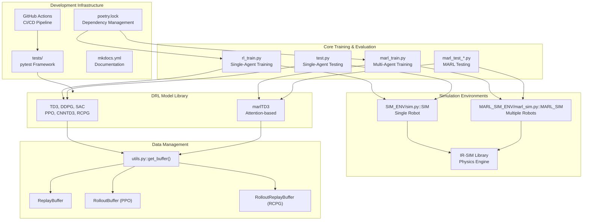
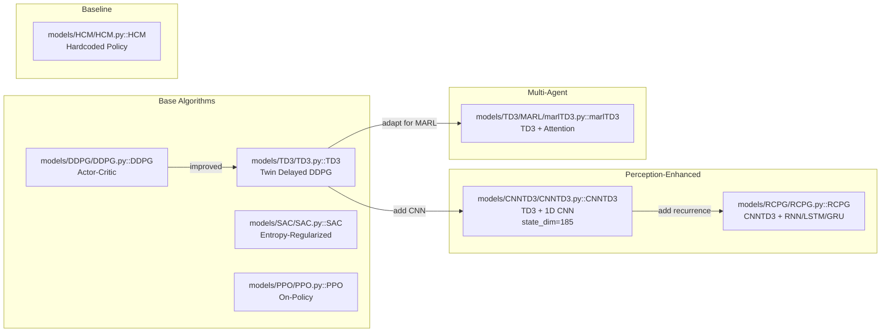
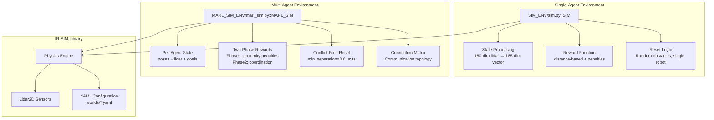
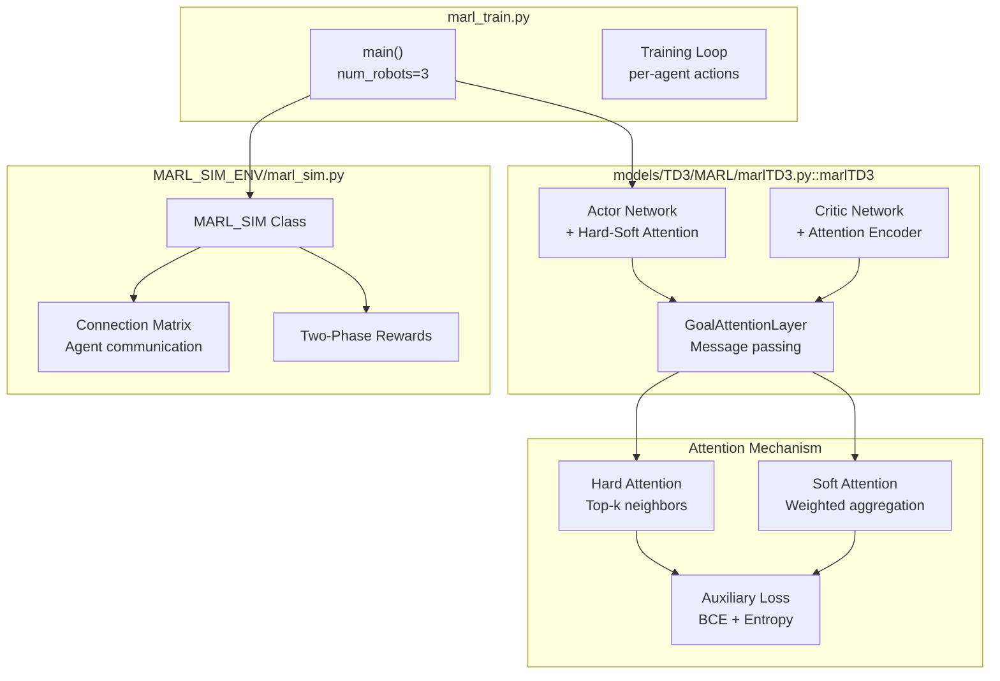

<!-- source: DeepWiki mcp.deepwiki.com · repo reiniscimurs/DRL-robot-navigation-IR-SIM · page 1 Overview · fetched 2026-10-14 -->

# Overview

Relevant source files

The following files were used as context for generating this wiki page:

- [README.md](README.md)
- [docs/index.md](docs/index.md)
- [mkdocs.yml](mkdocs.yml)
- [poetry.lock](poetry.lock)
- [robot_nav/rl_train.py](robot_nav/rl_train.py)

This document provides a comprehensive overview of the **DRL-robot-navigation-IR-SIM** project, a Deep Reinforcement Learning framework designed for autonomous robot navigation in simulated environments. The system uses the IR-SIM lightweight simulator to train robots to navigate to specified goal points using 2D laser sensor data, supporting both single-agent and multi-agent reinforcement learning scenarios.

The project implements **8+ distinct RL algorithms** spanning off-policy actor-critic methods (TD3, DDPG, SAC), on-policy methods (PPO), perception-enhanced variants (CNNTD3 with 1D CNNs), recurrent models (RCPG with LSTM/GRU), and multi-agent coordination (marlTD3 with attention mechanisms). The modular architecture enables systematic experimentation across algorithms, state representations, and training configurations.

## System Purpose and Capabilities

**Primary Capabilities:**

- **Single-Agent Navigation**: Train individual robots using laser scans (10-dim or 185-dim states) to navigate obstacle-rich environments
- **Multi-Agent Coordination**: Train multiple robots simultaneously with attention-based message passing for collision-free navigation
- **Flexible Model Library**: 8+ algorithms with varying complexity, from simple feedforward networks to CNN+RNN+Attention architectures
- **Pretraining Support**: Initialize models from offline datasets for faster convergence
- **Comprehensive Evaluation**: Automated testing with collision/goal metrics, TensorBoard monitoring, and reproducible evaluation scenarios
- **Max Bound Regularization**: Optional Q-value bounding for TD3-based models to address overestimation bias

## High-Level System Architecture

The system is organized into **five major subsystems** that provide clear separation of concerns:

**System Architecture: Five Major Subsystems**

**Architectural Principles:**

1. **Separation of Training Pipelines**: [rl_train.py:1-146]() handles single-agent scenarios, [marl_train.py]() handles multi-agent scenarios with independent execution paths
2. **Polymorphic Buffer Management**: [utils.py::get_buffer()]() factory function automatically selects appropriate buffer types (ReplayBuffer, RolloutBuffer, RolloutReplayBuffer) based on model requirements
3. **Environment Abstraction**: Both [SIM_ENV/sim.py::SIM]() and [MARL_SIM_ENV/marl_sim.py::MARL_SIM]() wrap the same IR-SIM physics engine with scenario-specific state processing and reward functions
4. **Modular Model Library**: All models share common interfaces (`get_action()`, `train()`, `prepare_state()`) enabling drop-in replacement
5. **Automated Testing**: [tests/test_model.py](), [tests/test_sim.py](), [tests/test_utils.py]() provide integration testing with CI/CD automation via [.github/workflows/main.yml]()

Sources: [README.md:1-65](), [rl_train.py:1-146](), [poetry.lock:1-20](), [mkdocs.yml:1-36]()

## Model Library and Evolutionary Taxonomy

The system implements **8+ reinforcement learning algorithms** organized into evolutionary families:

**Model Taxonomy and Evolution**

| Model | State Dim | Buffer Type | Key Architectural Features | File Path |
|-------|-----------|-------------|----------------------------|-----------|
| **TD3** | 10 | ReplayBuffer | Twin Q-networks, delayed policy updates, target smoothing | [models/TD3/TD3.py]() |
| **DDPG** | 10 | ReplayBuffer | Single Q-network, deterministic policy | [models/DDPG/DDPG.py]() |
| **SAC** | 10 | ReplayBuffer | DiagGaussianActor with SquashedNormal, entropy regularization, automatic alpha tuning | [models/SAC/SAC.py]() |
| **PPO** | 10 | RolloutBuffer | On-policy, clipped objective, episodic rollouts | [models/PPO/PPO.py]() |
| **CNNTD3** | 185 | ReplayBuffer | 1D CNN layers for 180-point laser scan, TD3 backend | [models/CNNTD3/CNNTD3.py]() |
| **RCPG** | 185 | RolloutReplayBuffer | CNNTD3 + LSTM/GRU/RNN for temporal modeling, sequence sampling | [models/RCPG/RCPG.py]() |
| **marlTD3** | Variable | ReplayBuffer | Hard-soft attention encoder, GoalAttentionLayer, auxiliary BCE loss | [models/TD3/MARL/marlTD3.py]() |
| **HCM** | N/A | N/A | Rule-based navigation for dataset collection | [models/HCM/HCM.py]() |

**Max Upper Bound Regularization**: Models `TD3`, `DDPG`, and `CNNTD3` support optional Q-value bounding via `use_max_bound=True` parameter to address overestimation bias in off-policy learning. See [Advanced Features](#7).

**Evolutionary Insight**: The primary model in [rl_train.py:34-42]() is `CNNTD3`, reflecting the importance of spatial feature extraction from high-dimensional laser scans (185-dim vs 10-dim binned states).

Sources: [README.md:35-58](), [rl_train.py:34-42](), [models/TD3/TD3.py](), [models/CNNTD3/CNNTD3.py](), [models/RCPG/RCPG.py](), [models/TD3/MARL/marlTD3.py]()

## Training and Evaluation Pipeline

The training pipeline follows a hierarchical structure: **Epochs** (60) → **Episodes** (70 per epoch) → **Steps** (300 max per episode).

**Training Pipeline with Code Entity Mapping**

```mermaid
flowchart TD
    Start["rl_train.py::main()"] --> InitModel["CNNTD3.__init__()<br/>state_dim=185, action_dim=2"]
    InitModel --> InitEnv["SIM.__init__()<br/>world_file='worlds/robot_world.yaml'"]
    InitEnv --> GetBuffer["utils.py::get_buffer()<br/>Returns: ReplayBuffer"]
    
    GetBuffer --> Pretrain{{"Pretrain?<br/>load_saved_buffer=True"}}
    Pretrain -->|"Yes"| PretrainLoop["Pretraining.pretrain()<br/>assets/data.yml"]
    Pretrain -->|"No"| EpochLoop
    PretrainLoop --> EpochLoop
    
    EpochLoop["Epoch Loop<br/>max_epochs=60"] --> EpisodeLoop["Episode Loop<br/>episodes_per_epoch=70"]
    EpisodeLoop --> StepLoop["Step Loop<br/>max_steps=300"]
    
    StepLoop --> PrepState["model.prepare_state()<br/>laser, distance, cos, sin<br/>→ state_dim=185"]
    PrepState --> GetAction["model.get_action(state, explore=True)<br/>→ [lin_vel, ang_vel]"]
    GetAction --> EnvStep["sim.step(lin_velocity, ang_velocity)<br/>→ next_state, reward, terminal"]
    EnvStep --> BufferAdd["replay_buffer.add(s, a, r, terminal, s')"]
    
    BufferAdd --> Terminal{{"Terminal or<br/>max_steps?"}}
    Terminal -->|"Yes"| EnvReset["sim.reset()<br/>Random obstacles"]
    Terminal -->|"No"| StepLoop
    
    EnvReset --> TrainCheck{{"Episode %<br/>train_every_n==0?"}}
    TrainCheck -->|"Yes"| ModelTrain["model.train()<br/>iterations=80<br/>batch_size=64"]
    TrainCheck -->|"No"| EpochCheck
    
    ModelTrain --> EpochCheck{{"End of<br/>Epoch?"}}
    EpochCheck -->|"Yes"| Evaluate["evaluate()<br/>eval_episodes=10"]
    EpochCheck -->|"No"| EpisodeLoop
    
    Evaluate --> TBLog["TensorBoard Logging<br/>avg_reward, collisions, goals"]
    TBLog --> SaveModel["model.save()<br/>save_every=5 epochs"]
    SaveModel --> MoreEpochs{{"epoch <<br/>max_epochs?"}}
    MoreEpochs -->|"Yes"| EpochLoop
    MoreEpochs -->|"No"| End["Training Complete"]
```

**Key Training Parameters** (from [rl_train.py:10-32]()):

| Parameter | Value | Description |
|-----------|-------|-------------|
| `state_dim` | 185 | Full laser scan (180) + distance (1) + cos(1) + sin(1) + collision(1) + goal(1) |
| `action_dim` | 2 | Linear velocity [0, 0.5] m/s, angular velocity [-1, 1] rad/s |
| `max_epochs` | 60 | Training duration |
| `episodes_per_epoch` | 70 | Episodes before evaluation |
| `max_steps` | 300 | Maximum steps per episode |
| `train_every_n` | 2 | Update model every 2 episodes |
| `training_iterations` | 80 | Gradient updates per training cycle |
| `batch_size` | 64 | Minibatch size for training |

**Data Flow: State Preparation**

The [model.prepare_state()]() method transforms raw sensor data into normalized neural network inputs. For CNNTD3/RCPG (185-dim):
- **Laser scan**: 180 readings, replace inf→7.0, divide by 7.0
- **Distance to goal**: Divide by 10.0
- **Goal direction**: cos(angle), sin(angle) 
- **Status flags**: collision (0/1), goal_reached (0/1)
- **Previous action**: Normalized lin_vel, ang_vel

For TD3/DDPG/SAC/PPO (10-dim), laser scan is binned into 10 sectors using min values.

Sources: [rl_train.py:1-146](), [models/CNNTD3/CNNTD3.py](), [SIM_ENV/sim.py](), [utils.py]()

## Simulation Environment Architecture

The system provides two environment wrappers around IR-SIM for different training scenarios:

**Environment Comparison: SIM vs MARL_SIM**

**SIM (Single-Agent)** [SIM_ENV/sim.py]():
- **Observation**: 360-point laser scan (downsampled to 180), goal distance, goal angle, collision flag, goal flag
- **Action Space**: Continuous `[lin_velocity, ang_velocity]`
- **Reward**: `-distance_change - 10*collision + 15*goal_reached - 0.01*|action|`
- **Configuration**: [worlds/robot_world.yaml]() defines dimensions, obstacles, robot properties

**MARL_SIM (Multi-Agent)** [MARL_SIM_ENV/marl_sim.py]():
- **Observation**: Per-agent states (own pose, goal, lidar) + neighbor information via attention
- **Action Space**: Continuous actions for N robots (default 3)
- **Reward**: Two-phase system (Phase 1: goal-seeking with inter-robot penalties, Phase 2: refined coordination)
- **Configuration**: [tests/test_marl_world.yaml]() with multi-robot spawn points
- **Connection Matrix**: Defines communication topology between agents

**Environment Configuration Files**:
- [worlds/robot_world.yaml]() - Training world for single-agent
- [worlds/eval_points.yaml]() - Evaluation scenarios with fixed start/goal positions
- [tests/test_data.yml]() - Pretraining dataset (100 transitions, 6 episodes)
- [tests/test_marl_world.yaml]() - Multi-agent world configuration

Sources: [SIM_ENV/sim.py](), [MARL_SIM_ENV/marl_sim.py](), [worlds/robot_world.yaml](), [README.md:59-65]()

## Multi-Agent Reinforcement Learning

The system supports **multi-agent navigation** where multiple robots (typically 3) learn to navigate simultaneously while avoiding each other through attention-based coordination.

**MARL Architecture Overview**

**Key MARL Features**:

- **Attention-Based Coordination**: [models/TD3/MARL/marlTD3.py]() implements hard-soft attention from G2ANet for agent-to-agent message passing
- **Per-Agent Policy**: Single shared policy network with agent-specific inputs
- **Connection Topology**: [MARL_SIM.connection_matrix]() defines which agents can communicate
- **Two-Phase Training**: Phase 1 focuses on goal-reaching with proximity penalties, Phase 2 refines coordination
- **Auxiliary Losses**: Binary cross-entropy and entropy losses on attention weights improve training stability

**Testing**: [marl_test_tud.py](), [marl_test_ingraph.py]() provide evaluation scripts for different MARL configurations.

Sources: [README.md:59-65](), [models/TD3/MARL/marlTD3.py](), [MARL_SIM_ENV/marl_sim.py](), [marl_train.py]()

## Testing and Evaluation Framework

The system provides multiple testing approaches for comprehensive performance evaluation:

- **Structured Evaluation**: `test.py` with predefined scenarios from `eval_points.yaml`
- **Random Testing**: `test_random.py` for stochastic environment validation
- **Unit Testing**: Comprehensive test suite covering model instantiation, buffer operations, and simulation validation
- **Performance Metrics**: Success rate, collision frequency, path efficiency, and convergence analysis

For detailed testing procedures and metric definitions, see [Testing and Evaluation](#5).

Sources: [test.py](), [test_random.py](), [tests/]()

---

