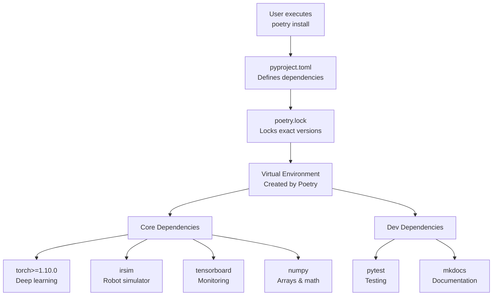
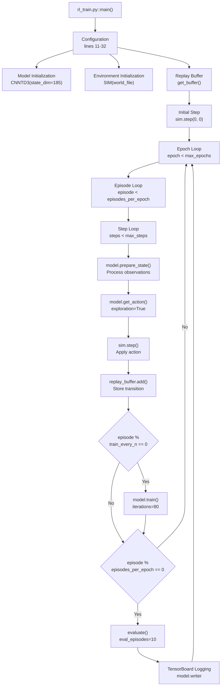
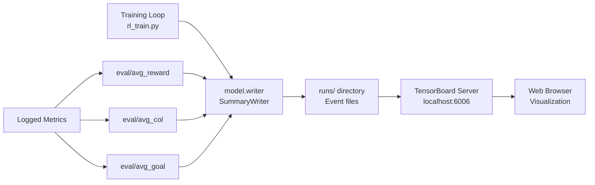
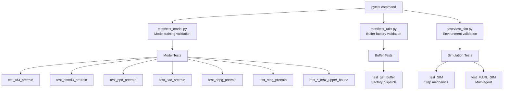

<!-- source: DeepWiki mcp.deepwiki.com · repo reiniscimurs/DRL-robot-navigation-IR-SIM · page 1.1 Getting Started · fetched 2026-10-14 -->

# Getting Started

<details>
<summary>Relevant source files</summary>

The following files were used as context for generating this wiki page:

- [README.md](README.md)
- [docs/index.md](docs/index.md)
- [mkdocs.yml](mkdocs.yml)
- [poetry.lock](poetry.lock)
- [robot_nav/rl_train.py](robot_nav/rl_train.py)

</details>


This guide covers the initial setup and execution of the DRL-robot-navigation-IR-SIM project. You will learn how to install dependencies using Poetry, run your first training session, and monitor progress using TensorBoard. For detailed information about the model architectures, see [Single-Agent Models](#3). For multi-agent training, see [Multi-Agent Reinforcement Learning](#4).

---

## Prerequisites

Before beginning, ensure you have the following installed:

| Requirement | Version | Purpose |
|-------------|---------|---------|
| Python | ≥3.8 | Runtime environment |
| pip | Latest | Package installer |
| Git | Any | Repository cloning |
| CUDA (optional) | Compatible with PyTorch | GPU acceleration |

The project automatically detects and uses GPU acceleration if CUDA is available ([robot_nav/rl_train.py:14-16]()).

---

## Installation Process

### Step 1: Install Poetry

Poetry is the dependency manager for this project. It ensures reproducible builds and isolates project dependencies.

```bash
pip install poetry
```

**Sources:** [README.md:10-11](), [poetry.lock:1-3]()

---

### Step 2: Clone Repository

```bash
git clone https://github.com/reiniscimurs/DRL-robot-navigation-IR-SIM.git
cd DRL-robot-navigation-IR-SIM
```

**Sources:** [README.md:12-13]()

---

### Step 3: Install Dependencies

Navigate to the project root and install all dependencies:

```bash
poetry install
```

This command reads `pyproject.toml` and `poetry.lock` to install exact package versions, including:

- **PyTorch**: Deep learning framework
- **IR-SIM**: Lightweight robot simulator
- **TensorBoard**: Training visualization
- **pytest**: Testing framework (development dependency)
- **NumPy**: Numerical computations

**Dependency Installation Flow**



**Sources:** [README.md:14-15](), [poetry.lock:1-353](), [mkdocs.yml:30-32]()

---

## Running Your First Training

### Default Training Execution

The primary entry point for single-agent training is `rl_train.py`, which trains a CNNTD3 model by default:

```bash
poetry run python robot_nav/rl_train.py
```

**Training Script Architecture**



**Sources:** [robot_nav/rl_train.py:1-146]()

---

### Key Training Parameters

The following parameters control training behavior ([robot_nav/rl_train.py:11-32]()):

| Parameter | Default Value | Description |
|-----------|---------------|-------------|
| `state_dim` | 185 | Input dimension for CNNTD3 (180 laser + 5 other features) |
| `action_dim` | 2 | Linear and angular velocity outputs |
| `max_action` | 1 | Action space bounds [-1, 1] |
| `max_epochs` | 60 | Total training epochs |
| `episodes_per_epoch` | 70 | Episodes before evaluation |
| `train_every_n` | 2 | Training frequency (every n episodes) |
| `training_iterations` | 80 | Gradient updates per training cycle |
| `batch_size` | 64 | Samples per training iteration |
| `max_steps` | 300 | Maximum steps per episode |
| `nr_eval_episodes` | 10 | Evaluation episodes per epoch |

**State Space Composition** ([robot_nav/rl_train.py:57-77]()):

```
state[0:180]   → Laser scan readings (binned or full, depending on model)
state[180]     → Normalized distance to goal
state[181]     → cos(angle to goal)
state[182]     → sin(angle to goal)
state[183:184] → Previous action [linear_vel, angular_vel]
```

**Action Space** ([robot_nav/rl_train.py:67-70]()):

```
action[0] → Linear velocity (clipped to [0, 0.5] m/s via: (action[0] + 1) / 4)
action[1] → Angular velocity (range: [-1, 1] rad/s)
```

**Sources:** [robot_nav/rl_train.py:9-146]()

---

## Monitoring Training with TensorBoard

### Starting TensorBoard

In a separate terminal window, launch TensorBoard to visualize training metrics:

```bash
tensorboard --logdir runs
```

Then navigate to `http://localhost:6006` in your web browser.

**TensorBoard Logging Flow**



**Sources:** [README.md:22-23](), [robot_nav/rl_train.py:139-141]()

---

### Tracked Metrics

The evaluation function logs three key metrics every epoch ([robot_nav/rl_train.py:106-142]()):

| Metric | Tag | Description |
|--------|-----|-------------|
| Average Reward | `eval/avg_reward` | Mean cumulative reward over evaluation episodes |
| Collision Rate | `eval/avg_col` | Proportion of episodes ending in collision |
| Goal Success Rate | `eval/avg_goal` | Proportion of episodes reaching the goal |

**Evaluation Logic** ([robot_nav/rl_train.py:106-142]()):
- Runs 10 evaluation episodes per epoch (default)
- Uses trained policy without exploration (`get_action(state, False)`)
- Maximum 501 steps per evaluation episode
- Resets environment using `sim.reset()` for each episode

**Sources:** [robot_nav/rl_train.py:106-142]()

---

## Verifying Installation

### Running Tests

The project includes a comprehensive test suite to verify correct installation and configuration:

```bash
poetry run pytest
```

**Test Coverage Map**



For more details on the testing infrastructure, see [Testing and Validation](#6).

**Sources:** [mkdocs.yml:30-32](), [README.md:10-15]()

---

### CI/CD Verification

The project uses GitHub Actions for continuous integration. Every push automatically:

1. Installs dependencies via `poetry install`
2. Executes the full test suite via `poetry run pytest`
3. Reports pass/fail status

This ensures the codebase remains in a working state.

**Sources:** High-level system architecture diagrams (Diagram 6)

---

## Project Structure Overview

Understanding the directory layout helps navigate the codebase:

```
DRL-robot-navigation-IR-SIM/
├── robot_nav/              # Main package directory
│   ├── rl_train.py         # Primary training script (single-agent)
│   ├── marl_train.py       # Multi-agent training script
│   ├── test.py             # Single-agent testing script
│   ├── models/             # DRL model implementations
│   │   ├── CNNTD3/         # CNN-enhanced TD3
│   │   ├── TD3/            # Twin Delayed DDPG
│   │   ├── DDPG/           # Deep Deterministic Policy Gradient
│   │   ├── SAC/            # Soft Actor-Critic
│   │   ├── PPO/            # Proximal Policy Optimization
│   │   ├── RCPG/           # Recurrent Convolutional Policy Gradient
│   │   ├── HCM/            # Hardcoded Model
│   │   └── MARL/           # Multi-agent models
│   ├── SIM_ENV/            # Environment wrappers
│   │   ├── sim.py          # Single-agent SIM class
│   │   └── marl_sim.py     # Multi-agent MARL_SIM class
│   └── utils.py            # Utility functions (get_buffer, etc.)
├── worlds/                 # YAML world configurations
│   └── robot_world.yaml    # Default single-agent world
├── tests/                  # Test suite
│   ├── test_model.py       # Model training tests
│   ├── test_utils.py       # Utility function tests
│   ├── test_sim.py         # Environment tests
│   ├── test_data.yml       # Prefilled experience data
│   ├── test_world.yaml     # Single-agent test world
│   └── test_marl_world.yaml # Multi-agent test world
├── assets/                 # Data assets
│   └── data.yml            # Offline pretraining data
├── pyproject.toml          # Poetry project configuration
├── poetry.lock             # Locked dependency versions
└── mkdocs.yml              # Documentation configuration
```

**Sources:** [mkdocs.yml:4-29](), [robot_nav/rl_train.py:1-7]()

---

## Common Configuration Changes

### Training a Different Model

To train a different model (e.g., TD3 instead of CNNTD3), modify the import and instantiation in `rl_train.py`:

```python
# Change line 1
from robot_nav.models.TD3.TD3 import TD3

# Change line 13 (state_dim depends on model)
state_dim = 10  # TD3 uses 10-dim state (binned laser)

# Change lines 34-42
model = TD3(
    state_dim=state_dim,
    action_dim=action_dim,
    max_action=max_action,
    device=device,
    save_every=save_every,
    load_model=False,
    model_name="TD3",
)
```

**State Dimension Requirements:**
- **TD3, DDPG, SAC, PPO**: `state_dim=10` (binned laser scan)
- **CNNTD3, RCPG**: `state_dim=185` (full laser scan)

For model-specific details, see [Single-Agent Models](#3).

**Sources:** [robot_nav/rl_train.py:1-42](), High-level system architecture diagrams (Diagram 2)

---

### Loading Pretrained Models

To continue training from a saved checkpoint:

```python
model = CNNTD3(
    state_dim=state_dim,
    action_dim=action_dim,
    max_action=max_action,
    device=device,
    save_every=save_every,
    load_model=True,  # Enable loading
    model_name="CNNTD3",
)
```

The model automatically loads from the checkpoint directory corresponding to `model_name`.

**Sources:** [robot_nav/rl_train.py:34-42]()

---

### Pretraining from Offline Data

To pretrain the model using saved experiences ([robot_nav/rl_train.py:27-31]()):

```python
load_saved_buffer = True   # Load experiences from assets/data.yml
pretrain = True            # Enable pretraining
pretraining_iterations = 10  # Number of training iterations
```

The `get_buffer()` function handles pretraining automatically when these flags are set. For details on offline learning, see [Pretraining and Offline Learning](#7.2).

**Sources:** [robot_nav/rl_train.py:27-55]()

---

## Next Steps

Now that you have the project running, explore:

- **[Core Training System](#2)**: Deep dive into the training loop architecture
- **[Simulation Environments](#2.1)**: Understand state observation processing and reward functions
- **[Single-Agent Models](#3)**: Learn about each model's architecture and use cases
- **[Multi-Agent Reinforcement Learning](#4)**: Train multiple robots simultaneously
- **[Environment Configuration](#5)**: Customize world layouts and robot properties
- **[Testing and Validation](#6)**: Extend the test suite for your modifications

**Sources:** mkdocs.yml structure, README.md

---

