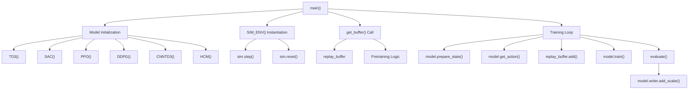
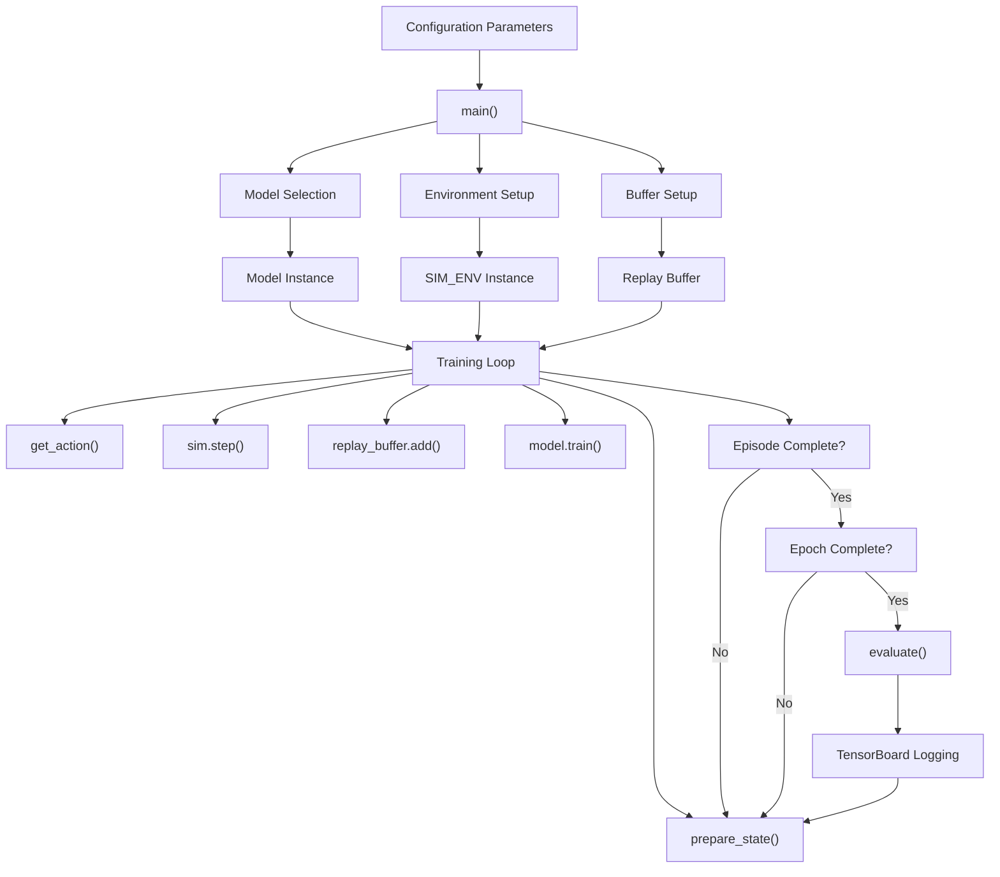
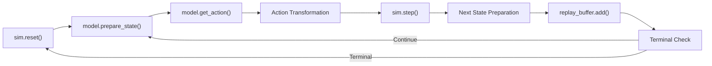
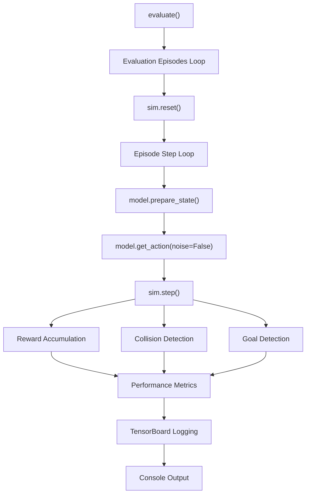

<!-- source: DeepWiki mcp.deepwiki.com · repo reiniscimurs/DRL-robot-navigation-IR-SIM · page 2 Core Training System · fetched 2026-10-14 -->

# Core Training System

Relevant source files

The following files were used as context for generating this wiki page:

- [README.md](README.md)
- [poetry.lock](poetry.lock)
- [robot_nav/models/CNNTD3/CNNTD3.py](robot_nav/models/CNNTD3/CNNTD3.py)
- [robot_nav/models/DDPG/DDPG.py](robot_nav/models/DDPG/DDPG.py)
- [robot_nav/models/TD3/TD3.py](robot_nav/models/TD3/TD3.py)
- [robot_nav/rl_train.py](robot_nav/rl_train.py)

This document covers the central training orchestration system that coordinates reinforcement learning model training for robot navigation. The core training system is implemented primarily in `train.py` and serves as the main entry point for training RL agents in the IR-SIM simulation environment.

For detailed information about the simulation environment mechanics, see [Simulation Environment](#2.1). For replay buffer management and preprocessing utilities, see [Data Management and Utilities](#2.2). For specific RL algorithm implementations, see [Reinforcement Learning Models](#3).

## System Architecture

The core training system follows a modular architecture that separates concerns between model selection, environment management, and training orchestration.

**Training System Component Mapping**

| Component | Code Entity | File Location | Purpose |
|-----------|-------------|---------------|---------|
| Training Orchestrator | `main()` | [robot_nav/train.py:14-108]() | Main training loop coordinator |
| Environment Manager | `SIM_ENV` | [robot_nav/train.py:49]() | Simulation environment interface |
| Buffer Manager | `get_buffer()` | [robot_nav/train.py:50-58]() | Replay buffer initialization |
| Model Interface | Various model classes | [robot_nav/train.py:1-6]() | RL algorithm implementations |
| Evaluation System | `evaluate()` | [robot_nav/train.py:109-144]() | Performance assessment |

Sources: [robot_nav/train.py:1-149]()

## Training Pipeline Components

The training system consists of several key components that work together to train RL agents:

### Core Configuration Parameters

The training system uses a comprehensive set of hyperparameters defined in the `main()` function:

| Parameter | Default Value | Purpose |
|-----------|---------------|---------|
| `action_dim` | 2 | Linear and angular velocity actions |
| `state_dim` | 25 | Laser scan + goal + action state vector |
| `max_epochs` | 60 | Total training epochs |
| `episodes_per_epoch` | 70 | Episodes before evaluation |
| `train_every_n` | 2 | Training frequency (every n episodes) |
| `training_iterations` | 80 | Batches per training cycle |
| `batch_size` | 64 | Experience batch size |
| `max_steps` | 300 | Maximum steps per episode |

Sources: [robot_nav/train.py:16-37]()

## Main Training Loop

The core training loop implements the standard RL training cycle with episode and epoch management:

### State-Action-Reward Cycle

The training loop processes experiences in the following sequence:

1. **State Preparation**: Raw sensor data is processed via `model.prepare_state()` [robot_nav/train.py:65-67]()
2. **Action Generation**: Policy network produces actions via `model.get_action()` [robot_nav/train.py:69]()
3. **Action Transformation**: Actions are scaled to appropriate velocity ranges [robot_nav/train.py:70-73]()
4. **Environment Step**: Actions are executed in simulation via `sim.step()` [robot_nav/train.py:75-77]()
5. **Experience Storage**: Transitions are stored via `replay_buffer.add()` [robot_nav/train.py:81-83]()

### Episode and Epoch Management

The system manages training at two hierarchical levels:

- **Episodes**: Individual navigation attempts, terminated by collision, goal reach, or step limit
- **Epochs**: Collections of episodes (default 70) followed by evaluation

Training occurs every `train_every_n` episodes via `model.train()` [robot_nav/train.py:91-95](), while evaluation runs after each epoch completion [robot_nav/train.py:101-106]().

Sources: [robot_nav/train.py:64-107]()

## Model Training Integration

The training system supports multiple RL algorithms through a unified interface:

### Supported Models

| Model Class | Algorithm Type | Key Features |
|-------------|----------------|--------------|
| `TD3` | Off-policy Actor-Critic | Twin networks, delayed updates |
| `SAC` | Off-policy Actor-Critic | Entropy regularization |
| `PPO` | On-policy Actor-Critic | Clipped surrogate objective |
| `DDPG` | Off-policy Actor-Critic | Deterministic policy |
| `CNNTD3` | Enhanced TD3 | CNN laser processing |
| `HCM` | Rule-based | Hardcoded navigation baseline |

All models implement the same interface:
- `prepare_state()`: State preprocessing
- `get_action()`: Action generation
- `train()`: Network parameter updates

Sources: [robot_nav/train.py:1-6](), [robot_nav/train.py:39-47]()

## Evaluation System

The evaluation system provides comprehensive performance assessment through the `evaluate()` function:

### Evaluation Metrics

The evaluation system tracks three primary metrics:

1. **Average Reward**: Cumulative reward across evaluation episodes [robot_nav/train.py:128-135]()
2. **Collision Rate**: Percentage of episodes ending in collision [robot_nav/train.py:130-136]()
3. **Goal Rate**: Percentage of episodes reaching the target [robot_nav/train.py:132-137]()

Results are logged to TensorBoard via `model.writer.add_scalar()` [robot_nav/train.py:142-144]() and displayed in console output [robot_nav/train.py:138-141]().

### Evaluation Configuration

- **Episode Count**: Configurable via `nr_eval_episodes` (default 10)
- **Step Limit**: 501 steps maximum per evaluation episode
- **Noise**: Actions generated without exploration noise (`noise=False`)

Sources: [robot_nav/train.py:109-144]()

## Buffer and Pretraining Integration

The training system integrates with the buffer management system through `get_buffer()` which handles:

- Replay buffer instantiation
- Optional experience loading from saved data
- Pretraining capability for model initialization
- Buffer size and type configuration based on model requirements

The buffer setup supports both off-policy algorithms (with replay buffers) and on-policy algorithms (with rollout buffers), determined by the model type.

Sources: [robot_nav/train.py:50-58]()

---

