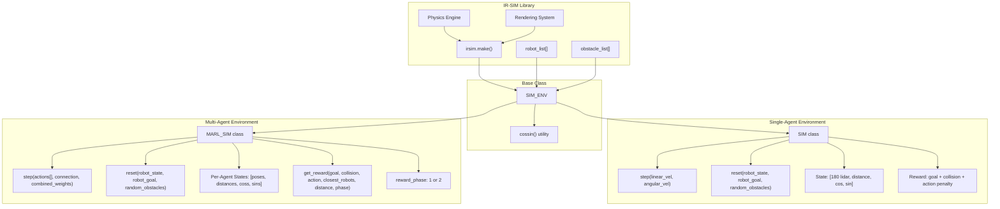
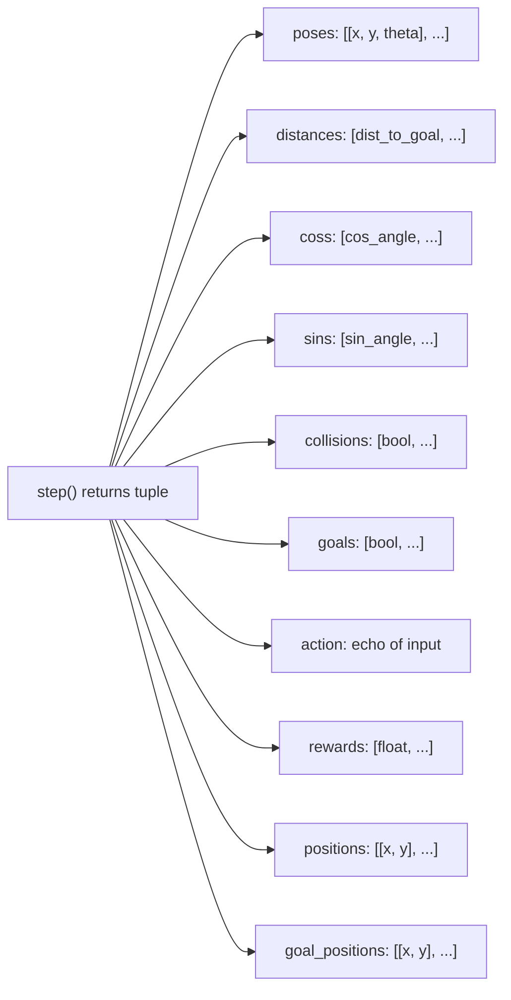
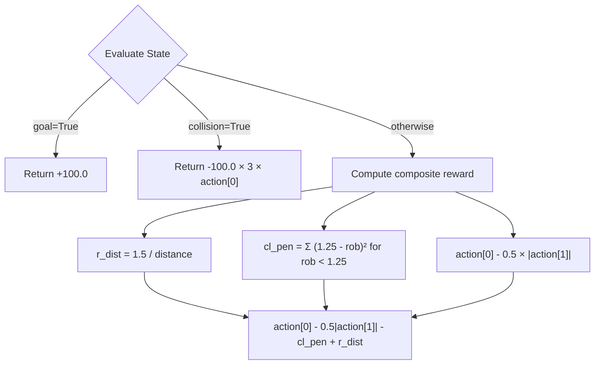
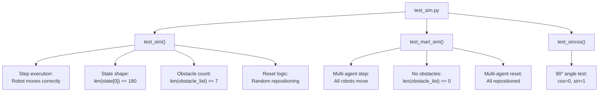

<!-- source: DeepWiki mcp.deepwiki.com · repo reiniscimurs/DRL-robot-navigation-IR-SIM · page 2.1 Simulation Environments · fetched 2026-10-14 -->

# Simulation Environments

<details>
<summary>Relevant source files</summary>

The following files were used as context for generating this wiki page:

- [robot_nav/SIM_ENV/marl_sim.py](robot_nav/SIM_ENV/marl_sim.py)
- [tests/test_sim.py](tests/test_sim.py)

</details>


## Purpose and Scope

This document describes the simulation environment wrappers that interface with the IR-SIM library to provide standardized observation spaces, reward computation, and environment management for both single-agent and multi-agent robot navigation scenarios. The two primary classes are `SIM` for single-robot navigation and `MARL_SIM` for multi-robot coordination. For details on environment configuration via YAML files, see [Environment Configuration](#5). For information on how these environments integrate with the training pipeline, see [Core Training System](#2).

---

## Architecture Overview

The simulation layer consists of two environment wrapper classes built on top of the IR-SIM physics engine. Both environments share a common base class `SIM_ENV` and provide consistent interfaces for state retrieval, action execution, and environment resets.



**Sources:** [robot_nav/SIM_ENV/marl_sim.py:1-364](), [tests/test_sim.py:1-61]()

---

## IR-SIM Integration

Both environment classes instantiate the IR-SIM simulation engine through the `irsim.make()` factory function. The initialization accepts a world configuration file path and optional display settings.

| Parameter | Type | Purpose |
|-----------|------|---------|
| `world_file` | str | Path to YAML world configuration (relative or absolute) |
| `disable_plotting` | bool | When `True`, disables IRSim visualization for headless training |
| `display` | bool | Controls window display; derived from `disable_plotting` |

**Example instantiation patterns:**

```python
# Single-agent environment
self.env = irsim.make(world_file, disable_all_plot=disable_plotting, display=display)

# Multi-agent environment  
self.env = irsim.make(world_file, disable_all_plot=disable_plotting, display=display)
```

The `env` object provides access to:
- `robot_list[]`: List of robot instances for multi-agent scenarios
- `robot`: Single robot instance for single-agent scenarios (inferred from test patterns)
- `obstacle_list[]`: Dynamic obstacles in the world
- Physics simulation via `step()` and `render()` methods
- Robot state access via `get_robot_state()` and `get_robot_info()`

**Sources:** [robot_nav/SIM_ENV/marl_sim.py:45-52](), [tests/test_sim.py:17-18](), [tests/test_sim.py:34]()

---

## Single-Agent Environment (SIM)

### Initialization and World Setup

The `SIM` class wraps IR-SIM for single-robot navigation tasks. While the implementation file is not included in the provided sources, its behavior can be inferred from test cases.

**Inferred initialization:**
- Loads world from YAML file (e.g., `/tests/test_world.yaml`)
- Supports `disable_plotting` parameter for headless operation
- Maintains a single robot instance accessible via `sim.env.robot`
- Manages obstacle list for collision detection

**Sources:** [tests/test_sim.py:16-17](), [tests/test_sim.py:57]()

### State Observations

The single-agent environment returns state observations with the following structure:

| State Component | Dimension | Description |
|----------------|-----------|-------------|
| Laser scan | 180 | Binned or downsampled lidar readings from 360 raw readings |
| Distance to goal | 1 | Euclidean distance from robot to goal position |
| Cosine | 1 | Cosine of angle between robot heading and goal direction |
| Sine | 1 | Sine of angle between robot heading and goal direction |

The state is returned as the first element of the tuple from `step()`:

```python
state = sim.step(1, 0)  # Returns tuple (state, ...)
assert len(state[0]) == 180  # Lidar observations
```

**Sources:** [tests/test_sim.py:19-24]()

### Step Function

The `step()` method advances the simulation by one timestep given velocity commands:

**Signature (inferred):**
```python
def step(linear_velocity: float, angular_velocity: float) -> tuple
```

**Parameters:**
- `linear_velocity`: Forward velocity in m/s
- `angular_velocity`: Rotational velocity in rad/s

**Returns:** Tuple containing state observations, reward, done flag, and additional info

The physics engine updates robot position based on commanded velocities:

```python
robot_state = sim.env.get_robot_state()
state = sim.step(1, 0)  # Move forward at 1 m/s
next_robot_state = sim.env.get_robot_state()
# Robot moved ~1 meter in x-direction
assert np.isclose(robot_state[0], next_robot_state[0] - 1)
```

**Sources:** [tests/test_sim.py:18-22]()

### Reset Logic

The `reset()` method reinitializes the environment for a new episode:

**Signature (inferred):**
```python
def reset(
    robot_state: list = None,
    robot_goal: list = None, 
    random_obstacle_ids: list = None
) -> tuple
```

**Key behaviors:**
- Randomizes robot start position and orientation when `robot_state=None`
- Generates new goal position when `robot_goal=None`
- Repositions specified obstacles via `random_obstacle_ids` list
- Returns initial state observations after reset

**Example obstacle randomization:**

```python
# Randomize obstacles with IDs 1-6
sim.reset(random_obstacle_ids=[i + 1 for i in range(6)])
new_robot_state = sim.env.get_robot_state()
# Robot position has changed
assert np.not_equal(robot_state[0], new_robot_state[0])
```

**Sources:** [tests/test_sim.py:27-30]()

---

## Multi-Agent Environment (MARL_SIM)

### Initialization

The `MARL_SIM` class extends `SIM_ENV` to handle multiple robots with inter-agent coordination:

```python
def __init__(
    self,
    world_file="multi_robot_world.yaml",
    disable_plotting=False,
    reward_phase=1,
)
```

**Key attributes:**

| Attribute | Type | Description |
|-----------|------|-------------|
| `num_robots` | int | Number of robots in environment (from `len(env.robot_list)`) |
| `robot_goal` | np.ndarray | Goal positions for robots |
| `x_range` | tuple | World boundary limits in x-direction |
| `y_range` | tuple | World boundary limits in y-direction |
| `reward_phase` | int | Selects reward function variant (1 or 2) |

**Sources:** [robot_nav/SIM_ENV/marl_sim.py:24-53]()

### Step Function

The multi-agent step function processes actions for all robots simultaneously:

```python
def step(self, action, connection, combined_weights=None) -> tuple
```

**Parameters:**

| Parameter | Type | Shape | Description |
|-----------|------|-------|-------------|
| `action` | list | `(num_robots, 2)` | `[linear_vel, angular_vel]` for each robot |
| `connection` | Tensor | `(num_robots, num_robots-1)` | Connection logits (for compatibility) |
| `combined_weights` | Tensor | `(num_robots, num_robots)` or `(num_robots, num_robots-1)` | Edge weights for visualization |

**Return value structure:**



All return values are lists of length `num_robots`, providing per-agent observations.

**Sources:** [robot_nav/SIM_ENV/marl_sim.py:55-205]()

### State Processing

The step function computes per-robot observations in a loop:

```python
for i in range(self.num_robots):
    robot_state = self.env.robot_list[i].state  # [x, y, theta]
    robot_goal = self.env.robot_list[i].goal
    
    # Compute goal vector and distance
    goal_vector = [robot_goal[0] - robot_state[0], robot_goal[1] - robot_state[1]]
    distance = np.linalg.norm(goal_vector)
    
    # Compute heading-to-goal alignment
    pose_vector = [np.cos(robot_state[2]), np.sin(robot_state[2])]
    cos, sin = self.cossin(pose_vector, goal_vector)
    
    # Check termination conditions
    collision = self.env.robot_list[i].collision
    goal = self.env.robot_list[i].arrive
```

**Inter-robot proximity computation:**

```python
# Compute distances to all other robots
closest_robots = [
    np.linalg.norm([
        robot_states[j][0] - robot_state[0],
        robot_states[j][1] - robot_state[1],
    ])
    for j in range(self.num_robots)
    if j != i
]
```

**Sources:** [robot_nav/SIM_ENV/marl_sim.py:118-148]()

### Reward Functions

The `MARL_SIM` class implements two distinct reward phases via the static method `get_reward()`:

```python
@staticmethod
def get_reward(goal, collision, action, closest_robots, distance, phase=1) -> float
```

#### Phase 1: Goal-Seeking with Proximity Penalties



**Phase 1 characteristics:**
- Encourages forward motion via `action[0]` (linear velocity)
- Penalizes rotation via `-0.5 * abs(action[1])`
- Rewards proximity to goal via `1.5 / distance`
- Penalizes inter-robot proximity within 1.25 units
- Large rewards/penalties for goal achievement (+100) and collisions (-300 × speed)

**Sources:** [robot_nav/SIM_ENV/marl_sim.py:334-347]()

#### Phase 2: Coordination Refinement

Phase 2 removes distance-based rewards and increases proximity penalties:

```python
case 2:
    if goal:
        return 70.0  # Reduced from 100
    elif collision:
        return -100.0 * 3 * action[0]
    else:
        cl_pen = 0
        for rob in closest_robots:
            add = (3 - rob) ** 2 if rob < 3 else 0  # Wider range
            cl_pen += add
        return -0.5 * abs(action[1]) - cl_pen
```

**Phase 2 differences:**
- No forward motion encouragement (removed `action[0]` term)
- No distance-based reward (removed `r_dist` term)
- Wider proximity penalty range (3.0 units instead of 1.25)
- Lower goal reward (70 instead of 100)

**Sources:** [robot_nav/SIM_ENV/marl_sim.py:349-360]()

#### Reward Function Comparison

| Component | Phase 1 | Phase 2 |
|-----------|---------|---------|
| Goal reward | +100.0 | +70.0 |
| Collision penalty | -300 × speed | -300 × speed |
| Forward motion | +action[0] | 0 |
| Rotation penalty | -0.5 × \|angular_vel\| | -0.5 × \|angular_vel\| |
| Distance term | +1.5 / distance | 0 |
| Proximity threshold | 1.25 units | 3.0 units |
| Proximity penalty | (1.25 - d)² | (3 - d)² |

**Sources:** [robot_nav/SIM_ENV/marl_sim.py:314-363]()

### Reset with Conflict Avoidance

The multi-agent reset implements collision-free initialization by ensuring minimum separation between robots:

```python
def reset(
    self,
    robot_state=None,
    robot_goal=None,
    random_obstacles=False,
    random_obstacle_ids=None,
) -> tuple
```

**Conflict avoidance algorithm:**

```python
init_states = []
for robot in self.env.robot_list:
    conflict = True
    while conflict:
        conflict = False
        robot_state = [
            [random.uniform(3, 9)],  # x
            [random.uniform(3, 9)],  # y
            [random.uniform(-3.14, 3.14)],  # theta
        ]
        pos = [robot_state[0][0], robot_state[1][0]]
        
        # Check distance to all previously placed robots
        for loc in init_states:
            vector = [pos[0] - loc[0], pos[1] - loc[1]]
            if np.linalg.norm(vector) < 0.6:  # Minimum 0.6 unit separation
                conflict = True
    
    init_states.append(pos)
    robot.set_state(state=np.array(robot_state), init=True)
```

**Key constraints:**
- Minimum separation: 0.6 units between any two robots
- Random spawn area: [3, 9] × [3, 9] within world bounds
- Random orientations: [-π, π]
- Sequential placement with conflict checking

**Sources:** [robot_nav/SIM_ENV/marl_sim.py:240-266]()

**Goal assignment:**

After robot placement, goals are randomly assigned within world boundaries:

```python
for robot in self.env.robot_list:
    robot.set_random_goal(
        obstacle_list=self.env.obstacle_list,
        init=True,
        range_limits=[
            [self.x_range[0] + 1, self.y_range[0] + 1, -π],
            [self.x_range[1] - 1, self.y_range[1] - 1, π],
        ],
    )
```

Goals are placed at least 1 unit away from world boundaries to avoid edge cases.

**Sources:** [robot_nav/SIM_ENV/marl_sim.py:278-291]()

### Connection Matrix Visualization

When `combined_weights` is provided to `step()`, the environment renders inter-robot connections as lines with thickness proportional to weight:

```python
if combined_weights is not None:
    i_weights = combined_weights[i].tolist()
    for j in range(self.num_robots):
        weight = i_weights[j]
        other_robot_state = self.env.robot_list[j].state
        other_pos = [other_robot_state[0], other_robot_state[1]]
        
        rx = [position[0], other_pos[0]]
        ry = [position[1], other_pos[1]]
        
        self.env.draw_trajectory(
            np.array([rx, ry]), 
            refresh=True, 
            linewidth=weight * 2
        )
```

This visualization supports attention mechanisms in MARL models (see [marlTD3 with Attention Mechanisms](#4.2)) by showing which robots are attending to each other during coordination.

**Sources:** [robot_nav/SIM_ENV/marl_sim.py:165-182]()

---

## Utility Functions

### cossin: Angle Computation

Both `SIM` and `MARL_SIM` inherit the `cossin()` utility from `SIM_ENV` to compute directional alignment:

```python
def cossin(pose_vector, goal_vector) -> tuple[float, float]
```

**Purpose:** Computes cosine and sine of the angle between the robot's heading and the goal direction.

**Usage:**
```python
pose_vector = [np.cos(robot_state[2]), np.sin(robot_state[2])]  # Robot heading
goal_vector = [goal_x - robot_x, goal_y - robot_y]  # Direction to goal
cos, sin = self.cossin(pose_vector, goal_vector)
```

**Test validation:**
```python
sim = SIM("/tests/test_world.yaml")
cos, sin = sim.cossin([1, 0], [0, 1])  # 90-degree angle
assert np.isclose(cos, 0)  # cos(90°) = 0
assert np.isclose(sin, 1)  # sin(90°) = 1
```

The function provides orientation information that helps the agent understand whether it's facing toward or away from the goal.

**Sources:** [tests/test_sim.py:56-60](), [robot_nav/SIM_ENV/marl_sim.py:143]()

---

## Environment Configuration

World configurations, robot properties, sensor specifications, and obstacle layouts are defined in YAML files. The test suite uses:

| File | Purpose | Robot Count | Obstacle Count |
|------|---------|-------------|----------------|
| `/tests/test_world.yaml` | Single-agent testing | 1 | 7 |
| `/tests/test_marl_world.yaml` | Multi-agent testing | 3 | 0 |

For complete details on YAML configuration structure and available parameters, see [Environment Configuration](#5).

**Sources:** [tests/test_sim.py:17](), [tests/test_sim.py:34](), [tests/test_sim.py:25](), [tests/test_sim.py:46]()

---

## Testing and Validation

The simulation environments are validated through comprehensive integration tests:



**Test coverage:**
- Physics correctness: Robot position updates match commanded velocities
- State dimensions: Laser scans contain expected number of readings
- Reset functionality: Positions randomize after reset
- Multi-agent coordination: All robots process actions simultaneously
- Utility functions: Angle computations produce correct trigonometric values

**CI integration:** Tests run on GitHub Actions with `skip_on_ci` decorator for tests requiring visualization.

**Sources:** [tests/test_sim.py:1-61]()

---

