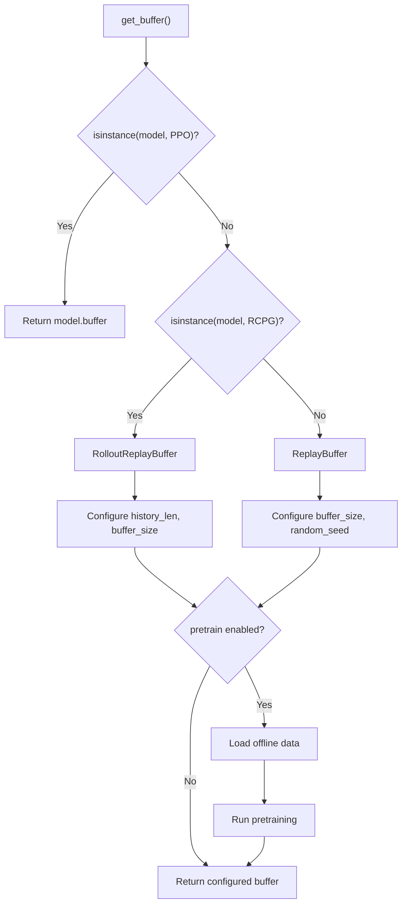
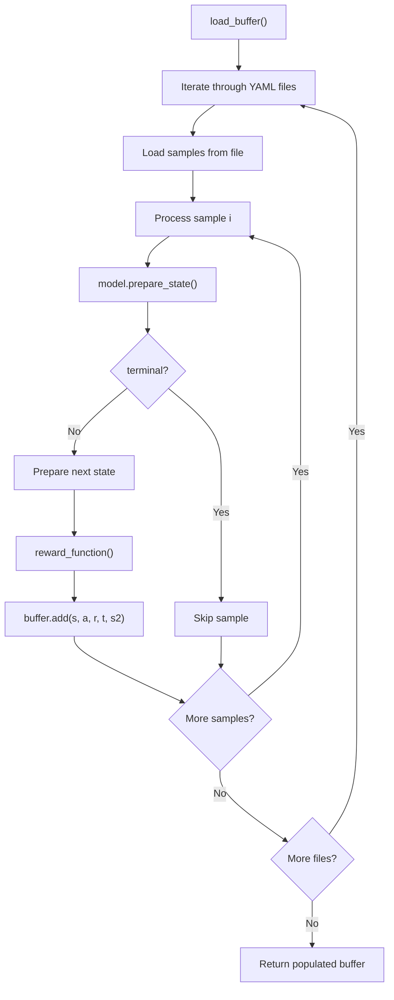
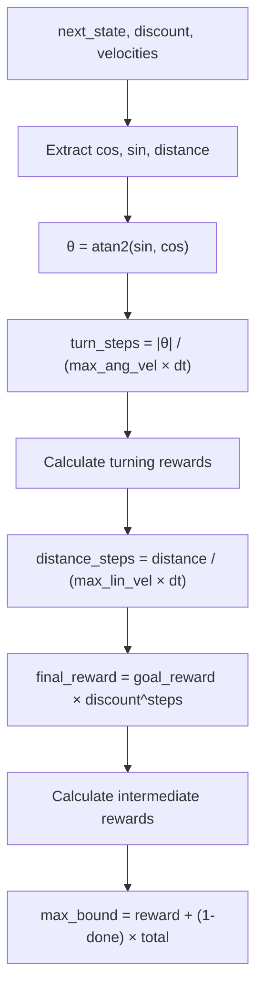

<!-- source: DeepWiki mcp.deepwiki.com · repo reiniscimurs/DRL-robot-navigation-IR-SIM · page 2.2 Data Management and Replay Buffers · fetched 2026-10-14 -->

# Data Management and Utilities

<details>
<summary>Relevant source files</summary>

The following files were used as context for generating this wiki page:

- [.github/workflows/main.yml](.github/workflows/main.yml)
- [pyproject.toml](pyproject.toml)
- [robot_nav/models/RCPG/RCPG.py](robot_nav/models/RCPG/RCPG.py)
- [robot_nav/models/SAC/SAC_utils.py](robot_nav/models/SAC/SAC_utils.py)
- [robot_nav/replay_buffer.py](robot_nav/replay_buffer.py)
- [robot_nav/utils.py](robot_nav/utils.py)
- [tests/test_utils.py](tests/test_utils.py)

</details>


This document covers the data management infrastructure and utility functions that support the reinforcement learning training pipeline. It includes replay buffer implementations, pretraining capabilities, state preparation utilities, and advanced features like maximum return bound estimation.

For information about the core training system that uses these utilities, see [Core Training System](#2). For model-specific state preparation methods, see [Reinforcement Learning Models](#3).

## Overview

The data management system provides several key components:

- **Replay Buffers**: Store and sample experience tuples for off-policy learning
- **Pretraining System**: Load offline data and initialize models with prior experience  
- **State Preparation**: Normalize and format raw sensor data for model consumption
- **Utility Functions**: Advanced features like maximum return bound estimation

## Replay Buffer System

### Buffer Types and Architecture

The system implements two main types of replay buffers to support different learning algorithms and temporal requirements.

#### Standard Replay Buffer

The `ReplayBuffer` class provides basic experience replay for off-policy algorithms like TD3, SAC, and DDPG.

| Feature | Description |
|---------|-------------|
| Storage | Fixed-size deque with FIFO replacement |
| Data Format | (state, action, reward, done, next_state) tuples |
| Sampling | Random uniform sampling |
| Use Cases | Standard off-policy RL algorithms |

Key methods:
- `add(s, a, r, t, s2)`: Store experience tuple [robot_nav/replay_buffer.py:29-46]()
- `sample_batch(batch_size)`: Sample random batch [robot_nav/replay_buffer.py:57-78]()
- `return_buffer()`: Get all stored experiences [robot_nav/replay_buffer.py:80-93]()

#### Rollout Replay Buffer

The `RolloutReplayBuffer` class stores complete episodes and provides sequential history for recurrent models.

| Feature | Description |
|---------|-------------|
| Storage | Episode-based storage with configurable history length |
| Data Format | Full episode rollouts with temporal sequences |
| Sampling | Random episodes with historical context |
| Use Cases | RCPG and other recurrent architectures |

Key parameters:
- `history_len`: Number of past timesteps to include [robot_nav/replay_buffer.py:117]()
- Episode boundaries: Automatic detection via done flags [robot_nav/replay_buffer.py:140-145]()

### Buffer Selection Logic



**Buffer Selection and Configuration Flow**

Sources: [robot_nav/utils.py:114-179]()

## Pretraining System

### Pretraining Class Architecture

The `Pretraining` class handles offline data loading and model initialization from pre-recorded experiences.

```mermaid
classDiagram
    class Pretraining {
        +List[str] file_names
        +object model
        +object replay_buffer
        +callable reward_function
        +load_buffer() ReplayBuffer
        +train(iterations, batch_size) void
    }
    
    class ReplayBuffer {
        +add(s, a, r, t, s2) void
        +sample_batch(batch_size) tuple
    }
    
    class Model {
        +prepare_state(...) tuple
        +train(replay_buffer, iterations, batch_size) void
    }
    
    Pretraining --> ReplayBuffer : "populates"
    Pretraining --> Model : "trains"
    Pretraining --> "YAML Files" : "loads from"
```

**Pretraining System Components**

Sources: [robot_nav/utils.py:11-112]()

### Data Loading Process

The pretraining system loads experience data from YAML files containing pre-recorded robot navigation episodes.

#### YAML Data Format

Each sample in the YAML file contains:
- `latest_scan`: Laser scan measurements
- `distance`: Distance to goal
- `cos`, `sin`: Heading angle components  
- `collision`: Collision flag
- `goal`: Goal reached flag
- `action`: Robot action `[linear_velocity, angular_velocity]`

#### Loading Algorithm



**Offline Data Loading Process**

Sources: [robot_nav/utils.py:34-86]()

### Pretraining Execution

The training phase uses the populated replay buffer to update model parameters before online learning begins.

Key parameters:
- `pretraining_iterations`: Number of outer training loops [robot_nav/utils.py:90]()
- `iterations`: Training steps per iteration [robot_nav/utils.py:102]()
- `batch_size`: Samples per training batch [robot_nav/utils.py:103]()

Sources: [robot_nav/utils.py:88-111]()

## State Preparation Utilities

### State Normalization

Models implement `prepare_state` methods to convert raw sensor data into normalized input vectors. The RCPG implementation demonstrates the standard approach:

#### Input Processing Steps

1. **Laser Scan Normalization**: Replace infinite values and scale to [0,1] range [robot_nav/models/RCPG/RCPG.py:504-506]()
2. **Distance Scaling**: Normalize distance to goal [robot_nav/models/RCPG/RCPG.py:509]()
3. **Action Transformation**: Scale linear and angular velocities [robot_nav/models/RCPG/RCPG.py:510-511]()
4. **State Vector Assembly**: Concatenate all components [robot_nav/models/RCPG/RCPG.py:512]()

#### State Vector Format

| Component | Range | Description |
|-----------|--------|-------------|
| `latest_scan` | [0, 1] | Normalized laser measurements |
| `distance` | [0, 1] | Normalized goal distance |
| `cos`, `sin` | [-1, 1] | Heading angle components |
| `lin_vel` | [-2, 2] | Transformed linear velocity |
| `ang_vel` | [0, 1] | Normalized angular velocity |

Sources: [robot_nav/models/RCPG/RCPG.py:474-517]()

## Advanced Utilities

### Maximum Return Bound Estimation

The `get_max_bound` function computes conservative upper bounds on future returns for safe policy optimization and Q-value regularization.

#### Calculation Components



**Maximum Bound Calculation Process**

The algorithm estimates:
1. **Turning Time**: Steps needed to align with goal [robot_nav/utils.py:223-230]()
2. **Travel Time**: Steps to reach goal at maximum speed [robot_nav/utils.py:234-237]()  
3. **Reward Components**: Goal reward and intermediate motion rewards [robot_nav/utils.py:238-248]()
4. **Final Bound**: Combined discounted return estimate [robot_nav/utils.py:250-252]()

#### Use Cases

- Q-value clipping in TD3 variants
- Conservative policy updates
- Training stability improvements

Sources: [robot_nav/utils.py:182-253]()

## Integration with Training Pipeline

The data management utilities integrate seamlessly with the main training loop through the `get_buffer` function, which serves as the primary interface for buffer creation and configuration.

### Buffer Configuration Parameters

| Parameter | Type | Default | Description |
|-----------|------|---------|-------------|
| `buffer_size` | int | 50000 | Maximum experiences stored |
| `random_seed` | int | 666 | Reproducibility seed |
| `file_names` | List[str] | `["robot_nav/assets/data.yml"]` | Pretraining data files |
| `history_len` | int | 10 | RCPG sequence length |
| `load_saved_buffer` | bool | - | Enable offline data loading |
| `pretrain` | bool | - | Enable pretraining phase |

Sources: [robot_nav/utils.py:114-125]()

---

