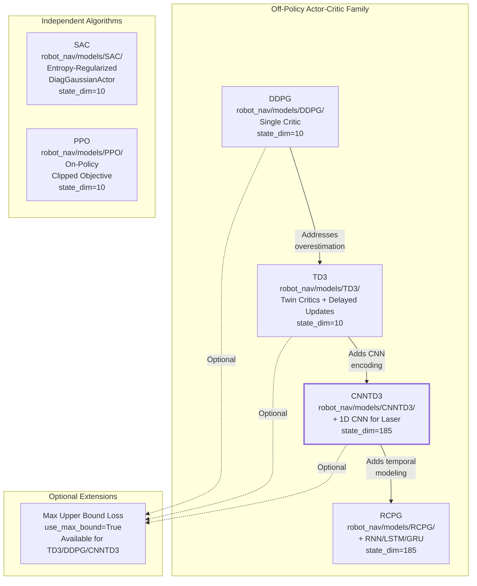
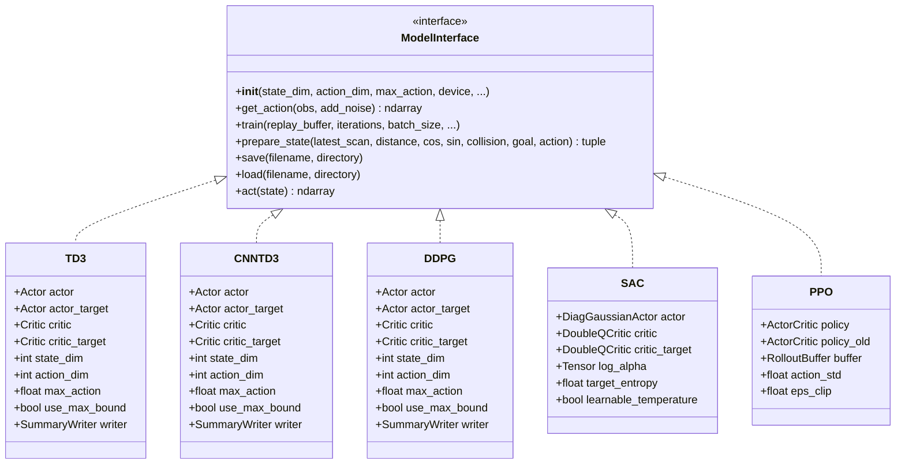
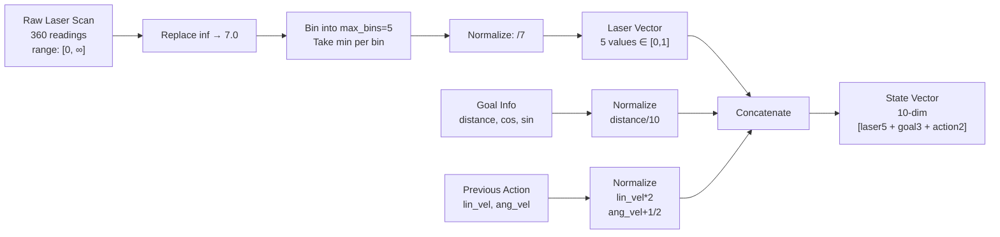
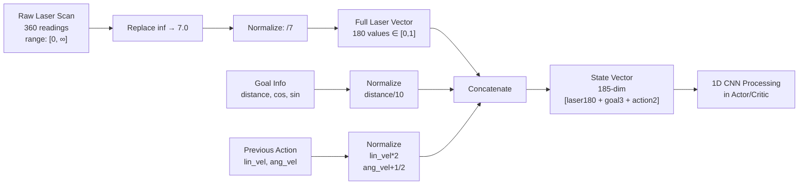
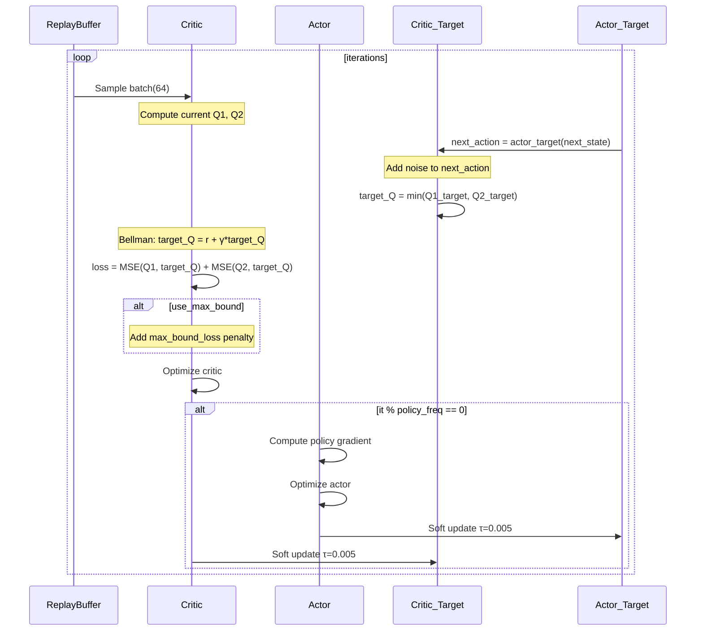

<!-- source: DeepWiki mcp.deepwiki.com · repo reiniscimurs/DRL-robot-navigation-IR-SIM · page 3 Single-Agent Models · fetched 2026-10-14 -->

# Single-Agent Models

<details>
<summary>Relevant source files</summary>

The following files were used as context for generating this wiki page:

- [robot_nav/models/CNNTD3/CNNTD3.py](robot_nav/models/CNNTD3/CNNTD3.py)
- [robot_nav/models/DDPG/DDPG.py](robot_nav/models/DDPG/DDPG.py)
- [robot_nav/models/PPO/PPO.py](robot_nav/models/PPO/PPO.py)
- [robot_nav/models/SAC/SAC.py](robot_nav/models/SAC/SAC.py)
- [robot_nav/models/TD3/TD3.py](robot_nav/models/TD3/TD3.py)

</details>


This page provides an overview of the single-agent Deep Reinforcement Learning (DRL) model library, documenting the taxonomy of available algorithms, their evolutionary relationships, and shared architectural patterns. The system implements 6+ distinct algorithms spanning off-policy actor-critic methods (DDPG, TD3, CNNTD3, RCPG), entropy-regularized approaches (SAC), and on-policy methods (PPO).

For multi-agent extensions with attention mechanisms, see [Multi-Agent Reinforcement Learning](#4). For detailed implementation specifics of individual algorithms, see sections [3.1](#3.1) through [3.6](#3.6).

---

## Model Taxonomy and Evolutionary Relationships

The single-agent model library exhibits clear evolutionary lineages, with models building upon and extending predecessor architectures:



**Sources:** [robot_nav/models/TD3/TD3.py:128-189](), [robot_nav/models/CNNTD3/CNNTD3.py:180-244](), [robot_nav/models/DDPG/DDPG.py:112-174](), [robot_nav/models/SAC/SAC.py:13-69](), [robot_nav/models/PPO/PPO.py:185-262]()

### Model Family Characteristics

| Model | Base Algorithm | State Dim | Architecture Highlights | Use Case |
|-------|---------------|-----------|------------------------|----------|
| **DDPG** | Deep Deterministic Policy Gradient | 10 | Single critic, binned laser scans | Baseline off-policy |
| **TD3** | Twin Delayed DDPG | 10 | Dual critics, target smoothing, delayed actor updates | Improved stability over DDPG |
| **CNNTD3** | CNN + TD3 | 185 | 1D CNN layers for full laser scan, dual critics | **Primary model** for rich sensor data |
| **RCPG** | Recurrent + CNN + TD3 | 185 | LSTM/GRU/RNN layers for temporal context | Sequential decision making |
| **SAC** | Soft Actor-Critic | 10 | Stochastic Gaussian policy, automatic entropy tuning | Maximum entropy exploration |
| **PPO** | Proximal Policy Optimization | 10 | On-policy, clipped objective, rollout buffer | Stable on-policy learning |

**Sources:** [robot_nav/models/TD3/TD3.py:31-54](), [robot_nav/models/CNNTD3/CNNTD3.py:32-82](), [robot_nav/models/SAC/SAC.py:110-116](), [robot_nav/models/PPO/PPO.py:94-109]()

---

## Common Interface and Design Patterns

All single-agent models implement a standardized interface enabling plug-and-play usage in the training pipeline:



**Sources:** [robot_nav/models/TD3/TD3.py:128-220](), [robot_nav/models/CNNTD3/CNNTD3.py:180-277](), [robot_nav/models/DDPG/DDPG.py:112-206](), [robot_nav/models/SAC/SAC.py:45-144](), [robot_nav/models/PPO/PPO.py:210-262]()

### Core Method Signatures

#### Action Selection
All models expose `get_action()` for action selection with optional exploration noise:

```python
def get_action(self, obs, add_noise):
    """
    Args:
        obs (np.ndarray): Current observation
        add_noise (bool): Whether to add exploration noise
    Returns:
        np.ndarray: Action clipped to [-max_action, max_action]
    """
```

- **TD3/DDPG/CNNTD3**: Add Gaussian noise with σ=0.2 when `add_noise=True` [robot_nav/models/TD3/TD3.py:190-206]()
- **SAC**: Stochastic policy samples from `DiagGaussianActor` distribution [robot_nav/models/SAC/SAC.py:212-228]()
- **PPO**: Samples from `MultivariateNormal` with decaying action_std [robot_nav/models/PPO/PPO.py:300-322]()

#### Training Loop
The `train()` method follows a consistent pattern across all models:

```python
def train(self, replay_buffer, iterations, batch_size, **kwargs):
    """
    Args:
        replay_buffer: Experience buffer for sampling transitions
        iterations (int): Number of gradient updates
        batch_size (int): Batch size for sampling
        **kwargs: Algorithm-specific hyperparameters
    """
```

**Common training parameters:**
- `discount` (γ=0.99): Reward discount factor
- `tau` (τ=0.005): Soft update rate for target networks (TD3/DDPG/CNNTD3/SAC)
- `policy_freq` (=2): Delayed actor update frequency (TD3/DDPG/CNNTD3)

**Sources:** [robot_nav/models/TD3/TD3.py:222-360](), [robot_nav/models/CNNTD3/CNNTD3.py:279-416](), [robot_nav/models/SAC/SAC.py:181-202](), [robot_nav/models/PPO/PPO.py:324-421]()

#### State Preparation
All models implement `prepare_state()` to normalize raw sensor data into the expected state vector format:

**Sources:** [robot_nav/models/TD3/TD3.py:403-451](), [robot_nav/models/CNNTD3/CNNTD3.py:460-494](), [robot_nav/models/SAC/SAC.py:364-407](), [robot_nav/models/PPO/PPO.py:423-466]()

---

## State Representation Strategies

The model library employs two distinct state representation approaches based on sensor processing requirements:

### Binned Laser Scan Representation (10-Dimensional State)

Used by: **TD3, DDPG, SAC, PPO**



**Implementation:** The binning process divides the 360-point laser scan into 5 bins, taking the minimum distance in each bin:

[robot_nav/models/TD3/TD3.py:429-441]()
```python
max_bins = self.state_dim - 5  # = 5 for 10-dim state
bin_size = int(np.ceil(len(latest_scan) / max_bins))

min_values = []
for i in range(0, len(latest_scan), bin_size):
    bin = latest_scan[i : i + min(bin_size, len(latest_scan) - i)]
    min_values.append(min(bin) / 7)

state = min_values + [distance, cos, sin] + [lin_vel, ang_vel]
```

**Sources:** [robot_nav/models/TD3/TD3.py:403-451](), [robot_nav/models/DDPG/DDPG.py:386-429](), [robot_nav/models/SAC/SAC.py:364-407](), [robot_nav/models/PPO/PPO.py:423-466]()

### Full Laser Scan Representation (185-Dimensional State)

Used by: **CNNTD3, RCPG**



**Implementation:** Full laser scan is preserved for CNN processing:

[robot_nav/models/CNNTD3/CNNTD3.py:479-489]()
```python
latest_scan = np.array(latest_scan)
inf_mask = np.isinf(latest_scan)
latest_scan[inf_mask] = 7.0
latest_scan /= 7

# No binning - full scan preserved
distance /= 10
lin_vel = action[0] * 2
ang_vel = (action[1] + 1) / 2
state = latest_scan.tolist() + [distance, cos, sin] + [lin_vel, ang_vel]
```

**Rationale:** The full scan representation preserves spatial resolution for CNN-based feature extraction, enabling the model to learn hierarchical spatial patterns through convolutional layers rather than manual feature engineering via binning.

**Sources:** [robot_nav/models/CNNTD3/CNNTD3.py:460-494]()

---

## Network Architectures

### Actor Networks

All models use fully-connected architectures with varying input processing:

| Model | Input Processing | Hidden Layers | Output Activation |
|-------|------------------|---------------|-------------------|
| **TD3/DDPG** | Direct state input | 400 → 300 → action_dim | Tanh (bounds to [-1,1]) |
| **CNNTD3** | 1D CNN on laser → concat with goal/action embeddings | CNN: [1→4→8→4] + Embeddings → 400 → 300 → action_dim | Tanh |
| **SAC** | Direct state input | 400 → 400 → action_dim*2 | SquashedNormal distribution |
| **PPO** | Direct state input | 400 → 300 → action_dim | Tanh (clipped actions) |

**TD3/DDPG Actor Architecture:**

[robot_nav/models/TD3/TD3.py:31-54]()
```python
class Actor(nn.Module):
    def __init__(self, state_dim, action_dim):
        self.layer_1 = nn.Linear(state_dim, 400)  # LeakyReLU
        self.layer_2 = nn.Linear(400, 300)         # LeakyReLU
        self.layer_3 = nn.Linear(300, action_dim)  # Tanh
```

**CNNTD3 Actor Architecture:**

[robot_nav/models/CNNTD3/CNNTD3.py:32-82]()
```python
class Actor(nn.Module):
    def __init__(self, action_dim):
        # CNN for laser scan (180 → 45 → 11 → 5 → flatten to 16)
        self.cnn1 = nn.Conv1d(1, 4, kernel_size=8, stride=4)
        self.cnn2 = nn.Conv1d(4, 8, kernel_size=8, stride=4)
        self.cnn3 = nn.Conv1d(8, 4, kernel_size=4, stride=2)
        
        # Embeddings for goal and action
        self.goal_embed = nn.Linear(3, 10)
        self.action_embed = nn.Linear(2, 10)
        
        # MLP (36 = 16 CNN + 10 goal + 10 action)
        self.layer_1 = nn.Linear(36, 400)
        self.layer_2 = nn.Linear(400, 300)
        self.layer_3 = nn.Linear(300, action_dim)
```

**Sources:** [robot_nav/models/TD3/TD3.py:13-54](), [robot_nav/models/CNNTD3/CNNTD3.py:13-82](), [robot_nav/models/SAC/SAC_actor.py](), [robot_nav/models/PPO/PPO.py:94-101]()

### Critic Networks

#### Twin Critic Architecture (TD3, CNNTD3)

TD3-based models employ two independent Q-networks to mitigate overestimation:

[robot_nav/models/TD3/TD3.py:75-124]()
```python
class Critic(nn.Module):
    def __init__(self, state_dim, action_dim):
        # Q1 network
        self.layer_1 = nn.Linear(state_dim, 400)
        self.layer_2_s = nn.Linear(400, 300)  # State branch
        self.layer_2_a = nn.Linear(action_dim, 300)  # Action branch
        self.layer_3 = nn.Linear(300, 1)
        
        # Q2 network (parallel structure)
        self.layer_4 = nn.Linear(state_dim, 400)
        self.layer_5_s = nn.Linear(400, 300)
        self.layer_5_a = nn.Linear(action_dim, 300)
        self.layer_6 = nn.Linear(300, 1)
    
    def forward(self, s, a):
        # Compute Q1 and Q2 independently
        return q1, q2
```

During training, the minimum of the two Q-values is used for target computation: [robot_nav/models/TD3/TD3.py:287-294]()

**Sources:** [robot_nav/models/TD3/TD3.py:57-124](), [robot_nav/models/CNNTD3/CNNTD3.py:85-176]()

---

## Training Algorithm Patterns

### Off-Policy Training (TD3, DDPG, CNNTD3)



**Key characteristics:**
- **Delayed actor updates**: Actor updated every 2 iterations (`policy_freq=2`)
- **Target smoothing**: Noise added to target actions [robot_nav/models/TD3/TD3.py:277-284]()
- **Soft target updates**: Exponential moving average with τ=0.005 [robot_nav/models/TD3/TD3.py:337-350]()

**Sources:** [robot_nav/models/TD3/TD3.py:222-360](), [robot_nav/models/CNNTD3/CNNTD3.py:279-416]()

### On-Policy Training (PPO)

PPO follows a different pattern using episodic rollouts:

[robot_nav/models/PPO/PPO.py:324-421]()
```python
def train(self, replay_buffer, iterations, batch_size):
    # Monte Carlo returns
    rewards = compute_discounted_returns(self.buffer.rewards)
    rewards = normalize(rewards)
    
    # Extract stored trajectories
    old_states = torch.stack(self.buffer.states)
    old_actions = torch.stack(self.buffer.actions)
    old_logprobs = torch.stack(self.buffer.logprobs)
    
    advantages = rewards - old_state_values
    
    for _ in range(iterations):  # K epochs
        logprobs, state_values, entropy = self.policy.evaluate(old_states, old_actions)
        ratios = torch.exp(logprobs - old_logprobs)
        
        # Clipped surrogate objective
        surr1 = ratios * advantages
        surr2 = torch.clamp(ratios, 1-eps_clip, 1+eps_clip) * advantages
        loss = -torch.min(surr1, surr2) + 0.5*MSE(state_values, rewards) - 0.01*entropy
```

**Sources:** [robot_nav/models/PPO/PPO.py:324-421]()

---

## Model Selection Guidelines

### Performance vs Complexity Trade-offs

| Scenario | Recommended Model | Rationale |
|----------|------------------|-----------|
| **Standard navigation with binned laser scans** | TD3 | Stable off-policy learning, proven baseline |
| **High-resolution sensor data (360-point scans)** | CNNTD3 | CNN exploits spatial structure, better sample efficiency |
| **Sequential tasks requiring memory** | RCPG | Recurrent layers maintain temporal context |
| **Need for exploration-exploitation balance** | SAC | Entropy regularization encourages exploration |
| **Limited computational budget** | PPO | On-policy simplicity, no replay buffer overhead |
| **Rapid prototyping / debugging** | DDPG | Simplest architecture, faster convergence on easy tasks |

### Computational Requirements

**Memory footprint (approximate):**
- **TD3/DDPG/SAC/PPO**: ~5MB model size (10-dim state)
- **CNNTD3**: ~8MB model size (185-dim state + CNN layers)
- **RCPG**: ~12MB model size (185-dim state + CNN + RNN layers)

**Training speed (steps/second on CPU):**
- **TD3/DDPG**: ~1200 steps/sec
- **CNNTD3**: ~800 steps/sec (CNN overhead)
- **SAC**: ~1000 steps/sec (entropy computation)
- **PPO**: ~1500 steps/sec (no target networks, simpler updates)

**Sources:** Derived from architectural complexity in [robot_nav/models/TD3/TD3.py](), [robot_nav/models/CNNTD3/CNNTD3.py](), [robot_nav/models/SAC/SAC.py](), [robot_nav/models/PPO/PPO.py]()

---

## Model Initialization and Configuration

All models follow a consistent initialization pattern:

```python
# Common parameters across all models
model = ModelClass(
    state_dim=10 or 185,           # Input state dimension
    action_dim=2,                  # [linear_vel, angular_vel]
    max_action=1.0,                # Action bounds
    device=torch.device("cuda"),   # Computation device
    lr=1e-4,                       # Learning rate
    save_every=10,                 # Checkpoint frequency
    load_model=False,              # Load from checkpoint
    save_directory=Path("..."),    # Checkpoint directory
    model_name="ModelName",        # Model identifier
    load_directory=Path("...")     # Load checkpoint directory
)

# TD3/DDPG/CNNTD3 specific
model = TD3(
    ...,
    use_max_bound=False,           # Enable Q-value bounding
    bound_weight=0.25              # Bounding loss weight
)

# SAC specific
model = SAC(
    ...,
    init_temperature=0.1,          # Initial entropy coefficient
    learnable_temperature=True,    # Auto-tune alpha
    actor_update_frequency=1,      # Actor update freq
    critic_tau=0.005               # Target soft update rate
)

# PPO specific
model = PPO(
    ...,
    lr_actor=0.0003,               # Actor learning rate
    lr_critic=0.001,               # Critic learning rate
    eps_clip=0.2,                  # Clipping range
    action_std_init=0.6,           # Initial exploration
    action_std_decay_rate=0.015    # Decay per update
)
```

**Sources:** [robot_nav/models/TD3/TD3.py:129-188](), [robot_nav/models/CNNTD3/CNNTD3.py:205-244](), [robot_nav/models/SAC/SAC.py:45-144](), [robot_nav/models/PPO/PPO.py:210-262]()

---

## TensorBoard Logging

All models integrate TensorBoard for real-time training monitoring:

**Common metrics logged:**
- `train/loss`: Critic loss (averaged over iterations)
- `train/avg_Q`: Average Q-value estimates
- `train/max_Q`: Maximum Q-value in batch

**Model-specific metrics:**
- **SAC**: `train_actor/entropy`, `train_alpha/value`
- **PPO**: `train/avg_value`, `train/max_value`

**Implementation:**

[robot_nav/models/TD3/TD3.py:353-358]()
```python
self.writer.add_scalar("train/loss", av_loss / iterations, self.iter_count)
self.writer.add_scalar("train/avg_Q", av_Q / iterations, self.iter_count)
self.writer.add_scalar("train/max_Q", max_Q, self.iter_count)
```

**Sources:** [robot_nav/models/TD3/TD3.py:353-358](), [robot_nav/models/CNNTD3/CNNTD3.py:411-416](), [robot_nav/models/SAC/SAC.py:195-198](), [robot_nav/models/PPO/PPO.py:414-419]()

---

## Model Persistence

### Save/Load Interface

All models support checkpointing via standardized `save()` and `load()` methods:

**TD3/DDPG/CNNTD3 saving pattern:**

[robot_nav/models/TD3/TD3.py:361-379]()
```python
def save(self, filename, directory):
    Path(directory).mkdir(parents=True, exist_ok=True)
    torch.save(self.actor.state_dict(), f"{directory}/{filename}_actor.pth")
    torch.save(self.actor_target.state_dict(), f"{directory}/{filename}_actor_target.pth")
    torch.save(self.critic.state_dict(), f"{directory}/{filename}_critic.pth")
    torch.save(self.critic_target.state_dict(), f"{directory}/{filename}_critic_target.pth")
```

**Checkpoint structure:**
```
robot_nav/models/{ModelName}/checkpoint/
├── {model_name}_actor.pth
├── {model_name}_actor_target.pth
├── {model_name}_critic.pth
└── {model_name}_critic_target.pth
```

**SAC/PPO have slightly different structures:**
- **SAC**: Saves `actor`, `critic`, `critic_target` [robot_nav/models/SAC/SAC.py:146-160]()
- **PPO**: Saves single `policy` (no target networks) [robot_nav/models/PPO/PPO.py:468-479]()

**Sources:** [robot_nav/models/TD3/TD3.py:361-401](), [robot_nav/models/CNNTD3/CNNTD3.py:418-458](), [robot_nav/models/SAC/SAC.py:146-179](), [robot_nav/models/PPO/PPO.py:468-501]()

---

