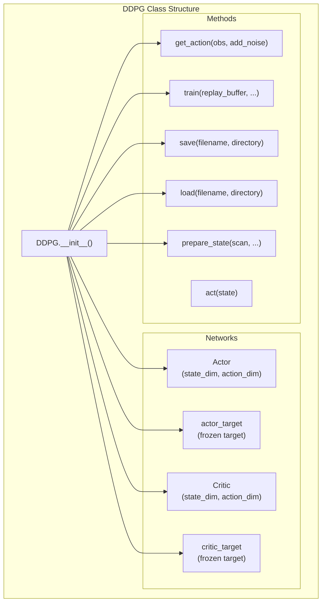
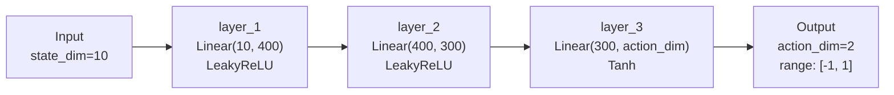
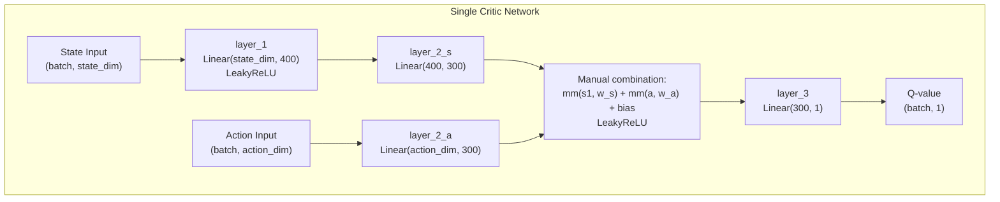
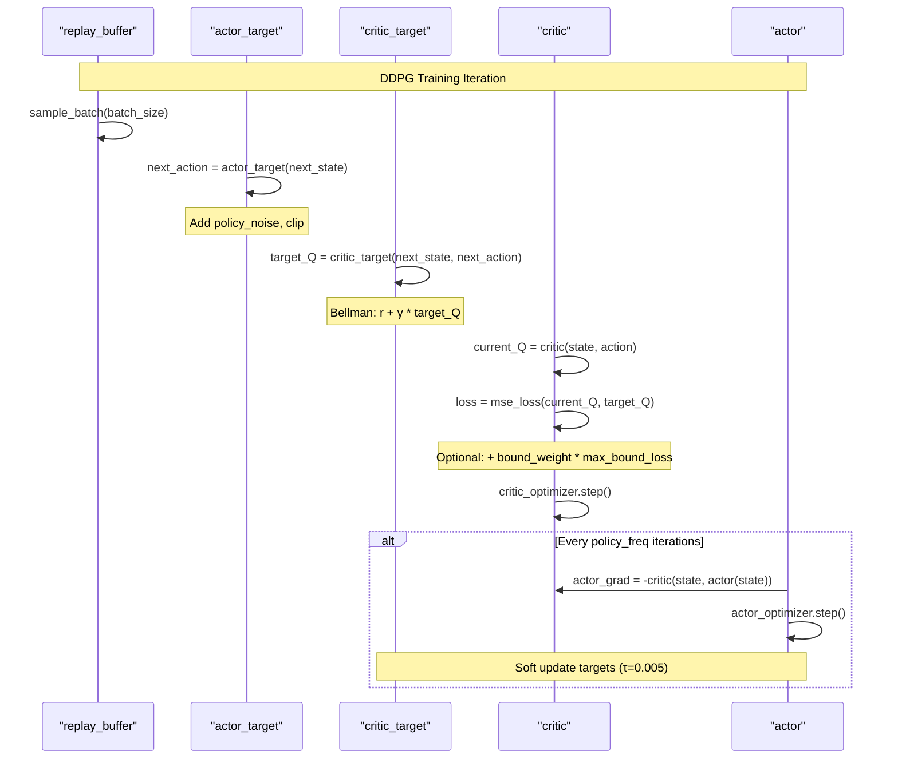
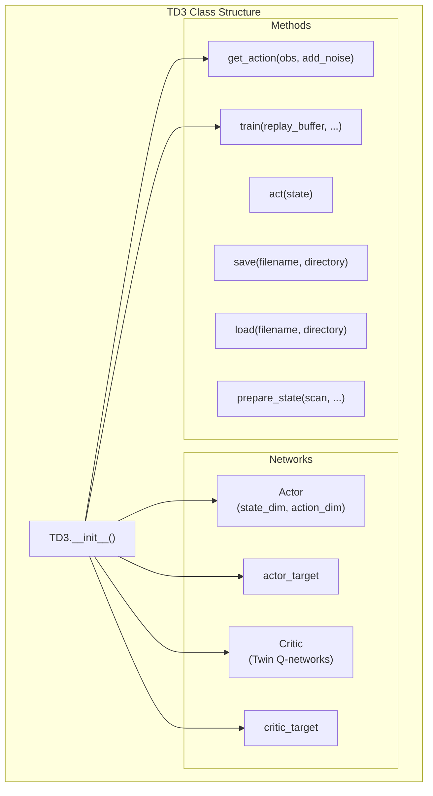
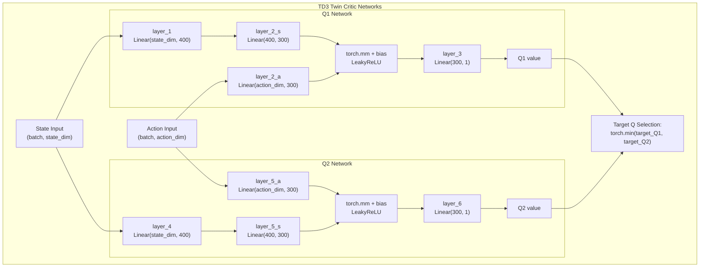
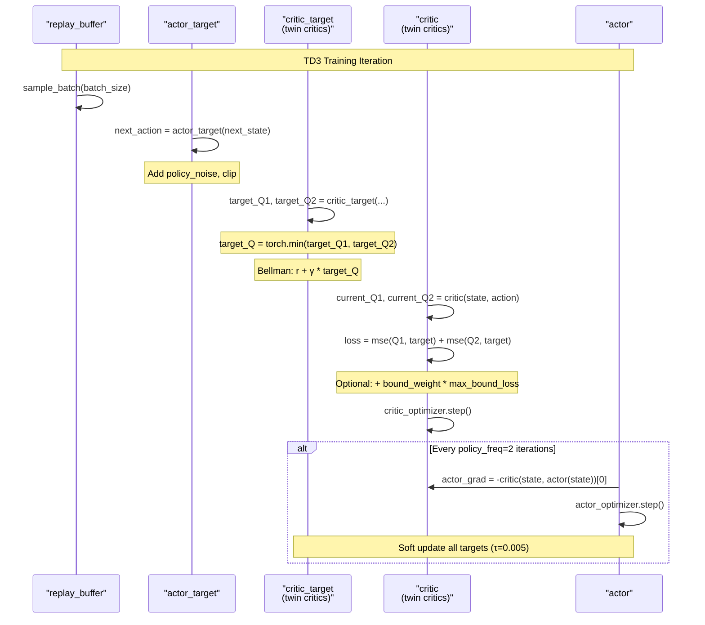
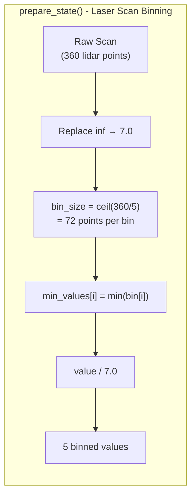
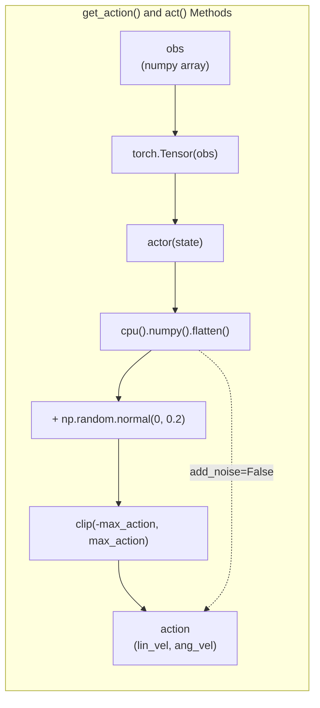

<!-- source: DeepWiki mcp.deepwiki.com · repo reiniscimurs/DRL-robot-navigation-IR-SIM · page 3.1 TD3 and DDPG · fetched 2026-10-14 -->

# TD3 and DDPG

<details>
<summary>Relevant source files</summary>

The following files were used as context for generating this wiki page:

- [robot_nav/models/CNNTD3/CNNTD3.py](robot_nav/models/CNNTD3/CNNTD3.py)
- [robot_nav/models/DDPG/DDPG.py](robot_nav/models/DDPG/DDPG.py)
- [robot_nav/models/TD3/TD3.py](robot_nav/models/TD3/TD3.py)

</details>


This document covers both the Deep Deterministic Policy Gradient (DDPG) and Twin Delayed Deep Deterministic Policy Gradient (TD3) algorithms. DDPG is the foundational actor-critic algorithm for continuous control, while TD3 extends it with twin critic networks and delayed policy updates to address Q-value overestimation bias.

Both algorithms operate on 10-dimensional state vectors created through laser scan binning. For enhanced variants with CNN processing of full 185-dimensional laser scans, see [CNNTD3](#3.2). For temporal modeling with recurrent networks, see [RCPG](#3.3).

## Algorithm Overview

### Evolution: DDPG → TD3

DDPG introduced deterministic policy gradients for continuous control, using an actor-critic framework with experience replay and target networks. TD3 improves upon DDPG by addressing three key issues:

1. **Twin Critics**: Two Q-networks with minimum selection to reduce overestimation
2. **Delayed Policy Updates**: Actor updates less frequently than critics (`policy_freq=2`)
3. **Target Policy Smoothing**: Noise added to target actions for regularization

**Key Algorithmic Difference:**

| Feature | DDPG | TD3 |
|---------|------|-----|
| **Critic Networks** | Single Q-network | Twin Q-networks (Q1, Q2) |
| **Target Q Selection** | `target_Q = critic_target(...)` | `target_Q = min(Q1, Q2)` |
| **Policy Update Frequency** | Every iteration | Every `policy_freq` iterations |
| **State Dimension** | 10 (binned laser scan) | 10 (binned laser scan) |
| **Class Location** | `robot_nav/models/DDPG/DDPG.py` | `robot_nav/models/TD3/TD3.py` |

**Sources:** [robot_nav/models/DDPG/DDPG.py:112-343](), [robot_nav/models/TD3/TD3.py:128-359]()

## DDPG Implementation

### DDPG Class Structure

The `DDPG` class in `robot_nav/models/DDPG/DDPG.py` implements the base algorithm with four networks:



**Sources:** [robot_nav/models/DDPG/DDPG.py:112-175]()

### DDPG Actor Network

The `Actor` network architecture is identical in both DDPG and TD3:



**Initialization:** Kaiming uniform for all linear layers with `nonlinearity='leaky_relu'`

**Sources:** [robot_nav/models/DDPG/DDPG.py:13-54]()

### DDPG Critic Network

The DDPG `Critic` uses a **single Q-network** (unlike TD3's twin critics):



**Key Implementation Detail:** The critic manually performs matrix multiplication (`torch.mm`) for state and action pathways before combining them, rather than using a simple concatenation.

**Sources:** [robot_nav/models/DDPG/DDPG.py:57-109]()

### DDPG Training Loop



**Sources:** [robot_nav/models/DDPG/DDPG.py:208-343]()

## TD3 Implementation

### TD3 Class Structure

The `TD3` class extends DDPG with twin critics:



**Sources:** [robot_nav/models/TD3/TD3.py:128-189]()

### TD3 Critic Network

The TD3 `Critic` implements **twin Q-networks** to reduce overestimation bias:



**Twin Critic Architecture:**
- **Two Independent Q-Networks:** Separate parameters for Q1 and Q2 to provide independent estimates
- **Identical Structure:** Each network has 400 → 300 units with LeakyReLU activations
- **Minimum Selection:** During training, `torch.min(target_Q1, target_Q2)` selects the conservative estimate
- **Purpose:** Reduces overestimation bias by preventing both critics from overestimating simultaneously

**Sources:** [robot_nav/models/TD3/TD3.py:57-125]()

### TD3 Training Loop



**Key TD3 Training Features:**

| Component | DDPG Approach | TD3 Approach |
|-----------|---------------|--------------|
| **Critic Target** | `target_Q = critic_target(...)` | `target_Q = min(Q1, Q2)` from twin critics |
| **Critic Loss** | `mse_loss(current_Q, target_Q)` | `mse_loss(Q1, target) + mse_loss(Q2, target)` |
| **Actor Update** | Every iteration | Every `policy_freq=2` iterations |
| **Purpose** | Standard actor-critic | Reduces overestimation, improves stability |

**Sources:** [robot_nav/models/TD3/TD3.py:222-359]()

## Comparison Table

### Detailed Algorithm Differences

| Aspect | DDPG | TD3 |
|--------|------|-----|
| **Critic Architecture** | Single `Critic` network | Twin `Critic` networks (Q1, Q2) |
| **Target Q Computation** | `critic_target(next_state, next_action)` | `torch.min(target_Q1, target_Q2)` |
| **Critic Loss Formula** | `F.mse_loss(current_Q, target_Q)` | `F.mse_loss(Q1, target) + F.mse_loss(Q2, target)` |
| **Actor Update Frequency** | Every iteration (`policy_freq=2` parameter unused) | Every `policy_freq=2` iterations |
| **Delayed Updates** | No | Yes - actor lags behind critics |
| **Network Forward Pass** | Returns single Q-value | Returns tuple `(q1, q2)` |
| **Primary Use Case** | Baseline algorithm | Production model with better stability |
| **Implementation File** | `robot_nav/models/DDPG/DDPG.py` | `robot_nav/models/TD3/TD3.py` |

**Sources:** [robot_nav/models/DDPG/DDPG.py:208-343](), [robot_nav/models/TD3/TD3.py:222-359]()

## Shared Components

### State Preparation

Both DDPG and TD3 use **identical** `prepare_state()` methods to process raw sensor data into 10-dimensional state vectors.

#### State Vector Composition (10-Dimensional)

For `state_dim=10`, the state vector contains:

| Component | Source | Normalization | Dimension | Range |
|-----------|--------|---------------|-----------|-------|
| **Binned Laser Scan** | `latest_scan` | Min-binning, divide by 7.0 | 5 | [0, 1] |
| **Goal Distance** | `distance` | Divide by 10.0 | 1 | [0, 1] |
| **Goal Direction** | `cos, sin` | Trigonometric | 2 | [-1, 1] |
| **Previous Action** | `action[0], action[1]` | Linear: *2, Angular: (+1)/2 | 2 | [0, 1] |

#### Laser Scan Binning Process



**Binning Implementation:**
```python
max_bins = self.state_dim - 5  # For state_dim=10, max_bins=5
bin_size = int(np.ceil(len(latest_scan) / max_bins))  # 360/5 = 72

for i in range(0, len(latest_scan), bin_size):
    bin = latest_scan[i : i + min(bin_size, len(latest_scan) - i)]
    min_values.append(min(bin) / 7)  # Take minimum, normalize
```

**Design Rationale:**
- **Minimum Selection:** Emphasizes nearest obstacles in each angular sector for collision avoidance
- **Fixed Dimensionality:** Reduces 360-point lidar to 5 values for compact state representation
- **Normalization:** All values in [0, 1] range for neural network stability

**Sources:** [robot_nav/models/TD3/TD3.py:403-451](), [robot_nav/models/DDPG/DDPG.py:386-429]()

### Action Selection

Both algorithms use identical action generation with optional exploration noise:



**Noise Parameters:**
- **Training (add_noise=True):** Gaussian noise with μ=0, σ=0.2 added to each action dimension
- **Evaluation (add_noise=False):** Deterministic policy output from actor network
- **Clipping:** Actions bounded to `[-max_action, max_action]` = `[-1, 1]`

**Sources:** [robot_nav/models/DDPG/DDPG.py:176-205](), [robot_nav/models/TD3/TD3.py:190-219]()

## Configuration and Usage

### Initialization Parameters

Both `DDPG` and `TD3` classes share identical initialization parameters:

| Parameter | Type | Default | Description |
|-----------|------|---------|-------------|
| `state_dim` | int | Required | Input state dimension (typically 10) |
| `action_dim` | int | Required | Output action dimension (typically 2) |
| `max_action` | float | Required | Maximum action magnitude (typically 1.0) |
| `device` | torch.device | Required | CUDA or CPU device |
| `lr` | float | 1e-4 | Learning rate for Adam optimizers |
| `save_every` | int | 0 | Checkpoint frequency (0 disables) |
| `load_model` | bool | False | Load weights on initialization |
| `save_directory` | Path | `.../checkpoint` | Directory for saving models |
| `model_name` | str | "TD3"/"DDPG" | Name for saved files and TensorBoard |
| `load_directory` | Path | `.../checkpoint` | Directory for loading models |
| `use_max_bound` | bool | False | Enable Q-value upper bound regularization |
| `bound_weight` | float | 0.25 | Weight for bound penalty loss |

**Sources:** [robot_nav/models/DDPG/DDPG.py:135-174](), [robot_nav/models/TD3/TD3.py:129-188]()

### Training Parameters

The `train()` method accepts hyperparameters controlling the learning process:

| Parameter | Default | Description |
|-----------|---------|-------------|
| `iterations` | Required | Number of training steps per call |
| `batch_size` | Required | Mini-batch size for sampling |
| `discount` | 0.99 | Discount factor γ for future rewards |
| `tau` | 0.005 | Soft update rate for target networks |
| `policy_noise` | 0.2 | Std dev of noise added to target actions |
| `noise_clip` | 0.5 | Maximum magnitude of target policy noise |
| `policy_freq` | 2 | Frequency of actor updates (TD3 only, DDPG unused) |
| `max_lin_vel` | 0.5 | Max linear velocity for bound calculation |
| `max_ang_vel` | 1.0 | Max angular velocity for bound calculation |
| `goal_reward` | 100 | Reward for reaching goal |
| `distance_norm` | 10 | Distance normalization for bounds |
| `time_step` | 0.3 | Simulation time step |

**Sources:** [robot_nav/models/DDPG/DDPG.py:208-223](), [robot_nav/models/TD3/TD3.py:222-237]()

## Advanced Features

### Max Upper Bound Regularization

When `use_max_bound=True`, TD3 applies additional regularization to prevent Q-value overestimation:

```python
if self.use_max_bound:
    max_bound = get_max_bound(...)
    max_excess_Q1 = F.relu(current_Q1 - max_bound)
    max_excess_Q2 = F.relu(current_Q2 - max_bound)
    max_bound_loss = (max_excess_Q1**2).mean() + (max_excess_Q2**2).mean()
    loss += self.bound_weight * max_bound_loss
```

This feature uses domain knowledge about maximum possible rewards to constrain Q-value estimates.

### Model Persistence

The TD3 implementation provides comprehensive model saving and loading:

- **Save Components:** Actor, actor_target, critic, critic_target networks
- **File Format:** PyTorch `.pth` state dictionaries
- **Directory Management:** Automatic directory creation
- **Loading:** Automatic weight restoration with verification

**Sources:** [robot_nav/models/TD3/TD3.py:302-320](), [robot_nav/models/TD3/TD3.py:361-401]()

---

