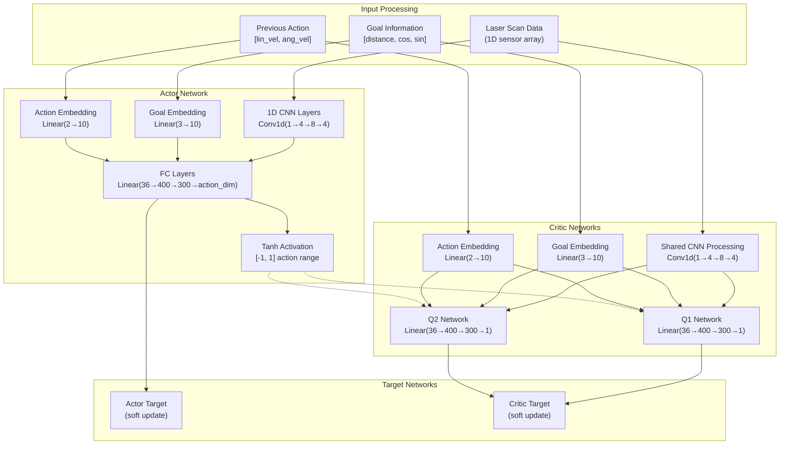
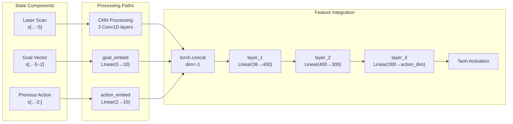
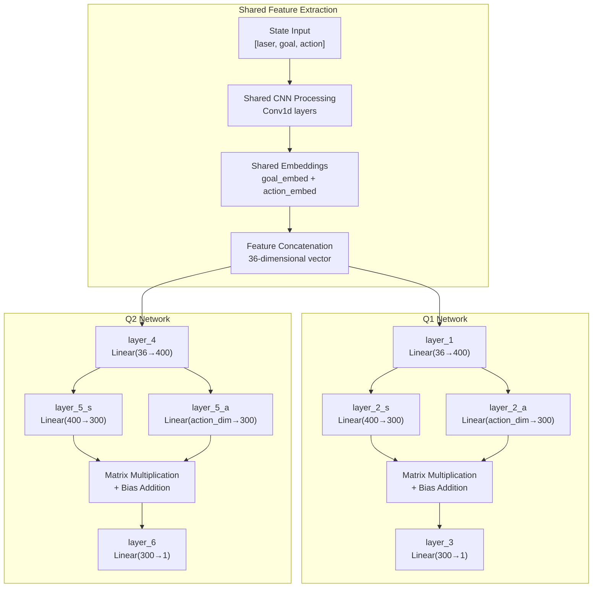
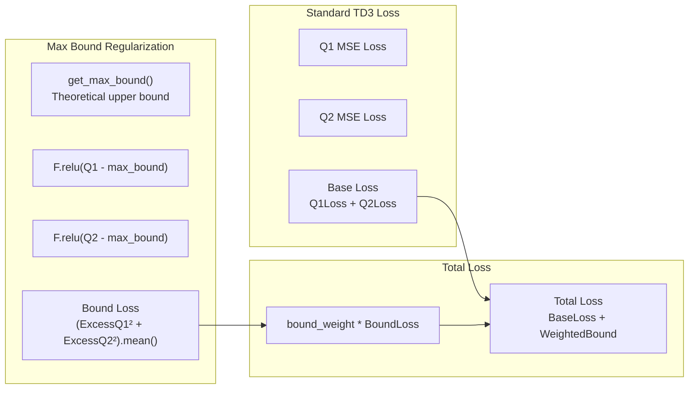
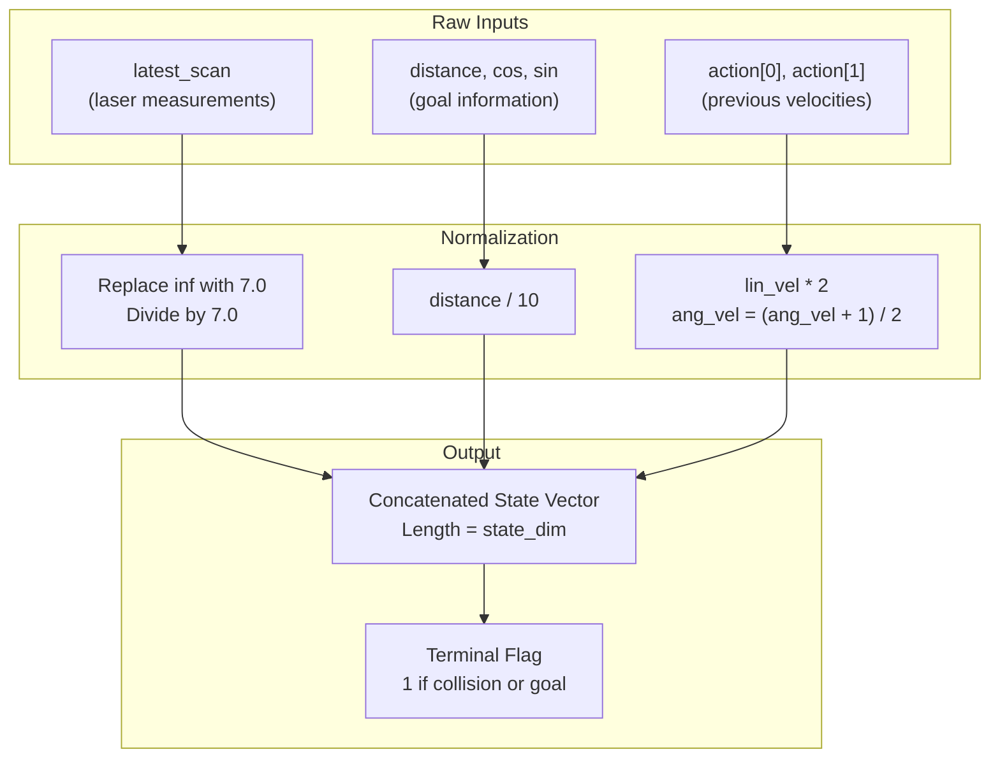

<!-- source: DeepWiki mcp.deepwiki.com · repo reiniscimurs/DRL-robot-navigation-IR-SIM · page 3.2 CNNTD3 · fetched 2026-10-14 -->

# CNNTD3 Model

Relevant source files

The following files were used as context for generating this wiki page:

- [README.md](README.md)
- [poetry.lock](poetry.lock)
- [robot_nav/models/CNNTD3/CNNTD3.py](robot_nav/models/CNNTD3/CNNTD3.py)
- [robot_nav/models/DDPG/DDPG.py](robot_nav/models/DDPG/DDPG.py)
- [robot_nav/models/TD3/TD3.py](robot_nav/models/TD3/TD3.py)
- [robot_nav/rl_train.py](robot_nav/rl_train.py)

This document covers the CNNTD3 (Convolutional Neural Network Twin Delayed Deep Deterministic Policy Gradient) model implementation, which extends the TD3 algorithm with specialized CNN architectures for processing laser scan sensor data in robot navigation tasks. For information about the base TD3 algorithm without CNN enhancements, see [TD3 Model](#3.1). For recurrent extensions of this model, see [RCPG Model](#3.6).

## Overview

The CNNTD3 model is a specialized variant of the TD3 reinforcement learning algorithm designed specifically for robot navigation using laser scan data. Unlike traditional fully-connected approaches, CNNTD3 leverages 1D convolutional neural networks to extract spatial features from laser range measurements, making it particularly effective for processing high-dimensional sensor inputs in navigation tasks.

**Key Features:**
- 1D CNN-based processing of laser scan data
- Twin critic networks for reduced overestimation bias
- Delayed policy updates for training stability
- Optional max upper bound regularization
- Integrated TensorBoard logging and model persistence

## Architecture Overview

The CNNTD3 architecture consists of three main components: an Actor network for action selection, dual Critic networks for Q-value estimation, and target networks for stable training.

Sources: [robot_nav/models/CNNTD3/CNNTD3.py:13-178]()

## Actor Network Architecture

The `Actor` class implements a policy network that maps environmental states to continuous actions through a combination of CNN feature extraction and fully connected layers.

### CNN Feature Extraction

The Actor processes laser scan data through three 1D convolutional layers:

| Layer | Input Channels | Output Channels | Kernel Size | Stride | Activation |
|-------|----------------|-----------------|-------------|--------|------------|
| cnn1  | 1              | 4               | 8           | 4      | LeakyReLU  |
| cnn2  | 4              | 8               | 8           | 4      | LeakyReLU  |
| cnn3  | 8              | 4               | 4           | 2      | LeakyReLU  |

The CNN layers progressively reduce the spatial dimensions while extracting increasingly abstract features from the laser scan data.

### State Embedding and Integration

The Actor network combines CNN-extracted laser features (16 dimensions), embedded goal information (10 dimensions), and embedded previous action (10 dimensions) into a 36-dimensional feature vector before passing through fully connected layers.

Sources: [robot_nav/models/CNNTD3/CNNTD3.py:32-82]()

## Critic Network Architecture

The `Critic` class implements dual Q-networks following the TD3 algorithm's approach to reduce overestimation bias. Both Q-networks share the same CNN feature extraction but maintain separate fully connected layers.

### Dual Q-Network Implementation

The Critic uses a specialized architecture where state and action information are processed separately in the final layers and combined through matrix multiplication operations, allowing for more flexible Q-value estimation.

Sources: [robot_nav/models/CNNTD3/CNNTD3.py:104-176]()

## CNNTD3 Agent Implementation

The main `CNNTD3` class orchestrates the training process, managing Actor and Critic networks along with their target counterparts.

### Training Algorithm

The training process follows the TD3 algorithm with the following key steps:

| Component | Update Frequency | Description |
|-----------|------------------|-------------|
| Critic Networks | Every iteration | Update Q1 and Q2 using Bellman equation |
| Actor Network | Every `policy_freq` iterations | Policy gradient update |
| Target Networks | Every `policy_freq` iterations | Soft update with rate `tau` |

### Max Upper Bound Regularization

When `use_max_bound=True`, the CNNTD3 agent applies additional regularization to prevent Q-value overestimation:

Sources: [robot_nav/models/CNNTD3/CNNTD3.py:359-376]()

## State Preparation

The `prepare_state` method normalizes raw sensor data and navigation information into a format suitable for the neural networks.

### State Vector Composition

| Component | Dimensions | Normalization | Description |
|-----------|------------|---------------|-------------|
| Laser Scan | Variable (processed by CNN) | `/7.0` | Raw laser measurements, inf values set to 7.0 |
| Distance | 1 | `/10.0` | Euclidean distance to goal |
| Cosine | 1 | None | Cosine of heading angle to goal |
| Sine | 1 | None | Sine of heading angle to goal |
| Linear Velocity | 1 | `*2.0` | Previous linear velocity |
| Angular Velocity | 1 | `(value + 1) / 2` | Previous angular velocity |

### State Processing Pipeline

Sources: [robot_nav/models/CNNTD3/CNNTD3.py:460-494]()

## Model Persistence and Configuration

The CNNTD3 agent provides comprehensive model management capabilities through save/load functionality and configurable training parameters.

### Model Files Structure

| File Pattern | Network Component | Description |
|--------------|-------------------|-------------|
| `{model_name}_actor.pth` | Actor Network | Current actor parameters |
| `{model_name}_actor_target.pth` | Actor Target | Target actor parameters |
| `{model_name}_critic.pth` | Critic Network | Current critic parameters |
| `{model_name}_critic_target.pth` | Critic Target | Target critic parameters |

### Key Configuration Parameters

| Parameter | Default | Description |
|-----------|---------|-------------|
| `lr` | 1e-4 | Learning rate for both actor and critic optimizers |
| `save_every` | 0 | Model checkpoint frequency (0 = disabled) |
| `use_max_bound` | False | Enable Q-value upper bound regularization |
| `bound_weight` | 0.25 | Weight for bound regularization loss |
| `save_directory` | `robot_nav/models/CNNTD3/checkpoint` | Model checkpoint directory |

Sources: [robot_nav/models/CNNTD3/CNNTD3.py:205-244](), [robot_nav/models/CNNTD3/CNNTD3.py:418-458]()

## Comparison with Base TD3/DDPG

The key differences between CNNTD3 and the base algorithms highlight its specialization for sensor-rich navigation tasks:

| Aspect | CNNTD3 | TD3/DDPG |
|--------|--------|----------|
| Input Processing | 1D CNN for laser scans | Fully connected only |
| State Representation | Full laser scan + embeddings | Binned laser features (DDPG) |
| Feature Extraction | Spatial convolutions | Linear transformations |
| Laser Data Handling | Maintains spatial relationships | Loses spatial structure |
| Network Architecture | Specialized CNN + FC | Pure FC networks |

Sources: [robot_nav/models/CNNTD3/CNNTD3.py:35-37](), [robot_nav/models/DDPG/DDPG.py:407-429]()

---

