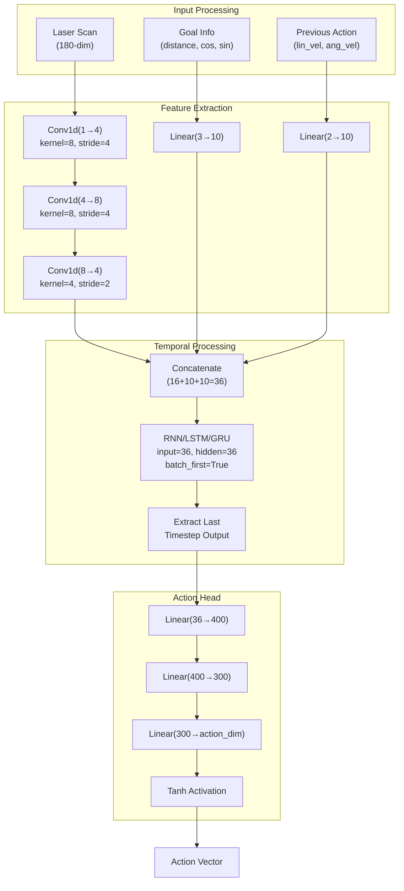
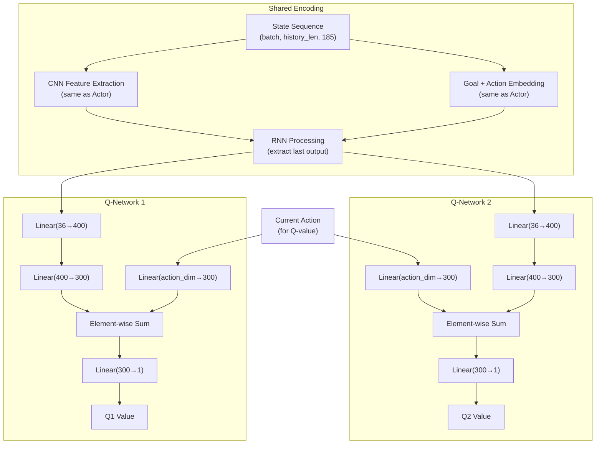
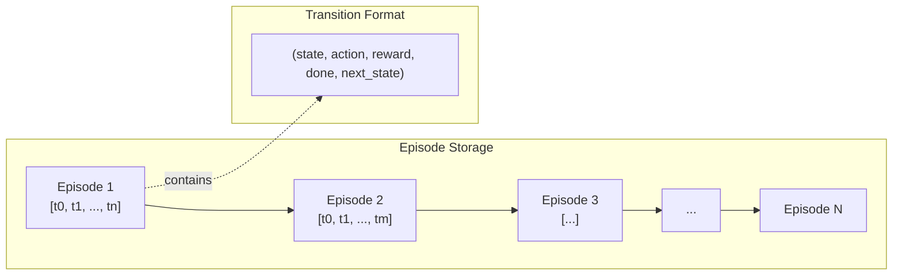
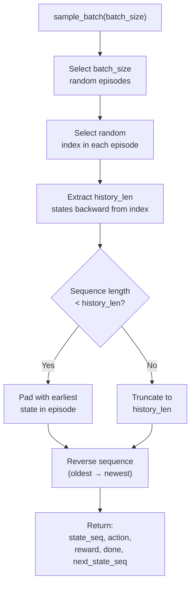
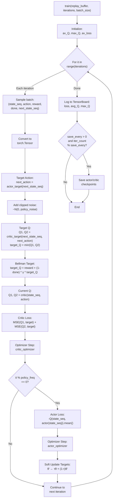
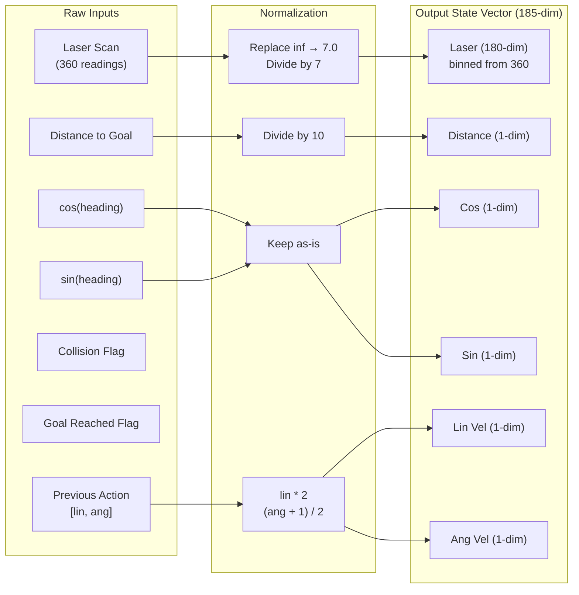
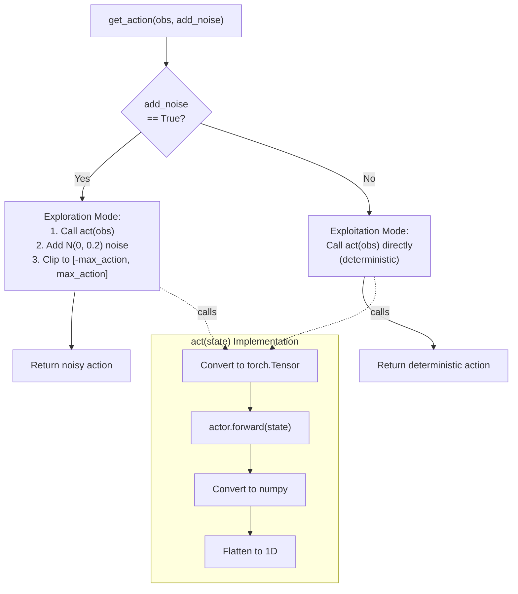
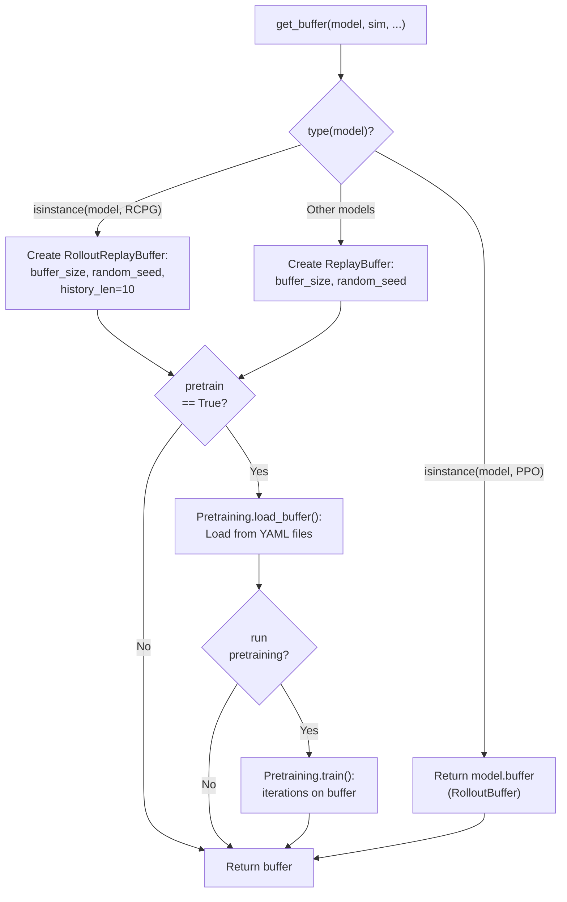
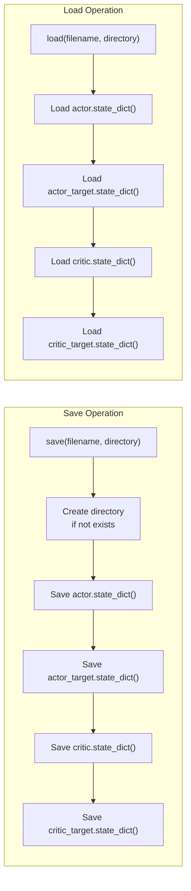

<!-- source: DeepWiki mcp.deepwiki.com · repo reiniscimurs/DRL-robot-navigation-IR-SIM · page 3.3 RCPG · fetched 2026-10-14 -->

# RCPG

<details>
<summary>Relevant source files</summary>

The following files were used as context for generating this wiki page:

- [robot_nav/models/RCPG/RCPG.py](robot_nav/models/RCPG/RCPG.py)
- [robot_nav/models/SAC/SAC_utils.py](robot_nav/models/SAC/SAC_utils.py)
- [robot_nav/replay_buffer.py](robot_nav/replay_buffer.py)
- [robot_nav/utils.py](robot_nav/utils.py)

</details>


This page documents the **Recurrent Convolutional Policy Gradient (RCPG)** model, which extends CNNTD3 by incorporating recurrent neural network layers (LSTM/GRU/RNN) for temporal sequence modeling in robotic navigation. RCPG processes historical state trajectories to capture temporal dependencies in the robot's sensor observations and decision-making process.

For information about the base TD3 algorithm without CNN or recurrent components, see [TD3 and DDPG](#3.1). For the CNN-enhanced version without recurrence, see [CNNTD3](#3.2). For RCPG's specialized replay buffer, see [Data Management and Replay Buffers](#2.2).

---

## Model Overview

RCPG is a recurrent actor-critic algorithm designed for continuous control in navigation tasks. It combines three key architectural features:

1. **1D Convolutional layers** for spatial feature extraction from 180-point laser scans
2. **Recurrent layers** (GRU/LSTM/RNN) for temporal sequence processing
3. **Twin delayed Q-learning** (TD3-style) for stable value estimation

The model operates on 185-dimensional state vectors and processes sequences of past states using a history window of 10 timesteps. Unlike standard off-policy algorithms that sample individual transitions, RCPG samples complete trajectories and extracts subsequences for training.

**Key Characteristics:**
- **State Dimension:** 185 (180 laser + 3 goal info + 2 previous action)
- **Action Dimension:** 2 (linear velocity, angular velocity)
- **Replay Buffer:** `RolloutReplayBuffer` with episode-based storage
- **History Length:** 10 timesteps (configurable)
- **RNN Type:** Configurable (GRU, LSTM, or vanilla RNN)

Sources: [robot_nav/models/RCPG/RCPG.py:194-225](), [robot_nav/replay_buffer.py:103-124]()

---

## Architecture

### Actor Network



The Actor network processes sequences of states through three stages:

1. **Parallel Feature Extraction** [robot_nav/models/RCPG/RCPG.py:67-80]():
   - Laser scans pass through three 1D convolutional layers with LeakyReLU activations
   - Goal information (distance, cos, sin) is embedded via a linear layer
   - Previous action is embedded separately
   - All features are concatenated to form a 36-dimensional feature vector per timestep

2. **Temporal Aggregation** [robot_nav/models/RCPG/RCPG.py:83-85]():
   - Feature sequences are reshaped to `(batch_size, history_len, 36)`
   - The RNN processes the entire sequence and returns outputs for all timesteps
   - Only the last timestep output is used for action prediction

3. **Action Generation** [robot_nav/models/RCPG/RCPG.py:86-89]():
   - Two fully connected layers with LeakyReLU activations
   - Final layer outputs raw action logits
   - Tanh activation maps actions to `[-1, 1]` range

**Network Initialization:** Uses Kaiming uniform initialization for all linear layers [robot_nav/models/RCPG/RCPG.py:54-58]()

Sources: [robot_nav/models/RCPG/RCPG.py:11-90]()

---

### Critic Network



The Critic implements **twin Q-networks** for stable value estimation:

1. **State Processing** [robot_nav/models/RCPG/RCPG.py:152-173]():
   - Uses identical CNN and RNN architecture as the Actor
   - Processes state sequences to extract temporal features
   - Outputs a single 36-dimensional representation from the last RNN timestep

2. **Twin Q-Networks** [robot_nav/models/RCPG/RCPG.py:133-149]():
   - Two independent Q-networks with separate parameters
   - Each network combines state features and action inputs
   - Actions are injected at the second layer via element-wise addition
   - Implementation uses matrix multiplication for efficiency: `torch.mm(state, weight.T) + torch.mm(action, weight.T) + bias`

3. **Q-Value Computation** [robot_nav/models/RCPG/RCPG.py:175-190]():
   - Both networks output scalar Q-values
   - Minimum Q-value is used during training (clipped double Q-learning)

Sources: [robot_nav/models/RCPG/RCPG.py:92-191]()

---

## RolloutReplayBuffer

RCPG uses `RolloutReplayBuffer` instead of standard `ReplayBuffer` to maintain episode structure and enable sequence sampling.

### Buffer Structure



**Key Differences from ReplayBuffer:**

| Feature | ReplayBuffer | RolloutReplayBuffer |
|---------|--------------|---------------------|
| Storage Unit | Individual transitions | Complete episodes |
| Buffer Type | `deque` of tuples | `deque` of episode lists |
| Sampling | Random transitions | Random position within random episode |
| History | Not maintained | Last `history_len` steps returned |
| Size Metric | Transition count | Episode count |

Sources: [robot_nav/replay_buffer.py:103-124]()

---

### Sequence Sampling

The buffer's `sample_batch` method implements specialized sequence extraction:



**Sampling Algorithm** [robot_nav/replay_buffer.py:156-214]():

1. **Episode Selection:** Sample `batch_size` episodes from the buffer (excluding the currently incomplete episode)
2. **Index Selection:** For each episode, randomly select a transition index
3. **Sequence Extraction:** Extract up to `history_len` previous states:
   - States are collected in reverse order from the selected index
   - If fewer than `history_len` states exist, pad with the earliest state
   - Both current states and next states are extracted as sequences
4. **Batch Construction:** Return arrays of shape `(batch_size, history_len, state_dim)`

**Padding Strategy:**
```python
if len(sequence) < history_len:
    missing = history_len - len(sequence)
    sequence += [sequence[-1]] * missing  # Repeat earliest state
```

Sources: [robot_nav/replay_buffer.py:156-214]()

---

## Training Algorithm

RCPG follows the Twin Delayed DDPG (TD3) training procedure with adaptations for sequence inputs.

### Training Loop



### Training Hyperparameters

| Parameter | Default Value | Description |
|-----------|---------------|-------------|
| `discount` | 0.99 | Discount factor (γ) for future rewards |
| `tau` | 0.005 | Soft update coefficient for target networks |
| `policy_noise` | 0.2 | Standard deviation of noise added to target actions |
| `noise_clip` | 0.5 | Maximum absolute value for clipped noise |
| `policy_freq` | 2 | Actor update frequency (every N critic updates) |
| `iterations` | Variable | Number of training iterations per call |
| `batch_size` | Variable | Number of sequences per batch |

Sources: [robot_nav/models/RCPG/RCPG.py:307-425]()

---

### Key Training Features

**1. Target Policy Smoothing** [robot_nav/models/RCPG/RCPG.py:362-368]():
```python
noise = torch.Tensor(batch_actions).data.normal_(0, policy_noise).to(device)
noise = noise.clamp(-noise_clip, noise_clip)
next_action = (next_action + noise).clamp(-max_action, max_action)
```
Adds clipped Gaussian noise to target actions to reduce value overestimation.

**2. Clipped Double Q-Learning** [robot_nav/models/RCPG/RCPG.py:371-378]():
```python
target_Q1, target_Q2 = self.critic_target(next_state, next_action)
target_Q = torch.min(target_Q1, target_Q2)
target_Q = reward + ((1 - done) * discount * target_Q).detach()
```
Uses the minimum of two Q-estimates to mitigate overestimation bias.

**3. Delayed Policy Updates** [robot_nav/models/RCPG/RCPG.py:391-415]():
Actor is updated every `policy_freq` iterations while critic updates every iteration. This stabilizes training by allowing the Q-function to converge before updating the policy.

**4. Soft Target Updates** [robot_nav/models/RCPG/RCPG.py:402-415]():
```python
target_param.data.copy_(tau * param.data + (1 - tau) * target_param.data)
```
Target networks are updated slowly using exponential moving average.

Sources: [robot_nav/models/RCPG/RCPG.py:307-425]()

---

## State Preparation

The `prepare_state` method converts raw sensor data into normalized state vectors compatible with the network input requirements.

### State Composition



### Normalization Details

**Laser Scan Processing** [robot_nav/models/RCPG/RCPG.py:502-506]():
```python
latest_scan = np.array(latest_scan)
inf_mask = np.isinf(latest_scan)
latest_scan[inf_mask] = 7.0  # Replace infinity with max range
latest_scan /= 7              # Normalize to [0, 1]
```
- 360 raw readings are binned/subsampled to 180 (handled externally)
- Infinite values (no obstacle detected) are capped at 7.0 meters
- All values normalized to [0, 1] range

**Goal Information** [robot_nav/models/RCPG/RCPG.py:509]():
- `distance`: Euclidean distance to goal divided by 10
- `cos`, `sin`: Heading angle components (already normalized to [-1, 1])

**Previous Action** [robot_nav/models/RCPG/RCPG.py:510-511]():
- Linear velocity: `lin_vel = action[0] * 2` (denormalization for storage)
- Angular velocity: `ang_vel = (action[1] + 1) / 2` (maps [-1, 1] to [0, 1])

**Terminal Flag** [robot_nav/models/RCPG/RCPG.py:515]():
Returns `1` if collision or goal reached, otherwise `0`. This signals episode termination.

Sources: [robot_nav/models/RCPG/RCPG.py:474-517]()

---

## Action Computation

### Inference Modes



### Implementation Details

**1. Deterministic Action** [robot_nav/models/RCPG/RCPG.py:288-304]():
```python
def act(self, state):
    state = torch.Tensor(state).to(self.device)
    return self.actor(state).cpu().data.numpy().flatten()
```
Directly queries the actor network without noise. Used during evaluation.

**2. Stochastic Action** [robot_nav/models/RCPG/RCPG.py:265-286]():
```python
def get_action(self, obs, add_noise):
    if add_noise:
        return (self.act(obs) + np.random.normal(0, 0.2, size=self.action_dim)
               ).clip(-self.max_action, self.max_action)
    else:
        return self.act(obs)
```
Adds Gaussian noise with σ=0.2 for exploration during training. Actions are clipped to valid range.

**Action Space:**
- Linear velocity: `[0, 0.5]` m/s (controlled by `max_action` scaling)
- Angular velocity: `[-1, 1]` rad/s

Sources: [robot_nav/models/RCPG/RCPG.py:265-304]()

---

## Model Integration

### Buffer Factory Integration



The `get_buffer` factory function in `robot_nav/utils.py` provides specialized buffer instantiation for RCPG:

**RCPG Buffer Creation** [robot_nav/utils.py:149-152]():
```python
if isinstance(model, RCPG):
    replay_buffer = RolloutReplayBuffer(
        buffer_size=buffer_size, random_seed=random_seed, history_len=history_len
    )
```

**Configuration Parameters:**
- `buffer_size`: Maximum number of episodes (default: 50000)
- `random_seed`: For reproducible sampling (default: 666)
- `history_len`: Sequence length for temporal modeling (default: 10)

**Pretraining Support:**
RCPG supports pretraining from offline datasets. The `Pretraining` class loads YAML files and populates the buffer using `prepare_state` to process raw observations [robot_nav/utils.py:54-85]().

Sources: [robot_nav/utils.py:114-179]()

---

## Model Persistence

### Save/Load Functions



**File Naming Convention** [robot_nav/models/RCPG/RCPG.py:438-447]():
- Actor: `{model_name}_actor.pth`
- Actor Target: `{model_name}_actor_target.pth`
- Critic: `{model_name}_critic.pth`
- Critic Target: `{model_name}_critic_target.pth`

The `model_name` is constructed as `{base_name}{rnn_type}`, e.g., `"RCPGgru"` for GRU-based RCPG [robot_nav/models/RCPG/RCPG.py:259]().

**Default Directories:**
- Save: `robot_nav/models/RCPG/checkpoint/`
- Load: `robot_nav/models/RCPG/checkpoint/`

**Automatic Checkpointing:**
When `save_every > 0`, models are automatically saved every N training iterations [robot_nav/models/RCPG/RCPG.py:423-424]().

Sources: [robot_nav/models/RCPG/RCPG.py:426-472]()

---

## TensorBoard Logging

RCPG logs training metrics using `SummaryWriter` from `torch.utils.tensorboard` [robot_nav/models/RCPG/RCPG.py:257]().

**Logged Metrics:**

| Metric | Tag | Description |
|--------|-----|-------------|
| Average Q-Value | `train/avg_Q` | Mean target Q-value across batch |
| Maximum Q-Value | `train/max_Q` | Maximum target Q-value in batch |
| Critic Loss | `train/loss` | Mean squared error of Q-value predictions |

Metrics are logged after each training call [robot_nav/models/RCPG/RCPG.py:420-422](), with `iter_count` tracking the number of training calls (not individual iterations).

**Accessing Logs:**
```bash
tensorboard --logdir=runs
```

Sources: [robot_nav/models/RCPG/RCPG.py:257-258](), [robot_nav/models/RCPG/RCPG.py:418-422]()

---

## Usage Example

```python
import torch
from robot_nav.models.RCPG.RCPG import RCPG
from robot_nav.utils import get_buffer

# Initialize model
device = torch.device("cuda" if torch.cuda.is_available() else "cpu")
model = RCPG(
    state_dim=185,
    action_dim=2,
    max_action=1.0,
    device=device,
    lr=1e-4,
    save_every=10,
    rnn="gru"  # or "lstm", "rnn"
)

# Get specialized replay buffer
replay_buffer = get_buffer(
    model=model,
    sim=env,
    load_saved_buffer=False,
    pretrain=False,
    pretraining_iterations=0,
    training_iterations=80,
    batch_size=64,
    history_len=10
)

# Training loop
for episode in range(num_episodes):
    state = env.reset()
    done = False
    
    while not done:
        # Get action with exploration noise
        action = model.get_action(state, add_noise=True)
        next_state, reward, done, _ = env.step(action)
        
        # Store transition
        replay_buffer.add(state, action, reward, done, next_state)
        state = next_state
    
    # Train model
    if replay_buffer.size() >= batch_size:
        model.train(
            replay_buffer=replay_buffer,
            iterations=80,
            batch_size=64,
            discount=0.99,
            tau=0.005
        )

# Save final model
model.save(filename="RCPGgru_final", directory="checkpoints/")
```

Sources: [robot_nav/models/RCPG/RCPG.py:227-264](), [robot_nav/utils.py:149-152]()

---

