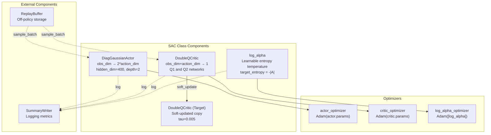
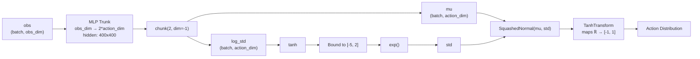
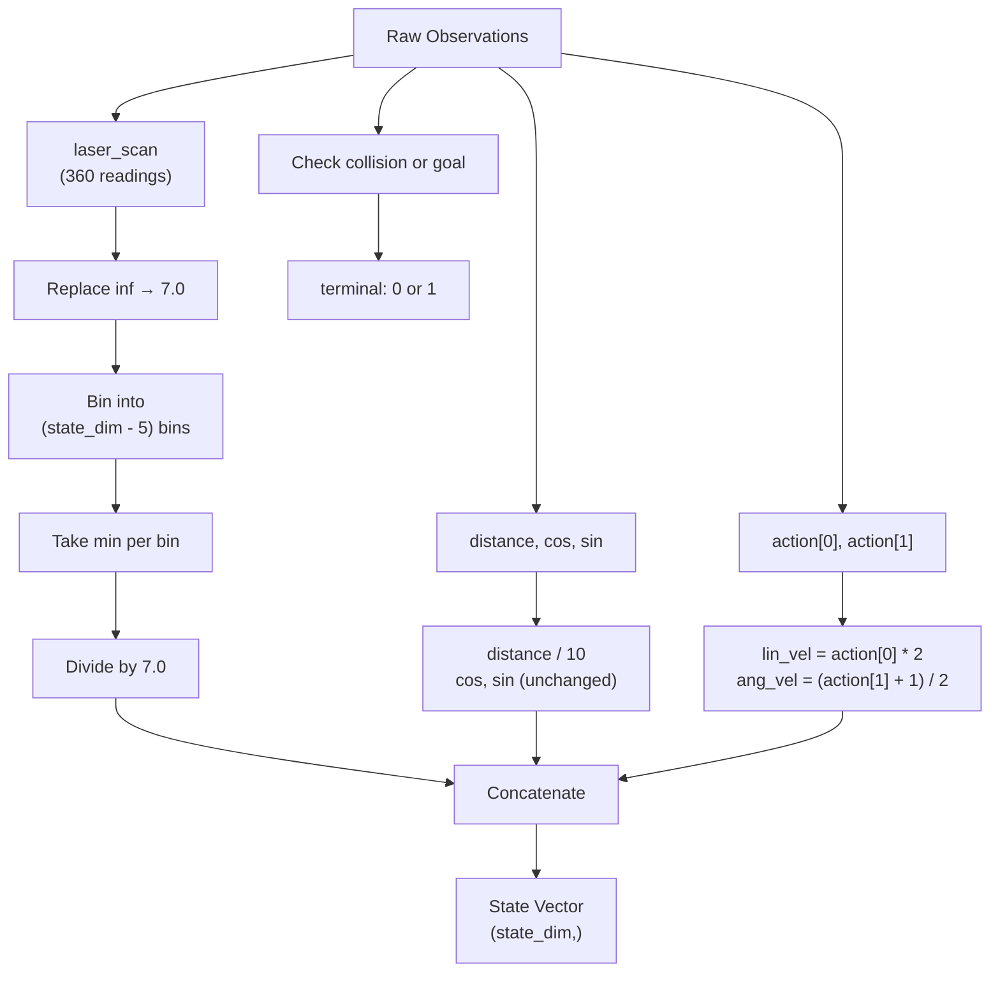
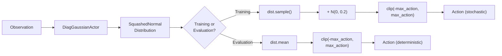

<!-- source: DeepWiki mcp.deepwiki.com · repo reiniscimurs/DRL-robot-navigation-IR-SIM · page 3.4 SAC · fetched 2026-10-14 -->

# SAC

<details>
<summary>Relevant source files</summary>

The following files were used as context for generating this wiki page:

- [robot_nav/models/PPO/PPO.py](robot_nav/models/PPO/PPO.py)
- [robot_nav/models/SAC/SAC.py](robot_nav/models/SAC/SAC.py)
- [robot_nav/models/SAC/SAC_actor.py](robot_nav/models/SAC/SAC_actor.py)
- [robot_nav/models/SAC/SAC_critic.py](robot_nav/models/SAC/SAC_critic.py)

</details>


## Purpose and Scope

This document describes the Soft Actor-Critic (SAC) algorithm implementation for single-agent robot navigation. SAC is an entropy-regularized off-policy actor-critic method that learns a stochastic policy by maximizing both expected reward and policy entropy. The implementation uses a diagonal Gaussian policy with tanh squashing, double Q-learning critics, and automatic entropy temperature tuning.

For the on-policy PPO algorithm, see [PPO](#3.5). For the deterministic TD3 algorithm, see [TD3 and DDPG](#3.1). For multi-agent methods, see [Multi-Agent Reinforcement Learning](#4).

**Sources:** [robot_nav/models/SAC/SAC.py:1-408]()

## Algorithm Overview

SAC optimizes a maximum entropy objective that balances reward maximization with policy entropy. The algorithm maintains:

- **Actor Network** (`DiagGaussianActor`): Outputs a squashed Gaussian distribution over actions
- **Two Critic Networks** (`DoubleQCritic`): Estimate state-action values using double Q-learning
- **Target Critic Network**: Provides stable target values during updates
- **Entropy Temperature** (`alpha`): Learnable parameter that balances exploration vs exploitation

The SAC implementation in [robot_nav/models/SAC/SAC.py]() uses 10-dimensional state vectors with binned laser scan data, supporting state dimensions from 10 to 185 depending on the number of bins.

**Sources:** [robot_nav/models/SAC/SAC.py:13-144]()



**Sources:** [robot_nav/models/SAC/SAC.py:45-144]()

## Network Architectures

### DiagGaussianActor

The actor network outputs a diagonal Gaussian distribution with tanh squashing to bound actions within `[-max_action, max_action]`. The network architecture:

| Component | Configuration |
|-----------|---------------|
| Input | `obs_dim` (typically 10) |
| Hidden Layers | `hidden_depth=2` layers of `hidden_dim=400` units each |
| Output | `2 * action_dim` (mean and log_std) |
| Activation | ReLU (in MLP trunk) |
| Log Std Bounds | `[-5, 2]` |

The output is split into mean (`mu`) and log standard deviation, which are used to create a `SquashedNormal` distribution. The log standard deviation is constrained using tanh and bounded to `[-5, 2]` for numerical stability.

**Sources:** [robot_nav/models/SAC/SAC_actor.py:138-189](), [robot_nav/models/SAC/SAC.py:110-116]()



**Sources:** [robot_nav/models/SAC/SAC_actor.py:165-188]()

### SquashedNormal Distribution

The `SquashedNormal` class implements a tanh-transformed Gaussian distribution. This ensures actions remain bounded while preserving differentiability for gradient-based optimization. The transformation applies:

$$\text{action} = \tanh(\text{sample from } \mathcal{N}(\mu, \sigma))$$

The log probability is adjusted by the log absolute determinant of the Jacobian:

$$\log \pi(a|s) = \log p(u|s) - \sum_i \log(1 - a_i^2 + \epsilon)$$

where $u$ is the pre-squashed action sampled from the Gaussian.

**Sources:** [robot_nav/models/SAC/SAC_actor.py:10-136]()

### DoubleQCritic

The critic uses two independent Q-networks (Q1 and Q2) to mitigate overestimation bias. Both networks share the same architecture but maintain separate weights:

| Component | Configuration |
|-----------|---------------|
| Input | `obs_dim + action_dim` |
| Hidden Layers | `hidden_depth=2` layers of `hidden_dim=400` units each |
| Output | 1 (Q-value) |
| Activation | ReLU |

During updates, the minimum of the two Q-values is used to compute targets, following the TD3 approach.

**Sources:** [robot_nav/models/SAC/SAC_critic.py:7-55](), [robot_nav/models/SAC/SAC.py:96-108]()

## Training Process

The training loop performs the following updates:

1. **Sample Batch**: Draw `(s, a, r, done, s')` from replay buffer
2. **Update Critic**: Compute temporal difference loss
3. **Update Actor**: Maximize expected Q-value minus entropy term
4. **Update Alpha**: Adjust entropy temperature (if learnable)
5. **Soft Update Target**: `target = (1-tau)*target + tau*critic`

```mermaid
sequenceDiagram
    participant Buffer as ReplayBuffer
    participant SAC as SAC.update()
    participant Critic as DoubleQCritic
    participant Actor as DiagGaussianActor
    participant Alpha as log_alpha
    participant Target as critic_target
    
    Buffer->>SAC: sample_batch(batch_size)
    SAC->>SAC: Convert to tensors
    
    Note over SAC,Critic: Critic Update
    SAC->>Actor: Forward(next_obs)
    Actor->>SAC: dist.rsample(), log_prob
    SAC->>Target: Q1(s', a'), Q2(s', a')
    SAC->>SAC: target_V = min(Q1, Q2) - alpha*log_prob
    SAC->>SAC: target_Q = r + gamma * target_V
    SAC->>Critic: Q1(s, a), Q2(s, a)
    SAC->>Critic: MSE(Q1, target_Q) + MSE(Q2, target_Q)
    SAC->>Critic: critic_optimizer.step()
    
    alt step % actor_update_frequency == 0
        Note over SAC,Actor: Actor Update
        SAC->>Actor: Forward(obs)
        Actor->>SAC: dist.rsample(), log_prob
        SAC->>Critic: Q1(s, a), Q2(s, a)
        SAC->>SAC: actor_loss = alpha*log_prob - min(Q1, Q2)
        SAC->>Actor: actor_optimizer.step()
        
        alt learnable_temperature
            Note over SAC,Alpha: Alpha Update
            SAC->>Alpha: alpha_loss = alpha*(-log_prob - target_entropy)
            SAC->>Alpha: log_alpha_optimizer.step()
        end
    end
    
    alt step % critic_target_update_frequency == 0
        SAC->>Target: soft_update(critic, tau=0.005)
    end
```

**Sources:** [robot_nav/models/SAC/SAC.py:181-203](), [robot_nav/models/SAC/SAC.py:329-363]()

### Update Frequency Parameters

| Parameter | Default Value | Description |
|-----------|---------------|-------------|
| `actor_update_frequency` | 1 | Update actor every N critic updates |
| `critic_target_update_frequency` | 2 | Update target every N steps |
| `critic_tau` | 0.005 | Soft update coefficient |
| `discount` | 0.99 | Reward discount factor |

**Sources:** [robot_nav/models/SAC/SAC.py:60-61](), [robot_nav/models/SAC/SAC.py:76-79]()

### Critic Update

The critic update minimizes the mean squared Bellman error:

```
target_Q = reward + (1 - done) * discount * (min(Q1', Q2') - alpha * log_prob)
critic_loss = MSE(Q1(s,a), target_Q) + MSE(Q2(s,a), target_Q)
```

where `Q1'` and `Q2'` are computed from the target critic network and next actions sampled from the current policy.

**Sources:** [robot_nav/models/SAC/SAC.py:249-283]()

### Actor Update

The actor update maximizes the expected Q-value while promoting entropy:

```
dist = actor(obs)
action = dist.rsample()  # Reparameterization trick
log_prob = dist.log_prob(action)
actor_Q = min(Q1(s,a), Q2(s,a))
actor_loss = (alpha * log_prob - actor_Q).mean()
```

The reparameterization trick enables backpropagation through the stochastic sampling process.

**Sources:** [robot_nav/models/SAC/SAC.py:284-316]()

### Entropy Temperature Tuning

When `learnable_temperature=True`, the entropy coefficient `alpha` is automatically tuned to maintain a target entropy equal to the negative action dimension:

```
target_entropy = -action_dim
alpha_loss = (alpha * (-log_prob - target_entropy)).mean()
```

This ensures the policy maintains sufficient exploration throughout training.

**Sources:** [robot_nav/models/SAC/SAC.py:121-124](), [robot_nav/models/SAC/SAC.py:317-327]()

## State Preparation

The `prepare_state` method converts raw sensor observations into a normalized state vector suitable for the neural networks. This is identical to the state preparation used in TD3 and PPO for 10-dimensional states.

### Processing Pipeline

1. **Laser Scan Processing**:
   - Replace infinite values with 7.0 (max sensor range)
   - Divide into `state_dim - 5` bins
   - Take minimum value in each bin
   - Normalize by dividing by 7.0

2. **Goal Information**:
   - Distance to goal (normalized by 10)
   - Cosine and sine of heading angle

3. **Previous Action**:
   - Linear velocity (scaled: `action[0] * 2`)
   - Angular velocity (scaled: `(action[1] + 1) / 2`)



**Sources:** [robot_nav/models/SAC/SAC.py:364-407]()

### State Dimensions

For the default configuration with `state_dim=10`:
- 5 laser scan bins (min values from binning 360 readings into 5 groups)
- 1 distance to goal
- 2 heading angles (cos, sin)
- 2 previous action components (linear, angular)

The binning process ensures the state dimension remains fixed regardless of the number of raw laser scan readings.

**Sources:** [robot_nav/models/SAC/SAC.py:385-402]()

## Action Selection

SAC provides two modes of action selection:

### Training Mode (`add_noise=True`)

During training, actions are sampled from the policy distribution and additional Gaussian noise is added for exploration:

```python
action = actor.act(obs) + N(0, 0.2)
action = clip(action, -max_action, max_action)
```

The `act` method samples from the `SquashedNormal` distribution when `sample=True`.

**Sources:** [robot_nav/models/SAC/SAC.py:212-228]()

### Evaluation Mode (`add_noise=False`)

During evaluation, the mean of the distribution is used without sampling or noise:

```python
dist = actor(obs)
action = dist.mean  # Deterministic, no sampling
```

This provides a deterministic policy for testing and deployment.

**Sources:** [robot_nav/models/SAC/SAC.py:230-247]()



**Sources:** [robot_nav/models/SAC/SAC.py:212-247]()

## Hyperparameters

The SAC implementation uses the following default hyperparameters:

| Parameter | Default Value | Description |
|-----------|---------------|-------------|
| `discount` | 0.99 | Reward discount factor |
| `init_temperature` | 0.1 | Initial entropy coefficient |
| `alpha_lr` | 1e-4 | Learning rate for alpha |
| `alpha_betas` | (0.9, 0.999) | Adam betas for alpha optimizer |
| `actor_lr` | 1e-4 | Learning rate for actor |
| `actor_betas` | (0.9, 0.999) | Adam betas for actor optimizer |
| `actor_update_frequency` | 1 | Actor updates per critic update |
| `critic_lr` | 1e-4 | Learning rate for critic |
| `critic_betas` | (0.9, 0.999) | Adam betas for critic optimizer |
| `critic_tau` | 0.005 | Soft update coefficient for target |
| `critic_target_update_frequency` | 2 | Target updates per training step |
| `learnable_temperature` | True | Whether to learn alpha automatically |
| `log_std_bounds` | [-5, 2] | Bounds on log standard deviation |
| `hidden_dim` | 400 | Hidden layer size for actor/critic |
| `hidden_depth` | 2 | Number of hidden layers |

**Sources:** [robot_nav/models/SAC/SAC.py:45-116]()

## Model Persistence

The SAC class provides save/load functionality for model checkpoints:

### Saving Models

The `save` method stores three model files:
- `{model_name}_actor.pth`: Actor network weights
- `{model_name}_critic.pth`: Critic network weights
- `{model_name}_critic_target.pth`: Target critic weights

**Sources:** [robot_nav/models/SAC/SAC.py:146-160]()

### Loading Models

The `load` method restores all three networks from the specified directory. Models are loaded at initialization if `load_model=True`.

**Sources:** [robot_nav/models/SAC/SAC.py:162-179](), [robot_nav/models/SAC/SAC.py:118-119]()

### Checkpointing

When `save_every > 0`, the model automatically saves every N training steps:

```python
if self.save_every > 0 and self.step % self.save_every == 0:
    self.save(filename=self.model_name, directory=self.save_directory)
```

**Sources:** [robot_nav/models/SAC/SAC.py:201-202]()

## TensorBoard Logging

SAC logs the following metrics to TensorBoard:

| Metric | Description |
|--------|-------------|
| `train_critic/loss` | Critic MSE loss |
| `train_actor/loss` | Actor policy loss |
| `train_actor/target_entropy` | Target entropy value |
| `train_actor/entropy` | Current policy entropy |
| `train_alpha/loss` | Entropy temperature loss |
| `train_alpha/value` | Current alpha value |
| `train/batch_reward` | Mean batch reward |
| `train_actor/mu_hist` | Actor output mean histogram (optional) |
| `train_actor/std_hist` | Actor output std histogram (optional) |
| `train_critic/q1_hist` | Q1 value histogram (optional) |
| `train_critic/q2_hist` | Q2 value histogram (optional) |

Histogram logging is enabled when `log_dist_and_hist=True`.

**Sources:** [robot_nav/models/SAC/SAC.py:86-94](), [robot_nav/models/SAC/SAC.py:195-198](), [robot_nav/models/SAC/SAC.py:274-282](), [robot_nav/models/SAC/SAC.py:306-327]()

## Integration with Training Pipeline

SAC integrates with the main training pipeline via:

1. **Buffer Compatibility**: Uses standard `ReplayBuffer` (obtained via `get_buffer` factory with `model_type="SAC"`)
2. **Training Interface**: Implements `train(replay_buffer, iterations, batch_size)` method
3. **Action Interface**: Implements `get_action(obs, add_noise)` method
4. **State Preparation**: Implements `prepare_state(laser_scan, distance, cos, sin, collision, goal, action)` method
5. **Model Persistence**: Implements `save(filename, directory)` and `load(filename, directory)` methods

These interfaces allow SAC to be used interchangeably with other single-agent models like TD3, DDPG, and PPO in the training scripts.

**Sources:** [robot_nav/models/SAC/SAC.py:13-408]()

---

