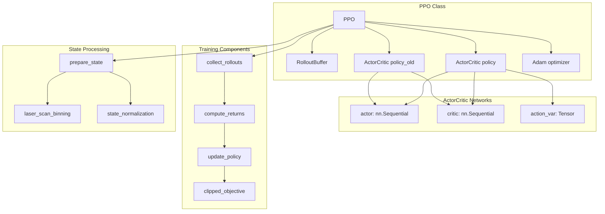
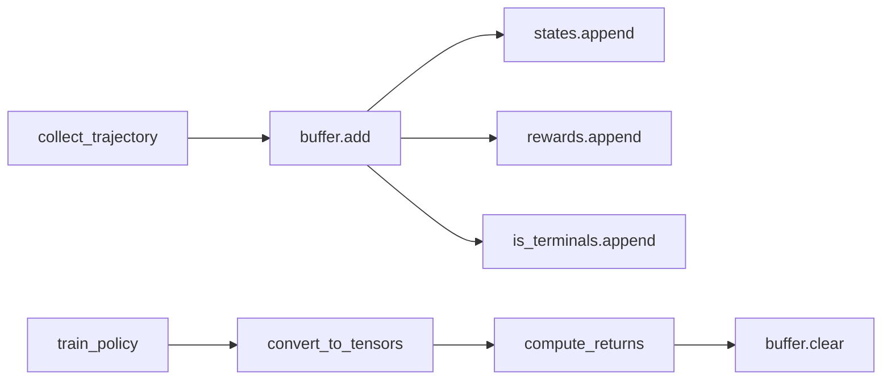
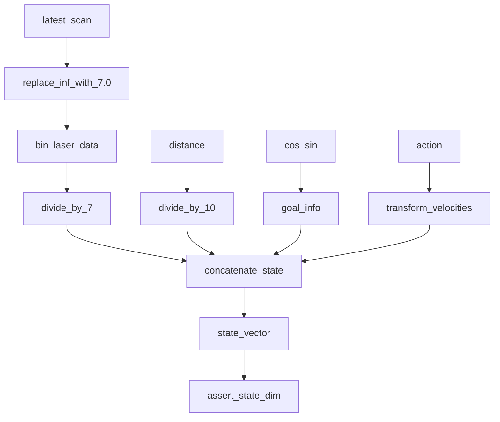
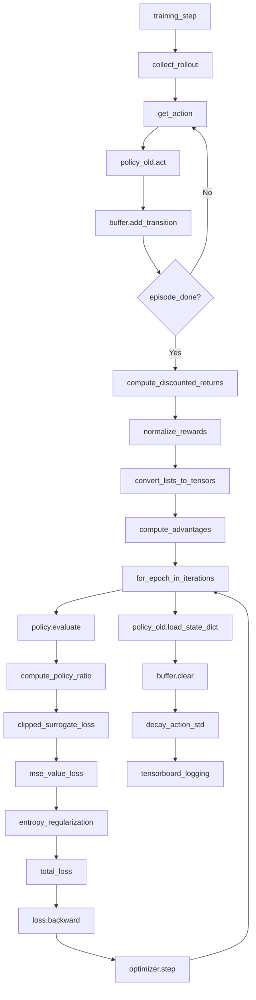

<!-- source: DeepWiki mcp.deepwiki.com · repo reiniscimurs/DRL-robot-navigation-IR-SIM · page 3.5 PPO · fetched 2026-10-14 -->

# PPO Model

<details>
<summary>Relevant source files</summary>

The following files were used as context for generating this wiki page:

- [robot_nav/models/PPO/PPO.py](robot_nav/models/PPO/PPO.py)
- [robot_nav/models/SAC/SAC.py](robot_nav/models/SAC/SAC.py)

</details>


This document covers the Proximal Policy Optimization (PPO) implementation for continuous control in robot navigation. PPO is an on-policy reinforcement learning algorithm that uses rollout buffers and clipped objective functions to ensure stable policy updates.

For information about off-policy algorithms like TD3 and SAC, see [TD3 Model](#3.1) and [SAC Model](#3.3). For the overall training system integration, see [Core Training System](#2).

## Architecture Overview

PPO implements an actor-critic architecture with on-policy learning, using rollout buffers to collect trajectory data before performing batch updates. The implementation consists of three main components: the rollout buffer, actor-critic networks, and the PPO training algorithm.

**PPO Model Architecture**


Sources: [robot_nav/models/PPO/PPO.py:185-262](), [robot_nav/models/PPO/PPO.py:61-109]()

## Core Components

### RolloutBuffer

The `RolloutBuffer` class stores trajectory data for on-policy learning. Unlike off-policy algorithms that use replay buffers, PPO collects complete episodes before training.

| Component | Type | Description |
|-----------|------|-------------|
| `actions` | list | Actions taken by the agent |
| `states` | list | Observed states |
| `logprobs` | list | Log probabilities of actions |
| `rewards` | list | Rewards received |
| `state_values` | list | Value function estimates |
| `is_terminals` | list | Episode termination flags |

**RolloutBuffer Operations**


Sources: [robot_nav/models/PPO/PPO.py:10-59]()

### ActorCritic Networks

The `ActorCritic` class implements dual neural networks with shared architecture but different outputs. Both networks use identical layer structures with tanh activations.

**Network Architecture:**
- **Actor**: `state_dim → 400 → 300 → action_dim` (outputs action mean)
- **Critic**: `state_dim → 400 → 300 → 1` (outputs state value)
- **Action Distribution**: `MultivariateNormal` with diagonal covariance

The actor network outputs action means, while the critic estimates state values for advantage computation.

Sources: [robot_nav/models/PPO/PPO.py:61-109](), [robot_nav/models/PPO/PPO.py:94-109]()

### PPO Training Algorithm

The main PPO algorithm implements clipped objective functions to prevent large policy updates. Key training parameters include:

| Parameter | Default | Description |
|-----------|---------|-------------|
| `eps_clip` | 0.2 | Clipping range for policy ratio |
| `gamma` | 0.99 | Discount factor |
| `action_std_init` | 0.6 | Initial action standard deviation |
| `action_std_decay_rate` | 0.015 | Decay rate for exploration |
| `min_action_std` | 0.1 | Minimum exploration noise |

The training process uses the clipped surrogate objective:
```
L = min(ratio * advantage, clip(ratio, 1-ε, 1+ε) * advantage)
```

Sources: [robot_nav/models/PPO/PPO.py:210-262](), [robot_nav/models/PPO/PPO.py:324-422]()

## State Processing

The `prepare_state` method converts raw sensor data into normalized state vectors suitable for neural network processing.

**State Vector Composition:**
1. **Laser Scan Binning**: Raw laser data is binned and normalized to reduce dimensionality
2. **Goal Information**: Distance, cosine, and sine of goal direction
3. **Action History**: Previous linear and angular velocities

**State Processing Pipeline**


The binning process reduces laser scan dimensionality from full resolution to `state_dim - 5` bins, taking the minimum value in each bin for obstacle detection.

Sources: [robot_nav/models/PPO/PPO.py:423-466]()

## Training Process

PPO uses on-policy learning with the following training cycle:

**PPO Training Flow**


The training implements several key PPO features:
1. **Clipped Objective**: Prevents large policy updates using ratio clipping
2. **Value Function Loss**: MSE between predicted and discounted returns
3. **Entropy Regularization**: Encourages exploration with coefficient 0.01
4. **Action Std Decay**: Gradually reduces exploration noise over training

Sources: [robot_nav/models/PPO/PPO.py:324-422](), [robot_nav/models/PPO/PPO.py:300-322]()

## Model Persistence

PPO supports model saving and loading through the `save` and `load` methods. The implementation saves only the policy network state, not the optimizer state.

**Model Files:**
- `{model_name}_policy.pth`: Contains `policy_old.state_dict()`

The model automatically saves every `save_every` training iterations when configured. Both current policy and old policy networks are synchronized during loading.

Sources: [robot_nav/models/PPO/PPO.py:468-501](), [robot_nav/models/PPO/PPO.py:258-259]()

---

