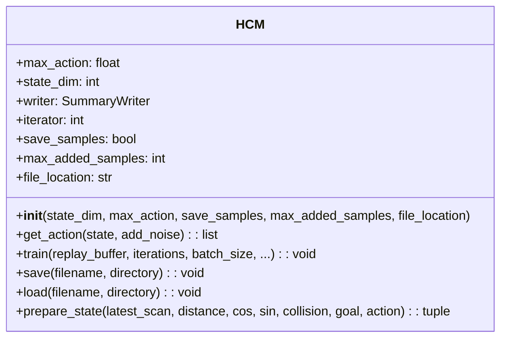
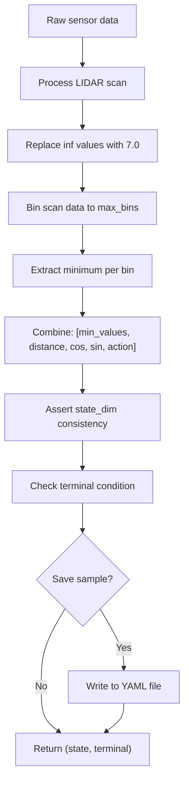
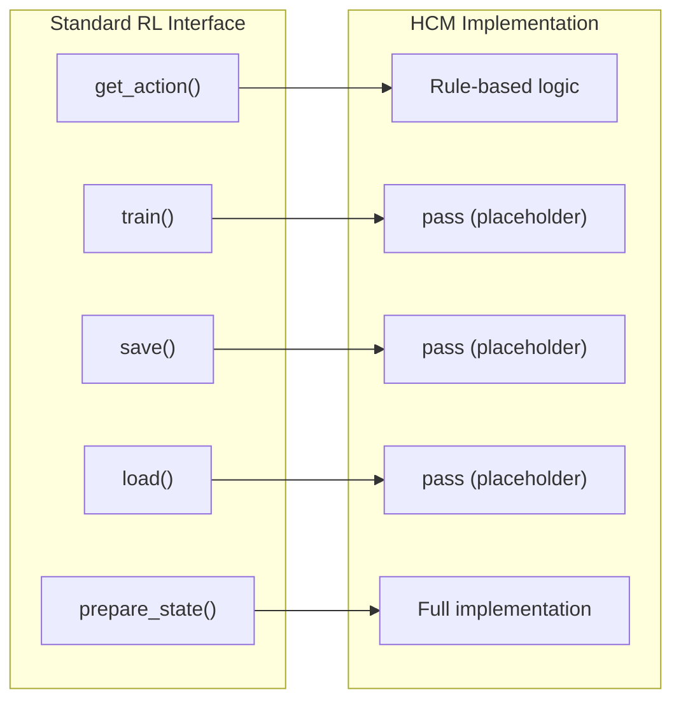

<!-- source: DeepWiki mcp.deepwiki.com · repo reiniscimurs/DRL-robot-navigation-IR-SIM · page 3.6 HCM (Hardcoded Model) · fetched 2026-10-14 -->

# HCM (Hardcoded) Model

<details>
<summary>Relevant source files</summary>

The following files were used as context for generating this wiki page:

- [robot_nav/models/HCM/hardcoded_model.py](robot_nav/models/HCM/hardcoded_model.py)
- [tests/test_data.yml](tests/test_data.yml)

</details>


This document covers the HCM (Hardcoded) Model, a rule-based navigation baseline implementation that serves as a comparison reference for deep reinforcement learning models and provides data collection capabilities for pretraining. The HCM model implements deterministic obstacle avoidance behavior using LIDAR sensor data and goal direction information.

For information about other reinforcement learning models in the system, see [Reinforcement Learning Models](#3). For details about training data collection and pretraining utilities, see [Data Management and Utilities](#2.2).

## Purpose and Architecture

The HCM model serves multiple purposes in the robot navigation system:

- **Baseline Performance**: Provides a deterministic reference for comparing DRL model performance
- **Data Collection**: Generates training samples with suboptimal behavior to create collision scenarios for pretraining
- **Interface Compatibility**: Maintains the same API as other RL models for seamless integration

## Class Structure

The `HCM` class follows the standard model interface used throughout the system:



**Sources**: [robot_nav/models/HCM/hardcoded_model.py:9-51]()

## Navigation Algorithm

The core navigation logic in `get_action` implements a simple obstacle avoidance strategy:

### Decision Flow

```mermaid
flowchart TD
    start[Start] --> get_state["Get robot state"]
    get_state --> extract_goal["Extract goal direction: angle = atan2(sin, cos)"]
    extract_goal --> check_obstacle{"min(laser_scan) < 1.5m?"}
    
    check_obstacle -->|No| move_to_goal["Set rotation = goal_angle"]
    check_obstacle -->|Yes| find_obstacle["Find closest obstacle index"]
    
    find_obstacle --> determine_side{"Obstacle on left or right?"}
    determine_side -->|"idx > laser_nr/2"| turn_left["Turn left: sign = -1"]
    determine_side -->|"idx <= laser_nr/2"| turn_right["Turn right: sign = 1"]
    
    turn_left --> calculate_escape["Calculate escape angle"]
    turn_right --> calculate_escape
    calculate_escape --> clip_rotation["Clip rotation to [-1.0, 1.0]"]
    move_to_goal --> clip_rotation
    
    clip_rotation --> set_linear["Set linear_vel = -abs(rot_vel/2)"]
    set_linear --> return_action["Return [lin_vel, rot_vel]"]
    return_action --> end[End]
```

**Sources**: [robot_nav/models/HCM/hardcoded_model.py:53-85]()

### Algorithm Details

The navigation algorithm operates as follows:

| Step | Description | Code Reference |
|------|-------------|---------------|
| Goal Direction | Extracts target angle from state using `atan2(sin, cos)` | [hardcoded_model.py:65-67]() |
| Obstacle Detection | Checks if minimum LIDAR reading < 1.5m threshold | [hardcoded_model.py:69-71]() |
| Avoidance Direction | Determines turn direction based on obstacle position | [hardcoded_model.py:74-77]() |
| Escape Angle | Calculates avoidance angle with intensity-based scaling | [hardcoded_model.py:79-81]() |
| Action Clipping | Constrains rotation to [-1.0, 1.0] range | [hardcoded_model.py:83-84]() |

The linear velocity is set inversely proportional to rotation magnitude, causing the robot to slow down during turns.

**Sources**: [robot_nav/models/HCM/hardcoded_model.py:68-85]()

## State Preparation

The `prepare_state` method processes raw sensor data into the standardized state representation:



**Sources**: [robot_nav/models/HCM/hardcoded_model.py:143-199]()

The state preparation includes:
- **LIDAR Processing**: Binning scan data and extracting minimum distances per bin
- **Goal Information**: Distance, cosine, and sine of goal direction
- **Action History**: Previous action values for temporal context
- **Terminal Detection**: Collision or goal achievement flags

## Data Collection System

The HCM model includes sophisticated data collection capabilities for DRL pretraining:

### Sample Storage Configuration

| Parameter | Default Value | Purpose |
|-----------|---------------|---------|
| `save_samples` | Boolean | Enable/disable sample collection |
| `max_added_samples` | 10,000 | Maximum samples to collect |
| `file_location` | `robot_nav/assets/data.yml` | Output file path |

### Sample Format

Each saved sample contains complete environment state information:

```yaml
iterator_number:
  latest_scan: [float_array]
  distance: float
  cos: float
  sin: float
  collision: boolean
  goal: boolean
  action: [linear_vel, angular_vel]
```

**Sources**: [robot_nav/models/HCM/hardcoded_model.py:182-198]()

## Interface Compatibility

The HCM model implements placeholder methods to maintain API compatibility with RL models:



**Sources**: [robot_nav/models/HCM/hardcoded_model.py:88-141]()

## Configuration and Usage

### Initialization Parameters

The HCM model requires the following configuration:

```python
HCM(
    state_dim=int,           # State vector dimension
    max_action=float,        # Maximum action magnitude
    save_samples=bool,       # Enable data collection
    max_added_samples=int,   # Sample collection limit
    file_location=str        # Data output path
)
```

### Integration with Training Pipeline

The HCM model integrates seamlessly with the training system through the standard model interface, allowing it to be used as a baseline or for data collection without modifying the training loop.

**Sources**: [robot_nav/models/HCM/hardcoded_model.py:27-51]()

---

