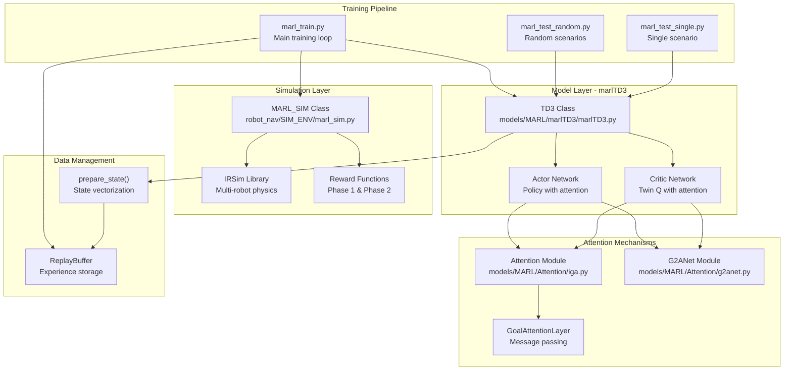
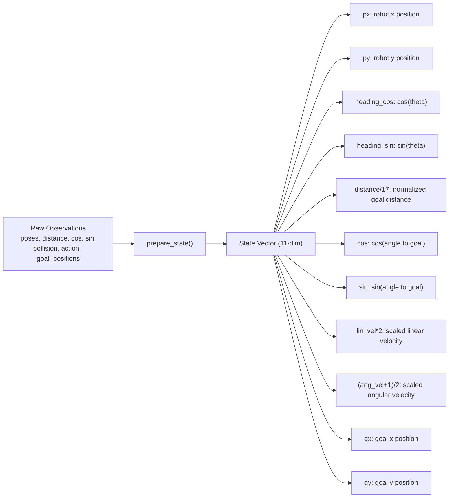
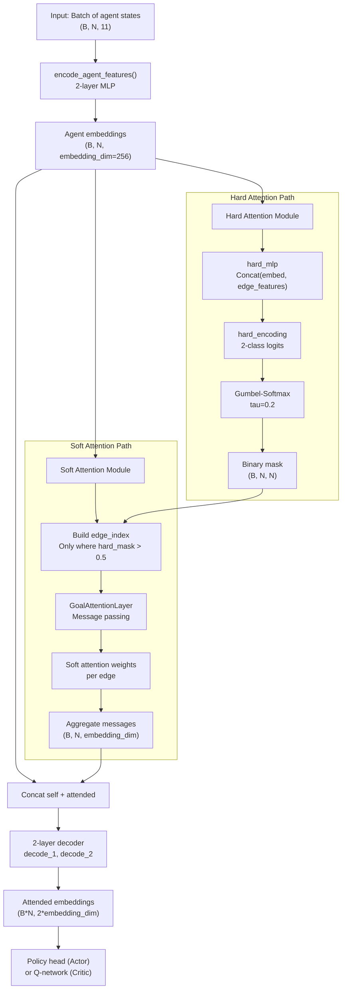

<!-- source: DeepWiki mcp.deepwiki.com · repo reiniscimurs/DRL-robot-navigation-IR-SIM · page 4 Multi-Agent Reinforcement Learning · fetched 2026-10-14 -->

# Multi-Agent Reinforcement Learning

<details>
<summary>Relevant source files</summary>

The following files were used as context for generating this wiki page:

- [robot_nav/SIM_ENV/marl_sim.py](robot_nav/SIM_ENV/marl_sim.py)
- [robot_nav/marl_test_random.py](robot_nav/marl_test_random.py)
- [robot_nav/marl_test_single.py](robot_nav/marl_test_single.py)
- [robot_nav/marl_train.py](robot_nav/marl_train.py)
- [robot_nav/models/MARL/Attention/iga.py](robot_nav/models/MARL/Attention/iga.py)
- [robot_nav/models/MARL/marlTD3/marlTD3.py](robot_nav/models/MARL/marlTD3/marlTD3.py)

</details>


## Purpose and Scope

This page provides an overview of the Multi-Agent Reinforcement Learning (MARL) capabilities in the DRL-robot-navigation-IR-SIM system. It introduces the architecture, components, and coordination mechanisms that enable multiple robots to navigate collaboratively in shared environments. This page covers the high-level design, while detailed implementations are documented in child pages: [MARL Simulation Environment](#4.1) and [marlTD3 with Attention Mechanisms](#4.2).

For single-agent training approaches, see [Core Training System](#2) and [Single-Agent Models](#3).

**Sources:** [robot_nav/marl_train.py:1-177](), [robot_nav/SIM_ENV/marl_sim.py:1-364](), [robot_nav/models/MARL/marlTD3/marlTD3.py:1-634]()

---

## System Architecture Overview

The MARL system extends the single-agent framework by introducing inter-agent coordination through attention mechanisms and a multi-robot simulation environment. The architecture consists of three primary layers: simulation, coordination, and policy learning.

### High-Level MARL Architecture



**Sources:** [robot_nav/marl_train.py:1-177](), [robot_nav/SIM_ENV/marl_sim.py:9-23](), [robot_nav/models/MARL/marlTD3/marlTD3.py:171-206](), [robot_nav/models/MARL/Attention/iga.py:132-157]()

---

## Key Differences from Single-Agent Systems

The MARL implementation differs from single-agent approaches in several fundamental ways:

| Aspect | Single-Agent | Multi-Agent (MARL) |
|--------|--------------|-------------------|
| **State Dimension** | 10 or 185 (with CNN) | 11 per agent |
| **Action Space** | Individual robot | Coordinated N robots |
| **Observation** | Self-centric | Self + neighbors via attention |
| **Reward Function** | Individual goal/collision | Individual + proximity penalties |
| **Network Architecture** | MLP or CNN+MLP | Attention encoder + MLP |
| **Coordination** | None | Hard-soft attention mechanism |
| **Environment** | `SIM` class | `MARL_SIM` class |
| **Model** | TD3, DDPG, SAC, PPO, etc. | `marlTD3` only |

**Sources:** [robot_nav/SIM_ENV/marl_sim.py:9-23](), [robot_nav/models/MARL/marlTD3/marlTD3.py:208-266]()

---

## Component Overview

### MARL_SIM Environment

The `MARL_SIM` class ([robot_nav/SIM_ENV/marl_sim.py:9-364]()) wraps the IR-SIM library to handle multiple robots. It manages per-robot state observations, coordinates action execution, and computes rewards with inter-robot proximity penalties.

**Key methods:**
- `step()` ([robot_nav/SIM_ENV/marl_sim.py:55-205]()): Executes actions for all robots and returns observations
- `reset()` ([robot_nav/SIM_ENV/marl_sim.py:207-311]()): Resets environment with conflict-free robot placement (minimum 0.6-unit separation)
- `get_reward()` ([robot_nav/SIM_ENV/marl_sim.py:313-363]()): Computes rewards with configurable phase (1 or 2)

### marlTD3 Model

The `TD3` class ([robot_nav/models/MARL/marlTD3/marlTD3.py:171-634]()) implements Twin Delayed DDPG adapted for multi-agent scenarios. It instantiates attention-based `Actor` and `Critic` networks.

**Key components:**
- `Actor` ([robot_nav/models/MARL/marlTD3/marlTD3.py:14-77]()): Policy network with attention encoder
- `Critic` ([robot_nav/models/MARL/marlTD3/marlTD3.py:79-169]()): Twin Q-network with attention encoder
- `train()` ([robot_nav/models/MARL/marlTD3/marlTD3.py:310-530]()): Training loop with auxiliary losses (BCE, entropy)
- `prepare_state()` ([robot_nav/models/MARL/marlTD3/marlTD3.py:573-633]()): Converts raw observations to state vectors

### Attention Mechanisms

The `Attention` module ([robot_nav/models/MARL/Attention/iga.py:132-421]()) implements the IGA (Inter-agent Graph Attention) mechanism, which computes:
1. **Hard attention**: Binary masks determining which agents to attend to
2. **Soft attention**: Weighted message aggregation from attended neighbors
3. **Message passing**: Graph neural network-based information exchange

**Sources:** [robot_nav/SIM_ENV/marl_sim.py:9-364](), [robot_nav/models/MARL/marlTD3/marlTD3.py:171-634](), [robot_nav/models/MARL/Attention/iga.py:132-421]()

---

## State and Action Representation

### Per-Agent State Vector

Each agent's state is an 11-dimensional vector constructed by `prepare_state()`:



**Implementation:** [robot_nav/models/MARL/marlTD3/marlTD3.py:573-633]()

```python
state = [
    px,                    # [0] robot x
    py,                    # [1] robot y
    heading_cos,           # [2] cos(theta)
    heading_sin,           # [3] sin(theta)
    distance[i] / 17,      # [4] normalized distance to goal
    cos[i],                # [5] cos(angle to goal)
    sin[i],                # [6] sin(angle to goal)
    lin_vel,               # [7] last linear velocity (scaled)
    ang_vel,               # [8] last angular velocity (scaled)
    gx,                    # [9] goal x
    gy,                    # [10] goal y
]
```

### Action Space

Actions are 2-dimensional continuous vectors per agent:
- **Linear velocity**: Range `[-1, 1]` → clipped to `[0, 0.5]` m/s in environment ([robot_nav/marl_train.py:109-111]())
- **Angular velocity**: Range `[-1, 1]` rad/s (no clipping)

**Sources:** [robot_nav/models/MARL/marlTD3/marlTD3.py:573-633](), [robot_nav/marl_train.py:109-111]()

---

## Coordination through Attention

The attention mechanism enables agents to selectively communicate and coordinate. It operates in two stages: hard attention (gating) followed by soft attention (weighting).

### Attention Flow Diagram



**Sources:** [robot_nav/models/MARL/Attention/iga.py:224-421](), [robot_nav/models/MARL/marlTD3/marlTD3.py:14-77](), [robot_nav/models/MARL/marlTD3/marlTD3.py:79-169]()

### Edge Feature Construction

For each agent pair (i, j), edge features capture relative geometry and dynamics:

| Feature | Description | Computation |
|---------|-------------|-------------|
| `rel_dist` | Normalized distance | `‖pos_j - pos_i‖ / 12` |
| `rel_angle_cos` | Cosine of relative bearing | `cos(atan2(dy, dx) - theta_i)` |
| `rel_angle_sin` | Sine of relative bearing | `sin(atan2(dy, dx) - theta_i)` |
| `heading_j_cos` | Neighbor's heading cosine | `cos(theta_j)` |
| `heading_j_sin` | Neighbor's heading sine | `sin(theta_j)` |
| `action` | Neighbor's last action | `[lin_vel, ang_vel]` |
| `goal_rel_dist` | Distance to neighbor's goal | `‖goal_j - pos_i‖` |
| `goal_rel_angle` | Bearing to neighbor's goal | Computed in agent i's frame |

**Implementation:** [robot_nav/models/MARL/Attention/iga.py:268-345]()

### Auxiliary Training Losses

The training loop includes auxiliary losses beyond the standard TD3 objective:

1. **BCE Loss** ([robot_nav/models/MARL/marlTD3/marlTD3.py:428-438]()): Supervises hard attention logits using distance-based labels
   - Positive class (connect) if `unnorm_rel_dist < connection_proximity_threshold` (default: 4)
   - Weight: `bce_weight=0.01`

2. **Entropy Bonus** ([robot_nav/models/MARL/marlTD3/marlTD3.py:419-439]()): Encourages exploration in soft attention
   - Computed per-node as `-∑ p log p`
   - Weight: `entropy_weight=1`

**Sources:** [robot_nav/models/MARL/Attention/iga.py:9-45](), [robot_nav/models/MARL/marlTD3/marlTD3.py:310-530]()

---

## Training Pipeline

### Training Script Workflow

```mermaid
sequenceDiagram
    participant Script as marl_train.py
    participant Sim as MARL_SIM
    participant Model as TD3 (marlTD3)
    participant Buffer as ReplayBuffer
    participant Actor as Actor Network
    participant Critic as Critic Network
    
    Script->>Sim: Initialize (num_robots=3)
    Script->>Model: Initialize TD3(state_dim=11, num_robots=3)
    Script->>Buffer: get_buffer()
    
    Script->>Sim: step(action=[[0,0], ...], connection)
    Sim-->>Script: poses, distances, cos, sin, collision, goal, ...
    
    loop Training Loop (epoch < max_epochs=160)
        Script->>Model: prepare_state(poses, distance, ...)
        Model-->>Script: state (N, 11), terminal flags
        
        Script->>Model: get_action(state, add_noise=True)
        Model->>Actor: forward(state)
        Actor-->>Model: action, connection_logits, combined_weights
        Model-->>Script: action (N, 2), connection, weights
        
        Script->>Script: Clip lin_vel: (a[0]+1)/4
        Script->>Sim: step(clipped_action, connection, weights)
        Sim-->>Script: next_poses, next_distances, rewards, ...
        
        Script->>Model: prepare_state(next_poses, ...)
        Model-->>Script: next_state, terminal
        
        Script->>Buffer: add(state, action, reward, terminal, next_state)
        
        alt Episode end (terminal or max_steps or out_of_bounds)
            Script->>Sim: reset()
            
            alt episode % train_every_n == 0
                Script->>Model: train(buffer, iterations=80, batch_size=16)
                
                loop iterations=80
                    Model->>Buffer: sample_batch(batch_size=16)
                    Buffer-->>Model: batch_states, actions, rewards, dones, next_states
                    
                    Model->>Critic: forward(state, action)
                    Critic-->>Model: Q1, Q2, entropy, hard_logits, dist
                    
                    Model->>Model: Compute critic_loss (MSE + BCE + entropy)
                    Model->>Critic: Backward + optimizer step
                    
                    alt iteration % policy_freq == 0
                        Model->>Actor: forward(state)
                        Actor-->>Model: action, hard_logits, dist, entropy
                        
                        Model->>Critic: forward(state, action)
                        Critic-->>Model: Q1 (for actor loss)
                        
                        Model->>Model: Compute actor_loss (-Q + BCE + entropy)
                        Model->>Actor: Backward + optimizer step
                        
                        Model->>Model: Soft update target networks (tau=0.005)
                    end
                end
                
                Script->>Script: Increment epoch
            end
        end
    end
```

**Sources:** [robot_nav/marl_train.py:31-173](), [robot_nav/models/MARL/marlTD3/marlTD3.py:310-530]()

### Training Hyperparameters

| Parameter | Value | Description |
|-----------|-------|-------------|
| `max_epochs` | 160 | Total training epochs |
| `train_every_n` | 10 | Train every N episodes |
| `training_iterations` | 80 | Gradient steps per training cycle |
| `batch_size` | 16 | Mini-batch size |
| `max_steps` | 300 | Max steps per episode |
| `discount` | 0.99 | Discount factor γ |
| `tau` | 0.005 | Target network update rate |
| `policy_freq` | 2 | Actor update frequency |
| `lr_actor` | 1e-4 | Actor learning rate |
| `lr_critic` | 3e-4 | Critic learning rate |
| `policy_noise` | 0.2 | Target policy smoothing noise std |
| `noise_clip` | 0.5 | Target noise clipping range |
| `max_grad_norm` | 7.0 | Gradient clipping norm |
| `bce_weight` | 0.01 | Hard attention BCE loss weight |
| `entropy_weight` | 1 | Attention entropy bonus weight |
| `connection_proximity_threshold` | 4 | Distance threshold for hard attention supervision |

**Sources:** [robot_nav/marl_train.py:34-54](), [robot_nav/models/MARL/marlTD3/marlTD3.py:310-344]()

---

## Reward Functions

The `MARL_SIM.get_reward()` method supports two configurable reward phases:

### Phase 1: Goal-Seeking with Proximity Penalties

Used during initial training ([robot_nav/SIM_ENV/marl_sim.py:335-347]()):

```python
if goal:
    return 100.0
elif collision:
    return -100.0 * 3 * action[0]  # Penalize forward collisions more
else:
    r_dist = 1.5 / distance  # Inverse distance reward
    cl_pen = sum((1.25 - rob)^2 for rob in closest_robots if rob < 1.25)
    return action[0] - 0.5 * abs(action[1]) - cl_pen + r_dist
```

**Components:**
- Goal arrival: +100
- Collision: -300 × linear velocity
- Distance reward: Encourages approaching goal
- Proximity penalty: Quadratic penalty if robots closer than 1.25 units
- Action penalty: Discourages angular velocity

### Phase 2: Coordination Refinement

Used for fine-tuning coordination ([robot_nav/SIM_ENV/marl_sim.py:349-360]()):

```python
if goal:
    return 70.0
elif collision:
    return -100.0 * 3 * action[0]
else:
    cl_pen = sum((3 - rob)^2 for rob in closest_robots if rob < 3)
    return -0.5 * abs(action[1]) - cl_pen
```

**Changes from Phase 1:**
- Lower goal reward: +70 (vs +100)
- Larger proximity threshold: 3 units (vs 1.25)
- No distance reward: Focus on coordination
- No linear velocity reward: Prioritize safety

**Sources:** [robot_nav/SIM_ENV/marl_sim.py:313-363](), [robot_nav/marl_train.py:60]()

---

## Testing and Evaluation

Two testing scripts validate MARL performance:

### Random Scenario Testing

`marl_test_random.py` ([robot_nav/marl_test_random.py:1-242]()) evaluates the model across 1000 randomized scenarios with:
- Random obstacle placement
- Random robot initializations
- Metrics: rewards, goals, collisions, action distributions, attention entropy

### Single Scenario Testing

`marl_test_single.py` ([robot_nav/marl_test_single.py:1-462]()) tests coordination in a fixed `circle_world.yaml` with a single robot (modified for testing purposes). It tracks:
- Success rate: `test_scenarios - collisions`
- Average timesteps per episode
- Episodes reaching maximum steps
- Action statistics

**Key difference:** Random testing uses `reward_phase=2`, while single testing can configure the phase.

**Sources:** [robot_nav/marl_test_random.py:33-242](), [robot_nav/marl_test_single.py:299-461]()

---

## Connection to Broader System

The MARL subsystem integrates with the broader codebase through:

1. **Buffer Factory**: Uses `get_buffer()` ([utils.py]()) for consistent replay buffer instantiation
2. **IR-SIM Library**: Shares the same physics simulator as single-agent environments
3. **TensorBoard Logging**: Writes training metrics via `model.writer` ([robot_nav/models/MARL/marlTD3/marlTD3.py:492-526]())
4. **Checkpoint Management**: Saves/loads models via `save()` and `load()` methods ([robot_nav/models/MARL/marlTD3/marlTD3.py:531-571]())

For detailed implementation of the simulation environment, see [MARL Simulation Environment](#4.1). For the attention mechanism and model architecture, see [marlTD3 with Attention Mechanisms](#4.2).

**Sources:** [robot_nav/marl_train.py:78-86](), [robot_nav/models/MARL/marlTD3/marlTD3.py:258-266]()

---

