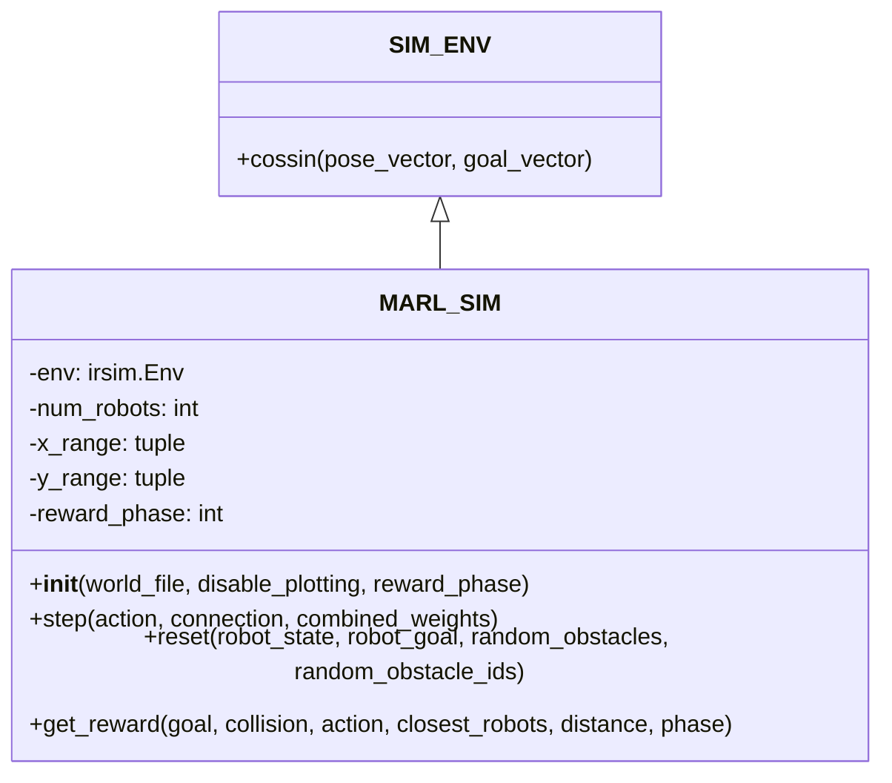
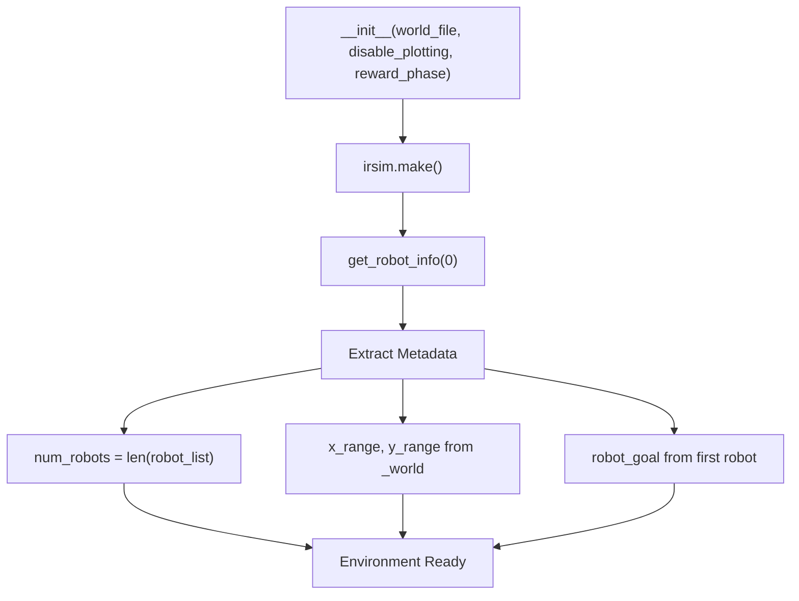
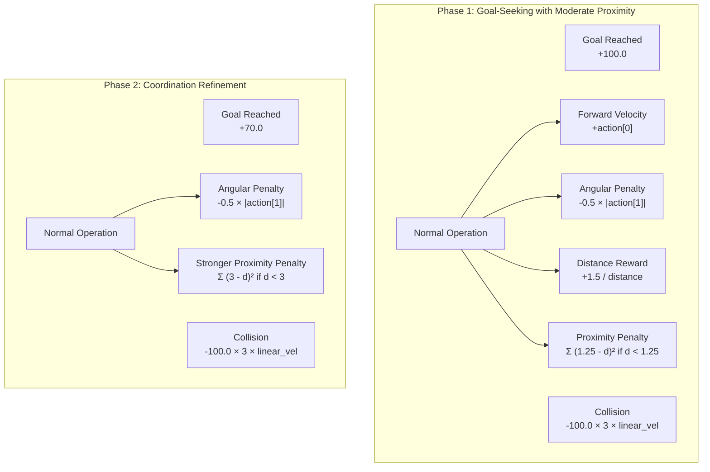
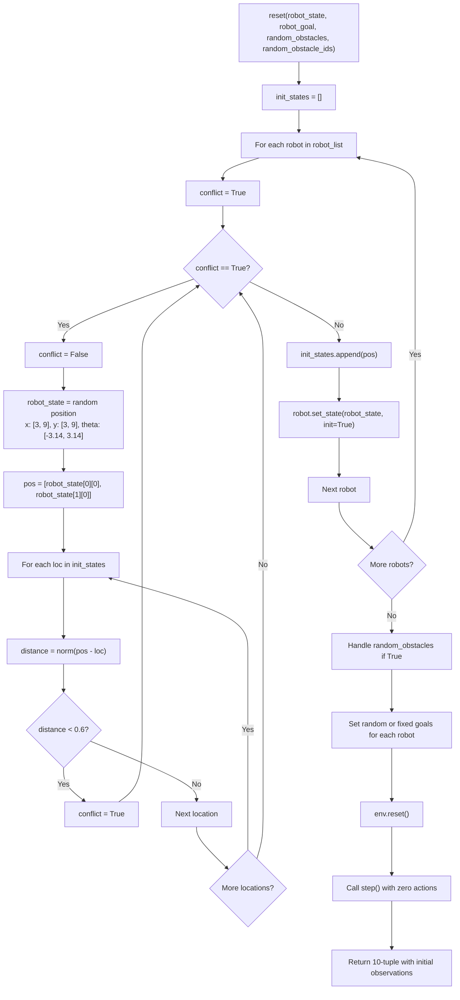
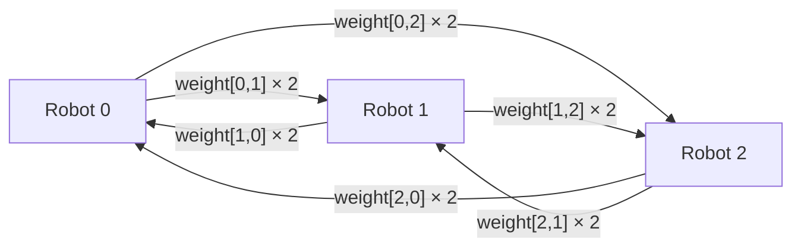
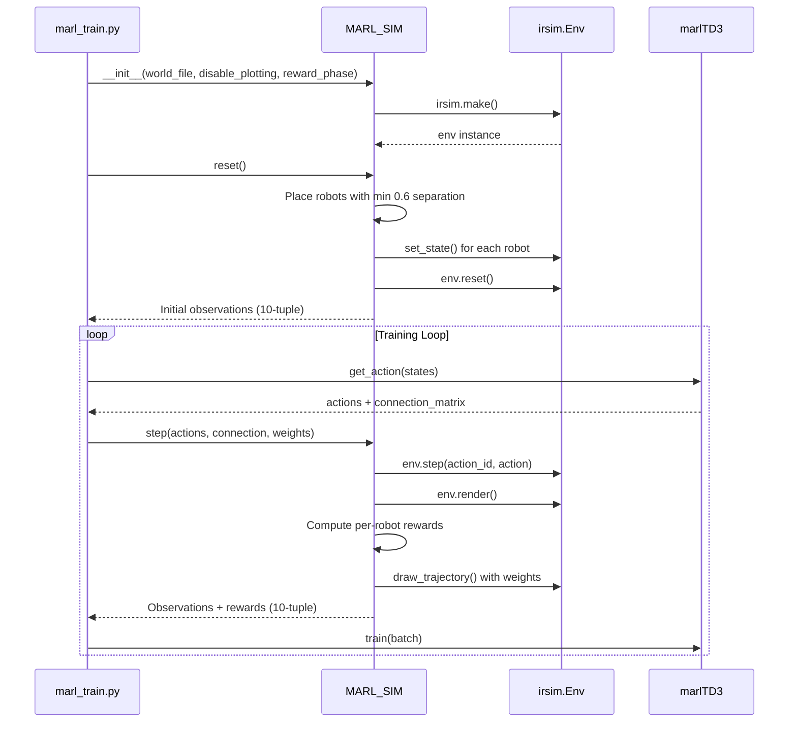

<!-- source: DeepWiki mcp.deepwiki.com · repo reiniscimurs/DRL-robot-navigation-IR-SIM · page 4.1 MARL Simulation Environment · fetched 2026-10-14 -->

# MARL Simulation Environment

<details>
<summary>Relevant source files</summary>

The following files were used as context for generating this wiki page:

- [robot_nav/SIM_ENV/marl_sim.py](robot_nav/SIM_ENV/marl_sim.py)

</details>


## Purpose and Scope

This document details the `MARL_SIM` class, which provides a multi-agent simulation environment wrapper around the IR-SIM library for training multiple robots simultaneously. The environment handles per-agent state observation, two-phase reward functions with inter-robot proximity penalties, connection matrix visualization, and conflict-free reset logic that ensures minimum spacing between robots.

For single-agent simulation, see [Simulation Environments](#2.1). For the multi-agent model that uses this environment, see [marlTD3 with Attention Mechanisms](#4.2). For environment configuration files, see [Environment Configuration](#5).

---

## Class Architecture

The `MARL_SIM` class extends the `SIM_ENV` base class to support multiple robots operating in the same environment. The class manages per-robot observations, rewards, and goals while coordinating physics simulation steps across all agents.

### Inheritance Structure



**Sources:** [robot_nav/SIM_ENV/marl_sim.py:9-23]()

### Initialization Parameters

The `MARL_SIM` constructor accepts three key parameters:

| Parameter | Type | Default | Description |
|-----------|------|---------|-------------|
| `world_file` | str | `"multi_robot_world.yaml"` | Path to YAML world configuration defining robot count and properties |
| `disable_plotting` | bool | `False` | Disables IRSim visualization for headless training |
| `reward_phase` | int | `1` | Selects reward function variant (1 or 2) |

The initialization process extracts environment metadata from IRSim:



**Sources:** [robot_nav/SIM_ENV/marl_sim.py:24-53]()

---

## Step Function and State Processing

The `step` method is the core interaction loop that advances the simulation by one timestep for all robots. It takes actions for each agent and returns comprehensive per-robot observations.

### Step Function Signature

```python
def step(action, connection, combined_weights=None)
```

**Parameters:**
- `action` (list): List of `[linear_velocity, angular_velocity]` pairs, one per robot
- `connection` (Tensor): Shape `(num_robots, num_robots-1)` logits indicating pairwise connections
- `combined_weights` (Tensor, optional): Shape `(num_robots, num_robots)` or `(num_robots, num_robots-1)` for edge visualization

**Returns:** 10-tuple containing per-robot observations

### Return Value Structure

| Index | Name | Type | Description |
|-------|------|------|-------------|
| 0 | `poses` | list[list[float]] | `[x, y, theta]` for each robot |
| 1 | `distances` | list[float] | Euclidean distance to goal per robot |
| 2 | `coss` | list[float] | Cosine of angle between heading and goal |
| 3 | `sins` | list[float] | Sine of angle between heading and goal |
| 4 | `collisions` | list[bool] | Collision flags from IRSim |
| 5 | `goals` | list[bool] | Goal arrival flags (triggers new random goal) |
| 6 | `action` | list | Echo of input actions |
| 7 | `rewards` | list[float] | Per-robot rewards from `get_reward` |
| 8 | `positions` | list[list[float]] | `[x, y]` positions |
| 9 | `goal_positions` | list[list[float]] | `[x, y]` goal coordinates |

### Step Execution Flow

```mermaid
flowchart TD
    Start["step(action, connection, combined_weights)"] --> SimStep["env.step(action_id=[0...N-1], action)"]
    SimStep --> Render["env.render()"]
    Render --> CollectStates["Collect robot_states positions"]
    CollectStates --> LoopRobots["For each robot i in range(num_robots)"]
    
    LoopRobots --> GetState["Get robot_state = robot_list[i].state"]
    GetState --> CalcClosest["Calculate closest_robots distances"]
    CalcClosest --> GetGoal["robot_goal = robot_list[i].goal"]
    GetGoal --> CalcDist["distance = norm(goal_vector)"]
    CalcDist --> CalcCossin["cos, sin = cossin(pose_vector, goal_vector)"]
    CalcCossin --> GetFlags["collision = robot_list[i].collision<br/>goal = robot_list[i].arrive"]
    GetFlags --> CalcReward["reward = get_reward(goal, collision, action_i, closest_robots, distance, reward_phase)"]
    CalcReward --> Append["Append to result lists"]
    
    Append --> CheckWeights{"combined_weights<br/>is not None?"}
    CheckWeights -->|Yes| DrawEdges["For each robot j:<br/>draw_trajectory() with weight*2 linewidth"]
    CheckWeights -->|No| CheckGoal
    DrawEdges --> CheckGoal{"goal arrived?"}
    
    CheckGoal -->|Yes| SetNewGoal["set_random_goal() within range_limits"]
    CheckGoal -->|No| NextRobot
    SetNewGoal --> NextRobot["Next robot"]
    
    NextRobot --> MoreRobots{"More robots?"}
    MoreRobots -->|Yes| LoopRobots
    MoreRobots -->|No| Return["Return 10-tuple<br/>(poses, distances, coss, sins, collisions, goals, action, rewards, positions, goal_positions)"]
```



**Sources:** [robot_nav/SIM_ENV/marl_sim.py:55-205]()

### Inter-Robot Distance Computation

For each robot `i`, the method computes distances to all other robots to enable proximity-based reward penalties:

```python
# Lines 125-134
closest_robots = [
    np.linalg.norm([
        robot_states[j][0] - robot_state[0],
        robot_states[j][1] - robot_state[1],
    ])
    for j in range(self.num_robots)
    if j != i
]
```

This list excludes the robot itself (condition `j != i`) and is passed to `get_reward` for computing proximity penalties.

**Sources:** [robot_nav/SIM_ENV/marl_sim.py:118-134]()

---

## Two-Phase Reward System

The `get_reward` static method implements two distinct reward configurations optimized for different training stages. The reward phase is selected during environment initialization and remains fixed throughout training.

### Reward Function Comparison



### Detailed Reward Formulations

**Phase 1** (Lines 335-347):
- **Goal achievement:** `+100.0`
- **Collision:** `-100.0 × 3 × action[0]` (scales with forward velocity)
- **Normal operation:**
  - Forward encouragement: `+action[0]`
  - Angular penalty: `-0.5 × |action[1]|`
  - Distance reward: `+1.5 / distance` (inverse of distance to goal)
  - Proximity penalty: `Σ (1.25 - d)²` for all robots within 1.25 units

**Phase 2** (Lines 349-360):
- **Goal achievement:** `+70.0` (reduced to prioritize collision-free behavior)
- **Collision:** `-100.0 × 3 × action[0]` (unchanged)
- **Normal operation:**
  - Angular penalty: `-0.5 × |action[1]|` (unchanged)
  - Proximity penalty: `Σ (3 - d)²` for all robots within 3 units (wider range, stronger penalty)
  - **No forward encouragement** (removes action[0] term)
  - **No distance reward** (removes 1.5/distance term)

### Key Differences

| Aspect | Phase 1 | Phase 2 |
|--------|---------|---------|
| Goal reward | 100.0 | 70.0 |
| Forward encouragement | ✓ (+action[0]) | ✗ |
| Distance reward | ✓ (+1.5/distance) | ✗ |
| Proximity threshold | 1.25 units | 3.0 units |
| Proximity penalty scale | (1.25 - d)² | (3 - d)² |

Phase 2 is designed for scenarios where agents have already learned basic goal-seeking and need to refine coordination with stronger inter-robot avoidance.

**Sources:** [robot_nav/SIM_ENV/marl_sim.py:313-363]()

---

## Reset Logic and Conflict Avoidance

The `reset` method reinitializes the environment with conflict-free robot placement. Unlike single-agent environments, MARL requires special handling to prevent robots from spawning too close to each other.

### Reset Function Signature

```python
def reset(robot_state=None, robot_goal=None, random_obstacles=False, random_obstacle_ids=None)
```

### Conflict-Free Placement Algorithm



### Minimum Separation Constraint

The conflict avoidance logic ensures robots spawn at least **0.6 units apart**:

```python
# Lines 254-261
for loc in init_states:
    vector = [pos[0] - loc[0], pos[1] - loc[1]]
    if np.linalg.norm(vector) < 0.6:
        conflict = True
```

This prevents initialization issues where robots would immediately detect collisions or interfere with each other's sensors.

**Sources:** [robot_nav/SIM_ENV/marl_sim.py:207-311]()

### Random Obstacle Positioning

When `random_obstacles=True`, the environment repositions obstacles using IRSim's `random_obstacle_position` method. By default, it randomizes 7 obstacles starting from index `num_robots`:

```python
# Lines 269-276
if random_obstacle_ids is None:
    random_obstacle_ids = [i + self.num_robots for i in range(7)]
self.env.random_obstacle_position(
    range_low=[self.x_range[0], self.y_range[0], -3.14],
    range_high=[self.x_range[1], self.y_range[1], 3.14],
    ids=random_obstacle_ids,
    non_overlapping=True,
)
```

The `non_overlapping=True` flag ensures obstacles don't overlap with each other or robots.

**Sources:** [robot_nav/SIM_ENV/marl_sim.py:268-276]()

---

## Connection Matrix and Visualization

The `step` method accepts an optional `combined_weights` parameter that enables visualization of inter-robot communication topology. This feature is used by the marlTD3 model to display attention weights.

### Visualization Logic

When `combined_weights` is provided, the environment draws lines between robots with width proportional to the connection strength:

```python
# Lines 165-182
if combined_weights is not None:
    i_weights = combined_weights[i].tolist()
    
    for j in range(self.num_robots):
        weight = i_weights[j]
        other_robot_state = self.env.robot_list[j].state
        other_pos = [other_robot_state[0].item(), other_robot_state[1].item()]
        rx = [position[0], other_pos[0]]
        ry = [position[1], other_pos[1]]
        self.env.draw_trajectory(
            np.array([rx, ry]), refresh=True, linewidth=weight * 2
        )
```

### Connection Weight Interpretation



**Matrix Shape Compatibility:**

| Shape | Interpretation |
|-------|---------------|
| `(num_robots, num_robots)` | Full connection matrix including self-connections |
| `(num_robots, num_robots-1)` | Connection matrix with self-column removed |

The marlTD3 model typically provides the `(num_robots, num_robots-1)` form since attention mechanisms don't compute self-attention in this implementation.

**Sources:** [robot_nav/SIM_ENV/marl_sim.py:165-182]()

---

## Differences from Single-Agent Environment

The `MARL_SIM` class differs from `SIM` in several key aspects:

### Comparison Table

| Feature | SIM (Single-Agent) | MARL_SIM (Multi-Agent) |
|---------|-------------------|------------------------|
| Robot count | 1 | N (configured in world file) |
| State observation | Single tuple | List of tuples (one per robot) |
| Action input | Single `[lin_vel, ang_vel]` | List of actions |
| Reward computation | Distance-based only | Distance + proximity penalties |
| Reset logic | Simple random placement | Conflict-free with minimum separation |
| Visualization | Robot trajectory | Robot trajectories + connection edges |
| Goal handling | Single goal reset | Per-robot independent goals |
| Reward phases | Single reward function | Two-phase reward system |

### Multi-Agent State Aggregation

The `step` method returns lists where each index corresponds to a specific robot. Training code must handle per-agent experiences:

```python
# Example usage pattern
poses, distances, coss, sins, collisions, goals, actions, rewards, positions, goal_positions = marl_sim.step(
    action=[action_0, action_1, action_2],
    connection=connection_matrix,
    combined_weights=attention_weights
)

# Extract per-robot experiences
for i in range(num_robots):
    state_i = [poses[i], distances[i], coss[i], sins[i], ...]
    reward_i = rewards[i]
    # Store in replay buffer
```

**Sources:** [robot_nav/SIM_ENV/marl_sim.py:55-205]()

---

## Usage Example Structure



**Sources:** [robot_nav/SIM_ENV/marl_sim.py:9-363]()

---

