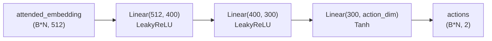
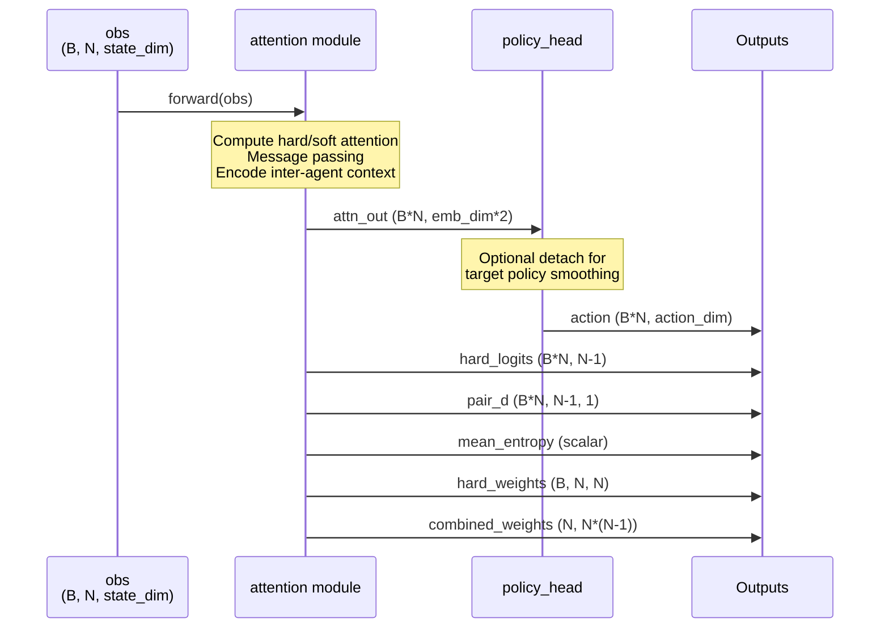
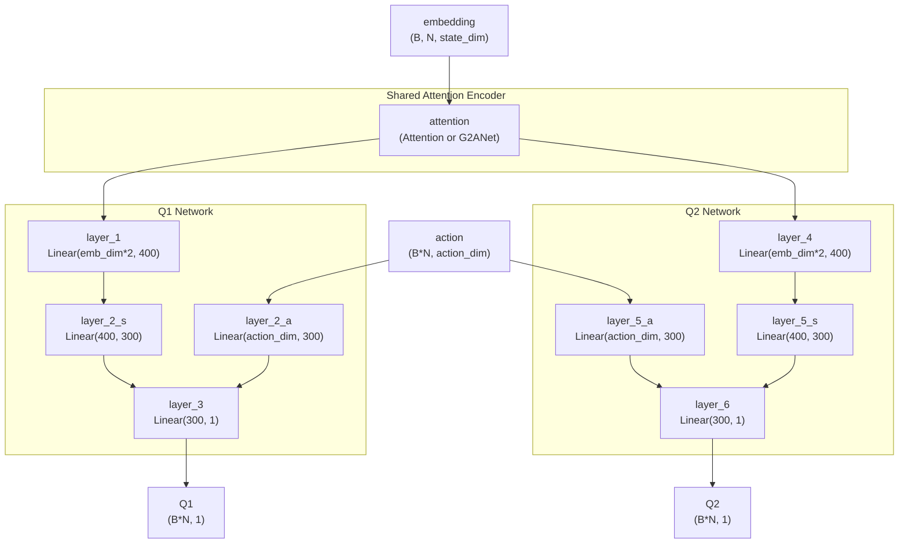
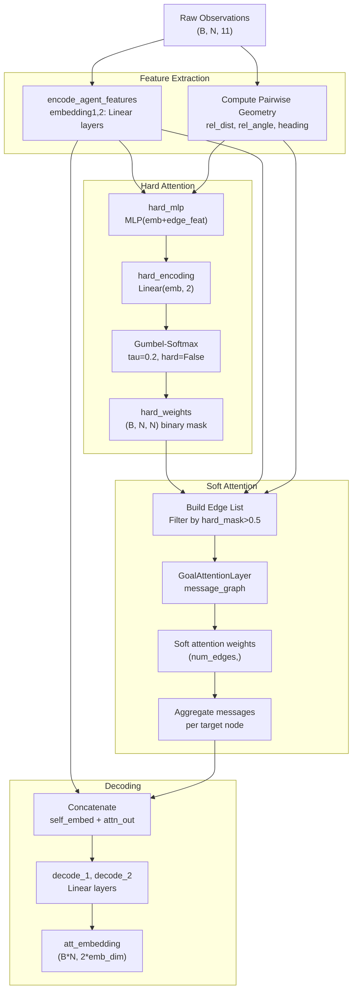
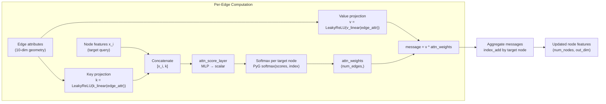
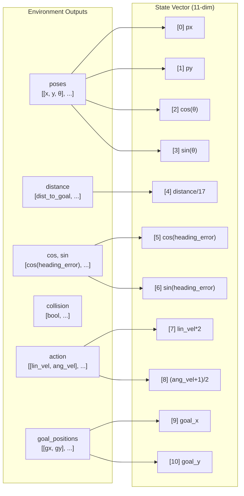
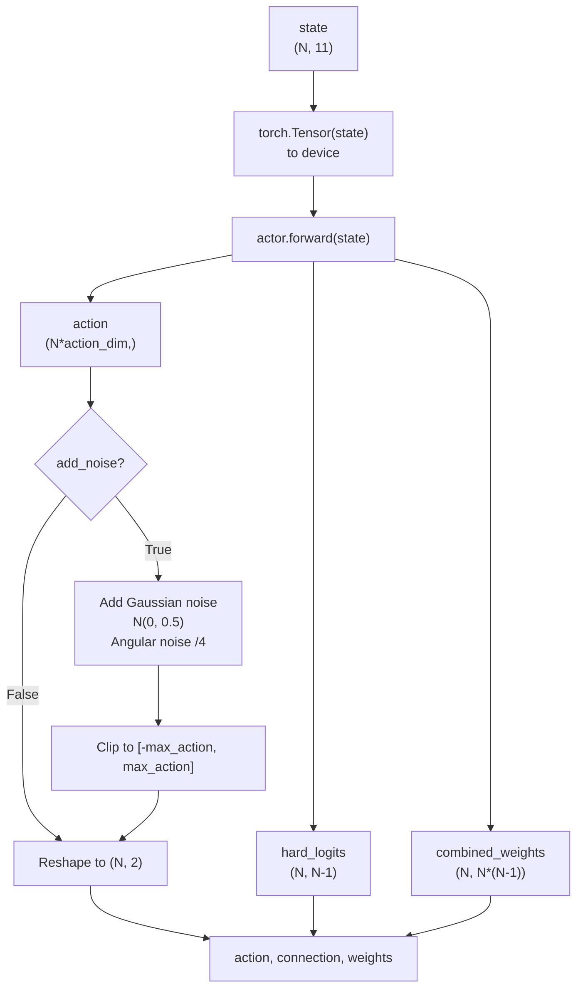
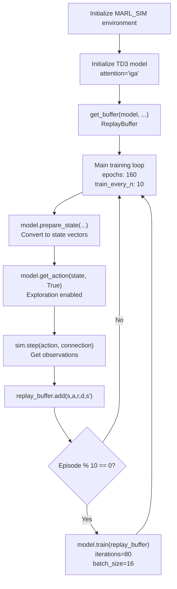

<!-- source: DeepWiki mcp.deepwiki.com · repo reiniscimurs/DRL-robot-navigation-IR-SIM · page 4.2 marlTD3 with Attention Mechanisms · fetched 2026-10-14 -->

# marlTD3 with Attention Mechanisms

<details>
<summary>Relevant source files</summary>

The following files were used as context for generating this wiki page:

- [docs/api/IR-SIM/ir-marl-sim.md](docs/api/IR-SIM/ir-marl-sim.md)
- [docs/api/models/MARL/Attention.md](docs/api/models/MARL/Attention.md)
- [docs/api/models/MARL/TD3.md](docs/api/models/MARL/TD3.md)
- [robot_nav/marl_test_random.py](robot_nav/marl_test_random.py)
- [robot_nav/marl_test_single.py](robot_nav/marl_test_single.py)
- [robot_nav/marl_train.py](robot_nav/marl_train.py)
- [robot_nav/models/MARL/Attention/iga.py](robot_nav/models/MARL/Attention/iga.py)
- [robot_nav/models/MARL/__init__.py](robot_nav/models/MARL/__init__.py)
- [robot_nav/models/MARL/marlTD3/marlTD3.py](robot_nav/models/MARL/marlTD3/marlTD3.py)

</details>


This page documents the multi-agent Twin Delayed DDPG (marlTD3) implementation with hard-soft attention mechanisms for coordinated robot navigation. The marlTD3 model extends the single-agent TD3 algorithm to multi-agent scenarios by incorporating attention-based inter-agent coordination. For information about the multi-agent simulation environment, see [MARL Simulation Environment](#4.1). For single-agent TD3 variants, see [TD3 and DDPG](#3.1).

**Sources:** [robot_nav/models/MARL/marlTD3/marlTD3.py:1-634]()

---

## System Architecture

The marlTD3 implementation consists of three primary components: an `Actor` network that produces actions using attention-encoded observations, a `Critic` network that evaluates state-action pairs with attention-based value estimation, and a `TD3` wrapper class that orchestrates training, exploration, and model management.

### Component Overview

```mermaid
graph TB
    subgraph "TD3 Agent Wrapper"
        TD3Class["TD3<br/>(marlTD3.py:171-634)"]
        ActorOpt["actor_optimizer<br/>Adam(policy_params + attn_params)"]
        CriticOpt["critic_optimizer<br/>Adam(critic.parameters())"]
        Writer["SummaryWriter<br/>TensorBoard logging"]
    end
    
    subgraph "Actor Network"
        Actor["Actor<br/>(marlTD3.py:14-77)"]
        ActorAttn["attention<br/>(Attention or G2ANet)"]
        PolicyHead["policy_head<br/>Sequential MLP"]
    end
    
    subgraph "Critic Network"
        Critic["Critic<br/>(marlTD3.py:79-169)"]
        CriticAttn["attention<br/>(Attention or G2ANet)"]
        TwinQ["Twin Q Networks<br/>layer_1...layer_6"]
    end
    
    subgraph "Attention Modules"
        IGSAttn["Attention (IGA)<br/>(iga.py:132-422)"]
        G2AAttn["G2ANet<br/>(g2anet.py)"]
        GoalLayer["GoalAttentionLayer<br/>(iga.py:48-130)"]
    end
    
    TD3Class --> Actor
    TD3Class --> Critic
    TD3Class --> ActorOpt
    TD3Class --> CriticOpt
    TD3Class --> Writer
    
    Actor --> ActorAttn
    Actor --> PolicyHead
    Critic --> CriticAttn
    Critic --> TwinQ
    
    ActorAttn -.->|attention="igs"| IGSAttn
    ActorAttn -.->|attention="g2anet"| G2AAttn
    CriticAttn -.->|attention="igs"| IGSAttn
    CriticAttn -.->|attention="g2anet"| G2AAttn
    
    IGSAttn --> GoalLayer
```

**Sources:** [robot_nav/models/MARL/marlTD3/marlTD3.py:14-169](), [robot_nav/models/MARL/Attention/iga.py:48-422]()

---

## Actor Network

The `Actor` class implements a policy network that maps multi-agent observations to continuous actions through an attention-based encoding process. The architecture consists of an attention encoder followed by a policy head MLP.

### Actor Class Structure

| Component | Type | Input Shape | Output Shape | Purpose |
|-----------|------|-------------|--------------|---------|
| `attention` | `Attention` or `G2ANet` | `(B, N, obs_dim)` | `(B*N, emb_dim*2)` | Encode inter-agent context |
| `policy_head` | `nn.Sequential` | `(B*N, emb_dim*2)` | `(B*N, action_dim)` | Map attended features to actions |

The policy head consists of three linear layers with LeakyReLU activations and a final Tanh to bound actions to `[-1, 1]`:



**Sources:** [robot_nav/models/MARL/marlTD3/marlTD3.py:14-77]()

### Actor Forward Pass

The `forward` method produces actions and attention diagnostics:



The `detach_attn` flag is used during target policy evaluation to prevent gradient flow through the attention mechanism, enabling stable delayed policy updates.

**Sources:** [robot_nav/models/MARL/marlTD3/marlTD3.py:51-77]()

---

## Critic Network

The `Critic` class implements twin Q-value networks with attention-based state encoding, following the TD3 design to reduce overestimation bias. Both Q-networks share the attention encoder but have independent parameters for value estimation.

### Critic Architecture



All linear layers use Kaiming uniform initialization with `nonlinearity="leaky_relu"` for stable gradients.

**Sources:** [robot_nav/models/MARL/marlTD3/marlTD3.py:79-169]()

### Critic Forward Pass Outputs

The `forward` method returns six values:

| Output | Shape | Description |
|--------|-------|-------------|
| `Q1` | `(B*N, 1)` | First Q-value estimate |
| `Q2` | `(B*N, 1)` | Second Q-value estimate |
| `mean_entropy` | `(1,)` | Mean soft-attention entropy |
| `hard_logits` | `(B*N, N-1)` | Hard attention connection logits |
| `unnorm_rel_dist` | `(B*N, N-1, 1)` | Unnormalized pairwise distances |
| `hard_weights` | `(B, N, N)` | Binary hard attention mask |

**Sources:** [robot_nav/models/MARL/marlTD3/marlTD3.py:131-169]()

---

## Attention Mechanisms

The marlTD3 model supports two attention backends: **IGA (Independent Goal Attention)** and **G2ANet (Graph Attention Networks)**. Both implement a hybrid hard-soft attention scheme where hard attention determines which agent pairs communicate, and soft attention computes weighted message aggregation.

### Hard-Soft Attention Pipeline



**Sources:** [robot_nav/models/MARL/Attention/iga.py:224-421]()

### IGA Attention Module

The `Attention` class in `iga.py` implements the IGA attention mechanism with the following components:

| Module | Parameters | Purpose |
|--------|-----------|---------|
| `embedding1, embedding2` | `Linear(5, 128), Linear(128, emb_dim)` | Encode per-agent features (distance, cos, sin, velocity) |
| `hard_mlp` | `Sequential(Linear(emb+7, emb), ReLU, Linear(emb, emb))` | Process agent embedding + edge features |
| `hard_encoding` | `Linear(emb, 2)` | Output logits for binary connection classification |
| `q, k, v` | `Linear` projections | Query, key, value for soft attention |
| `attn_score_layer` | `Sequential(Linear(2*emb, emb), ReLU, Linear(emb, 1))` | Compute soft attention scores |
| `message_graph` | `GoalAttentionLayer(emb, 10, emb)` | Graph attention message passing |
| `decode_1, decode_2` | `Linear(2*emb, 2*emb)` | Decode concatenated embeddings |

**Sources:** [robot_nav/models/MARL/Attention/iga.py:132-209]()

### GoalAttentionLayer Message Passing

The `GoalAttentionLayer` performs attention-weighted message aggregation:



**Sources:** [robot_nav/models/MARL/Attention/iga.py:48-130]()

### Edge Feature Construction

The attention mechanism constructs 10-dimensional edge features for soft attention:

| Index | Feature | Description |
|-------|---------|-------------|
| 0 | `rel_dist / 12` | Normalized relative distance between agents |
| 1 | `rel_angle_cos` | Cosine of relative angle in receiver's frame |
| 2 | `rel_angle_sin` | Sine of relative angle in receiver's frame |
| 3 | `heading_j_cos` | Cosine of sender's heading |
| 4 | `heading_j_sin` | Sine of sender's heading |
| 5-6 | `action` | Sender's linear and angular velocities |
| 7 | `goal_rel_dist` | Distance from receiver to sender's goal |
| 8 | `goal_rel_angle_cos` | Cosine of goal angle in receiver's frame |
| 9 | `goal_rel_angle_sin` | Sine of goal angle in receiver's frame |

**Sources:** [robot_nav/models/MARL/Attention/iga.py:290-346]()

---

## TD3 Agent Wrapper

The `TD3` class orchestrates the actor-critic networks, manages exploration, implements the training loop, and handles model checkpointing. It serves as the main interface for interacting with the marlTD3 model.

### Initialization Parameters

| Parameter | Type | Default | Description |
|-----------|------|---------|-------------|
| `state_dim` | `int` | - | Per-agent state dimension (11 for marlTD3) |
| `action_dim` | `int` | - | Per-agent action dimension (2 for marlTD3) |
| `max_action` | `float` | - | Action clipping magnitude |
| `device` | `torch.device` | - | Target device (CPU/CUDA) |
| `num_robots` | `int` | - | Number of agents in the environment |
| `lr_actor` | `float` | `1e-4` | Actor learning rate |
| `lr_critic` | `float` | `3e-4` | Critic learning rate |
| `attention` | `str` | `"igs"` | Attention backend ("igs" or "g2anet") |
| `save_every` | `int` | `0` | Model checkpoint frequency (0=disabled) |
| `load_model` | `bool` | `False` | Whether to load existing weights |

**Sources:** [robot_nav/models/MARL/marlTD3/marlTD3.py:208-267]()

### Optimizer Configuration

The actor optimizer jointly trains the attention encoder and policy head:

```python
# Line 238-243 in marlTD3.py
self.attn_params = list(self.actor.attention.parameters())
self.policy_params = list(self.actor.policy_head.parameters())

self.actor_optimizer = torch.optim.Adam(
    self.policy_params + self.attn_params, lr=lr_actor
)
```

This joint optimization allows the attention mechanism to learn which inter-agent communications are most beneficial for policy learning.

**Sources:** [robot_nav/models/MARL/marlTD3/marlTD3.py:238-243]()

---

## Training Procedure

The `train` method implements the TD3 algorithm with additional auxiliary losses for attention mechanism supervision. Training alternates between critic updates (every iteration) and delayed actor updates (every `policy_freq` iterations).

### Training Loop Architecture

```mermaid
sequenceDiagram
    participant Buffer as ReplayBuffer
    participant Critic as Critic Network
    participant Actor as Actor Network
    participant Target as Target Networks
    
    loop iterations
        Buffer->>Critic: Sample batch (B, N, state_dim)
        
        Note over Critic: CRITIC UPDATE
        Target->>Target: Compute next_action with target_actor
        Target->>Target: Add target policy noise
        Target->>Target: Compute min(Q1_target, Q2_target)
        Critic->>Critic: Compute current_Q1, current_Q2
        Critic->>Critic: MSE loss = (Q1-target)² + (Q2-target)²
        Critic->>Critic: BCE loss on hard_logits vs distance
        Critic->>Critic: Entropy bonus on soft attention
        Critic->>Critic: total_loss = mse - entropy_weight*H + bce_weight*BCE
        Critic->>Critic: Backward + gradient clipping (7.0)
        Critic->>Critic: Optimizer step
        
        alt iteration % policy_freq == 0
            Note over Actor: ACTOR UPDATE
            Actor->>Actor: Compute action from current policy
            Critic->>Actor: Compute Q1(state, action)
            Actor->>Actor: actor_loss = -Q1.mean()
            Actor->>Actor: BCE loss on hard_logits vs distance
            Actor->>Actor: Entropy bonus on soft attention
            Actor->>Actor: total_loss = actor_loss - entropy_weight*H + bce_weight*BCE
            Actor->>Actor: Backward + gradient clipping (7.0)
            Actor->>Actor: Optimizer step
            
            Note over Target: SOFT UPDATE
            Target->>Target: θ_target ← τ*θ + (1-τ)*θ_target
        end
    end
```

**Sources:** [robot_nav/models/MARL/marlTD3/marlTD3.py:310-530]()

### Auxiliary Loss Functions

The training procedure incorporates two auxiliary losses beyond the standard TD3 objectives:

#### 1. Binary Cross-Entropy (BCE) Loss

Supervises the hard attention mechanism to predict whether agents should communicate based on proximity:

```python
# Lines 428-432 in marlTD3.py
targets = (unnorm_rel_dist.flatten() < connection_proximity_threshold).float()
flat_logits = hard_logits.flatten()
bce_loss = F.binary_cross_entropy_with_logits(flat_logits, targets)
```

- **Default threshold**: 4.0 units (configurable via `connection_proximity_threshold`)
- **Purpose**: Encourage attention to nearby agents for collision avoidance
- **Weight**: Controlled by `bce_weight` (default: 0.01)

#### 2. Entropy Regularization

Maximizes the entropy of soft attention distributions to encourage exploration of communication patterns:

```python
# Lines 437, 467 in marlTD3.py
total_loss = critic_loss - entropy_weight * mean_entropy + bce_weight * bce_loss
total_loss = actor_loss - entropy_weight * mean_entropy + bce_weight * bce_loss
```

- **Purpose**: Prevent premature convergence to narrow communication patterns
- **Weight**: Controlled by `entropy_weight` (default: 1.0)
- **Implementation**: Mean entropy computed across all receiving nodes via `entropy_from_attention`

**Sources:** [robot_nav/models/MARL/marlTD3/marlTD3.py:428-468](), [robot_nav/models/MARL/Attention/iga.py:9-45]()

### Training Hyperparameters

| Parameter | Default | Description |
|-----------|---------|-------------|
| `discount` | `0.99` | Discount factor γ for future rewards |
| `tau` | `0.005` | Target network soft update rate |
| `policy_noise` | `0.2` | Std of target policy smoothing noise |
| `noise_clip` | `0.5` | Clipping range for target noise |
| `policy_freq` | `2` | Actor update frequency (in critic steps) |
| `bce_weight` | `0.01` | Weight for hard connection BCE loss |
| `entropy_weight` | `1.0` | Weight for attention entropy bonus |
| `connection_proximity_threshold` | `4.0` | Distance threshold for BCE supervision |
| `max_grad_norm` | `7.0` | Gradient clipping norm |

**Sources:** [robot_nav/models/MARL/marlTD3/marlTD3.py:310-344]()

---

## State Preparation and Action Selection

The `prepare_state` method converts raw environment outputs into per-agent state vectors compatible with the attention mechanism, and `get_action` produces exploration-aware actions.

### State Vector Construction

The `prepare_state` method constructs 11-dimensional state vectors from environment observations:



**Key normalization choices:**
- Distance to goal is divided by 17 (approximate max distance in the environment)
- Linear velocity is scaled by 2 to convert from `[0, 0.5]` to normalized range
- Angular velocity is shifted and scaled from `[-1, 1]` to `[0, 1]`

**Sources:** [robot_nav/models/MARL/marlTD3/marlTD3.py:573-633]()

### Action Selection with Exploration

The `get_action` method produces actions with optional Gaussian exploration noise:



The noise is asymmetric: angular velocity noise is divided by 4 to reduce excessive rotation during exploration.

**Sources:** [robot_nav/models/MARL/marlTD3/marlTD3.py:268-308]()

---

## Integration with Training Pipeline

The marlTD3 model integrates with the multi-agent training pipeline defined in `marl_train.py`.

### Training Script Integration



**Sources:** [robot_nav/marl_train.py:1-177]()

### Typical Hyperparameters

Configuration used in the training script:

| Parameter | Value | Location |
|-----------|-------|----------|
| `state_dim` | `11` | [marl_train.py:37]() |
| `action_dim` | `2` | [marl_train.py:35]() |
| `max_action` | `1` | [marl_train.py:36]() |
| `max_epochs` | `160` | [marl_train.py:41]() |
| `train_every_n` | `10` | [marl_train.py:44]() |
| `training_iterations` | `80` | [marl_train.py:45]() |
| `batch_size` | `16` | [marl_train.py:46]() |
| `max_steps` | `300` | [marl_train.py:47]() |
| `reward_phase` | `1` | [marl_train.py:60]() |
| `attention` | `"iga"` | [marl_train.py:74]() |

**Sources:** [robot_nav/marl_train.py:34-74]()

---

## Model Checkpointing

The TD3 class provides `save` and `load` methods for model persistence.

### Checkpoint Files

Each checkpoint consists of four separate `.pth` files:

| File Pattern | Content |
|--------------|---------|
| `{filename}_actor.pth` | Actor network state dict |
| `{filename}_actor_target.pth` | Target actor network state dict |
| `{filename}_critic.pth` | Critic network state dict |
| `{filename}_critic_target.pth` | Target critic network state dict |

**Default directory**: `robot_nav/models/MARL/marlTD3/checkpoint/`

### Automatic Saving

Models are automatically saved during training when `save_every > 0`:

```python
# Lines 528-529 in marlTD3.py
if self.save_every > 0 and self.iter_count % self.save_every == 0:
    self.save(filename=self.model_name, directory=self.save_directory)
```

**Sources:** [robot_nav/models/MARL/marlTD3/marlTD3.py:531-572]()

---

## Testing and Evaluation

Two test scripts demonstrate marlTD3 evaluation in different scenarios:

### Test Script Comparison

| Script | Environment | Robots | Evaluation Metrics |
|--------|-------------|--------|-------------------|
| `marl_test_random.py` | `multi_robot_world.yaml` | 3 | Rewards, goals, collisions, action distributions, attention entropy |
| `marl_test_single.py` | `circle_world.yaml` | 1 | Success rate, timesteps, action statistics |

Both scripts:
1. Load trained model weights from `checkpoint/TDR-MARL-train`
2. Disable plotting for faster execution (`disable_plotting=True`)
3. Run episodes without exploration (`add_noise=False` in `get_action`)
4. Log metrics to TensorBoard
5. Analyze attention entropy and combined weight distributions

**Sources:** [robot_nav/marl_test_random.py:1-242](), [robot_nav/marl_test_single.py:1-462]()

### Entropy Analysis

Both test scripts compute attention entropy for analysis:

```python
# Lines 100-114 in marl_test_random.py
combined_weights_norm = combined_weights / (
    combined_weights.sum(dim=-1, keepdim=True) + epsilon
)

entropy = (
    (
        -(combined_weights_norm * (combined_weights_norm + epsilon).log())
        .sum(dim=-1)
        .mean()
    )
    .data.cpu()
    .numpy()
)
```

This measures the diversity of inter-agent communication patterns during inference.

**Sources:** [robot_nav/marl_test_random.py:100-114](), [robot_nav/marl_test_single.py:370-379]()

---

## Usage Example

```python
import torch
from pathlib import Path
from robot_nav.models.MARL.marlTD3.marlTD3 import TD3
from robot_nav.SIM_ENV.marl_sim import MARL_SIM

# Initialize environment
sim = MARL_SIM(
    world_file="worlds/multi_robot_world.yaml",
    disable_plotting=False,
    reward_phase=1
)

# Initialize model
model = TD3(
    state_dim=11,
    action_dim=2,
    max_action=1.0,
    device=torch.device("cuda"),
    num_robots=sim.num_robots,
    lr_actor=1e-4,
    lr_critic=3e-4,
    attention="igs",  # or "g2anet"
    save_every=10,
    load_model=False,
    model_name="my_marl_model",
    save_directory=Path("checkpoints/")
)

# Get initial observations
poses, distance, cos, sin, collision, goal, a, reward, positions, goal_positions = \
    sim.step([[0, 0]] * sim.num_robots, connections)

# Prepare state and get action
state, terminal = model.prepare_state(
    poses, distance, cos, sin, collision, a, goal_positions
)
action, connection, combined_weights = model.get_action(
    state, add_noise=True  # Enable exploration
)

# Train on replay buffer
model.train(
    replay_buffer=buffer,
    iterations=80,
    batch_size=16,
    discount=0.99,
    tau=0.005,
    policy_freq=2
)
```

**Sources:** [robot_nav/marl_train.py:56-168]()

---

