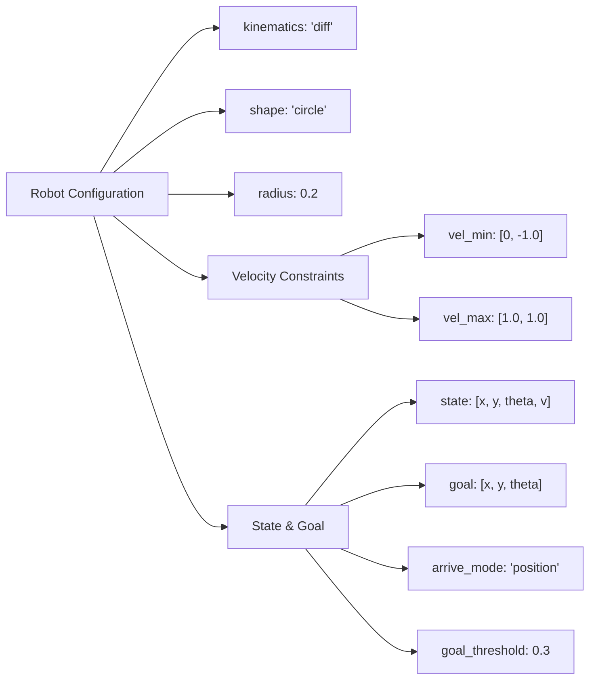
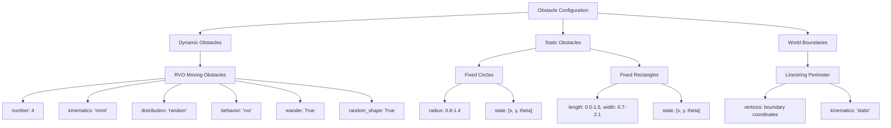
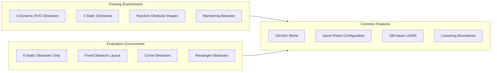

<!-- source: DeepWiki mcp.deepwiki.com · repo reiniscimurs/DRL-robot-navigation-IR-SIM · page 5 Environment Configuration · fetched 2026-10-14 -->

# Environment Configuration

<details>
<summary>Relevant source files</summary>

The following files were used as context for generating this wiki page:

- [robot_nav/eval_points.yaml](robot_nav/eval_points.yaml)
- [tests/test_world.yaml](tests/test_world.yaml)

</details>


This document covers the YAML-based environment configuration system that defines simulation worlds, robot parameters, obstacle layouts, and sensor specifications for the DRL robot navigation system. These configurations control the physical properties and behavior of the simulation environment used during training, evaluation, and testing.

For information about the simulation environment implementation and the `SIM_ENV` class that processes these configurations, see [Simulation Environment](#2.1). For testing and evaluation procedures that use these environments, see [Testing and Evaluation](#5).

## Configuration File Structure

The environment configuration system uses YAML files to define three main components: world parameters, robot specifications, and obstacle configurations. The system supports multiple configuration variants for different purposes.

### Configuration File Hierarchy

```mermaid
graph TB
    CONFIG["Environment Configuration System"]
    
    CONFIG --> WORLD_SEC["world Section"]
    CONFIG --> ROBOT_SEC["robot Section"]
    CONFIG --> OBSTACLE_SEC["obstacle Section"]
    
    WORLD_SEC --> HEIGHT["height: 10"]
    WORLD_SEC --> WIDTH["width: 10"]
    WORLD_SEC --> STEP_TIME["step_time: 0.3"]
    WORLD_SEC --> SAMPLE_TIME["sample_time: 0.3"]
    WORLD_SEC --> COLLISION_MODE["collision_mode: 'reactive'"]
    
    ROBOT_SEC --> KINEMATICS["kinematics: 'diff'"]
    ROBOT_SEC --> SHAPE_R["shape: 'circle'"]
    ROBOT_SEC --> VELOCITIES["vel_min/vel_max"]
    ROBOT_SEC --> SENSORS["sensors"]
    ROBOT_SEC --> GOAL_CONFIG["goal/state"]
    
    OBSTACLE_SEC --> STATIC_OBS["Static Obstacles"]
    OBSTACLE_SEC --> DYNAMIC_OBS["Dynamic Obstacles"]
    OBSTACLE_SEC --> BOUNDARY["World Boundaries"]
    
    SENSORS --> LIDAR["type: 'lidar2d'"]
    SENSORS --> RANGE_PARAMS["range_min/max"]
    SENSORS --> NOISE_PARAMS["noise/std"]
    
    STATIC_OBS --> CIRCLES["Circle Shapes"]
    STATIC_OBS --> RECTANGLES["Rectangle Shapes"]
    STATIC_OBS --> LINESTRINGS["Linestring Shapes"]
    
    DYNAMIC_OBS --> RVO_BEHAVIOR["RVO Behavior"]
    DYNAMIC_OBS --> RANDOM_DIST["Random Distribution"]
    DYNAMIC_OBS --> WANDER["Wander Mode"]
```



**Sources:** [robot_nav/robot_world.yaml:1-55](), [robot_nav/eval_world.yaml:1-51](), [tests/test_world.yaml:1-52]()

## World Parameters

The `world` section defines the global simulation environment properties that affect timing, boundaries, and collision handling.

| Parameter | Type | Description | Example Values |
|-----------|------|-------------|----------------|
| `height` | float | World height in meters | `10` |
| `width` | float | World width in meters | `10` |
| `step_time` | float | Physics simulation timestep in seconds | `0.3` (training), `1.0` (testing) |
| `sample_time` | float | Data sampling rate in seconds | `0.3` (training), `1.0` (testing) |
| `collision_mode` | string | Collision detection mode | `'reactive'` |

The timing parameters control simulation frequency, with training configurations using higher frequency (`0.3` seconds) compared to testing configurations (`1.0` seconds) for performance optimization.

**Sources:** [robot_nav/robot_world.yaml:1-6](), [robot_nav/eval_world.yaml:1-6](), [tests/test_world.yaml:1-6]()

## Robot Configuration

The `robot` section defines the agent's physical properties, kinematic constraints, sensor specifications, and goal parameters.

### Robot Physical Properties



The robot uses differential drive kinematics (`'diff'`) with a circular shape of 0.2m radius. Velocity constraints define linear velocity range `[0, 1.0]` m/s and angular velocity range `[-1.0, 1.0]` rad/s.

**Sources:** [robot_nav/robot_world.yaml:8-16](), [robot_nav/eval_world.yaml:8-16](), [tests/test_world.yaml:8-16]()

### Sensor Configuration

The robot is equipped with a 2D LiDAR sensor with comprehensive noise modeling:

| Parameter | Value | Description |
|-----------|-------|-------------|
| `type` | `'lidar2d'` | Sensor type |
| `range_min` | `0` | Minimum detection range (m) |
| `range_max` | `7` | Maximum detection range (m) |
| `angle_range` | `3.14` | Angular field of view (radians) |
| `number` | `180` | Number of laser beams |
| `noise` | `True` | Enable noise simulation |
| `std` | `0.08` | Range measurement noise std dev |
| `angle_std` | `0.1` | Angular noise std dev |
| `alpha` | `0.3` | Noise filtering parameter |

**Sources:** [robot_nav/robot_world.yaml:18-28](), [robot_nav/eval_world.yaml:18-28](), [tests/test_world.yaml:18-28]()

## Obstacle Configuration

The `obstacle` section defines static and dynamic obstacles using various geometric shapes and behaviors.

### Obstacle Types and Behaviors



**Sources:** [robot_nav/robot_world.yaml:33-55](), [robot_nav/eval_world.yaml:33-51]()

### Dynamic Obstacle Configuration

The training environment includes dynamic obstacles with RVO (Reciprocal Velocity Obstacles) behavior:

```yaml
- number: 4
  kinematics: {name: 'omni'}
  distribution: {name: 'random', range_low: [0, 0, -3.14], range_high: [10, 10, 3.14]}
  behavior: {name: 'rvo', wander: True, range_low: [0, 0, -3.14], range_high: [10, 10, 3.14], 
             vxmax: 0.2, vymax: 0.2, factor: 1.0}
  shape:
    - {name: 'circle', radius: 1.0, random_shape: True}
    - {name: 'polygon', random_shape: true, avg_radius_range: [0.5, 1.0], 
       irregularity_range: [0, 0.4], spikeyness_range: [0, 0.4], num_vertices_range: [4, 6]}
```

**Sources:** [robot_nav/robot_world.yaml:34-42]()

### Static Obstacle Shapes

The system supports multiple geometric shapes for static obstacles:

| Shape Type | Parameters | Example |
|------------|------------|---------|
| Circle | `radius` | `{name: 'circle', radius: 1.0}` |
| Rectangle | `length`, `width` | `{name: 'rectangle', length: 1.0, width: 1.2}` |
| Linestring | `vertices` | `{name: 'linestring', vertices: [[0,0], [10,0], ...]}` |

**Sources:** [robot_nav/robot_world.yaml:43-54](), [robot_nav/eval_world.yaml:34-50]()

## Configuration Variants

The system provides three main configuration variants optimized for different use cases:

### Configuration Comparison

| Aspect | Training (`robot_world.yaml`) | Evaluation (`eval_world.yaml`) | Testing (`test_world.yaml`) |
|--------|------------------------------|--------------------------------|----------------------------|
| **Timing** | `step_time: 0.3`, `sample_time: 0.3` | `step_time: 0.3`, `sample_time: 0.3` | `step_time: 1.0`, `sample_time: 1.0` |
| **Robot Start** | `[2, 2, 0, 0]` | `[3, 4, 0, 0]` | `[3, 4, 0, 0]` |
| **Dynamic Obstacles** | 4 RVO obstacles with random shapes | None | None |
| **Static Obstacles** | 4 fixed obstacles + boundaries | 6 fixed obstacles + boundaries | 6 fixed obstacles + boundaries |
| **Complexity** | High (moving obstacles) | Medium (fixed layout) | Medium (fixed layout) |

### Training vs Evaluation Environments



The training environment emphasizes variability and complexity with dynamic obstacles, while evaluation environments provide consistent, reproducible scenarios for performance assessment.

**Sources:** [robot_nav/robot_world.yaml:1-55](), [robot_nav/eval_world.yaml:1-51](), [tests/test_world.yaml:1-52]()

---

