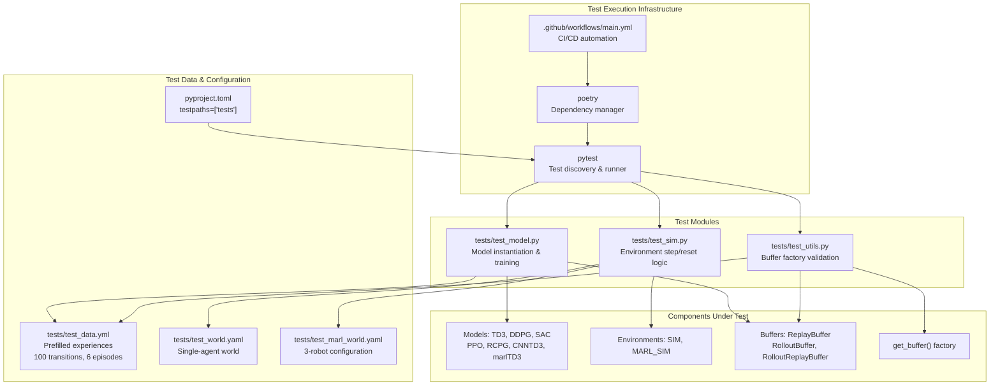
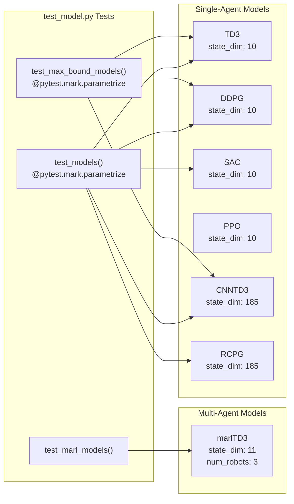
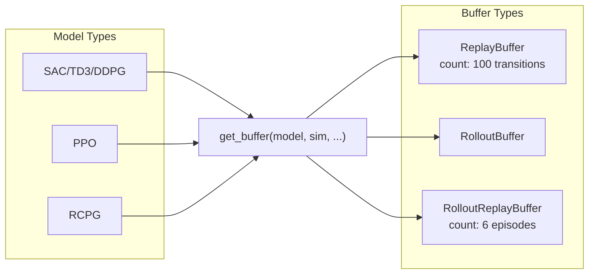
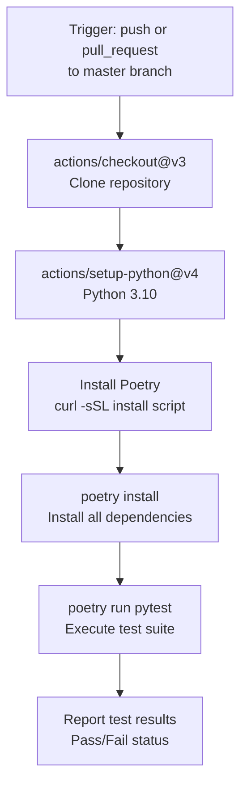
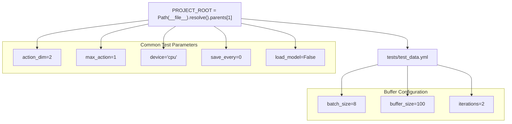

<!-- source: DeepWiki mcp.deepwiki.com · repo reiniscimurs/DRL-robot-navigation-IR-SIM · page 6 Testing and Validation · fetched 2026-10-14 -->

# Testing and Validation

<details>
<summary>Relevant source files</summary>

The following files were used as context for generating this wiki page:

- [.github/workflows/main.yml](.github/workflows/main.yml)
- [pyproject.toml](pyproject.toml)
- [tests/test_marl_world.yaml](tests/test_marl_world.yaml)
- [tests/test_model.py](tests/test_model.py)
- [tests/test_sim.py](tests/test_sim.py)
- [tests/test_utils.py](tests/test_utils.py)

</details>


## Overview

The DRL robot navigation system implements a comprehensive testing infrastructure using `pytest` to validate core functionality across models, environments, and utilities. The testing system ensures code quality through automated execution in a CI/CD pipeline via GitHub Actions.

The testing framework covers three primary areas:

1. **Model Testing** - Validates all DRL algorithms (TD3, DDPG, SAC, PPO, RCPG, CNNTD3, marlTD3) including training capabilities and special features like max bound regularization (see page 6.1)
2. **Environment Testing** - Verifies simulation environments (SIM, MARL_SIM) including state processing, step execution, and reset logic (see page 6.2)  
3. **Utility Testing** - Confirms buffer factory functions and data management components work correctly (see page 6.3)

This page provides an overview of the testing architecture and execution infrastructure. For detailed information about specific test suites, refer to the child pages.

Sources: [tests/test_model.py:1-151](), [tests/test_sim.py:1-61](), [tests/test_utils.py:1-112](), [.github/workflows/main.yml:1-32]()

## Testing Architecture

The testing infrastructure consists of three test modules that validate different system layers, with automated execution through GitHub Actions CI/CD.



**Testing Architecture Overview**

The test suite uses `pytest` for test discovery and execution, with Poetry managing dependencies. All test files are located in the `tests/` directory as configured in `pyproject.toml`. Test data includes YAML files with pre-generated experience transitions and world configurations.

Sources: [tests/test_model.py:1-16](), [tests/test_sim.py:1-12](), [tests/test_utils.py:1-9](), [pyproject.toml:23-24](), [.github/workflows/main.yml:1-32]()

## Test Organization

The testing system is organized into three focused modules that validate different components of the system.

### Test Module Overview

| Test Module | Primary Focus | Test Functions | Key Validations |
|-------------|---------------|----------------|-----------------|
| `tests/test_model.py` | DRL model training | `test_models`<br/>`test_max_bound_models`<br/>`test_marl_models` | Model instantiation, training loop execution, buffer integration, max bound feature |
| `tests/test_sim.py` | Simulation environments | `test_sim`<br/>`test_marl_sim`<br/>`test_sincos` | Step/reset mechanics, state dimensions, multi-agent coordination |
| `tests/test_utils.py` | Utility functions | `test_buffer`<br/>`test_rollout_buffer`<br/>`test_ppo_buffer` | Buffer factory dispatch, data loading, buffer type validation |

### Test Coverage by Algorithm

The test suite validates all implemented DRL algorithms with appropriate state dimensions and buffer types:



**Model Test Coverage**

For detailed information about model testing including parameterized tests, prefilled data usage, and max bound validation, see page 6.1.

Sources: [tests/test_model.py:19-28](), [tests/test_model.py:60-67](), [tests/test_model.py:100-110]()

## Test Data and Fixtures

The testing infrastructure uses pre-generated test data and environment configurations to ensure reproducible and consistent test execution.

### Test Data Files

| File | Purpose | Contents | Used By |
|------|---------|----------|---------|
| `tests/test_data.yml` | Prefilled experience buffer | 100 transitions, 6 episodes | `test_model.py`, `test_utils.py` |
| `tests/test_world.yaml` | Single-agent world config | 12×12 world, 7 obstacles | `test_sim.py` |
| `tests/test_marl_world.yaml` | Multi-agent world config | 12×12 world, 3 robots | `test_sim.py`, `test_model.py` |

### Common Test Configuration

All tests use consistent parameters to ensure reproducible validation:

```python
# Model instantiation parameters
state_dim = 10 or 185  # Depends on model type
action_dim = 2
max_action = 1
device = "cpu"
save_every = 0
load_model = False

# Buffer configuration
buffer_size = 100
batch_size = 8
iterations = 2

# Project root for data paths
PROJECT_ROOT = Path(__file__).resolve().parents[1]
```

### Buffer Factory Testing

The `get_buffer()` factory function is validated to ensure correct buffer type instantiation based on model requirements:



**Buffer Factory Validation**

For detailed information about buffer testing, including type validation and data loading, see page 6.3.

Sources: [tests/test_utils.py:12-48](), [tests/test_model.py:16](), [tests/test_model.py:30-37](), [tests/test_marl_world.yaml:1-23]()

## CI/CD Pipeline

The testing system integrates with GitHub Actions to provide automated testing on every push and pull request to the master branch.

### GitHub Actions Workflow

The CI/CD pipeline defined in `.github/workflows/main.yml` executes the following steps:



**CI/CD Execution Flow**

The workflow runs on `ubuntu-latest` runners and automatically reports test status on pull requests, preventing merges of code that breaks tests.

Sources: [.github/workflows/main.yml:1-32]()

### Test Configuration in pyproject.toml

The project configuration specifies test discovery paths and dependencies:

```toml
[tool.pytest.ini_options]
testpaths = ["tests"]

[project]
requires-python = ">=3.10"
dependencies = [
    "pytest (>=8.3.4,<9.0.0)",
    ...
]
```

This configuration ensures `pytest` automatically discovers all tests in the `tests/` directory when executed via `poetry run pytest`.

Sources: [pyproject.toml:23-24](), [pyproject.toml:9](), [pyproject.toml:15]()

## Test Environment Setup

The testing system uses consistent environment configuration across all test functions:



**Test Environment Configuration**

Sources: [tests/test_model.py:12](), [tests/test_utils.py:9](), [tests/test_model.py:25-32](), [tests/test_model.py:48-52]()

---

