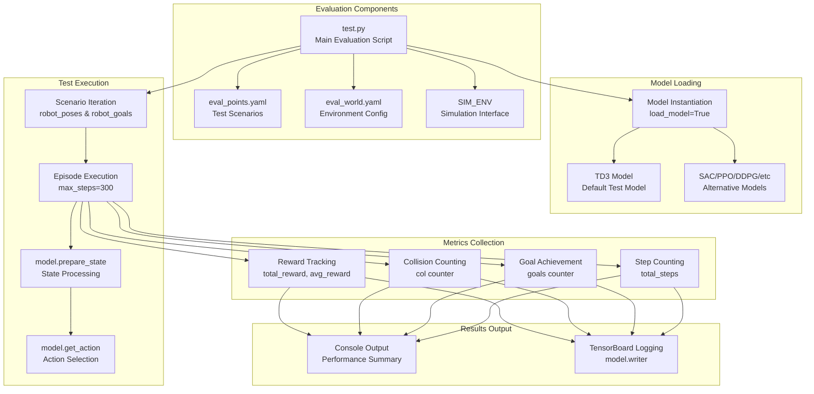
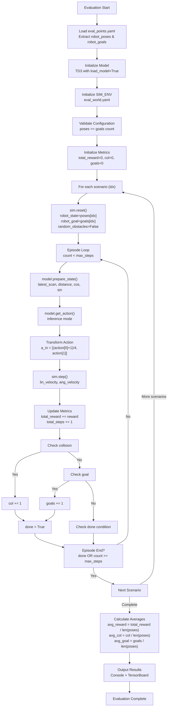

<!-- source: DeepWiki mcp.deepwiki.com · repo reiniscimurs/DRL-robot-navigation-IR-SIM · page 6.1 Model Testing · fetched 2026-10-14 -->

# Model Evaluation

<details>
<summary>Relevant source files</summary>

The following files were used as context for generating this wiki page:

- [tests/test_marl_world.yaml](tests/test_marl_world.yaml)
- [tests/test_model.py](tests/test_model.py)

</details>


## Purpose and Scope

This document covers the structured model evaluation system implemented in the DRL robot navigation framework. The evaluation system tests trained models against predefined scenarios to measure performance consistency and reliability. This structured approach differs from random testing scenarios covered in [Random Testing and Simulation Validation](#5.2), and complements the unit testing framework described in [Unit Testing Framework](#5.3).

The evaluation system uses fixed robot poses and goals defined in configuration files to ensure reproducible testing conditions across different model versions and training runs.

## Evaluation System Overview

The model evaluation system provides a standardized framework for testing trained reinforcement learning models against predetermined navigation scenarios. The system loads pre-trained models and executes them through a series of controlled test cases to measure key performance indicators.



**Sources:** [robot_nav/test.py:1-94]()

## Test Scenario Configuration

The evaluation system relies on predefined test scenarios specified in the `eval_points.yaml` configuration file. This file contains matched pairs of robot starting positions and target goals that create consistent testing conditions.

### Configuration Structure

The evaluation configuration defines specific test cases through robot poses and corresponding goals:

| Configuration Element | Purpose | Source Location |
|----------------------|---------|----------------|
| `robot_poses` | Starting positions for each test scenario | `eval_points.yaml` |
| `robot_goals` | Target destinations for each scenario | `eval_points.yaml` |
| `eval_world.yaml` | Environment configuration for testing | Simulation environment |

The system validates that the number of poses matches the number of goals to ensure test integrity [robot_nav/test.py:40-42]().

### Test Parameters

Key evaluation parameters are configured as constants in the test script:

```
action_dim = 2        # Linear and angular velocity outputs
max_action = 1        # Maximum action magnitude
state_dim = 25        # Input state vector dimension
max_steps = 300       # Maximum steps per episode
```

**Sources:** [robot_nav/test.py:35-42](), [robot_nav/test.py:16-23]()

## Evaluation Workflow

The evaluation process follows a systematic workflow that ensures consistent testing across all scenarios and models.



**Sources:** [robot_nav/test.py:50-89]()

## Metrics Collection and Analysis

The evaluation system tracks multiple performance indicators to provide comprehensive model assessment.

### Core Metrics

The system collects the following metrics during evaluation:

| Metric | Calculation | Purpose |
|--------|-------------|---------|
| `total_reward` | Sum of all step rewards | Overall performance measure |
| `avg_reward` | `total_reward / len(robot_poses)` | Average reward per scenario |
| `avg_step_reward` | `total_reward / total_steps` | Efficiency measure |
| `avg_col` | `col / len(robot_poses)` | Collision rate per scenario |
| `avg_goal` | `goals / len(robot_poses)` | Success rate per scenario |

### Action Transformation

The evaluation system applies action transformation to convert model outputs to simulation inputs:

```
a_in = [(action[0] + 1) / 4, action[1]]
```

This transformation maps the model's action space to appropriate velocity commands where:
- Linear velocity: `(action[0] + 1) / 4` scales [-1,1] to [0,0.5]
- Angular velocity: `action[1]` remains in [-1,1] range

**Sources:** [robot_nav/test.py:63](), [robot_nav/test.py:75-83]()

## Results Logging and Output

The evaluation system provides dual output channels for results analysis and monitoring.

### Console Output

Performance metrics are displayed in a formatted console summary:

```
..............................................
Testing {number} scenarios
Total Reward: {total_reward}
Average Reward: {avg_reward}
Average Step Reward: {avg_step_reward}
Average Collision rate: {avg_col}
Average Goal rate: {avg_goal}
..............................................
```

### TensorBoard Integration

All metrics are logged to TensorBoard for visualization and tracking across evaluation runs:

- `test/total_reward`: Cumulative reward across all scenarios
- `test/avg_reward`: Average reward per scenario
- `test/avg_step_reward`: Average reward per step
- `test/avg_col`: Average collision rate
- `test/avg_goal`: Average goal achievement rate

The TensorBoard logging enables comparison of model performance across different training epochs and model variants.

**Sources:** [robot_nav/test.py:44-49](), [robot_nav/test.py:79-89](), [robot_nav/test.py:85-89]()

## Model Selection and Configuration

While the default evaluation script uses TD3, the system supports testing any trained model by modifying the model instantiation section. The evaluation framework is model-agnostic and works with all implemented algorithms including SAC, PPO, DDPG, CNNTD3, and RCPG variants.

Model loading is controlled by the `load_model=True` parameter, which instructs the model to load pre-trained weights from the default checkpoint location.

**Sources:** [robot_nav/test.py:25-32](), [robot_nav/test.py:1-6]()

---

