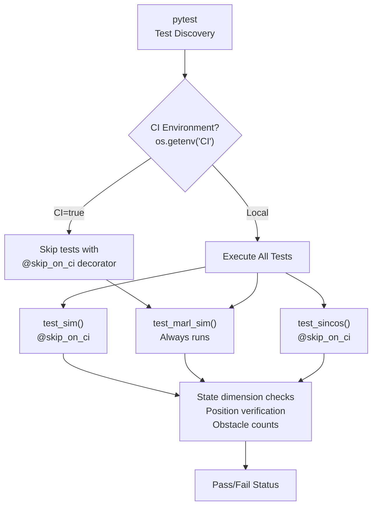
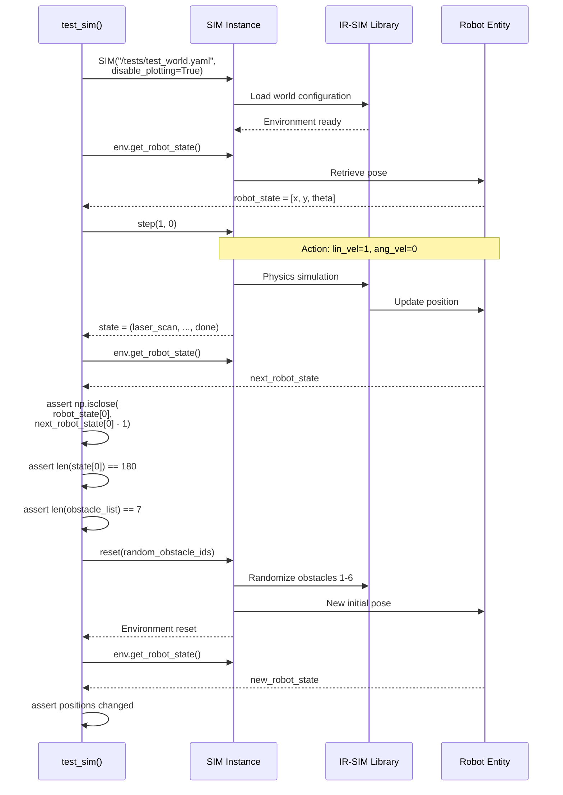
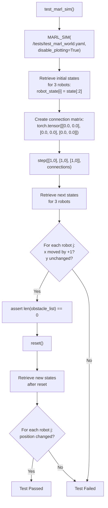
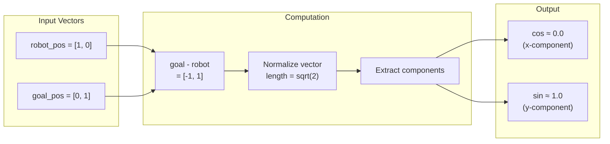
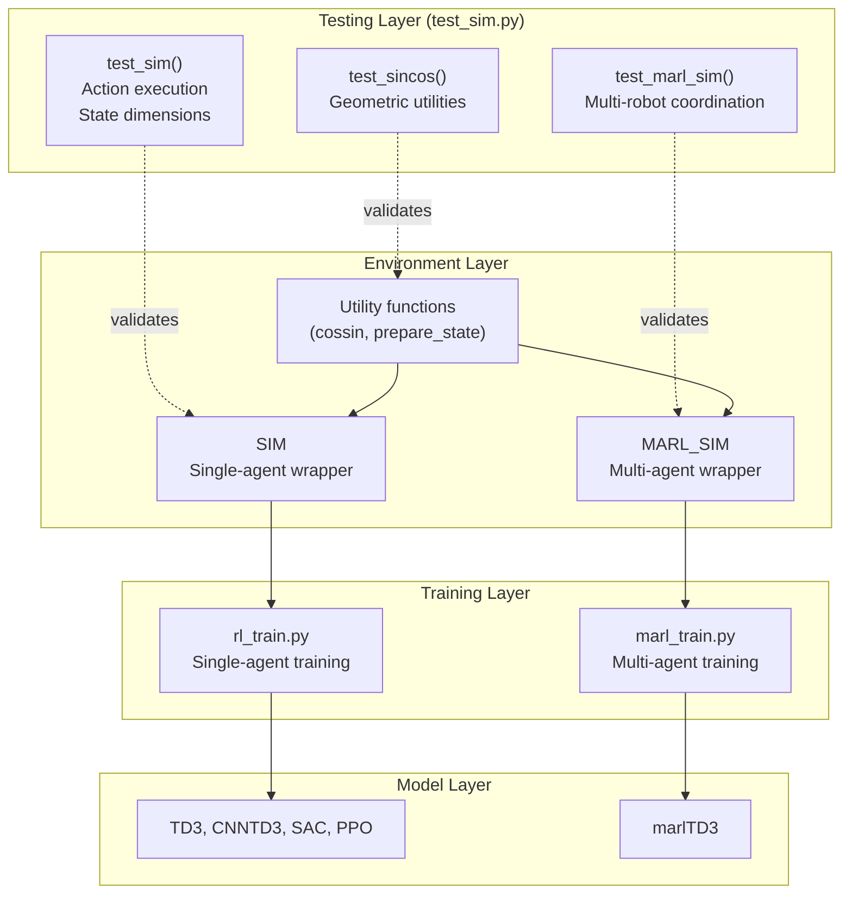

<!-- source: DeepWiki mcp.deepwiki.com · repo reiniscimurs/DRL-robot-navigation-IR-SIM · page 6.2 Simulation and Environment Testing · fetched 2026-10-14 -->

# Simulation and Environment Testing

<details>
<summary>Relevant source files</summary>

The following files were used as context for generating this wiki page:

- [tests/test_sim.py](tests/test_sim.py)

</details>


This page documents the test suite for the simulation environment wrappers, specifically the `SIM` and `MARL_SIM` classes that interface with the IR-SIM library. These tests validate core environment functionality including state retrieval, action execution, reset mechanics, and utility functions. For model training validation, see [Model Testing](#6.1). For buffer factory testing, see [Buffer and Utility Testing](#6.3).

## Overview

The simulation environment tests are located in [tests/test_sim.py]() and provide integration testing for the environment wrappers. The test suite verifies that:

- Single-agent environments correctly execute actions and return valid states
- Multi-agent environments coordinate multiple robots properly
- Reset functionality produces randomized initial conditions
- Utility functions (e.g., `cossin`) compute correct geometric transformations

These tests ensure the environment layer functions correctly before being integrated with DRL models during training.

**Sources:** [tests/test_sim.py:1-61]()

## Test Structure and CI Integration

The test suite uses pytest with conditional execution based on CI environment detection. Tests that require IR-SIM rendering are skipped in GitHub Actions to avoid display-related failures in headless environments.



**Decorator Configuration**

The `skip_on_ci` marker conditionally skips tests based on the `CI` environment variable:

| Test Function | Decorator | CI Behavior |
|--------------|-----------|-------------|
| `test_sim()` | `@skip_on_ci` | Skipped on GitHub Actions |
| `test_marl_sim()` | None | Always executes |
| `test_sincos()` | `@skip_on_ci` | Skipped on GitHub Actions |

**Sources:** [tests/test_sim.py:10-12](), [tests/test_sim.py:15](), [tests/test_sim.py:55]()

## Single-Agent Environment Testing (test_sim)

The `test_sim()` function validates the `SIM` class for single-robot navigation scenarios. This test creates an environment instance, executes actions, and verifies state transitions.

### Test Execution Flow



### Test Assertions

The test validates the following aspects:

**Action Execution** [tests/test_sim.py:19-22]()
- Forward motion with `step(1, 0)` moves robot +1.0 units in x-direction
- Angular velocity of 0 maintains y-position
- Verifies physics simulation is correctly applied

**State Dimensions** [tests/test_sim.py:24]()
- Laser scan state contains exactly 180 readings (binned from 360 raw readings)
- Confirms state preparation matches model expectations

**Environment Configuration** [tests/test_sim.py:25]()
- Test world contains 7 obstacles as defined in `test_world.yaml`
- Validates correct world loading from YAML configuration

**Reset Functionality** [tests/test_sim.py:27-30]()
- `reset()` with `random_obstacle_ids=[1,2,3,4,5,6]` randomizes 6 of 7 obstacles
- Robot position changes after reset, confirming random initialization
- Both x and y coordinates are verified to have changed

**Sources:** [tests/test_sim.py:16-30]()

## Multi-Agent Environment Testing (test_marl_sim)

The `test_marl_sim()` function validates the `MARL_SIM` class for multi-robot coordination scenarios with 3 robots. This test is not decorated with `@skip_on_ci`, allowing it to run in CI pipelines.

### Multi-Robot Test Flow



### Multi-Agent Assertions

**Simultaneous Action Execution** [tests/test_sim.py:40-44]()
- All 3 robots receive action `[1, 0]` (forward motion)
- Each robot independently moves +1.0 units in x-direction
- Y-coordinates remain unchanged for all robots
- Validates parallel physics simulation

**Connection Matrix Structure** [tests/test_sim.py:36-38]()
- Creates a `torch.tensor` with shape `(3, 2)` representing connections
- Each robot has 2 connection slots (num_robots - 1)
- Zero connections indicate no inter-agent communication for this test
- Matrix structure: `[[0.0, 0.0], [0.0, 0.0], [0.0, 0.0]]`

**Environment Configuration** [tests/test_sim.py:46]()
- Test MARL world contains 0 obstacles
- Validates clean environment for multi-agent testing
- Reduces collision complexity to focus on robot coordination

**Multi-Robot Reset** [tests/test_sim.py:48-52]()
- Reset without arguments randomizes all robot positions
- Verifies minimum separation constraints (0.6 units) are enforced
- All robot positions change, confirming independent randomization

**Sources:** [tests/test_sim.py:33-52]()

## Geometric Utility Testing (test_sincos)

The `test_sincos()` function validates the `cossin()` utility method that computes geometric relationships between robot position and goal location.

### Cossin Function Behavior



### Test Case Analysis

The test validates a specific geometric configuration:

**Input Configuration** [tests/test_sim.py:58]()
- Robot position: `[1, 0]` (on positive x-axis)
- Goal position: `[0, 1]` (on positive y-axis)
- Expected angle from robot to goal: approximately 135° (π - π/4)

**Expected Outputs** [tests/test_sim.py:59-60]()
- `cos ≈ 0.0` - normalized x-component of direction vector
- `sin ≈ 1.0` - normalized y-component of direction vector
- Uses `np.isclose()` for floating-point tolerance

**Purpose in State Representation**
- The `cossin()` function encodes goal direction in the state vector
- Provides rotation-invariant representation of goal location
- Used by all single-agent models during state preparation

**Sources:** [tests/test_sim.py:56-60]()

## Test Coverage and Validation Strategy

The simulation test suite provides comprehensive coverage of environment functionality through a focused set of integration tests.

### Coverage Matrix

| Component | Test Function | Validation Aspects |
|-----------|--------------|-------------------|
| **SIM Class** | `test_sim()` | Action execution, state dimensions, obstacle loading, reset randomization |
| **MARL_SIM Class** | `test_marl_sim()` | Multi-robot coordination, connection matrices, simultaneous actions, conflict-free reset |
| **Utility Functions** | `test_sincos()` | Geometric computations, goal direction encoding |
| **Configuration Loading** | Both environment tests | YAML world file parsing, robot/obstacle initialization |

### Test Data Files

The tests rely on dedicated configuration files in the `tests/` directory:

| File | Purpose | Contents |
|------|---------|----------|
| `test_world.yaml` | Single-agent testing | 1 robot, 7 obstacles, sensor config |
| `test_marl_world.yaml` | Multi-agent testing | 3 robots, 0 obstacles, coordination setup |

These minimal configurations enable fast, reproducible testing without the complexity of full training scenarios.

**Sources:** [tests/test_sim.py:17](), [tests/test_sim.py:34]()

## Integration with Training Pipeline

The simulation environment tests validate the foundation upon which the entire training pipeline depends. Understanding this integration clarifies why these tests focus on specific functionality.



### Critical Integration Points

**State Dimension Validation**
- `test_sim()` asserts 180-dimensional laser state [tests/test_sim.py:24]()
- Matches expectations of CNNTD3 model (185-dim after adding goal/action features)
- Prevents runtime errors during training from dimension mismatches

**Physics Accuracy**
- Forward motion assertions [tests/test_sim.py:21]() validate simulator integration
- Ensures reward functions receive accurate positional feedback
- Critical for convergence of value-based methods (TD3, SAC)

**Reset Reproducibility**
- Random obstacle verification [tests/test_sim.py:27-30]() ensures training diversity
- Multi-robot separation checks [tests/test_sim.py:48-52]() prevent collision bias
- Enables fair comparison across training runs

**Sources:** [tests/test_sim.py:1-61]()

## Running the Tests

Execute the simulation environment tests using pytest:

```bash
# Run all simulation tests
poetry run pytest tests/test_sim.py -v

# Run only multi-agent test (works on CI)
poetry run pytest tests/test_sim.py::test_marl_sim -v

# Run with detailed output
poetry run pytest tests/test_sim.py -v -s
```

**Expected Output:**

```
tests/test_sim.py::test_sim SKIPPED (on CI) / PASSED (locally)
tests/test_sim.py::test_marl_sim PASSED
tests/test_sim.py::test_sincos SKIPPED (on CI) / PASSED (locally)
```

The test suite completes in seconds, providing rapid validation of environment functionality during development.

**Sources:** [tests/test_sim.py:1-61]()

---

