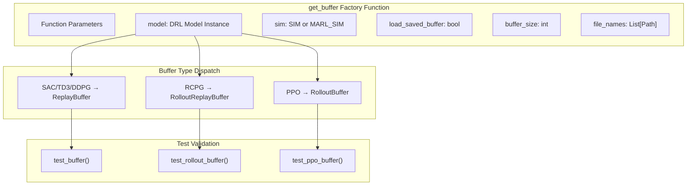
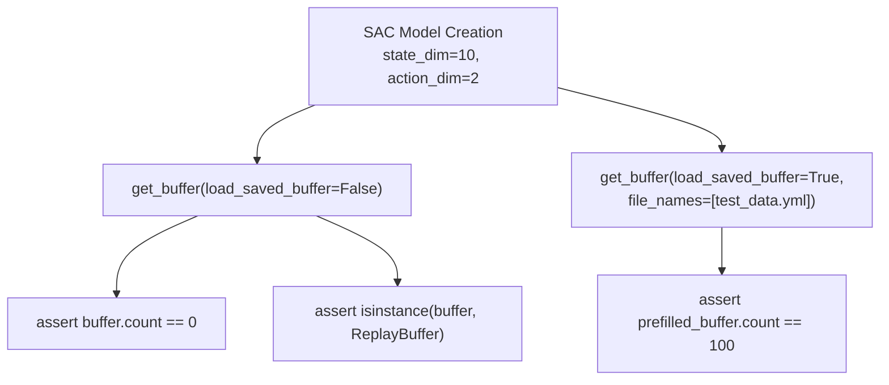
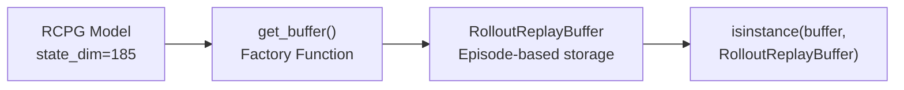
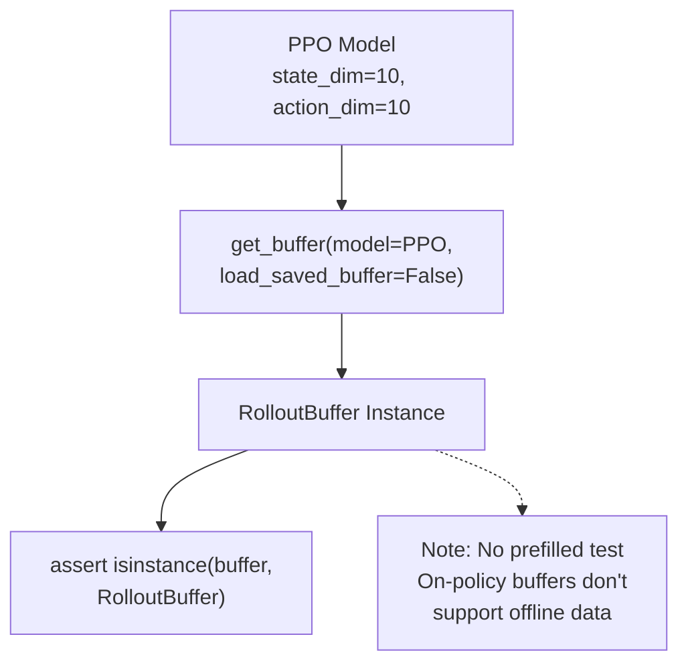
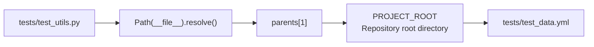
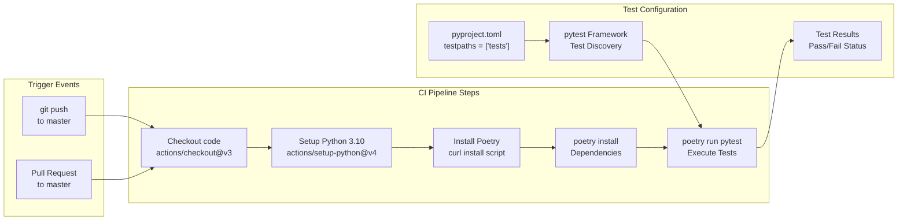

<!-- source: DeepWiki mcp.deepwiki.com · repo reiniscimurs/DRL-robot-navigation-IR-SIM · page 6.3 Buffer and Utility Testing · fetched 2026-10-14 -->

# Buffer and Utility Testing

<details>
<summary>Relevant source files</summary>

The following files were used as context for generating this wiki page:

- [.github/workflows/main.yml](.github/workflows/main.yml)
- [pyproject.toml](pyproject.toml)
- [tests/test_utils.py](tests/test_utils.py)

</details>


## Purpose and Scope

The buffer testing framework validates the `get_buffer` factory function, ensuring correct polymorphic dispatch of buffer types based on model architecture. The tests verify that each algorithm receives its appropriate buffer implementation: `ReplayBuffer` for off-policy methods (SAC, TD3, DDPG), `RolloutReplayBuffer` for sequence-based recurrent models (RCPG), and `RolloutBuffer` for on-policy algorithms (PPO).

For model training validation, see page 6.1. For simulation environment testing, see page 6.2.

## Buffer Factory Testing Architecture

The `get_buffer` factory function in [robot_nav/utils.py]() performs polymorphic dispatch based on model type. The test suite validates this dispatch mechanism through three specialized test functions:

### Buffer Factory Function Signature



**Sources:** [tests/test_utils.py:1-112](), [robot_nav/utils.py]()

## ReplayBuffer Testing (SAC Model)

The `test_buffer` function validates that off-policy algorithms receive the standard `ReplayBuffer` implementation. This test uses the `SAC` model as a representative off-policy algorithm.

### Test Workflow Diagram



**Sources:** [tests/test_utils.py:12-48]()

### Test Parameters

| Parameter | Value | Purpose |
|-----------|-------|---------|
| `model` | `SAC(state_dim=10, action_dim=2)` | Representative off-policy algorithm |
| `sim` | `SIM` | Single-agent simulation class |
| `buffer_size` | `100` | Fixed size for testing |
| `file_names` | `[PROJECT_ROOT/tests/test_data.yml]` | Prefilled experience data |

The test validates two scenarios:
1. **Empty buffer initialization** ([tests/test_utils.py:23-35]()): Verifies `count == 0` and correct type
2. **Prefilled buffer loading** ([tests/test_utils.py:37-48]()): Verifies 100 transitions loaded from YAML

**Sources:** [tests/test_utils.py:12-48]()

## RolloutReplayBuffer Testing (RCPG Model)

The `test_rollout_buffer` function validates that recurrent models receive the sequence-based `RolloutReplayBuffer` implementation, which stores complete episode trajectories.

### RCPG Buffer Type Dispatch



**Sources:** [tests/test_utils.py:51-87]()

### Episode Count Validation

The test demonstrates a key difference: the `RolloutReplayBuffer` counts episodes rather than individual transitions:

| Buffer Type | Empty Count | Prefilled Count | Unit |
|-------------|-------------|-----------------|------|
| `ReplayBuffer` | 0 | 100 | Transitions |
| `RolloutReplayBuffer` | 0 | 6 | Episodes |

When loading [tests/test_data.yml](), the `RolloutReplayBuffer` groups transitions into 6 complete episodes ([tests/test_utils.py:87]()), while the `ReplayBuffer` treats them as 100 individual transitions ([tests/test_utils.py:48]()).

**Sources:** [tests/test_utils.py:51-87]()

## RolloutBuffer Testing (PPO Model)

The `test_ppo_buffer` function validates that on-policy algorithms receive the `RolloutBuffer` implementation, which is designed for immediate use without long-term storage.

### PPO Buffer Characteristics



**Sources:** [tests/test_utils.py:90-111]()

### On-Policy Buffer Behavior

The PPO test differs from off-policy tests in several ways:

1. **No prefilled buffer test**: On-policy algorithms don't support pretraining from offline data
2. **Episode-based collection**: Data is collected and immediately consumed
3. **No long-term storage**: Buffer is cleared after each training iteration

The test only validates type correctness ([tests/test_utils.py:111]()), as the `RolloutBuffer` doesn't maintain a persistent `count` attribute like replay buffers.

**Sources:** [tests/test_utils.py:90-111]()

## Test Data Configuration

The buffer tests use standardized test data to ensure consistent validation across different buffer types. The test data configuration is managed through path resolution and YAML file loading.

### Path Resolution



**Sources:** [tests/test_utils.py:1](), [tests/test_utils.py:9]()

The `PROJECT_ROOT` variable ([tests/test_utils.py:9]()) establishes a consistent reference point for locating test data files, regardless of where pytest is invoked from.

### Test Data Structure

| Configuration | Value | Purpose |
|---------------|-------|---------|
| **File Path** | `PROJECT_ROOT.joinpath("tests/test_data.yml")` | Source of prefilled experiences |
| **Buffer Size** | `100` | Maximum capacity for testing |
| **Batch Size** | `0` | Not used in buffer tests |
| **Training Iterations** | `0` | No training during buffer tests |
| **Pretraining Iterations** | `0` | No pretraining during buffer tests |

The test data file contains 100 individual transitions that can be interpreted as either:
- **100 transitions** for `ReplayBuffer` (transition-based storage)
- **6 episodes** for `RolloutReplayBuffer` (episode-based storage)

**Sources:** [tests/test_utils.py:46](), [tests/test_utils.py:85]()

## Buffer Type Validation Summary

The following table summarizes the validation performed by each test function:

| Test Function | Model Type | Buffer Type | Empty Count | Prefilled Count | File Reference |
|---------------|------------|-------------|-------------|-----------------|----------------|
| `test_buffer()` | `SAC` | `ReplayBuffer` | 0 | 100 transitions | [tests/test_utils.py:12-48]() |
| `test_rollout_buffer()` | `RCPG` | `RolloutReplayBuffer` | 0 | 6 episodes | [tests/test_utils.py:51-87]() |
| `test_ppo_buffer()` | `PPO` | `RolloutBuffer` | N/A | N/A | [tests/test_utils.py:90-111]() |

### Key Validation Points

Each test validates two critical properties:

1. **Type Correctness**: The `isinstance()` check ensures the factory returns the correct buffer class
2. **Data Loading**: For off-policy buffers, the prefilled test validates that experiences load correctly

The differing count values (100 vs 6) demonstrate the fundamental difference between transition-based and episode-based storage mechanisms.

**Sources:** [tests/test_utils.py:1-112]()

## CI/CD Integration

The testing framework integrates with GitHub Actions for automated continuous integration:



**Sources:** [.github/workflows/main.yml:1-32](), [pyproject.toml:22-23]()

## Test Data Management

The testing framework uses standardized test data for consistent validation across all tests:

### Test Data Configuration

- **Test Data File**: [tests/test_data.yml]() contains sample training experiences
- **Project Root Resolution**: [tests/test_model.py:12]() and [tests/test_utils.py:9]() establish consistent path resolution
- **Buffer Size**: Tests use `buffer_size=100` for consistent memory usage
- **Batch Configuration**: Model training tests use `batch_size=8` and `iterations=2` for fast validation

### Buffer Prefilling Process

The `get_buffer` function loads test data with specific parameters:

```
get_buffer(
    model=test_model,
    sim=SIM_ENV,
    load_saved_buffer=True,
    pretrain=False,
    pretraining_iterations=0,
    training_iterations=0,
    batch_size=0,
    buffer_size=100,
    file_names=[PROJECT_ROOT.joinpath("tests/test_data.yml")]
)
```

**Sources:** [tests/test_model.py:36-46](), [tests/test_utils.py:36-46]()

## Dependencies and Configuration

### Test Dependencies

The testing framework requires the following dependencies defined in [pyproject.toml:15]():

- `pytest (>=8.3.4,<9.0.0)` - Core testing framework
- `ir-sim[all] (>=2.3.0,<3.0.0)` - Simulation environment for testing
- `torch (>=2.5.1,<3.0.0)` - Neural network models

### Pytest Configuration

Test configuration is specified in [pyproject.toml:22-23]():

```toml
[tool.pytest.ini_options]
testpaths = ["tests"]
```

This configuration ensures pytest automatically discovers and runs all tests in the `tests/` directory.

**Sources:** [pyproject.toml:10-20](), [pyproject.toml:22-23]()

---

