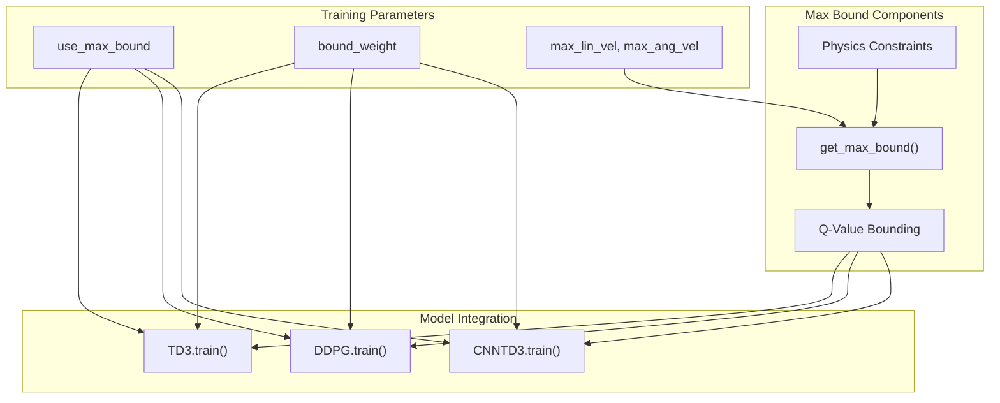
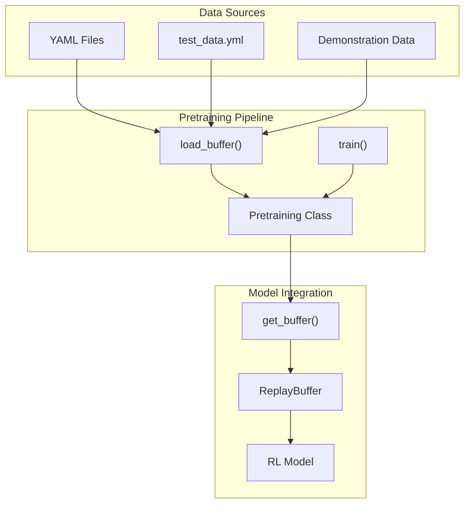
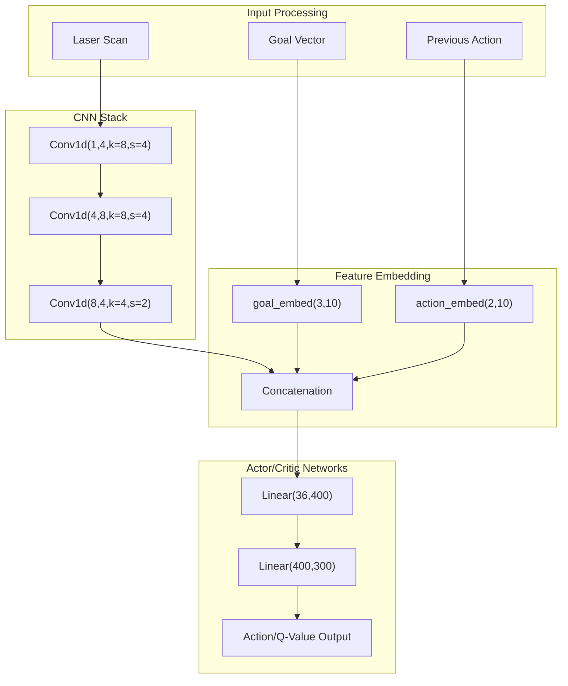
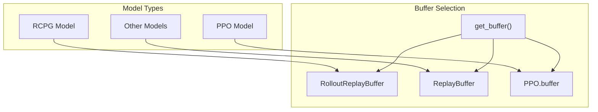

<!-- source: DeepWiki mcp.deepwiki.com · repo reiniscimurs/DRL-robot-navigation-IR-SIM · page 7 Advanced Features · fetched 2026-10-14 -->

# Advanced Features

<details>
<summary>Relevant source files</summary>

The following files were used as context for generating this wiki page:

- [docs/index.md](docs/index.md)
- [mkdocs.yml](mkdocs.yml)
- [robot_nav/models/CNNTD3/CNNTD3.py](robot_nav/models/CNNTD3/CNNTD3.py)
- [robot_nav/models/DDPG/DDPG.py](robot_nav/models/DDPG/DDPG.py)
- [robot_nav/models/RCPG/RCPG.py](robot_nav/models/RCPG/RCPG.py)
- [robot_nav/models/SAC/SAC_utils.py](robot_nav/models/SAC/SAC_utils.py)
- [robot_nav/models/TD3/TD3.py](robot_nav/models/TD3/TD3.py)
- [robot_nav/replay_buffer.py](robot_nav/replay_buffer.py)
- [robot_nav/utils.py](robot_nav/utils.py)

</details>


This document covers sophisticated training techniques, regularization methods, and architectural enhancements available in the DRL robot navigation system. These features enable improved sample efficiency, training stability, and performance optimization beyond the basic RL model implementations.

For basic model training and usage, see [Core Training System](#2). For standard model architectures, see [Reinforcement Learning Models](#3). For environment setup and configuration, see [Environment Configuration](#4).

## Max Upper Bound Regularization

The system implements an advanced Q-value regularization technique that prevents overestimation bias by constraining Q-values to physically realizable upper bounds. This feature is available for TD3-based models including `CNNTD3` and `DDPG`.

### Implementation Architecture



**Sources:** [robot_nav/utils.py:182-253](), [robot_nav/models/CNNTD3/CNNTD3.py:359-376](), [robot_nav/models/DDPG/DDPG.py:286-302]()

### Physical Bound Calculation

The `get_max_bound` function computes theoretical maximum returns based on robot kinematics and environment constraints:

| Component | Calculation | Purpose |
|-----------|-------------|---------|
| Turn Steps | `theta.abs() / (max_ang_vel * time_step)` | Time to orient toward goal |
| Distance Steps | `distance / (max_lin_vel * time_step)` | Time to reach goal at max speed |
| Discounted Rewards | `goal_reward * discount^final_steps` | Maximum possible return |

The bound calculation considers:
- **Angular constraints**: Maximum turning velocity and required heading change
- **Linear constraints**: Maximum forward velocity and goal distance  
- **Temporal discounting**: Future reward degradation over time steps
- **Terminal rewards**: Goal achievement bonus

**Sources:** [robot_nav/utils.py:215-252]()

### Usage Configuration

Models supporting max bound regularization accept these initialization parameters:

```python
# Enable max bound regularization
model = CNNTD3(
    use_max_bound=True,      # Enable bounding loss
    bound_weight=0.25,       # Weight for bound penalty
    # ... other parameters
)
```

During training, the regularization adds a penalty term:
```
total_loss = mse_loss + bound_weight * max_bound_loss
```

**Sources:** [robot_nav/models/CNNTD3/CNNTD3.py:201-202](), [robot_nav/models/CNNTD3/CNNTD3.py:372-376]()

## Pretraining System

The pretraining system enables offline learning from pre-recorded demonstration data, improving sample efficiency and initial policy quality.

### Pretraining Architecture



**Sources:** [robot_nav/utils.py:11-112](), [robot_nav/utils.py:114-179]()

### Data Format and Loading

Pretraining data must be stored in YAML format with environment transitions:

| Field | Type | Description |
|-------|------|-------------|
| `latest_scan` | List[float] | LiDAR sensor readings |
| `distance` | float | Distance to goal |
| `cos`, `sin` | float | Goal direction encoding |
| `collision` | bool | Collision status |
| `goal` | bool | Goal reached status |
| `action` | List[float] | Executed action `[lin_vel, ang_vel]` |

The `Pretraining.load_buffer()` method processes sequential samples to create state-action-reward-next_state tuples for the replay buffer.

**Sources:** [robot_nav/utils.py:34-86]()

### Configuration Parameters

| Parameter | Type | Default | Purpose |
|-----------|------|---------|---------|
| `pretrain` | bool | False | Enable pretraining phase |
| `load_saved_buffer` | bool | False | Load offline data |
| `pretraining_iterations` | int | - | Number of pretraining epochs |
| `file_names` | List[str] | `["robot_nav/assets/data.yml"]` | Data file paths |

**Sources:** [robot_nav/utils.py:114-126]()

## Advanced Network Architectures

The system provides enhanced neural network architectures beyond standard fully-connected networks.

### CNN-Enhanced Processing (CNNTD3)



**Sources:** [robot_nav/models/CNNTD3/CNNTD3.py:32-82](), [robot_nav/models/CNNTD3/CNNTD3.py:104-176]()

### Recurrent Networks with Memory (RCPG)

The `RCPG` model incorporates recurrent layers for temporal sequence processing:

| RNN Type | Configuration | Use Case |
|----------|---------------|----------|
| `"gru"` | GRU(36, 36, 1) | Default choice, efficient training |
| `"lstm"` | LSTM(36, 36, 1) | Long-term dependencies |
| `"rnn"` | RNN(36, 36, 1) | Simple recurrence |

The recurrent architecture processes state sequences through:
1. **CNN feature extraction** for each timestep
2. **RNN processing** across the temporal dimension  
3. **Final timestep output** for action/value prediction

**Sources:** [robot_nav/models/RCPG/RCPG.py:29-89](), [robot_nav/models/RCPG/RCPG.py:109-190]()

## Specialized Replay Buffers

The system supports multiple replay buffer implementations optimized for different learning paradigms.

### Buffer Type Selection



**Sources:** [robot_nav/utils.py:146-154]()

### RolloutReplayBuffer Features

The `RolloutReplayBuffer` provides episode-aware storage for sequence-based learning:

| Feature | Standard Buffer | Rollout Buffer |
|---------|----------------|----------------|
| Storage Unit | Individual transitions | Complete episodes |
| Sampling | Random transitions | Sequence segments |
| History Access | Single timestep | Configurable `history_len` |
| Memory Overhead | Low | Higher |

Key capabilities:
- **Episode segmentation**: Automatic episode boundary detection
- **Sequence sampling**: Returns `history_len` consecutive states
- **Padding handling**: Repeats earliest state for short sequences

**Sources:** [robot_nav/replay_buffer.py:103-222]()

## State Preparation Variants

Different models implement specialized state preparation methods optimized for their architectures.

### Preparation Method Comparison

| Model | Scan Processing | Normalization | Special Features |
|-------|----------------|---------------|------------------|
| `DDPG` | Binning to `max_bins` | Min values per bin | Adaptive scan compression |
| `CNNTD3` | Full resolution | Direct normalization | CNN-optimized format |
| `RCPG` | Full resolution | Direct normalization | Sequence-ready output |

### DDPG Adaptive Binning

The `DDPG.prepare_state()` method implements scan compression:

```python
max_bins = self.state_dim - 5
bin_size = int(np.ceil(len(latest_scan) / max_bins))
```

This approach:
- **Reduces dimensionality** for computational efficiency
- **Preserves critical information** via minimum distance per bin
- **Adapts to varying scan resolutions** automatically

**Sources:** [robot_nav/models/DDPG/DDPG.py:407-419]()

### CNN-Optimized Processing

`CNNTD3` and `RCPG` maintain full scan resolution for convolutional processing:

```python
latest_scan[inf_mask] = 7.0  # Replace infinite values
latest_scan /= 7             # Normalize to [0,1]
```

This preserves spatial relationships essential for CNN feature extraction.

**Sources:** [robot_nav/models/CNNTD3/CNNTD3.py:481-483](), [robot_nav/models/RCPG/RCPG.py:504-506]()

---

