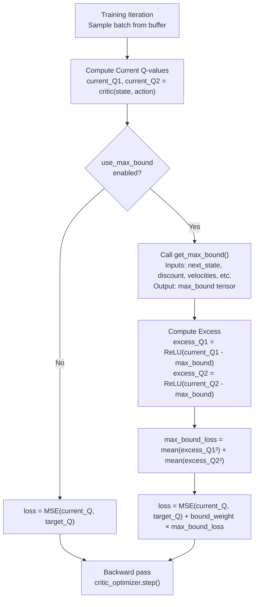
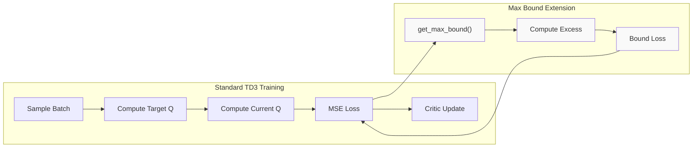
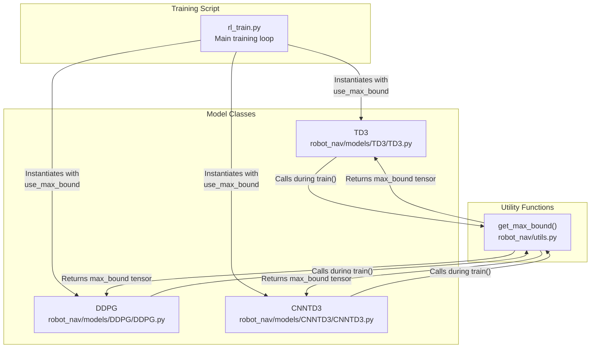
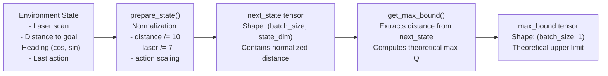

<!-- source: DeepWiki mcp.deepwiki.com · repo reiniscimurs/DRL-robot-navigation-IR-SIM · page 7.1 Max Upper Bound Loss · fetched 2026-10-14 -->

# Max Upper Bound Loss

<details>
<summary>Relevant source files</summary>

The following files were used as context for generating this wiki page:

- [docs/index.md](docs/index.md)
- [mkdocs.yml](mkdocs.yml)
- [robot_nav/models/CNNTD3/CNNTD3.py](robot_nav/models/CNNTD3/CNNTD3.py)
- [robot_nav/models/DDPG/DDPG.py](robot_nav/models/DDPG/DDPG.py)
- [robot_nav/models/TD3/TD3.py](robot_nav/models/TD3/TD3.py)

</details>


## Purpose and Scope

This document describes the **Max Upper Bound Loss** mechanism, an optional regularization technique available in select off-policy actor-critic models (TD3, DDPG, CNNTD3) to address Q-value overestimation bias. This feature adds a penalty term to the critic loss when Q-values exceed a theoretically computed maximum bound.

For information about the base algorithms themselves, see [Single-Agent Models](#3). For the utility function that computes the bound, see [Pretraining and Offline Learning](#7.2).

---

## Motivation: Q-Value Overestimation Problem

Off-policy actor-critic algorithms like TD3 and DDPG are known to suffer from **Q-value overestimation bias**. This occurs because:

1. The Bellman backup operation inherently introduces a maximization bias when bootstrapping from target Q-values
2. Function approximation errors compound across training iterations
3. The critic may overestimate values for state-action pairs outside the training distribution

While TD3 addresses this partially through twin Q-networks (using the minimum of two estimates), additional regularization can further stabilize learning by preventing Q-values from growing unboundedly above physically achievable returns.

**Sources:** [robot_nav/models/TD3/TD3.py:1-452](), [robot_nav/models/DDPG/DDPG.py:1-430](), [docs/index.md:46-56]()

---

## Theoretical Maximum Bound Calculation

### Derivation

The max upper bound represents the **maximum possible cumulative reward** achievable from a given state, assuming optimal actions within physical constraints. For robot navigation tasks, this bound is computed using:

- **Distance to goal** (from `next_state`)
- **Maximum linear velocity** (`max_lin_vel`)
- **Maximum angular velocity** (`max_ang_vel`) 
- **Time step duration** (`time_step`)
- **Distance normalization factor** (`distance_norm`)
- **Goal reward** (`goal_reward`)
- **Current reward** (`reward`)
- **Discount factor** (`discount`)

The computation is encapsulated in the `get_max_bound()` utility function, which calculates the theoretical upper limit on the Q-value by estimating the minimum time to reach the goal under optimal control.

### Mathematical Formulation

```
max_bound = reward + (1 - done) × discount × theoretical_max_future_return
```

Where `theoretical_max_future_return` is derived from:
- Extracting goal distance from `next_state`
- Computing minimum steps to goal given velocity constraints
- Calculating maximum achievable discounted return along this optimal trajectory

**Sources:** [robot_nav/models/TD3/TD3.py:303-314](), [robot_nav/models/CNNTD3/CNNTD3.py:360-371](), [robot_nav/utils.py:10]()

---

## Max Bound Loss Computation Flow



**Sources:** [robot_nav/models/TD3/TD3.py:302-319](), [robot_nav/models/CNNTD3/CNNTD3.py:359-376](), [robot_nav/models/DDPG/DDPG.py:286-302]()

---

## Loss Formulation

### Standard TD3 Critic Loss

```
loss = MSE(current_Q1, target_Q) + MSE(current_Q2, target_Q)
```

### With Max Bound Regularization

```
max_excess_Q1 = ReLU(current_Q1 - max_bound)
max_excess_Q2 = ReLU(current_Q2 - max_bound)
max_bound_loss = mean(max_excess_Q1²) + mean(max_excess_Q2²)

total_loss = MSE(current_Q1, target_Q) + MSE(current_Q2, target_Q) + bound_weight × max_bound_loss
```

The **ReLU activation** ensures that only Q-values **exceeding** the theoretical maximum contribute to the penalty. The squared term increases the penalty for larger violations, encouraging the critic to stay within physically plausible bounds.

| Component | Purpose |
|-----------|---------|
| `ReLU(Q - max_bound)` | Isolate Q-values exceeding the bound (zero otherwise) |
| Squaring | Quadratic penalty increases with violation magnitude |
| `bound_weight` | Hyperparameter controlling regularization strength (default: 0.25) |

**Sources:** [robot_nav/models/TD3/TD3.py:315-319](), [robot_nav/models/CNNTD3/CNNTD3.py:372-376]()

---

## Implementation Details

### Model Initialization Parameters

All three supporting models (TD3, DDPG, CNNTD3) accept the following constructor arguments:

```python
def __init__(
    self,
    ...,
    use_max_bound=False,    # Enable/disable max bound loss
    bound_weight=0.25,      # Weight of the bound loss term
):
```

**Sources:** [robot_nav/models/TD3/TD3.py:141-142](), [robot_nav/models/DDPG/DDPG.py:147-148](), [robot_nav/models/CNNTD3/CNNTD3.py:217-218]()

### Training Loop Integration

The max bound loss is computed during the critic update step, after the standard MSE loss calculation:



**Sources:** [robot_nav/models/TD3/TD3.py:256-324](), [robot_nav/models/CNNTD3/CNNTD3.py:313-381]()

### Required Training Arguments

When `use_max_bound=True`, the `train()` method requires these additional parameters to compute the theoretical bound:

| Parameter | Type | Purpose | Default |
|-----------|------|---------|---------|
| `max_lin_vel` | float | Maximum linear velocity (m/s) | 0.5 |
| `max_ang_vel` | float | Maximum angular velocity (rad/s) | 1.0 |
| `goal_reward` | float | Reward for reaching goal | 100 |
| `distance_norm` | float | Distance normalization factor | 10 |
| `time_step` | float | Time step duration (seconds) | 0.3 |

These parameters match the environment physics and reward structure, ensuring the bound accurately reflects the task constraints.

**Sources:** [robot_nav/models/TD3/TD3.py:232-237](), [robot_nav/models/CNNTD3/CNNTD3.py:289-293]()

---

## Supported Models

### Model Compatibility Matrix

| Model | Supports Max Bound | Q-Networks | State Dimension |
|-------|-------------------|------------|-----------------|
| **TD3** | ✓ | Twin (Q1, Q2) | 10 (binned laser) |
| **DDPG** | ✓ | Single (Q) | 10 (binned laser) |
| **CNNTD3** | ✓ | Twin (Q1, Q2) | 185 (full laser) |
| SAC | ✗ | Twin (Q1, Q2) | 10 |
| PPO | ✗ | Value function (V) | 10 |
| RCPG | ✗ | Twin (Q1, Q2) | 185 |
| marlTD3 | ✗ | Twin (Q1, Q2) | Variable |

**Rationale:** The max bound loss is designed for deterministic policy gradient methods with explicit Q-value estimation. SAC uses entropy regularization (different overestimation mitigation), PPO is on-policy (no replay buffer), RCPG adds recurrence complexity, and marlTD3 involves multi-agent coordination that complicates bound calculation.

**Sources:** [docs/index.md:46-56](), [robot_nav/models/TD3/TD3.py:129-188](), [robot_nav/models/DDPG/DDPG.py:135-174](), [robot_nav/models/CNNTD3/CNNTD3.py:205-244]()

### Implementation Differences: Twin vs Single Q-Network

#### TD3 and CNNTD3 (Twin Q-Networks)

Both Q-networks receive the bound penalty:

```python
max_excess_Q1 = F.relu(current_Q1 - max_bound)
max_excess_Q2 = F.relu(current_Q2 - max_bound)
max_bound_loss = (max_excess_Q1**2).mean() + (max_excess_Q2**2).mean()
```

**Sources:** [robot_nav/models/TD3/TD3.py:315-317](), [robot_nav/models/CNNTD3/CNNTD3.py:372-374]()

#### DDPG (Single Q-Network)

Only one Q-network exists:

```python
max_excess_Q = F.relu(current_Q - max_bound)
max_bound_loss = (max_excess_Q**2).mean()
```

**Sources:** [robot_nav/models/DDPG/DDPG.py:299-300]()

---

## Usage and Configuration

### Enabling Max Bound Loss

```python
from robot_nav.models.TD3 import TD3

# Initialize model with max bound enabled
model = TD3(
    state_dim=10,
    action_dim=2,
    max_action=1.0,
    device=torch.device("cuda"),
    use_max_bound=True,      # Enable the feature
    bound_weight=0.25        # Regularization strength
)

# Train with required parameters
model.train(
    replay_buffer=buffer,
    iterations=80,
    batch_size=64,
    discount=0.99,
    tau=0.005,
    policy_noise=0.2,
    noise_clip=0.5,
    policy_freq=2,
    max_lin_vel=0.5,         # Environment constraint
    max_ang_vel=1.0,         # Environment constraint
    goal_reward=100,         # Reward structure
    distance_norm=10,        # State normalization
    time_step=0.3            # Simulation timestep
)
```

**Sources:** [robot_nav/models/TD3/TD3.py:129-188](), [robot_nav/models/TD3/TD3.py:222-237]()

### Hyperparameter Tuning

The `bound_weight` parameter controls the trade-off between standard TD learning and bound regularization:

- **Lower values (0.1-0.2)**: Minimal regularization, closer to standard TD3
- **Default (0.25)**: Balanced regularization
- **Higher values (0.3-0.5)**: Stronger constraint on Q-value growth

Tuning considerations:
- Start with default `bound_weight=0.25`
- Monitor TensorBoard for `train/avg_Q` and `train/max_Q` metrics
- Reduce weight if learning is too conservative (low Q-values, poor exploration)
- Increase weight if Q-values diverge or grow unrealistically high

**Sources:** [robot_nav/models/TD3/TD3.py:142](), [robot_nav/models/TD3/TD3.py:319]()

---

## Integration with Code Architecture

### Class Hierarchy and Method Flow



**Sources:** [robot_nav/models/TD3/TD3.py:1-10](), [robot_nav/models/DDPG/DDPG.py:1-10](), [robot_nav/models/CNNTD3/CNNTD3.py:1-10]()

### State Information Flow for Bound Calculation

The `next_state` tensor passed to `get_max_bound()` contains normalized state information including the goal distance, which is critical for computing the theoretical maximum return:



**Sources:** [robot_nav/models/TD3/TD3.py:403-451](), [robot_nav/models/CNNTD3/CNNTD3.py:460-494](), [robot_nav/models/TD3/TD3.py:303-314]()

---

## Testing and Validation

### Test Coverage

The max bound functionality is tested in `tests/test_model.py` with parametrized tests for all three supporting models:

- **Test name:** `test_max_bound_model_training`
- **Models tested:** `["TD3", "DDPG", "CNNTD3"]`
- **Verification:** Trains with `use_max_bound=True` using prefilled test data

**Sources:** [tests/test_model.py]()

### Expected Behavior

When `use_max_bound=True`:
1. Q-values should remain within physically plausible bounds
2. Training loss includes the bound penalty term
3. `train/avg_Q` and `train/max_Q` metrics logged to TensorBoard should stabilize
4. No significant degradation in final policy performance compared to standard training

**Sources:** [robot_nav/models/TD3/TD3.py:355-357](), [robot_nav/models/CNNTD3/CNNTD3.py:412-414]()

---

