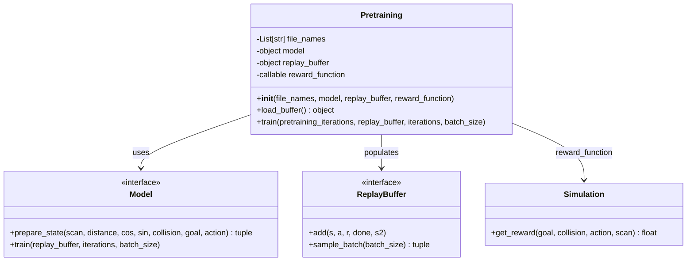
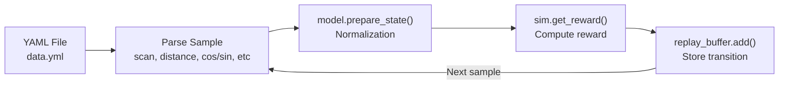
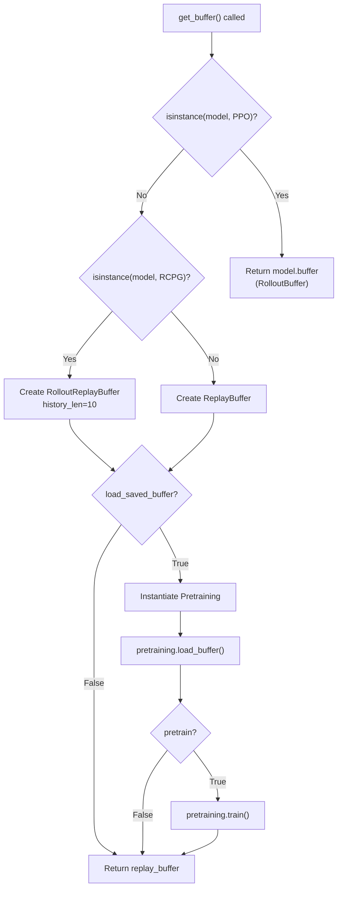
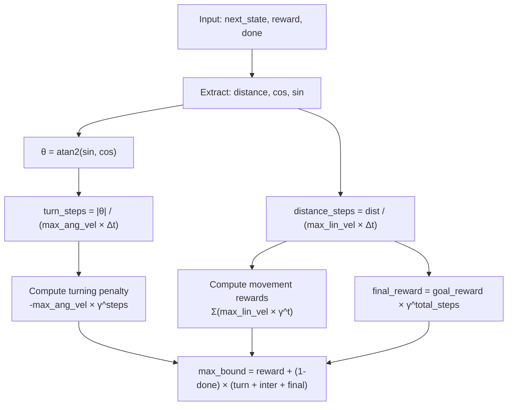
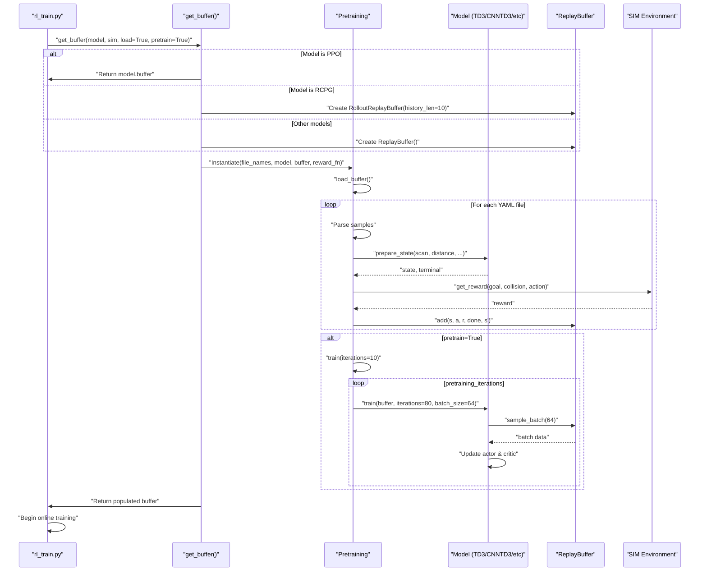

<!-- source: DeepWiki mcp.deepwiki.com · repo reiniscimurs/DRL-robot-navigation-IR-SIM · page 7.2 Pretraining and Offline Learning · fetched 2026-10-14 -->

# Pretraining and Offline Learning

<details>
<summary>Relevant source files</summary>

The following files were used as context for generating this wiki page:

- [robot_nav/models/RCPG/RCPG.py](robot_nav/models/RCPG/RCPG.py)
- [robot_nav/models/SAC/SAC_utils.py](robot_nav/models/SAC/SAC_utils.py)
- [robot_nav/replay_buffer.py](robot_nav/replay_buffer.py)
- [robot_nav/utils.py](robot_nav/utils.py)

</details>


## Purpose and Scope

This document describes the system's capabilities for **offline learning and pretraining** from pre-recorded experience data. The primary components covered are:

- The `Pretraining` class for loading YAML-formatted experience datasets
- The `get_buffer` factory function's integration with offline data loading
- The `get_max_bound` utility for computing theoretical maximum returns

For information about the replay buffer implementations themselves, see [Data Management and Replay Buffers](#2.2). For the Max Upper Bound Loss mechanism that uses `get_max_bound`, see [Max Upper Bound Loss](#7.1).

---

## Overview

The pretraining system enables models to learn from **offline datasets** collected by previous policies or hardcoded controllers (see [HCM](#3.6)). This approach provides several benefits:

- **Warm-starting** training with reasonable policies
- **Sample efficiency** by reusing collected experiences
- **Safer exploration** by learning collision avoidance before online interaction

The workflow consists of three stages:

1. **Data Collection**: Experiences saved as YAML files containing sensor readings, actions, and environment state
2. **Buffer Loading**: The `Pretraining` class parses YAML and populates replay buffers
3. **Model Pretraining**: Optional supervised training phase before online learning begins

Sources: [robot_nav/utils.py:11-112]()

---

## Offline Data Format

Experience data is stored in YAML files with the following structure per sample:

| Field | Type | Description |
|-------|------|-------------|
| `latest_scan` | list[float] | 360-element laser scan readings |
| `distance` | float | Euclidean distance to goal |
| `cos` | float | Cosine of heading angle to goal |
| `sin` | float | Sine of heading angle to goal |
| `collision` | bool | Whether robot collided |
| `goal` | bool | Whether goal was reached |
| `action` | list[float] | `[linear_velocity, angular_velocity]` |

**Example YAML snippet:**
```yaml
- latest_scan: [0.5, 0.6, ..., 0.7]
  distance: 3.2
  cos: 0.8
  sin: 0.6
  collision: false
  goal: false
  action: [0.3, 0.1]
```

The default dataset is located at `robot_nav/assets/data.yml`. Tests use `tests/test_data.yml` which contains 100 transitions across 6 episodes.

Sources: [robot_nav/utils.py:41-84](), [tests/test_data.yml]()

---

## The Pretraining Class

### Architecture



Sources: [robot_nav/utils.py:11-33]()

### Loading Buffer Data

The `load_buffer()` method [robot_nav/utils.py:34-86]() performs the following operations:

1. **Iterate through YAML files**: Reads each file in `self.file_names`
2. **Parse samples**: Extracts raw observations for each timestep
3. **State preparation**: Calls `model.prepare_state()` to normalize inputs
4. **Reward computation**: Uses `reward_function` from the simulation environment
5. **Transition storage**: Adds `(s, a, r, done, s')` tuples to the buffer

**Data Flow Diagram:**



Sources: [robot_nav/utils.py:34-86]()

**Key Implementation Details:**

- **Terminal states are skipped**: If `terminal == True` (collision or goal), the transition is not added [robot_nav/utils.py:59-60]()
- **Sequential processing**: Uses consecutive samples `i` and `i+1` to form `(state, action, reward, done, next_state)` [robot_nav/utils.py:45-84]()
- **Progress tracking**: Uses `tqdm` for visual feedback during loading [robot_nav/utils.py:45]()

### Pretraining Execution

The `train()` method [robot_nav/utils.py:88-111]() executes model training iterations:

```python
# Simplified logic
for _ in range(pretraining_iterations):
    model.train(
        replay_buffer=replay_buffer,
        iterations=iterations,
        batch_size=batch_size
    )
```

This calls the model's standard `train()` method, which samples batches and updates network parameters. The number of gradient steps is `pretraining_iterations × iterations`.

Sources: [robot_nav/utils.py:88-111]()

---

## Buffer Factory Integration

The `get_buffer()` factory function [robot_nav/utils.py:114-179]() orchestrates buffer creation and optional pretraining:

### Function Signature and Parameters

| Parameter | Type | Default | Description |
|-----------|------|---------|-------------|
| `model` | object | - | RL model instance (PPO, RCPG, etc.) |
| `sim` | object | - | Simulation environment |
| `load_saved_buffer` | bool | - | Whether to load offline data |
| `pretrain` | bool | - | Whether to run pretraining |
| `pretraining_iterations` | int | - | Outer loop iterations |
| `training_iterations` | int | - | Inner loop iterations per outer iteration |
| `batch_size` | int | - | Training batch size |
| `buffer_size` | int | 50000 | Maximum buffer capacity |
| `random_seed` | int | 666 | Random seed for reproducibility |
| `file_names` | List[str] | `["robot_nav/assets/data.yml"]` | YAML data files |
| `history_len` | int | 10 | Sequence length for RCPG |

Sources: [robot_nav/utils.py:114-126]()

### Buffer Selection Logic



Sources: [robot_nav/utils.py:146-179]()

### Key Constraints

**Assertion check** [robot_nav/utils.py:157-159](): If `pretrain=True`, then `load_saved_buffer` must also be `True`:

```python
if pretrain:
    assert load_saved_buffer, \
        "To pre-train model, load_saved_buffer must be set to True"
```

This prevents attempting to pretrain on an empty buffer.

### Example Usage

```python
# In rl_train.py (conceptual)
replay_buffer = get_buffer(
    model=td3_model,
    sim=environment,
    load_saved_buffer=True,      # Load data.yml
    pretrain=True,                # Run pretraining
    pretraining_iterations=10,    # 10 outer loops
    training_iterations=80,       # 80 gradient steps per loop
    batch_size=64,
    file_names=["robot_nav/assets/data.yml"]
)
```

Sources: [robot_nav/utils.py:114-179]()

---

## Maximum Return Bound Calculation

The `get_max_bound()` function [robot_nav/utils.py:182-253]() computes a **theoretical upper bound** on the Q-value for a given state. This is used by the Max Upper Bound Loss mechanism (see [Max Upper Bound Loss](#7.1)) to constrain Q-value estimates.

### Algorithm Overview

The function calculates the maximum achievable return assuming an **optimal policy** that:

1. **Rotates in place** to face the goal (minimal angular velocity cost)
2. **Moves straight** to the goal (maximum linear velocity reward)
3. **Receives goal reward** upon arrival



Sources: [robot_nav/utils.py:182-253]()

### Mathematical Formulation

Given:
- `θ`: heading angle to goal (from `atan2(sin, cos)`)
- `d`: distance to goal (normalized)
- `γ`: discount factor
- `v_max`: maximum linear velocity
- `ω_max`: maximum angular velocity
- `Δt`: time step duration

**Turn phase** [robot_nav/utils.py:223-230]():
```
n_turn = ⌊|θ| / (ω_max × Δt)⌋
R_turn = -ω_max × γ^n_turn + fractional_turn_penalty
```

**Movement phase** [robot_nav/utils.py:234-248]():
```
n_move = ⌈d / (v_max × Δt)⌉
R_move = Σ(t=1 to n_move) [v_max × γ^t]
```

**Goal achievement** [robot_nav/utils.py:238]():
```
R_goal = goal_reward × γ^(n_turn + n_move)
```

**Total bound** [robot_nav/utils.py:250-252]():
```
Q_max = r_immediate + (1 - done) × (R_turn + R_move + R_goal)
```

### Implementation Notes

- **Clone tensors** [robot_nav/utils.py:215-217]() to prevent in-place modifications
- **Efficient computation** using vectorized operations over batches
- **Device-agnostic** - uses the same device as input tensors [robot_nav/utils.py:242]()
- **Handles terminal states** via `(1 - done)` masking [robot_nav/utils.py:250]()

Sources: [robot_nav/utils.py:182-253]()

---

## Complete Workflow

### Training Pipeline with Pretraining



Sources: [robot_nav/utils.py:114-179](), [robot_nav/utils.py:34-111]()

### Configuration Example

Typical hyperparameters for pretraining from `rl_train.py`:

| Parameter | Typical Value | Purpose |
|-----------|---------------|---------|
| `load_saved_buffer` | `True` | Enable offline data loading |
| `pretrain` | `True`/`False` | Whether to run supervised phase |
| `pretraining_iterations` | `10` | Number of outer loops |
| `training_iterations` | `80` | Gradient steps per outer loop |
| `batch_size` | `64` | Samples per gradient update |
| `file_names` | `["robot_nav/assets/data.yml"]` | Data source |

Total pretraining gradient steps: `10 × 80 = 800`

Sources: [robot_nav/utils.py:119-124]()

---

## Integration with Model Architectures

### State Preparation Requirements

All models must implement `prepare_state()` to work with the pretraining system. This method converts raw sensor data into normalized state vectors:

**RCPG example** [robot_nav/models/RCPG/RCPG.py:474-517]():
```python
def prepare_state(self, latest_scan, distance, cos, sin, 
                  collision, goal, action):
    latest_scan = np.array(latest_scan)
    inf_mask = np.isinf(latest_scan)
    latest_scan[inf_mask] = 7.0
    latest_scan /= 7
    
    distance /= 10
    lin_vel = action[0] * 2
    ang_vel = (action[1] + 1) / 2
    state = latest_scan.tolist() + [distance, cos, sin] + [lin_vel, ang_vel]
    
    terminal = 1 if collision or goal else 0
    return state, terminal
```

All models (TD3, CNNTD3, SAC, etc.) follow this interface pattern.

Sources: [robot_nav/models/RCPG/RCPG.py:474-517]()

### Buffer Compatibility

| Model Type | Buffer Type | History Support |
|------------|-------------|-----------------|
| TD3, DDPG, SAC, CNNTD3 | `ReplayBuffer` | No (single transitions) |
| RCPG | `RolloutReplayBuffer` | Yes (10-step sequences) |
| PPO | `RolloutBuffer` | N/A (on-policy, no pretraining) |

**Note**: PPO returns its internal buffer directly [robot_nav/utils.py:146-147]() since it's on-policy and doesn't benefit from offline data.

Sources: [robot_nav/utils.py:146-154](), [robot_nav/replay_buffer.py:8-222]()

---

## Testing and Validation

The testing infrastructure validates pretraining functionality:

**Test data** [tests/test_data.yml]():
- 100 transitions
- 6 complete episodes
- Mixed terminal and non-terminal states

**Model tests** [tests/test_model.py]() verify:
- All models can train with prefilled buffers
- Correct buffer types are instantiated
- State dimensions match model expectations

Sources: [tests/test_data.yml](), [tests/test_model.py]()

---

