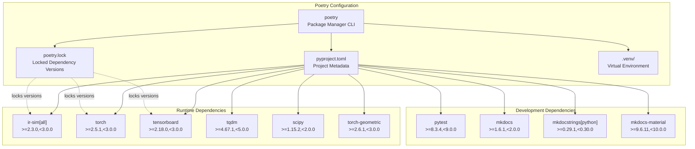
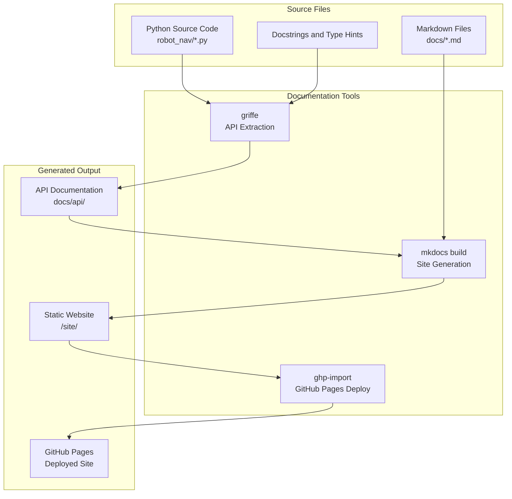
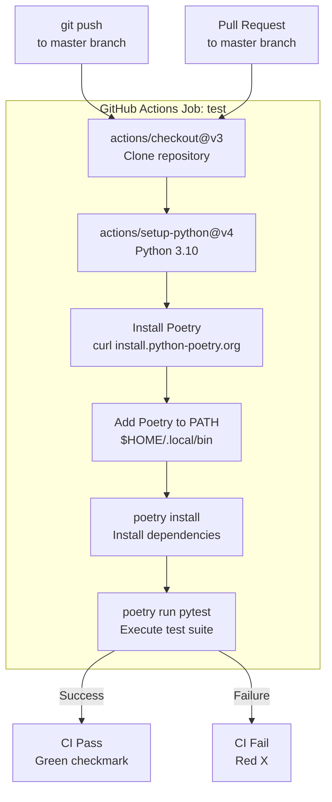
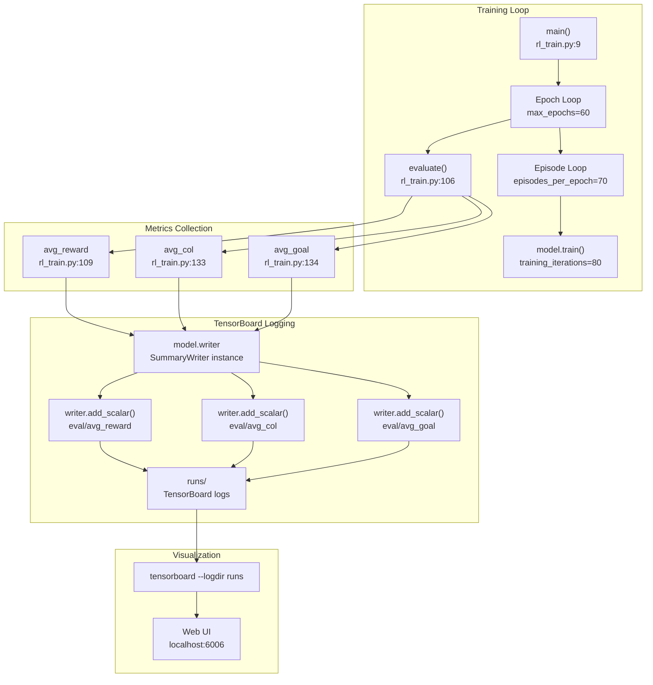

<!-- source: DeepWiki mcp.deepwiki.com · repo reiniscimurs/DRL-robot-navigation-IR-SIM · page 8 Development and Deployment · fetched 2026-10-14 -->

# Development and Deployment

<details>
<summary>Relevant source files</summary>

The following files were used as context for generating this wiki page:

- [.github/workflows/main.yml](.github/workflows/main.yml)
- [README.md](README.md)
- [poetry.lock](poetry.lock)
- [pyproject.toml](pyproject.toml)
- [robot_nav/rl_train.py](robot_nav/rl_train.py)
- [tests/test_utils.py](tests/test_utils.py)

</details>


This document covers the development environment setup, dependency management, documentation generation, continuous integration/continuous deployment (CI/CD) pipeline, and deployment guidelines for the DRL Robot Navigation system. It provides technical guidance for developers contributing to the codebase and deploying the system.

For information about training models and running experiments, see [Core Training System](#2). For testing and evaluation procedures, see [Testing and Evaluation](#5).

## Development Environment Setup

The project uses Poetry for dependency management and virtual environment creation. The development workflow is designed to ensure reproducible builds and consistent environments across different machines.

### Poetry Configuration and Dependencies

**Poetry Dependency Management Workflow**



The development environment is managed through Poetry, which handles dependency resolution, virtual environment creation, and package installation. The [pyproject.toml:1-29]() file defines project metadata and dependency constraints, while [poetry.lock:1-100]() contains exact dependency versions with cryptographic hashes, ensuring reproducible builds.

**Installation Process:**

1. Install Poetry: `pip install poetry`
2. Clone repository: `git clone https://github.com/reiniscimurs/DRL-robot-navigation-IR-SIM.git`
3. Install dependencies: `poetry install`
4. Activate environment: `poetry shell`

The project is configured as `robot-nav` version `0.1.0` requiring Python `>=3.10`. The `[tool.pytest.ini_options]` section in [pyproject.toml:23-24]() configures pytest to discover tests in the `tests/` directory.

Sources: [pyproject.toml:1-29](), [poetry.lock:1-200](), [README.md:8-16]()

### Project Structure and Git Configuration

The project follows a standard Python package structure with specific directories for different components:

| Directory | Purpose | Git Tracking |
|-----------|---------|--------------|
| `robot_nav/` | Main package source code | Tracked |
| `docs/` | Documentation source files | Tracked |
| `tests/` | Unit and integration tests | Tracked |
| `/.venv/` | Virtual environment | Ignored |
| `/runs/` | TensorBoard log files | Ignored |
| `/site/` | Generated documentation | Ignored |

The [.gitignore:1-4]() configuration ensures that generated files, virtual environments, and training artifacts are not committed to version control.

Sources: [.gitignore:1-4](), [README.md:1-57]()

## Documentation Generation System

The project uses MkDocs for documentation generation with automatic API documentation extraction.

### Documentation Workflow



The documentation system automatically extracts API documentation from Python source code using the `griffe` package, which parses docstrings and type annotations. The [docs/api/Testing/test.md:1-11]() file demonstrates the automatic API documentation generation syntax.

**Documentation Commands:**
- Build documentation: `mkdocs build`
- Serve locally: `mkdocs serve`
- Deploy to GitHub Pages: `mkdocs gh-deploy`

Sources: [docs/api/Testing/test.md:1-11](), [poetry.lock:461-470](), [poetry.lock:443-459]()

## Dependency Management with Poetry

Poetry manages both runtime and development dependencies with precise version locking.

### Core Runtime Dependencies

**Runtime Dependencies from pyproject.toml**

| Package | Version Constraint | Purpose |
|---------|-------------------|---------|
| `ir-sim[all]` | `>=2.3.0,<3.0.0` | Lightweight robot simulator environment |
| `torch` | `>=2.5.1,<3.0.0` | Deep learning framework for RL models |
| `tensorboard` | `>=2.18.0,<3.0.0` | Training monitoring and visualization |
| `tqdm` | `>=4.67.1,<5.0.0` | Progress bars for training loops |
| `scipy` | `>=1.15.2,<2.0.0` | Scientific computing utilities |
| `torch-geometric` | `>=2.6.1,<3.0.0` | Graph neural network support for MARL |

### Development Dependencies

**Development-only Dependencies**

| Package | Version Constraint | Purpose |
|---------|-------------------|---------|
| `pytest` | `>=8.3.4,<9.0.0` | Testing framework for unit and integration tests |
| `mkdocs` | `>=1.6.1,<2.0.0` | Static site documentation generator |
| `mkdocstrings[python]` | `>=0.29.1,<0.30.0` | API documentation extraction from docstrings |
| `mkdocs-material` | `>=9.6.11,<10.0.0` | Material theme for MkDocs documentation |

The [poetry.lock:1-100]() file contains exact versions of all dependencies and their transitive dependencies. For example, `aiohttp==3.13.2` [poetry.lock:28-29](), `certifi==2025.11.12` [poetry.lock:248](), and `charset-normalizer==3.4.4` [poetry.lock:260]() are locked as transitive dependencies.

**Dependency Update Process:**
1. Update version constraints in [pyproject.toml:10-21]()
2. Run `poetry update` to resolve new dependency graph
3. Review changes in regenerated `poetry.lock`
4. Run `poetry run pytest` to verify compatibility
5. Commit both `pyproject.toml` and `poetry.lock`

Sources: [pyproject.toml:10-21](), [poetry.lock:1-500]()

## CI/CD Pipeline and Testing

The project implements automated testing and continuous integration using GitHub Actions.

### GitHub Actions CI/CD Workflow

**CI Pipeline from .github/workflows/main.yml**



The CI/CD pipeline is defined in [.github/workflows/main.yml:1-32](). The workflow triggers on pushes or pull requests to the `master` branch [.github/workflows/main.yml:3-7]() and runs on `ubuntu-latest` [.github/workflows/main.yml:11]().

**CI/CD Workflow Steps:**

1. **Checkout code** [.github/workflows/main.yml:14-15](): Uses `actions/checkout@v3` to clone repository
2. **Set up Python** [.github/workflows/main.yml:17-20](): Configures Python 3.10 environment
3. **Install Poetry** [.github/workflows/main.yml:22-25](): Downloads and installs Poetry package manager
4. **Install dependencies** [.github/workflows/main.yml:27-28](): Runs `poetry install` to set up environment
5. **Run tests** [.github/workflows/main.yml:30-31](): Executes `poetry run pytest` to validate code

### Testing Infrastructure

**Test Categories:**
- **Buffer factory tests** [tests/test_utils.py:12-112](): Validates `get_buffer()` returns correct buffer types (`ReplayBuffer`, `RolloutReplayBuffer`, `RolloutBuffer`) for different models (`SAC`, `RCPG`, `PPO`)
- **Model instantiation tests**: Ensures all RL algorithms can be initialized with proper parameters
- **Simulation environment tests**: Validates `SIM` and `MARL_SIM` environment functionality

The test discovery is configured in [pyproject.toml:23-24]() with `testpaths = ["tests"]`, so pytest automatically discovers all `test_*.py` files in the `tests/` directory.

Sources: [.github/workflows/main.yml:1-32](), [tests/test_utils.py:1-112](), [pyproject.toml:23-24]()

## TensorBoard Integration and Monitoring

TensorBoard provides real-time monitoring of training progress and model performance.

### TensorBoard Monitoring Workflow

**Training Metrics Logging from rl_train.py**



The training script [robot_nav/rl_train.py:9-146]() integrates TensorBoard logging through the `model.writer` object. At the end of each epoch, the `evaluate()` function [robot_nav/rl_train.py:106-142]() computes performance metrics and logs them:

- `model.writer.add_scalar("eval/avg_reward", avg_reward, epoch)` [robot_nav/rl_train.py:139]()
- `model.writer.add_scalar("eval/avg_col", avg_col, epoch)` [robot_nav/rl_train.py:140]()
- `model.writer.add_scalar("eval/avg_goal", avg_goal, epoch)` [robot_nav/rl_train.py:141]()

**TensorBoard Usage:**

1. Start training: `poetry run python robot_nav/rl_train.py` [README.md:20]()
2. In separate terminal: `tensorboard --logdir runs` [README.md:23]()
3. Open browser to `http://localhost:6006`

The `runs/` directory is excluded from version control [.gitignore:2]() to avoid committing large log files.

**Monitored Metrics:**
- **avg_reward**: Average cumulative reward per evaluation episode
- **avg_col**: Average collision rate across evaluation episodes
- **avg_goal**: Average goal achievement rate

Sources: [robot_nav/rl_train.py:106-142](), [README.md:22-24]()

## Deployment Guidelines

### Production Environment Setup

For production deployment, the system requires specific environment configuration and dependency management:

**Environment Requirements:**
- Python 3.8+ with Poetry installed
- IR-SIM simulator dependencies
- GPU support for PyTorch (recommended)
- Sufficient storage for model checkpoints and logs

**Deployment Steps:**

1. **Environment Preparation:**
   ```bash
   poetry install --only=main  # Install only runtime dependencies
   poetry run python -c "import torch; print(torch.cuda.is_available())"  # Verify GPU
   ```

2. **Model Deployment:**
   - Copy trained model checkpoints to deployment environment
   - Configure environment-specific parameters
   - Set up monitoring and logging

3. **Service Configuration:**
   - Configure IR-SIM simulator parameters
   - Set up TensorBoard for production monitoring
   - Configure backup and recovery procedures

### Version Management and Release Process

The project uses Poetry's version management combined with Git tags for release management:

**Release Workflow:**
1. Update version in `pyproject.toml`
2. Run comprehensive test suite
3. Generate and review documentation
4. Create Git tag for release
5. Deploy to production environment

**Rollback Procedures:**
- Maintain previous model checkpoints
- Use Poetry's dependency locking for consistent environments
- Document configuration changes for quick rollback

Sources: [README.md:8-25](), [poetry.lock:1-150887]()