# Page: Overview

# Overview

<details>
<summary>Relevant source files</summary>

The following files were used as context for generating this wiki page:

- [README.md](README.md)
- [docs/index.md](docs/index.md)
- [mkdocs.yml](mkdocs.yml)
- [poetry.lock](poetry.lock)
- [robot_nav/rl_train.py](robot_nav/rl_train.py)

</details>


This document provides a comprehensive overview of the **DRL-robot-navigation-IR-SIM** project, a Deep Reinforcement Learning framework designed for autonomous robot navigation in simulated environments. The system uses the IR-SIM lightweight simulator to train robots to navigate to specified goal points using 2D laser sensor data, supporting both single-agent and multi-agent reinforcement learning scenarios.

The project implements **8+ distinct RL algorithms** spanning off-policy actor-critic methods (TD3, DDPG, SAC), on-policy methods (PPO), perception-enhanced variants (CNNTD3 with 1D CNNs), recurrent models (RCPG with LSTM/GRU), and multi-agent coordination (marlTD3 with attention mechanisms). The modular architecture enables systematic experimentation across algorithms, state representations, and training configurations.

## System Purpose and Capabilities

**Primary Capabilities:**

- **Single-Agent Navigation**: Train individual robots using laser scans (10-dim or 185-dim states) to navigate obstacle-rich environments
- **Multi-Agent Coordination**: Train multiple robots simultaneously with attention-based message passing for collision-free navigation
- **Flexible Model Library**: 8+ algorithms with varying complexity, from simple feedforward networks to CNN+RNN+Attention architectures
- **Pretraining Support**: Initialize models from offline datasets for faster convergence
- **Comprehensive Evaluation**: Automated testing with collision/goal metrics, TensorBoard monitoring, and reproducible evaluation scenarios
- **Max Bound Regularization**: Optional Q-value bounding for TD3-based models to address overestimation bias

## High-Level System Architecture

The system is organized into **five major subsystems** that provide clear separation of concerns:

**System Architecture: Five Major Subsystems**

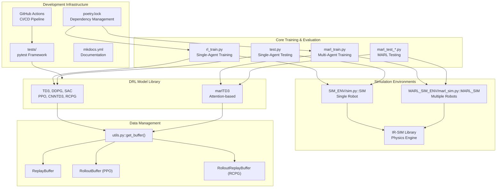

**Architectural Principles:**

1. **Separation of Training Pipelines**: [rl_train.py:1-146]() handles single-agent scenarios, [marl_train.py]() handles multi-agent scenarios with independent execution paths
2. **Polymorphic Buffer Management**: [utils.py::get_buffer()]() factory function automatically selects appropriate buffer types (ReplayBuffer, RolloutBuffer, RolloutReplayBuffer) based on model requirements
3. **Environment Abstraction**: Both [SIM_ENV/sim.py::SIM]() and [MARL_SIM_ENV/marl_sim.py::MARL_SIM]() wrap the same IR-SIM physics engine with scenario-specific state processing and reward functions
4. **Modular Model Library**: All models share common interfaces (`get_action()`, `train()`, `prepare_state()`) enabling drop-in replacement
5. **Automated Testing**: [tests/test_model.py](), [tests/test_sim.py](), [tests/test_utils.py]() provide integration testing with CI/CD automation via [.github/workflows/main.yml]()

Sources: [README.md:1-65](), [rl_train.py:1-146](), [poetry.lock:1-20](), [mkdocs.yml:1-36]()

## Model Library and Evolutionary Taxonomy

The system implements **8+ reinforcement learning algorithms** organized into evolutionary families:

**Model Taxonomy and Evolution**

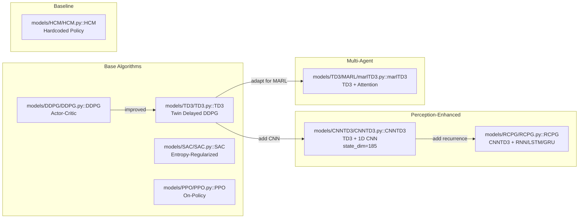

| Model | State Dim | Buffer Type | Key Architectural Features | File Path |
|-------|-----------|-------------|----------------------------|-----------|
| **TD3** | 10 | ReplayBuffer | Twin Q-networks, delayed policy updates, target smoothing | [models/TD3/TD3.py]() |
| **DDPG** | 10 | ReplayBuffer | Single Q-network, deterministic policy | [models/DDPG/DDPG.py]() |
| **SAC** | 10 | ReplayBuffer | DiagGaussianActor with SquashedNormal, entropy regularization, automatic alpha tuning | [models/SAC/SAC.py]() |
| **PPO** | 10 | RolloutBuffer | On-policy, clipped objective, episodic rollouts | [models/PPO/PPO.py]() |
| **CNNTD3** | 185 | ReplayBuffer | 1D CNN layers for 180-point laser scan, TD3 backend | [models/CNNTD3/CNNTD3.py]() |
| **RCPG** | 185 | RolloutReplayBuffer | CNNTD3 + LSTM/GRU/RNN for temporal modeling, sequence sampling | [models/RCPG/RCPG.py]() |
| **marlTD3** | Variable | ReplayBuffer | Hard-soft attention encoder, GoalAttentionLayer, auxiliary BCE loss | [models/TD3/MARL/marlTD3.py]() |
| **HCM** | N/A | N/A | Rule-based navigation for dataset collection | [models/HCM/HCM.py]() |

**Max Upper Bound Regularization**: Models `TD3`, `DDPG`, and `CNNTD3` support optional Q-value bounding via `use_max_bound=True` parameter to address overestimation bias in off-policy learning. See [Advanced Features](#7).

**Evolutionary Insight**: The primary model in [rl_train.py:34-42]() is `CNNTD3`, reflecting the importance of spatial feature extraction from high-dimensional laser scans (185-dim vs 10-dim binned states).

Sources: [README.md:35-58](), [rl_train.py:34-42](), [models/TD3/TD3.py](), [models/CNNTD3/CNNTD3.py](), [models/RCPG/RCPG.py](), [models/TD3/MARL/marlTD3.py]()

## Training and Evaluation Pipeline

The training pipeline follows a hierarchical structure: **Epochs** (60) → **Episodes** (70 per epoch) → **Steps** (300 max per episode).

**Training Pipeline with Code Entity Mapping**

```mermaid
flowchart TD
    Start["rl_train.py::main()"] --> InitModel["CNNTD3.__init__()<br/>state_dim=185, action_dim=2"]
    InitModel --> InitEnv["SIM.__init__()<br/>world_file='worlds/robot_world.yaml'"]
    InitEnv --> GetBuffer["utils.py::get_buffer()<br/>Returns: ReplayBuffer"]
    
    GetBuffer --> Pretrain{{"Pretrain?<br/>load_saved_buffer=True"}}
    Pretrain -->|"Yes"| PretrainLoop["Pretraining.pretrain()<br/>assets/data.yml"]
    Pretrain -->|"No"| EpochLoop
    PretrainLoop --> EpochLoop
    
    EpochLoop["Epoch Loop<br/>max_epochs=60"] --> EpisodeLoop["Episode Loop<br/>episodes_per_epoch=70"]
    EpisodeLoop --> StepLoop["Step Loop<br/>max_steps=300"]
    
    StepLoop --> PrepState["model.prepare_state()<br/>laser, distance, cos, sin<br/>→ state_dim=185"]
    PrepState --> GetAction["model.get_action(state, explore=True)<br/>→ [lin_vel, ang_vel]"]
    GetAction --> EnvStep["sim.step(lin_velocity, ang_velocity)<br/>→ next_state, reward, terminal"]
    EnvStep --> BufferAdd["replay_buffer.add(s, a, r, terminal, s')"]
    
    BufferAdd --> Terminal{{"Terminal or<br/>max_steps?"}}
    Terminal -->|"Yes"| EnvReset["sim.reset()<br/>Random obstacles"]
    Terminal -->|"No"| StepLoop
    
    EnvReset --> TrainCheck{{"Episode %<br/>train_every_n==0?"}}
    TrainCheck -->|"Yes"| ModelTrain["model.train()<br/>iterations=80<br/>batch_size=64"]
    TrainCheck -->|"No"| EpochCheck
    
    ModelTrain --> EpochCheck{{"End of<br/>Epoch?"}}
    EpochCheck -->|"Yes"| Evaluate["evaluate()<br/>eval_episodes=10"]
    EpochCheck -->|"No"| EpisodeLoop
    
    Evaluate --> TBLog["TensorBoard Logging<br/>avg_reward, collisions, goals"]
    TBLog --> SaveModel["model.save()<br/>save_every=5 epochs"]
    SaveModel --> MoreEpochs{{"epoch <<br/>max_epochs?"}}
    MoreEpochs -->|"Yes"| EpochLoop
    MoreEpochs -->|"No"| End["Training Complete"]
```

**Key Training Parameters** (from [rl_train.py:10-32]()):

| Parameter | Value | Description |
|-----------|-------|-------------|
| `state_dim` | 185 | Full laser scan (180) + distance (1) + cos(1) + sin(1) + collision(1) + goal(1) |
| `action_dim` | 2 | Linear velocity [0, 0.5] m/s, angular velocity [-1, 1] rad/s |
| `max_epochs` | 60 | Training duration |
| `episodes_per_epoch` | 70 | Episodes before evaluation |
| `max_steps` | 300 | Maximum steps per episode |
| `train_every_n` | 2 | Update model every 2 episodes |
| `training_iterations` | 80 | Gradient updates per training cycle |
| `batch_size` | 64 | Minibatch size for training |

**Data Flow: State Preparation**

The [model.prepare_state()]() method transforms raw sensor data into normalized neural network inputs. For CNNTD3/RCPG (185-dim):
- **Laser scan**: 180 readings, replace inf→7.0, divide by 7.0
- **Distance to goal**: Divide by 10.0
- **Goal direction**: cos(angle), sin(angle) 
- **Status flags**: collision (0/1), goal_reached (0/1)
- **Previous action**: Normalized lin_vel, ang_vel

For TD3/DDPG/SAC/PPO (10-dim), laser scan is binned into 10 sectors using min values.

Sources: [rl_train.py:1-146](), [models/CNNTD3/CNNTD3.py](), [SIM_ENV/sim.py](), [utils.py]()

## Simulation Environment Architecture

The system provides two environment wrappers around IR-SIM for different training scenarios:

**Environment Comparison: SIM vs MARL_SIM**

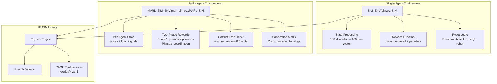

**SIM (Single-Agent)** [SIM_ENV/sim.py]():
- **Observation**: 360-point laser scan (downsampled to 180), goal distance, goal angle, collision flag, goal flag
- **Action Space**: Continuous `[lin_velocity, ang_velocity]`
- **Reward**: `-distance_change - 10*collision + 15*goal_reached - 0.01*|action|`
- **Configuration**: [worlds/robot_world.yaml]() defines dimensions, obstacles, robot properties

**MARL_SIM (Multi-Agent)** [MARL_SIM_ENV/marl_sim.py]():
- **Observation**: Per-agent states (own pose, goal, lidar) + neighbor information via attention
- **Action Space**: Continuous actions for N robots (default 3)
- **Reward**: Two-phase system (Phase 1: goal-seeking with inter-robot penalties, Phase 2: refined coordination)
- **Configuration**: [tests/test_marl_world.yaml]() with multi-robot spawn points
- **Connection Matrix**: Defines communication topology between agents

**Environment Configuration Files**:
- [worlds/robot_world.yaml]() - Training world for single-agent
- [worlds/eval_points.yaml]() - Evaluation scenarios with fixed start/goal positions
- [tests/test_data.yml]() - Pretraining dataset (100 transitions, 6 episodes)
- [tests/test_marl_world.yaml]() - Multi-agent world configuration

Sources: [SIM_ENV/sim.py](), [MARL_SIM_ENV/marl_sim.py](), [worlds/robot_world.yaml](), [README.md:59-65]()

## Multi-Agent Reinforcement Learning

The system supports **multi-agent navigation** where multiple robots (typically 3) learn to navigate simultaneously while avoiding each other through attention-based coordination.

**MARL Architecture Overview**

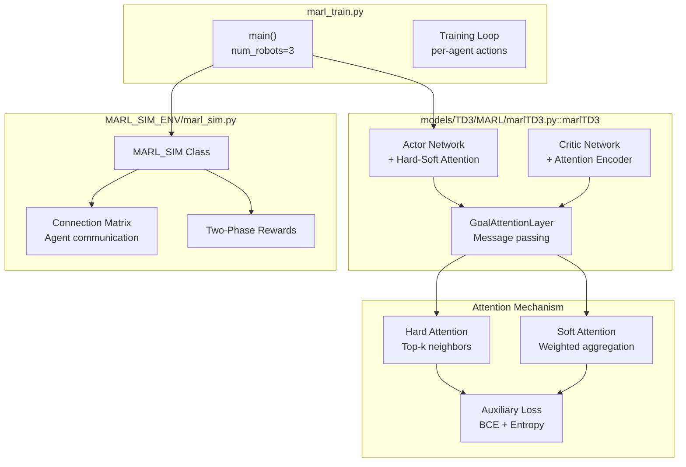

**Key MARL Features**:

- **Attention-Based Coordination**: [models/TD3/MARL/marlTD3.py]() implements hard-soft attention from G2ANet for agent-to-agent message passing
- **Per-Agent Policy**: Single shared policy network with agent-specific inputs
- **Connection Topology**: [MARL_SIM.connection_matrix]() defines which agents can communicate
- **Two-Phase Training**: Phase 1 focuses on goal-reaching with proximity penalties, Phase 2 refines coordination
- **Auxiliary Losses**: Binary cross-entropy and entropy losses on attention weights improve training stability

**Testing**: [marl_test_tud.py](), [marl_test_ingraph.py]() provide evaluation scripts for different MARL configurations.

Sources: [README.md:59-65](), [models/TD3/MARL/marlTD3.py](), [MARL_SIM_ENV/marl_sim.py](), [marl_train.py]()

## Testing and Evaluation Framework

The system provides multiple testing approaches for comprehensive performance evaluation:

- **Structured Evaluation**: `test.py` with predefined scenarios from `eval_points.yaml`
- **Random Testing**: `test_random.py` for stochastic environment validation
- **Unit Testing**: Comprehensive test suite covering model instantiation, buffer operations, and simulation validation
- **Performance Metrics**: Success rate, collision frequency, path efficiency, and convergence analysis

For detailed testing procedures and metric definitions, see [Testing and Evaluation](#5).

Sources: [test.py](), [test_random.py](), [tests/]()

---

# Page: Getting Started

# Getting Started

<details>
<summary>Relevant source files</summary>

The following files were used as context for generating this wiki page:

- [README.md](README.md)
- [docs/index.md](docs/index.md)
- [mkdocs.yml](mkdocs.yml)
- [poetry.lock](poetry.lock)
- [robot_nav/rl_train.py](robot_nav/rl_train.py)

</details>


This guide covers the initial setup and execution of the DRL-robot-navigation-IR-SIM project. You will learn how to install dependencies using Poetry, run your first training session, and monitor progress using TensorBoard. For detailed information about the model architectures, see [Single-Agent Models](#3). For multi-agent training, see [Multi-Agent Reinforcement Learning](#4).

---

## Prerequisites

Before beginning, ensure you have the following installed:

| Requirement | Version | Purpose |
|-------------|---------|---------|
| Python | ≥3.8 | Runtime environment |
| pip | Latest | Package installer |
| Git | Any | Repository cloning |
| CUDA (optional) | Compatible with PyTorch | GPU acceleration |

The project automatically detects and uses GPU acceleration if CUDA is available ([robot_nav/rl_train.py:14-16]()).

---

## Installation Process

### Step 1: Install Poetry

Poetry is the dependency manager for this project. It ensures reproducible builds and isolates project dependencies.

```bash
pip install poetry
```

**Sources:** [README.md:10-11](), [poetry.lock:1-3]()

---

### Step 2: Clone Repository

```bash
git clone https://github.com/reiniscimurs/DRL-robot-navigation-IR-SIM.git
cd DRL-robot-navigation-IR-SIM
```

**Sources:** [README.md:12-13]()

---

### Step 3: Install Dependencies

Navigate to the project root and install all dependencies:

```bash
poetry install
```

This command reads `pyproject.toml` and `poetry.lock` to install exact package versions, including:

- **PyTorch**: Deep learning framework
- **IR-SIM**: Lightweight robot simulator
- **TensorBoard**: Training visualization
- **pytest**: Testing framework (development dependency)
- **NumPy**: Numerical computations

**Dependency Installation Flow**

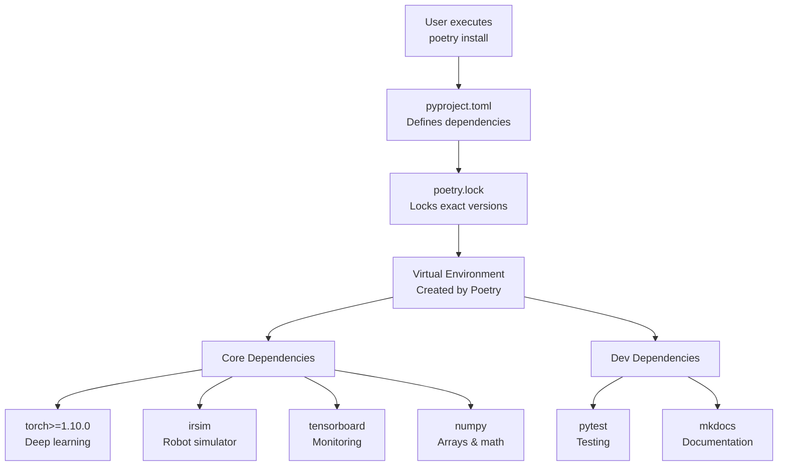

**Sources:** [README.md:14-15](), [poetry.lock:1-353](), [mkdocs.yml:30-32]()

---

## Running Your First Training

### Default Training Execution

The primary entry point for single-agent training is `rl_train.py`, which trains a CNNTD3 model by default:

```bash
poetry run python robot_nav/rl_train.py
```

**Training Script Architecture**

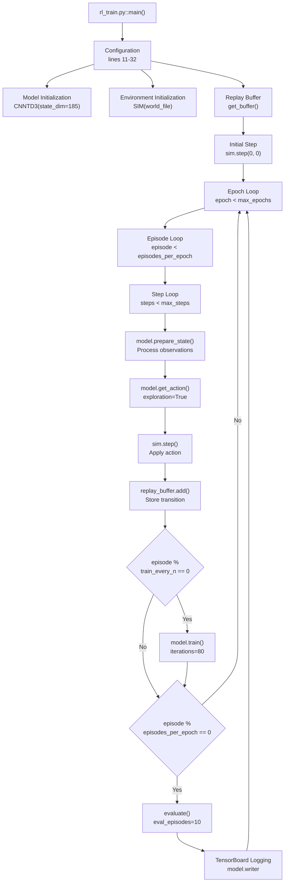

**Sources:** [robot_nav/rl_train.py:1-146]()

---

### Key Training Parameters

The following parameters control training behavior ([robot_nav/rl_train.py:11-32]()):

| Parameter | Default Value | Description |
|-----------|---------------|-------------|
| `state_dim` | 185 | Input dimension for CNNTD3 (180 laser + 5 other features) |
| `action_dim` | 2 | Linear and angular velocity outputs |
| `max_action` | 1 | Action space bounds [-1, 1] |
| `max_epochs` | 60 | Total training epochs |
| `episodes_per_epoch` | 70 | Episodes before evaluation |
| `train_every_n` | 2 | Training frequency (every n episodes) |
| `training_iterations` | 80 | Gradient updates per training cycle |
| `batch_size` | 64 | Samples per training iteration |
| `max_steps` | 300 | Maximum steps per episode |
| `nr_eval_episodes` | 10 | Evaluation episodes per epoch |

**State Space Composition** ([robot_nav/rl_train.py:57-77]()):

```
state[0:180]   → Laser scan readings (binned or full, depending on model)
state[180]     → Normalized distance to goal
state[181]     → cos(angle to goal)
state[182]     → sin(angle to goal)
state[183:184] → Previous action [linear_vel, angular_vel]
```

**Action Space** ([robot_nav/rl_train.py:67-70]()):

```
action[0] → Linear velocity (clipped to [0, 0.5] m/s via: (action[0] + 1) / 4)
action[1] → Angular velocity (range: [-1, 1] rad/s)
```

**Sources:** [robot_nav/rl_train.py:9-146]()

---

## Monitoring Training with TensorBoard

### Starting TensorBoard

In a separate terminal window, launch TensorBoard to visualize training metrics:

```bash
tensorboard --logdir runs
```

Then navigate to `http://localhost:6006` in your web browser.

**TensorBoard Logging Flow**

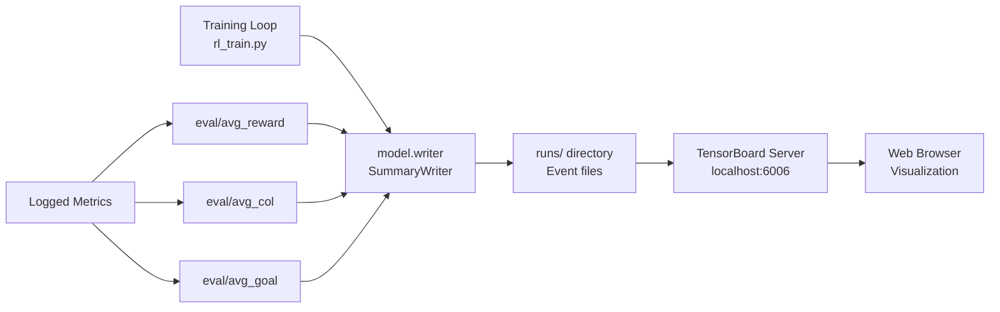

**Sources:** [README.md:22-23](), [robot_nav/rl_train.py:139-141]()

---

### Tracked Metrics

The evaluation function logs three key metrics every epoch ([robot_nav/rl_train.py:106-142]()):

| Metric | Tag | Description |
|--------|-----|-------------|
| Average Reward | `eval/avg_reward` | Mean cumulative reward over evaluation episodes |
| Collision Rate | `eval/avg_col` | Proportion of episodes ending in collision |
| Goal Success Rate | `eval/avg_goal` | Proportion of episodes reaching the goal |

**Evaluation Logic** ([robot_nav/rl_train.py:106-142]()):
- Runs 10 evaluation episodes per epoch (default)
- Uses trained policy without exploration (`get_action(state, False)`)
- Maximum 501 steps per evaluation episode
- Resets environment using `sim.reset()` for each episode

**Sources:** [robot_nav/rl_train.py:106-142]()

---

## Verifying Installation

### Running Tests

The project includes a comprehensive test suite to verify correct installation and configuration:

```bash
poetry run pytest
```

**Test Coverage Map**

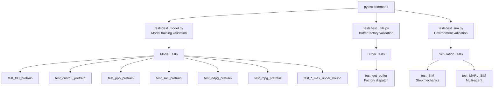

For more details on the testing infrastructure, see [Testing and Validation](#6).

**Sources:** [mkdocs.yml:30-32](), [README.md:10-15]()

---

### CI/CD Verification

The project uses GitHub Actions for continuous integration. Every push automatically:

1. Installs dependencies via `poetry install`
2. Executes the full test suite via `poetry run pytest`
3. Reports pass/fail status

This ensures the codebase remains in a working state.

**Sources:** High-level system architecture diagrams (Diagram 6)

---

## Project Structure Overview

Understanding the directory layout helps navigate the codebase:

```
DRL-robot-navigation-IR-SIM/
├── robot_nav/              # Main package directory
│   ├── rl_train.py         # Primary training script (single-agent)
│   ├── marl_train.py       # Multi-agent training script
│   ├── test.py             # Single-agent testing script
│   ├── models/             # DRL model implementations
│   │   ├── CNNTD3/         # CNN-enhanced TD3
│   │   ├── TD3/            # Twin Delayed DDPG
│   │   ├── DDPG/           # Deep Deterministic Policy Gradient
│   │   ├── SAC/            # Soft Actor-Critic
│   │   ├── PPO/            # Proximal Policy Optimization
│   │   ├── RCPG/           # Recurrent Convolutional Policy Gradient
│   │   ├── HCM/            # Hardcoded Model
│   │   └── MARL/           # Multi-agent models
│   ├── SIM_ENV/            # Environment wrappers
│   │   ├── sim.py          # Single-agent SIM class
│   │   └── marl_sim.py     # Multi-agent MARL_SIM class
│   └── utils.py            # Utility functions (get_buffer, etc.)
├── worlds/                 # YAML world configurations
│   └── robot_world.yaml    # Default single-agent world
├── tests/                  # Test suite
│   ├── test_model.py       # Model training tests
│   ├── test_utils.py       # Utility function tests
│   ├── test_sim.py         # Environment tests
│   ├── test_data.yml       # Prefilled experience data
│   ├── test_world.yaml     # Single-agent test world
│   └── test_marl_world.yaml # Multi-agent test world
├── assets/                 # Data assets
│   └── data.yml            # Offline pretraining data
├── pyproject.toml          # Poetry project configuration
├── poetry.lock             # Locked dependency versions
└── mkdocs.yml              # Documentation configuration
```

**Sources:** [mkdocs.yml:4-29](), [robot_nav/rl_train.py:1-7]()

---

## Common Configuration Changes

### Training a Different Model

To train a different model (e.g., TD3 instead of CNNTD3), modify the import and instantiation in `rl_train.py`:

```python
# Change line 1
from robot_nav.models.TD3.TD3 import TD3

# Change line 13 (state_dim depends on model)
state_dim = 10  # TD3 uses 10-dim state (binned laser)

# Change lines 34-42
model = TD3(
    state_dim=state_dim,
    action_dim=action_dim,
    max_action=max_action,
    device=device,
    save_every=save_every,
    load_model=False,
    model_name="TD3",
)
```

**State Dimension Requirements:**
- **TD3, DDPG, SAC, PPO**: `state_dim=10` (binned laser scan)
- **CNNTD3, RCPG**: `state_dim=185` (full laser scan)

For model-specific details, see [Single-Agent Models](#3).

**Sources:** [robot_nav/rl_train.py:1-42](), High-level system architecture diagrams (Diagram 2)

---

### Loading Pretrained Models

To continue training from a saved checkpoint:

```python
model = CNNTD3(
    state_dim=state_dim,
    action_dim=action_dim,
    max_action=max_action,
    device=device,
    save_every=save_every,
    load_model=True,  # Enable loading
    model_name="CNNTD3",
)
```

The model automatically loads from the checkpoint directory corresponding to `model_name`.

**Sources:** [robot_nav/rl_train.py:34-42]()

---

### Pretraining from Offline Data

To pretrain the model using saved experiences ([robot_nav/rl_train.py:27-31]()):

```python
load_saved_buffer = True   # Load experiences from assets/data.yml
pretrain = True            # Enable pretraining
pretraining_iterations = 10  # Number of training iterations
```

The `get_buffer()` function handles pretraining automatically when these flags are set. For details on offline learning, see [Pretraining and Offline Learning](#7.2).

**Sources:** [robot_nav/rl_train.py:27-55]()

---

## Next Steps

Now that you have the project running, explore:

- **[Core Training System](#2)**: Deep dive into the training loop architecture
- **[Simulation Environments](#2.1)**: Understand state observation processing and reward functions
- **[Single-Agent Models](#3)**: Learn about each model's architecture and use cases
- **[Multi-Agent Reinforcement Learning](#4)**: Train multiple robots simultaneously
- **[Environment Configuration](#5)**: Customize world layouts and robot properties
- **[Testing and Validation](#6)**: Extend the test suite for your modifications

**Sources:** mkdocs.yml structure, README.md

---

# Page: Core Training System

# Core Training System

<details>
<summary>Relevant source files</summary>

The following files were used as context for generating this wiki page:

- [README.md](README.md)
- [poetry.lock](poetry.lock)
- [robot_nav/models/CNNTD3/CNNTD3.py](robot_nav/models/CNNTD3/CNNTD3.py)
- [robot_nav/models/DDPG/DDPG.py](robot_nav/models/DDPG/DDPG.py)
- [robot_nav/models/TD3/TD3.py](robot_nav/models/TD3/TD3.py)
- [robot_nav/rl_train.py](robot_nav/rl_train.py)

</details>


This document covers the central training orchestration system that coordinates reinforcement learning model training for robot navigation. The core training system is implemented primarily in `train.py` and serves as the main entry point for training RL agents in the IR-SIM simulation environment.

For detailed information about the simulation environment mechanics, see [Simulation Environment](#2.1). For replay buffer management and preprocessing utilities, see [Data Management and Utilities](#2.2). For specific RL algorithm implementations, see [Reinforcement Learning Models](#3).

## System Architecture

The core training system follows a modular architecture that separates concerns between model selection, environment management, and training orchestration.

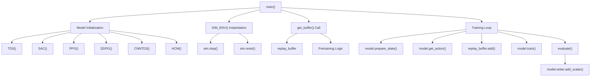

**Training System Component Mapping**

| Component | Code Entity | File Location | Purpose |
|-----------|-------------|---------------|---------|
| Training Orchestrator | `main()` | [robot_nav/train.py:14-108]() | Main training loop coordinator |
| Environment Manager | `SIM_ENV` | [robot_nav/train.py:49]() | Simulation environment interface |
| Buffer Manager | `get_buffer()` | [robot_nav/train.py:50-58]() | Replay buffer initialization |
| Model Interface | Various model classes | [robot_nav/train.py:1-6]() | RL algorithm implementations |
| Evaluation System | `evaluate()` | [robot_nav/train.py:109-144]() | Performance assessment |

Sources: [robot_nav/train.py:1-149]()

## Training Pipeline Components

The training system consists of several key components that work together to train RL agents:

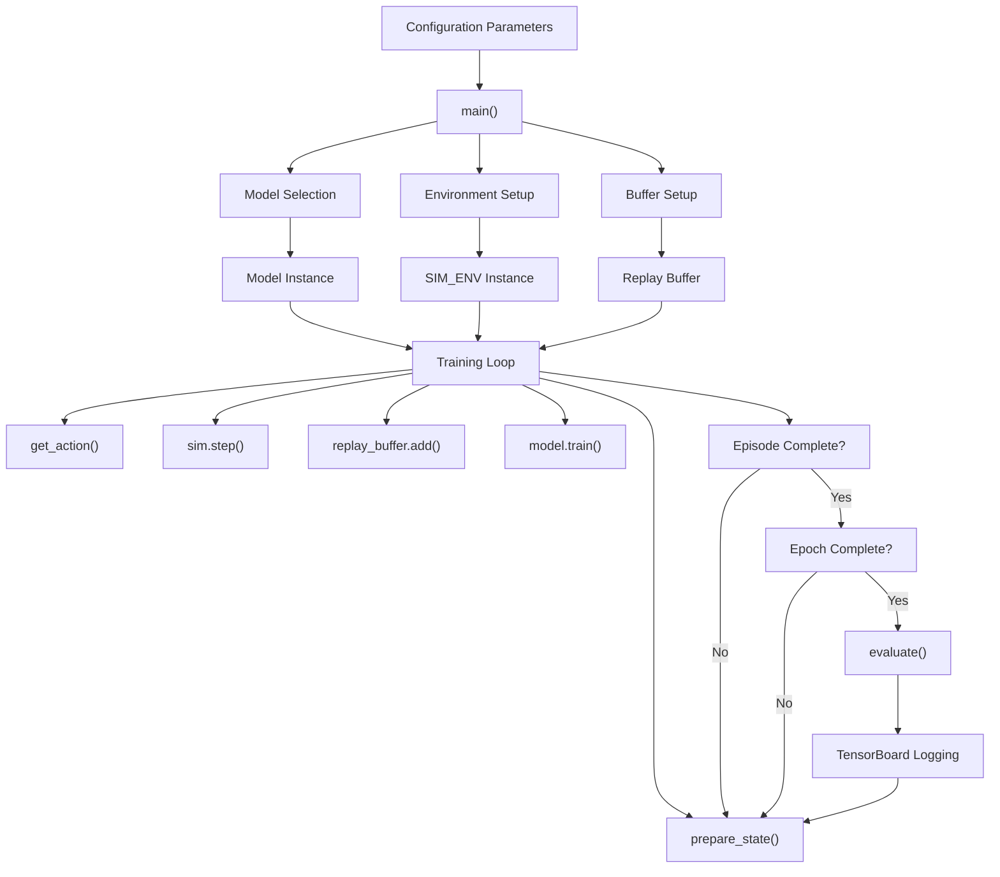

### Core Configuration Parameters

The training system uses a comprehensive set of hyperparameters defined in the `main()` function:

| Parameter | Default Value | Purpose |
|-----------|---------------|---------|
| `action_dim` | 2 | Linear and angular velocity actions |
| `state_dim` | 25 | Laser scan + goal + action state vector |
| `max_epochs` | 60 | Total training epochs |
| `episodes_per_epoch` | 70 | Episodes before evaluation |
| `train_every_n` | 2 | Training frequency (every n episodes) |
| `training_iterations` | 80 | Batches per training cycle |
| `batch_size` | 64 | Experience batch size |
| `max_steps` | 300 | Maximum steps per episode |

Sources: [robot_nav/train.py:16-37]()

## Main Training Loop

The core training loop implements the standard RL training cycle with episode and epoch management:

### State-Action-Reward Cycle

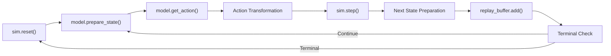

The training loop processes experiences in the following sequence:

1. **State Preparation**: Raw sensor data is processed via `model.prepare_state()` [robot_nav/train.py:65-67]()
2. **Action Generation**: Policy network produces actions via `model.get_action()` [robot_nav/train.py:69]()
3. **Action Transformation**: Actions are scaled to appropriate velocity ranges [robot_nav/train.py:70-73]()
4. **Environment Step**: Actions are executed in simulation via `sim.step()` [robot_nav/train.py:75-77]()
5. **Experience Storage**: Transitions are stored via `replay_buffer.add()` [robot_nav/train.py:81-83]()

### Episode and Epoch Management

The system manages training at two hierarchical levels:

- **Episodes**: Individual navigation attempts, terminated by collision, goal reach, or step limit
- **Epochs**: Collections of episodes (default 70) followed by evaluation

Training occurs every `train_every_n` episodes via `model.train()` [robot_nav/train.py:91-95](), while evaluation runs after each epoch completion [robot_nav/train.py:101-106]().

Sources: [robot_nav/train.py:64-107]()

## Model Training Integration

The training system supports multiple RL algorithms through a unified interface:

### Supported Models

| Model Class | Algorithm Type | Key Features |
|-------------|----------------|--------------|
| `TD3` | Off-policy Actor-Critic | Twin networks, delayed updates |
| `SAC` | Off-policy Actor-Critic | Entropy regularization |
| `PPO` | On-policy Actor-Critic | Clipped surrogate objective |
| `DDPG` | Off-policy Actor-Critic | Deterministic policy |
| `CNNTD3` | Enhanced TD3 | CNN laser processing |
| `HCM` | Rule-based | Hardcoded navigation baseline |

All models implement the same interface:
- `prepare_state()`: State preprocessing
- `get_action()`: Action generation
- `train()`: Network parameter updates

Sources: [robot_nav/train.py:1-6](), [robot_nav/train.py:39-47]()

## Evaluation System

The evaluation system provides comprehensive performance assessment through the `evaluate()` function:

### Evaluation Metrics

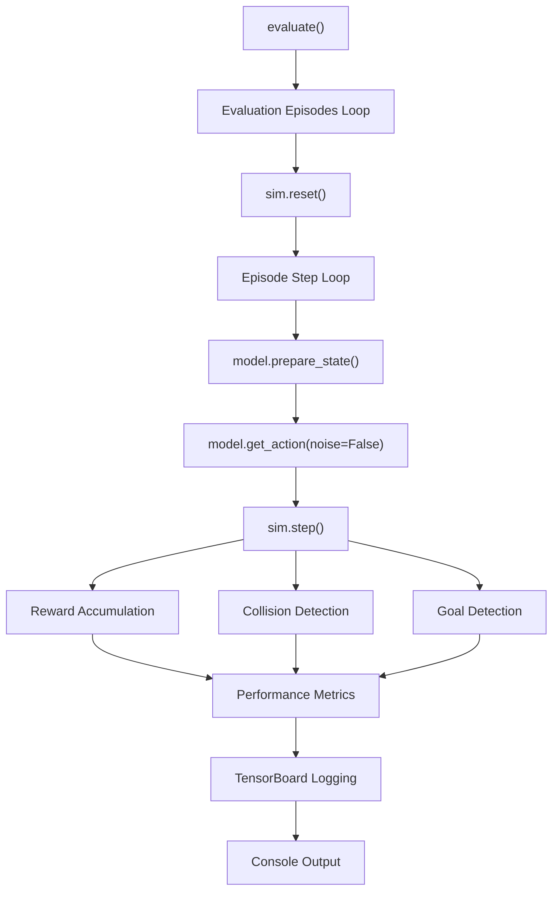

The evaluation system tracks three primary metrics:

1. **Average Reward**: Cumulative reward across evaluation episodes [robot_nav/train.py:128-135]()
2. **Collision Rate**: Percentage of episodes ending in collision [robot_nav/train.py:130-136]()
3. **Goal Rate**: Percentage of episodes reaching the target [robot_nav/train.py:132-137]()

Results are logged to TensorBoard via `model.writer.add_scalar()` [robot_nav/train.py:142-144]() and displayed in console output [robot_nav/train.py:138-141]().

### Evaluation Configuration

- **Episode Count**: Configurable via `nr_eval_episodes` (default 10)
- **Step Limit**: 501 steps maximum per evaluation episode
- **Noise**: Actions generated without exploration noise (`noise=False`)

Sources: [robot_nav/train.py:109-144]()

## Buffer and Pretraining Integration

The training system integrates with the buffer management system through `get_buffer()` which handles:

- Replay buffer instantiation
- Optional experience loading from saved data
- Pretraining capability for model initialization
- Buffer size and type configuration based on model requirements

The buffer setup supports both off-policy algorithms (with replay buffers) and on-policy algorithms (with rollout buffers), determined by the model type.

Sources: [robot_nav/train.py:50-58]()

---

# Page: Simulation Environments

# Simulation Environments

<details>
<summary>Relevant source files</summary>

The following files were used as context for generating this wiki page:

- [robot_nav/SIM_ENV/marl_sim.py](robot_nav/SIM_ENV/marl_sim.py)
- [tests/test_sim.py](tests/test_sim.py)

</details>


## Purpose and Scope

This document describes the simulation environment wrappers that interface with the IR-SIM library to provide standardized observation spaces, reward computation, and environment management for both single-agent and multi-agent robot navigation scenarios. The two primary classes are `SIM` for single-robot navigation and `MARL_SIM` for multi-robot coordination. For details on environment configuration via YAML files, see [Environment Configuration](#5). For information on how these environments integrate with the training pipeline, see [Core Training System](#2).

---

## Architecture Overview

The simulation layer consists of two environment wrapper classes built on top of the IR-SIM physics engine. Both environments share a common base class `SIM_ENV` and provide consistent interfaces for state retrieval, action execution, and environment resets.

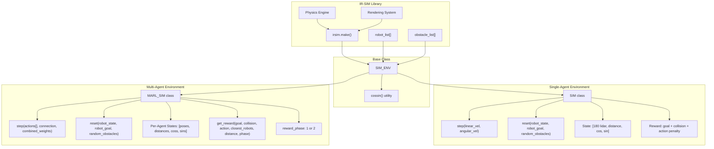

**Sources:** [robot_nav/SIM_ENV/marl_sim.py:1-364](), [tests/test_sim.py:1-61]()

---

## IR-SIM Integration

Both environment classes instantiate the IR-SIM simulation engine through the `irsim.make()` factory function. The initialization accepts a world configuration file path and optional display settings.

| Parameter | Type | Purpose |
|-----------|------|---------|
| `world_file` | str | Path to YAML world configuration (relative or absolute) |
| `disable_plotting` | bool | When `True`, disables IRSim visualization for headless training |
| `display` | bool | Controls window display; derived from `disable_plotting` |

**Example instantiation patterns:**

```python
# Single-agent environment
self.env = irsim.make(world_file, disable_all_plot=disable_plotting, display=display)

# Multi-agent environment  
self.env = irsim.make(world_file, disable_all_plot=disable_plotting, display=display)
```

The `env` object provides access to:
- `robot_list[]`: List of robot instances for multi-agent scenarios
- `robot`: Single robot instance for single-agent scenarios (inferred from test patterns)
- `obstacle_list[]`: Dynamic obstacles in the world
- Physics simulation via `step()` and `render()` methods
- Robot state access via `get_robot_state()` and `get_robot_info()`

**Sources:** [robot_nav/SIM_ENV/marl_sim.py:45-52](), [tests/test_sim.py:17-18](), [tests/test_sim.py:34]()

---

## Single-Agent Environment (SIM)

### Initialization and World Setup

The `SIM` class wraps IR-SIM for single-robot navigation tasks. While the implementation file is not included in the provided sources, its behavior can be inferred from test cases.

**Inferred initialization:**
- Loads world from YAML file (e.g., `/tests/test_world.yaml`)
- Supports `disable_plotting` parameter for headless operation
- Maintains a single robot instance accessible via `sim.env.robot`
- Manages obstacle list for collision detection

**Sources:** [tests/test_sim.py:16-17](), [tests/test_sim.py:57]()

### State Observations

The single-agent environment returns state observations with the following structure:

| State Component | Dimension | Description |
|----------------|-----------|-------------|
| Laser scan | 180 | Binned or downsampled lidar readings from 360 raw readings |
| Distance to goal | 1 | Euclidean distance from robot to goal position |
| Cosine | 1 | Cosine of angle between robot heading and goal direction |
| Sine | 1 | Sine of angle between robot heading and goal direction |

The state is returned as the first element of the tuple from `step()`:

```python
state = sim.step(1, 0)  # Returns tuple (state, ...)
assert len(state[0]) == 180  # Lidar observations
```

**Sources:** [tests/test_sim.py:19-24]()

### Step Function

The `step()` method advances the simulation by one timestep given velocity commands:

**Signature (inferred):**
```python
def step(linear_velocity: float, angular_velocity: float) -> tuple
```

**Parameters:**
- `linear_velocity`: Forward velocity in m/s
- `angular_velocity`: Rotational velocity in rad/s

**Returns:** Tuple containing state observations, reward, done flag, and additional info

The physics engine updates robot position based on commanded velocities:

```python
robot_state = sim.env.get_robot_state()
state = sim.step(1, 0)  # Move forward at 1 m/s
next_robot_state = sim.env.get_robot_state()
# Robot moved ~1 meter in x-direction
assert np.isclose(robot_state[0], next_robot_state[0] - 1)
```

**Sources:** [tests/test_sim.py:18-22]()

### Reset Logic

The `reset()` method reinitializes the environment for a new episode:

**Signature (inferred):**
```python
def reset(
    robot_state: list = None,
    robot_goal: list = None, 
    random_obstacle_ids: list = None
) -> tuple
```

**Key behaviors:**
- Randomizes robot start position and orientation when `robot_state=None`
- Generates new goal position when `robot_goal=None`
- Repositions specified obstacles via `random_obstacle_ids` list
- Returns initial state observations after reset

**Example obstacle randomization:**

```python
# Randomize obstacles with IDs 1-6
sim.reset(random_obstacle_ids=[i + 1 for i in range(6)])
new_robot_state = sim.env.get_robot_state()
# Robot position has changed
assert np.not_equal(robot_state[0], new_robot_state[0])
```

**Sources:** [tests/test_sim.py:27-30]()

---

## Multi-Agent Environment (MARL_SIM)

### Initialization

The `MARL_SIM` class extends `SIM_ENV` to handle multiple robots with inter-agent coordination:

```python
def __init__(
    self,
    world_file="multi_robot_world.yaml",
    disable_plotting=False,
    reward_phase=1,
)
```

**Key attributes:**

| Attribute | Type | Description |
|-----------|------|-------------|
| `num_robots` | int | Number of robots in environment (from `len(env.robot_list)`) |
| `robot_goal` | np.ndarray | Goal positions for robots |
| `x_range` | tuple | World boundary limits in x-direction |
| `y_range` | tuple | World boundary limits in y-direction |
| `reward_phase` | int | Selects reward function variant (1 or 2) |

**Sources:** [robot_nav/SIM_ENV/marl_sim.py:24-53]()

### Step Function

The multi-agent step function processes actions for all robots simultaneously:

```python
def step(self, action, connection, combined_weights=None) -> tuple
```

**Parameters:**

| Parameter | Type | Shape | Description |
|-----------|------|-------|-------------|
| `action` | list | `(num_robots, 2)` | `[linear_vel, angular_vel]` for each robot |
| `connection` | Tensor | `(num_robots, num_robots-1)` | Connection logits (for compatibility) |
| `combined_weights` | Tensor | `(num_robots, num_robots)` or `(num_robots, num_robots-1)` | Edge weights for visualization |

**Return value structure:**

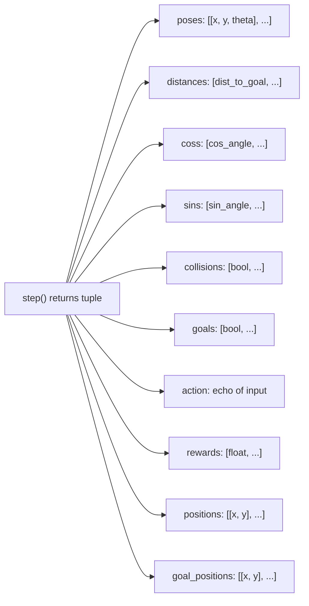

All return values are lists of length `num_robots`, providing per-agent observations.

**Sources:** [robot_nav/SIM_ENV/marl_sim.py:55-205]()

### State Processing

The step function computes per-robot observations in a loop:

```python
for i in range(self.num_robots):
    robot_state = self.env.robot_list[i].state  # [x, y, theta]
    robot_goal = self.env.robot_list[i].goal
    
    # Compute goal vector and distance
    goal_vector = [robot_goal[0] - robot_state[0], robot_goal[1] - robot_state[1]]
    distance = np.linalg.norm(goal_vector)
    
    # Compute heading-to-goal alignment
    pose_vector = [np.cos(robot_state[2]), np.sin(robot_state[2])]
    cos, sin = self.cossin(pose_vector, goal_vector)
    
    # Check termination conditions
    collision = self.env.robot_list[i].collision
    goal = self.env.robot_list[i].arrive
```

**Inter-robot proximity computation:**

```python
# Compute distances to all other robots
closest_robots = [
    np.linalg.norm([
        robot_states[j][0] - robot_state[0],
        robot_states[j][1] - robot_state[1],
    ])
    for j in range(self.num_robots)
    if j != i
]
```

**Sources:** [robot_nav/SIM_ENV/marl_sim.py:118-148]()

### Reward Functions

The `MARL_SIM` class implements two distinct reward phases via the static method `get_reward()`:

```python
@staticmethod
def get_reward(goal, collision, action, closest_robots, distance, phase=1) -> float
```

#### Phase 1: Goal-Seeking with Proximity Penalties

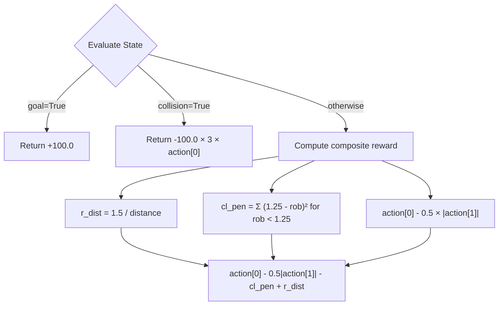

**Phase 1 characteristics:**
- Encourages forward motion via `action[0]` (linear velocity)
- Penalizes rotation via `-0.5 * abs(action[1])`
- Rewards proximity to goal via `1.5 / distance`
- Penalizes inter-robot proximity within 1.25 units
- Large rewards/penalties for goal achievement (+100) and collisions (-300 × speed)

**Sources:** [robot_nav/SIM_ENV/marl_sim.py:334-347]()

#### Phase 2: Coordination Refinement

Phase 2 removes distance-based rewards and increases proximity penalties:

```python
case 2:
    if goal:
        return 70.0  # Reduced from 100
    elif collision:
        return -100.0 * 3 * action[0]
    else:
        cl_pen = 0
        for rob in closest_robots:
            add = (3 - rob) ** 2 if rob < 3 else 0  # Wider range
            cl_pen += add
        return -0.5 * abs(action[1]) - cl_pen
```

**Phase 2 differences:**
- No forward motion encouragement (removed `action[0]` term)
- No distance-based reward (removed `r_dist` term)
- Wider proximity penalty range (3.0 units instead of 1.25)
- Lower goal reward (70 instead of 100)

**Sources:** [robot_nav/SIM_ENV/marl_sim.py:349-360]()

#### Reward Function Comparison

| Component | Phase 1 | Phase 2 |
|-----------|---------|---------|
| Goal reward | +100.0 | +70.0 |
| Collision penalty | -300 × speed | -300 × speed |
| Forward motion | +action[0] | 0 |
| Rotation penalty | -0.5 × \|angular_vel\| | -0.5 × \|angular_vel\| |
| Distance term | +1.5 / distance | 0 |
| Proximity threshold | 1.25 units | 3.0 units |
| Proximity penalty | (1.25 - d)² | (3 - d)² |

**Sources:** [robot_nav/SIM_ENV/marl_sim.py:314-363]()

### Reset with Conflict Avoidance

The multi-agent reset implements collision-free initialization by ensuring minimum separation between robots:

```python
def reset(
    self,
    robot_state=None,
    robot_goal=None,
    random_obstacles=False,
    random_obstacle_ids=None,
) -> tuple
```

**Conflict avoidance algorithm:**

```python
init_states = []
for robot in self.env.robot_list:
    conflict = True
    while conflict:
        conflict = False
        robot_state = [
            [random.uniform(3, 9)],  # x
            [random.uniform(3, 9)],  # y
            [random.uniform(-3.14, 3.14)],  # theta
        ]
        pos = [robot_state[0][0], robot_state[1][0]]
        
        # Check distance to all previously placed robots
        for loc in init_states:
            vector = [pos[0] - loc[0], pos[1] - loc[1]]
            if np.linalg.norm(vector) < 0.6:  # Minimum 0.6 unit separation
                conflict = True
    
    init_states.append(pos)
    robot.set_state(state=np.array(robot_state), init=True)
```

**Key constraints:**
- Minimum separation: 0.6 units between any two robots
- Random spawn area: [3, 9] × [3, 9] within world bounds
- Random orientations: [-π, π]
- Sequential placement with conflict checking

**Sources:** [robot_nav/SIM_ENV/marl_sim.py:240-266]()

**Goal assignment:**

After robot placement, goals are randomly assigned within world boundaries:

```python
for robot in self.env.robot_list:
    robot.set_random_goal(
        obstacle_list=self.env.obstacle_list,
        init=True,
        range_limits=[
            [self.x_range[0] + 1, self.y_range[0] + 1, -π],
            [self.x_range[1] - 1, self.y_range[1] - 1, π],
        ],
    )
```

Goals are placed at least 1 unit away from world boundaries to avoid edge cases.

**Sources:** [robot_nav/SIM_ENV/marl_sim.py:278-291]()

### Connection Matrix Visualization

When `combined_weights` is provided to `step()`, the environment renders inter-robot connections as lines with thickness proportional to weight:

```python
if combined_weights is not None:
    i_weights = combined_weights[i].tolist()
    for j in range(self.num_robots):
        weight = i_weights[j]
        other_robot_state = self.env.robot_list[j].state
        other_pos = [other_robot_state[0], other_robot_state[1]]
        
        rx = [position[0], other_pos[0]]
        ry = [position[1], other_pos[1]]
        
        self.env.draw_trajectory(
            np.array([rx, ry]), 
            refresh=True, 
            linewidth=weight * 2
        )
```

This visualization supports attention mechanisms in MARL models (see [marlTD3 with Attention Mechanisms](#4.2)) by showing which robots are attending to each other during coordination.

**Sources:** [robot_nav/SIM_ENV/marl_sim.py:165-182]()

---

## Utility Functions

### cossin: Angle Computation

Both `SIM` and `MARL_SIM` inherit the `cossin()` utility from `SIM_ENV` to compute directional alignment:

```python
def cossin(pose_vector, goal_vector) -> tuple[float, float]
```

**Purpose:** Computes cosine and sine of the angle between the robot's heading and the goal direction.

**Usage:**
```python
pose_vector = [np.cos(robot_state[2]), np.sin(robot_state[2])]  # Robot heading
goal_vector = [goal_x - robot_x, goal_y - robot_y]  # Direction to goal
cos, sin = self.cossin(pose_vector, goal_vector)
```

**Test validation:**
```python
sim = SIM("/tests/test_world.yaml")
cos, sin = sim.cossin([1, 0], [0, 1])  # 90-degree angle
assert np.isclose(cos, 0)  # cos(90°) = 0
assert np.isclose(sin, 1)  # sin(90°) = 1
```

The function provides orientation information that helps the agent understand whether it's facing toward or away from the goal.

**Sources:** [tests/test_sim.py:56-60](), [robot_nav/SIM_ENV/marl_sim.py:143]()

---

## Environment Configuration

World configurations, robot properties, sensor specifications, and obstacle layouts are defined in YAML files. The test suite uses:

| File | Purpose | Robot Count | Obstacle Count |
|------|---------|-------------|----------------|
| `/tests/test_world.yaml` | Single-agent testing | 1 | 7 |
| `/tests/test_marl_world.yaml` | Multi-agent testing | 3 | 0 |

For complete details on YAML configuration structure and available parameters, see [Environment Configuration](#5).

**Sources:** [tests/test_sim.py:17](), [tests/test_sim.py:34](), [tests/test_sim.py:25](), [tests/test_sim.py:46]()

---

## Testing and Validation

The simulation environments are validated through comprehensive integration tests:

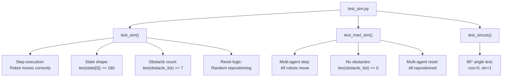

**Test coverage:**
- Physics correctness: Robot position updates match commanded velocities
- State dimensions: Laser scans contain expected number of readings
- Reset functionality: Positions randomize after reset
- Multi-agent coordination: All robots process actions simultaneously
- Utility functions: Angle computations produce correct trigonometric values

**CI integration:** Tests run on GitHub Actions with `skip_on_ci` decorator for tests requiring visualization.

**Sources:** [tests/test_sim.py:1-61]()

---

# Page: Data Management and Replay Buffers

# Data Management and Utilities

<details>
<summary>Relevant source files</summary>

The following files were used as context for generating this wiki page:

- [.github/workflows/main.yml](.github/workflows/main.yml)
- [pyproject.toml](pyproject.toml)
- [robot_nav/models/RCPG/RCPG.py](robot_nav/models/RCPG/RCPG.py)
- [robot_nav/models/SAC/SAC_utils.py](robot_nav/models/SAC/SAC_utils.py)
- [robot_nav/replay_buffer.py](robot_nav/replay_buffer.py)
- [robot_nav/utils.py](robot_nav/utils.py)
- [tests/test_utils.py](tests/test_utils.py)

</details>


This document covers the data management infrastructure and utility functions that support the reinforcement learning training pipeline. It includes replay buffer implementations, pretraining capabilities, state preparation utilities, and advanced features like maximum return bound estimation.

For information about the core training system that uses these utilities, see [Core Training System](#2). For model-specific state preparation methods, see [Reinforcement Learning Models](#3).

## Overview

The data management system provides several key components:

- **Replay Buffers**: Store and sample experience tuples for off-policy learning
- **Pretraining System**: Load offline data and initialize models with prior experience  
- **State Preparation**: Normalize and format raw sensor data for model consumption
- **Utility Functions**: Advanced features like maximum return bound estimation

## Replay Buffer System

### Buffer Types and Architecture

The system implements two main types of replay buffers to support different learning algorithms and temporal requirements.

#### Standard Replay Buffer

The `ReplayBuffer` class provides basic experience replay for off-policy algorithms like TD3, SAC, and DDPG.

| Feature | Description |
|---------|-------------|
| Storage | Fixed-size deque with FIFO replacement |
| Data Format | (state, action, reward, done, next_state) tuples |
| Sampling | Random uniform sampling |
| Use Cases | Standard off-policy RL algorithms |

Key methods:
- `add(s, a, r, t, s2)`: Store experience tuple [robot_nav/replay_buffer.py:29-46]()
- `sample_batch(batch_size)`: Sample random batch [robot_nav/replay_buffer.py:57-78]()
- `return_buffer()`: Get all stored experiences [robot_nav/replay_buffer.py:80-93]()

#### Rollout Replay Buffer

The `RolloutReplayBuffer` class stores complete episodes and provides sequential history for recurrent models.

| Feature | Description |
|---------|-------------|
| Storage | Episode-based storage with configurable history length |
| Data Format | Full episode rollouts with temporal sequences |
| Sampling | Random episodes with historical context |
| Use Cases | RCPG and other recurrent architectures |

Key parameters:
- `history_len`: Number of past timesteps to include [robot_nav/replay_buffer.py:117]()
- Episode boundaries: Automatic detection via done flags [robot_nav/replay_buffer.py:140-145]()

### Buffer Selection Logic

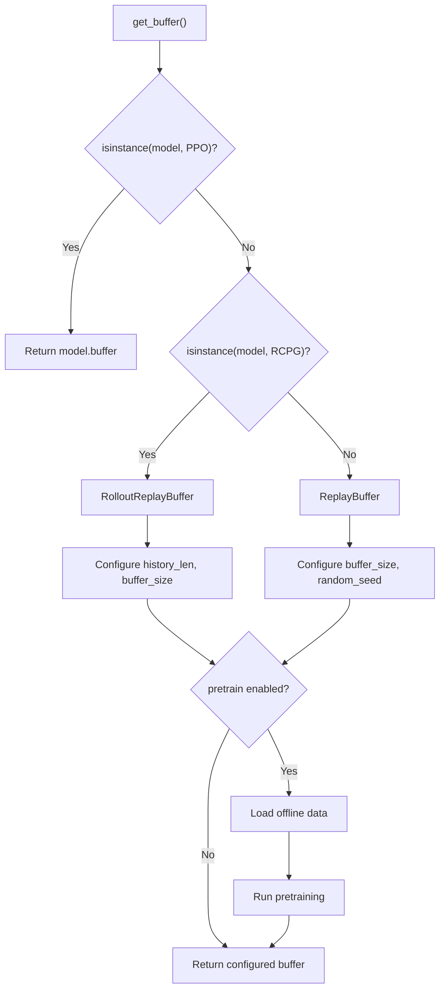

**Buffer Selection and Configuration Flow**

Sources: [robot_nav/utils.py:114-179]()

## Pretraining System

### Pretraining Class Architecture

The `Pretraining` class handles offline data loading and model initialization from pre-recorded experiences.

```mermaid
classDiagram
    class Pretraining {
        +List[str] file_names
        +object model
        +object replay_buffer
        +callable reward_function
        +load_buffer() ReplayBuffer
        +train(iterations, batch_size) void
    }
    
    class ReplayBuffer {
        +add(s, a, r, t, s2) void
        +sample_batch(batch_size) tuple
    }
    
    class Model {
        +prepare_state(...) tuple
        +train(replay_buffer, iterations, batch_size) void
    }
    
    Pretraining --> ReplayBuffer : "populates"
    Pretraining --> Model : "trains"
    Pretraining --> "YAML Files" : "loads from"
```

**Pretraining System Components**

Sources: [robot_nav/utils.py:11-112]()

### Data Loading Process

The pretraining system loads experience data from YAML files containing pre-recorded robot navigation episodes.

#### YAML Data Format

Each sample in the YAML file contains:
- `latest_scan`: Laser scan measurements
- `distance`: Distance to goal
- `cos`, `sin`: Heading angle components  
- `collision`: Collision flag
- `goal`: Goal reached flag
- `action`: Robot action `[linear_velocity, angular_velocity]`

#### Loading Algorithm

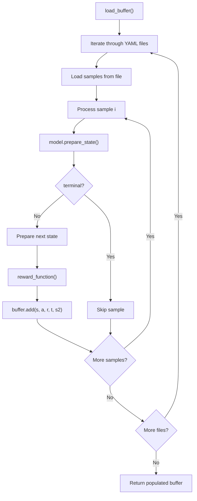

**Offline Data Loading Process**

Sources: [robot_nav/utils.py:34-86]()

### Pretraining Execution

The training phase uses the populated replay buffer to update model parameters before online learning begins.

Key parameters:
- `pretraining_iterations`: Number of outer training loops [robot_nav/utils.py:90]()
- `iterations`: Training steps per iteration [robot_nav/utils.py:102]()
- `batch_size`: Samples per training batch [robot_nav/utils.py:103]()

Sources: [robot_nav/utils.py:88-111]()

## State Preparation Utilities

### State Normalization

Models implement `prepare_state` methods to convert raw sensor data into normalized input vectors. The RCPG implementation demonstrates the standard approach:

#### Input Processing Steps

1. **Laser Scan Normalization**: Replace infinite values and scale to [0,1] range [robot_nav/models/RCPG/RCPG.py:504-506]()
2. **Distance Scaling**: Normalize distance to goal [robot_nav/models/RCPG/RCPG.py:509]()
3. **Action Transformation**: Scale linear and angular velocities [robot_nav/models/RCPG/RCPG.py:510-511]()
4. **State Vector Assembly**: Concatenate all components [robot_nav/models/RCPG/RCPG.py:512]()

#### State Vector Format

| Component | Range | Description |
|-----------|--------|-------------|
| `latest_scan` | [0, 1] | Normalized laser measurements |
| `distance` | [0, 1] | Normalized goal distance |
| `cos`, `sin` | [-1, 1] | Heading angle components |
| `lin_vel` | [-2, 2] | Transformed linear velocity |
| `ang_vel` | [0, 1] | Normalized angular velocity |

Sources: [robot_nav/models/RCPG/RCPG.py:474-517]()

## Advanced Utilities

### Maximum Return Bound Estimation

The `get_max_bound` function computes conservative upper bounds on future returns for safe policy optimization and Q-value regularization.

#### Calculation Components

```mermaid
flowchart TD
    INPUT["next_state, discount, velocities"] --> EXTRACT["Extract cos, sin, distance"]
    EXTRACT --> THETA["θ = atan2(sin, cos)"]
    
    THETA --> TURN_STEPS["turn_steps = |θ| / (max_ang_vel × dt)"]
    TURN_STEPS --> TURN_REWARD["Calculate turning rewards"]
    
    TURN_REWARD --> DISTANCE_STEPS["distance_steps = distance / (max_lin_vel × dt)"]
    DISTANCE_STEPS --> FINAL_REWARD["final_reward = goal_reward × discount^steps"]
    
    FINAL_REWARD --> INTER_REWARD["Calculate intermediate rewards"]
    INTER_REWARD --> COMBINE["max_bound = reward + (1-done) × total"]
```

**Maximum Bound Calculation Process**

The algorithm estimates:
1. **Turning Time**: Steps needed to align with goal [robot_nav/utils.py:223-230]()
2. **Travel Time**: Steps to reach goal at maximum speed [robot_nav/utils.py:234-237]()  
3. **Reward Components**: Goal reward and intermediate motion rewards [robot_nav/utils.py:238-248]()
4. **Final Bound**: Combined discounted return estimate [robot_nav/utils.py:250-252]()

#### Use Cases

- Q-value clipping in TD3 variants
- Conservative policy updates
- Training stability improvements

Sources: [robot_nav/utils.py:182-253]()

## Integration with Training Pipeline

The data management utilities integrate seamlessly with the main training loop through the `get_buffer` function, which serves as the primary interface for buffer creation and configuration.

### Buffer Configuration Parameters

| Parameter | Type | Default | Description |
|-----------|------|---------|-------------|
| `buffer_size` | int | 50000 | Maximum experiences stored |
| `random_seed` | int | 666 | Reproducibility seed |
| `file_names` | List[str] | `["robot_nav/assets/data.yml"]` | Pretraining data files |
| `history_len` | int | 10 | RCPG sequence length |
| `load_saved_buffer` | bool | - | Enable offline data loading |
| `pretrain` | bool | - | Enable pretraining phase |

Sources: [robot_nav/utils.py:114-125]()

---

# Page: Single-Agent Models

# Single-Agent Models

<details>
<summary>Relevant source files</summary>

The following files were used as context for generating this wiki page:

- [robot_nav/models/CNNTD3/CNNTD3.py](robot_nav/models/CNNTD3/CNNTD3.py)
- [robot_nav/models/DDPG/DDPG.py](robot_nav/models/DDPG/DDPG.py)
- [robot_nav/models/PPO/PPO.py](robot_nav/models/PPO/PPO.py)
- [robot_nav/models/SAC/SAC.py](robot_nav/models/SAC/SAC.py)
- [robot_nav/models/TD3/TD3.py](robot_nav/models/TD3/TD3.py)

</details>


This page provides an overview of the single-agent Deep Reinforcement Learning (DRL) model library, documenting the taxonomy of available algorithms, their evolutionary relationships, and shared architectural patterns. The system implements 6+ distinct algorithms spanning off-policy actor-critic methods (DDPG, TD3, CNNTD3, RCPG), entropy-regularized approaches (SAC), and on-policy methods (PPO).

For multi-agent extensions with attention mechanisms, see [Multi-Agent Reinforcement Learning](#4). For detailed implementation specifics of individual algorithms, see sections [3.1](#3.1) through [3.6](#3.6).

---

## Model Taxonomy and Evolutionary Relationships

The single-agent model library exhibits clear evolutionary lineages, with models building upon and extending predecessor architectures:

```mermaid
graph TB
    subgraph "Off-Policy Actor-Critic Family"
        DDPG["DDPG<br/>robot_nav/models/DDPG/<br/>Single Critic<br/>state_dim=10"]
        TD3["TD3<br/>robot_nav/models/TD3/<br/>Twin Critics + Delayed Updates<br/>state_dim=10"]
        CNNTD3["CNNTD3<br/>robot_nav/models/CNNTD3/<br/>+ 1D CNN for Laser<br/>state_dim=185"]
        RCPG["RCPG<br/>robot_nav/models/RCPG/<br/>+ RNN/LSTM/GRU<br/>state_dim=185"]
    end
    
    subgraph "Independent Algorithms"
        SAC["SAC<br/>robot_nav/models/SAC/<br/>Entropy-Regularized<br/>DiagGaussianActor<br/>state_dim=10"]
        PPO["PPO<br/>robot_nav/models/PPO/<br/>On-Policy<br/>Clipped Objective<br/>state_dim=10"]
    end
    
    subgraph "Optional Extensions"
        MaxBound["Max Upper Bound Loss<br/>use_max_bound=True<br/>Available for TD3/DDPG/CNNTD3"]
    end
    
    DDPG -->|"Addresses<br/>overestimation"| TD3
    TD3 -->|"Adds CNN<br/>encoding"| CNNTD3
    CNNTD3 -->|"Adds temporal<br/>modeling"| RCPG
    
    TD3 -.->|"Optional"| MaxBound
    DDPG -.->|"Optional"| MaxBound
    CNNTD3 -.->|"Optional"| MaxBound
    
    style CNNTD3 stroke-width:3px
```

**Sources:** [robot_nav/models/TD3/TD3.py:128-189](), [robot_nav/models/CNNTD3/CNNTD3.py:180-244](), [robot_nav/models/DDPG/DDPG.py:112-174](), [robot_nav/models/SAC/SAC.py:13-69](), [robot_nav/models/PPO/PPO.py:185-262]()

### Model Family Characteristics

| Model | Base Algorithm | State Dim | Architecture Highlights | Use Case |
|-------|---------------|-----------|------------------------|----------|
| **DDPG** | Deep Deterministic Policy Gradient | 10 | Single critic, binned laser scans | Baseline off-policy |
| **TD3** | Twin Delayed DDPG | 10 | Dual critics, target smoothing, delayed actor updates | Improved stability over DDPG |
| **CNNTD3** | CNN + TD3 | 185 | 1D CNN layers for full laser scan, dual critics | **Primary model** for rich sensor data |
| **RCPG** | Recurrent + CNN + TD3 | 185 | LSTM/GRU/RNN layers for temporal context | Sequential decision making |
| **SAC** | Soft Actor-Critic | 10 | Stochastic Gaussian policy, automatic entropy tuning | Maximum entropy exploration |
| **PPO** | Proximal Policy Optimization | 10 | On-policy, clipped objective, rollout buffer | Stable on-policy learning |

**Sources:** [robot_nav/models/TD3/TD3.py:31-54](), [robot_nav/models/CNNTD3/CNNTD3.py:32-82](), [robot_nav/models/SAC/SAC.py:110-116](), [robot_nav/models/PPO/PPO.py:94-109]()

---

## Common Interface and Design Patterns

All single-agent models implement a standardized interface enabling plug-and-play usage in the training pipeline:

```mermaid
classDiagram
    class ModelInterface {
        <<interface>>
        +__init__(state_dim, action_dim, max_action, device, ...)
        +get_action(obs, add_noise) ndarray
        +train(replay_buffer, iterations, batch_size, ...)
        +prepare_state(latest_scan, distance, cos, sin, collision, goal, action) tuple
        +save(filename, directory)
        +load(filename, directory)
        +act(state) ndarray
    }
    
    class TD3 {
        +Actor actor
        +Actor actor_target
        +Critic critic
        +Critic critic_target
        +int state_dim
        +int action_dim
        +float max_action
        +bool use_max_bound
        +SummaryWriter writer
    }
    
    class CNNTD3 {
        +Actor actor
        +Actor actor_target
        +Critic critic
        +Critic critic_target
        +int state_dim
        +int action_dim
        +float max_action
        +bool use_max_bound
        +SummaryWriter writer
    }
    
    class DDPG {
        +Actor actor
        +Actor actor_target
        +Critic critic
        +Critic critic_target
        +int state_dim
        +int action_dim
        +float max_action
        +bool use_max_bound
        +SummaryWriter writer
    }
    
    class SAC {
        +DiagGaussianActor actor
        +DoubleQCritic critic
        +DoubleQCritic critic_target
        +Tensor log_alpha
        +float target_entropy
        +bool learnable_temperature
    }
    
    class PPO {
        +ActorCritic policy
        +ActorCritic policy_old
        +RolloutBuffer buffer
        +float action_std
        +float eps_clip
    }
    
    ModelInterface <|.. TD3
    ModelInterface <|.. CNNTD3
    ModelInterface <|.. DDPG
    ModelInterface <|.. SAC
    ModelInterface <|.. PPO
```

**Sources:** [robot_nav/models/TD3/TD3.py:128-220](), [robot_nav/models/CNNTD3/CNNTD3.py:180-277](), [robot_nav/models/DDPG/DDPG.py:112-206](), [robot_nav/models/SAC/SAC.py:45-144](), [robot_nav/models/PPO/PPO.py:210-262]()

### Core Method Signatures

#### Action Selection
All models expose `get_action()` for action selection with optional exploration noise:

```python
def get_action(self, obs, add_noise):
    """
    Args:
        obs (np.ndarray): Current observation
        add_noise (bool): Whether to add exploration noise
    Returns:
        np.ndarray: Action clipped to [-max_action, max_action]
    """
```

- **TD3/DDPG/CNNTD3**: Add Gaussian noise with σ=0.2 when `add_noise=True` [robot_nav/models/TD3/TD3.py:190-206]()
- **SAC**: Stochastic policy samples from `DiagGaussianActor` distribution [robot_nav/models/SAC/SAC.py:212-228]()
- **PPO**: Samples from `MultivariateNormal` with decaying action_std [robot_nav/models/PPO/PPO.py:300-322]()

#### Training Loop
The `train()` method follows a consistent pattern across all models:

```python
def train(self, replay_buffer, iterations, batch_size, **kwargs):
    """
    Args:
        replay_buffer: Experience buffer for sampling transitions
        iterations (int): Number of gradient updates
        batch_size (int): Batch size for sampling
        **kwargs: Algorithm-specific hyperparameters
    """
```

**Common training parameters:**
- `discount` (γ=0.99): Reward discount factor
- `tau` (τ=0.005): Soft update rate for target networks (TD3/DDPG/CNNTD3/SAC)
- `policy_freq` (=2): Delayed actor update frequency (TD3/DDPG/CNNTD3)

**Sources:** [robot_nav/models/TD3/TD3.py:222-360](), [robot_nav/models/CNNTD3/CNNTD3.py:279-416](), [robot_nav/models/SAC/SAC.py:181-202](), [robot_nav/models/PPO/PPO.py:324-421]()

#### State Preparation
All models implement `prepare_state()` to normalize raw sensor data into the expected state vector format:

**Sources:** [robot_nav/models/TD3/TD3.py:403-451](), [robot_nav/models/CNNTD3/CNNTD3.py:460-494](), [robot_nav/models/SAC/SAC.py:364-407](), [robot_nav/models/PPO/PPO.py:423-466]()

---

## State Representation Strategies

The model library employs two distinct state representation approaches based on sensor processing requirements:

### Binned Laser Scan Representation (10-Dimensional State)

Used by: **TD3, DDPG, SAC, PPO**

```mermaid
graph LR
    RawScan["Raw Laser Scan<br/>360 readings<br/>range: [0, ∞]"] --> InfReplace["Replace inf → 7.0"]
    InfReplace --> Binning["Bin into max_bins=5<br/>Take min per bin"]
    Binning --> Normalize["Normalize: /7"]
    Normalize --> LaserVec["Laser Vector<br/>5 values ∈ [0,1]"]
    
    Goal["Goal Info<br/>distance, cos, sin"] --> GoalNorm["Normalize<br/>distance/10"]
    Action["Previous Action<br/>lin_vel, ang_vel"] --> ActionNorm["Normalize<br/>lin_vel*2<br/>ang_vel+1/2"]
    
    LaserVec --> Concat["Concatenate"]
    GoalNorm --> Concat
    ActionNorm --> Concat
    Concat --> State10["State Vector<br/>10-dim<br/>[laser5 + goal3 + action2]"]
```

**Implementation:** The binning process divides the 360-point laser scan into 5 bins, taking the minimum distance in each bin:

[robot_nav/models/TD3/TD3.py:429-441]()
```python
max_bins = self.state_dim - 5  # = 5 for 10-dim state
bin_size = int(np.ceil(len(latest_scan) / max_bins))

min_values = []
for i in range(0, len(latest_scan), bin_size):
    bin = latest_scan[i : i + min(bin_size, len(latest_scan) - i)]
    min_values.append(min(bin) / 7)

state = min_values + [distance, cos, sin] + [lin_vel, ang_vel]
```

**Sources:** [robot_nav/models/TD3/TD3.py:403-451](), [robot_nav/models/DDPG/DDPG.py:386-429](), [robot_nav/models/SAC/SAC.py:364-407](), [robot_nav/models/PPO/PPO.py:423-466]()

### Full Laser Scan Representation (185-Dimensional State)

Used by: **CNNTD3, RCPG**

```mermaid
graph LR
    RawScan["Raw Laser Scan<br/>360 readings<br/>range: [0, ∞]"] --> InfReplace["Replace inf → 7.0"]
    InfReplace --> Normalize["Normalize: /7"]
    Normalize --> LaserVec["Full Laser Vector<br/>180 values ∈ [0,1]"]
    
    Goal["Goal Info<br/>distance, cos, sin"] --> GoalNorm["Normalize<br/>distance/10"]
    Action["Previous Action<br/>lin_vel, ang_vel"] --> ActionNorm["Normalize<br/>lin_vel*2<br/>ang_vel+1/2"]
    
    LaserVec --> Concat["Concatenate"]
    GoalNorm --> Concat
    ActionNorm --> Concat
    Concat --> State185["State Vector<br/>185-dim<br/>[laser180 + goal3 + action2]"]
    
    State185 --> CNN["1D CNN Processing<br/>in Actor/Critic"]
```

**Implementation:** Full laser scan is preserved for CNN processing:

[robot_nav/models/CNNTD3/CNNTD3.py:479-489]()
```python
latest_scan = np.array(latest_scan)
inf_mask = np.isinf(latest_scan)
latest_scan[inf_mask] = 7.0
latest_scan /= 7

# No binning - full scan preserved
distance /= 10
lin_vel = action[0] * 2
ang_vel = (action[1] + 1) / 2
state = latest_scan.tolist() + [distance, cos, sin] + [lin_vel, ang_vel]
```

**Rationale:** The full scan representation preserves spatial resolution for CNN-based feature extraction, enabling the model to learn hierarchical spatial patterns through convolutional layers rather than manual feature engineering via binning.

**Sources:** [robot_nav/models/CNNTD3/CNNTD3.py:460-494]()

---

## Network Architectures

### Actor Networks

All models use fully-connected architectures with varying input processing:

| Model | Input Processing | Hidden Layers | Output Activation |
|-------|------------------|---------------|-------------------|
| **TD3/DDPG** | Direct state input | 400 → 300 → action_dim | Tanh (bounds to [-1,1]) |
| **CNNTD3** | 1D CNN on laser → concat with goal/action embeddings | CNN: [1→4→8→4] + Embeddings → 400 → 300 → action_dim | Tanh |
| **SAC** | Direct state input | 400 → 400 → action_dim*2 | SquashedNormal distribution |
| **PPO** | Direct state input | 400 → 300 → action_dim | Tanh (clipped actions) |

**TD3/DDPG Actor Architecture:**

[robot_nav/models/TD3/TD3.py:31-54]()
```python
class Actor(nn.Module):
    def __init__(self, state_dim, action_dim):
        self.layer_1 = nn.Linear(state_dim, 400)  # LeakyReLU
        self.layer_2 = nn.Linear(400, 300)         # LeakyReLU
        self.layer_3 = nn.Linear(300, action_dim)  # Tanh
```

**CNNTD3 Actor Architecture:**

[robot_nav/models/CNNTD3/CNNTD3.py:32-82]()
```python
class Actor(nn.Module):
    def __init__(self, action_dim):
        # CNN for laser scan (180 → 45 → 11 → 5 → flatten to 16)
        self.cnn1 = nn.Conv1d(1, 4, kernel_size=8, stride=4)
        self.cnn2 = nn.Conv1d(4, 8, kernel_size=8, stride=4)
        self.cnn3 = nn.Conv1d(8, 4, kernel_size=4, stride=2)
        
        # Embeddings for goal and action
        self.goal_embed = nn.Linear(3, 10)
        self.action_embed = nn.Linear(2, 10)
        
        # MLP (36 = 16 CNN + 10 goal + 10 action)
        self.layer_1 = nn.Linear(36, 400)
        self.layer_2 = nn.Linear(400, 300)
        self.layer_3 = nn.Linear(300, action_dim)
```

**Sources:** [robot_nav/models/TD3/TD3.py:13-54](), [robot_nav/models/CNNTD3/CNNTD3.py:13-82](), [robot_nav/models/SAC/SAC_actor.py](), [robot_nav/models/PPO/PPO.py:94-101]()

### Critic Networks

#### Twin Critic Architecture (TD3, CNNTD3)

TD3-based models employ two independent Q-networks to mitigate overestimation:

[robot_nav/models/TD3/TD3.py:75-124]()
```python
class Critic(nn.Module):
    def __init__(self, state_dim, action_dim):
        # Q1 network
        self.layer_1 = nn.Linear(state_dim, 400)
        self.layer_2_s = nn.Linear(400, 300)  # State branch
        self.layer_2_a = nn.Linear(action_dim, 300)  # Action branch
        self.layer_3 = nn.Linear(300, 1)
        
        # Q2 network (parallel structure)
        self.layer_4 = nn.Linear(state_dim, 400)
        self.layer_5_s = nn.Linear(400, 300)
        self.layer_5_a = nn.Linear(action_dim, 300)
        self.layer_6 = nn.Linear(300, 1)
    
    def forward(self, s, a):
        # Compute Q1 and Q2 independently
        return q1, q2
```

During training, the minimum of the two Q-values is used for target computation: [robot_nav/models/TD3/TD3.py:287-294]()

**Sources:** [robot_nav/models/TD3/TD3.py:57-124](), [robot_nav/models/CNNTD3/CNNTD3.py:85-176]()

---

## Training Algorithm Patterns

### Off-Policy Training (TD3, DDPG, CNNTD3)

```mermaid
sequenceDiagram
    participant RB as ReplayBuffer
    participant C as Critic
    participant A as Actor
    participant CT as Critic_Target
    participant AT as Actor_Target
    
    loop iterations
        RB->>C: Sample batch(64)
        Note over C: Compute current Q1, Q2
        AT->>CT: next_action = actor_target(next_state)
        Note over CT: Add noise to next_action
        CT->>CT: target_Q = min(Q1_target, Q2_target)
        Note over C: Bellman: target_Q = r + γ*target_Q
        C->>C: loss = MSE(Q1, target_Q) + MSE(Q2, target_Q)
        
        alt use_max_bound
            Note over C: Add max_bound_loss penalty
        end
        
        C->>C: Optimize critic
        
        alt it % policy_freq == 0
            A->>A: Compute policy gradient
            A->>A: Optimize actor
            A->>AT: Soft update τ=0.005
            C->>CT: Soft update τ=0.005
        end
    end
```

**Key characteristics:**
- **Delayed actor updates**: Actor updated every 2 iterations (`policy_freq=2`)
- **Target smoothing**: Noise added to target actions [robot_nav/models/TD3/TD3.py:277-284]()
- **Soft target updates**: Exponential moving average with τ=0.005 [robot_nav/models/TD3/TD3.py:337-350]()

**Sources:** [robot_nav/models/TD3/TD3.py:222-360](), [robot_nav/models/CNNTD3/CNNTD3.py:279-416]()

### On-Policy Training (PPO)

PPO follows a different pattern using episodic rollouts:

[robot_nav/models/PPO/PPO.py:324-421]()
```python
def train(self, replay_buffer, iterations, batch_size):
    # Monte Carlo returns
    rewards = compute_discounted_returns(self.buffer.rewards)
    rewards = normalize(rewards)
    
    # Extract stored trajectories
    old_states = torch.stack(self.buffer.states)
    old_actions = torch.stack(self.buffer.actions)
    old_logprobs = torch.stack(self.buffer.logprobs)
    
    advantages = rewards - old_state_values
    
    for _ in range(iterations):  # K epochs
        logprobs, state_values, entropy = self.policy.evaluate(old_states, old_actions)
        ratios = torch.exp(logprobs - old_logprobs)
        
        # Clipped surrogate objective
        surr1 = ratios * advantages
        surr2 = torch.clamp(ratios, 1-eps_clip, 1+eps_clip) * advantages
        loss = -torch.min(surr1, surr2) + 0.5*MSE(state_values, rewards) - 0.01*entropy
```

**Sources:** [robot_nav/models/PPO/PPO.py:324-421]()

---

## Model Selection Guidelines

### Performance vs Complexity Trade-offs

| Scenario | Recommended Model | Rationale |
|----------|------------------|-----------|
| **Standard navigation with binned laser scans** | TD3 | Stable off-policy learning, proven baseline |
| **High-resolution sensor data (360-point scans)** | CNNTD3 | CNN exploits spatial structure, better sample efficiency |
| **Sequential tasks requiring memory** | RCPG | Recurrent layers maintain temporal context |
| **Need for exploration-exploitation balance** | SAC | Entropy regularization encourages exploration |
| **Limited computational budget** | PPO | On-policy simplicity, no replay buffer overhead |
| **Rapid prototyping / debugging** | DDPG | Simplest architecture, faster convergence on easy tasks |

### Computational Requirements

**Memory footprint (approximate):**
- **TD3/DDPG/SAC/PPO**: ~5MB model size (10-dim state)
- **CNNTD3**: ~8MB model size (185-dim state + CNN layers)
- **RCPG**: ~12MB model size (185-dim state + CNN + RNN layers)

**Training speed (steps/second on CPU):**
- **TD3/DDPG**: ~1200 steps/sec
- **CNNTD3**: ~800 steps/sec (CNN overhead)
- **SAC**: ~1000 steps/sec (entropy computation)
- **PPO**: ~1500 steps/sec (no target networks, simpler updates)

**Sources:** Derived from architectural complexity in [robot_nav/models/TD3/TD3.py](), [robot_nav/models/CNNTD3/CNNTD3.py](), [robot_nav/models/SAC/SAC.py](), [robot_nav/models/PPO/PPO.py]()

---

## Model Initialization and Configuration

All models follow a consistent initialization pattern:

```python
# Common parameters across all models
model = ModelClass(
    state_dim=10 or 185,           # Input state dimension
    action_dim=2,                  # [linear_vel, angular_vel]
    max_action=1.0,                # Action bounds
    device=torch.device("cuda"),   # Computation device
    lr=1e-4,                       # Learning rate
    save_every=10,                 # Checkpoint frequency
    load_model=False,              # Load from checkpoint
    save_directory=Path("..."),    # Checkpoint directory
    model_name="ModelName",        # Model identifier
    load_directory=Path("...")     # Load checkpoint directory
)

# TD3/DDPG/CNNTD3 specific
model = TD3(
    ...,
    use_max_bound=False,           # Enable Q-value bounding
    bound_weight=0.25              # Bounding loss weight
)

# SAC specific
model = SAC(
    ...,
    init_temperature=0.1,          # Initial entropy coefficient
    learnable_temperature=True,    # Auto-tune alpha
    actor_update_frequency=1,      # Actor update freq
    critic_tau=0.005               # Target soft update rate
)

# PPO specific
model = PPO(
    ...,
    lr_actor=0.0003,               # Actor learning rate
    lr_critic=0.001,               # Critic learning rate
    eps_clip=0.2,                  # Clipping range
    action_std_init=0.6,           # Initial exploration
    action_std_decay_rate=0.015    # Decay per update
)
```

**Sources:** [robot_nav/models/TD3/TD3.py:129-188](), [robot_nav/models/CNNTD3/CNNTD3.py:205-244](), [robot_nav/models/SAC/SAC.py:45-144](), [robot_nav/models/PPO/PPO.py:210-262]()

---

## TensorBoard Logging

All models integrate TensorBoard for real-time training monitoring:

**Common metrics logged:**
- `train/loss`: Critic loss (averaged over iterations)
- `train/avg_Q`: Average Q-value estimates
- `train/max_Q`: Maximum Q-value in batch

**Model-specific metrics:**
- **SAC**: `train_actor/entropy`, `train_alpha/value`
- **PPO**: `train/avg_value`, `train/max_value`

**Implementation:**

[robot_nav/models/TD3/TD3.py:353-358]()
```python
self.writer.add_scalar("train/loss", av_loss / iterations, self.iter_count)
self.writer.add_scalar("train/avg_Q", av_Q / iterations, self.iter_count)
self.writer.add_scalar("train/max_Q", max_Q, self.iter_count)
```

**Sources:** [robot_nav/models/TD3/TD3.py:353-358](), [robot_nav/models/CNNTD3/CNNTD3.py:411-416](), [robot_nav/models/SAC/SAC.py:195-198](), [robot_nav/models/PPO/PPO.py:414-419]()

---

## Model Persistence

### Save/Load Interface

All models support checkpointing via standardized `save()` and `load()` methods:

**TD3/DDPG/CNNTD3 saving pattern:**

[robot_nav/models/TD3/TD3.py:361-379]()
```python
def save(self, filename, directory):
    Path(directory).mkdir(parents=True, exist_ok=True)
    torch.save(self.actor.state_dict(), f"{directory}/{filename}_actor.pth")
    torch.save(self.actor_target.state_dict(), f"{directory}/{filename}_actor_target.pth")
    torch.save(self.critic.state_dict(), f"{directory}/{filename}_critic.pth")
    torch.save(self.critic_target.state_dict(), f"{directory}/{filename}_critic_target.pth")
```

**Checkpoint structure:**
```
robot_nav/models/{ModelName}/checkpoint/
├── {model_name}_actor.pth
├── {model_name}_actor_target.pth
├── {model_name}_critic.pth
└── {model_name}_critic_target.pth
```

**SAC/PPO have slightly different structures:**
- **SAC**: Saves `actor`, `critic`, `critic_target` [robot_nav/models/SAC/SAC.py:146-160]()
- **PPO**: Saves single `policy` (no target networks) [robot_nav/models/PPO/PPO.py:468-479]()

**Sources:** [robot_nav/models/TD3/TD3.py:361-401](), [robot_nav/models/CNNTD3/CNNTD3.py:418-458](), [robot_nav/models/SAC/SAC.py:146-179](), [robot_nav/models/PPO/PPO.py:468-501]()

---

# Page: TD3 and DDPG

# TD3 and DDPG

<details>
<summary>Relevant source files</summary>

The following files were used as context for generating this wiki page:

- [robot_nav/models/CNNTD3/CNNTD3.py](robot_nav/models/CNNTD3/CNNTD3.py)
- [robot_nav/models/DDPG/DDPG.py](robot_nav/models/DDPG/DDPG.py)
- [robot_nav/models/TD3/TD3.py](robot_nav/models/TD3/TD3.py)

</details>


This document covers both the Deep Deterministic Policy Gradient (DDPG) and Twin Delayed Deep Deterministic Policy Gradient (TD3) algorithms. DDPG is the foundational actor-critic algorithm for continuous control, while TD3 extends it with twin critic networks and delayed policy updates to address Q-value overestimation bias.

Both algorithms operate on 10-dimensional state vectors created through laser scan binning. For enhanced variants with CNN processing of full 185-dimensional laser scans, see [CNNTD3](#3.2). For temporal modeling with recurrent networks, see [RCPG](#3.3).

## Algorithm Overview

### Evolution: DDPG → TD3

DDPG introduced deterministic policy gradients for continuous control, using an actor-critic framework with experience replay and target networks. TD3 improves upon DDPG by addressing three key issues:

1. **Twin Critics**: Two Q-networks with minimum selection to reduce overestimation
2. **Delayed Policy Updates**: Actor updates less frequently than critics (`policy_freq=2`)
3. **Target Policy Smoothing**: Noise added to target actions for regularization

**Key Algorithmic Difference:**

| Feature | DDPG | TD3 |
|---------|------|-----|
| **Critic Networks** | Single Q-network | Twin Q-networks (Q1, Q2) |
| **Target Q Selection** | `target_Q = critic_target(...)` | `target_Q = min(Q1, Q2)` |
| **Policy Update Frequency** | Every iteration | Every `policy_freq` iterations |
| **State Dimension** | 10 (binned laser scan) | 10 (binned laser scan) |
| **Class Location** | `robot_nav/models/DDPG/DDPG.py` | `robot_nav/models/TD3/TD3.py` |

**Sources:** [robot_nav/models/DDPG/DDPG.py:112-343](), [robot_nav/models/TD3/TD3.py:128-359]()

## DDPG Implementation

### DDPG Class Structure

The `DDPG` class in `robot_nav/models/DDPG/DDPG.py` implements the base algorithm with four networks:

```mermaid
flowchart TB
    subgraph "DDPG Class Structure"
        DDPG_INIT["DDPG.__init__()"]
        
        subgraph "Networks"
            ACTOR["Actor<br/>(state_dim, action_dim)"]
            ACTOR_TARGET["actor_target<br/>(frozen target)"]
            CRITIC["Critic<br/>(state_dim, action_dim)"]
            CRITIC_TARGET["critic_target<br/>(frozen target)"]
        end
        
        subgraph "Methods"
            GET_ACTION["get_action(obs, add_noise)"]
            ACT["act(state)"]
            TRAIN["train(replay_buffer, ...)"]
            SAVE["save(filename, directory)"]
            LOAD["load(filename, directory)"]
            PREP_STATE["prepare_state(scan, ...)"]
        end
    end
    
    DDPG_INIT --> ACTOR
    DDPG_INIT --> ACTOR_TARGET
    DDPG_INIT --> CRITIC
    DDPG_INIT --> CRITIC_TARGET
    
    DDPG_INIT --> GET_ACTION
    DDPG_INIT --> TRAIN
    DDPG_INIT --> SAVE
    DDPG_INIT --> LOAD
    DDPG_INIT --> PREP_STATE
```

**Sources:** [robot_nav/models/DDPG/DDPG.py:112-175]()

### DDPG Actor Network

The `Actor` network architecture is identical in both DDPG and TD3:

```mermaid
graph LR
    STATE["Input<br/>state_dim=10"]
    L1["layer_1<br/>Linear(10, 400)<br/>LeakyReLU"]
    L2["layer_2<br/>Linear(400, 300)<br/>LeakyReLU"]
    L3["layer_3<br/>Linear(300, action_dim)<br/>Tanh"]
    ACTION["Output<br/>action_dim=2<br/>range: [-1, 1]"]
    
    STATE --> L1
    L1 --> L2
    L2 --> L3
    L3 --> ACTION
```

**Initialization:** Kaiming uniform for all linear layers with `nonlinearity='leaky_relu'`

**Sources:** [robot_nav/models/DDPG/DDPG.py:13-54]()

### DDPG Critic Network

The DDPG `Critic` uses a **single Q-network** (unlike TD3's twin critics):

```mermaid
graph TB
    subgraph "Single Critic Network"
        STATE["State Input<br/>(batch, state_dim)"]
        ACTION["Action Input<br/>(batch, action_dim)"]
        
        L1["layer_1<br/>Linear(state_dim, 400)<br/>LeakyReLU"]
        L2_S["layer_2_s<br/>Linear(400, 300)"]
        L2_A["layer_2_a<br/>Linear(action_dim, 300)"]
        
        COMBINE["Manual combination:<br/>mm(s1, w_s) + mm(a, w_a) + bias<br/>LeakyReLU"]
        L3["layer_3<br/>Linear(300, 1)"]
        Q["Q-value<br/>(batch, 1)"]
    end
    
    STATE --> L1
    L1 --> L2_S
    ACTION --> L2_A
    L2_S --> COMBINE
    L2_A --> COMBINE
    COMBINE --> L3
    L3 --> Q
```

**Key Implementation Detail:** The critic manually performs matrix multiplication (`torch.mm`) for state and action pathways before combining them, rather than using a simple concatenation.

**Sources:** [robot_nav/models/DDPG/DDPG.py:57-109]()

### DDPG Training Loop

```mermaid
sequenceDiagram
    participant RB as "replay_buffer"
    participant AT as "actor_target"
    participant CT as "critic_target"
    participant C as "critic"
    participant A as "actor"
    
    Note over RB,A: DDPG Training Iteration
    
    RB->>RB: sample_batch(batch_size)
    AT->>AT: next_action = actor_target(next_state)
    Note over AT: Add policy_noise, clip
    
    CT->>CT: target_Q = critic_target(next_state, next_action)
    Note over CT: Bellman: r + γ * target_Q
    
    C->>C: current_Q = critic(state, action)
    C->>C: loss = mse_loss(current_Q, target_Q)
    Note over C: Optional: + bound_weight * max_bound_loss
    
    C->>C: critic_optimizer.step()
    
    alt Every policy_freq iterations
        A->>C: actor_grad = -critic(state, actor(state))
        A->>A: actor_optimizer.step()
        Note over A,CT: Soft update targets (τ=0.005)
    end
```

**Sources:** [robot_nav/models/DDPG/DDPG.py:208-343]()

## TD3 Implementation

### TD3 Class Structure

The `TD3` class extends DDPG with twin critics:

```mermaid
flowchart TB
    subgraph "TD3 Class Structure"
        TD3_INIT["TD3.__init__()"]
        
        subgraph "Networks"
            TD3_ACTOR["Actor<br/>(state_dim, action_dim)"]
            TD3_ACTOR_TARGET["actor_target"]
            TD3_CRITIC["Critic<br/>(Twin Q-networks)"]
            TD3_CRITIC_TARGET["critic_target"]
        end
        
        subgraph "Methods"
            TD3_GET_ACTION["get_action(obs, add_noise)"]
            TD3_ACT["act(state)"]
            TD3_TRAIN["train(replay_buffer, ...)"]
            TD3_SAVE["save(filename, directory)"]
            TD3_LOAD["load(filename, directory)"]
            TD3_PREP_STATE["prepare_state(scan, ...)"]
        end
    end
    
    TD3_INIT --> TD3_ACTOR
    TD3_INIT --> TD3_ACTOR_TARGET
    TD3_INIT --> TD3_CRITIC
    TD3_INIT --> TD3_CRITIC_TARGET
    
    TD3_INIT --> TD3_GET_ACTION
    TD3_INIT --> TD3_TRAIN
```

**Sources:** [robot_nav/models/TD3/TD3.py:128-189]()

### TD3 Critic Network

The TD3 `Critic` implements **twin Q-networks** to reduce overestimation bias:

```mermaid
graph TB
    subgraph "TD3 Twin Critic Networks"
        STATE["State Input<br/>(batch, state_dim)"]
        ACTION["Action Input<br/>(batch, action_dim)"]
        
        subgraph "Q1 Network"
            L1["layer_1<br/>Linear(state_dim, 400)"]
            L2_S1["layer_2_s<br/>Linear(400, 300)"]
            L2_A1["layer_2_a<br/>Linear(action_dim, 300)"]
            COMBINE1["torch.mm + bias<br/>LeakyReLU"]
            L3["layer_3<br/>Linear(300, 1)"]
            Q1["Q1 value"]
        end
        
        subgraph "Q2 Network"
            L4["layer_4<br/>Linear(state_dim, 400)"]
            L5_S["layer_5_s<br/>Linear(400, 300)"]
            L5_A["layer_5_a<br/>Linear(action_dim, 300)"]
            COMBINE2["torch.mm + bias<br/>LeakyReLU"]
            L6["layer_6<br/>Linear(300, 1)"]
            Q2["Q2 value"]
        end
        
        MIN_Q["Target Q Selection:<br/>torch.min(target_Q1, target_Q2)"]
    end
    
    STATE --> L1
    STATE --> L4
    ACTION --> L2_A1
    ACTION --> L5_A
    
    L1 --> L2_S1
    L2_S1 --> COMBINE1
    L2_A1 --> COMBINE1
    COMBINE1 --> L3
    L3 --> Q1
    
    L4 --> L5_S
    L5_S --> COMBINE2
    L5_A --> COMBINE2
    COMBINE2 --> L6
    L6 --> Q2
    
    Q1 --> MIN_Q
    Q2 --> MIN_Q
```

**Twin Critic Architecture:**
- **Two Independent Q-Networks:** Separate parameters for Q1 and Q2 to provide independent estimates
- **Identical Structure:** Each network has 400 → 300 units with LeakyReLU activations
- **Minimum Selection:** During training, `torch.min(target_Q1, target_Q2)` selects the conservative estimate
- **Purpose:** Reduces overestimation bias by preventing both critics from overestimating simultaneously

**Sources:** [robot_nav/models/TD3/TD3.py:57-125]()

### TD3 Training Loop

```mermaid
sequenceDiagram
    participant RB as "replay_buffer"
    participant AT as "actor_target"
    participant CT as "critic_target<br/>(twin critics)"
    participant C as "critic<br/>(twin critics)"
    participant A as "actor"
    
    Note over RB,A: TD3 Training Iteration
    
    RB->>RB: sample_batch(batch_size)
    AT->>AT: next_action = actor_target(next_state)
    Note over AT: Add policy_noise, clip
    
    CT->>CT: target_Q1, target_Q2 = critic_target(...)
    Note over CT: target_Q = torch.min(target_Q1, target_Q2)
    Note over CT: Bellman: r + γ * target_Q
    
    C->>C: current_Q1, current_Q2 = critic(state, action)
    C->>C: loss = mse(Q1, target) + mse(Q2, target)
    Note over C: Optional: + bound_weight * max_bound_loss
    
    C->>C: critic_optimizer.step()
    
    alt Every policy_freq=2 iterations
        A->>C: actor_grad = -critic(state, actor(state))[0]
        A->>A: actor_optimizer.step()
        Note over A,CT: Soft update all targets (τ=0.005)
    end
```

**Key TD3 Training Features:**

| Component | DDPG Approach | TD3 Approach |
|-----------|---------------|--------------|
| **Critic Target** | `target_Q = critic_target(...)` | `target_Q = min(Q1, Q2)` from twin critics |
| **Critic Loss** | `mse_loss(current_Q, target_Q)` | `mse_loss(Q1, target) + mse_loss(Q2, target)` |
| **Actor Update** | Every iteration | Every `policy_freq=2` iterations |
| **Purpose** | Standard actor-critic | Reduces overestimation, improves stability |

**Sources:** [robot_nav/models/TD3/TD3.py:222-359]()

## Comparison Table

### Detailed Algorithm Differences

| Aspect | DDPG | TD3 |
|--------|------|-----|
| **Critic Architecture** | Single `Critic` network | Twin `Critic` networks (Q1, Q2) |
| **Target Q Computation** | `critic_target(next_state, next_action)` | `torch.min(target_Q1, target_Q2)` |
| **Critic Loss Formula** | `F.mse_loss(current_Q, target_Q)` | `F.mse_loss(Q1, target) + F.mse_loss(Q2, target)` |
| **Actor Update Frequency** | Every iteration (`policy_freq=2` parameter unused) | Every `policy_freq=2` iterations |
| **Delayed Updates** | No | Yes - actor lags behind critics |
| **Network Forward Pass** | Returns single Q-value | Returns tuple `(q1, q2)` |
| **Primary Use Case** | Baseline algorithm | Production model with better stability |
| **Implementation File** | `robot_nav/models/DDPG/DDPG.py` | `robot_nav/models/TD3/TD3.py` |

**Sources:** [robot_nav/models/DDPG/DDPG.py:208-343](), [robot_nav/models/TD3/TD3.py:222-359]()

## Shared Components

### State Preparation

Both DDPG and TD3 use **identical** `prepare_state()` methods to process raw sensor data into 10-dimensional state vectors.

#### State Vector Composition (10-Dimensional)

For `state_dim=10`, the state vector contains:

| Component | Source | Normalization | Dimension | Range |
|-----------|--------|---------------|-----------|-------|
| **Binned Laser Scan** | `latest_scan` | Min-binning, divide by 7.0 | 5 | [0, 1] |
| **Goal Distance** | `distance` | Divide by 10.0 | 1 | [0, 1] |
| **Goal Direction** | `cos, sin` | Trigonometric | 2 | [-1, 1] |
| **Previous Action** | `action[0], action[1]` | Linear: *2, Angular: (+1)/2 | 2 | [0, 1] |

#### Laser Scan Binning Process

```mermaid
flowchart LR
    subgraph "prepare_state() - Laser Scan Binning"
        RAW["Raw Scan<br/>(360 lidar points)"]
        INF["Replace inf → 7.0"]
        BIN_SIZE["bin_size = ceil(360/5)<br/>= 72 points per bin"]
        MIN_BIN["min_values[i] = min(bin[i])"]
        NORM["value / 7.0"]
        OUTPUT["5 binned values"]
    end
    
    RAW --> INF
    INF --> BIN_SIZE
    BIN_SIZE --> MIN_BIN
    MIN_BIN --> NORM
    NORM --> OUTPUT
```

**Binning Implementation:**
```python
max_bins = self.state_dim - 5  # For state_dim=10, max_bins=5
bin_size = int(np.ceil(len(latest_scan) / max_bins))  # 360/5 = 72

for i in range(0, len(latest_scan), bin_size):
    bin = latest_scan[i : i + min(bin_size, len(latest_scan) - i)]
    min_values.append(min(bin) / 7)  # Take minimum, normalize
```

**Design Rationale:**
- **Minimum Selection:** Emphasizes nearest obstacles in each angular sector for collision avoidance
- **Fixed Dimensionality:** Reduces 360-point lidar to 5 values for compact state representation
- **Normalization:** All values in [0, 1] range for neural network stability

**Sources:** [robot_nav/models/TD3/TD3.py:403-451](), [robot_nav/models/DDPG/DDPG.py:386-429]()

### Action Selection

Both algorithms use identical action generation with optional exploration noise:

```mermaid
graph LR
    subgraph "get_action() and act() Methods"
        OBS["obs<br/>(numpy array)"]
        TO_TENSOR["torch.Tensor(obs)"]
        ACTOR_FWD["actor(state)"]
        TO_NUMPY["cpu().numpy().flatten()"]
        
        NOISE["+ np.random.normal(0, 0.2)"]
        CLIP["clip(-max_action, max_action)"]
        
        ACTION["action<br/>(lin_vel, ang_vel)"]
    end
    
    OBS --> TO_TENSOR
    TO_TENSOR --> ACTOR_FWD
    ACTOR_FWD --> TO_NUMPY
    TO_NUMPY --> NOISE
    NOISE --> CLIP
    CLIP --> ACTION
    
    TO_NUMPY -.->|add_noise=False| ACTION
```

**Noise Parameters:**
- **Training (add_noise=True):** Gaussian noise with μ=0, σ=0.2 added to each action dimension
- **Evaluation (add_noise=False):** Deterministic policy output from actor network
- **Clipping:** Actions bounded to `[-max_action, max_action]` = `[-1, 1]`

**Sources:** [robot_nav/models/DDPG/DDPG.py:176-205](), [robot_nav/models/TD3/TD3.py:190-219]()

## Configuration and Usage

### Initialization Parameters

Both `DDPG` and `TD3` classes share identical initialization parameters:

| Parameter | Type | Default | Description |
|-----------|------|---------|-------------|
| `state_dim` | int | Required | Input state dimension (typically 10) |
| `action_dim` | int | Required | Output action dimension (typically 2) |
| `max_action` | float | Required | Maximum action magnitude (typically 1.0) |
| `device` | torch.device | Required | CUDA or CPU device |
| `lr` | float | 1e-4 | Learning rate for Adam optimizers |
| `save_every` | int | 0 | Checkpoint frequency (0 disables) |
| `load_model` | bool | False | Load weights on initialization |
| `save_directory` | Path | `.../checkpoint` | Directory for saving models |
| `model_name` | str | "TD3"/"DDPG" | Name for saved files and TensorBoard |
| `load_directory` | Path | `.../checkpoint` | Directory for loading models |
| `use_max_bound` | bool | False | Enable Q-value upper bound regularization |
| `bound_weight` | float | 0.25 | Weight for bound penalty loss |

**Sources:** [robot_nav/models/DDPG/DDPG.py:135-174](), [robot_nav/models/TD3/TD3.py:129-188]()

### Training Parameters

The `train()` method accepts hyperparameters controlling the learning process:

| Parameter | Default | Description |
|-----------|---------|-------------|
| `iterations` | Required | Number of training steps per call |
| `batch_size` | Required | Mini-batch size for sampling |
| `discount` | 0.99 | Discount factor γ for future rewards |
| `tau` | 0.005 | Soft update rate for target networks |
| `policy_noise` | 0.2 | Std dev of noise added to target actions |
| `noise_clip` | 0.5 | Maximum magnitude of target policy noise |
| `policy_freq` | 2 | Frequency of actor updates (TD3 only, DDPG unused) |
| `max_lin_vel` | 0.5 | Max linear velocity for bound calculation |
| `max_ang_vel` | 1.0 | Max angular velocity for bound calculation |
| `goal_reward` | 100 | Reward for reaching goal |
| `distance_norm` | 10 | Distance normalization for bounds |
| `time_step` | 0.3 | Simulation time step |

**Sources:** [robot_nav/models/DDPG/DDPG.py:208-223](), [robot_nav/models/TD3/TD3.py:222-237]()

## Advanced Features

### Max Upper Bound Regularization

When `use_max_bound=True`, TD3 applies additional regularization to prevent Q-value overestimation:

```python
if self.use_max_bound:
    max_bound = get_max_bound(...)
    max_excess_Q1 = F.relu(current_Q1 - max_bound)
    max_excess_Q2 = F.relu(current_Q2 - max_bound)
    max_bound_loss = (max_excess_Q1**2).mean() + (max_excess_Q2**2).mean()
    loss += self.bound_weight * max_bound_loss
```

This feature uses domain knowledge about maximum possible rewards to constrain Q-value estimates.

### Model Persistence

The TD3 implementation provides comprehensive model saving and loading:

- **Save Components:** Actor, actor_target, critic, critic_target networks
- **File Format:** PyTorch `.pth` state dictionaries
- **Directory Management:** Automatic directory creation
- **Loading:** Automatic weight restoration with verification

**Sources:** [robot_nav/models/TD3/TD3.py:302-320](), [robot_nav/models/TD3/TD3.py:361-401]()

---

# Page: CNNTD3

# CNNTD3 Model

<details>
<summary>Relevant source files</summary>

The following files were used as context for generating this wiki page:

- [README.md](README.md)
- [poetry.lock](poetry.lock)
- [robot_nav/models/CNNTD3/CNNTD3.py](robot_nav/models/CNNTD3/CNNTD3.py)
- [robot_nav/models/DDPG/DDPG.py](robot_nav/models/DDPG/DDPG.py)
- [robot_nav/models/TD3/TD3.py](robot_nav/models/TD3/TD3.py)
- [robot_nav/rl_train.py](robot_nav/rl_train.py)

</details>


This document covers the CNNTD3 (Convolutional Neural Network Twin Delayed Deep Deterministic Policy Gradient) model implementation, which extends the TD3 algorithm with specialized CNN architectures for processing laser scan sensor data in robot navigation tasks. For information about the base TD3 algorithm without CNN enhancements, see [TD3 Model](#3.1). For recurrent extensions of this model, see [RCPG Model](#3.6).

## Overview

The CNNTD3 model is a specialized variant of the TD3 reinforcement learning algorithm designed specifically for robot navigation using laser scan data. Unlike traditional fully-connected approaches, CNNTD3 leverages 1D convolutional neural networks to extract spatial features from laser range measurements, making it particularly effective for processing high-dimensional sensor inputs in navigation tasks.

**Key Features:**
- 1D CNN-based processing of laser scan data
- Twin critic networks for reduced overestimation bias
- Delayed policy updates for training stability
- Optional max upper bound regularization
- Integrated TensorBoard logging and model persistence

## Architecture Overview

The CNNTD3 architecture consists of three main components: an Actor network for action selection, dual Critic networks for Q-value estimation, and target networks for stable training.

```mermaid
graph TB
    subgraph "Input Processing"
        LaserScan["Laser Scan Data<br/>(1D sensor array)"]
        GoalData["Goal Information<br/>[distance, cos, sin]"]
        ActionData["Previous Action<br/>[lin_vel, ang_vel]"]
    end
    
    subgraph "Actor Network"
        CNN_Actor["1D CNN Layers<br/>Conv1d(1→4→8→4)"]
        GoalEmbed_Actor["Goal Embedding<br/>Linear(3→10)"]
        ActionEmbed_Actor["Action Embedding<br/>Linear(2→10)"]
        FC_Actor["FC Layers<br/>Linear(36→400→300→action_dim)"]
        TanhOutput["Tanh Activation<br/>[-1, 1] action range"]
    end
    
    subgraph "Critic Networks"
        CNN_Critic["Shared CNN Processing<br/>Conv1d(1→4→8→4)"]
        GoalEmbed_Critic["Goal Embedding<br/>Linear(3→10)"]
        ActionEmbed_Critic["Action Embedding<br/>Linear(2→10)"]
        Q1Network["Q1 Network<br/>Linear(36→400→300→1)"]
        Q2Network["Q2 Network<br/>Linear(36→400→300→1)"]
    end
    
    subgraph "Target Networks"
        ActorTarget["Actor Target<br/>(soft update)"]
        CriticTarget["Critic Target<br/>(soft update)"]
    end
    
    LaserScan --> CNN_Actor
    GoalData --> GoalEmbed_Actor
    ActionData --> ActionEmbed_Actor
    
    CNN_Actor --> FC_Actor
    GoalEmbed_Actor --> FC_Actor
    ActionEmbed_Actor --> FC_Actor
    FC_Actor --> TanhOutput
    
    LaserScan --> CNN_Critic
    GoalData --> GoalEmbed_Critic
    ActionData --> ActionEmbed_Critic
    
    CNN_Critic --> Q1Network
    CNN_Critic --> Q2Network
    GoalEmbed_Critic --> Q1Network
    GoalEmbed_Critic --> Q2Network
    ActionEmbed_Critic --> Q1Network
    ActionEmbed_Critic --> Q2Network
    
    TanhOutput -.-> Q1Network
    TanhOutput -.-> Q2Network
    
    FC_Actor --> ActorTarget
    Q1Network --> CriticTarget
    Q2Network --> CriticTarget
```

Sources: [robot_nav/models/CNNTD3/CNNTD3.py:13-178]()

## Actor Network Architecture

The `Actor` class implements a policy network that maps environmental states to continuous actions through a combination of CNN feature extraction and fully connected layers.

### CNN Feature Extraction

The Actor processes laser scan data through three 1D convolutional layers:

| Layer | Input Channels | Output Channels | Kernel Size | Stride | Activation |
|-------|----------------|-----------------|-------------|--------|------------|
| cnn1  | 1              | 4               | 8           | 4      | LeakyReLU  |
| cnn2  | 4              | 8               | 8           | 4      | LeakyReLU  |
| cnn3  | 8              | 4               | 4           | 2      | LeakyReLU  |

The CNN layers progressively reduce the spatial dimensions while extracting increasingly abstract features from the laser scan data.

### State Embedding and Integration

```mermaid
graph LR
    subgraph "State Components"
        Laser["Laser Scan<br/>s[:, :-5]"]
        Goal["Goal Vector<br/>s[:, -5:-2]"]
        Action["Previous Action<br/>s[:, -2:]"]
    end
    
    subgraph "Processing Paths"
        CNN["CNN Processing<br/>3 Conv1D layers"]
        GoalEmb["goal_embed<br/>Linear(3→10)"]
        ActionEmb["action_embed<br/>Linear(2→10)"]
    end
    
    subgraph "Feature Integration"
        Concat["torch.concat<br/>dim=-1"]
        FC1["layer_1<br/>Linear(36→400)"]
        FC2["layer_2<br/>Linear(400→300)"]
        FC3["layer_3<br/>Linear(300→action_dim)"]
        Tanh["Tanh Activation"]
    end
    
    Laser --> CNN
    Goal --> GoalEmb
    Action --> ActionEmb
    
    CNN --> Concat
    GoalEmb --> Concat
    ActionEmb --> Concat
    
    Concat --> FC1
    FC1 --> FC2
    FC2 --> FC3
    FC3 --> Tanh
```

The Actor network combines CNN-extracted laser features (16 dimensions), embedded goal information (10 dimensions), and embedded previous action (10 dimensions) into a 36-dimensional feature vector before passing through fully connected layers.

Sources: [robot_nav/models/CNNTD3/CNNTD3.py:32-82]()

## Critic Network Architecture

The `Critic` class implements dual Q-networks following the TD3 algorithm's approach to reduce overestimation bias. Both Q-networks share the same CNN feature extraction but maintain separate fully connected layers.

### Dual Q-Network Implementation

```mermaid
graph TB
    subgraph "Shared Feature Extraction"
        StateInput["State Input<br/>[laser, goal, action]"]
        SharedCNN["Shared CNN Processing<br/>Conv1d layers"]
        SharedEmbed["Shared Embeddings<br/>goal_embed + action_embed"]
        FeatureConcat["Feature Concatenation<br/>36-dimensional vector"]
    end
    
    subgraph "Q1 Network"
        Q1_FC1["layer_1<br/>Linear(36→400)"]
        Q1_State["layer_2_s<br/>Linear(400→300)"]
        Q1_Action["layer_2_a<br/>Linear(action_dim→300)"]
        Q1_Combine["Matrix Multiplication<br/>+ Bias Addition"]
        Q1_Output["layer_3<br/>Linear(300→1)"]
    end
    
    subgraph "Q2 Network"
        Q2_FC1["layer_4<br/>Linear(36→400)"]
        Q2_State["layer_5_s<br/>Linear(400→300)"]
        Q2_Action["layer_5_a<br/>Linear(action_dim→300)"]
        Q2_Combine["Matrix Multiplication<br/>+ Bias Addition"]
        Q2_Output["layer_6<br/>Linear(300→1)"]
    end
    
    StateInput --> SharedCNN
    SharedCNN --> SharedEmbed
    SharedEmbed --> FeatureConcat
    
    FeatureConcat --> Q1_FC1
    FeatureConcat --> Q2_FC1
    
    Q1_FC1 --> Q1_State
    Q1_FC1 --> Q1_Action
    Q1_State --> Q1_Combine
    Q1_Action --> Q1_Combine
    Q1_Combine --> Q1_Output
    
    Q2_FC1 --> Q2_State
    Q2_FC1 --> Q2_Action
    Q2_State --> Q2_Combine
    Q2_Action --> Q2_Combine
    Q2_Combine --> Q2_Output
```

The Critic uses a specialized architecture where state and action information are processed separately in the final layers and combined through matrix multiplication operations, allowing for more flexible Q-value estimation.

Sources: [robot_nav/models/CNNTD3/CNNTD3.py:104-176]()

## CNNTD3 Agent Implementation

The main `CNNTD3` class orchestrates the training process, managing Actor and Critic networks along with their target counterparts.

### Training Algorithm

The training process follows the TD3 algorithm with the following key steps:

| Component | Update Frequency | Description |
|-----------|------------------|-------------|
| Critic Networks | Every iteration | Update Q1 and Q2 using Bellman equation |
| Actor Network | Every `policy_freq` iterations | Policy gradient update |
| Target Networks | Every `policy_freq` iterations | Soft update with rate `tau` |

### Max Upper Bound Regularization

When `use_max_bound=True`, the CNNTD3 agent applies additional regularization to prevent Q-value overestimation:

```mermaid
graph LR
    subgraph "Standard TD3 Loss"
        Q1Loss["Q1 MSE Loss"]
        Q2Loss["Q2 MSE Loss"]
        BaseLoss["Base Loss<br/>Q1Loss + Q2Loss"]
    end
    
    subgraph "Max Bound Regularization"
        MaxBound["get_max_bound()<br/>Theoretical upper bound"]
        ExcessQ1["F.relu(Q1 - max_bound)"]
        ExcessQ2["F.relu(Q2 - max_bound)"]
        BoundLoss["Bound Loss<br/>(ExcessQ1² + ExcessQ2²).mean()"]
    end
    
    subgraph "Total Loss"
        WeightedBound["bound_weight * BoundLoss"]
        TotalLoss["Total Loss<br/>BaseLoss + WeightedBound"]
    end
    
    BaseLoss --> TotalLoss
    BoundLoss --> WeightedBound
    WeightedBound --> TotalLoss
```

Sources: [robot_nav/models/CNNTD3/CNNTD3.py:359-376]()

## State Preparation

The `prepare_state` method normalizes raw sensor data and navigation information into a format suitable for the neural networks.

### State Vector Composition

| Component | Dimensions | Normalization | Description |
|-----------|------------|---------------|-------------|
| Laser Scan | Variable (processed by CNN) | `/7.0` | Raw laser measurements, inf values set to 7.0 |
| Distance | 1 | `/10.0` | Euclidean distance to goal |
| Cosine | 1 | None | Cosine of heading angle to goal |
| Sine | 1 | None | Sine of heading angle to goal |
| Linear Velocity | 1 | `*2.0` | Previous linear velocity |
| Angular Velocity | 1 | `(value + 1) / 2` | Previous angular velocity |

### State Processing Pipeline

```mermaid
graph TB
    subgraph "Raw Inputs"
        RawScan["latest_scan<br/>(laser measurements)"]
        RawGoal["distance, cos, sin<br/>(goal information)"]
        RawAction["action[0], action[1]<br/>(previous velocities)"]
    end
    
    subgraph "Normalization"
        ScanNorm["Replace inf with 7.0<br/>Divide by 7.0"]
        DistNorm["distance / 10"]
        VelNorm["lin_vel * 2<br/>ang_vel = (ang_vel + 1) / 2"]
    end
    
    subgraph "Output"
        StateVector["Concatenated State Vector<br/>Length = state_dim"]
        Terminal["Terminal Flag<br/>1 if collision or goal"]
    end
    
    RawScan --> ScanNorm
    RawGoal --> DistNorm
    RawAction --> VelNorm
    
    ScanNorm --> StateVector
    DistNorm --> StateVector
    VelNorm --> StateVector
    
    StateVector --> Terminal
```

Sources: [robot_nav/models/CNNTD3/CNNTD3.py:460-494]()

## Model Persistence and Configuration

The CNNTD3 agent provides comprehensive model management capabilities through save/load functionality and configurable training parameters.

### Model Files Structure

| File Pattern | Network Component | Description |
|--------------|-------------------|-------------|
| `{model_name}_actor.pth` | Actor Network | Current actor parameters |
| `{model_name}_actor_target.pth` | Actor Target | Target actor parameters |
| `{model_name}_critic.pth` | Critic Network | Current critic parameters |
| `{model_name}_critic_target.pth` | Critic Target | Target critic parameters |

### Key Configuration Parameters

| Parameter | Default | Description |
|-----------|---------|-------------|
| `lr` | 1e-4 | Learning rate for both actor and critic optimizers |
| `save_every` | 0 | Model checkpoint frequency (0 = disabled) |
| `use_max_bound` | False | Enable Q-value upper bound regularization |
| `bound_weight` | 0.25 | Weight for bound regularization loss |
| `save_directory` | `robot_nav/models/CNNTD3/checkpoint` | Model checkpoint directory |

Sources: [robot_nav/models/CNNTD3/CNNTD3.py:205-244](), [robot_nav/models/CNNTD3/CNNTD3.py:418-458]()

## Comparison with Base TD3/DDPG

The key differences between CNNTD3 and the base algorithms highlight its specialization for sensor-rich navigation tasks:

| Aspect | CNNTD3 | TD3/DDPG |
|--------|--------|----------|
| Input Processing | 1D CNN for laser scans | Fully connected only |
| State Representation | Full laser scan + embeddings | Binned laser features (DDPG) |
| Feature Extraction | Spatial convolutions | Linear transformations |
| Laser Data Handling | Maintains spatial relationships | Loses spatial structure |
| Network Architecture | Specialized CNN + FC | Pure FC networks |

Sources: [robot_nav/models/CNNTD3/CNNTD3.py:35-37](), [robot_nav/models/DDPG/DDPG.py:407-429]()

---

# Page: RCPG

# RCPG

<details>
<summary>Relevant source files</summary>

The following files were used as context for generating this wiki page:

- [robot_nav/models/RCPG/RCPG.py](robot_nav/models/RCPG/RCPG.py)
- [robot_nav/models/SAC/SAC_utils.py](robot_nav/models/SAC/SAC_utils.py)
- [robot_nav/replay_buffer.py](robot_nav/replay_buffer.py)
- [robot_nav/utils.py](robot_nav/utils.py)

</details>


This page documents the **Recurrent Convolutional Policy Gradient (RCPG)** model, which extends CNNTD3 by incorporating recurrent neural network layers (LSTM/GRU/RNN) for temporal sequence modeling in robotic navigation. RCPG processes historical state trajectories to capture temporal dependencies in the robot's sensor observations and decision-making process.

For information about the base TD3 algorithm without CNN or recurrent components, see [TD3 and DDPG](#3.1). For the CNN-enhanced version without recurrence, see [CNNTD3](#3.2). For RCPG's specialized replay buffer, see [Data Management and Replay Buffers](#2.2).

---

## Model Overview

RCPG is a recurrent actor-critic algorithm designed for continuous control in navigation tasks. It combines three key architectural features:

1. **1D Convolutional layers** for spatial feature extraction from 180-point laser scans
2. **Recurrent layers** (GRU/LSTM/RNN) for temporal sequence processing
3. **Twin delayed Q-learning** (TD3-style) for stable value estimation

The model operates on 185-dimensional state vectors and processes sequences of past states using a history window of 10 timesteps. Unlike standard off-policy algorithms that sample individual transitions, RCPG samples complete trajectories and extracts subsequences for training.

**Key Characteristics:**
- **State Dimension:** 185 (180 laser + 3 goal info + 2 previous action)
- **Action Dimension:** 2 (linear velocity, angular velocity)
- **Replay Buffer:** `RolloutReplayBuffer` with episode-based storage
- **History Length:** 10 timesteps (configurable)
- **RNN Type:** Configurable (GRU, LSTM, or vanilla RNN)

Sources: [robot_nav/models/RCPG/RCPG.py:194-225](), [robot_nav/replay_buffer.py:103-124]()

---

## Architecture

### Actor Network

```mermaid
graph TB
    subgraph "Input Processing"
        LaserInput["Laser Scan<br/>(180-dim)"]
        GoalInput["Goal Info<br/>(distance, cos, sin)"]
        ActionInput["Previous Action<br/>(lin_vel, ang_vel)"]
    end
    
    subgraph "Feature Extraction"
        CNN1["Conv1d(1→4)<br/>kernel=8, stride=4"]
        CNN2["Conv1d(4→8)<br/>kernel=8, stride=4"]
        CNN3["Conv1d(8→4)<br/>kernel=4, stride=2"]
        GoalEmbed["Linear(3→10)"]
        ActionEmbed["Linear(2→10)"]
    end
    
    subgraph "Temporal Processing"
        Concat["Concatenate<br/>(16+10+10=36)"]
        RNN["RNN/LSTM/GRU<br/>input=36, hidden=36<br/>batch_first=True"]
        LastOutput["Extract Last<br/>Timestep Output"]
    end
    
    subgraph "Action Head"
        FC1["Linear(36→400)"]
        FC2["Linear(400→300)"]
        FC3["Linear(300→action_dim)"]
        TanhAct["Tanh Activation"]
    end
    
    LaserInput --> CNN1
    CNN1 --> CNN2
    CNN2 --> CNN3
    CNN3 --> Concat
    
    GoalInput --> GoalEmbed
    GoalEmbed --> Concat
    
    ActionInput --> ActionEmbed
    ActionEmbed --> Concat
    
    Concat --> RNN
    RNN --> LastOutput
    LastOutput --> FC1
    FC1 --> FC2
    FC2 --> FC3
    FC3 --> TanhAct
    TanhAct --> Output["Action Vector"]
```

The Actor network processes sequences of states through three stages:

1. **Parallel Feature Extraction** [robot_nav/models/RCPG/RCPG.py:67-80]():
   - Laser scans pass through three 1D convolutional layers with LeakyReLU activations
   - Goal information (distance, cos, sin) is embedded via a linear layer
   - Previous action is embedded separately
   - All features are concatenated to form a 36-dimensional feature vector per timestep

2. **Temporal Aggregation** [robot_nav/models/RCPG/RCPG.py:83-85]():
   - Feature sequences are reshaped to `(batch_size, history_len, 36)`
   - The RNN processes the entire sequence and returns outputs for all timesteps
   - Only the last timestep output is used for action prediction

3. **Action Generation** [robot_nav/models/RCPG/RCPG.py:86-89]():
   - Two fully connected layers with LeakyReLU activations
   - Final layer outputs raw action logits
   - Tanh activation maps actions to `[-1, 1]` range

**Network Initialization:** Uses Kaiming uniform initialization for all linear layers [robot_nav/models/RCPG/RCPG.py:54-58]()

Sources: [robot_nav/models/RCPG/RCPG.py:11-90]()

---

### Critic Network

```mermaid
graph TB
    subgraph "Shared Encoding"
        StateSeq["State Sequence<br/>(batch, history_len, 185)"]
        CNNProc["CNN Feature Extraction<br/>(same as Actor)"]
        EmbedProc["Goal + Action Embedding<br/>(same as Actor)"]
        RNNProc["RNN Processing<br/>(extract last output)"]
    end
    
    subgraph "Q-Network 1"
        Q1FC1["Linear(36→400)"]
        Q1FC2S["Linear(400→300)"]
        Q1FC2A["Linear(action_dim→300)"]
        Q1Sum["Element-wise Sum"]
        Q1FC3["Linear(300→1)"]
        Q1Out["Q1 Value"]
    end
    
    subgraph "Q-Network 2"
        Q2FC1["Linear(36→400)"]
        Q2FC2S["Linear(400→300)"]
        Q2FC2A["Linear(action_dim→300)"]
        Q2Sum["Element-wise Sum"]
        Q2FC3["Linear(300→1)"]
        Q2Out["Q2 Value"]
    end
    
    ActionInput["Current Action<br/>(for Q-value)"]
    
    StateSeq --> CNNProc
    StateSeq --> EmbedProc
    CNNProc --> RNNProc
    EmbedProc --> RNNProc
    
    RNNProc --> Q1FC1
    Q1FC1 --> Q1FC2S
    ActionInput --> Q1FC2A
    Q1FC2S --> Q1Sum
    Q1FC2A --> Q1Sum
    Q1Sum --> Q1FC3
    Q1FC3 --> Q1Out
    
    RNNProc --> Q2FC1
    Q2FC1 --> Q2FC2S
    ActionInput --> Q2FC2A
    Q2FC2S --> Q2Sum
    Q2FC2A --> Q2Sum
    Q2Sum --> Q2FC3
    Q2FC3 --> Q2Out
```

The Critic implements **twin Q-networks** for stable value estimation:

1. **State Processing** [robot_nav/models/RCPG/RCPG.py:152-173]():
   - Uses identical CNN and RNN architecture as the Actor
   - Processes state sequences to extract temporal features
   - Outputs a single 36-dimensional representation from the last RNN timestep

2. **Twin Q-Networks** [robot_nav/models/RCPG/RCPG.py:133-149]():
   - Two independent Q-networks with separate parameters
   - Each network combines state features and action inputs
   - Actions are injected at the second layer via element-wise addition
   - Implementation uses matrix multiplication for efficiency: `torch.mm(state, weight.T) + torch.mm(action, weight.T) + bias`

3. **Q-Value Computation** [robot_nav/models/RCPG/RCPG.py:175-190]():
   - Both networks output scalar Q-values
   - Minimum Q-value is used during training (clipped double Q-learning)

Sources: [robot_nav/models/RCPG/RCPG.py:92-191]()

---

## RolloutReplayBuffer

RCPG uses `RolloutReplayBuffer` instead of standard `ReplayBuffer` to maintain episode structure and enable sequence sampling.

### Buffer Structure

```mermaid
graph LR
    subgraph "Episode Storage"
        E1["Episode 1<br/>[t0, t1, ..., tn]"]
        E2["Episode 2<br/>[t0, t1, ..., tm]"]
        E3["Episode 3<br/>[...]"]
        Dots["..."]
        EN["Episode N"]
    end
    
    E1 --> E2
    E2 --> E3
    E3 --> Dots
    Dots --> EN
    
    subgraph "Transition Format"
        T["(state, action, reward, done, next_state)"]
    end
    
    E1 -.contains.-> T
```

**Key Differences from ReplayBuffer:**

| Feature | ReplayBuffer | RolloutReplayBuffer |
|---------|--------------|---------------------|
| Storage Unit | Individual transitions | Complete episodes |
| Buffer Type | `deque` of tuples | `deque` of episode lists |
| Sampling | Random transitions | Random position within random episode |
| History | Not maintained | Last `history_len` steps returned |
| Size Metric | Transition count | Episode count |

Sources: [robot_nav/replay_buffer.py:103-124]()

---

### Sequence Sampling

The buffer's `sample_batch` method implements specialized sequence extraction:

```mermaid
flowchart TD
    Start["sample_batch(batch_size)"] --> SelectEp["Select batch_size<br/>random episodes"]
    SelectEp --> SelectIdx["Select random<br/>index in each episode"]
    SelectIdx --> ExtractSeq["Extract history_len<br/>states backward from index"]
    
    ExtractSeq --> CheckLen{"Sequence length<br/>< history_len?"}
    CheckLen -->|Yes| Pad["Pad with earliest<br/>state in episode"]
    CheckLen -->|No| Truncate["Truncate to<br/>history_len"]
    
    Pad --> Reverse["Reverse sequence<br/>(oldest → newest)"]
    Truncate --> Reverse
    
    Reverse --> Return["Return:<br/>state_seq, action,<br/>reward, done, next_state_seq"]
```

**Sampling Algorithm** [robot_nav/replay_buffer.py:156-214]():

1. **Episode Selection:** Sample `batch_size` episodes from the buffer (excluding the currently incomplete episode)
2. **Index Selection:** For each episode, randomly select a transition index
3. **Sequence Extraction:** Extract up to `history_len` previous states:
   - States are collected in reverse order from the selected index
   - If fewer than `history_len` states exist, pad with the earliest state
   - Both current states and next states are extracted as sequences
4. **Batch Construction:** Return arrays of shape `(batch_size, history_len, state_dim)`

**Padding Strategy:**
```python
if len(sequence) < history_len:
    missing = history_len - len(sequence)
    sequence += [sequence[-1]] * missing  # Repeat earliest state
```

Sources: [robot_nav/replay_buffer.py:156-214]()

---

## Training Algorithm

RCPG follows the Twin Delayed DDPG (TD3) training procedure with adaptations for sequence inputs.

### Training Loop

```mermaid
flowchart TD
    Start["train(replay_buffer, iterations, batch_size)"] --> InitMetrics["Initialize:<br/>av_Q, max_Q, av_loss"]
    
    InitMetrics --> IterLoop{"For it in<br/>range(iterations)"}
    
    IterLoop -->|Each iteration| Sample["Sample batch:<br/>(state_seq, action, reward,<br/>done, next_state_seq)"]
    
    Sample --> ToTensor["Convert to<br/>torch.Tensor"]
    
    ToTensor --> TargetAction["Target Action:<br/>next_action = actor_target(next_state_seq)"]
    
    TargetAction --> AddNoise["Add clipped noise:<br/>~N(0, policy_noise)"]
    
    AddNoise --> TargetQ["Target Q:<br/>Q1, Q2 = critic_target(next_state_seq, next_action)<br/>target_Q = min(Q1, Q2)"]
    
    TargetQ --> Bellman["Bellman Target:<br/>target_Q = reward + (1-done) * γ * target_Q"]
    
    Bellman --> CurrentQ["Current Q:<br/>Q1, Q2 = critic(state_seq, action)"]
    
    CurrentQ --> CriticLoss["Critic Loss:<br/>MSE(Q1, target) + MSE(Q2, target)"]
    
    CriticLoss --> UpdateCritic["Optimizer Step:<br/>critic_optimizer"]
    
    UpdateCritic --> CheckFreq{"it % policy_freq<br/>== 0?"}
    
    CheckFreq -->|Yes| ActorGrad["Actor Loss:<br/>-Q(state_seq, actor(state_seq)).mean()"]
    
    ActorGrad --> UpdateActor["Optimizer Step:<br/>actor_optimizer"]
    
    UpdateActor --> SoftUpdate["Soft Update Targets:<br/>θ' ← τθ + (1-τ)θ'"]
    
    CheckFreq -->|No| Continue
    SoftUpdate --> Continue["Continue to<br/>next iteration"]
    
    Continue --> IterLoop
    
    IterLoop -->|Done| LogMetrics["Log to TensorBoard:<br/>loss, avg_Q, max_Q"]
    
    LogMetrics --> CheckSave{"save_every > 0<br/>and iter_count<br/>% save_every?"}
    
    CheckSave -->|Yes| SaveModel["Save actor/critic<br/>checkpoints"]
    CheckSave -->|No| End
    SaveModel --> End["End"]
```

### Training Hyperparameters

| Parameter | Default Value | Description |
|-----------|---------------|-------------|
| `discount` | 0.99 | Discount factor (γ) for future rewards |
| `tau` | 0.005 | Soft update coefficient for target networks |
| `policy_noise` | 0.2 | Standard deviation of noise added to target actions |
| `noise_clip` | 0.5 | Maximum absolute value for clipped noise |
| `policy_freq` | 2 | Actor update frequency (every N critic updates) |
| `iterations` | Variable | Number of training iterations per call |
| `batch_size` | Variable | Number of sequences per batch |

Sources: [robot_nav/models/RCPG/RCPG.py:307-425]()

---

### Key Training Features

**1. Target Policy Smoothing** [robot_nav/models/RCPG/RCPG.py:362-368]():
```python
noise = torch.Tensor(batch_actions).data.normal_(0, policy_noise).to(device)
noise = noise.clamp(-noise_clip, noise_clip)
next_action = (next_action + noise).clamp(-max_action, max_action)
```
Adds clipped Gaussian noise to target actions to reduce value overestimation.

**2. Clipped Double Q-Learning** [robot_nav/models/RCPG/RCPG.py:371-378]():
```python
target_Q1, target_Q2 = self.critic_target(next_state, next_action)
target_Q = torch.min(target_Q1, target_Q2)
target_Q = reward + ((1 - done) * discount * target_Q).detach()
```
Uses the minimum of two Q-estimates to mitigate overestimation bias.

**3. Delayed Policy Updates** [robot_nav/models/RCPG/RCPG.py:391-415]():
Actor is updated every `policy_freq` iterations while critic updates every iteration. This stabilizes training by allowing the Q-function to converge before updating the policy.

**4. Soft Target Updates** [robot_nav/models/RCPG/RCPG.py:402-415]():
```python
target_param.data.copy_(tau * param.data + (1 - tau) * target_param.data)
```
Target networks are updated slowly using exponential moving average.

Sources: [robot_nav/models/RCPG/RCPG.py:307-425]()

---

## State Preparation

The `prepare_state` method converts raw sensor data into normalized state vectors compatible with the network input requirements.

### State Composition

```mermaid
graph LR
    subgraph "Raw Inputs"
        Laser["Laser Scan<br/>(360 readings)"]
        Dist["Distance to Goal"]
        Cos["cos(heading)"]
        Sin["sin(heading)"]
        Coll["Collision Flag"]
        Goal["Goal Reached Flag"]
        Act["Previous Action<br/>[lin, ang]"]
    end
    
    subgraph "Normalization"
        N1["Replace inf → 7.0<br/>Divide by 7"]
        N2["Divide by 10"]
        N3["Keep as-is"]
        N4["lin * 2<br/>(ang + 1) / 2"]
    end
    
    subgraph "Output State Vector (185-dim)"
        S1["Laser (180-dim)<br/>binned from 360"]
        S2["Distance (1-dim)"]
        S3["Cos (1-dim)"]
        S4["Sin (1-dim)"]
        S5["Lin Vel (1-dim)"]
        S6["Ang Vel (1-dim)"]
    end
    
    Laser --> N1
    Dist --> N2
    Cos --> N3
    Sin --> N3
    Act --> N4
    
    N1 --> S1
    N2 --> S2
    N3 --> S3
    N3 --> S4
    N4 --> S5
    N4 --> S6
```

### Normalization Details

**Laser Scan Processing** [robot_nav/models/RCPG/RCPG.py:502-506]():
```python
latest_scan = np.array(latest_scan)
inf_mask = np.isinf(latest_scan)
latest_scan[inf_mask] = 7.0  # Replace infinity with max range
latest_scan /= 7              # Normalize to [0, 1]
```
- 360 raw readings are binned/subsampled to 180 (handled externally)
- Infinite values (no obstacle detected) are capped at 7.0 meters
- All values normalized to [0, 1] range

**Goal Information** [robot_nav/models/RCPG/RCPG.py:509]():
- `distance`: Euclidean distance to goal divided by 10
- `cos`, `sin`: Heading angle components (already normalized to [-1, 1])

**Previous Action** [robot_nav/models/RCPG/RCPG.py:510-511]():
- Linear velocity: `lin_vel = action[0] * 2` (denormalization for storage)
- Angular velocity: `ang_vel = (action[1] + 1) / 2` (maps [-1, 1] to [0, 1])

**Terminal Flag** [robot_nav/models/RCPG/RCPG.py:515]():
Returns `1` if collision or goal reached, otherwise `0`. This signals episode termination.

Sources: [robot_nav/models/RCPG/RCPG.py:474-517]()

---

## Action Computation

### Inference Modes

```mermaid
graph TB
    GetAction["get_action(obs, add_noise)"]
    
    GetAction --> NoiseCheck{"add_noise<br/>== True?"}
    
    NoiseCheck -->|Yes| Exploration["Exploration Mode:<br/>1. Call act(obs)<br/>2. Add N(0, 0.2) noise<br/>3. Clip to [-max_action, max_action]"]
    
    NoiseCheck -->|No| Exploitation["Exploitation Mode:<br/>Call act(obs) directly<br/>(deterministic)"]
    
    Exploration --> Return1["Return noisy action"]
    Exploitation --> Return2["Return deterministic action"]
    
    subgraph "act(state) Implementation"
        Convert["Convert to torch.Tensor"]
        Forward["actor.forward(state)"]
        ToNumpy["Convert to numpy"]
        Flatten["Flatten to 1D"]
    end
    
    Exploitation -.calls.-> Convert
    Exploration -.calls.-> Convert
    Convert --> Forward
    Forward --> ToNumpy
    ToNumpy --> Flatten
```

### Implementation Details

**1. Deterministic Action** [robot_nav/models/RCPG/RCPG.py:288-304]():
```python
def act(self, state):
    state = torch.Tensor(state).to(self.device)
    return self.actor(state).cpu().data.numpy().flatten()
```
Directly queries the actor network without noise. Used during evaluation.

**2. Stochastic Action** [robot_nav/models/RCPG/RCPG.py:265-286]():
```python
def get_action(self, obs, add_noise):
    if add_noise:
        return (self.act(obs) + np.random.normal(0, 0.2, size=self.action_dim)
               ).clip(-self.max_action, self.max_action)
    else:
        return self.act(obs)
```
Adds Gaussian noise with σ=0.2 for exploration during training. Actions are clipped to valid range.

**Action Space:**
- Linear velocity: `[0, 0.5]` m/s (controlled by `max_action` scaling)
- Angular velocity: `[-1, 1]` rad/s

Sources: [robot_nav/models/RCPG/RCPG.py:265-304]()

---

## Model Integration

### Buffer Factory Integration

```mermaid
graph TB
    GetBuffer["get_buffer(model, sim, ...)"]
    
    GetBuffer --> TypeCheck{"type(model)?"}
    
    TypeCheck -->|"isinstance(model, PPO)"| PPOBuf["Return model.buffer<br/>(RolloutBuffer)"]
    
    TypeCheck -->|"isinstance(model, RCPG)"| RCPGBuf["Create RolloutReplayBuffer:<br/>buffer_size, random_seed,<br/>history_len=10"]
    
    TypeCheck -->|"Other models"| StdBuf["Create ReplayBuffer:<br/>buffer_size, random_seed"]
    
    RCPGBuf --> PretrainCheck{"pretrain<br/>== True?"}
    StdBuf --> PretrainCheck
    
    PretrainCheck -->|Yes| LoadData["Pretraining.load_buffer():<br/>Load from YAML files"]
    PretrainCheck -->|No| Return
    
    LoadData --> TrainCheck{"run<br/>pretraining?"}
    TrainCheck -->|Yes| Pretrain["Pretraining.train():<br/>iterations on buffer"]
    TrainCheck -->|No| Return
    
    Pretrain --> Return["Return buffer"]
    PPOBuf --> Return
```

The `get_buffer` factory function in `robot_nav/utils.py` provides specialized buffer instantiation for RCPG:

**RCPG Buffer Creation** [robot_nav/utils.py:149-152]():
```python
if isinstance(model, RCPG):
    replay_buffer = RolloutReplayBuffer(
        buffer_size=buffer_size, random_seed=random_seed, history_len=history_len
    )
```

**Configuration Parameters:**
- `buffer_size`: Maximum number of episodes (default: 50000)
- `random_seed`: For reproducible sampling (default: 666)
- `history_len`: Sequence length for temporal modeling (default: 10)

**Pretraining Support:**
RCPG supports pretraining from offline datasets. The `Pretraining` class loads YAML files and populates the buffer using `prepare_state` to process raw observations [robot_nav/utils.py:54-85]().

Sources: [robot_nav/utils.py:114-179]()

---

## Model Persistence

### Save/Load Functions

```mermaid
graph LR
    subgraph "Save Operation"
        SaveCall["save(filename, directory)"]
        CreateDir["Create directory<br/>if not exists"]
        SaveActor["Save actor.state_dict()"]
        SaveActorTarget["Save actor_target.state_dict()"]
        SaveCritic["Save critic.state_dict()"]
        SaveCriticTarget["Save critic_target.state_dict()"]
    end
    
    subgraph "Load Operation"
        LoadCall["load(filename, directory)"]
        LoadActor["Load actor.state_dict()"]
        LoadActorTarget["Load actor_target.state_dict()"]
        LoadCritic["Load critic.state_dict()"]
        LoadCriticTarget["Load critic_target.state_dict()"]
    end
    
    SaveCall --> CreateDir
    CreateDir --> SaveActor
    SaveActor --> SaveActorTarget
    SaveActorTarget --> SaveCritic
    SaveCritic --> SaveCriticTarget
    
    LoadCall --> LoadActor
    LoadActor --> LoadActorTarget
    LoadActorTarget --> LoadCritic
    LoadCritic --> LoadCriticTarget
```

**File Naming Convention** [robot_nav/models/RCPG/RCPG.py:438-447]():
- Actor: `{model_name}_actor.pth`
- Actor Target: `{model_name}_actor_target.pth`
- Critic: `{model_name}_critic.pth`
- Critic Target: `{model_name}_critic_target.pth`

The `model_name` is constructed as `{base_name}{rnn_type}`, e.g., `"RCPGgru"` for GRU-based RCPG [robot_nav/models/RCPG/RCPG.py:259]().

**Default Directories:**
- Save: `robot_nav/models/RCPG/checkpoint/`
- Load: `robot_nav/models/RCPG/checkpoint/`

**Automatic Checkpointing:**
When `save_every > 0`, models are automatically saved every N training iterations [robot_nav/models/RCPG/RCPG.py:423-424]().

Sources: [robot_nav/models/RCPG/RCPG.py:426-472]()

---

## TensorBoard Logging

RCPG logs training metrics using `SummaryWriter` from `torch.utils.tensorboard` [robot_nav/models/RCPG/RCPG.py:257]().

**Logged Metrics:**

| Metric | Tag | Description |
|--------|-----|-------------|
| Average Q-Value | `train/avg_Q` | Mean target Q-value across batch |
| Maximum Q-Value | `train/max_Q` | Maximum target Q-value in batch |
| Critic Loss | `train/loss` | Mean squared error of Q-value predictions |

Metrics are logged after each training call [robot_nav/models/RCPG/RCPG.py:420-422](), with `iter_count` tracking the number of training calls (not individual iterations).

**Accessing Logs:**
```bash
tensorboard --logdir=runs
```

Sources: [robot_nav/models/RCPG/RCPG.py:257-258](), [robot_nav/models/RCPG/RCPG.py:418-422]()

---

## Usage Example

```python
import torch
from robot_nav.models.RCPG.RCPG import RCPG
from robot_nav.utils import get_buffer

# Initialize model
device = torch.device("cuda" if torch.cuda.is_available() else "cpu")
model = RCPG(
    state_dim=185,
    action_dim=2,
    max_action=1.0,
    device=device,
    lr=1e-4,
    save_every=10,
    rnn="gru"  # or "lstm", "rnn"
)

# Get specialized replay buffer
replay_buffer = get_buffer(
    model=model,
    sim=env,
    load_saved_buffer=False,
    pretrain=False,
    pretraining_iterations=0,
    training_iterations=80,
    batch_size=64,
    history_len=10
)

# Training loop
for episode in range(num_episodes):
    state = env.reset()
    done = False
    
    while not done:
        # Get action with exploration noise
        action = model.get_action(state, add_noise=True)
        next_state, reward, done, _ = env.step(action)
        
        # Store transition
        replay_buffer.add(state, action, reward, done, next_state)
        state = next_state
    
    # Train model
    if replay_buffer.size() >= batch_size:
        model.train(
            replay_buffer=replay_buffer,
            iterations=80,
            batch_size=64,
            discount=0.99,
            tau=0.005
        )

# Save final model
model.save(filename="RCPGgru_final", directory="checkpoints/")
```

Sources: [robot_nav/models/RCPG/RCPG.py:227-264](), [robot_nav/utils.py:149-152]()

---

# Page: SAC

# SAC

<details>
<summary>Relevant source files</summary>

The following files were used as context for generating this wiki page:

- [robot_nav/models/PPO/PPO.py](robot_nav/models/PPO/PPO.py)
- [robot_nav/models/SAC/SAC.py](robot_nav/models/SAC/SAC.py)
- [robot_nav/models/SAC/SAC_actor.py](robot_nav/models/SAC/SAC_actor.py)
- [robot_nav/models/SAC/SAC_critic.py](robot_nav/models/SAC/SAC_critic.py)

</details>


## Purpose and Scope

This document describes the Soft Actor-Critic (SAC) algorithm implementation for single-agent robot navigation. SAC is an entropy-regularized off-policy actor-critic method that learns a stochastic policy by maximizing both expected reward and policy entropy. The implementation uses a diagonal Gaussian policy with tanh squashing, double Q-learning critics, and automatic entropy temperature tuning.

For the on-policy PPO algorithm, see [PPO](#3.5). For the deterministic TD3 algorithm, see [TD3 and DDPG](#3.1). For multi-agent methods, see [Multi-Agent Reinforcement Learning](#4).

**Sources:** [robot_nav/models/SAC/SAC.py:1-408]()

## Algorithm Overview

SAC optimizes a maximum entropy objective that balances reward maximization with policy entropy. The algorithm maintains:

- **Actor Network** (`DiagGaussianActor`): Outputs a squashed Gaussian distribution over actions
- **Two Critic Networks** (`DoubleQCritic`): Estimate state-action values using double Q-learning
- **Target Critic Network**: Provides stable target values during updates
- **Entropy Temperature** (`alpha`): Learnable parameter that balances exploration vs exploitation

The SAC implementation in [robot_nav/models/SAC/SAC.py]() uses 10-dimensional state vectors with binned laser scan data, supporting state dimensions from 10 to 185 depending on the number of bins.

**Sources:** [robot_nav/models/SAC/SAC.py:13-144]()

```mermaid
graph TB
    subgraph "SAC Class Components"
        Actor["DiagGaussianActor<br/>obs_dim → 2*action_dim<br/>hidden_dim=400, depth=2"]
        Critic["DoubleQCritic<br/>obs_dim+action_dim → 1<br/>Q1 and Q2 networks"]
        CriticTarget["DoubleQCritic (Target)<br/>Soft-updated copy<br/>tau=0.005"]
        LogAlpha["log_alpha<br/>Learnable entropy temperature<br/>target_entropy = -|A|"]
    end
    
    subgraph "Optimizers"
        ActorOpt["actor_optimizer<br/>Adam(actor.params)"]
        CriticOpt["critic_optimizer<br/>Adam(critic.params)"]
        AlphaOpt["log_alpha_optimizer<br/>Adam([log_alpha])"]
    end
    
    subgraph "External Components"
        ReplayBuffer["ReplayBuffer<br/>Off-policy storage"]
        TensorBoard["SummaryWriter<br/>Logging metrics"]
    end
    
    Actor --> ActorOpt
    Critic --> CriticOpt
    LogAlpha --> AlphaOpt
    
    ReplayBuffer -.->|sample_batch| Critic
    ReplayBuffer -.->|sample_batch| Actor
    
    Critic -->|soft_update| CriticTarget
    
    Actor -.->|log| TensorBoard
    Critic -.->|log| TensorBoard
    LogAlpha -.->|log| TensorBoard
```

**Sources:** [robot_nav/models/SAC/SAC.py:45-144]()

## Network Architectures

### DiagGaussianActor

The actor network outputs a diagonal Gaussian distribution with tanh squashing to bound actions within `[-max_action, max_action]`. The network architecture:

| Component | Configuration |
|-----------|---------------|
| Input | `obs_dim` (typically 10) |
| Hidden Layers | `hidden_depth=2` layers of `hidden_dim=400` units each |
| Output | `2 * action_dim` (mean and log_std) |
| Activation | ReLU (in MLP trunk) |
| Log Std Bounds | `[-5, 2]` |

The output is split into mean (`mu`) and log standard deviation, which are used to create a `SquashedNormal` distribution. The log standard deviation is constrained using tanh and bounded to `[-5, 2]` for numerical stability.

**Sources:** [robot_nav/models/SAC/SAC_actor.py:138-189](), [robot_nav/models/SAC/SAC.py:110-116]()

```mermaid
graph LR
    Obs["obs<br/>(batch, obs_dim)"] --> Trunk["MLP Trunk<br/>obs_dim → 2*action_dim<br/>hidden: 400x400"]
    Trunk --> Split["chunk(2, dim=-1)"]
    Split --> Mu["mu<br/>(batch, action_dim)"]
    Split --> LogStd["log_std<br/>(batch, action_dim)"]
    
    LogStd --> Tanh["tanh"]
    Tanh --> Bound["Bound to [-5, 2]"]
    Bound --> Exp["exp()"]
    Exp --> Std["std"]
    
    Mu --> Dist["SquashedNormal(mu, std)"]
    Std --> Dist
    
    Dist --> TanhTransform["TanhTransform<br/>maps ℝ → [-1, 1]"]
    TanhTransform --> ActionDist["Action Distribution"]
```

**Sources:** [robot_nav/models/SAC/SAC_actor.py:165-188]()

### SquashedNormal Distribution

The `SquashedNormal` class implements a tanh-transformed Gaussian distribution. This ensures actions remain bounded while preserving differentiability for gradient-based optimization. The transformation applies:

$$\text{action} = \tanh(\text{sample from } \mathcal{N}(\mu, \sigma))$$

The log probability is adjusted by the log absolute determinant of the Jacobian:

$$\log \pi(a|s) = \log p(u|s) - \sum_i \log(1 - a_i^2 + \epsilon)$$

where $u$ is the pre-squashed action sampled from the Gaussian.

**Sources:** [robot_nav/models/SAC/SAC_actor.py:10-136]()

### DoubleQCritic

The critic uses two independent Q-networks (Q1 and Q2) to mitigate overestimation bias. Both networks share the same architecture but maintain separate weights:

| Component | Configuration |
|-----------|---------------|
| Input | `obs_dim + action_dim` |
| Hidden Layers | `hidden_depth=2` layers of `hidden_dim=400` units each |
| Output | 1 (Q-value) |
| Activation | ReLU |

During updates, the minimum of the two Q-values is used to compute targets, following the TD3 approach.

**Sources:** [robot_nav/models/SAC/SAC_critic.py:7-55](), [robot_nav/models/SAC/SAC.py:96-108]()

## Training Process

The training loop performs the following updates:

1. **Sample Batch**: Draw `(s, a, r, done, s')` from replay buffer
2. **Update Critic**: Compute temporal difference loss
3. **Update Actor**: Maximize expected Q-value minus entropy term
4. **Update Alpha**: Adjust entropy temperature (if learnable)
5. **Soft Update Target**: `target = (1-tau)*target + tau*critic`

```mermaid
sequenceDiagram
    participant Buffer as ReplayBuffer
    participant SAC as SAC.update()
    participant Critic as DoubleQCritic
    participant Actor as DiagGaussianActor
    participant Alpha as log_alpha
    participant Target as critic_target
    
    Buffer->>SAC: sample_batch(batch_size)
    SAC->>SAC: Convert to tensors
    
    Note over SAC,Critic: Critic Update
    SAC->>Actor: Forward(next_obs)
    Actor->>SAC: dist.rsample(), log_prob
    SAC->>Target: Q1(s', a'), Q2(s', a')
    SAC->>SAC: target_V = min(Q1, Q2) - alpha*log_prob
    SAC->>SAC: target_Q = r + gamma * target_V
    SAC->>Critic: Q1(s, a), Q2(s, a)
    SAC->>Critic: MSE(Q1, target_Q) + MSE(Q2, target_Q)
    SAC->>Critic: critic_optimizer.step()
    
    alt step % actor_update_frequency == 0
        Note over SAC,Actor: Actor Update
        SAC->>Actor: Forward(obs)
        Actor->>SAC: dist.rsample(), log_prob
        SAC->>Critic: Q1(s, a), Q2(s, a)
        SAC->>SAC: actor_loss = alpha*log_prob - min(Q1, Q2)
        SAC->>Actor: actor_optimizer.step()
        
        alt learnable_temperature
            Note over SAC,Alpha: Alpha Update
            SAC->>Alpha: alpha_loss = alpha*(-log_prob - target_entropy)
            SAC->>Alpha: log_alpha_optimizer.step()
        end
    end
    
    alt step % critic_target_update_frequency == 0
        SAC->>Target: soft_update(critic, tau=0.005)
    end
```

**Sources:** [robot_nav/models/SAC/SAC.py:181-203](), [robot_nav/models/SAC/SAC.py:329-363]()

### Update Frequency Parameters

| Parameter | Default Value | Description |
|-----------|---------------|-------------|
| `actor_update_frequency` | 1 | Update actor every N critic updates |
| `critic_target_update_frequency` | 2 | Update target every N steps |
| `critic_tau` | 0.005 | Soft update coefficient |
| `discount` | 0.99 | Reward discount factor |

**Sources:** [robot_nav/models/SAC/SAC.py:60-61](), [robot_nav/models/SAC/SAC.py:76-79]()

### Critic Update

The critic update minimizes the mean squared Bellman error:

```
target_Q = reward + (1 - done) * discount * (min(Q1', Q2') - alpha * log_prob)
critic_loss = MSE(Q1(s,a), target_Q) + MSE(Q2(s,a), target_Q)
```

where `Q1'` and `Q2'` are computed from the target critic network and next actions sampled from the current policy.

**Sources:** [robot_nav/models/SAC/SAC.py:249-283]()

### Actor Update

The actor update maximizes the expected Q-value while promoting entropy:

```
dist = actor(obs)
action = dist.rsample()  # Reparameterization trick
log_prob = dist.log_prob(action)
actor_Q = min(Q1(s,a), Q2(s,a))
actor_loss = (alpha * log_prob - actor_Q).mean()
```

The reparameterization trick enables backpropagation through the stochastic sampling process.

**Sources:** [robot_nav/models/SAC/SAC.py:284-316]()

### Entropy Temperature Tuning

When `learnable_temperature=True`, the entropy coefficient `alpha` is automatically tuned to maintain a target entropy equal to the negative action dimension:

```
target_entropy = -action_dim
alpha_loss = (alpha * (-log_prob - target_entropy)).mean()
```

This ensures the policy maintains sufficient exploration throughout training.

**Sources:** [robot_nav/models/SAC/SAC.py:121-124](), [robot_nav/models/SAC/SAC.py:317-327]()

## State Preparation

The `prepare_state` method converts raw sensor observations into a normalized state vector suitable for the neural networks. This is identical to the state preparation used in TD3 and PPO for 10-dimensional states.

### Processing Pipeline

1. **Laser Scan Processing**:
   - Replace infinite values with 7.0 (max sensor range)
   - Divide into `state_dim - 5` bins
   - Take minimum value in each bin
   - Normalize by dividing by 7.0

2. **Goal Information**:
   - Distance to goal (normalized by 10)
   - Cosine and sine of heading angle

3. **Previous Action**:
   - Linear velocity (scaled: `action[0] * 2`)
   - Angular velocity (scaled: `(action[1] + 1) / 2`)

```mermaid
graph TD
    Input["Raw Observations"] --> LaserScan["laser_scan<br/>(360 readings)"]
    Input --> GoalInfo["distance, cos, sin"]
    Input --> PrevAction["action[0], action[1]"]
    
    LaserScan --> ReplaceInf["Replace inf → 7.0"]
    ReplaceInf --> Binning["Bin into<br/>(state_dim - 5) bins"]
    Binning --> MinBin["Take min per bin"]
    MinBin --> Normalize1["Divide by 7.0"]
    
    GoalInfo --> Normalize2["distance / 10<br/>cos, sin (unchanged)"]
    
    PrevAction --> Scale["lin_vel = action[0] * 2<br/>ang_vel = (action[1] + 1) / 2"]
    
    Normalize1 --> Concatenate["Concatenate"]
    Normalize2 --> Concatenate
    Scale --> Concatenate
    
    Concatenate --> StateVector["State Vector<br/>(state_dim,)"]
    
    Input --> Terminal["Check collision or goal"]
    Terminal --> TerminalFlag["terminal: 0 or 1"]
```

**Sources:** [robot_nav/models/SAC/SAC.py:364-407]()

### State Dimensions

For the default configuration with `state_dim=10`:
- 5 laser scan bins (min values from binning 360 readings into 5 groups)
- 1 distance to goal
- 2 heading angles (cos, sin)
- 2 previous action components (linear, angular)

The binning process ensures the state dimension remains fixed regardless of the number of raw laser scan readings.

**Sources:** [robot_nav/models/SAC/SAC.py:385-402]()

## Action Selection

SAC provides two modes of action selection:

### Training Mode (`add_noise=True`)

During training, actions are sampled from the policy distribution and additional Gaussian noise is added for exploration:

```python
action = actor.act(obs) + N(0, 0.2)
action = clip(action, -max_action, max_action)
```

The `act` method samples from the `SquashedNormal` distribution when `sample=True`.

**Sources:** [robot_nav/models/SAC/SAC.py:212-228]()

### Evaluation Mode (`add_noise=False`)

During evaluation, the mean of the distribution is used without sampling or noise:

```python
dist = actor(obs)
action = dist.mean  # Deterministic, no sampling
```

This provides a deterministic policy for testing and deployment.

**Sources:** [robot_nav/models/SAC/SAC.py:230-247]()

```mermaid
graph LR
    Obs["Observation"] --> Actor["DiagGaussianActor"]
    Actor --> Dist["SquashedNormal<br/>Distribution"]
    
    Dist --> Branch{Training or<br/>Evaluation?}
    
    Branch -->|Training| Sample["dist.sample()"]
    Branch -->|Evaluation| Mean["dist.mean"]
    
    Sample --> Noise["+ N(0, 0.2)"]
    Noise --> Clip1["clip(-max_action,<br/>max_action)"]
    
    Mean --> Clip2["clip(-max_action,<br/>max_action)"]
    
    Clip1 --> Action1["Action (stochastic)"]
    Clip2 --> Action2["Action (deterministic)"]
```

**Sources:** [robot_nav/models/SAC/SAC.py:212-247]()

## Hyperparameters

The SAC implementation uses the following default hyperparameters:

| Parameter | Default Value | Description |
|-----------|---------------|-------------|
| `discount` | 0.99 | Reward discount factor |
| `init_temperature` | 0.1 | Initial entropy coefficient |
| `alpha_lr` | 1e-4 | Learning rate for alpha |
| `alpha_betas` | (0.9, 0.999) | Adam betas for alpha optimizer |
| `actor_lr` | 1e-4 | Learning rate for actor |
| `actor_betas` | (0.9, 0.999) | Adam betas for actor optimizer |
| `actor_update_frequency` | 1 | Actor updates per critic update |
| `critic_lr` | 1e-4 | Learning rate for critic |
| `critic_betas` | (0.9, 0.999) | Adam betas for critic optimizer |
| `critic_tau` | 0.005 | Soft update coefficient for target |
| `critic_target_update_frequency` | 2 | Target updates per training step |
| `learnable_temperature` | True | Whether to learn alpha automatically |
| `log_std_bounds` | [-5, 2] | Bounds on log standard deviation |
| `hidden_dim` | 400 | Hidden layer size for actor/critic |
| `hidden_depth` | 2 | Number of hidden layers |

**Sources:** [robot_nav/models/SAC/SAC.py:45-116]()

## Model Persistence

The SAC class provides save/load functionality for model checkpoints:

### Saving Models

The `save` method stores three model files:
- `{model_name}_actor.pth`: Actor network weights
- `{model_name}_critic.pth`: Critic network weights
- `{model_name}_critic_target.pth`: Target critic weights

**Sources:** [robot_nav/models/SAC/SAC.py:146-160]()

### Loading Models

The `load` method restores all three networks from the specified directory. Models are loaded at initialization if `load_model=True`.

**Sources:** [robot_nav/models/SAC/SAC.py:162-179](), [robot_nav/models/SAC/SAC.py:118-119]()

### Checkpointing

When `save_every > 0`, the model automatically saves every N training steps:

```python
if self.save_every > 0 and self.step % self.save_every == 0:
    self.save(filename=self.model_name, directory=self.save_directory)
```

**Sources:** [robot_nav/models/SAC/SAC.py:201-202]()

## TensorBoard Logging

SAC logs the following metrics to TensorBoard:

| Metric | Description |
|--------|-------------|
| `train_critic/loss` | Critic MSE loss |
| `train_actor/loss` | Actor policy loss |
| `train_actor/target_entropy` | Target entropy value |
| `train_actor/entropy` | Current policy entropy |
| `train_alpha/loss` | Entropy temperature loss |
| `train_alpha/value` | Current alpha value |
| `train/batch_reward` | Mean batch reward |
| `train_actor/mu_hist` | Actor output mean histogram (optional) |
| `train_actor/std_hist` | Actor output std histogram (optional) |
| `train_critic/q1_hist` | Q1 value histogram (optional) |
| `train_critic/q2_hist` | Q2 value histogram (optional) |

Histogram logging is enabled when `log_dist_and_hist=True`.

**Sources:** [robot_nav/models/SAC/SAC.py:86-94](), [robot_nav/models/SAC/SAC.py:195-198](), [robot_nav/models/SAC/SAC.py:274-282](), [robot_nav/models/SAC/SAC.py:306-327]()

## Integration with Training Pipeline

SAC integrates with the main training pipeline via:

1. **Buffer Compatibility**: Uses standard `ReplayBuffer` (obtained via `get_buffer` factory with `model_type="SAC"`)
2. **Training Interface**: Implements `train(replay_buffer, iterations, batch_size)` method
3. **Action Interface**: Implements `get_action(obs, add_noise)` method
4. **State Preparation**: Implements `prepare_state(laser_scan, distance, cos, sin, collision, goal, action)` method
5. **Model Persistence**: Implements `save(filename, directory)` and `load(filename, directory)` methods

These interfaces allow SAC to be used interchangeably with other single-agent models like TD3, DDPG, and PPO in the training scripts.

**Sources:** [robot_nav/models/SAC/SAC.py:13-408]()

---

# Page: PPO

# PPO Model

<details>
<summary>Relevant source files</summary>

The following files were used as context for generating this wiki page:

- [robot_nav/models/PPO/PPO.py](robot_nav/models/PPO/PPO.py)
- [robot_nav/models/SAC/SAC.py](robot_nav/models/SAC/SAC.py)

</details>


This document covers the Proximal Policy Optimization (PPO) implementation for continuous control in robot navigation. PPO is an on-policy reinforcement learning algorithm that uses rollout buffers and clipped objective functions to ensure stable policy updates.

For information about off-policy algorithms like TD3 and SAC, see [TD3 Model](#3.1) and [SAC Model](#3.3). For the overall training system integration, see [Core Training System](#2).

## Architecture Overview

PPO implements an actor-critic architecture with on-policy learning, using rollout buffers to collect trajectory data before performing batch updates. The implementation consists of three main components: the rollout buffer, actor-critic networks, and the PPO training algorithm.

**PPO Model Architecture**
```mermaid
graph TB
    subgraph "PPO Class"
        PPO_MAIN[PPO]
        BUFFER[RolloutBuffer]
        POLICY[ActorCritic policy]
        POLICY_OLD[ActorCritic policy_old]
        OPTIMIZER[Adam optimizer]
    end
    
    subgraph "ActorCritic Networks"
        ACTOR[actor: nn.Sequential]
        CRITIC[critic: nn.Sequential]
        ACTION_VAR[action_var: Tensor]
    end
    
    subgraph "Training Components"
        ROLLOUT[collect_rollouts]
        COMPUTE_RETURNS[compute_returns]
        UPDATE_POLICY[update_policy]
        CLIP_OBJECTIVE[clipped_objective]
    end
    
    subgraph "State Processing"
        PREPARE_STATE[prepare_state]
        LASER_BINNING[laser_scan_binning]
        NORMALIZATION[state_normalization]
    end
    
    PPO_MAIN --> BUFFER
    PPO_MAIN --> POLICY
    PPO_MAIN --> POLICY_OLD
    PPO_MAIN --> OPTIMIZER
    
    POLICY --> ACTOR
    POLICY --> CRITIC
    POLICY --> ACTION_VAR
    POLICY_OLD --> ACTOR
    POLICY_OLD --> CRITIC
    
    PPO_MAIN --> ROLLOUT
    ROLLOUT --> COMPUTE_RETURNS
    COMPUTE_RETURNS --> UPDATE_POLICY
    UPDATE_POLICY --> CLIP_OBJECTIVE
    
    PPO_MAIN --> PREPARE_STATE
    PREPARE_STATE --> LASER_BINNING
    PREPARE_STATE --> NORMALIZATION
```

Sources: [robot_nav/models/PPO/PPO.py:185-262](), [robot_nav/models/PPO/PPO.py:61-109]()

## Core Components

### RolloutBuffer

The `RolloutBuffer` class stores trajectory data for on-policy learning. Unlike off-policy algorithms that use replay buffers, PPO collects complete episodes before training.

| Component | Type | Description |
|-----------|------|-------------|
| `actions` | list | Actions taken by the agent |
| `states` | list | Observed states |
| `logprobs` | list | Log probabilities of actions |
| `rewards` | list | Rewards received |
| `state_values` | list | Value function estimates |
| `is_terminals` | list | Episode termination flags |

**RolloutBuffer Operations**
```mermaid
graph LR
    COLLECT[collect_trajectory] --> ADD[buffer.add]
    ADD --> STATES[states.append]
    ADD --> REWARDS[rewards.append]
    ADD --> TERMINALS[is_terminals.append]
    
    TRAIN[train_policy] --> CONVERT[convert_to_tensors]
    CONVERT --> RETURNS[compute_returns]
    RETURNS --> CLEAR[buffer.clear]
```

Sources: [robot_nav/models/PPO/PPO.py:10-59]()

### ActorCritic Networks

The `ActorCritic` class implements dual neural networks with shared architecture but different outputs. Both networks use identical layer structures with tanh activations.

**Network Architecture:**
- **Actor**: `state_dim → 400 → 300 → action_dim` (outputs action mean)
- **Critic**: `state_dim → 400 → 300 → 1` (outputs state value)
- **Action Distribution**: `MultivariateNormal` with diagonal covariance

The actor network outputs action means, while the critic estimates state values for advantage computation.

Sources: [robot_nav/models/PPO/PPO.py:61-109](), [robot_nav/models/PPO/PPO.py:94-109]()

### PPO Training Algorithm

The main PPO algorithm implements clipped objective functions to prevent large policy updates. Key training parameters include:

| Parameter | Default | Description |
|-----------|---------|-------------|
| `eps_clip` | 0.2 | Clipping range for policy ratio |
| `gamma` | 0.99 | Discount factor |
| `action_std_init` | 0.6 | Initial action standard deviation |
| `action_std_decay_rate` | 0.015 | Decay rate for exploration |
| `min_action_std` | 0.1 | Minimum exploration noise |

The training process uses the clipped surrogate objective:
```
L = min(ratio * advantage, clip(ratio, 1-ε, 1+ε) * advantage)
```

Sources: [robot_nav/models/PPO/PPO.py:210-262](), [robot_nav/models/PPO/PPO.py:324-422]()

## State Processing

The `prepare_state` method converts raw sensor data into normalized state vectors suitable for neural network processing.

**State Vector Composition:**
1. **Laser Scan Binning**: Raw laser data is binned and normalized to reduce dimensionality
2. **Goal Information**: Distance, cosine, and sine of goal direction
3. **Action History**: Previous linear and angular velocities

**State Processing Pipeline**
```mermaid
graph TB
    RAW_LASER[latest_scan] --> INF_REPLACE[replace_inf_with_7.0]
    INF_REPLACE --> BINNING[bin_laser_data]
    BINNING --> NORMALIZE_LASER[divide_by_7]
    
    GOAL_DIST[distance] --> NORMALIZE_DIST[divide_by_10]
    GOAL_ANGLE[cos_sin] --> GOAL_INFO[goal_info]
    
    PREV_ACTION[action] --> TRANSFORM_ACTION[transform_velocities]
    
    NORMALIZE_LASER --> CONCATENATE[concatenate_state]
    NORMALIZE_DIST --> CONCATENATE
    GOAL_INFO --> CONCATENATE
    TRANSFORM_ACTION --> CONCATENATE
    
    CONCATENATE --> STATE_VECTOR[state_vector]
    STATE_VECTOR --> ASSERT_DIM[assert_state_dim]
```

The binning process reduces laser scan dimensionality from full resolution to `state_dim - 5` bins, taking the minimum value in each bin for obstacle detection.

Sources: [robot_nav/models/PPO/PPO.py:423-466]()

## Training Process

PPO uses on-policy learning with the following training cycle:

**PPO Training Flow**
```mermaid
graph TB
    START[training_step] --> COLLECT[collect_rollout]
    COLLECT --> GET_ACTION[get_action]
    GET_ACTION --> ACT[policy_old.act]
    ACT --> STORE[buffer.add_transition]
    
    STORE --> CHECK_EPISODE{episode_done?}
    CHECK_EPISODE -->|No| GET_ACTION
    CHECK_EPISODE -->|Yes| COMPUTE_RETURNS[compute_discounted_returns]
    
    COMPUTE_RETURNS --> NORMALIZE[normalize_rewards]
    NORMALIZE --> CONVERT[convert_lists_to_tensors]
    CONVERT --> COMPUTE_ADV[compute_advantages]
    
    COMPUTE_ADV --> POLICY_LOOP[for_epoch_in_iterations]
    POLICY_LOOP --> EVALUATE[policy.evaluate]
    EVALUATE --> COMPUTE_RATIO[compute_policy_ratio]
    COMPUTE_RATIO --> CLIP_LOSS[clipped_surrogate_loss]
    CLIP_LOSS --> VALUE_LOSS[mse_value_loss]
    VALUE_LOSS --> ENTROPY_LOSS[entropy_regularization]
    
    ENTROPY_LOSS --> TOTAL_LOSS[total_loss]
    TOTAL_LOSS --> BACKWARD[loss.backward]
    BACKWARD --> OPTIMIZER_STEP[optimizer.step]
    OPTIMIZER_STEP --> POLICY_LOOP
    
    POLICY_LOOP --> UPDATE_OLD[policy_old.load_state_dict]
    UPDATE_OLD --> CLEAR_BUFFER[buffer.clear]
    CLEAR_BUFFER --> DECAY_STD[decay_action_std]
    DECAY_STD --> LOG_METRICS[tensorboard_logging]
```

The training implements several key PPO features:
1. **Clipped Objective**: Prevents large policy updates using ratio clipping
2. **Value Function Loss**: MSE between predicted and discounted returns
3. **Entropy Regularization**: Encourages exploration with coefficient 0.01
4. **Action Std Decay**: Gradually reduces exploration noise over training

Sources: [robot_nav/models/PPO/PPO.py:324-422](), [robot_nav/models/PPO/PPO.py:300-322]()

## Model Persistence

PPO supports model saving and loading through the `save` and `load` methods. The implementation saves only the policy network state, not the optimizer state.

**Model Files:**
- `{model_name}_policy.pth`: Contains `policy_old.state_dict()`

The model automatically saves every `save_every` training iterations when configured. Both current policy and old policy networks are synchronized during loading.

Sources: [robot_nav/models/PPO/PPO.py:468-501](), [robot_nav/models/PPO/PPO.py:258-259]()

---

# Page: HCM (Hardcoded Model)

# HCM (Hardcoded) Model

<details>
<summary>Relevant source files</summary>

The following files were used as context for generating this wiki page:

- [robot_nav/models/HCM/hardcoded_model.py](robot_nav/models/HCM/hardcoded_model.py)
- [tests/test_data.yml](tests/test_data.yml)

</details>


This document covers the HCM (Hardcoded) Model, a rule-based navigation baseline implementation that serves as a comparison reference for deep reinforcement learning models and provides data collection capabilities for pretraining. The HCM model implements deterministic obstacle avoidance behavior using LIDAR sensor data and goal direction information.

For information about other reinforcement learning models in the system, see [Reinforcement Learning Models](#3). For details about training data collection and pretraining utilities, see [Data Management and Utilities](#2.2).

## Purpose and Architecture

The HCM model serves multiple purposes in the robot navigation system:

- **Baseline Performance**: Provides a deterministic reference for comparing DRL model performance
- **Data Collection**: Generates training samples with suboptimal behavior to create collision scenarios for pretraining
- **Interface Compatibility**: Maintains the same API as other RL models for seamless integration

## Class Structure

The `HCM` class follows the standard model interface used throughout the system:

```mermaid
classDiagram
    class HCM {
        +max_action: float
        +state_dim: int
        +writer: SummaryWriter
        +iterator: int
        +save_samples: bool
        +max_added_samples: int
        +file_location: str
        +__init__(state_dim, max_action, save_samples, max_added_samples, file_location)
        +get_action(state, add_noise): list
        +train(replay_buffer, iterations, batch_size, ...): void
        +save(filename, directory): void
        +load(filename, directory): void
        +prepare_state(latest_scan, distance, cos, sin, collision, goal, action): tuple
    }
```

**Sources**: [robot_nav/models/HCM/hardcoded_model.py:9-51]()

## Navigation Algorithm

The core navigation logic in `get_action` implements a simple obstacle avoidance strategy:

### Decision Flow

```mermaid
flowchart TD
    start[Start] --> get_state["Get robot state"]
    get_state --> extract_goal["Extract goal direction: angle = atan2(sin, cos)"]
    extract_goal --> check_obstacle{"min(laser_scan) < 1.5m?"}
    
    check_obstacle -->|No| move_to_goal["Set rotation = goal_angle"]
    check_obstacle -->|Yes| find_obstacle["Find closest obstacle index"]
    
    find_obstacle --> determine_side{"Obstacle on left or right?"}
    determine_side -->|"idx > laser_nr/2"| turn_left["Turn left: sign = -1"]
    determine_side -->|"idx <= laser_nr/2"| turn_right["Turn right: sign = 1"]
    
    turn_left --> calculate_escape["Calculate escape angle"]
    turn_right --> calculate_escape
    calculate_escape --> clip_rotation["Clip rotation to [-1.0, 1.0]"]
    move_to_goal --> clip_rotation
    
    clip_rotation --> set_linear["Set linear_vel = -abs(rot_vel/2)"]
    set_linear --> return_action["Return [lin_vel, rot_vel]"]
    return_action --> end[End]
```

**Sources**: [robot_nav/models/HCM/hardcoded_model.py:53-85]()

### Algorithm Details

The navigation algorithm operates as follows:

| Step | Description | Code Reference |
|------|-------------|---------------|
| Goal Direction | Extracts target angle from state using `atan2(sin, cos)` | [hardcoded_model.py:65-67]() |
| Obstacle Detection | Checks if minimum LIDAR reading < 1.5m threshold | [hardcoded_model.py:69-71]() |
| Avoidance Direction | Determines turn direction based on obstacle position | [hardcoded_model.py:74-77]() |
| Escape Angle | Calculates avoidance angle with intensity-based scaling | [hardcoded_model.py:79-81]() |
| Action Clipping | Constrains rotation to [-1.0, 1.0] range | [hardcoded_model.py:83-84]() |

The linear velocity is set inversely proportional to rotation magnitude, causing the robot to slow down during turns.

**Sources**: [robot_nav/models/HCM/hardcoded_model.py:68-85]()

## State Preparation

The `prepare_state` method processes raw sensor data into the standardized state representation:

```mermaid
flowchart TD
    raw_data["Raw sensor data"] --> scan_process["Process LIDAR scan"]
    scan_process --> inf_replace["Replace inf values with 7.0"]
    inf_replace --> binning["Bin scan data to max_bins"]
    binning --> min_extract["Extract minimum per bin"]
    min_extract --> combine["Combine: [min_values, distance, cos, sin, action]"]
    combine --> assert_dim["Assert state_dim consistency"]
    assert_dim --> terminal_check["Check terminal condition"]
    terminal_check --> save_sample{"Save sample?"}
    save_sample -->|Yes| yaml_write["Write to YAML file"]
    save_sample -->|No| return_state["Return (state, terminal)"]
    yaml_write --> return_state
```

**Sources**: [robot_nav/models/HCM/hardcoded_model.py:143-199]()

The state preparation includes:
- **LIDAR Processing**: Binning scan data and extracting minimum distances per bin
- **Goal Information**: Distance, cosine, and sine of goal direction
- **Action History**: Previous action values for temporal context
- **Terminal Detection**: Collision or goal achievement flags

## Data Collection System

The HCM model includes sophisticated data collection capabilities for DRL pretraining:

### Sample Storage Configuration

| Parameter | Default Value | Purpose |
|-----------|---------------|---------|
| `save_samples` | Boolean | Enable/disable sample collection |
| `max_added_samples` | 10,000 | Maximum samples to collect |
| `file_location` | `robot_nav/assets/data.yml` | Output file path |

### Sample Format

Each saved sample contains complete environment state information:

```yaml
iterator_number:
  latest_scan: [float_array]
  distance: float
  cos: float
  sin: float
  collision: boolean
  goal: boolean
  action: [linear_vel, angular_vel]
```

**Sources**: [robot_nav/models/HCM/hardcoded_model.py:182-198]()

## Interface Compatibility

The HCM model implements placeholder methods to maintain API compatibility with RL models:

```mermaid
graph LR
    subgraph "Standard RL Interface"
        get_action["get_action()"]
        train["train()"]
        save["save()"]
        load["load()"]
        prepare_state["prepare_state()"]
    end
    
    subgraph "HCM Implementation"
        get_action --> hardcoded_logic["Rule-based logic"]
        train --> pass_placeholder["pass (placeholder)"]
        save --> pass_placeholder2["pass (placeholder)"]
        load --> pass_placeholder3["pass (placeholder)"]
        prepare_state --> state_processing["Full implementation"]
    end
```

**Sources**: [robot_nav/models/HCM/hardcoded_model.py:88-141]()

## Configuration and Usage

### Initialization Parameters

The HCM model requires the following configuration:

```python
HCM(
    state_dim=int,           # State vector dimension
    max_action=float,        # Maximum action magnitude
    save_samples=bool,       # Enable data collection
    max_added_samples=int,   # Sample collection limit
    file_location=str        # Data output path
)
```

### Integration with Training Pipeline

The HCM model integrates seamlessly with the training system through the standard model interface, allowing it to be used as a baseline or for data collection without modifying the training loop.

**Sources**: [robot_nav/models/HCM/hardcoded_model.py:27-51]()

---

# Page: Multi-Agent Reinforcement Learning

# Multi-Agent Reinforcement Learning

<details>
<summary>Relevant source files</summary>

The following files were used as context for generating this wiki page:

- [robot_nav/SIM_ENV/marl_sim.py](robot_nav/SIM_ENV/marl_sim.py)
- [robot_nav/marl_test_random.py](robot_nav/marl_test_random.py)
- [robot_nav/marl_test_single.py](robot_nav/marl_test_single.py)
- [robot_nav/marl_train.py](robot_nav/marl_train.py)
- [robot_nav/models/MARL/Attention/iga.py](robot_nav/models/MARL/Attention/iga.py)
- [robot_nav/models/MARL/marlTD3/marlTD3.py](robot_nav/models/MARL/marlTD3/marlTD3.py)

</details>


## Purpose and Scope

This page provides an overview of the Multi-Agent Reinforcement Learning (MARL) capabilities in the DRL-robot-navigation-IR-SIM system. It introduces the architecture, components, and coordination mechanisms that enable multiple robots to navigate collaboratively in shared environments. This page covers the high-level design, while detailed implementations are documented in child pages: [MARL Simulation Environment](#4.1) and [marlTD3 with Attention Mechanisms](#4.2).

For single-agent training approaches, see [Core Training System](#2) and [Single-Agent Models](#3).

**Sources:** [robot_nav/marl_train.py:1-177](), [robot_nav/SIM_ENV/marl_sim.py:1-364](), [robot_nav/models/MARL/marlTD3/marlTD3.py:1-634]()

---

## System Architecture Overview

The MARL system extends the single-agent framework by introducing inter-agent coordination through attention mechanisms and a multi-robot simulation environment. The architecture consists of three primary layers: simulation, coordination, and policy learning.

### High-Level MARL Architecture

```mermaid
graph TB
    subgraph "Training Pipeline"
        TrainScript["marl_train.py<br/>Main training loop"]
        TestRandom["marl_test_random.py<br/>Random scenarios"]
        TestSingle["marl_test_single.py<br/>Single scenario"]
    end
    
    subgraph "Simulation Layer"
        MARLSIM["MARL_SIM Class<br/>robot_nav/SIM_ENV/marl_sim.py"]
        IRSim["IRSim Library<br/>Multi-robot physics"]
        RewardPhase["Reward Functions<br/>Phase 1 & Phase 2"]
    end
    
    subgraph "Model Layer - marlTD3"
        TD3Class["TD3 Class<br/>models/MARL/marlTD3/marlTD3.py"]
        Actor["Actor Network<br/>Policy with attention"]
        Critic["Critic Network<br/>Twin Q with attention"]
    end
    
    subgraph "Attention Mechanisms"
        IGA["Attention Module<br/>models/MARL/Attention/iga.py"]
        G2ANet["G2ANet Module<br/>models/MARL/Attention/g2anet.py"]
        GoalAttnLayer["GoalAttentionLayer<br/>Message passing"]
    end
    
    subgraph "Data Management"
        ReplayBuffer["ReplayBuffer<br/>Experience storage"]
        PrepareState["prepare_state()<br/>State vectorization"]
    end
    
    TrainScript --> TD3Class
    TrainScript --> MARLSIM
    TrainScript --> ReplayBuffer
    TestRandom --> TD3Class
    TestSingle --> TD3Class
    
    MARLSIM --> IRSim
    MARLSIM --> RewardPhase
    
    TD3Class --> Actor
    TD3Class --> Critic
    TD3Class --> PrepareState
    
    Actor --> IGA
    Actor --> G2ANet
    Critic --> IGA
    Critic --> G2ANet
    
    IGA --> GoalAttnLayer
    
    PrepareState --> ReplayBuffer
```

**Sources:** [robot_nav/marl_train.py:1-177](), [robot_nav/SIM_ENV/marl_sim.py:9-23](), [robot_nav/models/MARL/marlTD3/marlTD3.py:171-206](), [robot_nav/models/MARL/Attention/iga.py:132-157]()

---

## Key Differences from Single-Agent Systems

The MARL implementation differs from single-agent approaches in several fundamental ways:

| Aspect | Single-Agent | Multi-Agent (MARL) |
|--------|--------------|-------------------|
| **State Dimension** | 10 or 185 (with CNN) | 11 per agent |
| **Action Space** | Individual robot | Coordinated N robots |
| **Observation** | Self-centric | Self + neighbors via attention |
| **Reward Function** | Individual goal/collision | Individual + proximity penalties |
| **Network Architecture** | MLP or CNN+MLP | Attention encoder + MLP |
| **Coordination** | None | Hard-soft attention mechanism |
| **Environment** | `SIM` class | `MARL_SIM` class |
| **Model** | TD3, DDPG, SAC, PPO, etc. | `marlTD3` only |

**Sources:** [robot_nav/SIM_ENV/marl_sim.py:9-23](), [robot_nav/models/MARL/marlTD3/marlTD3.py:208-266]()

---

## Component Overview

### MARL_SIM Environment

The `MARL_SIM` class ([robot_nav/SIM_ENV/marl_sim.py:9-364]()) wraps the IR-SIM library to handle multiple robots. It manages per-robot state observations, coordinates action execution, and computes rewards with inter-robot proximity penalties.

**Key methods:**
- `step()` ([robot_nav/SIM_ENV/marl_sim.py:55-205]()): Executes actions for all robots and returns observations
- `reset()` ([robot_nav/SIM_ENV/marl_sim.py:207-311]()): Resets environment with conflict-free robot placement (minimum 0.6-unit separation)
- `get_reward()` ([robot_nav/SIM_ENV/marl_sim.py:313-363]()): Computes rewards with configurable phase (1 or 2)

### marlTD3 Model

The `TD3` class ([robot_nav/models/MARL/marlTD3/marlTD3.py:171-634]()) implements Twin Delayed DDPG adapted for multi-agent scenarios. It instantiates attention-based `Actor` and `Critic` networks.

**Key components:**
- `Actor` ([robot_nav/models/MARL/marlTD3/marlTD3.py:14-77]()): Policy network with attention encoder
- `Critic` ([robot_nav/models/MARL/marlTD3/marlTD3.py:79-169]()): Twin Q-network with attention encoder
- `train()` ([robot_nav/models/MARL/marlTD3/marlTD3.py:310-530]()): Training loop with auxiliary losses (BCE, entropy)
- `prepare_state()` ([robot_nav/models/MARL/marlTD3/marlTD3.py:573-633]()): Converts raw observations to state vectors

### Attention Mechanisms

The `Attention` module ([robot_nav/models/MARL/Attention/iga.py:132-421]()) implements the IGA (Inter-agent Graph Attention) mechanism, which computes:
1. **Hard attention**: Binary masks determining which agents to attend to
2. **Soft attention**: Weighted message aggregation from attended neighbors
3. **Message passing**: Graph neural network-based information exchange

**Sources:** [robot_nav/SIM_ENV/marl_sim.py:9-364](), [robot_nav/models/MARL/marlTD3/marlTD3.py:171-634](), [robot_nav/models/MARL/Attention/iga.py:132-421]()

---

## State and Action Representation

### Per-Agent State Vector

Each agent's state is an 11-dimensional vector constructed by `prepare_state()`:

```mermaid
graph LR
    RawObs["Raw Observations<br/>poses, distance, cos, sin,<br/>collision, action, goal_positions"] --> PrepState["prepare_state()"]
    
    PrepState --> StateVec["State Vector (11-dim)"]
    
    StateVec --> Elem1["px: robot x position"]
    StateVec --> Elem2["py: robot y position"]
    StateVec --> Elem3["heading_cos: cos(theta)"]
    StateVec --> Elem4["heading_sin: sin(theta)"]
    StateVec --> Elem5["distance/17: normalized goal distance"]
    StateVec --> Elem6["cos: cos(angle to goal)"]
    StateVec --> Elem7["sin: sin(angle to goal)"]
    StateVec --> Elem8["lin_vel*2: scaled linear velocity"]
    StateVec --> Elem9["(ang_vel+1)/2: scaled angular velocity"]
    StateVec --> Elem10["gx: goal x position"]
    StateVec --> Elem11["gy: goal y position"]
```

**Implementation:** [robot_nav/models/MARL/marlTD3/marlTD3.py:573-633]()

```python
state = [
    px,                    # [0] robot x
    py,                    # [1] robot y
    heading_cos,           # [2] cos(theta)
    heading_sin,           # [3] sin(theta)
    distance[i] / 17,      # [4] normalized distance to goal
    cos[i],                # [5] cos(angle to goal)
    sin[i],                # [6] sin(angle to goal)
    lin_vel,               # [7] last linear velocity (scaled)
    ang_vel,               # [8] last angular velocity (scaled)
    gx,                    # [9] goal x
    gy,                    # [10] goal y
]
```

### Action Space

Actions are 2-dimensional continuous vectors per agent:
- **Linear velocity**: Range `[-1, 1]` → clipped to `[0, 0.5]` m/s in environment ([robot_nav/marl_train.py:109-111]())
- **Angular velocity**: Range `[-1, 1]` rad/s (no clipping)

**Sources:** [robot_nav/models/MARL/marlTD3/marlTD3.py:573-633](), [robot_nav/marl_train.py:109-111]()

---

## Coordination through Attention

The attention mechanism enables agents to selectively communicate and coordinate. It operates in two stages: hard attention (gating) followed by soft attention (weighting).

### Attention Flow Diagram

```mermaid
flowchart TD
    Input["Input: Batch of agent states<br/>(B, N, 11)"] --> Encode["encode_agent_features()<br/>2-layer MLP"]
    
    Encode --> AgentEmbed["Agent embeddings<br/>(B, N, embedding_dim=256)"]
    
    AgentEmbed --> HardAttn["Hard Attention Module"]
    AgentEmbed --> SoftAttn["Soft Attention Module"]
    
    subgraph "Hard Attention Path"
        HardAttn --> HardMLP["hard_mlp<br/>Concat(embed, edge_features)"]
        HardMLP --> HardLogits["hard_encoding<br/>2-class logits"]
        HardLogits --> GumbelSoftmax["Gumbel-Softmax<br/>tau=0.2"]
        GumbelSoftmax --> HardMask["Binary mask<br/>(B, N, N)"]
    end
    
    subgraph "Soft Attention Path"
        SoftAttn --> BuildGraph["Build edge_index<br/>Only where hard_mask > 0.5"]
        BuildGraph --> MessagePass["GoalAttentionLayer<br/>Message passing"]
        MessagePass --> AttnWeights["Soft attention weights<br/>per edge"]
        AttnWeights --> Aggregate["Aggregate messages<br/>(B, N, embedding_dim)"]
    end
    
    HardMask --> BuildGraph
    AgentEmbed --> Concat["Concat self + attended"]
    Aggregate --> Concat
    
    Concat --> Decode["2-layer decoder<br/>decode_1, decode_2"]
    Decode --> Output["Attended embeddings<br/>(B*N, 2*embedding_dim)"]
    
    Output --> PolicyHead["Policy head (Actor)<br/>or Q-network (Critic)"]
```

**Sources:** [robot_nav/models/MARL/Attention/iga.py:224-421](), [robot_nav/models/MARL/marlTD3/marlTD3.py:14-77](), [robot_nav/models/MARL/marlTD3/marlTD3.py:79-169]()

### Edge Feature Construction

For each agent pair (i, j), edge features capture relative geometry and dynamics:

| Feature | Description | Computation |
|---------|-------------|-------------|
| `rel_dist` | Normalized distance | `‖pos_j - pos_i‖ / 12` |
| `rel_angle_cos` | Cosine of relative bearing | `cos(atan2(dy, dx) - theta_i)` |
| `rel_angle_sin` | Sine of relative bearing | `sin(atan2(dy, dx) - theta_i)` |
| `heading_j_cos` | Neighbor's heading cosine | `cos(theta_j)` |
| `heading_j_sin` | Neighbor's heading sine | `sin(theta_j)` |
| `action` | Neighbor's last action | `[lin_vel, ang_vel]` |
| `goal_rel_dist` | Distance to neighbor's goal | `‖goal_j - pos_i‖` |
| `goal_rel_angle` | Bearing to neighbor's goal | Computed in agent i's frame |

**Implementation:** [robot_nav/models/MARL/Attention/iga.py:268-345]()

### Auxiliary Training Losses

The training loop includes auxiliary losses beyond the standard TD3 objective:

1. **BCE Loss** ([robot_nav/models/MARL/marlTD3/marlTD3.py:428-438]()): Supervises hard attention logits using distance-based labels
   - Positive class (connect) if `unnorm_rel_dist < connection_proximity_threshold` (default: 4)
   - Weight: `bce_weight=0.01`

2. **Entropy Bonus** ([robot_nav/models/MARL/marlTD3/marlTD3.py:419-439]()): Encourages exploration in soft attention
   - Computed per-node as `-∑ p log p`
   - Weight: `entropy_weight=1`

**Sources:** [robot_nav/models/MARL/Attention/iga.py:9-45](), [robot_nav/models/MARL/marlTD3/marlTD3.py:310-530]()

---

## Training Pipeline

### Training Script Workflow

```mermaid
sequenceDiagram
    participant Script as marl_train.py
    participant Sim as MARL_SIM
    participant Model as TD3 (marlTD3)
    participant Buffer as ReplayBuffer
    participant Actor as Actor Network
    participant Critic as Critic Network
    
    Script->>Sim: Initialize (num_robots=3)
    Script->>Model: Initialize TD3(state_dim=11, num_robots=3)
    Script->>Buffer: get_buffer()
    
    Script->>Sim: step(action=[[0,0], ...], connection)
    Sim-->>Script: poses, distances, cos, sin, collision, goal, ...
    
    loop Training Loop (epoch < max_epochs=160)
        Script->>Model: prepare_state(poses, distance, ...)
        Model-->>Script: state (N, 11), terminal flags
        
        Script->>Model: get_action(state, add_noise=True)
        Model->>Actor: forward(state)
        Actor-->>Model: action, connection_logits, combined_weights
        Model-->>Script: action (N, 2), connection, weights
        
        Script->>Script: Clip lin_vel: (a[0]+1)/4
        Script->>Sim: step(clipped_action, connection, weights)
        Sim-->>Script: next_poses, next_distances, rewards, ...
        
        Script->>Model: prepare_state(next_poses, ...)
        Model-->>Script: next_state, terminal
        
        Script->>Buffer: add(state, action, reward, terminal, next_state)
        
        alt Episode end (terminal or max_steps or out_of_bounds)
            Script->>Sim: reset()
            
            alt episode % train_every_n == 0
                Script->>Model: train(buffer, iterations=80, batch_size=16)
                
                loop iterations=80
                    Model->>Buffer: sample_batch(batch_size=16)
                    Buffer-->>Model: batch_states, actions, rewards, dones, next_states
                    
                    Model->>Critic: forward(state, action)
                    Critic-->>Model: Q1, Q2, entropy, hard_logits, dist
                    
                    Model->>Model: Compute critic_loss (MSE + BCE + entropy)
                    Model->>Critic: Backward + optimizer step
                    
                    alt iteration % policy_freq == 0
                        Model->>Actor: forward(state)
                        Actor-->>Model: action, hard_logits, dist, entropy
                        
                        Model->>Critic: forward(state, action)
                        Critic-->>Model: Q1 (for actor loss)
                        
                        Model->>Model: Compute actor_loss (-Q + BCE + entropy)
                        Model->>Actor: Backward + optimizer step
                        
                        Model->>Model: Soft update target networks (tau=0.005)
                    end
                end
                
                Script->>Script: Increment epoch
            end
        end
    end
```

**Sources:** [robot_nav/marl_train.py:31-173](), [robot_nav/models/MARL/marlTD3/marlTD3.py:310-530]()

### Training Hyperparameters

| Parameter | Value | Description |
|-----------|-------|-------------|
| `max_epochs` | 160 | Total training epochs |
| `train_every_n` | 10 | Train every N episodes |
| `training_iterations` | 80 | Gradient steps per training cycle |
| `batch_size` | 16 | Mini-batch size |
| `max_steps` | 300 | Max steps per episode |
| `discount` | 0.99 | Discount factor γ |
| `tau` | 0.005 | Target network update rate |
| `policy_freq` | 2 | Actor update frequency |
| `lr_actor` | 1e-4 | Actor learning rate |
| `lr_critic` | 3e-4 | Critic learning rate |
| `policy_noise` | 0.2 | Target policy smoothing noise std |
| `noise_clip` | 0.5 | Target noise clipping range |
| `max_grad_norm` | 7.0 | Gradient clipping norm |
| `bce_weight` | 0.01 | Hard attention BCE loss weight |
| `entropy_weight` | 1 | Attention entropy bonus weight |
| `connection_proximity_threshold` | 4 | Distance threshold for hard attention supervision |

**Sources:** [robot_nav/marl_train.py:34-54](), [robot_nav/models/MARL/marlTD3/marlTD3.py:310-344]()

---

## Reward Functions

The `MARL_SIM.get_reward()` method supports two configurable reward phases:

### Phase 1: Goal-Seeking with Proximity Penalties

Used during initial training ([robot_nav/SIM_ENV/marl_sim.py:335-347]()):

```python
if goal:
    return 100.0
elif collision:
    return -100.0 * 3 * action[0]  # Penalize forward collisions more
else:
    r_dist = 1.5 / distance  # Inverse distance reward
    cl_pen = sum((1.25 - rob)^2 for rob in closest_robots if rob < 1.25)
    return action[0] - 0.5 * abs(action[1]) - cl_pen + r_dist
```

**Components:**
- Goal arrival: +100
- Collision: -300 × linear velocity
- Distance reward: Encourages approaching goal
- Proximity penalty: Quadratic penalty if robots closer than 1.25 units
- Action penalty: Discourages angular velocity

### Phase 2: Coordination Refinement

Used for fine-tuning coordination ([robot_nav/SIM_ENV/marl_sim.py:349-360]()):

```python
if goal:
    return 70.0
elif collision:
    return -100.0 * 3 * action[0]
else:
    cl_pen = sum((3 - rob)^2 for rob in closest_robots if rob < 3)
    return -0.5 * abs(action[1]) - cl_pen
```

**Changes from Phase 1:**
- Lower goal reward: +70 (vs +100)
- Larger proximity threshold: 3 units (vs 1.25)
- No distance reward: Focus on coordination
- No linear velocity reward: Prioritize safety

**Sources:** [robot_nav/SIM_ENV/marl_sim.py:313-363](), [robot_nav/marl_train.py:60]()

---

## Testing and Evaluation

Two testing scripts validate MARL performance:

### Random Scenario Testing

`marl_test_random.py` ([robot_nav/marl_test_random.py:1-242]()) evaluates the model across 1000 randomized scenarios with:
- Random obstacle placement
- Random robot initializations
- Metrics: rewards, goals, collisions, action distributions, attention entropy

### Single Scenario Testing

`marl_test_single.py` ([robot_nav/marl_test_single.py:1-462]()) tests coordination in a fixed `circle_world.yaml` with a single robot (modified for testing purposes). It tracks:
- Success rate: `test_scenarios - collisions`
- Average timesteps per episode
- Episodes reaching maximum steps
- Action statistics

**Key difference:** Random testing uses `reward_phase=2`, while single testing can configure the phase.

**Sources:** [robot_nav/marl_test_random.py:33-242](), [robot_nav/marl_test_single.py:299-461]()

---

## Connection to Broader System

The MARL subsystem integrates with the broader codebase through:

1. **Buffer Factory**: Uses `get_buffer()` ([utils.py]()) for consistent replay buffer instantiation
2. **IR-SIM Library**: Shares the same physics simulator as single-agent environments
3. **TensorBoard Logging**: Writes training metrics via `model.writer` ([robot_nav/models/MARL/marlTD3/marlTD3.py:492-526]())
4. **Checkpoint Management**: Saves/loads models via `save()` and `load()` methods ([robot_nav/models/MARL/marlTD3/marlTD3.py:531-571]())

For detailed implementation of the simulation environment, see [MARL Simulation Environment](#4.1). For the attention mechanism and model architecture, see [marlTD3 with Attention Mechanisms](#4.2).

**Sources:** [robot_nav/marl_train.py:78-86](), [robot_nav/models/MARL/marlTD3/marlTD3.py:258-266]()

---

# Page: MARL Simulation Environment

# MARL Simulation Environment

<details>
<summary>Relevant source files</summary>

The following files were used as context for generating this wiki page:

- [robot_nav/SIM_ENV/marl_sim.py](robot_nav/SIM_ENV/marl_sim.py)

</details>


## Purpose and Scope

This document details the `MARL_SIM` class, which provides a multi-agent simulation environment wrapper around the IR-SIM library for training multiple robots simultaneously. The environment handles per-agent state observation, two-phase reward functions with inter-robot proximity penalties, connection matrix visualization, and conflict-free reset logic that ensures minimum spacing between robots.

For single-agent simulation, see [Simulation Environments](#2.1). For the multi-agent model that uses this environment, see [marlTD3 with Attention Mechanisms](#4.2). For environment configuration files, see [Environment Configuration](#5).

---

## Class Architecture

The `MARL_SIM` class extends the `SIM_ENV` base class to support multiple robots operating in the same environment. The class manages per-robot observations, rewards, and goals while coordinating physics simulation steps across all agents.

### Inheritance Structure

```mermaid
classDiagram
    class SIM_ENV {
        +cossin(pose_vector, goal_vector)
    }
    
    class MARL_SIM {
        -env: irsim.Env
        -num_robots: int
        -x_range: tuple
        -y_range: tuple
        -reward_phase: int
        +__init__(world_file, disable_plotting, reward_phase)
        +step(action, connection, combined_weights)
        +reset(robot_state, robot_goal, random_obstacles, random_obstacle_ids)
        +get_reward(goal, collision, action, closest_robots, distance, phase)
    }
    
    SIM_ENV <|-- MARL_SIM
```

**Sources:** [robot_nav/SIM_ENV/marl_sim.py:9-23]()

### Initialization Parameters

The `MARL_SIM` constructor accepts three key parameters:

| Parameter | Type | Default | Description |
|-----------|------|---------|-------------|
| `world_file` | str | `"multi_robot_world.yaml"` | Path to YAML world configuration defining robot count and properties |
| `disable_plotting` | bool | `False` | Disables IRSim visualization for headless training |
| `reward_phase` | int | `1` | Selects reward function variant (1 or 2) |

The initialization process extracts environment metadata from IRSim:

```mermaid
flowchart TD
    Init["__init__(world_file, disable_plotting, reward_phase)"] --> MakeEnv["irsim.make()"]
    MakeEnv --> GetInfo["get_robot_info(0)"]
    GetInfo --> ExtractMeta["Extract Metadata"]
    ExtractMeta --> NumRobots["num_robots = len(robot_list)"]
    ExtractMeta --> Ranges["x_range, y_range from _world"]
    ExtractMeta --> Goal["robot_goal from first robot"]
    NumRobots --> Ready["Environment Ready"]
    Ranges --> Ready
    Goal --> Ready
```

**Sources:** [robot_nav/SIM_ENV/marl_sim.py:24-53]()

---

## Step Function and State Processing

The `step` method is the core interaction loop that advances the simulation by one timestep for all robots. It takes actions for each agent and returns comprehensive per-robot observations.

### Step Function Signature

```python
def step(action, connection, combined_weights=None)
```

**Parameters:**
- `action` (list): List of `[linear_velocity, angular_velocity]` pairs, one per robot
- `connection` (Tensor): Shape `(num_robots, num_robots-1)` logits indicating pairwise connections
- `combined_weights` (Tensor, optional): Shape `(num_robots, num_robots)` or `(num_robots, num_robots-1)` for edge visualization

**Returns:** 10-tuple containing per-robot observations

### Return Value Structure

| Index | Name | Type | Description |
|-------|------|------|-------------|
| 0 | `poses` | list[list[float]] | `[x, y, theta]` for each robot |
| 1 | `distances` | list[float] | Euclidean distance to goal per robot |
| 2 | `coss` | list[float] | Cosine of angle between heading and goal |
| 3 | `sins` | list[float] | Sine of angle between heading and goal |
| 4 | `collisions` | list[bool] | Collision flags from IRSim |
| 5 | `goals` | list[bool] | Goal arrival flags (triggers new random goal) |
| 6 | `action` | list | Echo of input actions |
| 7 | `rewards` | list[float] | Per-robot rewards from `get_reward` |
| 8 | `positions` | list[list[float]] | `[x, y]` positions |
| 9 | `goal_positions` | list[list[float]] | `[x, y]` goal coordinates |

### Step Execution Flow

```mermaid
flowchart TD
    Start["step(action, connection, combined_weights)"] --> SimStep["env.step(action_id=[0...N-1], action)"]
    SimStep --> Render["env.render()"]
    Render --> CollectStates["Collect robot_states positions"]
    CollectStates --> LoopRobots["For each robot i in range(num_robots)"]
    
    LoopRobots --> GetState["Get robot_state = robot_list[i].state"]
    GetState --> CalcClosest["Calculate closest_robots distances"]
    CalcClosest --> GetGoal["robot_goal = robot_list[i].goal"]
    GetGoal --> CalcDist["distance = norm(goal_vector)"]
    CalcDist --> CalcCossin["cos, sin = cossin(pose_vector, goal_vector)"]
    CalcCossin --> GetFlags["collision = robot_list[i].collision<br/>goal = robot_list[i].arrive"]
    GetFlags --> CalcReward["reward = get_reward(goal, collision, action_i, closest_robots, distance, reward_phase)"]
    CalcReward --> Append["Append to result lists"]
    
    Append --> CheckWeights{"combined_weights<br/>is not None?"}
    CheckWeights -->|Yes| DrawEdges["For each robot j:<br/>draw_trajectory() with weight*2 linewidth"]
    CheckWeights -->|No| CheckGoal
    DrawEdges --> CheckGoal{"goal arrived?"}
    
    CheckGoal -->|Yes| SetNewGoal["set_random_goal() within range_limits"]
    CheckGoal -->|No| NextRobot
    SetNewGoal --> NextRobot["Next robot"]
    
    NextRobot --> MoreRobots{"More robots?"}
    MoreRobots -->|Yes| LoopRobots
    MoreRobots -->|No| Return["Return 10-tuple<br/>(poses, distances, coss, sins, collisions, goals, action, rewards, positions, goal_positions)"]
```

**Sources:** [robot_nav/SIM_ENV/marl_sim.py:55-205]()

### Inter-Robot Distance Computation

For each robot `i`, the method computes distances to all other robots to enable proximity-based reward penalties:

```python
# Lines 125-134
closest_robots = [
    np.linalg.norm([
        robot_states[j][0] - robot_state[0],
        robot_states[j][1] - robot_state[1],
    ])
    for j in range(self.num_robots)
    if j != i
]
```

This list excludes the robot itself (condition `j != i`) and is passed to `get_reward` for computing proximity penalties.

**Sources:** [robot_nav/SIM_ENV/marl_sim.py:118-134]()

---

## Two-Phase Reward System

The `get_reward` static method implements two distinct reward configurations optimized for different training stages. The reward phase is selected during environment initialization and remains fixed throughout training.

### Reward Function Comparison

```mermaid
graph TB
    subgraph "Phase 1: Goal-Seeking with Moderate Proximity"
        P1Goal["Goal Reached<br/>+100.0"]
        P1Collision["Collision<br/>-100.0 × 3 × linear_vel"]
        P1Normal["Normal Operation"]
        
        P1Normal --> P1Forward["Forward Velocity<br/>+action[0]"]
        P1Normal --> P1Angular["Angular Penalty<br/>-0.5 × |action[1]|"]
        P1Normal --> P1Distance["Distance Reward<br/>+1.5 / distance"]
        P1Normal --> P1Proximity["Proximity Penalty<br/>Σ (1.25 - d)² if d < 1.25"]
    end
    
    subgraph "Phase 2: Coordination Refinement"
        P2Goal["Goal Reached<br/>+70.0"]
        P2Collision["Collision<br/>-100.0 × 3 × linear_vel"]
        P2Normal["Normal Operation"]
        
        P2Normal --> P2Angular["Angular Penalty<br/>-0.5 × |action[1]|"]
        P2Normal --> P2Proximity["Stronger Proximity Penalty<br/>Σ (3 - d)² if d < 3"]
    end
```

### Detailed Reward Formulations

**Phase 1** (Lines 335-347):
- **Goal achievement:** `+100.0`
- **Collision:** `-100.0 × 3 × action[0]` (scales with forward velocity)
- **Normal operation:**
  - Forward encouragement: `+action[0]`
  - Angular penalty: `-0.5 × |action[1]|`
  - Distance reward: `+1.5 / distance` (inverse of distance to goal)
  - Proximity penalty: `Σ (1.25 - d)²` for all robots within 1.25 units

**Phase 2** (Lines 349-360):
- **Goal achievement:** `+70.0` (reduced to prioritize collision-free behavior)
- **Collision:** `-100.0 × 3 × action[0]` (unchanged)
- **Normal operation:**
  - Angular penalty: `-0.5 × |action[1]|` (unchanged)
  - Proximity penalty: `Σ (3 - d)²` for all robots within 3 units (wider range, stronger penalty)
  - **No forward encouragement** (removes action[0] term)
  - **No distance reward** (removes 1.5/distance term)

### Key Differences

| Aspect | Phase 1 | Phase 2 |
|--------|---------|---------|
| Goal reward | 100.0 | 70.0 |
| Forward encouragement | ✓ (+action[0]) | ✗ |
| Distance reward | ✓ (+1.5/distance) | ✗ |
| Proximity threshold | 1.25 units | 3.0 units |
| Proximity penalty scale | (1.25 - d)² | (3 - d)² |

Phase 2 is designed for scenarios where agents have already learned basic goal-seeking and need to refine coordination with stronger inter-robot avoidance.

**Sources:** [robot_nav/SIM_ENV/marl_sim.py:313-363]()

---

## Reset Logic and Conflict Avoidance

The `reset` method reinitializes the environment with conflict-free robot placement. Unlike single-agent environments, MARL requires special handling to prevent robots from spawning too close to each other.

### Reset Function Signature

```python
def reset(robot_state=None, robot_goal=None, random_obstacles=False, random_obstacle_ids=None)
```

### Conflict-Free Placement Algorithm

```mermaid
flowchart TD
    Start["reset(robot_state, robot_goal, random_obstacles, random_obstacle_ids)"] --> InitList["init_states = []"]
    InitList --> LoopRobots["For each robot in robot_list"]
    
    LoopRobots --> SetConflict["conflict = True"]
    SetConflict --> WhileConflict{"conflict == True?"}
    
    WhileConflict -->|Yes| ResetFlag["conflict = False"]
    ResetFlag --> RandomPos["robot_state = random position<br/>x: [3, 9], y: [3, 9], theta: [-3.14, 3.14]"]
    RandomPos --> ExtractPos["pos = [robot_state[0][0], robot_state[1][0]]"]
    
    ExtractPos --> CheckAll["For each loc in init_states"]
    CheckAll --> CalcDist["distance = norm(pos - loc)"]
    CalcDist --> CheckThreshold{"distance < 0.6?"}
    
    CheckThreshold -->|Yes| SetConflictTrue["conflict = True"]
    SetConflictTrue --> WhileConflict
    CheckThreshold -->|No| NextLoc["Next location"]
    
    NextLoc --> MoreLocs{"More locations?"}
    MoreLocs -->|Yes| CheckAll
    MoreLocs -->|No| WhileConflict
    
    WhileConflict -->|No| AppendPos["init_states.append(pos)"]
    AppendPos --> SetState["robot.set_state(robot_state, init=True)"]
    SetState --> NextRobot["Next robot"]
    
    NextRobot --> MoreRobots{"More robots?"}
    MoreRobots -->|Yes| LoopRobots
    MoreRobots -->|No| HandleObstacles["Handle random_obstacles if True"]
    
    HandleObstacles --> SetGoals["Set random or fixed goals for each robot"]
    SetGoals --> CallReset["env.reset()"]
    CallReset --> InitStep["Call step() with zero actions"]
    InitStep --> ReturnTuple["Return 10-tuple with initial observations"]
```

### Minimum Separation Constraint

The conflict avoidance logic ensures robots spawn at least **0.6 units apart**:

```python
# Lines 254-261
for loc in init_states:
    vector = [pos[0] - loc[0], pos[1] - loc[1]]
    if np.linalg.norm(vector) < 0.6:
        conflict = True
```

This prevents initialization issues where robots would immediately detect collisions or interfere with each other's sensors.

**Sources:** [robot_nav/SIM_ENV/marl_sim.py:207-311]()

### Random Obstacle Positioning

When `random_obstacles=True`, the environment repositions obstacles using IRSim's `random_obstacle_position` method. By default, it randomizes 7 obstacles starting from index `num_robots`:

```python
# Lines 269-276
if random_obstacle_ids is None:
    random_obstacle_ids = [i + self.num_robots for i in range(7)]
self.env.random_obstacle_position(
    range_low=[self.x_range[0], self.y_range[0], -3.14],
    range_high=[self.x_range[1], self.y_range[1], 3.14],
    ids=random_obstacle_ids,
    non_overlapping=True,
)
```

The `non_overlapping=True` flag ensures obstacles don't overlap with each other or robots.

**Sources:** [robot_nav/SIM_ENV/marl_sim.py:268-276]()

---

## Connection Matrix and Visualization

The `step` method accepts an optional `combined_weights` parameter that enables visualization of inter-robot communication topology. This feature is used by the marlTD3 model to display attention weights.

### Visualization Logic

When `combined_weights` is provided, the environment draws lines between robots with width proportional to the connection strength:

```python
# Lines 165-182
if combined_weights is not None:
    i_weights = combined_weights[i].tolist()
    
    for j in range(self.num_robots):
        weight = i_weights[j]
        other_robot_state = self.env.robot_list[j].state
        other_pos = [other_robot_state[0].item(), other_robot_state[1].item()]
        rx = [position[0], other_pos[0]]
        ry = [position[1], other_pos[1]]
        self.env.draw_trajectory(
            np.array([rx, ry]), refresh=True, linewidth=weight * 2
        )
```

### Connection Weight Interpretation

```mermaid
graph LR
    Robot0["Robot 0"] -->|"weight[0,1] × 2"| Robot1["Robot 1"]
    Robot0 -->|"weight[0,2] × 2"| Robot2["Robot 2"]
    Robot1 -->|"weight[1,0] × 2"| Robot0
    Robot1 -->|"weight[1,2] × 2"| Robot2
    Robot2 -->|"weight[2,0] × 2"| Robot0
    Robot2 -->|"weight[2,1] × 2"| Robot1
```

**Matrix Shape Compatibility:**

| Shape | Interpretation |
|-------|---------------|
| `(num_robots, num_robots)` | Full connection matrix including self-connections |
| `(num_robots, num_robots-1)` | Connection matrix with self-column removed |

The marlTD3 model typically provides the `(num_robots, num_robots-1)` form since attention mechanisms don't compute self-attention in this implementation.

**Sources:** [robot_nav/SIM_ENV/marl_sim.py:165-182]()

---

## Differences from Single-Agent Environment

The `MARL_SIM` class differs from `SIM` in several key aspects:

### Comparison Table

| Feature | SIM (Single-Agent) | MARL_SIM (Multi-Agent) |
|---------|-------------------|------------------------|
| Robot count | 1 | N (configured in world file) |
| State observation | Single tuple | List of tuples (one per robot) |
| Action input | Single `[lin_vel, ang_vel]` | List of actions |
| Reward computation | Distance-based only | Distance + proximity penalties |
| Reset logic | Simple random placement | Conflict-free with minimum separation |
| Visualization | Robot trajectory | Robot trajectories + connection edges |
| Goal handling | Single goal reset | Per-robot independent goals |
| Reward phases | Single reward function | Two-phase reward system |

### Multi-Agent State Aggregation

The `step` method returns lists where each index corresponds to a specific robot. Training code must handle per-agent experiences:

```python
# Example usage pattern
poses, distances, coss, sins, collisions, goals, actions, rewards, positions, goal_positions = marl_sim.step(
    action=[action_0, action_1, action_2],
    connection=connection_matrix,
    combined_weights=attention_weights
)

# Extract per-robot experiences
for i in range(num_robots):
    state_i = [poses[i], distances[i], coss[i], sins[i], ...]
    reward_i = rewards[i]
    # Store in replay buffer
```

**Sources:** [robot_nav/SIM_ENV/marl_sim.py:55-205]()

---

## Usage Example Structure

```mermaid
sequenceDiagram
    participant Train as marl_train.py
    participant MARL_SIM as MARL_SIM
    participant IRSim as irsim.Env
    participant Model as marlTD3
    
    Train->>MARL_SIM: __init__(world_file, disable_plotting, reward_phase)
    MARL_SIM->>IRSim: irsim.make()
    IRSim-->>MARL_SIM: env instance
    
    Train->>MARL_SIM: reset()
    MARL_SIM->>MARL_SIM: Place robots with min 0.6 separation
    MARL_SIM->>IRSim: set_state() for each robot
    MARL_SIM->>IRSim: env.reset()
    MARL_SIM-->>Train: Initial observations (10-tuple)
    
    loop Training Loop
        Train->>Model: get_action(states)
        Model-->>Train: actions + connection_matrix
        Train->>MARL_SIM: step(actions, connection, weights)
        MARL_SIM->>IRSim: env.step(action_id, action)
        MARL_SIM->>IRSim: env.render()
        MARL_SIM->>MARL_SIM: Compute per-robot rewards
        MARL_SIM->>IRSim: draw_trajectory() with weights
        MARL_SIM-->>Train: Observations + rewards (10-tuple)
        Train->>Model: train(batch)
    end
```

**Sources:** [robot_nav/SIM_ENV/marl_sim.py:9-363]()

---

# Page: marlTD3 with Attention Mechanisms

# marlTD3 with Attention Mechanisms

<details>
<summary>Relevant source files</summary>

The following files were used as context for generating this wiki page:

- [docs/api/IR-SIM/ir-marl-sim.md](docs/api/IR-SIM/ir-marl-sim.md)
- [docs/api/models/MARL/Attention.md](docs/api/models/MARL/Attention.md)
- [docs/api/models/MARL/TD3.md](docs/api/models/MARL/TD3.md)
- [robot_nav/marl_test_random.py](robot_nav/marl_test_random.py)
- [robot_nav/marl_test_single.py](robot_nav/marl_test_single.py)
- [robot_nav/marl_train.py](robot_nav/marl_train.py)
- [robot_nav/models/MARL/Attention/iga.py](robot_nav/models/MARL/Attention/iga.py)
- [robot_nav/models/MARL/__init__.py](robot_nav/models/MARL/__init__.py)
- [robot_nav/models/MARL/marlTD3/marlTD3.py](robot_nav/models/MARL/marlTD3/marlTD3.py)

</details>


This page documents the multi-agent Twin Delayed DDPG (marlTD3) implementation with hard-soft attention mechanisms for coordinated robot navigation. The marlTD3 model extends the single-agent TD3 algorithm to multi-agent scenarios by incorporating attention-based inter-agent coordination. For information about the multi-agent simulation environment, see [MARL Simulation Environment](#4.1). For single-agent TD3 variants, see [TD3 and DDPG](#3.1).

**Sources:** [robot_nav/models/MARL/marlTD3/marlTD3.py:1-634]()

---

## System Architecture

The marlTD3 implementation consists of three primary components: an `Actor` network that produces actions using attention-encoded observations, a `Critic` network that evaluates state-action pairs with attention-based value estimation, and a `TD3` wrapper class that orchestrates training, exploration, and model management.

### Component Overview

```mermaid
graph TB
    subgraph "TD3 Agent Wrapper"
        TD3Class["TD3<br/>(marlTD3.py:171-634)"]
        ActorOpt["actor_optimizer<br/>Adam(policy_params + attn_params)"]
        CriticOpt["critic_optimizer<br/>Adam(critic.parameters())"]
        Writer["SummaryWriter<br/>TensorBoard logging"]
    end
    
    subgraph "Actor Network"
        Actor["Actor<br/>(marlTD3.py:14-77)"]
        ActorAttn["attention<br/>(Attention or G2ANet)"]
        PolicyHead["policy_head<br/>Sequential MLP"]
    end
    
    subgraph "Critic Network"
        Critic["Critic<br/>(marlTD3.py:79-169)"]
        CriticAttn["attention<br/>(Attention or G2ANet)"]
        TwinQ["Twin Q Networks<br/>layer_1...layer_6"]
    end
    
    subgraph "Attention Modules"
        IGSAttn["Attention (IGA)<br/>(iga.py:132-422)"]
        G2AAttn["G2ANet<br/>(g2anet.py)"]
        GoalLayer["GoalAttentionLayer<br/>(iga.py:48-130)"]
    end
    
    TD3Class --> Actor
    TD3Class --> Critic
    TD3Class --> ActorOpt
    TD3Class --> CriticOpt
    TD3Class --> Writer
    
    Actor --> ActorAttn
    Actor --> PolicyHead
    Critic --> CriticAttn
    Critic --> TwinQ
    
    ActorAttn -.->|attention="igs"| IGSAttn
    ActorAttn -.->|attention="g2anet"| G2AAttn
    CriticAttn -.->|attention="igs"| IGSAttn
    CriticAttn -.->|attention="g2anet"| G2AAttn
    
    IGSAttn --> GoalLayer
```

**Sources:** [robot_nav/models/MARL/marlTD3/marlTD3.py:14-169](), [robot_nav/models/MARL/Attention/iga.py:48-422]()

---

## Actor Network

The `Actor` class implements a policy network that maps multi-agent observations to continuous actions through an attention-based encoding process. The architecture consists of an attention encoder followed by a policy head MLP.

### Actor Class Structure

| Component | Type | Input Shape | Output Shape | Purpose |
|-----------|------|-------------|--------------|---------|
| `attention` | `Attention` or `G2ANet` | `(B, N, obs_dim)` | `(B*N, emb_dim*2)` | Encode inter-agent context |
| `policy_head` | `nn.Sequential` | `(B*N, emb_dim*2)` | `(B*N, action_dim)` | Map attended features to actions |

The policy head consists of three linear layers with LeakyReLU activations and a final Tanh to bound actions to `[-1, 1]`:

```mermaid
graph LR
    Input["attended_embedding<br/>(B*N, 512)"]
    L1["Linear(512, 400)<br/>LeakyReLU"]
    L2["Linear(400, 300)<br/>LeakyReLU"]
    L3["Linear(300, action_dim)<br/>Tanh"]
    Output["actions<br/>(B*N, 2)"]
    
    Input --> L1 --> L2 --> L3 --> Output
```

**Sources:** [robot_nav/models/MARL/marlTD3/marlTD3.py:14-77]()

### Actor Forward Pass

The `forward` method produces actions and attention diagnostics:

```mermaid
sequenceDiagram
    participant Obs as obs<br/>(B, N, state_dim)
    participant Attn as attention module
    participant Head as policy_head
    participant Out as Outputs
    
    Obs->>Attn: forward(obs)
    Note over Attn: Compute hard/soft attention<br/>Message passing<br/>Encode inter-agent context
    Attn->>Head: attn_out (B*N, emb_dim*2)
    Note over Head: Optional detach for<br/>target policy smoothing
    Head->>Out: action (B*N, action_dim)
    Attn->>Out: hard_logits (B*N, N-1)
    Attn->>Out: pair_d (B*N, N-1, 1)
    Attn->>Out: mean_entropy (scalar)
    Attn->>Out: hard_weights (B, N, N)
    Attn->>Out: combined_weights (N, N*(N-1))
```

The `detach_attn` flag is used during target policy evaluation to prevent gradient flow through the attention mechanism, enabling stable delayed policy updates.

**Sources:** [robot_nav/models/MARL/marlTD3/marlTD3.py:51-77]()

---

## Critic Network

The `Critic` class implements twin Q-value networks with attention-based state encoding, following the TD3 design to reduce overestimation bias. Both Q-networks share the attention encoder but have independent parameters for value estimation.

### Critic Architecture

```mermaid
graph TB
    subgraph "Shared Attention Encoder"
        AttentionMod["attention<br/>(Attention or G2ANet)"]
    end
    
    subgraph "Q1 Network"
        L1["layer_1<br/>Linear(emb_dim*2, 400)"]
        L2s["layer_2_s<br/>Linear(400, 300)"]
        L2a["layer_2_a<br/>Linear(action_dim, 300)"]
        L3["layer_3<br/>Linear(300, 1)"]
    end
    
    subgraph "Q2 Network"
        L4["layer_4<br/>Linear(emb_dim*2, 400)"]
        L5s["layer_5_s<br/>Linear(400, 300)"]
        L5a["layer_5_a<br/>Linear(action_dim, 300)"]
        L6["layer_6<br/>Linear(300, 1)"]
    end
    
    Input["embedding<br/>(B, N, state_dim)"]
    Action["action<br/>(B*N, action_dim)"]
    Q1Out["Q1<br/>(B*N, 1)"]
    Q2Out["Q2<br/>(B*N, 1)"]
    
    Input --> AttentionMod
    AttentionMod --> L1
    AttentionMod --> L4
    
    L1 --> L2s
    Action --> L2a
    L2s --> L3
    L2a --> L3
    L3 --> Q1Out
    
    L4 --> L5s
    Action --> L5a
    L5s --> L6
    L5a --> L6
    L6 --> Q2Out
```

All linear layers use Kaiming uniform initialization with `nonlinearity="leaky_relu"` for stable gradients.

**Sources:** [robot_nav/models/MARL/marlTD3/marlTD3.py:79-169]()

### Critic Forward Pass Outputs

The `forward` method returns six values:

| Output | Shape | Description |
|--------|-------|-------------|
| `Q1` | `(B*N, 1)` | First Q-value estimate |
| `Q2` | `(B*N, 1)` | Second Q-value estimate |
| `mean_entropy` | `(1,)` | Mean soft-attention entropy |
| `hard_logits` | `(B*N, N-1)` | Hard attention connection logits |
| `unnorm_rel_dist` | `(B*N, N-1, 1)` | Unnormalized pairwise distances |
| `hard_weights` | `(B, N, N)` | Binary hard attention mask |

**Sources:** [robot_nav/models/MARL/marlTD3/marlTD3.py:131-169]()

---

## Attention Mechanisms

The marlTD3 model supports two attention backends: **IGA (Independent Goal Attention)** and **G2ANet (Graph Attention Networks)**. Both implement a hybrid hard-soft attention scheme where hard attention determines which agent pairs communicate, and soft attention computes weighted message aggregation.

### Hard-Soft Attention Pipeline

```mermaid
graph TD
    RawObs["Raw Observations<br/>(B, N, 11)"]
    
    subgraph "Feature Extraction"
        EncodeAgent["encode_agent_features<br/>embedding1,2: Linear layers"]
        GeometryComp["Compute Pairwise Geometry<br/>rel_dist, rel_angle, heading"]
    end
    
    subgraph "Hard Attention"
        HardMLP["hard_mlp<br/>MLP(emb+edge_feat)"]
        HardEnc["hard_encoding<br/>Linear(emb, 2)"]
        Gumbel["Gumbel-Softmax<br/>tau=0.2, hard=False"]
        HardMask["hard_weights<br/>(B, N, N) binary mask"]
    end
    
    subgraph "Soft Attention"
        BuildGraph["Build Edge List<br/>Filter by hard_mask>0.5"]
        MessagePass["GoalAttentionLayer<br/>message_graph"]
        SoftWeights["Soft attention weights<br/>(num_edges,)"]
        Aggregate["Aggregate messages<br/>per target node"]
    end
    
    subgraph "Decoding"
        Concat["Concatenate<br/>self_embed + attn_out"]
        Decode["decode_1, decode_2<br/>Linear layers"]
        FinalEmbed["att_embedding<br/>(B*N, 2*emb_dim)"]
    end
    
    RawObs --> EncodeAgent
    RawObs --> GeometryComp
    
    EncodeAgent --> HardMLP
    GeometryComp --> HardMLP
    
    HardMLP --> HardEnc
    HardEnc --> Gumbel
    Gumbel --> HardMask
    
    HardMask --> BuildGraph
    EncodeAgent --> BuildGraph
    GeometryComp --> BuildGraph
    
    BuildGraph --> MessagePass
    MessagePass --> SoftWeights
    SoftWeights --> Aggregate
    
    EncodeAgent --> Concat
    Aggregate --> Concat
    Concat --> Decode
    Decode --> FinalEmbed
```

**Sources:** [robot_nav/models/MARL/Attention/iga.py:224-421]()

### IGA Attention Module

The `Attention` class in `iga.py` implements the IGA attention mechanism with the following components:

| Module | Parameters | Purpose |
|--------|-----------|---------|
| `embedding1, embedding2` | `Linear(5, 128), Linear(128, emb_dim)` | Encode per-agent features (distance, cos, sin, velocity) |
| `hard_mlp` | `Sequential(Linear(emb+7, emb), ReLU, Linear(emb, emb))` | Process agent embedding + edge features |
| `hard_encoding` | `Linear(emb, 2)` | Output logits for binary connection classification |
| `q, k, v` | `Linear` projections | Query, key, value for soft attention |
| `attn_score_layer` | `Sequential(Linear(2*emb, emb), ReLU, Linear(emb, 1))` | Compute soft attention scores |
| `message_graph` | `GoalAttentionLayer(emb, 10, emb)` | Graph attention message passing |
| `decode_1, decode_2` | `Linear(2*emb, 2*emb)` | Decode concatenated embeddings |

**Sources:** [robot_nav/models/MARL/Attention/iga.py:132-209]()

### GoalAttentionLayer Message Passing

The `GoalAttentionLayer` performs attention-weighted message aggregation:

```mermaid
graph LR
    subgraph "Per-Edge Computation"
        NodeFeat["Node features x_i<br/>(target query)"]
        EdgeAttr["Edge attributes<br/>(10-dim geometry)"]
        
        K["Key projection<br/>k = LeakyReLU(k_linear(edge_attr))"]
        V["Value projection<br/>v = LeakyReLU(v_linear(edge_attr))"]
        
        Concat["Concatenate<br/>[x_i, k]"]
        Score["attn_score_layer<br/>MLP → scalar"]
        Softmax["Softmax per target node<br/>PyG softmax(scores, index)"]
        Weight["attn_weights<br/>(num_edges,)"]
        Message["message = v * attn_weights"]
    end
    
    NodeFeat --> Concat
    EdgeAttr --> K
    EdgeAttr --> V
    K --> Concat
    Concat --> Score
    Score --> Softmax
    Softmax --> Weight
    V --> Message
    Weight --> Message
    
    Aggregate["Aggregate messages<br/>index_add by target node"]
    Message --> Aggregate
    Output["Updated node features<br/>(num_nodes, out_dim)"]
    Aggregate --> Output
```

**Sources:** [robot_nav/models/MARL/Attention/iga.py:48-130]()

### Edge Feature Construction

The attention mechanism constructs 10-dimensional edge features for soft attention:

| Index | Feature | Description |
|-------|---------|-------------|
| 0 | `rel_dist / 12` | Normalized relative distance between agents |
| 1 | `rel_angle_cos` | Cosine of relative angle in receiver's frame |
| 2 | `rel_angle_sin` | Sine of relative angle in receiver's frame |
| 3 | `heading_j_cos` | Cosine of sender's heading |
| 4 | `heading_j_sin` | Sine of sender's heading |
| 5-6 | `action` | Sender's linear and angular velocities |
| 7 | `goal_rel_dist` | Distance from receiver to sender's goal |
| 8 | `goal_rel_angle_cos` | Cosine of goal angle in receiver's frame |
| 9 | `goal_rel_angle_sin` | Sine of goal angle in receiver's frame |

**Sources:** [robot_nav/models/MARL/Attention/iga.py:290-346]()

---

## TD3 Agent Wrapper

The `TD3` class orchestrates the actor-critic networks, manages exploration, implements the training loop, and handles model checkpointing. It serves as the main interface for interacting with the marlTD3 model.

### Initialization Parameters

| Parameter | Type | Default | Description |
|-----------|------|---------|-------------|
| `state_dim` | `int` | - | Per-agent state dimension (11 for marlTD3) |
| `action_dim` | `int` | - | Per-agent action dimension (2 for marlTD3) |
| `max_action` | `float` | - | Action clipping magnitude |
| `device` | `torch.device` | - | Target device (CPU/CUDA) |
| `num_robots` | `int` | - | Number of agents in the environment |
| `lr_actor` | `float` | `1e-4` | Actor learning rate |
| `lr_critic` | `float` | `3e-4` | Critic learning rate |
| `attention` | `str` | `"igs"` | Attention backend ("igs" or "g2anet") |
| `save_every` | `int` | `0` | Model checkpoint frequency (0=disabled) |
| `load_model` | `bool` | `False` | Whether to load existing weights |

**Sources:** [robot_nav/models/MARL/marlTD3/marlTD3.py:208-267]()

### Optimizer Configuration

The actor optimizer jointly trains the attention encoder and policy head:

```python
# Line 238-243 in marlTD3.py
self.attn_params = list(self.actor.attention.parameters())
self.policy_params = list(self.actor.policy_head.parameters())

self.actor_optimizer = torch.optim.Adam(
    self.policy_params + self.attn_params, lr=lr_actor
)
```

This joint optimization allows the attention mechanism to learn which inter-agent communications are most beneficial for policy learning.

**Sources:** [robot_nav/models/MARL/marlTD3/marlTD3.py:238-243]()

---

## Training Procedure

The `train` method implements the TD3 algorithm with additional auxiliary losses for attention mechanism supervision. Training alternates between critic updates (every iteration) and delayed actor updates (every `policy_freq` iterations).

### Training Loop Architecture

```mermaid
sequenceDiagram
    participant Buffer as ReplayBuffer
    participant Critic as Critic Network
    participant Actor as Actor Network
    participant Target as Target Networks
    
    loop iterations
        Buffer->>Critic: Sample batch (B, N, state_dim)
        
        Note over Critic: CRITIC UPDATE
        Target->>Target: Compute next_action with target_actor
        Target->>Target: Add target policy noise
        Target->>Target: Compute min(Q1_target, Q2_target)
        Critic->>Critic: Compute current_Q1, current_Q2
        Critic->>Critic: MSE loss = (Q1-target)² + (Q2-target)²
        Critic->>Critic: BCE loss on hard_logits vs distance
        Critic->>Critic: Entropy bonus on soft attention
        Critic->>Critic: total_loss = mse - entropy_weight*H + bce_weight*BCE
        Critic->>Critic: Backward + gradient clipping (7.0)
        Critic->>Critic: Optimizer step
        
        alt iteration % policy_freq == 0
            Note over Actor: ACTOR UPDATE
            Actor->>Actor: Compute action from current policy
            Critic->>Actor: Compute Q1(state, action)
            Actor->>Actor: actor_loss = -Q1.mean()
            Actor->>Actor: BCE loss on hard_logits vs distance
            Actor->>Actor: Entropy bonus on soft attention
            Actor->>Actor: total_loss = actor_loss - entropy_weight*H + bce_weight*BCE
            Actor->>Actor: Backward + gradient clipping (7.0)
            Actor->>Actor: Optimizer step
            
            Note over Target: SOFT UPDATE
            Target->>Target: θ_target ← τ*θ + (1-τ)*θ_target
        end
    end
```

**Sources:** [robot_nav/models/MARL/marlTD3/marlTD3.py:310-530]()

### Auxiliary Loss Functions

The training procedure incorporates two auxiliary losses beyond the standard TD3 objectives:

#### 1. Binary Cross-Entropy (BCE) Loss

Supervises the hard attention mechanism to predict whether agents should communicate based on proximity:

```python
# Lines 428-432 in marlTD3.py
targets = (unnorm_rel_dist.flatten() < connection_proximity_threshold).float()
flat_logits = hard_logits.flatten()
bce_loss = F.binary_cross_entropy_with_logits(flat_logits, targets)
```

- **Default threshold**: 4.0 units (configurable via `connection_proximity_threshold`)
- **Purpose**: Encourage attention to nearby agents for collision avoidance
- **Weight**: Controlled by `bce_weight` (default: 0.01)

#### 2. Entropy Regularization

Maximizes the entropy of soft attention distributions to encourage exploration of communication patterns:

```python
# Lines 437, 467 in marlTD3.py
total_loss = critic_loss - entropy_weight * mean_entropy + bce_weight * bce_loss
total_loss = actor_loss - entropy_weight * mean_entropy + bce_weight * bce_loss
```

- **Purpose**: Prevent premature convergence to narrow communication patterns
- **Weight**: Controlled by `entropy_weight` (default: 1.0)
- **Implementation**: Mean entropy computed across all receiving nodes via `entropy_from_attention`

**Sources:** [robot_nav/models/MARL/marlTD3/marlTD3.py:428-468](), [robot_nav/models/MARL/Attention/iga.py:9-45]()

### Training Hyperparameters

| Parameter | Default | Description |
|-----------|---------|-------------|
| `discount` | `0.99` | Discount factor γ for future rewards |
| `tau` | `0.005` | Target network soft update rate |
| `policy_noise` | `0.2` | Std of target policy smoothing noise |
| `noise_clip` | `0.5` | Clipping range for target noise |
| `policy_freq` | `2` | Actor update frequency (in critic steps) |
| `bce_weight` | `0.01` | Weight for hard connection BCE loss |
| `entropy_weight` | `1.0` | Weight for attention entropy bonus |
| `connection_proximity_threshold` | `4.0` | Distance threshold for BCE supervision |
| `max_grad_norm` | `7.0` | Gradient clipping norm |

**Sources:** [robot_nav/models/MARL/marlTD3/marlTD3.py:310-344]()

---

## State Preparation and Action Selection

The `prepare_state` method converts raw environment outputs into per-agent state vectors compatible with the attention mechanism, and `get_action` produces exploration-aware actions.

### State Vector Construction

The `prepare_state` method constructs 11-dimensional state vectors from environment observations:

```mermaid
graph LR
    subgraph "Environment Outputs"
        Poses["poses<br/>[[x, y, θ], ...]"]
        Distance["distance<br/>[dist_to_goal, ...]"]
        CosSin["cos, sin<br/>[cos(heading_error), ...]"]
        Collision["collision<br/>[bool, ...]"]
        Action["action<br/>[[lin_vel, ang_vel], ...]"]
        GoalPos["goal_positions<br/>[[gx, gy], ...]"]
    end
    
    subgraph "State Vector (11-dim)"
        PX["[0] px"]
        PY["[1] py"]
        HC["[2] cos(θ)"]
        HS["[3] sin(θ)"]
        D["[4] distance/17"]
        C["[5] cos(heading_error)"]
        S["[6] sin(heading_error)"]
        LV["[7] lin_vel*2"]
        AV["[8] (ang_vel+1)/2"]
        GX["[9] goal_x"]
        GY["[10] goal_y"]
    end
    
    Poses --> PX
    Poses --> PY
    Poses --> HC
    Poses --> HS
    Distance --> D
    CosSin --> C
    CosSin --> S
    Action --> LV
    Action --> AV
    GoalPos --> GX
    GoalPos --> GY
```

**Key normalization choices:**
- Distance to goal is divided by 17 (approximate max distance in the environment)
- Linear velocity is scaled by 2 to convert from `[0, 0.5]` to normalized range
- Angular velocity is shifted and scaled from `[-1, 1]` to `[0, 1]`

**Sources:** [robot_nav/models/MARL/marlTD3/marlTD3.py:573-633]()

### Action Selection with Exploration

The `get_action` method produces actions with optional Gaussian exploration noise:

```mermaid
graph TD
    State["state<br/>(N, 11)"]
    Convert["torch.Tensor(state)<br/>to device"]
    ActorFwd["actor.forward(state)"]
    
    Action["action<br/>(N*action_dim,)"]
    Connection["hard_logits<br/>(N, N-1)"]
    Weights["combined_weights<br/>(N, N*(N-1))"]
    
    NoiseCheck{add_noise?}
    AddNoise["Add Gaussian noise<br/>N(0, 0.5)<br/>Angular noise /4"]
    Clip["Clip to [-max_action, max_action]"]
    Reshape["Reshape to (N, 2)"]
    
    Output["action, connection, weights"]
    
    State --> Convert
    Convert --> ActorFwd
    ActorFwd --> Action
    ActorFwd --> Connection
    ActorFwd --> Weights
    
    Action --> NoiseCheck
    NoiseCheck -->|True| AddNoise
    NoiseCheck -->|False| Reshape
    AddNoise --> Clip
    Clip --> Reshape
    Reshape --> Output
    Connection --> Output
    Weights --> Output
```

The noise is asymmetric: angular velocity noise is divided by 4 to reduce excessive rotation during exploration.

**Sources:** [robot_nav/models/MARL/marlTD3/marlTD3.py:268-308]()

---

## Integration with Training Pipeline

The marlTD3 model integrates with the multi-agent training pipeline defined in `marl_train.py`.

### Training Script Integration

```mermaid
graph TD
    Init["Initialize MARL_SIM environment"]
    InitModel["Initialize TD3 model<br/>attention='iga'"]
    InitBuffer["get_buffer(model, ...)<br/>ReplayBuffer"]
    
    MainLoop["Main training loop<br/>epochs: 160<br/>train_every_n: 10"]
    
    StepEnv["sim.step(action, connection)<br/>Get observations"]
    PrepState["model.prepare_state(...)<br/>Convert to state vectors"]
    GetAction["model.get_action(state, True)<br/>Exploration enabled"]
    AddBuffer["replay_buffer.add(s,a,r,d,s')"]
    
    CheckTrain{Episode % 10 == 0?}
    Train["model.train(replay_buffer)<br/>iterations=80<br/>batch_size=16"]
    
    Init --> InitModel
    InitModel --> InitBuffer
    InitBuffer --> MainLoop
    
    MainLoop --> PrepState
    PrepState --> GetAction
    GetAction --> StepEnv
    StepEnv --> AddBuffer
    AddBuffer --> CheckTrain
    
    CheckTrain -->|Yes| Train
    CheckTrain -->|No| MainLoop
    Train --> MainLoop
```

**Sources:** [robot_nav/marl_train.py:1-177]()

### Typical Hyperparameters

Configuration used in the training script:

| Parameter | Value | Location |
|-----------|-------|----------|
| `state_dim` | `11` | [marl_train.py:37]() |
| `action_dim` | `2` | [marl_train.py:35]() |
| `max_action` | `1` | [marl_train.py:36]() |
| `max_epochs` | `160` | [marl_train.py:41]() |
| `train_every_n` | `10` | [marl_train.py:44]() |
| `training_iterations` | `80` | [marl_train.py:45]() |
| `batch_size` | `16` | [marl_train.py:46]() |
| `max_steps` | `300` | [marl_train.py:47]() |
| `reward_phase` | `1` | [marl_train.py:60]() |
| `attention` | `"iga"` | [marl_train.py:74]() |

**Sources:** [robot_nav/marl_train.py:34-74]()

---

## Model Checkpointing

The TD3 class provides `save` and `load` methods for model persistence.

### Checkpoint Files

Each checkpoint consists of four separate `.pth` files:

| File Pattern | Content |
|--------------|---------|
| `{filename}_actor.pth` | Actor network state dict |
| `{filename}_actor_target.pth` | Target actor network state dict |
| `{filename}_critic.pth` | Critic network state dict |
| `{filename}_critic_target.pth` | Target critic network state dict |

**Default directory**: `robot_nav/models/MARL/marlTD3/checkpoint/`

### Automatic Saving

Models are automatically saved during training when `save_every > 0`:

```python
# Lines 528-529 in marlTD3.py
if self.save_every > 0 and self.iter_count % self.save_every == 0:
    self.save(filename=self.model_name, directory=self.save_directory)
```

**Sources:** [robot_nav/models/MARL/marlTD3/marlTD3.py:531-572]()

---

## Testing and Evaluation

Two test scripts demonstrate marlTD3 evaluation in different scenarios:

### Test Script Comparison

| Script | Environment | Robots | Evaluation Metrics |
|--------|-------------|--------|-------------------|
| `marl_test_random.py` | `multi_robot_world.yaml` | 3 | Rewards, goals, collisions, action distributions, attention entropy |
| `marl_test_single.py` | `circle_world.yaml` | 1 | Success rate, timesteps, action statistics |

Both scripts:
1. Load trained model weights from `checkpoint/TDR-MARL-train`
2. Disable plotting for faster execution (`disable_plotting=True`)
3. Run episodes without exploration (`add_noise=False` in `get_action`)
4. Log metrics to TensorBoard
5. Analyze attention entropy and combined weight distributions

**Sources:** [robot_nav/marl_test_random.py:1-242](), [robot_nav/marl_test_single.py:1-462]()

### Entropy Analysis

Both test scripts compute attention entropy for analysis:

```python
# Lines 100-114 in marl_test_random.py
combined_weights_norm = combined_weights / (
    combined_weights.sum(dim=-1, keepdim=True) + epsilon
)

entropy = (
    (
        -(combined_weights_norm * (combined_weights_norm + epsilon).log())
        .sum(dim=-1)
        .mean()
    )
    .data.cpu()
    .numpy()
)
```

This measures the diversity of inter-agent communication patterns during inference.

**Sources:** [robot_nav/marl_test_random.py:100-114](), [robot_nav/marl_test_single.py:370-379]()

---

## Usage Example

```python
import torch
from pathlib import Path
from robot_nav.models.MARL.marlTD3.marlTD3 import TD3
from robot_nav.SIM_ENV.marl_sim import MARL_SIM

# Initialize environment
sim = MARL_SIM(
    world_file="worlds/multi_robot_world.yaml",
    disable_plotting=False,
    reward_phase=1
)

# Initialize model
model = TD3(
    state_dim=11,
    action_dim=2,
    max_action=1.0,
    device=torch.device("cuda"),
    num_robots=sim.num_robots,
    lr_actor=1e-4,
    lr_critic=3e-4,
    attention="igs",  # or "g2anet"
    save_every=10,
    load_model=False,
    model_name="my_marl_model",
    save_directory=Path("checkpoints/")
)

# Get initial observations
poses, distance, cos, sin, collision, goal, a, reward, positions, goal_positions = \
    sim.step([[0, 0]] * sim.num_robots, connections)

# Prepare state and get action
state, terminal = model.prepare_state(
    poses, distance, cos, sin, collision, a, goal_positions
)
action, connection, combined_weights = model.get_action(
    state, add_noise=True  # Enable exploration
)

# Train on replay buffer
model.train(
    replay_buffer=buffer,
    iterations=80,
    batch_size=16,
    discount=0.99,
    tau=0.005,
    policy_freq=2
)
```

**Sources:** [robot_nav/marl_train.py:56-168]()

---

# Page: Environment Configuration

# Environment Configuration

<details>
<summary>Relevant source files</summary>

The following files were used as context for generating this wiki page:

- [robot_nav/eval_points.yaml](robot_nav/eval_points.yaml)
- [tests/test_world.yaml](tests/test_world.yaml)

</details>


This document covers the YAML-based environment configuration system that defines simulation worlds, robot parameters, obstacle layouts, and sensor specifications for the DRL robot navigation system. These configurations control the physical properties and behavior of the simulation environment used during training, evaluation, and testing.

For information about the simulation environment implementation and the `SIM_ENV` class that processes these configurations, see [Simulation Environment](#2.1). For testing and evaluation procedures that use these environments, see [Testing and Evaluation](#5).

## Configuration File Structure

The environment configuration system uses YAML files to define three main components: world parameters, robot specifications, and obstacle configurations. The system supports multiple configuration variants for different purposes.

### Configuration File Hierarchy

```mermaid
graph TB
    CONFIG["Environment Configuration System"]
    
    CONFIG --> WORLD_SEC["world Section"]
    CONFIG --> ROBOT_SEC["robot Section"]
    CONFIG --> OBSTACLE_SEC["obstacle Section"]
    
    WORLD_SEC --> HEIGHT["height: 10"]
    WORLD_SEC --> WIDTH["width: 10"]
    WORLD_SEC --> STEP_TIME["step_time: 0.3"]
    WORLD_SEC --> SAMPLE_TIME["sample_time: 0.3"]
    WORLD_SEC --> COLLISION_MODE["collision_mode: 'reactive'"]
    
    ROBOT_SEC --> KINEMATICS["kinematics: 'diff'"]
    ROBOT_SEC --> SHAPE_R["shape: 'circle'"]
    ROBOT_SEC --> VELOCITIES["vel_min/vel_max"]
    ROBOT_SEC --> SENSORS["sensors"]
    ROBOT_SEC --> GOAL_CONFIG["goal/state"]
    
    OBSTACLE_SEC --> STATIC_OBS["Static Obstacles"]
    OBSTACLE_SEC --> DYNAMIC_OBS["Dynamic Obstacles"]
    OBSTACLE_SEC --> BOUNDARY["World Boundaries"]
    
    SENSORS --> LIDAR["type: 'lidar2d'"]
    SENSORS --> RANGE_PARAMS["range_min/max"]
    SENSORS --> NOISE_PARAMS["noise/std"]
    
    STATIC_OBS --> CIRCLES["Circle Shapes"]
    STATIC_OBS --> RECTANGLES["Rectangle Shapes"]
    STATIC_OBS --> LINESTRINGS["Linestring Shapes"]
    
    DYNAMIC_OBS --> RVO_BEHAVIOR["RVO Behavior"]
    DYNAMIC_OBS --> RANDOM_DIST["Random Distribution"]
    DYNAMIC_OBS --> WANDER["Wander Mode"]
```

**Sources:** [robot_nav/robot_world.yaml:1-55](), [robot_nav/eval_world.yaml:1-51](), [tests/test_world.yaml:1-52]()

## World Parameters

The `world` section defines the global simulation environment properties that affect timing, boundaries, and collision handling.

| Parameter | Type | Description | Example Values |
|-----------|------|-------------|----------------|
| `height` | float | World height in meters | `10` |
| `width` | float | World width in meters | `10` |
| `step_time` | float | Physics simulation timestep in seconds | `0.3` (training), `1.0` (testing) |
| `sample_time` | float | Data sampling rate in seconds | `0.3` (training), `1.0` (testing) |
| `collision_mode` | string | Collision detection mode | `'reactive'` |

The timing parameters control simulation frequency, with training configurations using higher frequency (`0.3` seconds) compared to testing configurations (`1.0` seconds) for performance optimization.

**Sources:** [robot_nav/robot_world.yaml:1-6](), [robot_nav/eval_world.yaml:1-6](), [tests/test_world.yaml:1-6]()

## Robot Configuration

The `robot` section defines the agent's physical properties, kinematic constraints, sensor specifications, and goal parameters.

### Robot Physical Properties

```mermaid
graph LR
    ROBOT["Robot Configuration"]
    
    ROBOT --> KINEMATICS["kinematics: 'diff'"]
    ROBOT --> SHAPE["shape: 'circle'"]
    ROBOT --> RADIUS["radius: 0.2"]
    
    ROBOT --> VEL_CONSTRAINTS["Velocity Constraints"]
    VEL_CONSTRAINTS --> VEL_MIN["vel_min: [0, -1.0]"]
    VEL_CONSTRAINTS --> VEL_MAX["vel_max: [1.0, 1.0]"]
    
    ROBOT --> STATE_GOAL["State & Goal"]
    STATE_GOAL --> INITIAL_STATE["state: [x, y, theta, v]"]
    STATE_GOAL --> GOAL_POS["goal: [x, y, theta]"]
    STATE_GOAL --> ARRIVE_MODE["arrive_mode: 'position'"]
    STATE_GOAL --> GOAL_THRESHOLD["goal_threshold: 0.3"]
```

The robot uses differential drive kinematics (`'diff'`) with a circular shape of 0.2m radius. Velocity constraints define linear velocity range `[0, 1.0]` m/s and angular velocity range `[-1.0, 1.0]` rad/s.

**Sources:** [robot_nav/robot_world.yaml:8-16](), [robot_nav/eval_world.yaml:8-16](), [tests/test_world.yaml:8-16]()

### Sensor Configuration

The robot is equipped with a 2D LiDAR sensor with comprehensive noise modeling:

| Parameter | Value | Description |
|-----------|-------|-------------|
| `type` | `'lidar2d'` | Sensor type |
| `range_min` | `0` | Minimum detection range (m) |
| `range_max` | `7` | Maximum detection range (m) |
| `angle_range` | `3.14` | Angular field of view (radians) |
| `number` | `180` | Number of laser beams |
| `noise` | `True` | Enable noise simulation |
| `std` | `0.08` | Range measurement noise std dev |
| `angle_std` | `0.1` | Angular noise std dev |
| `alpha` | `0.3` | Noise filtering parameter |

**Sources:** [robot_nav/robot_world.yaml:18-28](), [robot_nav/eval_world.yaml:18-28](), [tests/test_world.yaml:18-28]()

## Obstacle Configuration

The `obstacle` section defines static and dynamic obstacles using various geometric shapes and behaviors.

### Obstacle Types and Behaviors

```mermaid
graph TB
    OBSTACLES["Obstacle Configuration"]
    
    OBSTACLES --> DYNAMIC["Dynamic Obstacles"]
    OBSTACLES --> STATIC["Static Obstacles"]
    OBSTACLES --> BOUNDARIES["World Boundaries"]
    
    DYNAMIC --> RVO_OBSTACLES["RVO Moving Obstacles"]
    STATIC --> FIXED_CIRCLES["Fixed Circles"]
    STATIC --> FIXED_RECTANGLES["Fixed Rectangles"]
    BOUNDARIES --> LINESTRING_BOUNDARY["Linestring Perimeter"]
    
    RVO_OBSTACLES --> NUMBER["number: 4"]
    RVO_OBSTACLES --> OMNI_KINEMATICS["kinematics: 'omni'"]
    RVO_OBSTACLES --> RANDOM_DISTRIBUTION["distribution: 'random'"]
    RVO_OBSTACLES --> RVO_BEHAVIOR["behavior: 'rvo'"]
    RVO_OBSTACLES --> WANDER_MODE["wander: True"]
    RVO_OBSTACLES --> RANDOM_SHAPES["random_shape: True"]
    
    FIXED_CIRCLES --> CIRCLE_RADIUS["radius: 0.8-1.4"]
    FIXED_CIRCLES --> FIXED_POSITIONS["state: [x, y, theta]"]
    
    FIXED_RECTANGLES --> RECT_DIMENSIONS["length: 0.5-1.5, width: 0.7-2.1"]
    FIXED_RECTANGLES --> RECT_POSITIONS["state: [x, y, theta]"]
    
    LINESTRING_BOUNDARY --> VERTICES["vertices: boundary coordinates"]
    LINESTRING_BOUNDARY --> STATIC_KINEMATICS["kinematics: 'static'"]
```

**Sources:** [robot_nav/robot_world.yaml:33-55](), [robot_nav/eval_world.yaml:33-51]()

### Dynamic Obstacle Configuration

The training environment includes dynamic obstacles with RVO (Reciprocal Velocity Obstacles) behavior:

```yaml
- number: 4
  kinematics: {name: 'omni'}
  distribution: {name: 'random', range_low: [0, 0, -3.14], range_high: [10, 10, 3.14]}
  behavior: {name: 'rvo', wander: True, range_low: [0, 0, -3.14], range_high: [10, 10, 3.14], 
             vxmax: 0.2, vymax: 0.2, factor: 1.0}
  shape:
    - {name: 'circle', radius: 1.0, random_shape: True}
    - {name: 'polygon', random_shape: true, avg_radius_range: [0.5, 1.0], 
       irregularity_range: [0, 0.4], spikeyness_range: [0, 0.4], num_vertices_range: [4, 6]}
```

**Sources:** [robot_nav/robot_world.yaml:34-42]()

### Static Obstacle Shapes

The system supports multiple geometric shapes for static obstacles:

| Shape Type | Parameters | Example |
|------------|------------|---------|
| Circle | `radius` | `{name: 'circle', radius: 1.0}` |
| Rectangle | `length`, `width` | `{name: 'rectangle', length: 1.0, width: 1.2}` |
| Linestring | `vertices` | `{name: 'linestring', vertices: [[0,0], [10,0], ...]}` |

**Sources:** [robot_nav/robot_world.yaml:43-54](), [robot_nav/eval_world.yaml:34-50]()

## Configuration Variants

The system provides three main configuration variants optimized for different use cases:

### Configuration Comparison

| Aspect | Training (`robot_world.yaml`) | Evaluation (`eval_world.yaml`) | Testing (`test_world.yaml`) |
|--------|------------------------------|--------------------------------|----------------------------|
| **Timing** | `step_time: 0.3`, `sample_time: 0.3` | `step_time: 0.3`, `sample_time: 0.3` | `step_time: 1.0`, `sample_time: 1.0` |
| **Robot Start** | `[2, 2, 0, 0]` | `[3, 4, 0, 0]` | `[3, 4, 0, 0]` |
| **Dynamic Obstacles** | 4 RVO obstacles with random shapes | None | None |
| **Static Obstacles** | 4 fixed obstacles + boundaries | 6 fixed obstacles + boundaries | 6 fixed obstacles + boundaries |
| **Complexity** | High (moving obstacles) | Medium (fixed layout) | Medium (fixed layout) |

### Training vs Evaluation Environments

```mermaid
graph LR
    subgraph TRAINING["Training Environment"]
        TRAIN_DYNAMIC["4 Dynamic RVO Obstacles"]
        TRAIN_STATIC["4 Static Obstacles"]
        TRAIN_RANDOM["Random Obstacle Shapes"]
        TRAIN_WANDER["Wandering Behavior"]
    end
    
    subgraph EVALUATION["Evaluation Environment"]
        EVAL_STATIC["6 Static Obstacles Only"]
        EVAL_FIXED["Fixed Obstacle Layout"]
        EVAL_CIRCLES["Circle Obstacles"]
        EVAL_RECTANGLES["Rectangle Obstacles"]
    end
    
    subgraph COMMON["Common Features"]
        WORLD_SIZE["10x10m World"]
        ROBOT_CONFIG["Same Robot Configuration"]
        LIDAR_SENSOR["180-beam LiDAR"]
        BOUNDARIES["Linestring Boundaries"]
    end
    
    TRAINING --> COMMON
    EVALUATION --> COMMON
```

The training environment emphasizes variability and complexity with dynamic obstacles, while evaluation environments provide consistent, reproducible scenarios for performance assessment.

**Sources:** [robot_nav/robot_world.yaml:1-55](), [robot_nav/eval_world.yaml:1-51](), [tests/test_world.yaml:1-52]()

---

# Page: Testing and Validation

# Testing and Validation

<details>
<summary>Relevant source files</summary>

The following files were used as context for generating this wiki page:

- [.github/workflows/main.yml](.github/workflows/main.yml)
- [pyproject.toml](pyproject.toml)
- [tests/test_marl_world.yaml](tests/test_marl_world.yaml)
- [tests/test_model.py](tests/test_model.py)
- [tests/test_sim.py](tests/test_sim.py)
- [tests/test_utils.py](tests/test_utils.py)

</details>


## Overview

The DRL robot navigation system implements a comprehensive testing infrastructure using `pytest` to validate core functionality across models, environments, and utilities. The testing system ensures code quality through automated execution in a CI/CD pipeline via GitHub Actions.

The testing framework covers three primary areas:

1. **Model Testing** - Validates all DRL algorithms (TD3, DDPG, SAC, PPO, RCPG, CNNTD3, marlTD3) including training capabilities and special features like max bound regularization (see page 6.1)
2. **Environment Testing** - Verifies simulation environments (SIM, MARL_SIM) including state processing, step execution, and reset logic (see page 6.2)  
3. **Utility Testing** - Confirms buffer factory functions and data management components work correctly (see page 6.3)

This page provides an overview of the testing architecture and execution infrastructure. For detailed information about specific test suites, refer to the child pages.

Sources: [tests/test_model.py:1-151](), [tests/test_sim.py:1-61](), [tests/test_utils.py:1-112](), [.github/workflows/main.yml:1-32]()

## Testing Architecture

The testing infrastructure consists of three test modules that validate different system layers, with automated execution through GitHub Actions CI/CD.

```mermaid
graph TB
    subgraph "Test Modules"
        test_model["tests/test_model.py<br/>Model instantiation & training"]
        test_sim["tests/test_sim.py<br/>Environment step/reset logic"]
        test_utils["tests/test_utils.py<br/>Buffer factory validation"]
    end
    
    subgraph "Test Execution Infrastructure"
        pytest["pytest<br/>Test discovery & runner"]
        poetry["poetry<br/>Dependency manager"]
        github_actions[".github/workflows/main.yml<br/>CI/CD automation"]
    end
    
    subgraph "Test Data & Configuration"
        test_data_yml["tests/test_data.yml<br/>Prefilled experiences<br/>100 transitions, 6 episodes"]
        test_world_yaml["tests/test_world.yaml<br/>Single-agent world"]
        test_marl_world["tests/test_marl_world.yaml<br/>3-robot configuration"]
        pyproject_toml["pyproject.toml<br/>testpaths=['tests']"]
    end
    
    subgraph "Components Under Test"
        models["Models: TD3, DDPG, SAC<br/>PPO, RCPG, CNNTD3, marlTD3"]
        envs["Environments: SIM, MARL_SIM"]
        buffers["Buffers: ReplayBuffer<br/>RolloutBuffer, RolloutReplayBuffer"]
        get_buffer_func["get_buffer() factory"]
    end
    
    github_actions --> poetry
    poetry --> pytest
    pytest --> test_model
    pytest --> test_sim
    pytest --> test_utils
    
    test_model --> models
    test_model --> buffers
    test_model --> test_data_yml
    
    test_sim --> envs
    test_sim --> test_world_yaml
    test_sim --> test_marl_world
    
    test_utils --> get_buffer_func
    test_utils --> buffers
    test_utils --> test_data_yml
    
    pyproject_toml --> pytest
```

**Testing Architecture Overview**

The test suite uses `pytest` for test discovery and execution, with Poetry managing dependencies. All test files are located in the `tests/` directory as configured in `pyproject.toml`. Test data includes YAML files with pre-generated experience transitions and world configurations.

Sources: [tests/test_model.py:1-16](), [tests/test_sim.py:1-12](), [tests/test_utils.py:1-9](), [pyproject.toml:23-24](), [.github/workflows/main.yml:1-32]()

## Test Organization

The testing system is organized into three focused modules that validate different components of the system.

### Test Module Overview

| Test Module | Primary Focus | Test Functions | Key Validations |
|-------------|---------------|----------------|-----------------|
| `tests/test_model.py` | DRL model training | `test_models`<br/>`test_max_bound_models`<br/>`test_marl_models` | Model instantiation, training loop execution, buffer integration, max bound feature |
| `tests/test_sim.py` | Simulation environments | `test_sim`<br/>`test_marl_sim`<br/>`test_sincos` | Step/reset mechanics, state dimensions, multi-agent coordination |
| `tests/test_utils.py` | Utility functions | `test_buffer`<br/>`test_rollout_buffer`<br/>`test_ppo_buffer` | Buffer factory dispatch, data loading, buffer type validation |

### Test Coverage by Algorithm

The test suite validates all implemented DRL algorithms with appropriate state dimensions and buffer types:

```mermaid
graph LR
    subgraph "Single-Agent Models"
        TD3["TD3<br/>state_dim: 10"]
        DDPG["DDPG<br/>state_dim: 10"]
        SAC["SAC<br/>state_dim: 10"]
        PPO["PPO<br/>state_dim: 10"]
        CNNTD3["CNNTD3<br/>state_dim: 185"]
        RCPG["RCPG<br/>state_dim: 185"]
    end
    
    subgraph "Multi-Agent Models"
        marlTD3["marlTD3<br/>state_dim: 11<br/>num_robots: 3"]
    end
    
    subgraph "test_model.py Tests"
        test_models["test_models()<br/>@pytest.mark.parametrize"]
        test_max_bound["test_max_bound_models()<br/>@pytest.mark.parametrize"]
        test_marl["test_marl_models()"]
    end
    
    test_models --> TD3
    test_models --> DDPG
    test_models --> SAC
    test_models --> CNNTD3
    test_models --> RCPG
    
    test_max_bound --> TD3
    test_max_bound --> DDPG
    test_max_bound --> CNNTD3
    
    test_marl --> marlTD3
```

**Model Test Coverage**

For detailed information about model testing including parameterized tests, prefilled data usage, and max bound validation, see page 6.1.

Sources: [tests/test_model.py:19-28](), [tests/test_model.py:60-67](), [tests/test_model.py:100-110]()

## Test Data and Fixtures

The testing infrastructure uses pre-generated test data and environment configurations to ensure reproducible and consistent test execution.

### Test Data Files

| File | Purpose | Contents | Used By |
|------|---------|----------|---------|
| `tests/test_data.yml` | Prefilled experience buffer | 100 transitions, 6 episodes | `test_model.py`, `test_utils.py` |
| `tests/test_world.yaml` | Single-agent world config | 12×12 world, 7 obstacles | `test_sim.py` |
| `tests/test_marl_world.yaml` | Multi-agent world config | 12×12 world, 3 robots | `test_sim.py`, `test_model.py` |

### Common Test Configuration

All tests use consistent parameters to ensure reproducible validation:

```python
# Model instantiation parameters
state_dim = 10 or 185  # Depends on model type
action_dim = 2
max_action = 1
device = "cpu"
save_every = 0
load_model = False

# Buffer configuration
buffer_size = 100
batch_size = 8
iterations = 2

# Project root for data paths
PROJECT_ROOT = Path(__file__).resolve().parents[1]
```

### Buffer Factory Testing

The `get_buffer()` factory function is validated to ensure correct buffer type instantiation based on model requirements:

```mermaid
graph LR
    get_buffer["get_buffer(model, sim, ...)"]
    
    subgraph "Model Types"
        SAC_model["SAC/TD3/DDPG"]
        PPO_model["PPO"]
        RCPG_model["RCPG"]
    end
    
    subgraph "Buffer Types"
        ReplayBuffer_type["ReplayBuffer<br/>count: 100 transitions"]
        RolloutBuffer_type["RolloutBuffer"]
        RolloutReplayBuffer_type["RolloutReplayBuffer<br/>count: 6 episodes"]
    end
    
    SAC_model --> get_buffer
    PPO_model --> get_buffer
    RCPG_model --> get_buffer
    
    get_buffer --> ReplayBuffer_type
    get_buffer --> RolloutBuffer_type
    get_buffer --> RolloutReplayBuffer_type
```

**Buffer Factory Validation**

For detailed information about buffer testing, including type validation and data loading, see page 6.3.

Sources: [tests/test_utils.py:12-48](), [tests/test_model.py:16](), [tests/test_model.py:30-37](), [tests/test_marl_world.yaml:1-23]()

## CI/CD Pipeline

The testing system integrates with GitHub Actions to provide automated testing on every push and pull request to the master branch.

### GitHub Actions Workflow

The CI/CD pipeline defined in `.github/workflows/main.yml` executes the following steps:

```mermaid
flowchart TD
    trigger["Trigger: push or pull_request<br/>to master branch"]
    checkout["actions/checkout@v3<br/>Clone repository"]
    setup_python["actions/setup-python@v4<br/>Python 3.10"]
    install_poetry["Install Poetry<br/>curl -sSL install script"]
    install_deps["poetry install<br/>Install all dependencies"]
    run_tests["poetry run pytest<br/>Execute test suite"]
    report["Report test results<br/>Pass/Fail status"]
    
    trigger --> checkout
    checkout --> setup_python
    setup_python --> install_poetry
    install_poetry --> install_deps
    install_deps --> run_tests
    run_tests --> report
```

**CI/CD Execution Flow**

The workflow runs on `ubuntu-latest` runners and automatically reports test status on pull requests, preventing merges of code that breaks tests.

Sources: [.github/workflows/main.yml:1-32]()

### Test Configuration in pyproject.toml

The project configuration specifies test discovery paths and dependencies:

```toml
[tool.pytest.ini_options]
testpaths = ["tests"]

[project]
requires-python = ">=3.10"
dependencies = [
    "pytest (>=8.3.4,<9.0.0)",
    ...
]
```

This configuration ensures `pytest` automatically discovers all tests in the `tests/` directory when executed via `poetry run pytest`.

Sources: [pyproject.toml:23-24](), [pyproject.toml:9](), [pyproject.toml:15]()

## Test Environment Setup

The testing system uses consistent environment configuration across all test functions:

```mermaid
graph TB
    PROJECT_ROOT_DEF["PROJECT_ROOT = Path(__file__).resolve().parents[1]"] --> TEST_DATA_PATH["tests/test_data.yml"]
    
    subgraph "Common Test Parameters"
        ACTION_DIM["action_dim=2"]
        MAX_ACTION["max_action=1"] 
        DEVICE["device='cpu'"]
        SAVE_EVERY["save_every=0"]
        LOAD_MODEL["load_model=False"]
    end
    
    subgraph "Buffer Configuration"
        BATCH_SIZE["batch_size=8"]
        BUFFER_SIZE["buffer_size=100"]
        ITERATIONS["iterations=2"]
    end
    
    PROJECT_ROOT_DEF --> ACTION_DIM
    PROJECT_ROOT_DEF --> MAX_ACTION
    PROJECT_ROOT_DEF --> DEVICE
    PROJECT_ROOT_DEF --> SAVE_EVERY
    PROJECT_ROOT_DEF --> LOAD_MODEL
    
    TEST_DATA_PATH --> BATCH_SIZE
    TEST_DATA_PATH --> BUFFER_SIZE
    TEST_DATA_PATH --> ITERATIONS
```

**Test Environment Configuration**

Sources: [tests/test_model.py:12](), [tests/test_utils.py:9](), [tests/test_model.py:25-32](), [tests/test_model.py:48-52]()

---

# Page: Model Testing

# Model Evaluation

<details>
<summary>Relevant source files</summary>

The following files were used as context for generating this wiki page:

- [tests/test_marl_world.yaml](tests/test_marl_world.yaml)
- [tests/test_model.py](tests/test_model.py)

</details>


## Purpose and Scope

This document covers the structured model evaluation system implemented in the DRL robot navigation framework. The evaluation system tests trained models against predefined scenarios to measure performance consistency and reliability. This structured approach differs from random testing scenarios covered in [Random Testing and Simulation Validation](#5.2), and complements the unit testing framework described in [Unit Testing Framework](#5.3).

The evaluation system uses fixed robot poses and goals defined in configuration files to ensure reproducible testing conditions across different model versions and training runs.

## Evaluation System Overview

The model evaluation system provides a standardized framework for testing trained reinforcement learning models against predetermined navigation scenarios. The system loads pre-trained models and executes them through a series of controlled test cases to measure key performance indicators.

```mermaid
graph TB
    subgraph "Evaluation Components"
        TEST_SCRIPT["test.py<br/>Main Evaluation Script"]
        EVAL_CONFIG["eval_points.yaml<br/>Test Scenarios"]
        EVAL_WORLD["eval_world.yaml<br/>Environment Config"]
        SIM_ENV["SIM_ENV<br/>Simulation Interface"]
    end
    
    subgraph "Model Loading"
        MODEL_LOAD["Model Instantiation<br/>load_model=True"]
        TD3_MODEL["TD3 Model<br/>Default Test Model"]
        OTHER_MODELS["SAC/PPO/DDPG/etc<br/>Alternative Models"]
    end
    
    subgraph "Test Execution"
        SCENARIO_LOOP["Scenario Iteration<br/>robot_poses & robot_goals"]
        EPISODE_RUN["Episode Execution<br/>max_steps=300"]
        STATE_PREP["model.prepare_state<br/>State Processing"]
        ACTION_GET["model.get_action<br/>Action Selection"]
    end
    
    subgraph "Metrics Collection"
        REWARD_TRACK["Reward Tracking<br/>total_reward, avg_reward"]
        COLLISION_COUNT["Collision Counting<br/>col counter"]
        GOAL_COUNT["Goal Achievement<br/>goals counter"]
        STEP_COUNT["Step Counting<br/>total_steps"]
    end
    
    subgraph "Results Output"
        CONSOLE_OUT["Console Output<br/>Performance Summary"]
        TENSORBOARD["TensorBoard Logging<br/>model.writer"]
    end
    
    TEST_SCRIPT --> EVAL_CONFIG
    TEST_SCRIPT --> EVAL_WORLD
    TEST_SCRIPT --> SIM_ENV
    TEST_SCRIPT --> MODEL_LOAD
    
    MODEL_LOAD --> TD3_MODEL
    MODEL_LOAD --> OTHER_MODELS
    
    TEST_SCRIPT --> SCENARIO_LOOP
    SCENARIO_LOOP --> EPISODE_RUN
    EPISODE_RUN --> STATE_PREP
    STATE_PREP --> ACTION_GET
    
    EPISODE_RUN --> REWARD_TRACK
    EPISODE_RUN --> COLLISION_COUNT
    EPISODE_RUN --> GOAL_COUNT
    EPISODE_RUN --> STEP_COUNT
    
    REWARD_TRACK --> CONSOLE_OUT
    COLLISION_COUNT --> CONSOLE_OUT
    GOAL_COUNT --> CONSOLE_OUT
    STEP_COUNT --> CONSOLE_OUT
    
    REWARD_TRACK --> TENSORBOARD
    COLLISION_COUNT --> TENSORBOARD
    GOAL_COUNT --> TENSORBOARD
    STEP_COUNT --> TENSORBOARD
```

**Sources:** [robot_nav/test.py:1-94]()

## Test Scenario Configuration

The evaluation system relies on predefined test scenarios specified in the `eval_points.yaml` configuration file. This file contains matched pairs of robot starting positions and target goals that create consistent testing conditions.

### Configuration Structure

The evaluation configuration defines specific test cases through robot poses and corresponding goals:

| Configuration Element | Purpose | Source Location |
|----------------------|---------|----------------|
| `robot_poses` | Starting positions for each test scenario | `eval_points.yaml` |
| `robot_goals` | Target destinations for each scenario | `eval_points.yaml` |
| `eval_world.yaml` | Environment configuration for testing | Simulation environment |

The system validates that the number of poses matches the number of goals to ensure test integrity [robot_nav/test.py:40-42]().

### Test Parameters

Key evaluation parameters are configured as constants in the test script:

```
action_dim = 2        # Linear and angular velocity outputs
max_action = 1        # Maximum action magnitude
state_dim = 25        # Input state vector dimension
max_steps = 300       # Maximum steps per episode
```

**Sources:** [robot_nav/test.py:35-42](), [robot_nav/test.py:16-23]()

## Evaluation Workflow

The evaluation process follows a systematic workflow that ensures consistent testing across all scenarios and models.

```mermaid
flowchart TD
    START["Evaluation Start"] --> LOAD_CONFIG["Load eval_points.yaml<br/>Extract robot_poses & robot_goals"]
    LOAD_CONFIG --> INIT_MODEL["Initialize Model<br/>TD3 with load_model=True"]
    INIT_MODEL --> INIT_SIM["Initialize SIM_ENV<br/>eval_world.yaml"]
    
    INIT_SIM --> VALIDATE["Validate Configuration<br/>poses == goals count"]
    VALIDATE --> INIT_COUNTERS["Initialize Metrics<br/>total_reward=0, col=0, goals=0"]
    
    INIT_COUNTERS --> SCENARIO_LOOP["For each scenario (idx)"]
    SCENARIO_LOOP --> RESET_ENV["sim.reset()<br/>robot_state=poses[idx]<br/>robot_goal=goals[idx]<br/>random_obstacles=False"]
    
    RESET_ENV --> EPISODE_LOOP["Episode Loop<br/>count < max_steps"]
    EPISODE_LOOP --> PREPARE_STATE["model.prepare_state()<br/>latest_scan, distance, cos, sin"]
    PREPARE_STATE --> GET_ACTION["model.get_action()<br/>inference mode"]
    GET_ACTION --> TRANSFORM_ACTION["Transform Action<br/>a_in = [(action[0]+1)/4, action[1]]"]
    TRANSFORM_ACTION --> STEP_ENV["sim.step()<br/>lin_velocity, ang_velocity"]
    
    STEP_ENV --> UPDATE_METRICS["Update Metrics<br/>total_reward += reward<br/>total_steps += 1"]
    UPDATE_METRICS --> CHECK_COLLISION["Check collision"]
    CHECK_COLLISION -->|Yes| INC_COL["col += 1"]
    CHECK_COLLISION -->|No| CHECK_GOAL["Check goal"]
    INC_COL --> SET_DONE["done = True"]
    CHECK_GOAL -->|Yes| INC_GOAL["goals += 1"]
    CHECK_GOAL -->|No| CHECK_DONE["Check done condition"]
    INC_GOAL --> SET_DONE
    
    SET_DONE --> CHECK_EPISODE_END["Episode End?<br/>done OR count >= max_steps"]
    CHECK_DONE --> CHECK_EPISODE_END
    CHECK_EPISODE_END -->|No| EPISODE_LOOP
    CHECK_EPISODE_END -->|Yes| NEXT_SCENARIO["Next Scenario"]
    
    NEXT_SCENARIO -->|More scenarios| SCENARIO_LOOP
    NEXT_SCENARIO -->|Complete| CALC_AVERAGES["Calculate Averages<br/>avg_reward = total_reward / len(poses)<br/>avg_col = col / len(poses)<br/>avg_goal = goals / len(poses)"]
    
    CALC_AVERAGES --> OUTPUT_RESULTS["Output Results<br/>Console + TensorBoard"]
    OUTPUT_RESULTS --> END["Evaluation Complete"]
```

**Sources:** [robot_nav/test.py:50-89]()

## Metrics Collection and Analysis

The evaluation system tracks multiple performance indicators to provide comprehensive model assessment.

### Core Metrics

The system collects the following metrics during evaluation:

| Metric | Calculation | Purpose |
|--------|-------------|---------|
| `total_reward` | Sum of all step rewards | Overall performance measure |
| `avg_reward` | `total_reward / len(robot_poses)` | Average reward per scenario |
| `avg_step_reward` | `total_reward / total_steps` | Efficiency measure |
| `avg_col` | `col / len(robot_poses)` | Collision rate per scenario |
| `avg_goal` | `goals / len(robot_poses)` | Success rate per scenario |

### Action Transformation

The evaluation system applies action transformation to convert model outputs to simulation inputs:

```
a_in = [(action[0] + 1) / 4, action[1]]
```

This transformation maps the model's action space to appropriate velocity commands where:
- Linear velocity: `(action[0] + 1) / 4` scales [-1,1] to [0,0.5]
- Angular velocity: `action[1]` remains in [-1,1] range

**Sources:** [robot_nav/test.py:63](), [robot_nav/test.py:75-83]()

## Results Logging and Output

The evaluation system provides dual output channels for results analysis and monitoring.

### Console Output

Performance metrics are displayed in a formatted console summary:

```
..............................................
Testing {number} scenarios
Total Reward: {total_reward}
Average Reward: {avg_reward}
Average Step Reward: {avg_step_reward}
Average Collision rate: {avg_col}
Average Goal rate: {avg_goal}
..............................................
```

### TensorBoard Integration

All metrics are logged to TensorBoard for visualization and tracking across evaluation runs:

- `test/total_reward`: Cumulative reward across all scenarios
- `test/avg_reward`: Average reward per scenario
- `test/avg_step_reward`: Average reward per step
- `test/avg_col`: Average collision rate
- `test/avg_goal`: Average goal achievement rate

The TensorBoard logging enables comparison of model performance across different training epochs and model variants.

**Sources:** [robot_nav/test.py:44-49](), [robot_nav/test.py:79-89](), [robot_nav/test.py:85-89]()

## Model Selection and Configuration

While the default evaluation script uses TD3, the system supports testing any trained model by modifying the model instantiation section. The evaluation framework is model-agnostic and works with all implemented algorithms including SAC, PPO, DDPG, CNNTD3, and RCPG variants.

Model loading is controlled by the `load_model=True` parameter, which instructs the model to load pre-trained weights from the default checkpoint location.

**Sources:** [robot_nav/test.py:25-32](), [robot_nav/test.py:1-6]()

---

# Page: Simulation and Environment Testing

# Simulation and Environment Testing

<details>
<summary>Relevant source files</summary>

The following files were used as context for generating this wiki page:

- [tests/test_sim.py](tests/test_sim.py)

</details>


This page documents the test suite for the simulation environment wrappers, specifically the `SIM` and `MARL_SIM` classes that interface with the IR-SIM library. These tests validate core environment functionality including state retrieval, action execution, reset mechanics, and utility functions. For model training validation, see [Model Testing](#6.1). For buffer factory testing, see [Buffer and Utility Testing](#6.3).

## Overview

The simulation environment tests are located in [tests/test_sim.py]() and provide integration testing for the environment wrappers. The test suite verifies that:

- Single-agent environments correctly execute actions and return valid states
- Multi-agent environments coordinate multiple robots properly
- Reset functionality produces randomized initial conditions
- Utility functions (e.g., `cossin`) compute correct geometric transformations

These tests ensure the environment layer functions correctly before being integrated with DRL models during training.

**Sources:** [tests/test_sim.py:1-61]()

## Test Structure and CI Integration

The test suite uses pytest with conditional execution based on CI environment detection. Tests that require IR-SIM rendering are skipped in GitHub Actions to avoid display-related failures in headless environments.

```mermaid
graph TB
    PyTest["pytest<br/>Test Discovery"] --> SkipCheck{"CI Environment?<br/>os.getenv('CI')"}
    
    SkipCheck -->|"CI=true"| SkipTests["Skip tests with<br/>@skip_on_ci decorator"]
    SkipCheck -->|"Local"| RunAll["Execute All Tests"]
    
    SkipTests --> TestMarlSim["test_marl_sim()<br/>Always runs"]
    RunAll --> TestSim["test_sim()<br/>@skip_on_ci"]
    RunAll --> TestMarlSim
    RunAll --> TestSincos["test_sincos()<br/>@skip_on_ci"]
    
    TestSim --> Assertions["State dimension checks<br/>Position verification<br/>Obstacle counts"]
    TestMarlSim --> Assertions
    TestSincos --> Assertions
    
    Assertions --> Results["Pass/Fail Status"]
```

**Decorator Configuration**

The `skip_on_ci` marker conditionally skips tests based on the `CI` environment variable:

| Test Function | Decorator | CI Behavior |
|--------------|-----------|-------------|
| `test_sim()` | `@skip_on_ci` | Skipped on GitHub Actions |
| `test_marl_sim()` | None | Always executes |
| `test_sincos()` | `@skip_on_ci` | Skipped on GitHub Actions |

**Sources:** [tests/test_sim.py:10-12](), [tests/test_sim.py:15](), [tests/test_sim.py:55]()

## Single-Agent Environment Testing (test_sim)

The `test_sim()` function validates the `SIM` class for single-robot navigation scenarios. This test creates an environment instance, executes actions, and verifies state transitions.

### Test Execution Flow

```mermaid
sequenceDiagram
    participant Test as test_sim()
    participant SIM as SIM Instance
    participant IRSim as IR-SIM Library
    participant Robot as Robot Entity
    
    Test->>SIM: SIM("/tests/test_world.yaml",<br/>disable_plotting=True)
    SIM->>IRSim: Load world configuration
    IRSim-->>SIM: Environment ready
    
    Test->>SIM: env.get_robot_state()
    SIM->>Robot: Retrieve pose
    Robot-->>Test: robot_state = [x, y, theta]
    
    Test->>SIM: step(1, 0)
    Note over SIM,Robot: Action: lin_vel=1, ang_vel=0
    SIM->>IRSim: Physics simulation
    IRSim->>Robot: Update position
    SIM-->>Test: state = (laser_scan, ..., done)
    
    Test->>SIM: env.get_robot_state()
    Robot-->>Test: next_robot_state
    
    Test->>Test: assert np.isclose(<br/>robot_state[0],<br/>next_robot_state[0] - 1)
    
    Test->>Test: assert len(state[0]) == 180
    Test->>Test: assert len(obstacle_list) == 7
    
    Test->>SIM: reset(random_obstacle_ids)
    SIM->>IRSim: Randomize obstacles 1-6
    SIM->>Robot: New initial pose
    SIM-->>Test: Environment reset
    
    Test->>SIM: env.get_robot_state()
    Robot-->>Test: new_robot_state
    
    Test->>Test: assert positions changed
```

### Test Assertions

The test validates the following aspects:

**Action Execution** [tests/test_sim.py:19-22]()
- Forward motion with `step(1, 0)` moves robot +1.0 units in x-direction
- Angular velocity of 0 maintains y-position
- Verifies physics simulation is correctly applied

**State Dimensions** [tests/test_sim.py:24]()
- Laser scan state contains exactly 180 readings (binned from 360 raw readings)
- Confirms state preparation matches model expectations

**Environment Configuration** [tests/test_sim.py:25]()
- Test world contains 7 obstacles as defined in `test_world.yaml`
- Validates correct world loading from YAML configuration

**Reset Functionality** [tests/test_sim.py:27-30]()
- `reset()` with `random_obstacle_ids=[1,2,3,4,5,6]` randomizes 6 of 7 obstacles
- Robot position changes after reset, confirming random initialization
- Both x and y coordinates are verified to have changed

**Sources:** [tests/test_sim.py:16-30]()

## Multi-Agent Environment Testing (test_marl_sim)

The `test_marl_sim()` function validates the `MARL_SIM` class for multi-robot coordination scenarios with 3 robots. This test is not decorated with `@skip_on_ci`, allowing it to run in CI pipelines.

### Multi-Robot Test Flow

```mermaid
flowchart TD
    Start["test_marl_sim()"] --> Init["MARL_SIM(<br/>/tests/test_marl_world.yaml,<br/>disable_plotting=True)"]
    
    Init --> GetStates["Retrieve initial states<br/>for 3 robots:<br/>robot_state[i] = state[:2]"]
    
    GetStates --> CreateConn["Create connection matrix:<br/>torch.tensor([[0.0, 0.0], [0.0, 0.0], [0.0, 0.0]])"]
    
    CreateConn --> Step["step([[1,0], [1,0], [1,0]],<br/>connections)"]
    
    Step --> GetNext["Retrieve next states<br/>for 3 robots"]
    
    GetNext --> VerifyMotion{"For each robot j:<br/>x moved by +1?<br/>y unchanged?"}
    
    VerifyMotion -->|Yes| CheckObs["assert len(obstacle_list) == 0"]
    VerifyMotion -->|No| Fail["Test Failed"]
    
    CheckObs --> Reset["reset()"]
    
    Reset --> GetNew["Retrieve new states<br/>after reset"]
    
    GetNew --> VerifyReset{"For each robot j:<br/>position changed?"}
    
    VerifyReset -->|Yes| Pass["Test Passed"]
    VerifyReset -->|No| Fail
```

### Multi-Agent Assertions

**Simultaneous Action Execution** [tests/test_sim.py:40-44]()
- All 3 robots receive action `[1, 0]` (forward motion)
- Each robot independently moves +1.0 units in x-direction
- Y-coordinates remain unchanged for all robots
- Validates parallel physics simulation

**Connection Matrix Structure** [tests/test_sim.py:36-38]()
- Creates a `torch.tensor` with shape `(3, 2)` representing connections
- Each robot has 2 connection slots (num_robots - 1)
- Zero connections indicate no inter-agent communication for this test
- Matrix structure: `[[0.0, 0.0], [0.0, 0.0], [0.0, 0.0]]`

**Environment Configuration** [tests/test_sim.py:46]()
- Test MARL world contains 0 obstacles
- Validates clean environment for multi-agent testing
- Reduces collision complexity to focus on robot coordination

**Multi-Robot Reset** [tests/test_sim.py:48-52]()
- Reset without arguments randomizes all robot positions
- Verifies minimum separation constraints (0.6 units) are enforced
- All robot positions change, confirming independent randomization

**Sources:** [tests/test_sim.py:33-52]()

## Geometric Utility Testing (test_sincos)

The `test_sincos()` function validates the `cossin()` utility method that computes geometric relationships between robot position and goal location.

### Cossin Function Behavior

```mermaid
graph LR
    subgraph "Input Vectors"
        RobotPos["robot_pos = [1, 0]"]
        GoalPos["goal_pos = [0, 1]"]
    end
    
    subgraph "Computation"
        Vector["goal - robot<br/>= [-1, 1]"]
        Norm["Normalize vector<br/>length = sqrt(2)"]
        Extract["Extract components"]
    end
    
    subgraph "Output"
        Cos["cos ≈ 0.0<br/>(x-component)"]
        Sin["sin ≈ 1.0<br/>(y-component)"]
    end
    
    RobotPos --> Vector
    GoalPos --> Vector
    Vector --> Norm
    Norm --> Extract
    Extract --> Cos
    Extract --> Sin
```

### Test Case Analysis

The test validates a specific geometric configuration:

**Input Configuration** [tests/test_sim.py:58]()
- Robot position: `[1, 0]` (on positive x-axis)
- Goal position: `[0, 1]` (on positive y-axis)
- Expected angle from robot to goal: approximately 135° (π - π/4)

**Expected Outputs** [tests/test_sim.py:59-60]()
- `cos ≈ 0.0` - normalized x-component of direction vector
- `sin ≈ 1.0` - normalized y-component of direction vector
- Uses `np.isclose()` for floating-point tolerance

**Purpose in State Representation**
- The `cossin()` function encodes goal direction in the state vector
- Provides rotation-invariant representation of goal location
- Used by all single-agent models during state preparation

**Sources:** [tests/test_sim.py:56-60]()

## Test Coverage and Validation Strategy

The simulation test suite provides comprehensive coverage of environment functionality through a focused set of integration tests.

### Coverage Matrix

| Component | Test Function | Validation Aspects |
|-----------|--------------|-------------------|
| **SIM Class** | `test_sim()` | Action execution, state dimensions, obstacle loading, reset randomization |
| **MARL_SIM Class** | `test_marl_sim()` | Multi-robot coordination, connection matrices, simultaneous actions, conflict-free reset |
| **Utility Functions** | `test_sincos()` | Geometric computations, goal direction encoding |
| **Configuration Loading** | Both environment tests | YAML world file parsing, robot/obstacle initialization |

### Test Data Files

The tests rely on dedicated configuration files in the `tests/` directory:

| File | Purpose | Contents |
|------|---------|----------|
| `test_world.yaml` | Single-agent testing | 1 robot, 7 obstacles, sensor config |
| `test_marl_world.yaml` | Multi-agent testing | 3 robots, 0 obstacles, coordination setup |

These minimal configurations enable fast, reproducible testing without the complexity of full training scenarios.

**Sources:** [tests/test_sim.py:17](), [tests/test_sim.py:34]()

## Integration with Training Pipeline

The simulation environment tests validate the foundation upon which the entire training pipeline depends. Understanding this integration clarifies why these tests focus on specific functionality.

```mermaid
graph TB
    subgraph "Testing Layer (test_sim.py)"
        TestSim["test_sim()<br/>Action execution<br/>State dimensions"]
        TestMarl["test_marl_sim()<br/>Multi-robot coordination"]
        TestUtil["test_sincos()<br/>Geometric utilities"]
    end
    
    subgraph "Environment Layer"
        SIM["SIM<br/>Single-agent wrapper"]
        MARLSIM["MARL_SIM<br/>Multi-agent wrapper"]
        Utils["Utility functions<br/>(cossin, prepare_state)"]
    end
    
    subgraph "Training Layer"
        RLTrain["rl_train.py<br/>Single-agent training"]
        MarlTrain["marl_train.py<br/>Multi-agent training"]
    end
    
    subgraph "Model Layer"
        SingleModels["TD3, CNNTD3, SAC, PPO"]
        MarlModels["marlTD3"]
    end
    
    TestSim -.validates.-> SIM
    TestMarl -.validates.-> MARLSIM
    TestUtil -.validates.-> Utils
    
    SIM --> RLTrain
    MARLSIM --> MarlTrain
    Utils --> SIM
    Utils --> MARLSIM
    
    RLTrain --> SingleModels
    MarlTrain --> MarlModels
```

### Critical Integration Points

**State Dimension Validation**
- `test_sim()` asserts 180-dimensional laser state [tests/test_sim.py:24]()
- Matches expectations of CNNTD3 model (185-dim after adding goal/action features)
- Prevents runtime errors during training from dimension mismatches

**Physics Accuracy**
- Forward motion assertions [tests/test_sim.py:21]() validate simulator integration
- Ensures reward functions receive accurate positional feedback
- Critical for convergence of value-based methods (TD3, SAC)

**Reset Reproducibility**
- Random obstacle verification [tests/test_sim.py:27-30]() ensures training diversity
- Multi-robot separation checks [tests/test_sim.py:48-52]() prevent collision bias
- Enables fair comparison across training runs

**Sources:** [tests/test_sim.py:1-61]()

## Running the Tests

Execute the simulation environment tests using pytest:

```bash
# Run all simulation tests
poetry run pytest tests/test_sim.py -v

# Run only multi-agent test (works on CI)
poetry run pytest tests/test_sim.py::test_marl_sim -v

# Run with detailed output
poetry run pytest tests/test_sim.py -v -s
```

**Expected Output:**

```
tests/test_sim.py::test_sim SKIPPED (on CI) / PASSED (locally)
tests/test_sim.py::test_marl_sim PASSED
tests/test_sim.py::test_sincos SKIPPED (on CI) / PASSED (locally)
```

The test suite completes in seconds, providing rapid validation of environment functionality during development.

**Sources:** [tests/test_sim.py:1-61]()

---

# Page: Buffer and Utility Testing

# Buffer and Utility Testing

<details>
<summary>Relevant source files</summary>

The following files were used as context for generating this wiki page:

- [.github/workflows/main.yml](.github/workflows/main.yml)
- [pyproject.toml](pyproject.toml)
- [tests/test_utils.py](tests/test_utils.py)

</details>


## Purpose and Scope

The buffer testing framework validates the `get_buffer` factory function, ensuring correct polymorphic dispatch of buffer types based on model architecture. The tests verify that each algorithm receives its appropriate buffer implementation: `ReplayBuffer` for off-policy methods (SAC, TD3, DDPG), `RolloutReplayBuffer` for sequence-based recurrent models (RCPG), and `RolloutBuffer` for on-policy algorithms (PPO).

For model training validation, see page 6.1. For simulation environment testing, see page 6.2.

## Buffer Factory Testing Architecture

The `get_buffer` factory function in [robot_nav/utils.py]() performs polymorphic dispatch based on model type. The test suite validates this dispatch mechanism through three specialized test functions:

### Buffer Factory Function Signature

```mermaid
graph TB
    subgraph "get_buffer Factory Function"
        INPUT["Function Parameters"]
        MODEL_TYPE["model: DRL Model Instance"]
        SIM_TYPE["sim: SIM or MARL_SIM"]
        LOAD_FLAG["load_saved_buffer: bool"]
        BUFFER_SIZE["buffer_size: int"]
        FILE_NAMES["file_names: List[Path]"]
    end
    
    subgraph "Buffer Type Dispatch"
        SAC_DISPATCH["SAC/TD3/DDPG → ReplayBuffer"]
        RCPG_DISPATCH["RCPG → RolloutReplayBuffer"]
        PPO_DISPATCH["PPO → RolloutBuffer"]
    end
    
    subgraph "Test Validation"
        TEST_BUFFER["test_buffer()"]
        TEST_ROLLOUT["test_rollout_buffer()"]
        TEST_PPO["test_ppo_buffer()"]
    end
    
    MODEL_TYPE --> SAC_DISPATCH
    MODEL_TYPE --> RCPG_DISPATCH
    MODEL_TYPE --> PPO_DISPATCH
    
    SAC_DISPATCH --> TEST_BUFFER
    RCPG_DISPATCH --> TEST_ROLLOUT
    PPO_DISPATCH --> TEST_PPO
```

**Sources:** [tests/test_utils.py:1-112](), [robot_nav/utils.py]()

## ReplayBuffer Testing (SAC Model)

The `test_buffer` function validates that off-policy algorithms receive the standard `ReplayBuffer` implementation. This test uses the `SAC` model as a representative off-policy algorithm.

### Test Workflow Diagram

```mermaid
graph TB
    MODEL_INIT["SAC Model Creation<br/>state_dim=10, action_dim=2"]
    EMPTY_BUFFER["get_buffer(load_saved_buffer=False)"]
    EMPTY_ASSERT["assert buffer.count == 0"]
    TYPE_ASSERT["assert isinstance(buffer, ReplayBuffer)"]
    PREFILLED_BUFFER["get_buffer(load_saved_buffer=True,<br/>file_names=[test_data.yml])"]
    COUNT_ASSERT["assert prefilled_buffer.count == 100"]
    
    MODEL_INIT --> EMPTY_BUFFER
    EMPTY_BUFFER --> EMPTY_ASSERT
    EMPTY_BUFFER --> TYPE_ASSERT
    MODEL_INIT --> PREFILLED_BUFFER
    PREFILLED_BUFFER --> COUNT_ASSERT
```

**Sources:** [tests/test_utils.py:12-48]()

### Test Parameters

| Parameter | Value | Purpose |
|-----------|-------|---------|
| `model` | `SAC(state_dim=10, action_dim=2)` | Representative off-policy algorithm |
| `sim` | `SIM` | Single-agent simulation class |
| `buffer_size` | `100` | Fixed size for testing |
| `file_names` | `[PROJECT_ROOT/tests/test_data.yml]` | Prefilled experience data |

The test validates two scenarios:
1. **Empty buffer initialization** ([tests/test_utils.py:23-35]()): Verifies `count == 0` and correct type
2. **Prefilled buffer loading** ([tests/test_utils.py:37-48]()): Verifies 100 transitions loaded from YAML

**Sources:** [tests/test_utils.py:12-48]()

## RolloutReplayBuffer Testing (RCPG Model)

The `test_rollout_buffer` function validates that recurrent models receive the sequence-based `RolloutReplayBuffer` implementation, which stores complete episode trajectories.

### RCPG Buffer Type Dispatch

```mermaid
graph LR
    RCPG_MODEL["RCPG Model<br/>state_dim=185"]
    GET_BUFFER["get_buffer()<br/>Factory Function"]
    ROLLOUT_REPLAY["RolloutReplayBuffer<br/>Episode-based storage"]
    TYPE_CHECK["isinstance(buffer,<br/>RolloutReplayBuffer)"]
    
    RCPG_MODEL --> GET_BUFFER
    GET_BUFFER --> ROLLOUT_REPLAY
    ROLLOUT_REPLAY --> TYPE_CHECK
```

**Sources:** [tests/test_utils.py:51-87]()

### Episode Count Validation

The test demonstrates a key difference: the `RolloutReplayBuffer` counts episodes rather than individual transitions:

| Buffer Type | Empty Count | Prefilled Count | Unit |
|-------------|-------------|-----------------|------|
| `ReplayBuffer` | 0 | 100 | Transitions |
| `RolloutReplayBuffer` | 0 | 6 | Episodes |

When loading [tests/test_data.yml](), the `RolloutReplayBuffer` groups transitions into 6 complete episodes ([tests/test_utils.py:87]()), while the `ReplayBuffer` treats them as 100 individual transitions ([tests/test_utils.py:48]()).

**Sources:** [tests/test_utils.py:51-87]()

## RolloutBuffer Testing (PPO Model)

The `test_ppo_buffer` function validates that on-policy algorithms receive the `RolloutBuffer` implementation, which is designed for immediate use without long-term storage.

### PPO Buffer Characteristics

```mermaid
graph TB
    PPO_MODEL["PPO Model<br/>state_dim=10, action_dim=10"]
    GET_BUFFER["get_buffer(model=PPO,<br/>load_saved_buffer=False)"]
    ROLLOUT_BUFFER["RolloutBuffer Instance"]
    TYPE_VALIDATION["assert isinstance(buffer,<br/>RolloutBuffer)"]
    
    PPO_MODEL --> GET_BUFFER
    GET_BUFFER --> ROLLOUT_BUFFER
    ROLLOUT_BUFFER --> TYPE_VALIDATION
    
    NOTE["Note: No prefilled test<br/>On-policy buffers don't<br/>support offline data"]
    ROLLOUT_BUFFER -.-> NOTE
```

**Sources:** [tests/test_utils.py:90-111]()

### On-Policy Buffer Behavior

The PPO test differs from off-policy tests in several ways:

1. **No prefilled buffer test**: On-policy algorithms don't support pretraining from offline data
2. **Episode-based collection**: Data is collected and immediately consumed
3. **No long-term storage**: Buffer is cleared after each training iteration

The test only validates type correctness ([tests/test_utils.py:111]()), as the `RolloutBuffer` doesn't maintain a persistent `count` attribute like replay buffers.

**Sources:** [tests/test_utils.py:90-111]()

## Test Data Configuration

The buffer tests use standardized test data to ensure consistent validation across different buffer types. The test data configuration is managed through path resolution and YAML file loading.

### Path Resolution

```mermaid
graph LR
    TEST_FILE["tests/test_utils.py"]
    PATHLIB["Path(__file__).resolve()"]
    PARENTS["parents[1]"]
    PROJECT_ROOT["PROJECT_ROOT<br/>Repository root directory"]
    TEST_DATA["tests/test_data.yml"]
    
    TEST_FILE --> PATHLIB
    PATHLIB --> PARENTS
    PARENTS --> PROJECT_ROOT
    PROJECT_ROOT --> TEST_DATA
```

**Sources:** [tests/test_utils.py:1](), [tests/test_utils.py:9]()

The `PROJECT_ROOT` variable ([tests/test_utils.py:9]()) establishes a consistent reference point for locating test data files, regardless of where pytest is invoked from.

### Test Data Structure

| Configuration | Value | Purpose |
|---------------|-------|---------|
| **File Path** | `PROJECT_ROOT.joinpath("tests/test_data.yml")` | Source of prefilled experiences |
| **Buffer Size** | `100` | Maximum capacity for testing |
| **Batch Size** | `0` | Not used in buffer tests |
| **Training Iterations** | `0` | No training during buffer tests |
| **Pretraining Iterations** | `0` | No pretraining during buffer tests |

The test data file contains 100 individual transitions that can be interpreted as either:
- **100 transitions** for `ReplayBuffer` (transition-based storage)
- **6 episodes** for `RolloutReplayBuffer` (episode-based storage)

**Sources:** [tests/test_utils.py:46](), [tests/test_utils.py:85]()

## Buffer Type Validation Summary

The following table summarizes the validation performed by each test function:

| Test Function | Model Type | Buffer Type | Empty Count | Prefilled Count | File Reference |
|---------------|------------|-------------|-------------|-----------------|----------------|
| `test_buffer()` | `SAC` | `ReplayBuffer` | 0 | 100 transitions | [tests/test_utils.py:12-48]() |
| `test_rollout_buffer()` | `RCPG` | `RolloutReplayBuffer` | 0 | 6 episodes | [tests/test_utils.py:51-87]() |
| `test_ppo_buffer()` | `PPO` | `RolloutBuffer` | N/A | N/A | [tests/test_utils.py:90-111]() |

### Key Validation Points

Each test validates two critical properties:

1. **Type Correctness**: The `isinstance()` check ensures the factory returns the correct buffer class
2. **Data Loading**: For off-policy buffers, the prefilled test validates that experiences load correctly

The differing count values (100 vs 6) demonstrate the fundamental difference between transition-based and episode-based storage mechanisms.

**Sources:** [tests/test_utils.py:1-112]()

## CI/CD Integration

The testing framework integrates with GitHub Actions for automated continuous integration:

```mermaid
graph LR
    subgraph "Trigger Events"
        PUSH["git push<br/>to master"]
        PULL_REQUEST["Pull Request<br/>to master"]
    end
    
    subgraph "CI Pipeline Steps"
        CHECKOUT["Checkout code<br/>actions/checkout@v3"]
        SETUP_PYTHON["Setup Python 3.10<br/>actions/setup-python@v4"]
        INSTALL_POETRY["Install Poetry<br/>curl install script"]
        INSTALL_DEPS["poetry install<br/>Dependencies"]
        RUN_TESTS["poetry run pytest<br/>Execute Tests"]
    end
    
    subgraph "Test Configuration"
        PYPROJECT_CONFIG["pyproject.toml<br/>testpaths = ['tests']"]
        PYTEST_FRAMEWORK["pytest Framework<br/>Test Discovery"]
        TEST_RESULTS["Test Results<br/>Pass/Fail Status"]
    end
    
    PUSH --> CHECKOUT
    PULL_REQUEST --> CHECKOUT
    CHECKOUT --> SETUP_PYTHON
    SETUP_PYTHON --> INSTALL_POETRY
    INSTALL_POETRY --> INSTALL_DEPS
    INSTALL_DEPS --> RUN_TESTS
    
    PYPROJECT_CONFIG --> PYTEST_FRAMEWORK
    PYTEST_FRAMEWORK --> RUN_TESTS
    RUN_TESTS --> TEST_RESULTS
```

**Sources:** [.github/workflows/main.yml:1-32](), [pyproject.toml:22-23]()

## Test Data Management

The testing framework uses standardized test data for consistent validation across all tests:

### Test Data Configuration

- **Test Data File**: [tests/test_data.yml]() contains sample training experiences
- **Project Root Resolution**: [tests/test_model.py:12]() and [tests/test_utils.py:9]() establish consistent path resolution
- **Buffer Size**: Tests use `buffer_size=100` for consistent memory usage
- **Batch Configuration**: Model training tests use `batch_size=8` and `iterations=2` for fast validation

### Buffer Prefilling Process

The `get_buffer` function loads test data with specific parameters:

```
get_buffer(
    model=test_model,
    sim=SIM_ENV,
    load_saved_buffer=True,
    pretrain=False,
    pretraining_iterations=0,
    training_iterations=0,
    batch_size=0,
    buffer_size=100,
    file_names=[PROJECT_ROOT.joinpath("tests/test_data.yml")]
)
```

**Sources:** [tests/test_model.py:36-46](), [tests/test_utils.py:36-46]()

## Dependencies and Configuration

### Test Dependencies

The testing framework requires the following dependencies defined in [pyproject.toml:15]():

- `pytest (>=8.3.4,<9.0.0)` - Core testing framework
- `ir-sim[all] (>=2.3.0,<3.0.0)` - Simulation environment for testing
- `torch (>=2.5.1,<3.0.0)` - Neural network models

### Pytest Configuration

Test configuration is specified in [pyproject.toml:22-23]():

```toml
[tool.pytest.ini_options]
testpaths = ["tests"]
```

This configuration ensures pytest automatically discovers and runs all tests in the `tests/` directory.

**Sources:** [pyproject.toml:10-20](), [pyproject.toml:22-23]()

---

# Page: Advanced Features

# Advanced Features

<details>
<summary>Relevant source files</summary>

The following files were used as context for generating this wiki page:

- [docs/index.md](docs/index.md)
- [mkdocs.yml](mkdocs.yml)
- [robot_nav/models/CNNTD3/CNNTD3.py](robot_nav/models/CNNTD3/CNNTD3.py)
- [robot_nav/models/DDPG/DDPG.py](robot_nav/models/DDPG/DDPG.py)
- [robot_nav/models/RCPG/RCPG.py](robot_nav/models/RCPG/RCPG.py)
- [robot_nav/models/SAC/SAC_utils.py](robot_nav/models/SAC/SAC_utils.py)
- [robot_nav/models/TD3/TD3.py](robot_nav/models/TD3/TD3.py)
- [robot_nav/replay_buffer.py](robot_nav/replay_buffer.py)
- [robot_nav/utils.py](robot_nav/utils.py)

</details>


This document covers sophisticated training techniques, regularization methods, and architectural enhancements available in the DRL robot navigation system. These features enable improved sample efficiency, training stability, and performance optimization beyond the basic RL model implementations.

For basic model training and usage, see [Core Training System](#2). For standard model architectures, see [Reinforcement Learning Models](#3). For environment setup and configuration, see [Environment Configuration](#4).

## Max Upper Bound Regularization

The system implements an advanced Q-value regularization technique that prevents overestimation bias by constraining Q-values to physically realizable upper bounds. This feature is available for TD3-based models including `CNNTD3` and `DDPG`.

### Implementation Architecture

```mermaid
graph TB
    subgraph "Max Bound Components"
        GETBOUND["get_max_bound()"]
        PHYSICS["Physics Constraints"]
        QBOUND["Q-Value Bounding"]
    end
    
    subgraph "Model Integration"
        CNNTD3["CNNTD3.train()"]
        DDPG["DDPG.train()"]
        TD3["TD3.train()"]
    end
    
    subgraph "Training Parameters"
        USEBOUND["use_max_bound"]
        BOUNDWEIGHT["bound_weight"]
        MAXVEL["max_lin_vel, max_ang_vel"]
    end
    
    PHYSICS --> GETBOUND
    GETBOUND --> QBOUND
    QBOUND --> CNNTD3
    QBOUND --> DDPG
    QBOUND --> TD3
    
    USEBOUND --> CNNTD3
    USEBOUND --> DDPG
    USEBOUND --> TD3
    
    BOUNDWEIGHT --> CNNTD3
    BOUNDWEIGHT --> DDPG
    BOUNDWEIGHT --> TD3
    
    MAXVEL --> GETBOUND
```

**Sources:** [robot_nav/utils.py:182-253](), [robot_nav/models/CNNTD3/CNNTD3.py:359-376](), [robot_nav/models/DDPG/DDPG.py:286-302]()

### Physical Bound Calculation

The `get_max_bound` function computes theoretical maximum returns based on robot kinematics and environment constraints:

| Component | Calculation | Purpose |
|-----------|-------------|---------|
| Turn Steps | `theta.abs() / (max_ang_vel * time_step)` | Time to orient toward goal |
| Distance Steps | `distance / (max_lin_vel * time_step)` | Time to reach goal at max speed |
| Discounted Rewards | `goal_reward * discount^final_steps` | Maximum possible return |

The bound calculation considers:
- **Angular constraints**: Maximum turning velocity and required heading change
- **Linear constraints**: Maximum forward velocity and goal distance  
- **Temporal discounting**: Future reward degradation over time steps
- **Terminal rewards**: Goal achievement bonus

**Sources:** [robot_nav/utils.py:215-252]()

### Usage Configuration

Models supporting max bound regularization accept these initialization parameters:

```python
# Enable max bound regularization
model = CNNTD3(
    use_max_bound=True,      # Enable bounding loss
    bound_weight=0.25,       # Weight for bound penalty
    # ... other parameters
)
```

During training, the regularization adds a penalty term:
```
total_loss = mse_loss + bound_weight * max_bound_loss
```

**Sources:** [robot_nav/models/CNNTD3/CNNTD3.py:201-202](), [robot_nav/models/CNNTD3/CNNTD3.py:372-376]()

## Pretraining System

The pretraining system enables offline learning from pre-recorded demonstration data, improving sample efficiency and initial policy quality.

### Pretraining Architecture

```mermaid
graph TB
    subgraph "Data Sources"
        YAML["YAML Files"]
        TESTDATA["test_data.yml"]
        DEMOS["Demonstration Data"]
    end
    
    subgraph "Pretraining Pipeline"
        PRECLASS["Pretraining Class"]
        LOADBUFFER["load_buffer()"]
        PRETRAIN["train()"]
    end
    
    subgraph "Model Integration"
        GETBUFFER["get_buffer()"]
        REPLAYBUFFER["ReplayBuffer"]
        MODEL["RL Model"]
    end
    
    YAML --> LOADBUFFER
    TESTDATA --> LOADBUFFER
    DEMOS --> LOADBUFFER
    
    LOADBUFFER --> PRECLASS
    PRETRAIN --> PRECLASS
    
    PRECLASS --> GETBUFFER
    GETBUFFER --> REPLAYBUFFER
    REPLAYBUFFER --> MODEL
```

**Sources:** [robot_nav/utils.py:11-112](), [robot_nav/utils.py:114-179]()

### Data Format and Loading

Pretraining data must be stored in YAML format with environment transitions:

| Field | Type | Description |
|-------|------|-------------|
| `latest_scan` | List[float] | LiDAR sensor readings |
| `distance` | float | Distance to goal |
| `cos`, `sin` | float | Goal direction encoding |
| `collision` | bool | Collision status |
| `goal` | bool | Goal reached status |
| `action` | List[float] | Executed action `[lin_vel, ang_vel]` |

The `Pretraining.load_buffer()` method processes sequential samples to create state-action-reward-next_state tuples for the replay buffer.

**Sources:** [robot_nav/utils.py:34-86]()

### Configuration Parameters

| Parameter | Type | Default | Purpose |
|-----------|------|---------|---------|
| `pretrain` | bool | False | Enable pretraining phase |
| `load_saved_buffer` | bool | False | Load offline data |
| `pretraining_iterations` | int | - | Number of pretraining epochs |
| `file_names` | List[str] | `["robot_nav/assets/data.yml"]` | Data file paths |

**Sources:** [robot_nav/utils.py:114-126]()

## Advanced Network Architectures

The system provides enhanced neural network architectures beyond standard fully-connected networks.

### CNN-Enhanced Processing (CNNTD3)

```mermaid
graph TB
    subgraph "Input Processing"
        LASER["Laser Scan"]
        GOAL["Goal Vector"]
        ACTION["Previous Action"]
    end
    
    subgraph "CNN Stack"
        CNN1["Conv1d(1,4,k=8,s=4)"]
        CNN2["Conv1d(4,8,k=8,s=4)"]
        CNN3["Conv1d(8,4,k=4,s=2)"]
    end
    
    subgraph "Feature Embedding"
        GOALEMBED["goal_embed(3,10)"]
        ACTEMBED["action_embed(2,10)"]
        CONCAT["Concatenation"]
    end
    
    subgraph "Actor/Critic Networks"
        FC1["Linear(36,400)"]
        FC2["Linear(400,300)"]
        OUTPUT["Action/Q-Value Output"]
    end
    
    LASER --> CNN1
    CNN1 --> CNN2
    CNN2 --> CNN3
    CNN3 --> CONCAT
    
    GOAL --> GOALEMBED
    ACTION --> ACTEMBED
    GOALEMBED --> CONCAT
    ACTEMBED --> CONCAT
    
    CONCAT --> FC1
    FC1 --> FC2
    FC2 --> OUTPUT
```

**Sources:** [robot_nav/models/CNNTD3/CNNTD3.py:32-82](), [robot_nav/models/CNNTD3/CNNTD3.py:104-176]()

### Recurrent Networks with Memory (RCPG)

The `RCPG` model incorporates recurrent layers for temporal sequence processing:

| RNN Type | Configuration | Use Case |
|----------|---------------|----------|
| `"gru"` | GRU(36, 36, 1) | Default choice, efficient training |
| `"lstm"` | LSTM(36, 36, 1) | Long-term dependencies |
| `"rnn"` | RNN(36, 36, 1) | Simple recurrence |

The recurrent architecture processes state sequences through:
1. **CNN feature extraction** for each timestep
2. **RNN processing** across the temporal dimension  
3. **Final timestep output** for action/value prediction

**Sources:** [robot_nav/models/RCPG/RCPG.py:29-89](), [robot_nav/models/RCPG/RCPG.py:109-190]()

## Specialized Replay Buffers

The system supports multiple replay buffer implementations optimized for different learning paradigms.

### Buffer Type Selection

```mermaid
graph TB
    subgraph "Model Types"
        PPO["PPO Model"]
        RCPG["RCPG Model"] 
        OTHER["Other Models"]
    end
    
    subgraph "Buffer Selection"
        GETBUFFER["get_buffer()"]
        ROLLOUT["RolloutReplayBuffer"]
        STANDARD["ReplayBuffer"]
        PPOBUFFER["PPO.buffer"]
    end
    
    PPO --> PPOBUFFER
    RCPG --> ROLLOUT
    OTHER --> STANDARD
    
    GETBUFFER --> ROLLOUT
    GETBUFFER --> STANDARD
    GETBUFFER --> PPOBUFFER
```

**Sources:** [robot_nav/utils.py:146-154]()

### RolloutReplayBuffer Features

The `RolloutReplayBuffer` provides episode-aware storage for sequence-based learning:

| Feature | Standard Buffer | Rollout Buffer |
|---------|----------------|----------------|
| Storage Unit | Individual transitions | Complete episodes |
| Sampling | Random transitions | Sequence segments |
| History Access | Single timestep | Configurable `history_len` |
| Memory Overhead | Low | Higher |

Key capabilities:
- **Episode segmentation**: Automatic episode boundary detection
- **Sequence sampling**: Returns `history_len` consecutive states
- **Padding handling**: Repeats earliest state for short sequences

**Sources:** [robot_nav/replay_buffer.py:103-222]()

## State Preparation Variants

Different models implement specialized state preparation methods optimized for their architectures.

### Preparation Method Comparison

| Model | Scan Processing | Normalization | Special Features |
|-------|----------------|---------------|------------------|
| `DDPG` | Binning to `max_bins` | Min values per bin | Adaptive scan compression |
| `CNNTD3` | Full resolution | Direct normalization | CNN-optimized format |
| `RCPG` | Full resolution | Direct normalization | Sequence-ready output |

### DDPG Adaptive Binning

The `DDPG.prepare_state()` method implements scan compression:

```python
max_bins = self.state_dim - 5
bin_size = int(np.ceil(len(latest_scan) / max_bins))
```

This approach:
- **Reduces dimensionality** for computational efficiency
- **Preserves critical information** via minimum distance per bin
- **Adapts to varying scan resolutions** automatically

**Sources:** [robot_nav/models/DDPG/DDPG.py:407-419]()

### CNN-Optimized Processing

`CNNTD3` and `RCPG` maintain full scan resolution for convolutional processing:

```python
latest_scan[inf_mask] = 7.0  # Replace infinite values
latest_scan /= 7             # Normalize to [0,1]
```

This preserves spatial relationships essential for CNN feature extraction.

**Sources:** [robot_nav/models/CNNTD3/CNNTD3.py:481-483](), [robot_nav/models/RCPG/RCPG.py:504-506]()

---

# Page: Max Upper Bound Loss

# Max Upper Bound Loss

<details>
<summary>Relevant source files</summary>

The following files were used as context for generating this wiki page:

- [docs/index.md](docs/index.md)
- [mkdocs.yml](mkdocs.yml)
- [robot_nav/models/CNNTD3/CNNTD3.py](robot_nav/models/CNNTD3/CNNTD3.py)
- [robot_nav/models/DDPG/DDPG.py](robot_nav/models/DDPG/DDPG.py)
- [robot_nav/models/TD3/TD3.py](robot_nav/models/TD3/TD3.py)

</details>


## Purpose and Scope

This document describes the **Max Upper Bound Loss** mechanism, an optional regularization technique available in select off-policy actor-critic models (TD3, DDPG, CNNTD3) to address Q-value overestimation bias. This feature adds a penalty term to the critic loss when Q-values exceed a theoretically computed maximum bound.

For information about the base algorithms themselves, see [Single-Agent Models](#3). For the utility function that computes the bound, see [Pretraining and Offline Learning](#7.2).

---

## Motivation: Q-Value Overestimation Problem

Off-policy actor-critic algorithms like TD3 and DDPG are known to suffer from **Q-value overestimation bias**. This occurs because:

1. The Bellman backup operation inherently introduces a maximization bias when bootstrapping from target Q-values
2. Function approximation errors compound across training iterations
3. The critic may overestimate values for state-action pairs outside the training distribution

While TD3 addresses this partially through twin Q-networks (using the minimum of two estimates), additional regularization can further stabilize learning by preventing Q-values from growing unboundedly above physically achievable returns.

**Sources:** [robot_nav/models/TD3/TD3.py:1-452](), [robot_nav/models/DDPG/DDPG.py:1-430](), [docs/index.md:46-56]()

---

## Theoretical Maximum Bound Calculation

### Derivation

The max upper bound represents the **maximum possible cumulative reward** achievable from a given state, assuming optimal actions within physical constraints. For robot navigation tasks, this bound is computed using:

- **Distance to goal** (from `next_state`)
- **Maximum linear velocity** (`max_lin_vel`)
- **Maximum angular velocity** (`max_ang_vel`) 
- **Time step duration** (`time_step`)
- **Distance normalization factor** (`distance_norm`)
- **Goal reward** (`goal_reward`)
- **Current reward** (`reward`)
- **Discount factor** (`discount`)

The computation is encapsulated in the `get_max_bound()` utility function, which calculates the theoretical upper limit on the Q-value by estimating the minimum time to reach the goal under optimal control.

### Mathematical Formulation

```
max_bound = reward + (1 - done) × discount × theoretical_max_future_return
```

Where `theoretical_max_future_return` is derived from:
- Extracting goal distance from `next_state`
- Computing minimum steps to goal given velocity constraints
- Calculating maximum achievable discounted return along this optimal trajectory

**Sources:** [robot_nav/models/TD3/TD3.py:303-314](), [robot_nav/models/CNNTD3/CNNTD3.py:360-371](), [robot_nav/utils.py:10]()

---

## Max Bound Loss Computation Flow

```mermaid
flowchart TD
    Training["Training Iteration<br/>Sample batch from buffer"]
    ComputeQ["Compute Current Q-values<br/>current_Q1, current_Q2 = critic(state, action)"]
    CheckFlag{"use_max_bound<br/>enabled?"}
    
    Training --> ComputeQ
    ComputeQ --> CheckFlag
    
    CheckFlag -->|No| StandardLoss["loss = MSE(current_Q, target_Q)"]
    CheckFlag -->|Yes| GetBound
    
    GetBound["Call get_max_bound()<br/>Inputs: next_state, discount, velocities, etc.<br/>Output: max_bound tensor"]
    GetBound --> ComputeExcess
    
    ComputeExcess["Compute Excess<br/>excess_Q1 = ReLU(current_Q1 - max_bound)<br/>excess_Q2 = ReLU(current_Q2 - max_bound)"]
    ComputeExcess --> BoundLoss
    
    BoundLoss["max_bound_loss = mean(excess_Q1²) + mean(excess_Q2²)"]
    BoundLoss --> AddLoss
    
    AddLoss["loss = MSE(current_Q, target_Q) + bound_weight × max_bound_loss"]
    
    StandardLoss --> Optimize["Backward pass<br/>critic_optimizer.step()"]
    AddLoss --> Optimize
```

**Sources:** [robot_nav/models/TD3/TD3.py:302-319](), [robot_nav/models/CNNTD3/CNNTD3.py:359-376](), [robot_nav/models/DDPG/DDPG.py:286-302]()

---

## Loss Formulation

### Standard TD3 Critic Loss

```
loss = MSE(current_Q1, target_Q) + MSE(current_Q2, target_Q)
```

### With Max Bound Regularization

```
max_excess_Q1 = ReLU(current_Q1 - max_bound)
max_excess_Q2 = ReLU(current_Q2 - max_bound)
max_bound_loss = mean(max_excess_Q1²) + mean(max_excess_Q2²)

total_loss = MSE(current_Q1, target_Q) + MSE(current_Q2, target_Q) + bound_weight × max_bound_loss
```

The **ReLU activation** ensures that only Q-values **exceeding** the theoretical maximum contribute to the penalty. The squared term increases the penalty for larger violations, encouraging the critic to stay within physically plausible bounds.

| Component | Purpose |
|-----------|---------|
| `ReLU(Q - max_bound)` | Isolate Q-values exceeding the bound (zero otherwise) |
| Squaring | Quadratic penalty increases with violation magnitude |
| `bound_weight` | Hyperparameter controlling regularization strength (default: 0.25) |

**Sources:** [robot_nav/models/TD3/TD3.py:315-319](), [robot_nav/models/CNNTD3/CNNTD3.py:372-376]()

---

## Implementation Details

### Model Initialization Parameters

All three supporting models (TD3, DDPG, CNNTD3) accept the following constructor arguments:

```python
def __init__(
    self,
    ...,
    use_max_bound=False,    # Enable/disable max bound loss
    bound_weight=0.25,      # Weight of the bound loss term
):
```

**Sources:** [robot_nav/models/TD3/TD3.py:141-142](), [robot_nav/models/DDPG/DDPG.py:147-148](), [robot_nav/models/CNNTD3/CNNTD3.py:217-218]()

### Training Loop Integration

The max bound loss is computed during the critic update step, after the standard MSE loss calculation:

```mermaid
graph LR
    subgraph "Standard TD3 Training"
        A["Sample Batch"]
        B["Compute Target Q"]
        C["Compute Current Q"]
        D["MSE Loss"]
        E["Critic Update"]
    end
    
    subgraph "Max Bound Extension"
        F["get_max_bound()"]
        G["Compute Excess"]
        H["Bound Loss"]
    end
    
    A --> B
    B --> C
    C --> D
    D --> F
    F --> G
    G --> H
    H --> D
    D --> E
    
    style F fill:#f9f9f9
    style G fill:#f9f9f9
    style H fill:#f9f9f9
```

**Sources:** [robot_nav/models/TD3/TD3.py:256-324](), [robot_nav/models/CNNTD3/CNNTD3.py:313-381]()

### Required Training Arguments

When `use_max_bound=True`, the `train()` method requires these additional parameters to compute the theoretical bound:

| Parameter | Type | Purpose | Default |
|-----------|------|---------|---------|
| `max_lin_vel` | float | Maximum linear velocity (m/s) | 0.5 |
| `max_ang_vel` | float | Maximum angular velocity (rad/s) | 1.0 |
| `goal_reward` | float | Reward for reaching goal | 100 |
| `distance_norm` | float | Distance normalization factor | 10 |
| `time_step` | float | Time step duration (seconds) | 0.3 |

These parameters match the environment physics and reward structure, ensuring the bound accurately reflects the task constraints.

**Sources:** [robot_nav/models/TD3/TD3.py:232-237](), [robot_nav/models/CNNTD3/CNNTD3.py:289-293]()

---

## Supported Models

### Model Compatibility Matrix

| Model | Supports Max Bound | Q-Networks | State Dimension |
|-------|-------------------|------------|-----------------|
| **TD3** | ✓ | Twin (Q1, Q2) | 10 (binned laser) |
| **DDPG** | ✓ | Single (Q) | 10 (binned laser) |
| **CNNTD3** | ✓ | Twin (Q1, Q2) | 185 (full laser) |
| SAC | ✗ | Twin (Q1, Q2) | 10 |
| PPO | ✗ | Value function (V) | 10 |
| RCPG | ✗ | Twin (Q1, Q2) | 185 |
| marlTD3 | ✗ | Twin (Q1, Q2) | Variable |

**Rationale:** The max bound loss is designed for deterministic policy gradient methods with explicit Q-value estimation. SAC uses entropy regularization (different overestimation mitigation), PPO is on-policy (no replay buffer), RCPG adds recurrence complexity, and marlTD3 involves multi-agent coordination that complicates bound calculation.

**Sources:** [docs/index.md:46-56](), [robot_nav/models/TD3/TD3.py:129-188](), [robot_nav/models/DDPG/DDPG.py:135-174](), [robot_nav/models/CNNTD3/CNNTD3.py:205-244]()

### Implementation Differences: Twin vs Single Q-Network

#### TD3 and CNNTD3 (Twin Q-Networks)

Both Q-networks receive the bound penalty:

```python
max_excess_Q1 = F.relu(current_Q1 - max_bound)
max_excess_Q2 = F.relu(current_Q2 - max_bound)
max_bound_loss = (max_excess_Q1**2).mean() + (max_excess_Q2**2).mean()
```

**Sources:** [robot_nav/models/TD3/TD3.py:315-317](), [robot_nav/models/CNNTD3/CNNTD3.py:372-374]()

#### DDPG (Single Q-Network)

Only one Q-network exists:

```python
max_excess_Q = F.relu(current_Q - max_bound)
max_bound_loss = (max_excess_Q**2).mean()
```

**Sources:** [robot_nav/models/DDPG/DDPG.py:299-300]()

---

## Usage and Configuration

### Enabling Max Bound Loss

```python
from robot_nav.models.TD3 import TD3

# Initialize model with max bound enabled
model = TD3(
    state_dim=10,
    action_dim=2,
    max_action=1.0,
    device=torch.device("cuda"),
    use_max_bound=True,      # Enable the feature
    bound_weight=0.25        # Regularization strength
)

# Train with required parameters
model.train(
    replay_buffer=buffer,
    iterations=80,
    batch_size=64,
    discount=0.99,
    tau=0.005,
    policy_noise=0.2,
    noise_clip=0.5,
    policy_freq=2,
    max_lin_vel=0.5,         # Environment constraint
    max_ang_vel=1.0,         # Environment constraint
    goal_reward=100,         # Reward structure
    distance_norm=10,        # State normalization
    time_step=0.3            # Simulation timestep
)
```

**Sources:** [robot_nav/models/TD3/TD3.py:129-188](), [robot_nav/models/TD3/TD3.py:222-237]()

### Hyperparameter Tuning

The `bound_weight` parameter controls the trade-off between standard TD learning and bound regularization:

- **Lower values (0.1-0.2)**: Minimal regularization, closer to standard TD3
- **Default (0.25)**: Balanced regularization
- **Higher values (0.3-0.5)**: Stronger constraint on Q-value growth

Tuning considerations:
- Start with default `bound_weight=0.25`
- Monitor TensorBoard for `train/avg_Q` and `train/max_Q` metrics
- Reduce weight if learning is too conservative (low Q-values, poor exploration)
- Increase weight if Q-values diverge or grow unrealistically high

**Sources:** [robot_nav/models/TD3/TD3.py:142](), [robot_nav/models/TD3/TD3.py:319]()

---

## Integration with Code Architecture

### Class Hierarchy and Method Flow

```mermaid
graph TB
    subgraph "Model Classes"
        TD3["TD3<br/>robot_nav/models/TD3/TD3.py"]
        DDPG["DDPG<br/>robot_nav/models/DDPG/DDPG.py"]
        CNNTD3["CNNTD3<br/>robot_nav/models/CNNTD3/CNNTD3.py"]
    end
    
    subgraph "Utility Functions"
        GetMaxBound["get_max_bound()<br/>robot_nav/utils.py"]
    end
    
    subgraph "Training Script"
        RLTrain["rl_train.py<br/>Main training loop"]
    end
    
    RLTrain -->|"Instantiates with<br/>use_max_bound"| TD3
    RLTrain -->|"Instantiates with<br/>use_max_bound"| DDPG
    RLTrain -->|"Instantiates with<br/>use_max_bound"| CNNTD3
    
    TD3 -->|"Calls during train()"| GetMaxBound
    DDPG -->|"Calls during train()"| GetMaxBound
    CNNTD3 -->|"Calls during train()"| GetMaxBound
    
    GetMaxBound -->|"Returns max_bound tensor"| TD3
    GetMaxBound -->|"Returns max_bound tensor"| DDPG
    GetMaxBound -->|"Returns max_bound tensor"| CNNTD3
```

**Sources:** [robot_nav/models/TD3/TD3.py:1-10](), [robot_nav/models/DDPG/DDPG.py:1-10](), [robot_nav/models/CNNTD3/CNNTD3.py:1-10]()

### State Information Flow for Bound Calculation

The `next_state` tensor passed to `get_max_bound()` contains normalized state information including the goal distance, which is critical for computing the theoretical maximum return:

```mermaid
flowchart LR
    EnvState["Environment State<br/>- Laser scan<br/>- Distance to goal<br/>- Heading (cos, sin)<br/>- Last action"]
    
    PrepState["prepare_state()<br/>Normalization:<br/>- distance /= 10<br/>- laser /= 7<br/>- action scaling"]
    
    NextState["next_state tensor<br/>Shape: (batch_size, state_dim)<br/>Contains normalized distance"]
    
    GetBound["get_max_bound()<br/>Extracts distance from next_state<br/>Computes theoretical max Q"]
    
    MaxBound["max_bound tensor<br/>Shape: (batch_size, 1)<br/>Theoretical upper limit"]
    
    EnvState --> PrepState
    PrepState --> NextState
    NextState --> GetBound
    GetBound --> MaxBound
```

**Sources:** [robot_nav/models/TD3/TD3.py:403-451](), [robot_nav/models/CNNTD3/CNNTD3.py:460-494](), [robot_nav/models/TD3/TD3.py:303-314]()

---

## Testing and Validation

### Test Coverage

The max bound functionality is tested in `tests/test_model.py` with parametrized tests for all three supporting models:

- **Test name:** `test_max_bound_model_training`
- **Models tested:** `["TD3", "DDPG", "CNNTD3"]`
- **Verification:** Trains with `use_max_bound=True` using prefilled test data

**Sources:** [tests/test_model.py]()

### Expected Behavior

When `use_max_bound=True`:
1. Q-values should remain within physically plausible bounds
2. Training loss includes the bound penalty term
3. `train/avg_Q` and `train/max_Q` metrics logged to TensorBoard should stabilize
4. No significant degradation in final policy performance compared to standard training

**Sources:** [robot_nav/models/TD3/TD3.py:355-357](), [robot_nav/models/CNNTD3/CNNTD3.py:412-414]()

---

# Page: Pretraining and Offline Learning

# Pretraining and Offline Learning

<details>
<summary>Relevant source files</summary>

The following files were used as context for generating this wiki page:

- [robot_nav/models/RCPG/RCPG.py](robot_nav/models/RCPG/RCPG.py)
- [robot_nav/models/SAC/SAC_utils.py](robot_nav/models/SAC/SAC_utils.py)
- [robot_nav/replay_buffer.py](robot_nav/replay_buffer.py)
- [robot_nav/utils.py](robot_nav/utils.py)

</details>


## Purpose and Scope

This document describes the system's capabilities for **offline learning and pretraining** from pre-recorded experience data. The primary components covered are:

- The `Pretraining` class for loading YAML-formatted experience datasets
- The `get_buffer` factory function's integration with offline data loading
- The `get_max_bound` utility for computing theoretical maximum returns

For information about the replay buffer implementations themselves, see [Data Management and Replay Buffers](#2.2). For the Max Upper Bound Loss mechanism that uses `get_max_bound`, see [Max Upper Bound Loss](#7.1).

---

## Overview

The pretraining system enables models to learn from **offline datasets** collected by previous policies or hardcoded controllers (see [HCM](#3.6)). This approach provides several benefits:

- **Warm-starting** training with reasonable policies
- **Sample efficiency** by reusing collected experiences
- **Safer exploration** by learning collision avoidance before online interaction

The workflow consists of three stages:

1. **Data Collection**: Experiences saved as YAML files containing sensor readings, actions, and environment state
2. **Buffer Loading**: The `Pretraining` class parses YAML and populates replay buffers
3. **Model Pretraining**: Optional supervised training phase before online learning begins

Sources: [robot_nav/utils.py:11-112]()

---

## Offline Data Format

Experience data is stored in YAML files with the following structure per sample:

| Field | Type | Description |
|-------|------|-------------|
| `latest_scan` | list[float] | 360-element laser scan readings |
| `distance` | float | Euclidean distance to goal |
| `cos` | float | Cosine of heading angle to goal |
| `sin` | float | Sine of heading angle to goal |
| `collision` | bool | Whether robot collided |
| `goal` | bool | Whether goal was reached |
| `action` | list[float] | `[linear_velocity, angular_velocity]` |

**Example YAML snippet:**
```yaml
- latest_scan: [0.5, 0.6, ..., 0.7]
  distance: 3.2
  cos: 0.8
  sin: 0.6
  collision: false
  goal: false
  action: [0.3, 0.1]
```

The default dataset is located at `robot_nav/assets/data.yml`. Tests use `tests/test_data.yml` which contains 100 transitions across 6 episodes.

Sources: [robot_nav/utils.py:41-84](), [tests/test_data.yml]()

---

## The Pretraining Class

### Architecture

```mermaid
classDiagram
    class Pretraining {
        -List[str] file_names
        -object model
        -object replay_buffer
        -callable reward_function
        +__init__(file_names, model, replay_buffer, reward_function)
        +load_buffer() object
        +train(pretraining_iterations, replay_buffer, iterations, batch_size)
    }
    
    class Model {
        <<interface>>
        +prepare_state(scan, distance, cos, sin, collision, goal, action) tuple
        +train(replay_buffer, iterations, batch_size)
    }
    
    class ReplayBuffer {
        <<interface>>
        +add(s, a, r, done, s2)
        +sample_batch(batch_size) tuple
    }
    
    class Simulation {
        +get_reward(goal, collision, action, scan) float
    }
    
    Pretraining --> Model : uses
    Pretraining --> ReplayBuffer : populates
    Pretraining --> Simulation : reward_function
```

Sources: [robot_nav/utils.py:11-33]()

### Loading Buffer Data

The `load_buffer()` method [robot_nav/utils.py:34-86]() performs the following operations:

1. **Iterate through YAML files**: Reads each file in `self.file_names`
2. **Parse samples**: Extracts raw observations for each timestep
3. **State preparation**: Calls `model.prepare_state()` to normalize inputs
4. **Reward computation**: Uses `reward_function` from the simulation environment
5. **Transition storage**: Adds `(s, a, r, done, s')` tuples to the buffer

**Data Flow Diagram:**

```mermaid
flowchart LR
    YAML["YAML File<br/>data.yml"]
    Parse["Parse Sample<br/>scan, distance, cos/sin, etc"]
    PrepState["model.prepare_state()<br/>Normalization"]
    GetReward["sim.get_reward()<br/>Compute reward"]
    AddBuffer["replay_buffer.add()<br/>Store transition"]
    
    YAML --> Parse
    Parse --> PrepState
    PrepState --> GetReward
    GetReward --> AddBuffer
    AddBuffer -->|"Next sample"| Parse
```

Sources: [robot_nav/utils.py:34-86]()

**Key Implementation Details:**

- **Terminal states are skipped**: If `terminal == True` (collision or goal), the transition is not added [robot_nav/utils.py:59-60]()
- **Sequential processing**: Uses consecutive samples `i` and `i+1` to form `(state, action, reward, done, next_state)` [robot_nav/utils.py:45-84]()
- **Progress tracking**: Uses `tqdm` for visual feedback during loading [robot_nav/utils.py:45]()

### Pretraining Execution

The `train()` method [robot_nav/utils.py:88-111]() executes model training iterations:

```python
# Simplified logic
for _ in range(pretraining_iterations):
    model.train(
        replay_buffer=replay_buffer,
        iterations=iterations,
        batch_size=batch_size
    )
```

This calls the model's standard `train()` method, which samples batches and updates network parameters. The number of gradient steps is `pretraining_iterations × iterations`.

Sources: [robot_nav/utils.py:88-111]()

---

## Buffer Factory Integration

The `get_buffer()` factory function [robot_nav/utils.py:114-179]() orchestrates buffer creation and optional pretraining:

### Function Signature and Parameters

| Parameter | Type | Default | Description |
|-----------|------|---------|-------------|
| `model` | object | - | RL model instance (PPO, RCPG, etc.) |
| `sim` | object | - | Simulation environment |
| `load_saved_buffer` | bool | - | Whether to load offline data |
| `pretrain` | bool | - | Whether to run pretraining |
| `pretraining_iterations` | int | - | Outer loop iterations |
| `training_iterations` | int | - | Inner loop iterations per outer iteration |
| `batch_size` | int | - | Training batch size |
| `buffer_size` | int | 50000 | Maximum buffer capacity |
| `random_seed` | int | 666 | Random seed for reproducibility |
| `file_names` | List[str] | `["robot_nav/assets/data.yml"]` | YAML data files |
| `history_len` | int | 10 | Sequence length for RCPG |

Sources: [robot_nav/utils.py:114-126]()

### Buffer Selection Logic

```mermaid
flowchart TD
    Start["get_buffer() called"]
    CheckPPO{"isinstance(model, PPO)?"}
    CheckRCPG{"isinstance(model, RCPG)?"}
    
    ReturnPPO["Return model.buffer<br/>(RolloutBuffer)"]
    CreateRollout["Create RolloutReplayBuffer<br/>history_len=10"]
    CreateStandard["Create ReplayBuffer"]
    
    CheckLoad{"load_saved_buffer?"}
    CheckPretrain{"pretrain?"}
    
    Instantiate["Instantiate Pretraining"]
    LoadBuf["pretraining.load_buffer()"]
    TrainModel["pretraining.train()"]
    
    Return["Return replay_buffer"]
    
    Start --> CheckPPO
    CheckPPO -->|"Yes"| ReturnPPO
    CheckPPO -->|"No"| CheckRCPG
    CheckRCPG -->|"Yes"| CreateRollout
    CheckRCPG -->|"No"| CreateStandard
    
    CreateRollout --> CheckLoad
    CreateStandard --> CheckLoad
    
    CheckLoad -->|"False"| Return
    CheckLoad -->|"True"| Instantiate
    
    Instantiate --> LoadBuf
    LoadBuf --> CheckPretrain
    
    CheckPretrain -->|"False"| Return
    CheckPretrain -->|"True"| TrainModel
    TrainModel --> Return
```

Sources: [robot_nav/utils.py:146-179]()

### Key Constraints

**Assertion check** [robot_nav/utils.py:157-159](): If `pretrain=True`, then `load_saved_buffer` must also be `True`:

```python
if pretrain:
    assert load_saved_buffer, \
        "To pre-train model, load_saved_buffer must be set to True"
```

This prevents attempting to pretrain on an empty buffer.

### Example Usage

```python
# In rl_train.py (conceptual)
replay_buffer = get_buffer(
    model=td3_model,
    sim=environment,
    load_saved_buffer=True,      # Load data.yml
    pretrain=True,                # Run pretraining
    pretraining_iterations=10,    # 10 outer loops
    training_iterations=80,       # 80 gradient steps per loop
    batch_size=64,
    file_names=["robot_nav/assets/data.yml"]
)
```

Sources: [robot_nav/utils.py:114-179]()

---

## Maximum Return Bound Calculation

The `get_max_bound()` function [robot_nav/utils.py:182-253]() computes a **theoretical upper bound** on the Q-value for a given state. This is used by the Max Upper Bound Loss mechanism (see [Max Upper Bound Loss](#7.1)) to constrain Q-value estimates.

### Algorithm Overview

The function calculates the maximum achievable return assuming an **optimal policy** that:

1. **Rotates in place** to face the goal (minimal angular velocity cost)
2. **Moves straight** to the goal (maximum linear velocity reward)
3. **Receives goal reward** upon arrival

```mermaid
flowchart TD
    Input["Input: next_state, reward, done"]
    Extract["Extract: distance, cos, sin"]
    CalcTheta["θ = atan2(sin, cos)"]
    
    TurnSteps["turn_steps = |θ| / (max_ang_vel × Δt)"]
    TurnReward["Compute turning penalty<br/>-max_ang_vel × γ^steps"]
    
    DistSteps["distance_steps = dist / (max_lin_vel × Δt)"]
    InterReward["Compute movement rewards<br/>Σ(max_lin_vel × γ^t)"]
    
    FinalReward["final_reward = goal_reward × γ^total_steps"]
    
    Combine["max_bound = reward + (1-done) × (turn + inter + final)"]
    
    Input --> Extract
    Extract --> CalcTheta
    CalcTheta --> TurnSteps
    TurnSteps --> TurnReward
    
    Extract --> DistSteps
    DistSteps --> InterReward
    
    DistSteps --> FinalReward
    TurnReward --> Combine
    InterReward --> Combine
    FinalReward --> Combine
```

Sources: [robot_nav/utils.py:182-253]()

### Mathematical Formulation

Given:
- `θ`: heading angle to goal (from `atan2(sin, cos)`)
- `d`: distance to goal (normalized)
- `γ`: discount factor
- `v_max`: maximum linear velocity
- `ω_max`: maximum angular velocity
- `Δt`: time step duration

**Turn phase** [robot_nav/utils.py:223-230]():
```
n_turn = ⌊|θ| / (ω_max × Δt)⌋
R_turn = -ω_max × γ^n_turn + fractional_turn_penalty
```

**Movement phase** [robot_nav/utils.py:234-248]():
```
n_move = ⌈d / (v_max × Δt)⌉
R_move = Σ(t=1 to n_move) [v_max × γ^t]
```

**Goal achievement** [robot_nav/utils.py:238]():
```
R_goal = goal_reward × γ^(n_turn + n_move)
```

**Total bound** [robot_nav/utils.py:250-252]():
```
Q_max = r_immediate + (1 - done) × (R_turn + R_move + R_goal)
```

### Implementation Notes

- **Clone tensors** [robot_nav/utils.py:215-217]() to prevent in-place modifications
- **Efficient computation** using vectorized operations over batches
- **Device-agnostic** - uses the same device as input tensors [robot_nav/utils.py:242]()
- **Handles terminal states** via `(1 - done)` masking [robot_nav/utils.py:250]()

Sources: [robot_nav/utils.py:182-253]()

---

## Complete Workflow

### Training Pipeline with Pretraining

```mermaid
sequenceDiagram
    participant Main as "rl_train.py"
    participant Factory as "get_buffer()"
    participant PreTrain as "Pretraining"
    participant Model as "Model (TD3/CNNTD3/etc)"
    participant Buffer as "ReplayBuffer"
    participant Env as "SIM Environment"
    
    Main->>Factory: "get_buffer(model, sim, load=True, pretrain=True)"
    
    alt Model is PPO
        Factory->>Main: "Return model.buffer"
    else Model is RCPG
        Factory->>Buffer: "Create RolloutReplayBuffer(history_len=10)"
    else Other models
        Factory->>Buffer: "Create ReplayBuffer()"
    end
    
    Factory->>PreTrain: "Instantiate(file_names, model, buffer, reward_fn)"
    PreTrain->>PreTrain: "load_buffer()"
    
    loop For each YAML file
        PreTrain->>PreTrain: "Parse samples"
        PreTrain->>Model: "prepare_state(scan, distance, ...)"
        Model-->>PreTrain: "state, terminal"
        PreTrain->>Env: "get_reward(goal, collision, action)"
        Env-->>PreTrain: "reward"
        PreTrain->>Buffer: "add(s, a, r, done, s')"
    end
    
    alt pretrain=True
        PreTrain->>PreTrain: "train(iterations=10)"
        loop pretraining_iterations
            PreTrain->>Model: "train(buffer, iterations=80, batch_size=64)"
            Model->>Buffer: "sample_batch(64)"
            Buffer-->>Model: "batch data"
            Model->>Model: "Update actor & critic"
        end
    end
    
    Factory->>Main: "Return populated buffer"
    Main->>Main: "Begin online training"
```

Sources: [robot_nav/utils.py:114-179](), [robot_nav/utils.py:34-111]()

### Configuration Example

Typical hyperparameters for pretraining from `rl_train.py`:

| Parameter | Typical Value | Purpose |
|-----------|---------------|---------|
| `load_saved_buffer` | `True` | Enable offline data loading |
| `pretrain` | `True`/`False` | Whether to run supervised phase |
| `pretraining_iterations` | `10` | Number of outer loops |
| `training_iterations` | `80` | Gradient steps per outer loop |
| `batch_size` | `64` | Samples per gradient update |
| `file_names` | `["robot_nav/assets/data.yml"]` | Data source |

Total pretraining gradient steps: `10 × 80 = 800`

Sources: [robot_nav/utils.py:119-124]()

---

## Integration with Model Architectures

### State Preparation Requirements

All models must implement `prepare_state()` to work with the pretraining system. This method converts raw sensor data into normalized state vectors:

**RCPG example** [robot_nav/models/RCPG/RCPG.py:474-517]():
```python
def prepare_state(self, latest_scan, distance, cos, sin, 
                  collision, goal, action):
    latest_scan = np.array(latest_scan)
    inf_mask = np.isinf(latest_scan)
    latest_scan[inf_mask] = 7.0
    latest_scan /= 7
    
    distance /= 10
    lin_vel = action[0] * 2
    ang_vel = (action[1] + 1) / 2
    state = latest_scan.tolist() + [distance, cos, sin] + [lin_vel, ang_vel]
    
    terminal = 1 if collision or goal else 0
    return state, terminal
```

All models (TD3, CNNTD3, SAC, etc.) follow this interface pattern.

Sources: [robot_nav/models/RCPG/RCPG.py:474-517]()

### Buffer Compatibility

| Model Type | Buffer Type | History Support |
|------------|-------------|-----------------|
| TD3, DDPG, SAC, CNNTD3 | `ReplayBuffer` | No (single transitions) |
| RCPG | `RolloutReplayBuffer` | Yes (10-step sequences) |
| PPO | `RolloutBuffer` | N/A (on-policy, no pretraining) |

**Note**: PPO returns its internal buffer directly [robot_nav/utils.py:146-147]() since it's on-policy and doesn't benefit from offline data.

Sources: [robot_nav/utils.py:146-154](), [robot_nav/replay_buffer.py:8-222]()

---

## Testing and Validation

The testing infrastructure validates pretraining functionality:

**Test data** [tests/test_data.yml]():
- 100 transitions
- 6 complete episodes
- Mixed terminal and non-terminal states

**Model tests** [tests/test_model.py]() verify:
- All models can train with prefilled buffers
- Correct buffer types are instantiated
- State dimensions match model expectations

Sources: [tests/test_data.yml](), [tests/test_model.py]()

---

# Page: Development and Deployment

# Development and Deployment

<details>
<summary>Relevant source files</summary>

The following files were used as context for generating this wiki page:

- [.github/workflows/main.yml](.github/workflows/main.yml)
- [README.md](README.md)
- [poetry.lock](poetry.lock)
- [pyproject.toml](pyproject.toml)
- [robot_nav/rl_train.py](robot_nav/rl_train.py)
- [tests/test_utils.py](tests/test_utils.py)

</details>


This document covers the development environment setup, dependency management, documentation generation, continuous integration/continuous deployment (CI/CD) pipeline, and deployment guidelines for the DRL Robot Navigation system. It provides technical guidance for developers contributing to the codebase and deploying the system.

For information about training models and running experiments, see [Core Training System](#2). For testing and evaluation procedures, see [Testing and Evaluation](#5).

## Development Environment Setup

The project uses Poetry for dependency management and virtual environment creation. The development workflow is designed to ensure reproducible builds and consistent environments across different machines.

### Poetry Configuration and Dependencies

**Poetry Dependency Management Workflow**

```mermaid
graph TB
    subgraph "Poetry Configuration"
        POETRY["poetry<br/>Package Manager CLI"]
        PYPROJECT["pyproject.toml<br/>Project Metadata"]
        LOCK["poetry.lock<br/>Locked Dependency Versions"]
        VENV[".venv/<br/>Virtual Environment"]
    end
    
    subgraph "Runtime Dependencies"
        IRSIM["ir-sim[all]<br/>>=2.3.0,<3.0.0"]
        TORCH["torch<br/>>=2.5.1,<3.0.0"]
        TENSORBOARD["tensorboard<br/>>=2.18.0,<3.0.0"]
        TQDM["tqdm<br/>>=4.67.1,<5.0.0"]
        SCIPY["scipy<br/>>=1.15.2,<2.0.0"]
        TORCHGEOMETRIC["torch-geometric<br/>>=2.6.1,<3.0.0"]
    end
    
    subgraph "Development Dependencies"
        PYTEST["pytest<br/>>=8.3.4,<9.0.0"]
        MKDOCS["mkdocs<br/>>=1.6.1,<2.0.0"]
        MKDOCSTRINGS["mkdocstrings[python]<br/>>=0.29.1,<0.30.0"]
        MKDOCSMATERIAL["mkdocs-material<br/>>=9.6.11,<10.0.0"]
    end
    
    POETRY --> PYPROJECT
    POETRY --> LOCK
    POETRY --> VENV
    
    PYPROJECT --> IRSIM
    PYPROJECT --> TORCH
    PYPROJECT --> TENSORBOARD
    PYPROJECT --> TQDM
    PYPROJECT --> SCIPY
    PYPROJECT --> TORCHGEOMETRIC
    PYPROJECT --> PYTEST
    PYPROJECT --> MKDOCS
    PYPROJECT --> MKDOCSTRINGS
    PYPROJECT --> MKDOCSMATERIAL
    
    LOCK -.->|"locks versions"| IRSIM
    LOCK -.->|"locks versions"| TORCH
    LOCK -.->|"locks versions"| TENSORBOARD
```

The development environment is managed through Poetry, which handles dependency resolution, virtual environment creation, and package installation. The [pyproject.toml:1-29]() file defines project metadata and dependency constraints, while [poetry.lock:1-100]() contains exact dependency versions with cryptographic hashes, ensuring reproducible builds.

**Installation Process:**

1. Install Poetry: `pip install poetry`
2. Clone repository: `git clone https://github.com/reiniscimurs/DRL-robot-navigation-IR-SIM.git`
3. Install dependencies: `poetry install`
4. Activate environment: `poetry shell`

The project is configured as `robot-nav` version `0.1.0` requiring Python `>=3.10`. The `[tool.pytest.ini_options]` section in [pyproject.toml:23-24]() configures pytest to discover tests in the `tests/` directory.

Sources: [pyproject.toml:1-29](), [poetry.lock:1-200](), [README.md:8-16]()

### Project Structure and Git Configuration

The project follows a standard Python package structure with specific directories for different components:

| Directory | Purpose | Git Tracking |
|-----------|---------|--------------|
| `robot_nav/` | Main package source code | Tracked |
| `docs/` | Documentation source files | Tracked |
| `tests/` | Unit and integration tests | Tracked |
| `/.venv/` | Virtual environment | Ignored |
| `/runs/` | TensorBoard log files | Ignored |
| `/site/` | Generated documentation | Ignored |

The [.gitignore:1-4]() configuration ensures that generated files, virtual environments, and training artifacts are not committed to version control.

Sources: [.gitignore:1-4](), [README.md:1-57]()

## Documentation Generation System

The project uses MkDocs for documentation generation with automatic API documentation extraction.

### Documentation Workflow

```mermaid
flowchart TD
    subgraph "Source Files"
        PYTHON_CODE["Python Source Code<br/>robot_nav/*.py"]
        DOCSTRINGS["Docstrings and Type Hints"]
        MD_FILES["Markdown Files<br/>docs/*.md"]
    end
    
    subgraph "Documentation Tools"
        GRIFFE_EXTRACT["griffe<br/>API Extraction"]
        MKDOCS_BUILD["mkdocs build<br/>Site Generation"]
        GHP_IMPORT_DEPLOY["ghp-import<br/>GitHub Pages Deploy"]
    end
    
    subgraph "Generated Output"
        API_DOCS["API Documentation<br/>docs/api/"]
        STATIC_SITE["Static Website<br/>/site/"]
        GH_PAGES["GitHub Pages<br/>Deployed Site"]
    end
    
    PYTHON_CODE --> GRIFFE_EXTRACT
    DOCSTRINGS --> GRIFFE_EXTRACT
    GRIFFE_EXTRACT --> API_DOCS
    
    MD_FILES --> MKDOCS_BUILD
    API_DOCS --> MKDOCS_BUILD
    MKDOCS_BUILD --> STATIC_SITE
    
    STATIC_SITE --> GHP_IMPORT_DEPLOY
    GHP_IMPORT_DEPLOY --> GH_PAGES
```

The documentation system automatically extracts API documentation from Python source code using the `griffe` package, which parses docstrings and type annotations. The [docs/api/Testing/test.md:1-11]() file demonstrates the automatic API documentation generation syntax.

**Documentation Commands:**
- Build documentation: `mkdocs build`
- Serve locally: `mkdocs serve`
- Deploy to GitHub Pages: `mkdocs gh-deploy`

Sources: [docs/api/Testing/test.md:1-11](), [poetry.lock:461-470](), [poetry.lock:443-459]()

## Dependency Management with Poetry

Poetry manages both runtime and development dependencies with precise version locking.

### Core Runtime Dependencies

**Runtime Dependencies from pyproject.toml**

| Package | Version Constraint | Purpose |
|---------|-------------------|---------|
| `ir-sim[all]` | `>=2.3.0,<3.0.0` | Lightweight robot simulator environment |
| `torch` | `>=2.5.1,<3.0.0` | Deep learning framework for RL models |
| `tensorboard` | `>=2.18.0,<3.0.0` | Training monitoring and visualization |
| `tqdm` | `>=4.67.1,<5.0.0` | Progress bars for training loops |
| `scipy` | `>=1.15.2,<2.0.0` | Scientific computing utilities |
| `torch-geometric` | `>=2.6.1,<3.0.0` | Graph neural network support for MARL |

### Development Dependencies

**Development-only Dependencies**

| Package | Version Constraint | Purpose |
|---------|-------------------|---------|
| `pytest` | `>=8.3.4,<9.0.0` | Testing framework for unit and integration tests |
| `mkdocs` | `>=1.6.1,<2.0.0` | Static site documentation generator |
| `mkdocstrings[python]` | `>=0.29.1,<0.30.0` | API documentation extraction from docstrings |
| `mkdocs-material` | `>=9.6.11,<10.0.0` | Material theme for MkDocs documentation |

The [poetry.lock:1-100]() file contains exact versions of all dependencies and their transitive dependencies. For example, `aiohttp==3.13.2` [poetry.lock:28-29](), `certifi==2025.11.12` [poetry.lock:248](), and `charset-normalizer==3.4.4` [poetry.lock:260]() are locked as transitive dependencies.

**Dependency Update Process:**
1. Update version constraints in [pyproject.toml:10-21]()
2. Run `poetry update` to resolve new dependency graph
3. Review changes in regenerated `poetry.lock`
4. Run `poetry run pytest` to verify compatibility
5. Commit both `pyproject.toml` and `poetry.lock`

Sources: [pyproject.toml:10-21](), [poetry.lock:1-500]()

## CI/CD Pipeline and Testing

The project implements automated testing and continuous integration using GitHub Actions.

### GitHub Actions CI/CD Workflow

**CI Pipeline from .github/workflows/main.yml**

```mermaid
flowchart TD
    PUSH["git push<br/>to master branch"]
    PR["Pull Request<br/>to master branch"]
    
    subgraph "GitHub Actions Job: test"
        CHECKOUT["actions/checkout@v3<br/>Clone repository"]
        SETUP_PYTHON["actions/setup-python@v4<br/>Python 3.10"]
        INSTALL_POETRY["Install Poetry<br/>curl install.python-poetry.org"]
        ADD_PATH["Add Poetry to PATH<br/>$HOME/.local/bin"]
        POETRY_INSTALL["poetry install<br/>Install dependencies"]
        RUN_PYTEST["poetry run pytest<br/>Execute test suite"]
    end
    
    PUSH --> CHECKOUT
    PR --> CHECKOUT
    CHECKOUT --> SETUP_PYTHON
    SETUP_PYTHON --> INSTALL_POETRY
    INSTALL_POETRY --> ADD_PATH
    ADD_PATH --> POETRY_INSTALL
    POETRY_INSTALL --> RUN_PYTEST
    
    RUN_PYTEST -->|"Success"| PASS["CI Pass<br/>Green checkmark"]
    RUN_PYTEST -->|"Failure"| FAIL["CI Fail<br/>Red X"]
```

The CI/CD pipeline is defined in [.github/workflows/main.yml:1-32](). The workflow triggers on pushes or pull requests to the `master` branch [.github/workflows/main.yml:3-7]() and runs on `ubuntu-latest` [.github/workflows/main.yml:11]().

**CI/CD Workflow Steps:**

1. **Checkout code** [.github/workflows/main.yml:14-15](): Uses `actions/checkout@v3` to clone repository
2. **Set up Python** [.github/workflows/main.yml:17-20](): Configures Python 3.10 environment
3. **Install Poetry** [.github/workflows/main.yml:22-25](): Downloads and installs Poetry package manager
4. **Install dependencies** [.github/workflows/main.yml:27-28](): Runs `poetry install` to set up environment
5. **Run tests** [.github/workflows/main.yml:30-31](): Executes `poetry run pytest` to validate code

### Testing Infrastructure

**Test Categories:**
- **Buffer factory tests** [tests/test_utils.py:12-112](): Validates `get_buffer()` returns correct buffer types (`ReplayBuffer`, `RolloutReplayBuffer`, `RolloutBuffer`) for different models (`SAC`, `RCPG`, `PPO`)
- **Model instantiation tests**: Ensures all RL algorithms can be initialized with proper parameters
- **Simulation environment tests**: Validates `SIM` and `MARL_SIM` environment functionality

The test discovery is configured in [pyproject.toml:23-24]() with `testpaths = ["tests"]`, so pytest automatically discovers all `test_*.py` files in the `tests/` directory.

Sources: [.github/workflows/main.yml:1-32](), [tests/test_utils.py:1-112](), [pyproject.toml:23-24]()

## TensorBoard Integration and Monitoring

TensorBoard provides real-time monitoring of training progress and model performance.

### TensorBoard Monitoring Workflow

**Training Metrics Logging from rl_train.py**

```mermaid
flowchart TB
    subgraph "Training Loop"
        MAIN["main()<br/>rl_train.py:9"]
        EPOCH_LOOP["Epoch Loop<br/>max_epochs=60"]
        EPISODE_LOOP["Episode Loop<br/>episodes_per_epoch=70"]
        TRAIN_MODEL["model.train()<br/>training_iterations=80"]
        EVALUATE["evaluate()<br/>rl_train.py:106"]
    end
    
    subgraph "Metrics Collection"
        AVG_REWARD["avg_reward<br/>rl_train.py:109"]
        COL_RATE["avg_col<br/>rl_train.py:133"]
        GOAL_RATE["avg_goal<br/>rl_train.py:134"]
    end
    
    subgraph "TensorBoard Logging"
        WRITER["model.writer<br/>SummaryWriter instance"]
        ADD_SCALAR_REWARD["writer.add_scalar()<br/>eval/avg_reward"]
        ADD_SCALAR_COL["writer.add_scalar()<br/>eval/avg_col"]
        ADD_SCALAR_GOAL["writer.add_scalar()<br/>eval/avg_goal"]
        RUNS_DIR["runs/<br/>TensorBoard logs"]
    end
    
    subgraph "Visualization"
        TENSORBOARD["tensorboard --logdir runs"]
        WEB_UI["Web UI<br/>localhost:6006"]
    end
    
    MAIN --> EPOCH_LOOP
    EPOCH_LOOP --> EPISODE_LOOP
    EPISODE_LOOP --> TRAIN_MODEL
    EPOCH_LOOP --> EVALUATE
    
    EVALUATE --> AVG_REWARD
    EVALUATE --> COL_RATE
    EVALUATE --> GOAL_RATE
    
    AVG_REWARD --> WRITER
    COL_RATE --> WRITER
    GOAL_RATE --> WRITER
    
    WRITER --> ADD_SCALAR_REWARD
    WRITER --> ADD_SCALAR_COL
    WRITER --> ADD_SCALAR_GOAL
    
    ADD_SCALAR_REWARD --> RUNS_DIR
    ADD_SCALAR_COL --> RUNS_DIR
    ADD_SCALAR_GOAL --> RUNS_DIR
    
    RUNS_DIR --> TENSORBOARD
    TENSORBOARD --> WEB_UI
```

The training script [robot_nav/rl_train.py:9-146]() integrates TensorBoard logging through the `model.writer` object. At the end of each epoch, the `evaluate()` function [robot_nav/rl_train.py:106-142]() computes performance metrics and logs them:

- `model.writer.add_scalar("eval/avg_reward", avg_reward, epoch)` [robot_nav/rl_train.py:139]()
- `model.writer.add_scalar("eval/avg_col", avg_col, epoch)` [robot_nav/rl_train.py:140]()
- `model.writer.add_scalar("eval/avg_goal", avg_goal, epoch)` [robot_nav/rl_train.py:141]()

**TensorBoard Usage:**

1. Start training: `poetry run python robot_nav/rl_train.py` [README.md:20]()
2. In separate terminal: `tensorboard --logdir runs` [README.md:23]()
3. Open browser to `http://localhost:6006`

The `runs/` directory is excluded from version control [.gitignore:2]() to avoid committing large log files.

**Monitored Metrics:**
- **avg_reward**: Average cumulative reward per evaluation episode
- **avg_col**: Average collision rate across evaluation episodes
- **avg_goal**: Average goal achievement rate

Sources: [robot_nav/rl_train.py:106-142](), [README.md:22-24]()

## Deployment Guidelines

### Production Environment Setup

For production deployment, the system requires specific environment configuration and dependency management:

**Environment Requirements:**
- Python 3.8+ with Poetry installed
- IR-SIM simulator dependencies
- GPU support for PyTorch (recommended)
- Sufficient storage for model checkpoints and logs

**Deployment Steps:**

1. **Environment Preparation:**
   ```bash
   poetry install --only=main  # Install only runtime dependencies
   poetry run python -c "import torch; print(torch.cuda.is_available())"  # Verify GPU
   ```

2. **Model Deployment:**
   - Copy trained model checkpoints to deployment environment
   - Configure environment-specific parameters
   - Set up monitoring and logging

3. **Service Configuration:**
   - Configure IR-SIM simulator parameters
   - Set up TensorBoard for production monitoring
   - Configure backup and recovery procedures

### Version Management and Release Process

The project uses Poetry's version management combined with Git tags for release management:

**Release Workflow:**
1. Update version in `pyproject.toml`
2. Run comprehensive test suite
3. Generate and review documentation
4. Create Git tag for release
5. Deploy to production environment

**Rollback Procedures:**
- Maintain previous model checkpoints
- Use Poetry's dependency locking for consistent environments
- Document configuration changes for quick rollback

Sources: [README.md:8-25](), [poetry.lock:1-150887]()