> 来源: [https://deepwiki.com/thinkinaixyz/deepchat/8.2-file-processing-pipeline](https://deepwiki.com/thinkinaixyz/deepchat/8.2-file-processing-pipeline)（Wayback 快照 2026-04-11 RSC payload 提取）
> DeepWiki thinkinaixyz/deepchat · 世代: 2026-04

# File Processing Pipeline

<details>
<summary>Relevant source files</summary>

The following files were used as context for generating this wiki page:

- [src/main/presenter/filePresenter/BaseFileAdapter.ts](src/main/presenter/filePresenter/BaseFileAdapter.ts)
- [src/main/presenter/filePresenter/FileAdapterConstructor.ts](src/main/presenter/filePresenter/FileAdapterConstructor.ts)
- [src/main/presenter/filePresenter/FilePresenter.ts](src/main/presenter/filePresenter/FilePresenter.ts)
- [src/main/presenter/filePresenter/FileValidationService.ts](src/main/presenter/filePresenter/FileValidationService.ts)
- [src/main/presenter/filePresenter/ImageFileAdapter.ts](src/main/presenter/filePresenter/ImageFileAdapter.ts)
- [src/main/presenter/filePresenter/mime.ts](src/main/presenter/filePresenter/mime.ts)
- [src/main/presenter/knowledgePresenter/database/duckdbPresenter.ts](src/main/presenter/knowledgePresenter/database/duckdbPresenter.ts)
- [src/main/presenter/knowledgePresenter/index.ts](src/main/presenter/knowledgePresenter/index.ts)
- [src/main/presenter/knowledgePresenter/knowledgeStorePresenter.ts](src/main/presenter/knowledgePresenter/knowledgeStorePresenter.ts)
- [src/main/presenter/knowledgePresenter/knowledgeTaskPresenter.ts](src/main/presenter/knowledgePresenter/knowledgeTaskPresenter.ts)
- [src/main/utils/vector.ts](src/main/utils/vector.ts)
- [src/renderer/src/components/editor/mention/PromptParamsDialog.vue](src/renderer/src/components/editor/mention/PromptParamsDialog.vue)
- [src/renderer/src/components/editor/mention/mention.ts](src/renderer/src/components/editor/mention/mention.ts)
- [src/shared/dialog.ts](src/shared/dialog.ts)

</details>


This document describes the file processing pipeline within the Knowledge Base system that transforms raw files into searchable vector embeddings. The pipeline handles validation, content extraction, text chunking, and asynchronous embedding generation.

For general file handling and adapter patterns, see [File Adapter Architecture](#9.1). For vector database operations, see [Vector Database & DuckDB](#10.3). For task scheduling details, see [Task Scheduling & Concurrency](#10.4).

---

## Pipeline Overview

The file processing pipeline executes in two phases:

1. **Synchronous Phase**: File validation → metadata insertion → content extraction → text chunking → chunk record creation
2. **Asynchronous Phase**: Chunk embedding generation → vector insertion (managed by task queue)

The pipeline is designed to provide immediate feedback to users while processing chunks in the background with controlled concurrency (max 16 concurrent tasks).

**Key Design Principles:**
- Files are immediately visible in the UI with `processing` status
- Chunk processing is fully asynchronous to prevent UI blocking
- Thread-safe operations via file-level queue (`enqueueFileTask`)
- Progress tracking at both file and chunk level
- Graceful error handling with per-chunk status tracking

Sources: [src/main/presenter/knowledgePresenter/knowledgeStorePresenter.ts:1-463]()

---

## Pipeline Architecture

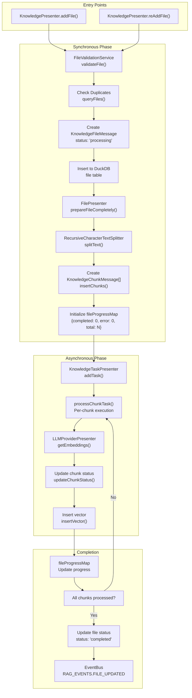

**Sources:** [src/main/presenter/knowledgePresenter/knowledgeStorePresenter.ts:60-320](), [src/main/presenter/knowledgePresenter/index.ts:279-288]()

---

## File Validation

Before processing begins, files are validated by `FileValidationService` to ensure they are suitable for knowledge base ingestion. The validation system excludes certain file types that are not processable for text-based RAG.

### Validation Logic

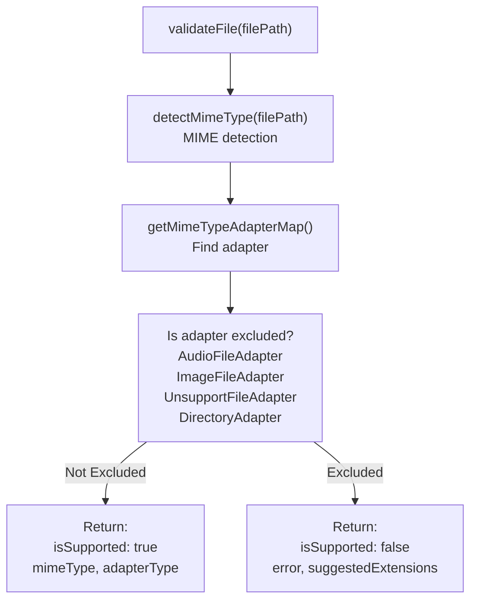

### Excluded Adapters

The following adapters are excluded from knowledge base processing:

| Adapter | Reason |
|---------|--------|
| `AudioFileAdapter` | Cannot extract text content from audio files |
| `ImageFileAdapter` | Images require vision models, not text-based RAG |
| `UnsupportFileAdapter` | Unsupported file format |
| `DirectoryAdapter` | Directories are not files |

### Supported File Types

The validation service returns supported extensions by examining the MIME type adapter map and filtering out excluded adapters. Common supported types include:

- **Text**: txt, md, markdown
- **Documents**: pdf, docx, pptx, xlsx
- **Data**: csv, json, yaml, yml, xml
- **Code**: js, ts, py, java, cpp, c, h, css, html

**Sources:** [src/main/presenter/filePresenter/FileValidationService.ts:20-227](), [src/main/presenter/knowledgePresenter/index.ts:392-460]()

---

## Synchronous Processing Phase

The synchronous phase executes immediately when a file is added and prepares all metadata and chunks before returning control to the caller.

### Step 1: File Metadata Creation

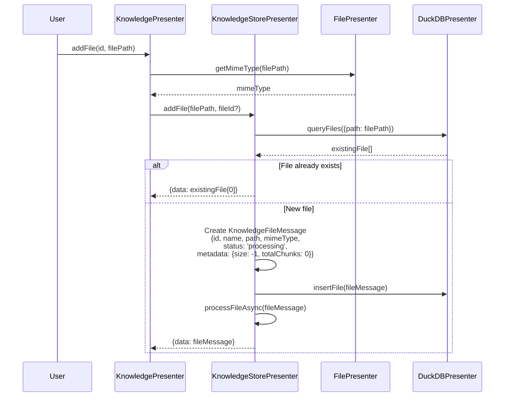

**Data Structure: KnowledgeFileMessage**

```typescript
{
  id: string              // Unique file identifier (nanoid)
  name: string            // File basename
  path: string            // Absolute file path
  mimeType: string        // Detected MIME type
  status: 'processing' | 'completed' | 'error' | 'paused'
  uploadedAt: number      // Timestamp
  metadata: {
    size: number          // File size in bytes
    totalChunks: number   // Number of text chunks
    errorReason?: string  // Error message if status is 'error'
  }
}
```

**Sources:** [src/main/presenter/knowledgePresenter/knowledgeStorePresenter.ts:60-103]()

### Step 2: Content Extraction

Content extraction delegates to `FilePresenter.prepareFileCompletely()` with `contentType: 'origin'` to retrieve raw text content without LLM-specific formatting.

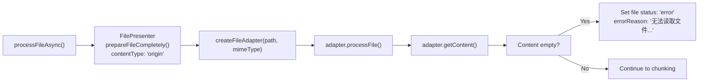

If content extraction fails or returns empty content, the file status is immediately set to `error` with an appropriate error message, and processing halts.

**Sources:** [src/main/presenter/knowledgePresenter/knowledgeStorePresenter.ts:108-129](), [src/main/presenter/filePresenter/FilePresenter.ts:121-174]()

### Step 3: Text Chunking

Text is split into overlapping chunks using `RecursiveCharacterTextSplitter` from `@/lib/textsplitters`. Chunking parameters are configured per-knowledge-base.

**Chunking Configuration:**

| Parameter | Description | Source |
|-----------|-------------|--------|
| `chunkSize` | Maximum characters per chunk | `config.chunkSize` |
| `chunkOverlap` | Overlapping characters between chunks | `config.chunkOverlap` |
| `separators` | Split priority: paragraph → sentence → word → character | `config.separators` |

**Text Preprocessing:**

Before chunking, text is sanitized using `sanitizeText()` utility to:
- Normalize whitespace
- Remove control characters
- Ensure consistent line endings

**Sources:** [src/main/presenter/knowledgePresenter/knowledgeStorePresenter.ts:133-143]()

### Step 4: Chunk Record Creation

After splitting, chunk records are created and inserted into the database. Each chunk is assigned a sequential index and an ID combining the file ID and chunk index.

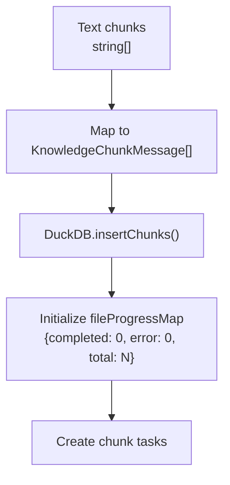

**Data Structure: KnowledgeChunkMessage**

```typescript
{
  id: string              // `${fileId}_${chunkIndex}`
  fileId: string          // Parent file ID
  chunkIndex: number      // Sequential chunk number (0-based)
  content: string         // Text content of chunk
  status: 'processing' | 'completed' | 'error' | 'paused'
  error?: string          // Error message if status is 'error'
}
```

**Sources:** [src/main/presenter/knowledgePresenter/knowledgeStorePresenter.ts:148-165]()

---

## Asynchronous Processing Phase

After synchronous setup completes, individual chunks are processed asynchronously via the task queue system. Each chunk is an independent task that can be retried, paused, or cancelled.

### Task Creation and Scheduling

```mermaid
graph TB
    subgraph "Task Structure"
        TaskDef["KnowledgeChunkTask {<br/>id: 'chunk_' + chunkId<br/>payload: {<br/>  knowledgeBaseId<br/>  fileId<br/>  chunkId<br/>  taskType: 'chunk_processing'<br/>  metadata: {content, chunkIndex}<br/>}<br/>run: processChunkTask<br/>onSuccess: handleChunkCompletion<br/>onError: handleChunkError<br/>onTerminate: cleanup<br/>}"]
    end
    
    subgraph "Task Queue"
        Queue["KnowledgeTaskPresenter<br/>queue: KnowledgeChunkTask[]<br/>maxConcurrency: 16"]
        AddTask["addTask(chunkTask)"]
        ProcessQueue["processQueue()"]
    end
    
    subgraph "Execution"
        RunTask["task.run({signal})"]
        Callbacks["onSuccess / onError / onTerminate"]
    end
    
    TaskDef --> AddTask
    AddTask --> Queue
    Queue --> ProcessQueue
    ProcessQueue --> RunTask
    RunTask --> Callbacks
```

The task queue maintains two data structures:
- `queue: KnowledgeChunkTask[]` - pending tasks
- `runningTasks: Map<string, KnowledgeChunkTask>` - currently executing tasks

Tasks are executed with `AbortController` signals to support cancellation.

**Sources:** [src/main/presenter/knowledgePresenter/knowledgeStorePresenter.ts:163-185](), [src/main/presenter/knowledgePresenter/knowledgeTaskPresenter.ts:22-27]()

### Chunk Task Execution

The core processing function `processChunkTask()` generates embeddings and inserts vectors:

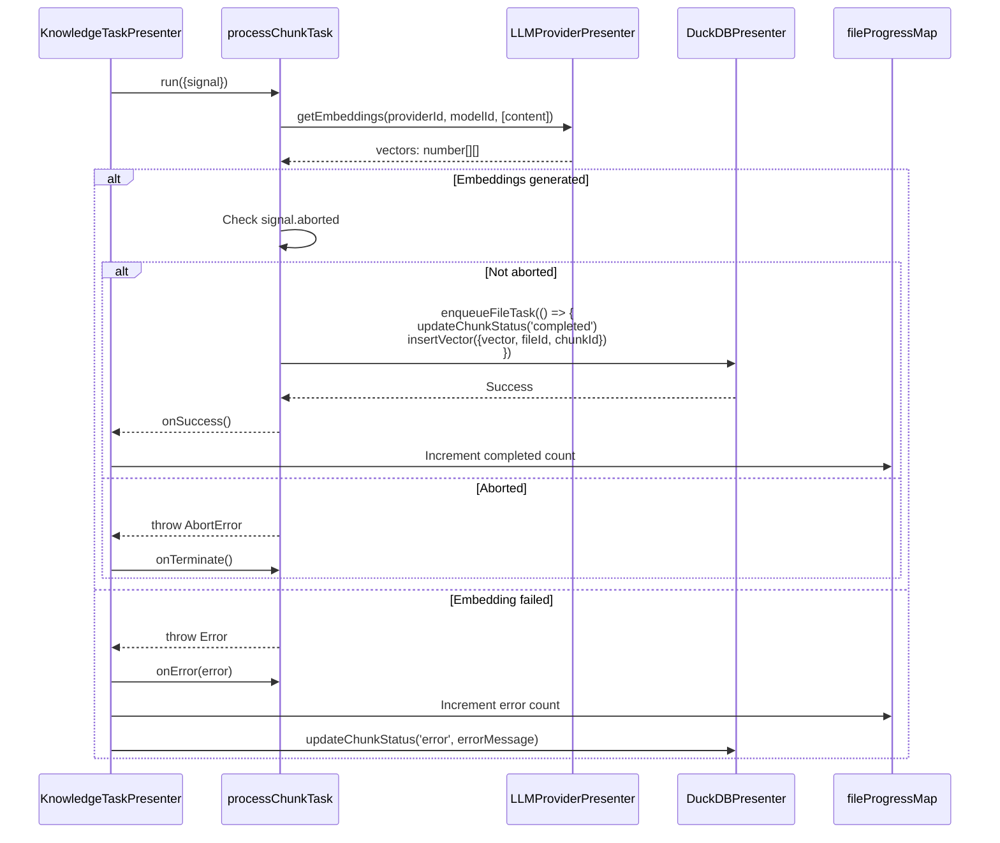

**Thread Safety:**

All database operations are wrapped in `enqueueFileTask(fileId, operation)` which maintains a per-file queue to ensure serialized access to DuckDB for the same file. This prevents race conditions when multiple chunks from the same file are processed concurrently.

**Sources:** [src/main/presenter/knowledgePresenter/knowledgeStorePresenter.ts:192-229]()

### Progress Tracking

Progress is tracked at two levels:

1. **File-Level Progress:** `fileProgressMap` tracks overall file processing status
2. **UI Events:** Real-time updates sent via EventBus

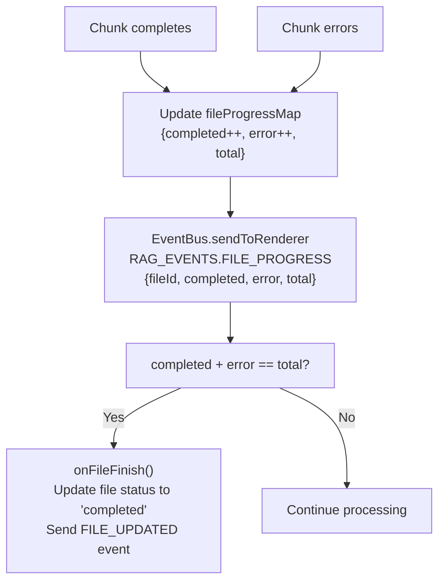

**Progress Data Structure:**

```typescript
{
  fileId: string
  completed: number   // Successfully embedded chunks
  error: number       // Failed chunks
  total: number       // Total chunks
}
```

When all chunks are processed (success or error), the file status is updated to `completed`, and a final `FILE_UPDATED` event is sent.

**Sources:** [src/main/presenter/knowledgePresenter/knowledgeStorePresenter.ts:232-302]()

---

## Error Handling

The pipeline implements multi-level error handling to isolate failures and provide actionable feedback.

### Error Isolation Strategy

| Level | Scope | Behavior |
|-------|-------|----------|
| **File Level** | Content extraction failure | Mark file as `error`, halt all processing |
| **Chunk Level** | Individual chunk embedding failure | Mark chunk as `error`, continue processing other chunks |
| **Task Level** | Task cancellation/abortion | Call `onTerminate`, clean up resources |

### Error States

**File Error State:**

```typescript
{
  status: 'error',
  metadata: {
    errorReason: string  // Human-readable error message
  }
}
```

**Chunk Error State:**

```typescript
{
  status: 'error',
  error: string  // Error message from embedding generation
}
```

### Error Recovery

Files in `error` state can be retried using `reAddFile()`:

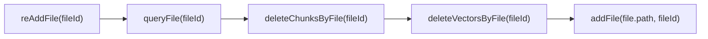

This clears all existing chunks and vectors, then re-processes the file from scratch while preserving the original file ID and database record.

**Sources:** [src/main/presenter/knowledgePresenter/knowledgeStorePresenter.ts:361-369](), [src/main/presenter/knowledgePresenter/knowledgeStorePresenter.ts:256-286]()

---

## Concurrency and Thread Safety

### File Queue Mechanism

The `enqueueFileTask()` method ensures thread-safe database operations for a single file:

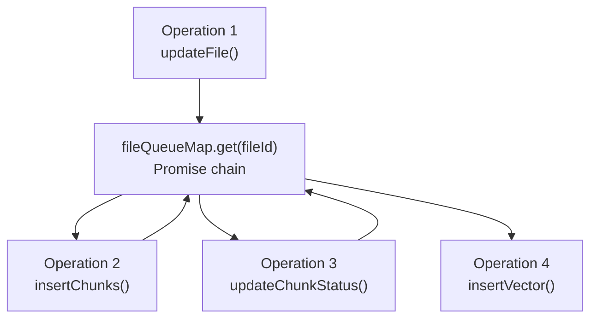

**Implementation:**

```typescript
private fileQueueMap = new Map<string, Promise<void>>()

private async enqueueFileTask(fileId: string, task: () => Promise<void>): Promise<void> {
  const last = this.fileQueueMap.get(fileId) ?? Promise.resolve()
  const next = last.then(task).catch((err) => {
    console.error(`[RAG] Error in queued task for file ${fileId}:`, err)
  })
  this.fileQueueMap.set(fileId, next)
  await next
}
```

This creates a sequential promise chain per file, ensuring operations execute in order even when multiple chunks are processed concurrently.

**Sources:** [src/main/presenter/knowledgePresenter/knowledgeStorePresenter.ts:28-37]()

### Task Queue Concurrency

The `KnowledgeTaskPresenter` enforces a maximum concurrency limit:

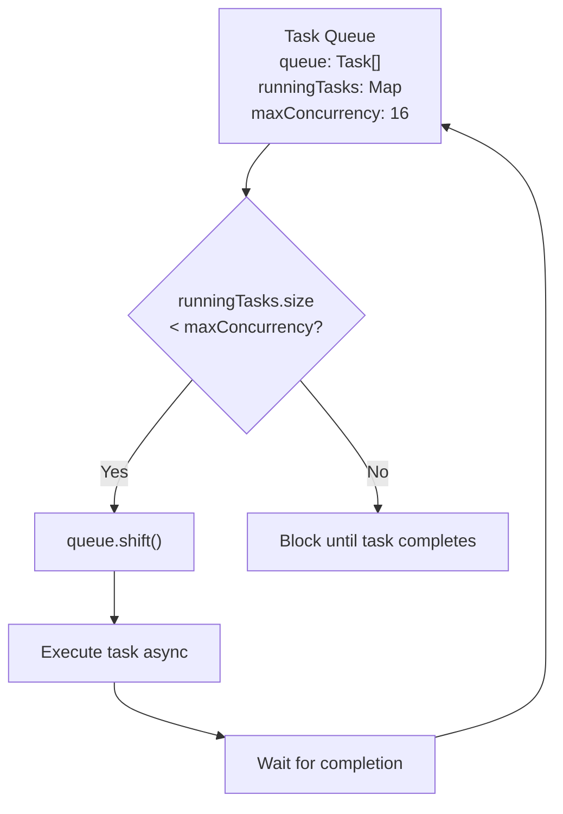

This prevents resource exhaustion while maintaining high throughput. The default concurrency of 16 balances between parallel processing efficiency and system resource constraints.

**Sources:** [src/main/presenter/knowledgePresenter/knowledgeTaskPresenter.ts:141-170]()

---

## Task Lifecycle Management

### Task Cancellation

Tasks can be cancelled at different granularities:

| Method | Scope | Use Case |
|--------|-------|----------|
| `cancelTasksByKnowledgeBase(id)` | All tasks for a KB | KB disabled or deleted |
| `cancelTasksByFile(fileId)` | All tasks for a file | File deleted by user |
| `removeTasks(filter)` | Custom filter | Fine-grained control |

When cancelled, tasks receive an `AbortError` and execute their `onTerminate` callback.

**Sources:** [src/main/presenter/knowledgePresenter/knowledgeTaskPresenter.ts:29-57]()

### Task Pause and Resume

Tasks in `processing` state can be paused (e.g., on application quit):

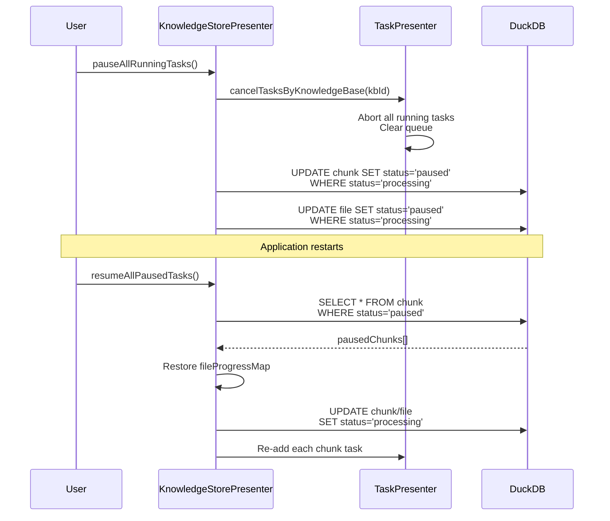

This allows the pipeline to gracefully handle application shutdown and resume processing on restart without losing progress.

**Sources:** [src/main/presenter/knowledgePresenter/knowledgeStorePresenter.ts:391-436](), [src/main/presenter/knowledgePresenter/database/duckdbPresenter.ts:622-650]()

---

## Integration with Vector Database

### Vector Insertion

After successful embedding generation, vectors are inserted into DuckDB:

```typescript
await this.vectorP.insertVector({
  vector: vectors[0],      // float[] of length dimensions
  fileId: chunkMsg.fileId,
  chunkId: chunkMsg.id
})
```

**Vector Table Schema:**

```sql
CREATE TABLE vector (
  id VARCHAR PRIMARY KEY,           -- nanoid
  embedding FLOAT[dimensions],      -- Fixed-dimension array
  file_id VARCHAR,                  -- Foreign key to file table
  chunk_id VARCHAR                  -- Foreign key to chunk table
)
```

Vectors are indexed using HNSW (Hierarchical Navigable Small World) for efficient similarity search.

**Sources:** [src/main/presenter/knowledgePresenter/knowledgeStorePresenter.ts:214-220](), [src/main/presenter/knowledgePresenter/database/duckdbPresenter.ts:364-378]()

### Transaction Management

DuckDB operations use a transaction queue to ensure ACID properties:

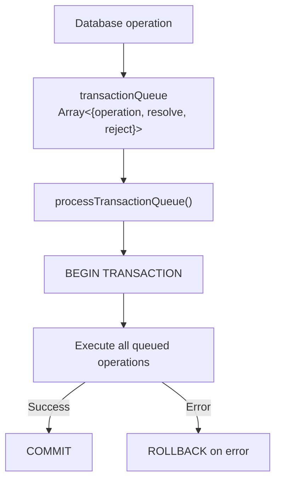

All operations within a transaction batch succeed or fail together. If any operation fails, the entire transaction is rolled back, and all operations in the batch are rejected.

**Sources:** [src/main/presenter/knowledgePresenter/database/duckdbPresenter.ts:468-606]()

---

## Configuration Parameters

The pipeline behavior is controlled by per-knowledge-base configuration:

### Configuration Schema

```typescript
interface BuiltinKnowledgeConfig {
  id: string                    // Knowledge base ID
  enabled: boolean              // Enable/disable processing
  
  // Chunking parameters
  chunkSize: number             // Default: 1000 characters
  chunkOverlap: number          // Default: 200 characters
  separators: string[]          // Default: ['\n\n', '\n', ' ', '']
  
  // Embedding configuration
  embedding: {
    providerId: string          // LLM provider ID
    modelId: string             // Embedding model ID
  }
  
  // Vector database configuration
  dimensions: number            // Embedding dimensions (e.g., 1536 for OpenAI)
  normalized: boolean           // Whether embeddings are normalized
  fragmentsNumber: number       // Top-K results for queries (default: 5)
}
```

### Language-Specific Separators

The `RecursiveCharacterTextSplitter` supports language-specific separators via `getSeparatorsForLanguage()`. This optimizes chunking for different programming languages and natural languages.

**Supported Languages:**

The system supports language-specific splitting for code files (Python, JavaScript, Java, etc.) and natural languages. See `SupportedTextSplitterLanguages` for the complete list.

**Sources:** [src/main/presenter/knowledgePresenter/index.ts:371-385]()

---

## Summary

The file processing pipeline transforms raw files into searchable vector embeddings through a multi-stage process:

1. **Validation** ensures files are suitable for text-based RAG
2. **Synchronous processing** extracts content, chunks text, and creates database records
3. **Asynchronous processing** generates embeddings and inserts vectors with controlled concurrency
4. **Progress tracking** provides real-time feedback via EventBus
5. **Error handling** isolates failures at chunk-level while maintaining pipeline integrity
6. **Thread safety** is ensured through file-level queuing and transaction management

The pipeline is designed for reliability, observability, and graceful degradation, making it suitable for production knowledge base management.

**Sources:** [src/main/presenter/knowledgePresenter/knowledgeStorePresenter.ts:1-463](), [src/main/presenter/knowledgePresenter/index.ts:1-462](), [src/main/presenter/knowledgePresenter/knowledgeTaskPresenter.ts:1-172]()
4b:T71c4,
