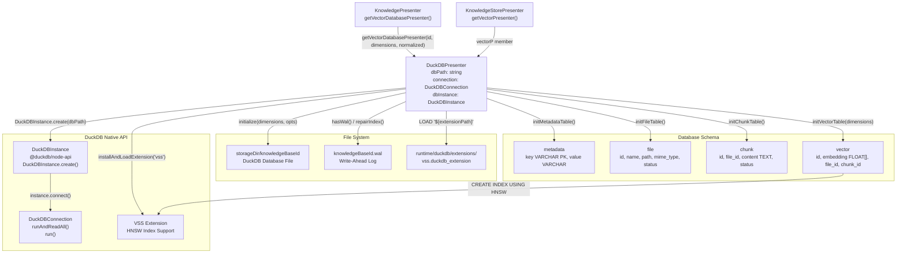
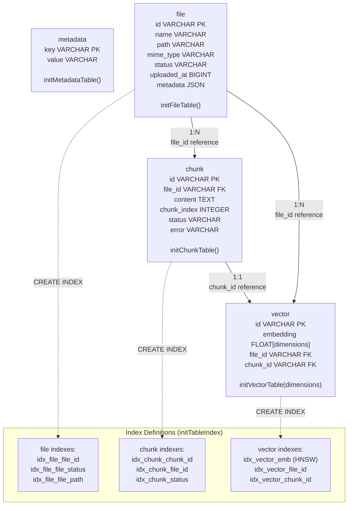
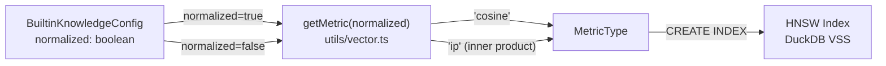
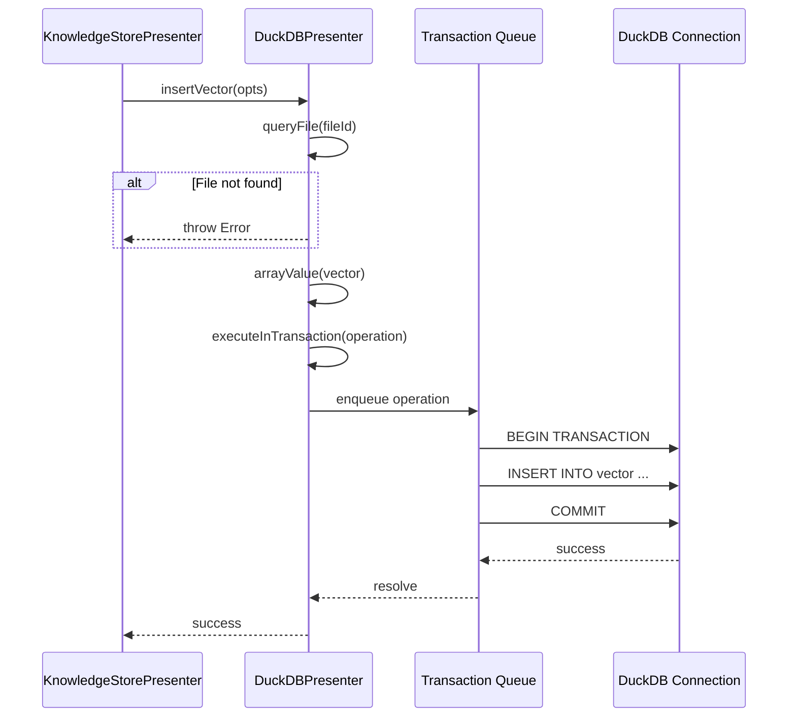
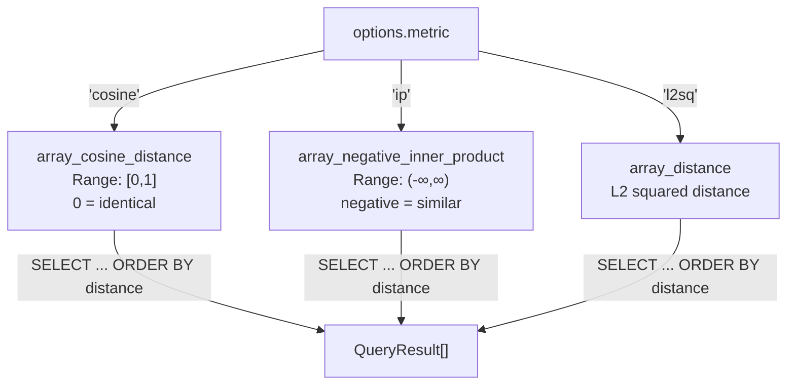
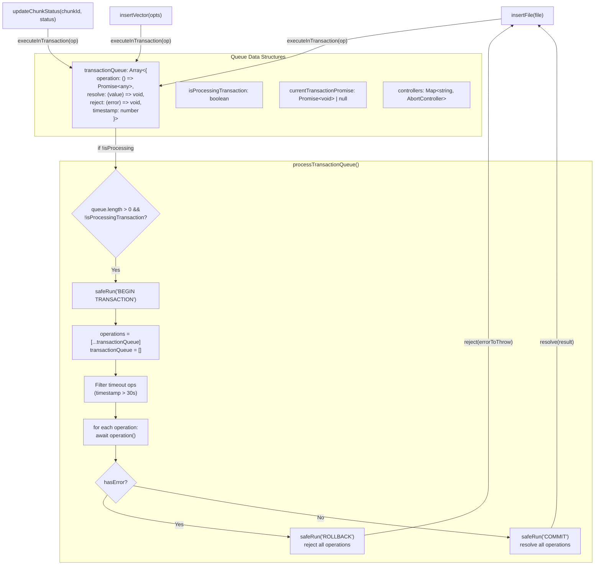
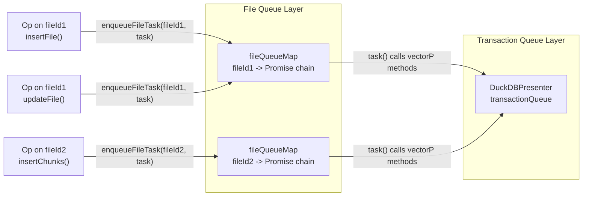
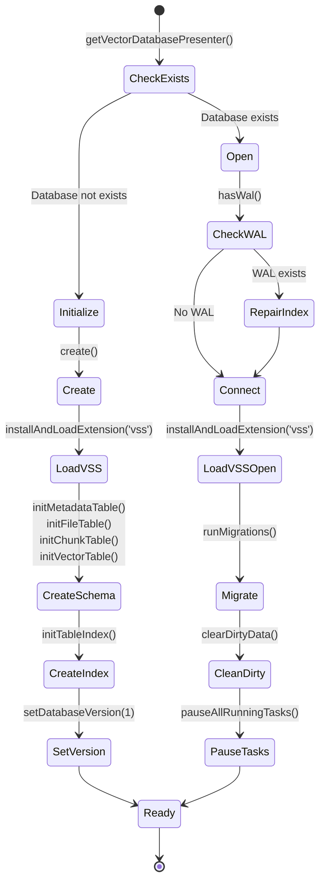
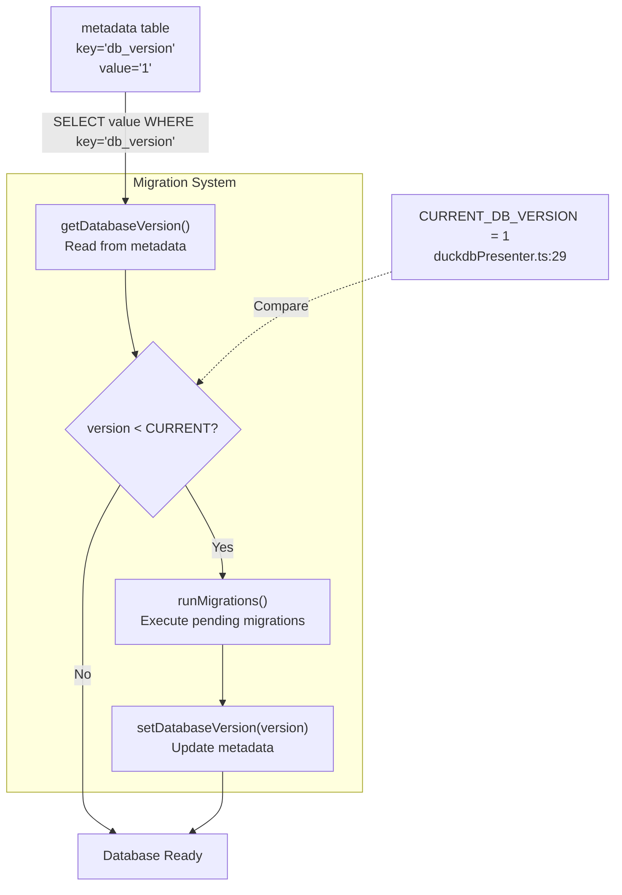

> 来源: [https://deepwiki.com/thinkinaixyz/deepchat/8.3-vector-database-and-duckdb](https://deepwiki.com/thinkinaixyz/deepchat/8.3-vector-database-and-duckdb)（Wayback 快照 2026-04-11 RSC payload 提取）
> DeepWiki thinkinaixyz/deepchat · 世代: 2026-04

# Vector Database & DuckDB

<details>
<summary>Relevant source files</summary>

The following files were used as context for generating this wiki page:

- [src/main/presenter/knowledgePresenter/database/duckdbPresenter.ts](src/main/presenter/knowledgePresenter/database/duckdbPresenter.ts)
- [src/main/presenter/knowledgePresenter/index.ts](src/main/presenter/knowledgePresenter/index.ts)
- [src/main/presenter/knowledgePresenter/knowledgeStorePresenter.ts](src/main/presenter/knowledgePresenter/knowledgeStorePresenter.ts)
- [src/main/presenter/knowledgePresenter/knowledgeTaskPresenter.ts](src/main/presenter/knowledgePresenter/knowledgeTaskPresenter.ts)
- [src/main/utils/vector.ts](src/main/utils/vector.ts)
- [src/shared/dialog.ts](src/shared/dialog.ts)

</details>


## Purpose and Scope

This document describes DeepChat's vector database implementation using DuckDB with the VSS (Vector Similarity Search) extension for storage and retrieval of embeddings in the built-in knowledge base system. It covers the `DuckDBPresenter` class, database schema design, HNSW indexing, transaction management, and vector similarity operations.

For the broader knowledge base architecture including file processing and task scheduling, see [Knowledge Base Architecture](#10.1). For embedding generation and query processing, see [Similarity Search & Query](#10.5). For database migration and recovery procedures, see [Database Migration & Recovery](#10.6).

---

## Architecture Overview

DeepDB uses **DuckDB** as an embedded analytical database with the **VSS extension** for vector similarity search. Each knowledge base instance gets its own isolated DuckDB database file, managed by a dedicated `DuckDBPresenter`.

### DuckDB Integration Components



**Sources:** [src/main/presenter/knowledgePresenter/index.ts:260-277](), [src/main/presenter/knowledgePresenter/database/duckdbPresenter.ts:66-79](), [src/main/presenter/knowledgePresenter/database/duckdbPresenter.ts:654-664](), [src/main/presenter/knowledgePresenter/database/duckdbPresenter.ts:699-715]()

---

## Database Schema

The DuckDB schema consists of four primary tables that form a hierarchical structure: files → chunks → vectors.

### Table Definitions

| Table Name | Primary Key | Purpose | Key Columns |
|------------|-------------|---------|-------------|
| `metadata` | `key` | Store database version and configuration | `key VARCHAR`, `value VARCHAR` |
| `file` | `id` | File metadata and processing status | `id`, `name`, `path`, `mime_type`, `status`, `uploaded_at`, `metadata JSON` |
| `chunk` | `id` | Text chunks split from files | `id`, `file_id`, `content TEXT`, `chunk_index`, `status`, `error` |
| `vector` | `id` | Embedding vectors with HNSW index | `id`, `embedding FLOAT[N]`, `file_id`, `chunk_id` |

### Schema Relationships and SQL DDL



**Table Creation Order (from initialize()):**
1. `initMetadataTable()` - line 94, defined at lines 832-838
2. `initFileTable()` - line 96, defined at lines 717-729
3. `initChunkTable()` - line 98, defined at lines 732-743
4. `initVectorTable(dimensions)` - line 100, defined at lines 747-755
5. `initTableIndex(opts)` - line 102, defined at lines 759-799

**Sources:** [src/main/presenter/knowledgePresenter/database/duckdbPresenter.ts:81-110](), [src/main/presenter/knowledgePresenter/database/duckdbPresenter.ts:717-755](), [src/main/presenter/knowledgePresenter/database/duckdbPresenter.ts:759-799](), [src/main/presenter/knowledgePresenter/database/duckdbPresenter.ts:832-838]()

### Table Initialization

The database schema is initialized in a specific order during the `initialize()` method:

1. **Metadata Table**: Created first to track schema version ([duckdbPresenter.ts:94]())
2. **File Table**: Stores file metadata with JSON column for flexible attributes ([duckdbPresenter.ts:96]())
3. **Chunk Table**: Stores text segments with processing status ([duckdbPresenter.ts:98]())
4. **Vector Table**: Stores fixed-dimension embeddings ([duckdbPresenter.ts:100]())
5. **HNSW Index**: Created on the embedding column ([duckdbPresenter.ts:102]())

**Sources:** [src/main/presenter/knowledgePresenter/database/duckdbPresenter.ts:81-110]()

---

## HNSW Vector Indexing

The VSS extension provides **Hierarchical Navigable Small World (HNSW)** indexing for efficient approximate nearest neighbor search.

### Index Configuration

```typescript
// Index creation SQL template from initTableIndex()
CREATE INDEX IF NOT EXISTS idx_vector_emb
ON vector
USING HNSW (embedding)
WITH (
  metric='cosine',      // or 'ip' (inner product) or 'l2sq'
  M=16,                 // Max connections per layer
  ef_construction=200   // Construction-time search width
);
```

### Index Parameters

| Parameter | Default | Purpose | Configured In |
|-----------|---------|---------|---------------|
| `metric` | `'cosine'` | Distance metric for similarity | [duckdbPresenter.ts:781]() |
| `M` | `16` | Maximum edges per node per layer | [duckdbPresenter.ts:782]() |
| `ef_construction` | `200` | Build-time search width | [duckdbPresenter.ts:783]() |

The metric is determined by the `normalized` configuration flag via `getMetric()`:



**Sources:** [src/main/utils/vector.ts:95-102](), [src/main/presenter/knowledgePresenter/database/duckdbPresenter.ts:759-799]()

### VSS Extension Loading

The VSS extension is loaded during database initialization and opening:

1. **Check for bundled extension**: Look in `runtime/duckdb/extensions/vss.duckdb_extension` ([duckdbPresenter.ts:705]())
2. **Load from file if exists**: Use `LOAD '...'` command with escaped path ([duckdbPresenter.ts:708]())
3. **Install online if missing**: Use `INSTALL vss; LOAD vss;` ([duckdbPresenter.ts:711-712]())
4. **Enable experimental persistence**: `SET hnsw_enable_experimental_persistence = true;` ([duckdbPresenter.ts:92]())

**Sources:** [src/main/presenter/knowledgePresenter/database/duckdbPresenter.ts:699-715]()

---

## Vector Operations

### Insertion Operations

Vector insertion follows a strict validation and transaction pattern:



**Single Vector Insertion:**
```typescript
// From duckdbPresenter.ts:364-378
await insertVector({
  vector: Float32Array,  // Embedding vector
  fileId: string,        // Must exist in file table
  chunkId: string        // Corresponding chunk ID
})
```

**Batch Vector Insertion:**
```typescript
// From duckdbPresenter.ts:380-395
await insertVectors([
  { vector, fileId, chunkId },
  { vector, fileId, chunkId },
  // ... bulk insert in single transaction
])
```

**Sources:** [src/main/presenter/knowledgePresenter/database/duckdbPresenter.ts:364-395]()

### Similarity Query

The `similarityQuery()` method performs vector similarity search using the HNSW index:

```typescript
// Query structure from duckdbPresenter.ts:397-435
await similarityQuery(queryVector: number[], options: {
  topK: number,           // Number of results
  metric: 'cosine' | 'ip', // Distance function
  threshold?: number      // Optional distance threshold
}): Promise<QueryResult[]>
```

#### Query SQL Template

```sql
-- Generated SQL from duckdbPresenter.ts:405-411
SELECT 
  t.id as id, 
  array_cosine_distance(embedding, ?) AS distance,  -- or array_negative_inner_product
  t1.content as content, 
  t2.name as name, 
  t2.path as path
FROM vector t
LEFT JOIN chunk t1 ON t1.id = t.chunk_id
LEFT JOIN file t2 ON t2.id = t.file_id
ORDER BY distance
LIMIT ?;
```

#### Distance Function Selection



**Sources:** [src/main/presenter/knowledgePresenter/database/duckdbPresenter.ts:397-435]()

### Distance Normalization

Raw distances from DuckDB are normalized to [0,1] confidence scores using `normalizeDistance()`:

```typescript
// From utils/vector.ts:71-93
function normalizeDistance(distance: number, metric: MetricType): number {
  if (metric === 'cosine') {
    // cosine distance ∈ [0,1], 0 = most similar
    // confidence = 1 - distance
    return 1 - Math.min(Math.max(distance, 0), 1)
  } else if (metric === 'ip') {
    // inner product distance = -inner_product
    // Use sigmoid mapping: 1 / (1 + exp(sign(d) * d^2 * k))
    const k = 0.04  // Scaling factor
    return 1 / (1 + Math.exp(Math.sign(distance) * Math.pow(distance, 2) * k))
  }
}
```

**Sources:** [src/main/utils/vector.ts:66-93](), [src/main/presenter/knowledgePresenter/knowledgeStorePresenter.ts:340-360]()

---

## Transaction Management

DuckDB operations use a **transaction queue** to ensure serial execution and ACID guarantees. All write operations are wrapped in transactions to maintain consistency.

### Transaction Queue Architecture



**Sources:** [src/main/presenter/knowledgePresenter/database/duckdbPresenter.ts:468-606]()

### Transaction Queue Implementation

### ACID Properties via Transaction Queue

The transaction queue mechanism provides ACID guarantees through the following design:

| ACID Property | Implementation Mechanism | Code Location |
|---------------|-------------------------|---------------|
| **Atomicity** | All queued operations execute in single transaction; rollback on any error | [duckdbPresenter.ts:513-577]() |
| **Consistency** | Schema constraints enforced; foreign key validation before insert | [duckdbPresenter.ts:365-369]() |
| **Isolation** | Serial execution via `isProcessingTransaction` flag; no concurrent transactions | [duckdbPresenter.ts:502-507]() |
| **Durability** | DuckDB WAL ensures committed data survives crashes | [duckdbPresenter.ts:819-825]() |

**Key Transaction Queue Properties:**

1. **Serial Execution**: `isProcessingTransaction` boolean prevents concurrent transaction processing ([duckdbPresenter.ts:476](), [duckdbPresenter.ts:502-507]())
2. **Batch Processing**: All queued operations drain into single transaction for efficiency ([duckdbPresenter.ts:516-538]())
3. **Timeout Detection**: Operations older than 30 seconds rejected before execution ([duckdbPresenter.ts:478](), [duckdbPresenter.ts:521-529]())
4. **All-or-Nothing Guarantee**: Single failure causes complete rollback with all operations rejected ([duckdbPresenter.ts:557-577]())
5. **Graceful Shutdown**: `close()` waits for current transaction, cancels queued operations ([duckdbPresenter.ts:149-166]())

### Transaction Method Details

```typescript
// Transaction wrapper - all write operations use this
private async executeInTransaction<T>(operation: () => Promise<T>): Promise<T> {
  return new Promise((resolve, reject) => {
    this.transactionQueue.push({
      operation,
      resolve,
      reject,
      timestamp: Date.now()
    })
    if (!this.isProcessingTransaction) {
      this.processTransactionQueue()
    }
  })
}
```

**Transaction-Protected Operations:**

| Method | SQL Operations | Validation | Line Reference |
|--------|---------------|------------|----------------|
| `insertFile()` | `INSERT INTO file` | None | [duckdbPresenter.ts:201-217]() |
| `updateFile()` | `UPDATE file SET ... WHERE id = ?` | None | [duckdbPresenter.ts:219-236]() |
| `deleteFile()` | 3 DELETEs (chunk, vector, file) | Cascade delete | [duckdbPresenter.ts:291-297]() |
| `insertChunks()` | Bulk `INSERT INTO chunk VALUES ...` | None | [duckdbPresenter.ts:299-317]() |
| `updateChunkStatus()` | `UPDATE chunk SET status = ?, error = ?` | None | [duckdbPresenter.ts:319-331]() |
| `insertVector()` | `INSERT INTO vector` | Validates file exists | [duckdbPresenter.ts:364-378]() |
| `insertVectors()` | Bulk `INSERT INTO vector VALUES ...` | None | [duckdbPresenter.ts:380-395]() |

**Sources:** [src/main/presenter/knowledgePresenter/database/duckdbPresenter.ts:483-497](), [src/main/presenter/knowledgePresenter/database/duckdbPresenter.ts:201-395]()

### File-Level Operation Queuing

`KnowledgeStorePresenter` adds a second layer of queuing on top of DuckDB's transaction queue to serialize operations per file:



**Purpose:** Prevent race conditions when multiple chunks of the same file are processed concurrently. File operations serialize per-file, but different files can process in parallel.

**Implementation:**
```typescript
// From knowledgeStorePresenter.ts:27-37
private fileQueueMap = new Map<string, Promise<void>>()

private async enqueueFileTask(fileId: string, task: () => Promise<void>) {
  const last = this.fileQueueMap.get(fileId) ?? Promise.resolve()
  const next = last.then(task).catch((err) => {
    console.error(`Error in queued task for file ${fileId}:`, err)
  })
  this.fileQueueMap.set(fileId, next)
  await next
}
```

**Usage Pattern:**
```typescript
// All vectorP operations wrapped in enqueueFileTask
await this.enqueueFileTask(fileMessage.id, async () => 
  this.vectorP.updateFile(fileMessage)
)

await this.enqueueFileTask(chunkMsg.fileId, async () => {
  await this.vectorP.updateChunkStatus(chunkMsg.id, 'completed')
  await this.vectorP.insertVector({ vector, fileId, chunkId })
})
```

**Sources:** [src/main/presenter/knowledgePresenter/knowledgeStorePresenter.ts:27-37](), [src/main/presenter/knowledgePresenter/knowledgeStorePresenter.ts:90-93](), [src/main/presenter/knowledgePresenter/knowledgeStorePresenter.ts:214-221]()

---

## Database Lifecycle Management

### Initialization vs. Opening

DuckDB databases follow a strict lifecycle with two distinct entry points:



**Sources:** [src/main/presenter/knowledgePresenter/database/duckdbPresenter.ts:81-145]()

### WAL Recovery Process

When a Write-Ahead Log (WAL) file exists, it indicates an unclean shutdown. The `repairIndex()` method performs recovery:

```typescript
// Recovery process from duckdbPresenter.ts:673-697
private async repairIndex(): Promise<void> {
  // 1. Create in-memory database
  const ins = await DuckDBInstance.create(':memory:')
  const conn = await ins.connect()
  
  // 2. Load VSS extension in memory
  await conn.run(`LOAD '${extensionPath}';`)
  await conn.run(`SET hnsw_enable_experimental_persistence = true;`)
  
  // 3. Attach the corrupt database
  await conn.run(`ATTACH DATABASE '${this.dbPath}' AS db;`)
  
  // 4. Close connections (triggers checkpoint)
  conn.closeSync()
  ins.closeSync()
}
```

**Why this approach?**
- Normal DuckDB checkpoint fails when VSS extension is not loaded
- Cannot load VSS directly on corrupt database
- Must load VSS in memory first, then attach corrupt database
- Attachment triggers automatic checkpoint with VSS support

**Sources:** [src/main/presenter/knowledgePresenter/database/duckdbPresenter.ts:118-126](), [src/main/presenter/knowledgePresenter/database/duckdbPresenter.ts:673-697](), [src/main/presenter/knowledgePresenter/database/duckdbPresenter.ts:819-825]()

### Dirty Data Cleanup

After opening a database, `clearDirtyData()` removes orphaned records from incomplete operations:

```sql
-- Remove vectors without corresponding files
DELETE FROM vector
WHERE file_id NOT IN (SELECT id FROM file);

-- Remove chunks without corresponding files  
DELETE FROM chunk
WHERE file_id NOT IN (SELECT id FROM file);
```

**Sources:** [src/main/presenter/knowledgePresenter/database/duckdbPresenter.ts:804-816]()

### Task Status Recovery

The `pauseAllRunningTasks()` method sets all processing items to 'paused' status during database open, allowing resumed processing after restart:

```sql
-- Pause chunks
UPDATE chunk SET status = 'paused' WHERE status = 'processing';

-- Pause files
UPDATE file SET status = 'paused' WHERE status = 'processing';
```

These paused tasks are later resumed via `KnowledgeStorePresenter.resumeAllPausedTasks()`.

**Sources:** [src/main/presenter/knowledgePresenter/database/duckdbPresenter.ts:622-650](), [src/main/presenter/knowledgePresenter/knowledgeStorePresenter.ts:396-436]()

---

## Database Versioning and Migration

The database uses a version tracking system to manage schema changes across application versions.

### Version Tracking



**Sources:** [src/main/presenter/knowledgePresenter/database/duckdbPresenter.ts:28-30](), [src/main/presenter/knowledgePresenter/database/duckdbPresenter.ts:843-898]()

### Migration Definition Structure

```typescript
// Migration interface from duckdbPresenter.ts:32-38
interface DatabaseMigration {
  version: number
  description: string
  up: (presenter: DuckDBPresenter) => Promise<void>
  down?: (presenter: DuckDBPresenter) => Promise<void>
}

// Example migration definition from duckdbPresenter.ts:41-49
const MIGRATIONS: DatabaseMigration[] = [
  {
    version: 1,
    description: 'Initial database schema',
    up: async (_presenter: DuckDBPresenter) => {
      console.log('[DuckDB Migration] Applied initial schema (v1)')
    }
  }
  // Future migrations will be added here
]
```

### Migration Execution

Migrations execute sequentially during `open()`:

1. **Read current version** from metadata table ([duckdbPresenter.ts:848]())
2. **Filter applicable migrations** (version > current && version ≤ target) ([duckdbPresenter.ts:865-867]())
3. **Sort by version** to ensure correct order ([duckdbPresenter.ts:877]())
4. **Execute each migration** in a transaction ([duckdbPresenter.ts:883-885]())
5. **Update version** after each successful migration ([duckdbPresenter.ts:886]())

If any migration fails, the process stops and throws an error, preventing database corruption.

**Sources:** [src/main/presenter/knowledgePresenter/database/duckdbPresenter.ts:843-898]()

---

## Database Closure and Cleanup

### Close Procedure

The `close()` method performs graceful shutdown:

```typescript
// From duckdbPresenter.ts:147-181
async close(): Promise<void> {
  // 1. Wait for current transaction to complete
  if (this.isProcessingTransaction && this.currentTransactionPromise) {
    await this.currentTransactionPromise
  }
  
  // 2. Cancel remaining operations
  if (this.transactionQueue.length > 0) {
    const remainingOperations = [...this.transactionQueue]
    this.transactionQueue = []
    for (const { reject } of remainingOperations) {
      reject(new Error('Database is closing'))
    }
  }
  
  // 3. Close connections
  if (this.connection) this.connection.closeSync()
  if (this.dbInstance) this.dbInstance.closeSync()
}
```

**Note**: DuckDB automatically performs CHECKPOINT on clean shutdown, so explicit checkpoint is not needed.

**Sources:** [src/main/presenter/knowledgePresenter/database/duckdbPresenter.ts:147-181]()

### Destroy Procedure

The `destroy()` method completely removes the database:

```typescript
// From duckdbPresenter.ts:183-197
async destroy(): Promise<void> {
  await this.close()
  
  // Delete database files
  if (fs.existsSync(this.dbPath)) {
    fs.rmSync(this.dbPath, { recursive: true })
  }
  if (fs.existsSync(this.dbPath + '.wal')) {
    fs.rmSync(this.dbPath + '.wal', { recursive: true })
  }
}
```

**Sources:** [src/main/presenter/knowledgePresenter/database/duckdbPresenter.ts:183-197]()

---

## Status Query Methods

DuckDB provides methods to query file and chunk processing status:

| Method | Return Type | Purpose |
|--------|-------------|---------|
| `queryFile(id)` | `KnowledgeFileMessage \| null` | Get single file by ID |
| `queryFiles(where)` | `KnowledgeFileMessage[]` | Query files with filters |
| `listFiles()` | `KnowledgeFileMessage[]` | Get all files ordered by upload time |
| `queryChunks(where)` | `KnowledgeChunkMessage[]` | Query chunks with filters |

**Filter Example:**
```typescript
// From duckdbPresenter.ts:252-277
await queryFiles({ 
  status: 'completed',  // Filter by status
  path: '/some/path'    // Filter by path
})
// Generates: SELECT * FROM file WHERE status = ? AND path = ?
```

**Sources:** [src/main/presenter/knowledgePresenter/database/duckdbPresenter.ts:238-289](), [src/main/presenter/knowledgePresenter/database/duckdbPresenter.ts:333-356]()

---

## Platform Support

DuckDB with VSS extension is supported on the following platforms:

```typescript
// From knowledgePresenter/index.ts:122-133
private static readonly SUPPORTED_OS = [
  'win32-x64',
  'linux-x64',
  'linux-arm64',
  'darwin-arm64',
  'darwin-x64'
]

isSupported = async (): Promise<boolean> => {
  const os = `${process.platform}-${process.arch}`
  return KnowledgePresenter.SUPPORTED_OS.includes(os)
}
```

**Sources:** [src/main/presenter/knowledgePresenter/index.ts:122-133]()
4c:T7a58,
