> 来源: [https://deepwiki.com/thinkinaixyz/deepchat/8.4-task-queue-and-concurrency](https://deepwiki.com/thinkinaixyz/deepchat/8.4-task-queue-and-concurrency)（Wayback 快照 2026-04-11 RSC payload 提取）
> DeepWiki thinkinaixyz/deepchat · 世代: 2026-04

# Task Scheduling & Concurrency

<details>
<summary>Relevant source files</summary>

The following files were used as context for generating this wiki page:

- [src/main/presenter/knowledgePresenter/database/duckdbPresenter.ts](src/main/presenter/knowledgePresenter/database/duckdbPresenter.ts)
- [src/main/presenter/knowledgePresenter/index.ts](src/main/presenter/knowledgePresenter/index.ts)
- [src/main/presenter/knowledgePresenter/knowledgeStorePresenter.ts](src/main/presenter/knowledgePresenter/knowledgeStorePresenter.ts)
- [src/main/presenter/knowledgePresenter/knowledgeTaskPresenter.ts](src/main/presenter/knowledgePresenter/knowledgeTaskPresenter.ts)
- [src/main/utils/vector.ts](src/main/utils/vector.ts)
- [src/shared/dialog.ts](src/shared/dialog.ts)

</details>


## Purpose & Scope

This document describes the task scheduling and concurrency control mechanisms in DeepChat's knowledge base system. It covers how the system manages concurrent embedding generation tasks, prevents database conflicts through transaction queuing, and maintains thread safety across file processing operations.

For information about the overall knowledge base architecture, see [Knowledge Base Architecture](#10.1). For details on file processing and chunking, see [File Processing Pipeline](#10.2). For vector database operations, see [Vector Database & DuckDB](#10.3).

**Sources:** [src/main/presenter/knowledgePresenter/knowledgeTaskPresenter.ts:1-172]()

---

## Architecture Overview

The task scheduling system operates at three distinct concurrency layers, each solving different synchronization challenges:

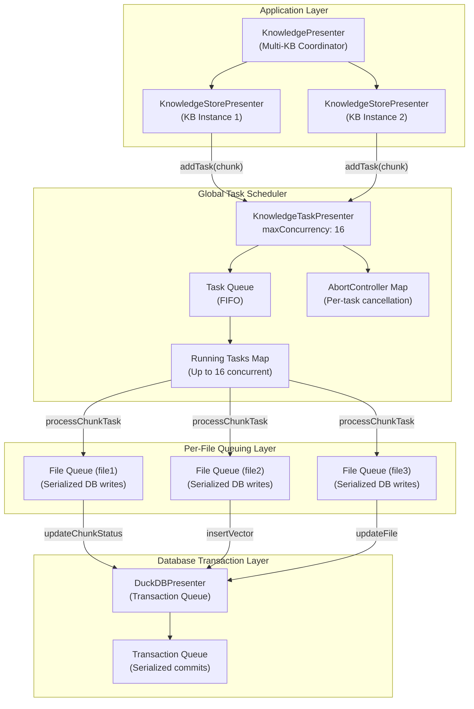

**Diagram: Three-Layer Concurrency Architecture**

The system uses three distinct queuing mechanisms:

1. **Global Task Scheduler** (`KnowledgeTaskPresenter`): Limits concurrent embedding generation to 16 tasks across all knowledge bases
2. **Per-File Queuing** (`fileQueueMap` in `KnowledgeStorePresenter`): Serializes database writes for each file to prevent race conditions
3. **Transaction Queue** (`transactionQueue` in `DuckDBPresenter`): Batches all database operations into atomic transactions

**Sources:** [src/main/presenter/knowledgePresenter/knowledgeTaskPresenter.ts:12-21](), [src/main/presenter/knowledgePresenter/knowledgeStorePresenter.ts:27-37](), [src/main/presenter/knowledgePresenter/database/duckdbPresenter.ts:469-497]()

---

## KnowledgeTaskPresenter: Global Task Scheduler

### Class Structure

`KnowledgeTaskPresenter` implements the `IKnowledgeTaskPresenter` interface and serves as the central task scheduler for all knowledge base operations. It maintains a simple FIFO queue with configurable concurrency limits.

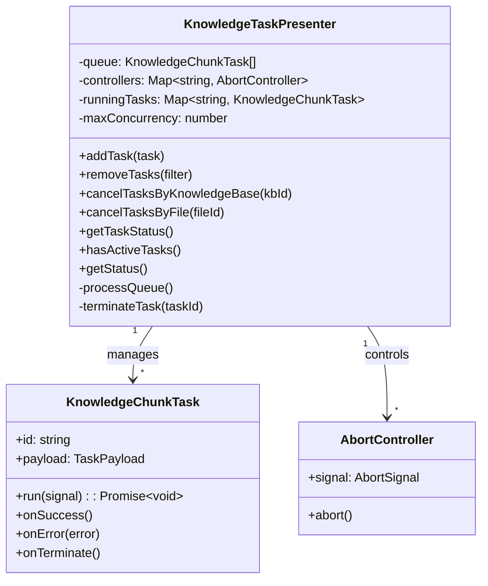

**Diagram: KnowledgeTaskPresenter Class Structure**

**Sources:** [src/main/presenter/knowledgePresenter/knowledgeTaskPresenter.ts:12-21]()

### Concurrency Control

The scheduler limits concurrent task execution to **16 tasks** by default, preventing system resource exhaustion from excessive parallel embedding generation requests:

| Configuration | Default Value | Purpose |
|---------------|---------------|---------|
| `maxConcurrency` | 16 | Maximum number of tasks executing simultaneously |
| Queue Strategy | FIFO | Tasks execute in order of submission |
| Abort Mechanism | Per-task `AbortController` | Each task can be individually cancelled |

The concurrency limit is enforced in the `processQueue()` method, which only pulls tasks from the queue when `runningTasks.size < maxConcurrency`:

**Sources:** [src/main/presenter/knowledgePresenter/knowledgeTaskPresenter.ts:18-20](), [src/main/presenter/knowledgePresenter/knowledgeTaskPresenter.ts:141-170]()

### Task Lifecycle

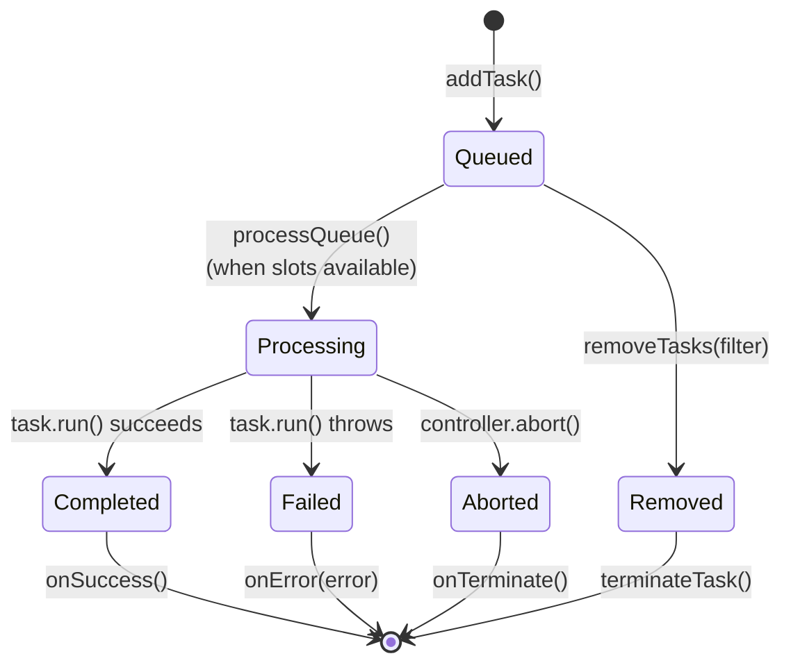

**Diagram: Task Lifecycle State Machine**

Tasks follow a strict lifecycle:

1. **Queued**: Task added via `addTask()`, receives an `AbortController`
2. **Processing**: Task dequeued when concurrency slot available, `run()` method executes
3. **Terminal States**:
   - **Completed**: `run()` succeeds, `onSuccess()` callback fires
   - **Failed**: `run()` throws non-abort error, `onError(error)` callback fires
   - **Aborted**: `AbortController.abort()` called, `onTerminate()` callback fires
   - **Removed**: Task filtered out via `removeTasks()`, `terminateTask()` cleanup

**Sources:** [src/main/presenter/knowledgePresenter/knowledgeTaskPresenter.ts:22-27](), [src/main/presenter/knowledgePresenter/knowledgeTaskPresenter.ts:141-170]()

### Task Processing Loop

The `processQueue()` method implements a self-perpetuating loop that processes tasks as slots become available:

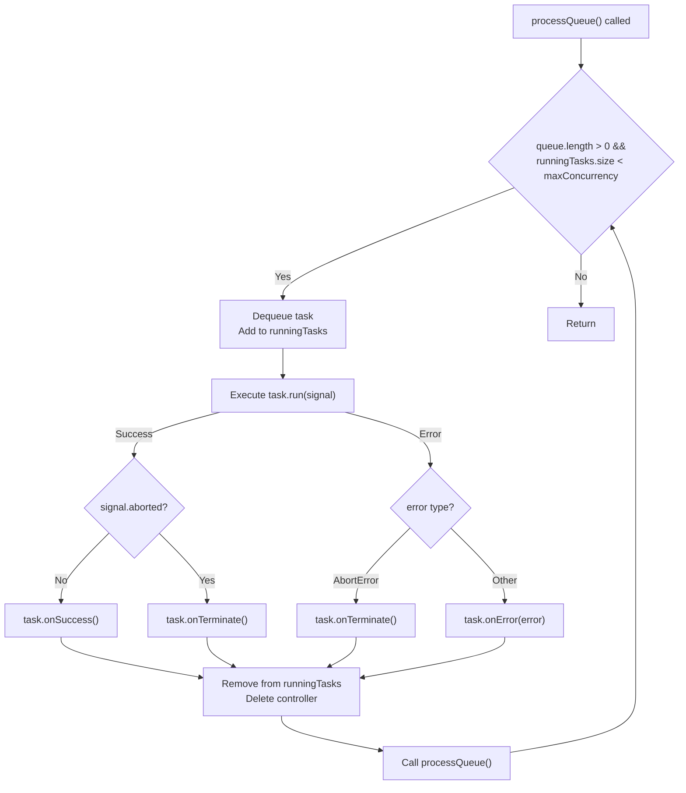

**Diagram: Task Processing Loop**

Key implementation details:
- Tasks execute in an immediately-invoked async function to avoid blocking the main loop
- Cleanup always occurs in `finally` block to prevent resource leaks
- Recursive call to `processQueue()` ensures continuous processing
- `AbortError` is distinguished from other errors to invoke correct callback

**Sources:** [src/main/presenter/knowledgePresenter/knowledgeTaskPresenter.ts:141-170]()

---

## Task Structure & Payloads

### KnowledgeChunkTask Interface

Each task submitted to the scheduler conforms to the `KnowledgeChunkTask` interface:

```typescript
interface KnowledgeChunkTask {
  id: string                              // Unique identifier (e.g., "chunk_file1_0")
  payload: {
    knowledgeBaseId: string              // KB instance identifier
    fileId: string                        // Parent file identifier
    chunkId: string                       // Specific chunk being processed
    taskType: 'chunk_processing'         // Task type discriminator
    metadata: {
      content: string                     // Chunk text content
      chunkIndex: number                  // Position in file
    }
  }
  run: (opts: { signal: AbortSignal }) => Promise<void>
  onSuccess?: () => void
  onError?: (error: Error) => void
  onTerminate?: () => void
}
```

**Example task creation** (from `KnowledgeStorePresenter`):

**Sources:** [src/main/presenter/knowledgePresenter/knowledgeStorePresenter.ts:165-185]()

### Task Execution: processChunkTask

The `run` function for chunk tasks performs the following sequence:

1. **Generate embeddings** via LLM provider
2. **Check abort signal** before database writes
3. **Enqueue file-level writes** to ensure serialization
4. **Update chunk status** to 'completed'
5. **Insert vector** into DuckDB

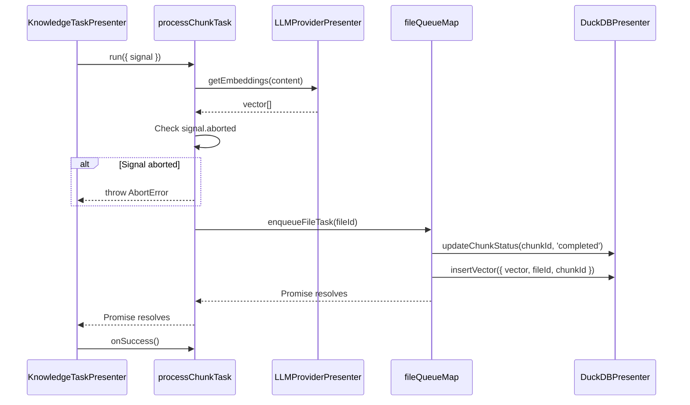

**Diagram: Chunk Task Execution Sequence**

**Sources:** [src/main/presenter/knowledgePresenter/knowledgeStorePresenter.ts:193-229]()

---

## Concurrency Patterns

### Per-File Task Queuing

`KnowledgeStorePresenter` maintains a `fileQueueMap` that serializes all database operations for a given file, preventing race conditions when multiple chunks from the same file update file metadata concurrently:

```typescript
private fileQueueMap = new Map<string, Promise<void>>()

private async enqueueFileTask(fileId: string, task: () => Promise<void>): Promise<void> {
  const last = this.fileQueueMap.get(fileId) ?? Promise.resolve()
  const next = last.then(task).catch((err) => {
    console.error(`[RAG] Error in queued task for file ${fileId}:`, err)
  })
  this.fileQueueMap.set(fileId, next)
  await next
}
```

**Why this is necessary:**
- Multiple chunks from the same file may complete simultaneously (up to 16)
- Each chunk completion updates file progress and potentially file status
- Without serialization, concurrent writes could corrupt file metadata

**Usage pattern:**
```typescript
// All database writes for a file are enqueued
await this.enqueueFileTask(fileId, async () => {
  await this.vectorP.updateChunkStatus(chunkId, 'completed')
  await this.vectorP.insertVector({ vector, fileId, chunkId })
})
```

**Sources:** [src/main/presenter/knowledgePresenter/knowledgeStorePresenter.ts:27-37](), [src/main/presenter/knowledgePresenter/knowledgeStorePresenter.ts:214-221]()

### Transaction Queuing in DuckDB

`DuckDBPresenter` implements a transaction queue that batches multiple operations into atomic transactions. This ensures ACID properties while allowing concurrent submission of database operations:

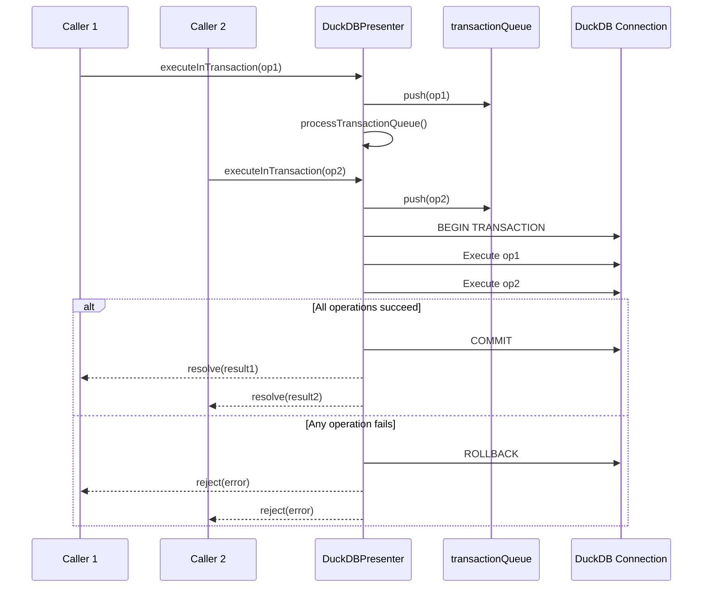

**Diagram: Transaction Queue Processing**

**Key implementation details:**

| Feature | Implementation | Purpose |
|---------|----------------|---------|
| Queue batching | All pending operations in one transaction | Reduces transaction overhead |
| Atomic execution | All succeed or all fail | Maintains data consistency |
| Timeout detection | 30-second timeout per operation | Prevents deadlocks |
| Recursive processing | `setImmediate()` for next batch | Avoids stack overflow |

**Sources:** [src/main/presenter/knowledgePresenter/database/duckdbPresenter.ts:469-606]()

### Concurrency Safety Analysis

The three-layer architecture provides complete thread safety:

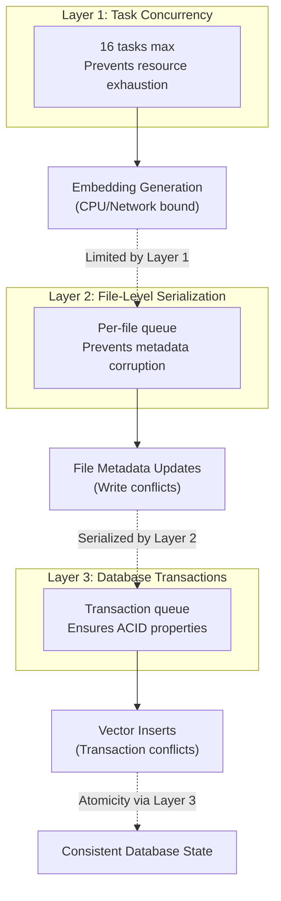

**Diagram: Layered Concurrency Safety**

**Sources:** [src/main/presenter/knowledgePresenter/knowledgeTaskPresenter.ts:16-20](), [src/main/presenter/knowledgePresenter/knowledgeStorePresenter.ts:27-37](), [src/main/presenter/knowledgePresenter/database/duckdbPresenter.ts:468-497]()

---

## Task Cancellation & Termination

### Cancellation Mechanisms

The system supports three levels of cancellation granularity:

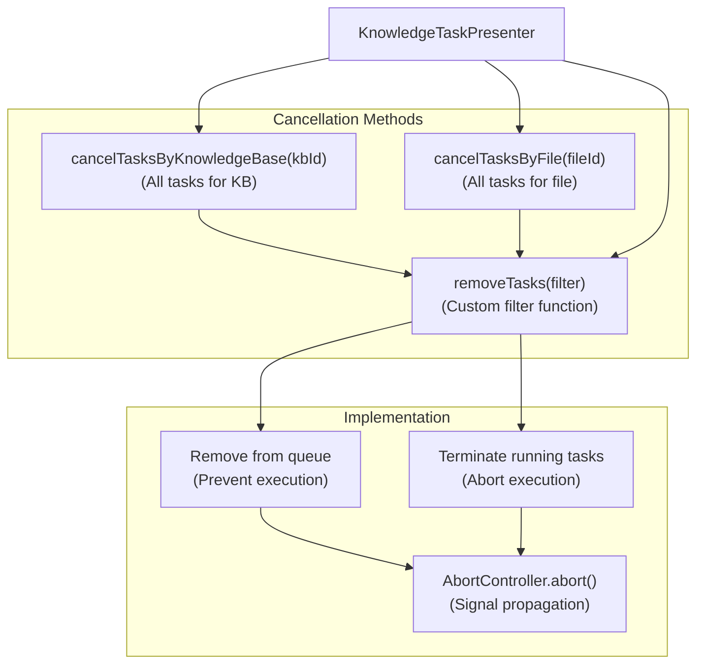

**Diagram: Task Cancellation Architecture**

### Cancellation Examples

**Cancel all tasks for a knowledge base:**
```typescript
// Called when KB is disabled or deleted
this.taskP.cancelTasksByKnowledgeBase(config.id)
```

**Cancel all tasks for a file:**
```typescript
// Called when file is deleted
this.taskP.cancelTasksByFile(fileId)
```

**Custom filter cancellation:**
```typescript
// Cancel all tasks matching custom criteria
this.taskP.removeTasks((task) => {
  return task.payload.knowledgeBaseId === kbId && 
         task.payload.metadata.chunkIndex > 100
})
```

**Sources:** [src/main/presenter/knowledgePresenter/knowledgeTaskPresenter.ts:29-57]()

### AbortController Integration

Each task receives an `AbortSignal` that it must check at cancellation points:

```typescript
async processChunkTask(chunkMsg: KnowledgeChunkMessage, signal: AbortSignal): Promise<void> {
  // 1. Generate embedding (blocking operation)
  const vectors = await presenter.llmproviderPresenter.getEmbeddings(...)
  
  // 2. Check abort signal before database writes
  if (signal.aborted) {
    throw new DOMException('Aborted', 'AbortError')
  }
  
  // 3. Proceed with database operations
  await this.vectorP.updateChunkStatus(chunkMsg.id, 'completed')
  await this.vectorP.insertVector({ vector: vectors[0], ... })
}
```

**Abort signal lifecycle:**
1. `addTask()` creates new `AbortController` and stores in `controllers` map
2. Task receives `controller.signal` as parameter to `run()`
3. `terminateTask()` or `removeTasks()` calls `controller.abort()`
4. Task checks `signal.aborted` at cancellation points
5. If aborted, task throws `AbortError` which triggers `onTerminate()` callback

**Sources:** [src/main/presenter/knowledgePresenter/knowledgeStorePresenter.ts:193-229](), [src/main/presenter/knowledgePresenter/knowledgeTaskPresenter.ts:132-139]()

---

## Status Monitoring & Reporting

### TaskQueueStatus

Simple status interface returned by `getStatus()`:

```typescript
interface TaskQueueStatus {
  totalTasks: number      // queue.length + runningTasks.size
  runningTasks: number    // Currently executing
  queuedTasks: number     // Waiting in queue
}
```

**Usage:**
```typescript
const status = taskPresenter.getStatus()
console.log(`Total: ${status.totalTasks}, Running: ${status.runningTasks}`)
```

**Sources:** [src/main/presenter/knowledgePresenter/knowledgeTaskPresenter.ts:111-117]()

### TaskStatusSummary

Detailed status breakdown by knowledge base, returned by `getTaskStatus()`:

```typescript
interface TaskStatusSummary {
  pending: number           // Total queued tasks
  processing: number        // Total running tasks
  byKnowledgeBase: Map<string, {
    pending: number         // Queued tasks for this KB
    processing: number      // Running tasks for this KB
  }>
}
```

**Implementation** traverses both `queue` and `runningTasks` to compute statistics:

**Sources:** [src/main/presenter/knowledgePresenter/knowledgeTaskPresenter.ts:60-86]()

### Active Task Queries

The scheduler provides convenience methods to check for active tasks:

| Method | Returns | Use Case |
|--------|---------|----------|
| `hasActiveTasks()` | `boolean` | Check if any tasks exist before shutdown |
| `hasActiveTasksForKnowledgeBase(kbId)` | `boolean` | Check if KB has pending work |
| `hasActiveTasksForFile(fileId)` | `boolean` | Check if file is being processed |

**Example usage in shutdown confirmation:**
```typescript
async beforeDestroy(): Promise<boolean> {
  const status = this.taskP.getStatus()
  if (status.totalTasks === 0) {
    return true
  }
  
  // Show dialog warning user about pending tasks
  const choice = await presenter.dialogPresenter.showDialog({
    title: 'settings.knowledgeBase.dialog.beforequit.title',
    description: 'settings.knowledgeBase.dialog.beforequit.description',
    icon: DIALOG_WARN,
    buttons: [/* ... */],
    i18n: true
  })
  return choice === 'confirm'
}
```

**Sources:** [src/main/presenter/knowledgePresenter/knowledgeTaskPresenter.ts:89-109](), [src/main/presenter/knowledgePresenter/index.ts:326-343]()

---

## Integration with File Processing Pipeline

### File Processing Flow

The interaction between file processing and task scheduling follows a carefully orchestrated sequence:

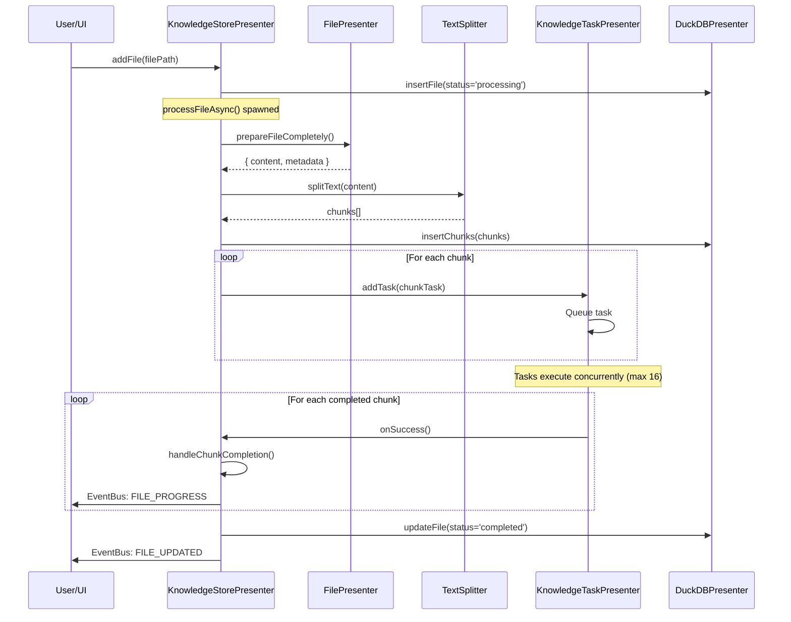

**Diagram: File Processing Integration**

**Key orchestration points:**

1. **Immediate Database Insert**: File metadata inserted with `status='processing'` before async work begins
2. **Async File Reading**: `processFileAsync()` spawned but doesn't block `addFile()` return
3. **Chunk Pre-Creation**: All chunks inserted to database before any embeddings generated
4. **Progress Tracking**: `fileProgressMap` initialized with total chunk count
5. **Task Submission**: Each chunk becomes independent task in global queue
6. **Completion Detection**: When `completed + error === total`, file status updated

**Sources:** [src/main/presenter/knowledgePresenter/knowledgeStorePresenter.ts:60-103](), [src/main/presenter/knowledgePresenter/knowledgeStorePresenter.ts:106-190]()

### Progress Tracking

Each file being processed has an entry in `fileProgressMap`:

```typescript
private fileProgressMap = new Map<string, {
  completed: number,  // Chunks successfully processed
  error: number,      // Chunks that failed
  total: number       // Total chunks for this file
}>()
```

**Progress update flow:**

1. Task completes → `handleChunkCompletion()` called
2. Increment `progress.completed`
3. Emit `RAG_EVENTS.FILE_PROGRESS` event to UI
4. Check if `completed + error === total`
5. If complete, call `onFileFinish()` and clean up progress entry

**Sources:** [src/main/presenter/knowledgePresenter/knowledgeStorePresenter.ts:26](), [src/main/presenter/knowledgePresenter/knowledgeStorePresenter.ts:232-254]()

---

## Pause & Resume Operations

### Pausing Tasks

When a knowledge base or file needs to be paused, the system performs coordinated cleanup across all three layers:

```typescript
async pauseAllRunningTasks(): Promise<void> {
  // 1. Cancel all queued/running tasks for this KB
  this.taskP.cancelTasksByKnowledgeBase(this.config.id)
  
  // 2. Clear local progress trackers
  this.fileProgressMap.clear()
  
  // 3. Update database: mark processing chunks as 'paused'
  await this.vectorP.pauseAllRunningTasks()
}
```

The database update marks chunks and files as paused:

**Sources:** [src/main/presenter/knowledgePresenter/knowledgeStorePresenter.ts:391-395](), [src/main/presenter/knowledgePresenter/database/duckdbPresenter.ts:622-650]()

### Resuming Tasks

Resume operation reconstructs the task queue from database state:

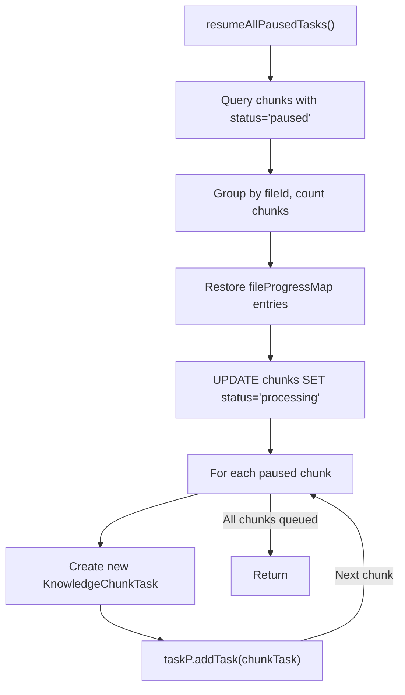

**Diagram: Resume Operation Flow**

**Key implementation details:**

1. **Query paused chunks**: `queryChunks({ status: 'paused' })`
2. **Restore progress tracking**: Count chunks per file, initialize `fileProgressMap`
3. **Update database status**: Batch update `status='processing'`
4. **Recreate tasks**: For each paused chunk, create new task with same configuration
5. **Requeue**: Submit tasks to `KnowledgeTaskPresenter`

**Sources:** [src/main/presenter/knowledgePresenter/knowledgeStorePresenter.ts:396-436]()

---

## Lifecycle Management

### Initialization

`KnowledgeTaskPresenter` is instantiated once globally and shared across all knowledge base instances:

```typescript
// In KnowledgePresenter constructor
constructor(configP: IConfigPresenter, dbDir: string, filePresenter: IFilePresenter) {
  this.configP = configP
  this.filePresenter = filePresenter
  this.storageDir = path.join(dbDir, 'KnowledgeBase')
  this.taskP = new KnowledgeTaskPresenter()  // Global singleton
  this.storePresenterCache = new Map()
  // ...
}
```

Each `KnowledgeStorePresenter` receives a reference to the global scheduler:

```typescript
constructor(
  vectorP: IVectorDatabasePresenter,
  config: BuiltinKnowledgeConfig,
  taskScheduler: IKnowledgeTaskPresenter  // Shared reference
) {
  this.vectorP = vectorP
  this.config = config
  this.taskP = taskScheduler
}
```

**Sources:** [src/main/presenter/knowledgePresenter/index.ts:52-62](), [src/main/presenter/knowledgePresenter/knowledgeStorePresenter.ts:39-47]()

### Shutdown Sequence

Application shutdown follows a strict sequence to ensure data integrity:

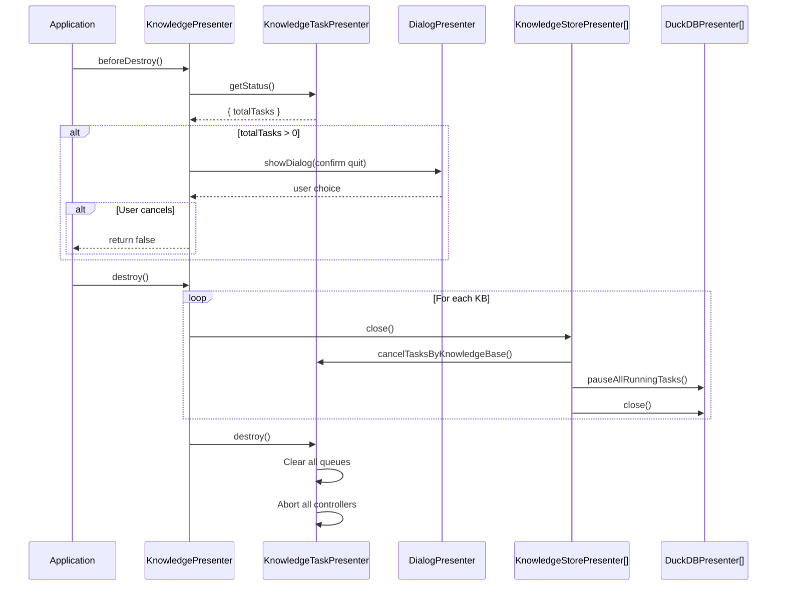

**Diagram: Shutdown Sequence**

**Critical steps:**

1. **beforeDestroy()**: Check for active tasks, prompt user if any exist
2. **Graceful cancellation**: Cancel all tasks via `cancelTasksByKnowledgeBase()`
3. **Database cleanup**: Mark running tasks as 'paused' for resume on next launch
4. **Connection closure**: Close DuckDB connections after all operations complete
5. **Resource cleanup**: Clear all maps, abort all controllers

**Sources:** [src/main/presenter/knowledgePresenter/index.ts:326-348](), [src/main/presenter/knowledgePresenter/knowledgeStorePresenter.ts:450-461](), [src/main/presenter/knowledgePresenter/knowledgeTaskPresenter.ts:119-130]()

---

## Performance Characteristics

### Concurrency Tuning

The `maxConcurrency=16` default was chosen to balance:

| Factor | Consideration |
|--------|---------------|
| API Rate Limits | Most embedding providers limit concurrent requests |
| Memory Usage | Each task holds chunk content + embedding vector in memory |
| CPU Utilization | Embedding generation is CPU-intensive for local models |
| Database Contention | Transaction queue handles serialization, but 16 is reasonable |

**Tuning recommendations:**
- **Cloud embeddings (OpenAI, etc.)**: Increase to 32-64 if rate limits allow
- **Local embeddings (Ollama)**: Reduce to 4-8 based on hardware
- **Large files**: Monitor memory usage, may need to reduce concurrency

### Bottleneck Analysis

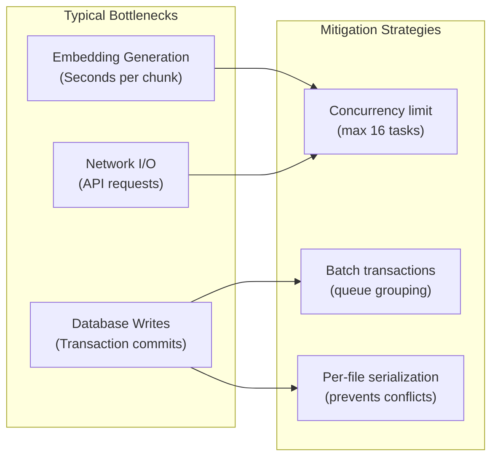

**Diagram: Performance Bottlenecks and Mitigations**

**Observed patterns:**
- **Embedding generation**: Typically 0.5-2 seconds per chunk (API-dependent)
- **Database writes**: <10ms per transaction when properly batched
- **Queue processing overhead**: <1ms per task
- **File-level serialization**: Minimal impact due to short critical sections

**Sources:** [src/main/presenter/knowledgePresenter/knowledgeTaskPresenter.ts:18]()

---

## Error Handling & Recovery

### Error Categories

| Error Type | Handling Strategy | Recovery |
|------------|-------------------|----------|
| `AbortError` | Trigger `onTerminate()`, clean up | No retry, task was cancelled |
| Network error | Trigger `onError()`, mark chunk failed | Manual retry via re-add file |
| Database error | Roll back transaction, fail all batched ops | Automatic on next operation |
| Timeout | Reject operation, log warning | Task fails, requires manual retry |

### Transaction Rollback

When any operation in a transaction batch fails, all operations roll back:

```typescript
if (hasError) {
  await this.safeRun('ROLLBACK;')
  
  // Reject all operations in the batch
  for (const { success, error, reject } of results) {
    if (success) {
      reject(errorToThrow)  // Even successful ops fail due to rollback
    } else {
      reject(error)
    }
  }
}
```

This ensures that partial writes never occur, maintaining database consistency even when multiple tasks fail simultaneously.

**Sources:** [src/main/presenter/knowledgePresenter/database/duckdbPresenter.ts:557-568]()

### Dirty Data Cleanup

On database open, the system cleans up orphaned data from interrupted operations:

```typescript
private async clearDirtyData(): Promise<void> {
  // Remove vectors without corresponding files
  await this.safeRun(`
    DELETE FROM ${this.vectorTable}
    WHERE file_id NOT IN (SELECT id FROM ${this.fileTable});
  `)
  
  // Remove chunks without corresponding files
  await this.safeRun(`
    DELETE FROM ${this.chunkTable}
    WHERE file_id NOT IN (SELECT id FROM ${this.fileTable});
  `)
}
```

This handles cases where the application crashed mid-transaction or a file was deleted but some operations completed.

**Sources:** [src/main/presenter/knowledgePresenter/database/duckdbPresenter.ts:804-816]()
4d:T81cf,
