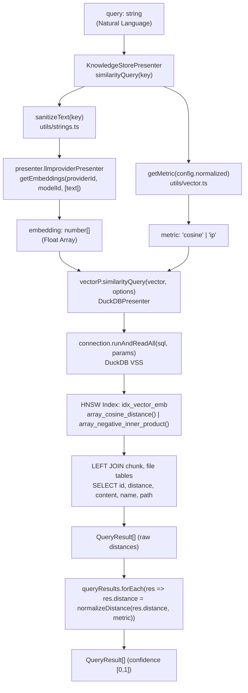
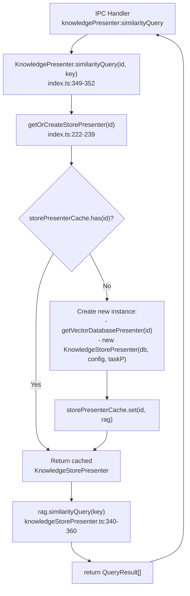
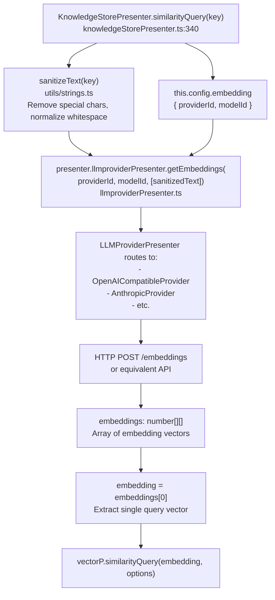
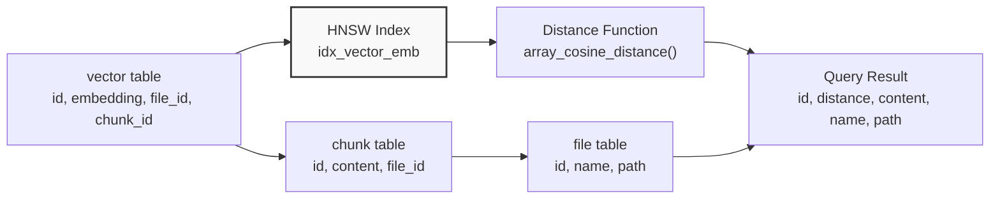
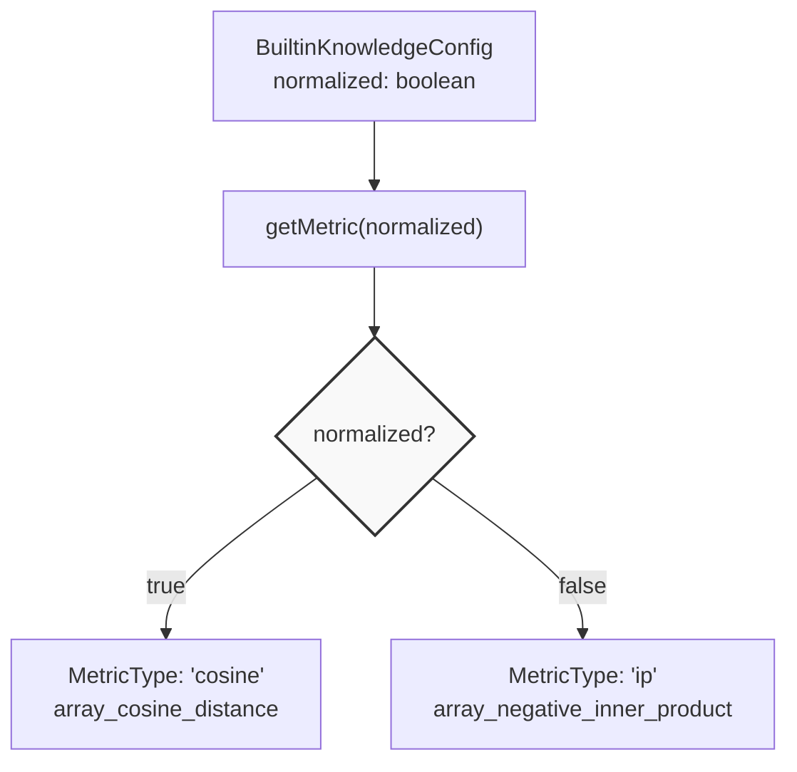
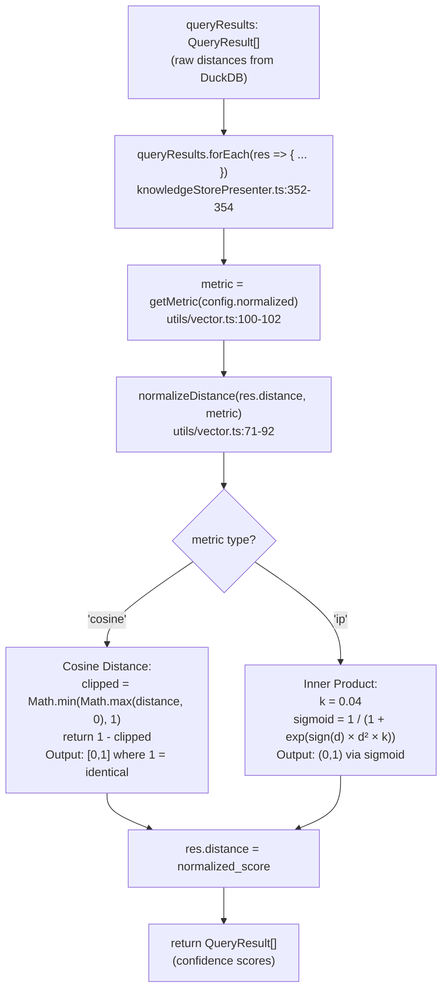
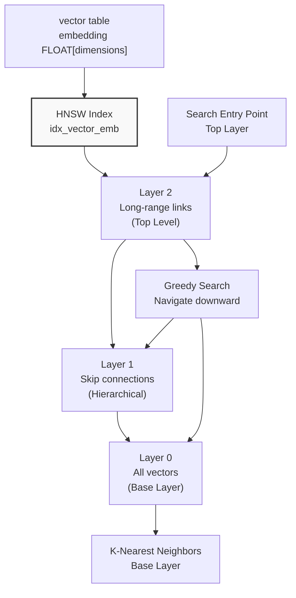
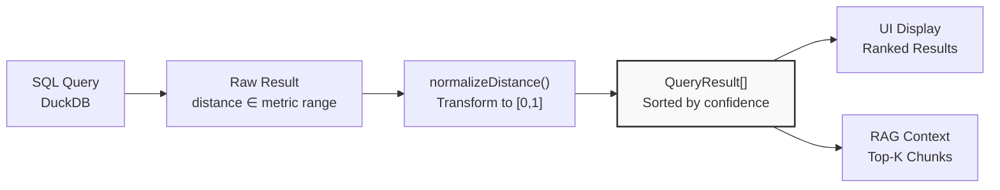
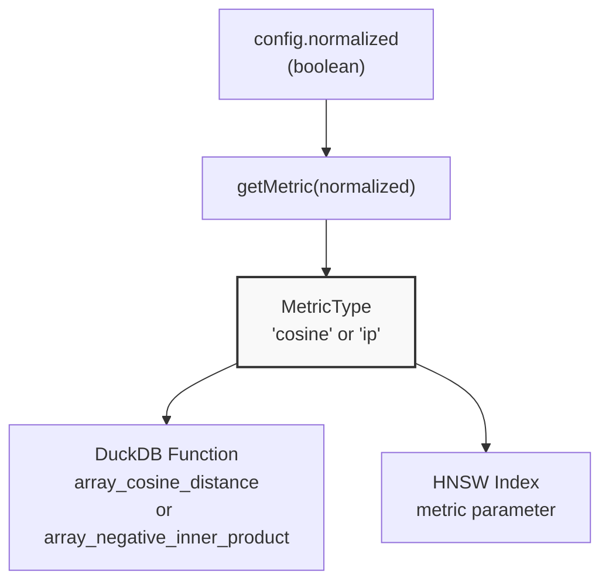
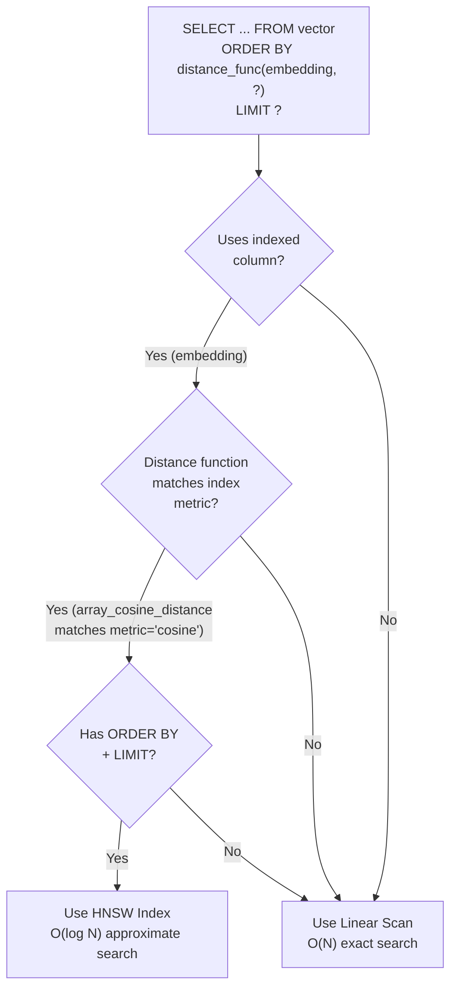

> 来源: [https://deepwiki.com/thinkinaixyz/deepchat/8.5-similarity-search-and-querying](https://deepwiki.com/thinkinaixyz/deepchat/8.5-similarity-search-and-querying)（Wayback 快照 2026-04-11 RSC payload 提取）
> DeepWiki thinkinaixyz/deepchat · 世代: 2026-04

# Similarity Search & Query

<details>
<summary>Relevant source files</summary>

The following files were used as context for generating this wiki page:

- [src/main/presenter/knowledgePresenter/database/duckdbPresenter.ts](src/main/presenter/knowledgePresenter/database/duckdbPresenter.ts)
- [src/main/presenter/knowledgePresenter/index.ts](src/main/presenter/knowledgePresenter/index.ts)
- [src/main/presenter/knowledgePresenter/knowledgeStorePresenter.ts](src/main/presenter/knowledgePresenter/knowledgeStorePresenter.ts)
- [src/main/presenter/knowledgePresenter/knowledgeTaskPresenter.ts](src/main/presenter/knowledgePresenter/knowledgeTaskPresenter.ts)
- [src/main/utils/vector.ts](src/main/utils/vector.ts)
- [src/shared/dialog.ts](src/shared/dialog.ts)

</details>


## Purpose and Scope

This document explains how DeepChat performs similarity-based retrieval of knowledge base content through vector embeddings and approximate nearest neighbor search. It covers query embedding generation, DuckDB vector operations, HNSW index utilization, distance metric selection, and confidence score normalization.

For information about knowledge base architecture and file processing, see [Knowledge Base Architecture](#10.1). For information about vector database schema and DuckDB integration, see [Vector Database & DuckDB](#10.3).

---

## Query Pipeline Overview

The similarity search system executes a multi-stage pipeline: `sanitizeText()` preprocessing → `LLMProviderPresenter.getEmbeddings()` → `DuckDBPresenter.similarityQuery()` with HNSW index → `normalizeDistance()` confidence transformation.

**Complete Query Pipeline Diagram:**



**Pipeline Stages:**

| Stage | Function | File | Input | Output |
|-------|----------|------|-------|--------|
| **Preprocessing** | `sanitizeText(key)` | `utils/strings.ts` | Raw query string | Sanitized text |
| **Embedding** | `getEmbeddings(providerId, modelId, [text])` | `LLMProviderPresenter` | Text array | `number[]` embedding |
| **Metric Selection** | `getMetric(config.normalized)` | `utils/vector.ts` | `boolean` | `'cosine' \| 'ip'` |
| **Vector Search** | `vectorP.similarityQuery(vector, options)` | `DuckDBPresenter` | Embedding + options | Raw `QueryResult[]` |
| **Normalization** | `normalizeDistance(distance, metric)` | `utils/vector.ts` | Raw distance | Confidence `[0,1]` |

**Sources:** [src/main/presenter/knowledgePresenter/knowledgeStorePresenter.ts:340-360](), [src/main/presenter/knowledgePresenter/database/duckdbPresenter.ts:397-435](), [src/main/utils/vector.ts:71-102]()

---

## Entry Point and Routing

The `KnowledgePresenter` class maintains a cache of `KnowledgeStorePresenter` instances indexed by knowledge base ID. The `similarityQuery()` method routes queries through `getOrCreateStorePresenter()` to the appropriate per-KB instance.

**Query Routing Architecture:**



**Key Data Structures:**

```typescript
// From index.ts:50
private readonly storePresenterCache: Map<string, KnowledgeStorePresenter>

// From index.ts:349-352
async similarityQuery(id: string, key: string): Promise<QueryResult[]> {
  const rag = await this.getOrCreateStorePresenter(id)
  return await rag.similarityQuery(key)
}

// From index.ts:222-239
private getOrCreateStorePresenter = async (id: string): Promise<KnowledgeStorePresenter> => {
  if (this.storePresenterCache.has(id)) {
    return this.storePresenterCache.get(id) as KnowledgeStorePresenter
  }
  // Fetch config, create DuckDBPresenter, instantiate KnowledgeStorePresenter
  // ...
}
```

**Cache Management Logic:**

| Operation | Method | Cache Behavior |
|-----------|--------|----------------|
| **Query Routing** | `similarityQuery(id, key)` | Delegates to cached or new instance |
| **Cache Lookup** | `getOrCreateStorePresenter(id)` | Returns existing or creates + caches |
| **KB Creation** | `create(config)` | Calls `createStorePresenter()` which populates cache |
| **KB Deletion** | `delete(id)` | Calls `destroy()` and removes from cache |
| **KB Update** | `update(config)` | Updates cached instance or creates if enabled |

**Sources:** [src/main/presenter/knowledgePresenter/index.ts:29-61](), [src/main/presenter/knowledgePresenter/index.ts:222-239](), [src/main/presenter/knowledgePresenter/index.ts:349-352]()

---

## Query Embedding Generation

The `KnowledgeStorePresenter.similarityQuery()` method generates query embeddings using `presenter.llmproviderPresenter.getEmbeddings()` with the configured embedding model from `BuiltinKnowledgeConfig`.

**Embedding Generation Call Chain:**



**Code Implementation:**

```typescript
// From knowledgeStorePresenter.ts:340-346
async similarityQuery(key: string): Promise<QueryResult[]> {
  try {
    const embedding = await presenter.llmproviderPresenter.getEmbeddings(
      this.config.embedding.providerId,
      this.config.embedding.modelId,
      [sanitizeText(key)]
    )
    // ... continue with vectorP.similarityQuery(embedding[0], options)
```

**Configuration Source:**

```typescript
// BuiltinKnowledgeConfig structure
interface BuiltinKnowledgeConfig {
  embedding: {
    providerId: string;   // e.g., "openai", "ollama"
    modelId: string;      // e.g., "text-embedding-3-small"
  };
  // ... other fields
}
```

**Embedding Dimensions:**

The `config.dimensions` field (set during KB creation) must match the dimensionality of the embedding model output. This is validated during database initialization:

```typescript
// From index.ts:260-277
const db = await this.getVectorDatabasePresenter(
  config.id,
  config.dimensions,  // Must match embedding model output
  config.normalized
)
```

**Sources:** [src/main/presenter/knowledgePresenter/knowledgeStorePresenter.ts:340-346](), [src/main/utils/strings.ts]()

---

## DuckDB Similarity Search Implementation

The `DuckDBPresenter` executes similarity queries using DuckDB's vector similarity functions with HNSW index optimization.

### Distance Function Selection

```typescript
// From duckdbPresenter.ts:399-404
const fn =
  options.metric === 'ip'
    ? 'array_negative_inner_product'
    : options.metric === 'cosine'
      ? 'array_cosine_distance'
      : 'array_distance'
```

| Metric Type | DuckDB Function | Description |
|-------------|-----------------|-------------|
| `'ip'` | `array_negative_inner_product` | Negative inner product (higher = more similar) |
| `'cosine'` | `array_cosine_distance` | Cosine distance [0,1] (lower = more similar) |
| `'l2sq'` | `array_distance` | L2 squared distance (lower = more similar) |

**Sources:** [src/main/presenter/knowledgePresenter/database/duckdbPresenter.ts:399-404]()

### SQL Query Structure

```sql
-- From duckdbPresenter.ts:405-412
SELECT t.id as id, 
       array_cosine_distance(embedding, ?) AS distance, 
       t1.content as content, 
       t2.name as name, 
       t2.path as path
FROM vector t
LEFT JOIN chunk t1 ON t1.id = t.chunk_id
LEFT JOIN file t2 ON t2.id = t.file_id
ORDER BY distance
LIMIT ?;
```

**Query Components:**



**Sources:** [src/main/presenter/knowledgePresenter/database/duckdbPresenter.ts:405-412]()

### Parameter Binding

The query uses parameterized execution via `connection.runAndReadAll(sql, params)` to prevent SQL injection and optimize prepared statement caching:

```typescript
// From duckdbPresenter.ts:413-420
const embParam = arrayValue(Array.from(vector))
const paramsArr: any[] = [embParam]
if (options.threshold != null) {
  paramsArr.push(options.threshold)
}
paramsArr.push(k)

const reader = await this.connection.runAndReadAll(sql, paramsArr)
```

**Parameter Processing:**

| Parameter | Type | DuckDB Binding | Purpose |
|-----------|------|----------------|---------|
| `embParam` | `arrayValue(number[])` | `?` in `array_*_distance(embedding, ?)` | Query vector for similarity comparison |
| `options.threshold` | `number` (optional) | `?` (if present) | Distance threshold filter (unused in current flow) |
| `k` | `number` | `?` in `LIMIT ?` | Top-K results (`config.fragmentsNumber`) |

**DuckDB Array Conversion:**

The `arrayValue()` function from `@duckdb/node-api` converts JavaScript arrays to DuckDB's internal array representation:

```typescript
import { arrayValue } from '@duckdb/node-api'

// Usage in query binding
const embParam = arrayValue(Array.from(vector))  // JavaScript array → DuckDB FLOAT[]
```

**Sources:** [src/main/presenter/knowledgePresenter/database/duckdbPresenter.ts:413-421]()

### Result Mapping

```typescript
// From duckdbPresenter.ts:422-430
return rows.map((r: any) => ({
  id: r.id,
  distance: r.distance,
  metadata: {
    from: r.name,
    filePath: r.path,
    content: r.content
  }
}))
```

**Result Structure:**

| Field | Type | Description |
|-------|------|-------------|
| `id` | `string` | Vector record ID (not chunk or file ID) |
| `distance` | `number` | Raw distance from distance function |
| `metadata.from` | `string` | Source file name |
| `metadata.filePath` | `string` | Full file path |
| `metadata.content` | `string` | Chunk text content |

**Sources:** [src/main/presenter/knowledgePresenter/database/duckdbPresenter.ts:422-430]()

---

## Distance Metrics and Normalization

The system supports two primary distance metrics, selected based on whether embeddings are normalized.

### Metric Selection Logic



**Metric Determination:**

```typescript
// From vector.ts:100-102
export function getMetric(normalized: boolean): MetricType {
  return normalized ? 'cosine' : 'ip'
}
```

- **Normalized Vectors** → Use `'cosine'` distance (valid for unit vectors)
- **Unnormalized Vectors** → Use `'ip'` (inner product) to preserve magnitude information

**Sources:** [src/main/utils/vector.ts:100-102](), [src/main/presenter/knowledgePresenter/knowledgeStorePresenter.ts:350]()

### Distance to Confidence Conversion

The `normalizeDistance()` function in `utils/vector.ts` converts raw distance values into [0,1] confidence scores using metric-specific transformations.

**Normalization Logic Flow:**



**Normalization Algorithms:**

#### Cosine Distance Normalization

```typescript
// From vector.ts:72-76
if (metric === 'cosine') {
  // cosine distance ∈ [0,1], 0 = identical, 1 = opposite
  const clipped = Math.min(Math.max(distance, 0), 1)
  return 1 - clipped
}
```

**Cosine Transformation Table:**

| Raw Distance | Clipped | Confidence | Interpretation |
|--------------|---------|------------|----------------|
| 0.0 | 0.0 | 1.0 | Identical vectors |
| 0.2 | 0.2 | 0.8 | Very similar |
| 0.5 | 0.5 | 0.5 | Moderately similar |
| 1.0 | 1.0 | 0.0 | Opposite vectors |
| <0 or >1 | Clamped | Clamped | Invalid (shouldn't occur) |

#### Inner Product Normalization

```typescript
// From vector.ts:77-89
else if (metric === 'ip') {
  // distance = -inner_product (negative of dot product)
  // distance < 0 → angle < 90°, high similarity
  // distance = 0 → orthogonal, no similarity
  // distance > 0 → angle > 90°, opposite direction
  const k = 0.04
  const sigmoid = 1 / (1 + Math.exp(Math.sign(distance) * Math.pow(distance, 2) * k))
  return sigmoid
}
```

**Inner Product Sigmoid Transformation:**

| Raw Distance | Formula | Approx Confidence | Interpretation |
|--------------|---------|-------------------|----------------|
| -10 | `1 / (1 + exp(-100 × 0.04))` | ~0.98 | Strong similarity |
| -5 | `1 / (1 + exp(-25 × 0.04))` | ~0.73 | Moderate similarity |
| 0 | `1 / (1 + exp(0))` | 0.50 | Orthogonal |
| +5 | `1 / (1 + exp(+25 × 0.04))` | ~0.27 | Opposite direction |
| +10 | `1 / (1 + exp(+100 × 0.04))` | ~0.02 | Strong opposition |

**Scaling Factor `k = 0.04`:**
- Lower values create smoother sigmoid curves (less sensitivity to distance changes)
- Higher values create steeper curves (more binary similarity decisions)
- Current value balances discrimination between similar/dissimilar chunks

**Normalization Application:**

```typescript
// From knowledgeStorePresenter.ts:352-354
queryResults.forEach((res) => {
  res.distance = normalizeDistance(res.distance, getMetric(this.config.normalized))
})
```

Normalization executes **post-query** in `KnowledgeStorePresenter`, mutating the `distance` field of each `QueryResult` before returning to the caller. This ensures all consumers receive confidence scores rather than raw distance metrics.

**Sources:** [src/main/utils/vector.ts:71-92](), [src/main/presenter/knowledgePresenter/knowledgeStorePresenter.ts:352-354]()

---

## HNSW Index Configuration

The system uses DuckDB's VSS (Vector Similarity Search) extension with HNSW (Hierarchical Navigable Small World) indexing for approximate nearest neighbor search.

### Index Creation Parameters

The HNSW index is created during database initialization via `DuckDBPresenter.initTableIndex()` with hardcoded parameters optimized for typical embedding workloads.

```sql
-- From duckdbPresenter.ts:784-792
CREATE INDEX IF NOT EXISTS idx_vector_emb
ON vector
USING HNSW (embedding)
WITH (
  metric='cosine',
  M=16,
  ef_construction=200
);
```

**HNSW Configuration Parameters:**

| Parameter | Default Value | Range | Impact on Performance | Impact on Quality |
|-----------|--------------|-------|----------------------|-------------------|
| `metric` | `'cosine'` | `'cosine' \| 'ip' \| 'l2sq'` | Determines distance function used during search | Must match query metric |
| `M` | `16` | Typical: 8-64 | Higher = more memory, slower insertions | Higher = better recall |
| `ef_construction` | `200` | Typical: 100-500 | Higher = slower index build | Higher = better index quality |

**Parameter Selection Rationale:**

- **`metric='cosine'`**: Default assumes normalized embeddings (most common for modern embedding models)
- **`M=16`**: Balances memory usage (~16 × dimensions × 4 bytes per vector) with recall quality
- **`ef_construction=200`**: Provides good index quality without excessive build time

**Index Creation Call Chain:**

```typescript
// From duckdbPresenter.ts:81-110
async initialize(dimensions: number, opts?: IndexOptions): Promise<void> {
  // ... table creation ...
  console.log(`[DuckDB] create vector index`)
  await this.initTableIndex(opts)
  // ...
}

// From duckdbPresenter.ts:759-799
private async initTableIndex(opts?: IndexOptions): Promise<void> {
  const metric = opts?.metric || 'cosine'  // Default to cosine
  const M = opts?.M || 16                  // Default M=16
  const efConstruction = opts?.efConstruction || 200  // Default ef_construction=200
  
  const sql = `CREATE INDEX IF NOT EXISTS idx_vector_emb
   ON ${this.vectorTable}
   USING HNSW (embedding)
   WITH (
     metric='${metric}',
     M=${M},
     ef_construction=${efConstruction}
   );`
  await this.safeRun(sql)
}
```

**Metric Override via Configuration:**

The `metric` parameter can be overridden via `IndexOptions` passed from `KnowledgePresenter.getVectorDatabasePresenter()`:

```typescript
// From index.ts:260-277
const db = await this.getVectorDatabasePresenter(
  config.id,
  config.dimensions,
  config.normalized
)

// In getVectorDatabasePresenter:
await db.initialize(dimensions, {
  metric: getMetric(normalized)  // 'cosine' if normalized, 'ip' otherwise
})
```

**Sources:** [src/main/presenter/knowledgePresenter/database/duckdbPresenter.ts:759-799](), [src/main/presenter/knowledgePresenter/index.ts:260-277]()

### Index Architecture



**HNSW Performance Characteristics:**

- **Search Complexity:** O(log N) average case for approximate search
- **Index Build Complexity:** O(N log N) with `ef_construction` factor
- **Memory Usage:** O(N × M × dimensions × sizeof(float))
- **Accuracy:** Trades exact search for speed (adjustable via `M` and `ef_construction`)

**Sources:** [src/main/presenter/knowledgePresenter/database/duckdbPresenter.ts:759-799]()

### Index Persistence and Recovery

The system enables DuckDB's experimental HNSW persistence feature, allowing the index to survive database restarts without full reconstruction.

```typescript
// From duckdbPresenter.ts:92 (during initialize)
await this.safeRun(`SET hnsw_enable_experimental_persistence = true;`)

// From duckdbPresenter.ts:137 (during open)
await this.installAndLoadExtension('vss', async () => {
  await this.safeRun(`SET hnsw_enable_experimental_persistence = true;`)
})
```

**Persistence Mechanism:**

The HNSW index structure is persisted in the DuckDB database file alongside the vector data. When `SET hnsw_enable_experimental_persistence = true` is enabled:
1. Index changes are written to disk during checkpoints
2. Index structure is loaded from disk during database open
3. No index rebuilding required after normal shutdown

**WAL Recovery for HNSW:**

When a database has an unprocessed WAL (Write-Ahead Log) file from abnormal shutdown:

```typescript
// From duckdbPresenter.ts:118-126
if (await this.hasWal()) {
  try {
    await this.repairIndex()  // Attach via in-memory DB with VSS loaded
  } catch (error) {
    console.error('[DuckDB] Error opening database:', error)
    throw new Error('Failed to open database, please check the logs for details.')
  }
}
```

The `repairIndex()` method uses an in-memory DuckDB instance to load the VSS extension before attaching the database:

```typescript
// From duckdbPresenter.ts:673-697
private async repairIndex(): Promise<void> {
  const ins = await DuckDBInstance.create(':memory:')
  const conn = await ins.connect()
  
  // Load VSS extension first (required for HNSW checkpoint recovery)
  await conn.run(`LOAD vss;`)
  await conn.run(`SET hnsw_enable_experimental_persistence = true;`)
  
  // Attach to the existing database (triggers automatic WAL checkpoint with VSS support)
  await conn.run(`ATTACH DATABASE '${this.dbPath}' AS db;`)
  
  conn.closeSync()
  ins.closeSync()
}
```

**Critical for Large Knowledge Bases:**

Without persistence, reopening a knowledge base with millions of vectors would require:
- Re-computing all embeddings (expensive LLM API calls)
- Re-building HNSW graph structure (O(N log N) complexity)
- Potentially hours of rebuild time

With persistence, the index loads in seconds regardless of size.

**Sources:** [src/main/presenter/knowledgePresenter/database/duckdbPresenter.ts:92](), [src/main/presenter/knowledgePresenter/database/duckdbPresenter.ts:118-126](), [src/main/presenter/knowledgePresenter/database/duckdbPresenter.ts:673-697]()

---

## Query Result Structure and Usage

The `QueryResult` interface defines the structure returned by similarity queries.

### TypeScript Interface

```typescript
interface QueryResult {
  id: string;
  distance: number;  // Normalized to [0,1] confidence
  metadata: {
    from: string;       // Source file name
    filePath: string;   // Full path to source file
    content: string;    // Chunk text content
  };
}
```

### Result Processing Flow



**Result Ordering:**

Results are ordered by **ascending distance** in SQL (lower distance = higher similarity), then normalized to confidence scores where **higher values indicate better matches**.

**Top-K Selection:**

The `topK` parameter (from `config.fragmentsNumber`) controls the number of results returned, determining how many chunks are included in RAG context.

**Sources:** [src/main/presenter/knowledgePresenter/database/duckdbPresenter.ts:422-430](), [src/main/presenter/knowledgePresenter/knowledgeStorePresenter.ts:348-354]()

---

## Configuration Parameters

Similarity search behavior is controlled by parameters in `BuiltinKnowledgeConfig`.

### Configuration Schema

| Parameter | Type | Purpose | Location |
|-----------|------|---------|----------|
| `embedding.providerId` | `string` | LLM provider for embeddings | Used in `getEmbeddings()` call |
| `embedding.modelId` | `string` | Specific embedding model | Used in `getEmbeddings()` call |
| `fragmentsNumber` | `number` | Top-K results to return | Maps to `topK` in `QueryOptions` |
| `normalized` | `boolean` | Whether embeddings are normalized | Determines metric type (cosine vs ip) |
| `dimensions` | `number` | Embedding vector dimensions | Used during database initialization |

### Metric and Distance Configuration



**Configuration Sources:**

- **Database Initialization** - `dimensions` and `normalized` determine index setup [src/main/presenter/knowledgePresenter/index.ts:260-277]()
- **Query Execution** - `embedding` config and `fragmentsNumber` control search parameters [src/main/presenter/knowledgePresenter/knowledgeStorePresenter.ts:342-350]()

**Sources:** [src/main/presenter/knowledgePresenter/knowledgeStorePresenter.ts:342-350](), [src/main/utils/vector.ts:100-102]()

---

## Error Handling and Edge Cases

### Query Execution Errors

```typescript
// From knowledgeStorePresenter.ts:356-360
catch (error) {
  console.error(`[RAG] Error during similarity query:`, error)
  throw error
}
```

Errors during query execution are logged and re-thrown to the caller. Common error scenarios:

- **Embedding generation failure** - Provider API errors or rate limits
- **Database connection errors** - DuckDB connection loss or lock timeout
- **Invalid vector dimensions** - Mismatch between query vector and indexed dimensions

**Sources:** [src/main/presenter/knowledgePresenter/knowledgeStorePresenter.ts:356-360]()

### Empty Result Handling

The system does not explicitly handle empty result sets at the similarity query level. Empty arrays are returned when no vectors match the query within the top-K constraint.

### Vector Normalization Edge Cases

```typescript
// From vector.ts:33-42
export function normalized(vector: number[]): number[] {
  if (!vector || !Array.isArray(vector) || vector.length === 0) {
    throw new Error('Vector cannot be empty')
  }
  const norm = calcNorm(vector)
  if (norm === 0) {
    throw new Error('Cannot normalize zero vector')
  }
  return vector.map((v) => v / norm)
}
```

The normalization utility handles:
- **Empty vectors** - Throws error before attempting normalization
- **Zero vectors** - Throws error (cannot divide by zero norm)
- **NaN/Infinity values** - Would propagate through calculation (no explicit check)

**Sources:** [src/main/utils/vector.ts:33-42]()

---

## Performance Considerations

### Index Usage Verification

DuckDB's query optimizer automatically selects the HNSW index when the query satisfies index usage criteria.

**Index Usage Conditions:**



**SQL Query Structure for Index Usage:**

```sql
-- From duckdbPresenter.ts:405-412
-- This query structure guarantees HNSW index usage:
SELECT t.id as id, 
       array_cosine_distance(embedding, ?) AS distance,  -- ✓ Uses indexed column
       t1.content as content, 
       t2.name as name, 
       t2.path as path
FROM vector t
LEFT JOIN chunk t1 ON t1.id = t.chunk_id
LEFT JOIN file t2 ON t2.id = t.file_id
ORDER BY distance     -- ✓ ORDER BY distance result
LIMIT ?;              -- ✓ LIMIT for top-K
```

**Index vs. Metric Compatibility:**

| Index Metric | Compatible Query Functions | Incompatible Functions |
|--------------|---------------------------|------------------------|
| `metric='cosine'` | `array_cosine_distance()` | `array_negative_inner_product()`, `array_distance()` |
| `metric='ip'` | `array_negative_inner_product()` | `array_cosine_distance()`, `array_distance()` |
| `metric='l2sq'` | `array_distance()` | `array_cosine_distance()`, `array_negative_inner_product()` |

**Query Planning:**

DuckDB's query planner will automatically use the HNSW index for the above query because:
1. The `ORDER BY distance LIMIT k` pattern indicates top-K similarity search
2. The distance function matches the index metric
3. HNSW provides O(log N) approximate nearest neighbor search vs O(N) linear scan

**Sources:** [src/main/presenter/knowledgePresenter/database/duckdbPresenter.ts:397-435]()

### Query Optimization Strategies

| Strategy | Implementation | Impact |
|----------|---------------|--------|
| **HNSW Index** | Created during initialization | O(log N) search vs O(N) linear scan |
| **Top-K Limitation** | LIMIT clause in SQL | Reduces result processing overhead |
| **Table Joins** | LEFT JOIN on indexed columns | Efficient metadata retrieval |
| **Prepared Statements** | Parameterized queries | Query plan caching |

### Memory and Disk I/O

- **Embedding storage** - `FLOAT[dimensions]` per vector (~1-4KB per vector for 256-1024 dimensions)
- **HNSW index overhead** - ~M × dimensions × sizeof(float) additional storage per vector
- **Query memory** - Temporary storage for candidate lists during HNSW traversal

**Sources:** [src/main/presenter/knowledgePresenter/database/duckdbPresenter.ts:397-435](), [src/main/presenter/knowledgePresenter/database/duckdbPresenter.ts:759-799]()
4e:T565c,
