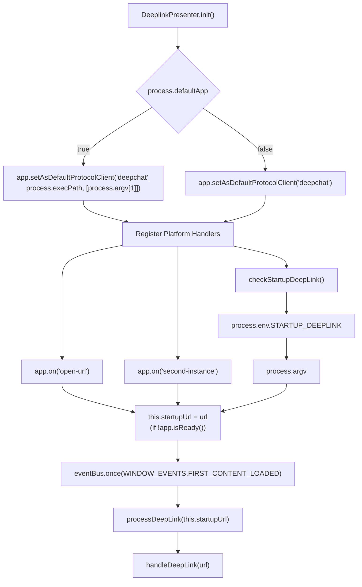
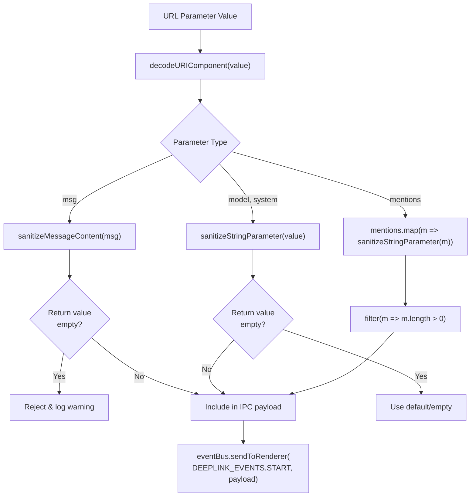
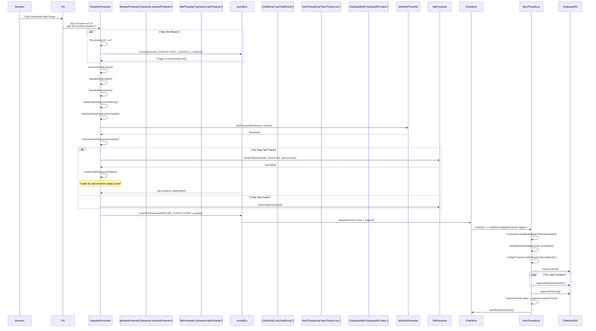
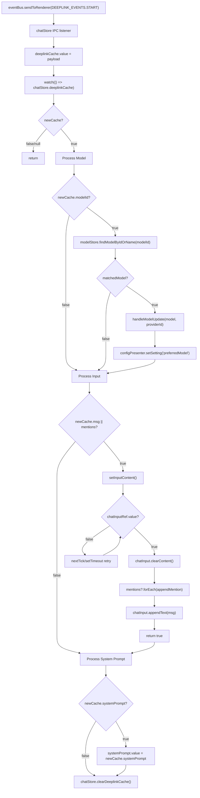
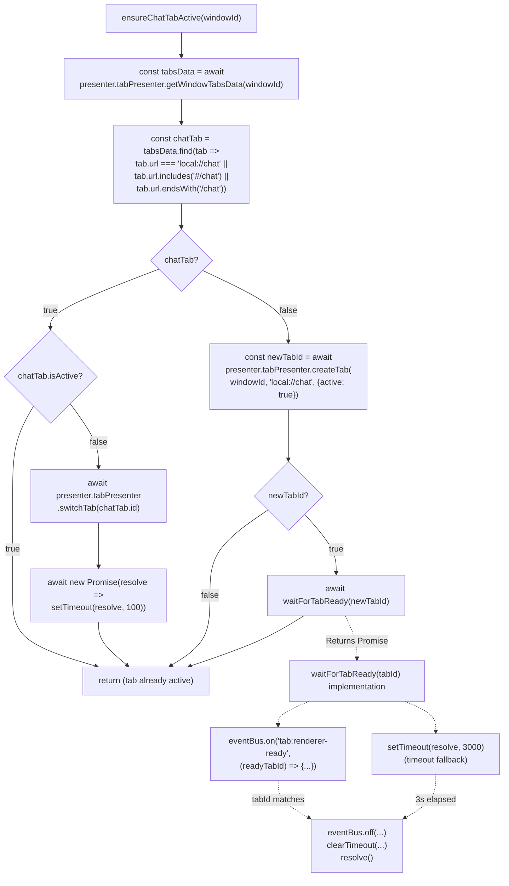

> 来源: [https://deepwiki.com/thinkinaixyz/deepchat/9.1-deeplink-protocol](https://deepwiki.com/thinkinaixyz/deepchat/9.1-deeplink-protocol)（Wayback 快照 2026-04-11 RSC payload 提取）
> DeepWiki thinkinaixyz/deepchat · 世代: 2026-04

# Deep Linking & External Integration

<details>
<summary>Relevant source files</summary>

The following files were used as context for generating this wiki page:

- [src/main/presenter/deeplinkPresenter/index.ts](src/main/presenter/deeplinkPresenter/index.ts)
- [src/main/presenter/sqlitePresenter/tables/conversations.ts](src/main/presenter/sqlitePresenter/tables/conversations.ts)
- [src/renderer/src/components/ChatConfig.vue](src/renderer/src/components/ChatConfig.vue)
- [src/renderer/src/components/ModelSelect.vue](src/renderer/src/components/ModelSelect.vue)
- [src/renderer/src/composables/message/useMessageScroll.ts](src/renderer/src/composables/message/useMessageScroll.ts)
- [src/renderer/src/views/ChatTabView.vue](src/renderer/src/views/ChatTabView.vue)

</details>


## Purpose & Scope

This document describes DeepChat's deep linking system, which allows external applications, websites, and shell commands to interact with the application through the `deepchat://` protocol. The system supports launching conversations with pre-filled content, switching models, and installing MCP servers via shareable links.

For information about MCP server configuration UI, see [7.7](#7.7). For general application startup flow, see [2.1](#2.1).

---

## Protocol Registration & Lifecycle

The `deepchat://` protocol is registered during application initialization by the `DeeplinkPresenter` class, which manages both cold-start (app not running) and hot-start (app already running) scenarios.

### Registration Process



**Main Process Startup Detection:**

Before the `DeeplinkPresenter` initializes, [src/main/index.ts:56-110]() performs early deeplink detection to ensure URLs aren't missed during app initialization:

```typescript
// Check command line arguments
const deepLinkArg = process.argv.find((arg) => {
  return arg.startsWith('deepchat://') || arg.includes('deepchat://') || arg.match(/^deepchat:/)
})
if (deepLinkArg) {
  startupDeepLink = deepLinkArg
}

// Check environment variables
const envDeepLink = process.env.DEEPLINK_URL || process.env.deepchat_deeplink
if (envDeepLink) {
  startupDeepLink = envDeepLink
}

// Store for later processing
if (startupDeepLink) {
  process.env.STARTUP_DEEPLINK = startupDeepLink
}
```

The `DeeplinkPresenter.init()` method then reads `process.env.STARTUP_DEEPLINK` via `checkStartupDeepLink()` [src/main/presenter/deeplinkPresenter/index.ts:153-180]().

**Cold Start vs Hot Start:**

- **Cold Start**: App not running when link is clicked. URL stored in `this.startupUrl` and processed after `WINDOW_EVENTS.FIRST_CONTENT_LOADED` event [src/main/presenter/deeplinkPresenter/index.ts:70-77]()
- **Hot Start**: App already running. URL processed immediately via `processDeepLink(url)` [src/main/presenter/deeplinkPresenter/index.ts:65]() or [src/main/presenter/deeplinkPresenter/index.ts:112]()

**Sources:** [src/main/index.ts:56-110](), [src/main/presenter/deeplinkPresenter/index.ts:37-117](), [src/main/presenter/deeplinkPresenter/index.ts:153-180]()

---

## Deep Link URL Formats

DeepChat supports two primary URL formats:

| URL Pattern | Purpose | Parameters |
|-------------|---------|------------|
| `deepchat://start` | Launch conversation | `msg`, `model`, `system`, `mentions` |
| `deepchat://mcp/install` | Install MCP server | `code` (base64 JSON) |

### Message Link Parameters

The `handleStart(params: URLSearchParams)` method processes these parameters [src/main/presenter/deeplinkPresenter/index.ts:215-277]():

| Parameter | Description | Processing Method | Storage Location |
|-----------|-------------|-------------------|------------------|
| `msg` | Pre-filled message text | `sanitizeMessageContent()` [src/main/presenter/deeplinkPresenter/index.ts:572-639]() | `chatStore.deeplinkCache.msg` |
| `model` | Model ID or name | `sanitizeStringParameter()` [src/main/presenter/deeplinkPresenter/index.ts:646-664]() | `chatStore.deeplinkCache.modelId` |
| `system` | System prompt override | `sanitizeStringParameter()` [src/main/presenter/deeplinkPresenter/index.ts:646-664]() | `chatStore.deeplinkCache.systemPrompt` |
| `mentions` | Comma-separated mention list | Each: `sanitizeStringParameter()` [src/main/presenter/deeplinkPresenter/index.ts:646-664]() | `chatStore.deeplinkCache.mentions[]` |
| ~~`yolo`~~ | ~~Auto-send flag~~ | **Disabled for security** [src/main/presenter/deeplinkPresenter/index.ts:253-254]() | `autoSend: false` (hardcoded) |

**Example URL:**
```
deepchat://start?msg=Hello%20world&model=gpt-4&system=Be%20concise&mentions=context1,context2
```

**Parameter Extraction in `handleStart(params: URLSearchParams)`:**
```typescript
let msg = params.get('msg')                             // "Hello world"
let modelId = params.get('model')                       // "gpt-4"
let systemPrompt = params.get('system')                 // "Be concise"
const mentionsParam = params.get('mentions')            // "context1,context2"
let mentions = mentionsParam?.split(',').map(m => m.trim()) // ["context1", "context2"]
```

All parameters are decoded via `decodeURIComponent()` and sanitized before use.

**Sources:** [src/main/presenter/deeplinkPresenter/index.ts:215-277]()

---

## Security & Sanitization

All deep link parameters undergo strict validation to prevent injection attacks and malicious content:

### Sanitization Pipeline



**Key Security Measures:**

1. **Auto-send disabled**: The `yolo` parameter is explicitly ignored; `autoSend` always set to `false` [src/main/presenter/deeplinkPresenter/index.ts:253-254]()
2. **Content validation**: Messages rejected if `sanitizeMessageContent()` returns empty string [src/main/presenter/deeplinkPresenter/index.ts:224-228]()
3. **String sanitization**: Model IDs and system prompts cleaned via `sanitizeStringParameter()` [src/main/presenter/deeplinkPresenter/index.ts:231-240]()
4. **Mention filtering**: Empty strings removed from mentions array after sanitization [src/main/presenter/deeplinkPresenter/index.ts:244-250]()

**Sanitization Functions:**

- `sanitizeMessageContent(content: string | null)`: Validates and cleans message text, returns empty string if invalid [src/main/presenter/deeplinkPresenter/index.ts:572-639]()
- `sanitizeStringParameter(value: string | null)`: Cleans string parameters, returns empty string if invalid [src/main/presenter/deeplinkPresenter/index.ts:646-664]()

Both functions use `decodeURIComponent()` and perform content validation to prevent injection attacks.

**Sources:** [src/main/presenter/deeplinkPresenter/index.ts:182-277]()

---

## Message Link Flow (deepchat://start)

### High-Level Process



**Sources:** [src/main/presenter/deeplinkPresenter/index.ts:182-336](), [src/renderer/src/components/NewThread.vue:436-506]()

### Renderer-Side Consumption

The renderer-side flow involves multiple components coordinating to apply deeplink parameters:

1. **Event Reception**: Main process calls `eventBus.sendToRenderer(DEEPLINK_EVENTS.START, SendTarget.DEFAULT_TAB, payload)` which broadcasts to the default tab [src/main/presenter/deeplinkPresenter/index.ts:270-276]()

2. **Cache Storage**: The event listener in the chat store updates `chatStore.deeplinkCache` with the sanitized payload containing `{msg, modelId, systemPrompt, mentions, autoSend}`

3. **Watch Trigger**: The `NewThread.vue` component watches `chatStore.deeplinkCache` for changes and triggers processing when cache updates

4. **Model Selection**: If `newCache.modelId` present, the component calls `modelStore.findModelByIdOrName(newCache.modelId)` to locate the matching model, then invokes `handleModelUpdate(matchedModel.model, matchedModel.providerId)` to activate it

5. **Model Persistence**: `handleModelUpdate()` updates `activeModel.value` and persists the user preference via `configPresenter.setSetting('preferredModel', {modelId, providerId})`

6. **Input Population**: Accesses `chatInputRef.value` to populate the input editor:
   - `chatInput.clearContent()` - Resets editor
   - `chatInput.appendMention(mention)` - Adds each mention (loop)
   - `chatInput.appendText(newCache.msg)` - Adds message text

7. **System Prompt**: If provided, updates local `systemPrompt.value = newCache.systemPrompt`

8. **Cache Cleanup**: Calls `chatStore.clearDeeplinkCache()` to reset the cache

**Retry Mechanism**: The input population uses a three-tier retry strategy to handle component initialization timing:

| Tier | Method | Timing |
|------|--------|--------|
| 1 | Immediate attempt | `if (chatInputRef.value) { ... }` |
| 2 | Vue tick retry | `nextTick(() => setInputContent())` |
| 3 | Timeout fallback | `setTimeout(() => setInputContent(), 100)` |

This ensures the `chatInputRef.value` component is fully mounted before content insertion.

**Sources:** [src/main/presenter/deeplinkPresenter/index.ts:270-276]()

---

## MCP Installation Link Flow (deepchat://mcp/install)

MCP installation links allow users to share and install MCP server configurations via URL.

### URL Structure

```
deepchat://mcp/install?code=<base64-encoded-json>
```

The `code` parameter contains a base64-encoded JSON object conforming to the `MCPInstallConfig` interface defined in [src/main/presenter/deeplinkPresenter/index.ts:8-23]():

```typescript
interface MCPInstallConfig {
  mcpServers: Record<string, {
    command?: string        // stdio: required if type not explicit
    args?: string[]
    env?: Record<string, string> | string
    descriptions?: string
    icons?: string
    autoApprove?: string[]
    disable?: boolean
    url?: string           // sse: required if type not explicit
    type?: 'sse' | 'stdio' | 'http'  // explicit type declaration
  }>
}
```

The configuration is decoded from base64 via `Buffer.from(jsonBase64, 'base64').toString('utf-8')`, parsed as JSON, then each server is transformed into `MCPServerConfig` objects via type inference and validation [src/main/presenter/deeplinkPresenter/index.ts:352-468]().

**Sources:** [src/main/presenter/deeplinkPresenter/index.ts:8-23](), [src/main/presenter/deeplinkPresenter/index.ts:352-468]()

### Installation Process Flow

```mermaid
graph TB
    ClickLink["User clicks deepchat://mcp/install?code=..."]
    HandleDeepLink["handleDeepLink(url)"]
    CheckReady{"presenter.mcpPresenter<br/>.isReady()"}
    
    ClickLink --> HandleDeepLink
    HandleDeepLink --> CheckReady
    
    CheckReady -->|false| StorePending["this.pendingMcpInstallUrl = url"]
    StorePending --> ListenInit["eventBus.on(MCP_EVENTS.INITIALIZED)"]
    ListenInit --> HandleInstall["handleMcpInstall(params)"]
    
    CheckReady -->|true| HandleInstall
    
    HandleInstall --> GetCode["const code = params.get('code')"]
    GetCode --> Decode["const jsonStr = Buffer.from(code, 'base64')<br/>.toString('utf-8')"]
    Decode --> Parse["const installConfig: MCPInstallConfig<br/>= JSON.parse(jsonStr)"]
    Parse --> CreateComplete["const completeMcpConfig = {<br/>mcpServers: {}"]
    
    CreateComplete --> IterateServers["for (const [serverName, serverConfig]<br/>of Object.entries(installConfig.mcpServers))"]
    
    IterateServers --> CheckType{"serverConfig.type?"}
    CheckType -->|"Explicit type"| UseExplicit["determinedType = serverConfig.type"]
    CheckType -->|"No type"| InferType["Infer: hasCommand && !hasUrl → 'stdio'<br/>!hasCommand && hasUrl → 'sse'<br/>Both or neither → ERROR"]
    
    UseExplicit --> ValidateFields["Validate required fields:<br/>stdio requires 'command'<br/>sse requires 'url'"]
    InferType --> ValidateFields
    
    ValidateFields --> Invalid{"Valid?"}
    Invalid -->|false| SkipServer["console.error() and continue"]
    Invalid -->|true| MergeDefaults["Merge with defaultConfig:<br/>env, descriptions, icons,<br/>autoApprove, disable, args"]
    
    MergeDefaults --> AddConfig["completeMcpConfig.mcpServers[serverName]<br/>= finalConfig"]
    AddConfig --> NextServer{"More servers?"}
    NextServer -->|true| IterateServers
    NextServer -->|false| CheckWindows
    
    CheckWindows{"presenter.windowPresenter<br/>.getAllWindows().length"}
    CheckWindows -->|"> 0"| CreateSettings["createSettingsWindow()"]
    CreateSettings --> StoreSettings["settingsWindow.webContents<br/>.executeJavaScript(<br/>localStorage.setItem('pending-mcp-install', json))"]
    
    CheckWindows -->|"=== 0"| WaitShell["saveMcpConfigToShellWindow()"]
    WaitShell --> GetShell["waitForFirstShellWindow()"]
    GetShell --> StoreShell["shellWindow.webContents<br/>.executeJavaScript(<br/>localStorage.setItem('pending-mcp-install', json))"]
    
    StoreSettings --> UIReads["Settings UI onMounted():<br/>read localStorage['pending-mcp-install']"]
    StoreShell --> UIReads
    UIReads --> ShowDialog["Display MCP import confirmation dialog"]
```



**Sources:** [src/main/presenter/deeplinkPresenter/index.ts:338-500](), [src/main/presenter/deeplinkPresenter/index.ts:506-565]()

### Type Inference Logic

The `handleMcpInstall()` method determines server type using this priority order [src/main/presenter/deeplinkPresenter/index.ts:373-468]():

**1. Explicit `type` field** [src/main/presenter/deeplinkPresenter/index.ts:378-398]():

```typescript
if (serverConfig.type) {
  determinedType = serverConfig.type
  // Validate required fields
  if (determinedType === 'stdio' && !hasCommand) {
    console.error(`Server ${serverName}: stdio type requires 'command'`)
    continue // Skip this server
  }
  if (determinedType === 'sse' && !hasUrl) {
    console.error(`Server ${serverName}: sse type requires 'url'`)
    continue
  }
}
```

**2. Inferred from fields** (if `type` not provided) [src/main/presenter/deeplinkPresenter/index.ts:400-419]():

| Conditions | Inferred Type | Action |
|------------|---------------|--------|
| `hasCommand && !hasUrl` | `stdio` | Accept |
| `!hasCommand && hasUrl` | `sse` | Accept |
| `hasCommand && hasUrl` | N/A | **Error**: Ambiguous, must specify explicit `type` |
| `!hasCommand && !hasUrl` | N/A | **Error**: No type indicator |

**3. Default Configuration Merge** [src/main/presenter/deeplinkPresenter/index.ts:428-460]():

Applied after type determination to fill in missing fields:

```typescript
const defaultConfig: Partial<MCPServerConfig> = {
  env: {},
  descriptions: `${serverName} MCP Service`,
  icons: determinedType === 'stdio' ? '🔌' : '🌐',
  autoApprove: ['all'],
  disable: false,
  args: [],
  baseUrl: '',
  command: '',
  type: determinedType
}

const finalConfig: MCPServerConfig = {
  env: { ...defaultConfig.env, ...serverConfig.env },
  descriptions: serverConfig.descriptions || defaultConfig.descriptions,
  icons: serverConfig.icons || defaultConfig.icons,
  autoApprove: serverConfig.autoApprove || defaultConfig.autoApprove,
  disable: serverConfig.disable ?? defaultConfig.disable,
  args: serverConfig.args || defaultConfig.args,
  type: determinedType,
  command: determinedType === 'stdio' ? determinedCommand : '',
  baseUrl: determinedType === 'sse' ? determinedUrl : ''
}

completeMcpConfig.mcpServers[serverName] = finalConfig
```

The merged configuration is added to `completeMcpConfig.mcpServers` object, which is then stored in the settings window or shell window localStorage.

**Sources:** [src/main/presenter/deeplinkPresenter/index.ts:373-468]()

### Window State Handling

The MCP installation flow differs based on whether the app has existing windows:

| State | Condition Check | Action | Storage Target |
|-------|----------------|--------|----------------|
| **Has windows** | `presenter.windowPresenter.getAllWindows().length > 0` | `presenter.windowPresenter.createSettingsWindow()` | Settings window `localStorage['pending-mcp-install']` |
| **No windows** | `getAllWindows().length === 0` | `saveMcpConfigToShellWindow()` → `waitForFirstShellWindow()` | Shell window `localStorage['pending-mcp-install']` |

**Storage Implementation:**

Both paths use `BrowserWindow.webContents.executeJavaScript()` to inject the configuration:

```typescript
await settingsWindow.webContents.executeJavaScript(`
  localStorage.setItem('pending-mcp-install', '${JSON.stringify(completeMcpConfig).replace(/'/g, "\\'")}');
`)
```

**Wait Mechanism** (no windows case):

The `waitForFirstShellWindow()` method implements a sophisticated wait pattern [src/main/presenter/deeplinkPresenter/index.ts:538-565]():

1. **Immediate check**: `presenter.windowPresenter.getAllWindows()` - returns existing window if available
2. **Event listening**: `eventBus.on(WINDOW_EVENTS.WINDOW_CREATED, checkForWindow)` - waits for window creation
3. **Timeout protection**: `setTimeout(resolve(null), 10000)` - prevents indefinite blocking
4. **WebContents readiness**: Waits for `webContents.isLoading()` to complete before writing to `localStorage`

This ensures MCP configuration isn't lost during cold-start scenarios when windows haven't yet been created.

**Sources:** [src/main/presenter/deeplinkPresenter/index.ts:470-530](), [src/main/presenter/deeplinkPresenter/index.ts:506-565]()

---

## Cache & State Management

### DeeplinkCache Structure

The renderer stores incoming deeplink data in `chatStore.deeplinkCache`, a reactive ref containing:

```typescript
// Deeplink message cache
const deeplinkCache = ref<{
  msg?: string
  modelId?: string
  systemPrompt?: string
  autoSend?: boolean
  mentions?: string[]
} | null>(null)
```

**Store API:**
- **Setter**: IPC event listener updates cache via direct assignment: `deeplinkCache.value = payload`
- **Getter**: Accessed as `chatStore.deeplinkCache` (reactive ref)
- **Clearer**: `chatStore.clearDeeplinkCache()` sets cache to `null`

**Security Note**: `autoSend` is always `false` regardless of URL parameters [src/main/presenter/deeplinkPresenter/index.ts:253-254]()

### MCP Deeplink Handler in Renderer

The renderer process also participates in MCP deeplink handling via the `useMcpInstallDeeplinkHandler` composable, which is set up in [src/renderer/src/App.vue:49]():

```typescript
const { setup: setupMcpDeeplink, cleanup: cleanupMcpDeeplink } = useMcpInstallDeeplinkHandler()
```

This composable:
- **Setup**: Called in `onMounted()` [src/renderer/src/App.vue:211]() to register renderer-side deeplink listeners
- **Cleanup**: Called in `onBeforeUnmount()` [src/renderer/src/App.vue:335]() to remove listeners and prevent memory leaks

The handler monitors `localStorage['pending-mcp-install']` set by the main process and triggers the MCP configuration import dialog when detected.

**Sources:** [src/renderer/src/App.vue:49](), [src/renderer/src/App.vue:211](), [src/renderer/src/App.vue:335](), [src/main/presenter/deeplinkPresenter/index.ts:253-254]()

### Renderer-Side Consumption Flow



**Sources:** [src/main/presenter/deeplinkPresenter/index.ts:270-276]()

### Input Population Details

The `NewThread` component populates `ChatInput` using a three-tier retry mechanism to handle component initialization timing:

```typescript
const setInputContent = () => {
  if (chatInputRef.value) {
    const chatInput = chatInputRef.value
    chatInput.clearContent()
    if (newCache.mentions) {
      newCache.mentions.forEach((mention) => {
        chatInput.appendMention(mention)
      })
    }
    if (newCache.msg) {
      chatInput.appendText(newCache.msg)
    }
    return true
  }
  return false
}
```

**Retry Strategy:**

| Attempt | Implementation | Description |
|---------|---------------|-------------|
| 1 | `setInputContent()` | Immediate synchronous call |
| 2 | `nextTick(() => setInputContent())` | Retry after Vue DOM update cycle |
| 3 | `setTimeout(() => setInputContent(), 100)` | Final fallback after 100ms delay |

This pattern ensures `chatInputRef.value` is mounted before content manipulation, handling both synchronous and asynchronous component initialization scenarios.

**ChatInput Component Methods:**

| Method | Purpose | Parameters |
|--------|---------|------------|
| `clearContent()` | Reset editor to empty state | None |
| `appendMention(mention)` | Insert mention node | `mention: MentionData` |
| `appendText(text)` | Insert text content | `text: string` |

These methods are exposed via the component's `defineExpose()` API and accessed through the `chatInputRef.value` template ref.

**Sources:** [src/main/presenter/deeplinkPresenter/index.ts:270-276]()

---

## Platform-Specific Handling

### macOS: open-url Event

macOS delivers deep links via the `open-url` event, which fires both during cold start and when the app is already running [src/main/presenter/deeplinkPresenter/index.ts:57-67]():

```typescript
app.on('open-url', (event, url) => {
  event.preventDefault()
  console.log('open-url event received:', url)
  if (!app.isReady()) {
    console.log('App not ready yet, saving URL:', url)
    this.startupUrl = url
  } else {
    console.log('App is ready, checking URL:', url)
    this.processDeepLink(url)
  }
})
```

**Behavior:**
- **Cold Start**: URL saved to `this.startupUrl`, processed after app ready
- **Hot Start**: URL processed immediately via `processDeepLink(url)`

**Sources:** [src/main/presenter/deeplinkPresenter/index.ts:57-67]()

### Windows: second-instance Event

Windows requires `second-instance` handling because clicking a protocol link attempts to launch a new app instance. The app must request single instance lock via `app.requestSingleInstanceLock()` [src/main/presenter/deeplinkPresenter/index.ts:90-117]():

```typescript
const gotTheLock = app.requestSingleInstanceLock()
if (!gotTheLock) {
  app.quit() // Second instance exits immediately
} else {
  app.on('second-instance', (_event, commandLine) => {
    // Focus existing window
    if (presenter.windowPresenter.mainWindow) {
      if (presenter.windowPresenter.mainWindow.isMinimized()) {
        presenter.windowPresenter.mainWindow.restore()
      }
      presenter.windowPresenter.mainWindow.show()
      presenter.windowPresenter.mainWindow.focus()
    }
    
    // Extract deeplink from command line (Windows-specific)
    if (process.platform === 'win32') {
      const deepLinkUrl = commandLine.find((arg) => 
        arg.startsWith('deepchat://')
      )
      if (deepLinkUrl) {
        if (!app.isReady()) {
          this.startupUrl = deepLinkUrl
        } else {
          this.processDeepLink(deepLinkUrl)
        }
      }
    }
  })
}
```

**Behavior:**
- First instance gets the lock and listens for `second-instance` events
- Second instance attempts are rejected (quit immediately)
- Command line arguments passed from second instance to first instance
- Main window restored and focused when second instance detected

**Sources:** [src/main/presenter/deeplinkPresenter/index.ts:90-117]()

### Startup Detection

For cold-start scenarios, `checkStartupDeepLink()` checks multiple sources [src/main/presenter/deeplinkPresenter/index.ts:153-180]():

**1. Environment Variable** [src/main/presenter/deeplinkPresenter/index.ts:157-163]():

```typescript
if (process.env.STARTUP_DEEPLINK) {
  console.log('Found STARTUP_DEEPLINK env var:', process.env.STARTUP_DEEPLINK)
  return process.env.STARTUP_DEEPLINK
}
```

**2. Command-Line Arguments** [src/main/presenter/deeplinkPresenter/index.ts:166-173]():

Checks `process.argv` for various formats:
- Direct URL: `deepchat://start?msg=hello`
- Flag format: `--url=deepchat://start?msg=hello`
- macOS format: `--open-url deepchat://start?msg=hello`

```typescript
for (const arg of process.argv) {
  if (arg.startsWith('deepchat://')) {
    return arg
  }
  if (arg.startsWith('--url=deepchat://')) {
    return arg.substring(6)
  }
  const nextIndex = process.argv.indexOf(arg) + 1
  if (arg === '--open-url' && nextIndex < process.argv.length) {
    return process.argv[nextIndex]
  }
}
```

**3. Debug Logging** [src/main/presenter/deeplinkPresenter/index.ts:176]():

If no deep link found, logs all arguments for debugging purposes.

**Sources:** [src/main/presenter/deeplinkPresenter/index.ts:153-180]()

---

## Integration Points

### Tab Activation

Before processing a message deep link, the system ensures a chat tab is active via `ensureChatTabActive(windowId)`:



**`waitForTabReady(tabId: number)` Implementation:**

The method waits for the `'tab:renderer-ready'` event from the event bus, with a 3-second timeout fallback to prevent indefinite blocking:

```typescript
private async waitForTabReady(tabId: number): Promise<void> {
  return new Promise((resolve) => {
    let resolved = false
    const onTabReady = (readyTabId: number) => {
      if (readyTabId === tabId && !resolved) {
        resolved = true
        eventBus.off('tab:renderer-ready', onTabReady)
        clearTimeout(timeoutId)
        resolve()
      }
    }
    eventBus.on('tab:renderer-ready', onTabReady)
    const timeoutId = setTimeout(() => {
      if (!resolved) {
        resolved = true
        eventBus.off('tab:renderer-ready', onTabReady)
        resolve()
      }
    }, 3000)
  })
}
```

**Sources:** [src/main/presenter/deeplinkPresenter/index.ts:283-336]()

### Event Bus Communication

Deep link events use the global `eventBus` to communicate between main and renderer processes:

| Event | Direction | Payload | Purpose |
|-------|-----------|---------|---------|
| `DEEPLINK_EVENTS.START` | Main → Renderer | `{msg, modelId, systemPrompt, mentions, autoSend}` | Trigger conversation setup |
| `WINDOW_EVENTS.FIRST_CONTENT_LOADED` | Renderer → Main | None | Signal window ready for deeplinks |
| `MCP_EVENTS.INITIALIZED` | Main → Main | None | Signal MCP ready for install |
| `tab:renderer-ready` | Main → Main | `tabId: number` | Signal tab ready for content |

**Sources:** [src/main/presenter/deeplinkPresenter/index.ts:70-87](), [src/main/presenter/deeplinkPresenter/index.ts:270-276](), [src/main/presenter/deeplinkPresenter/index.ts:312-336]()
30:T9836,
