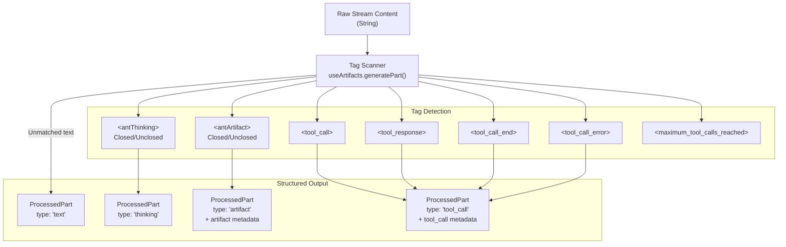
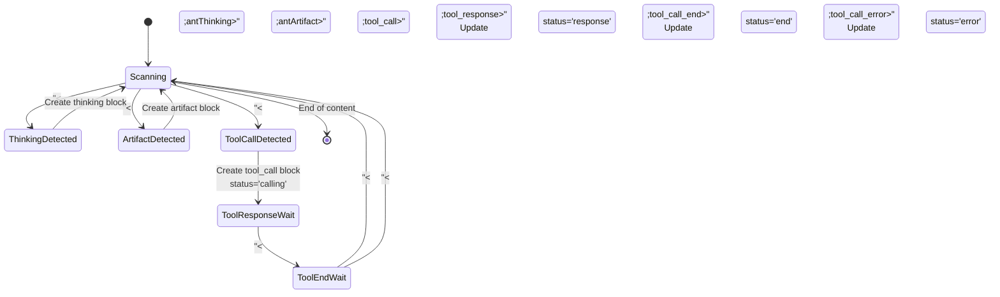
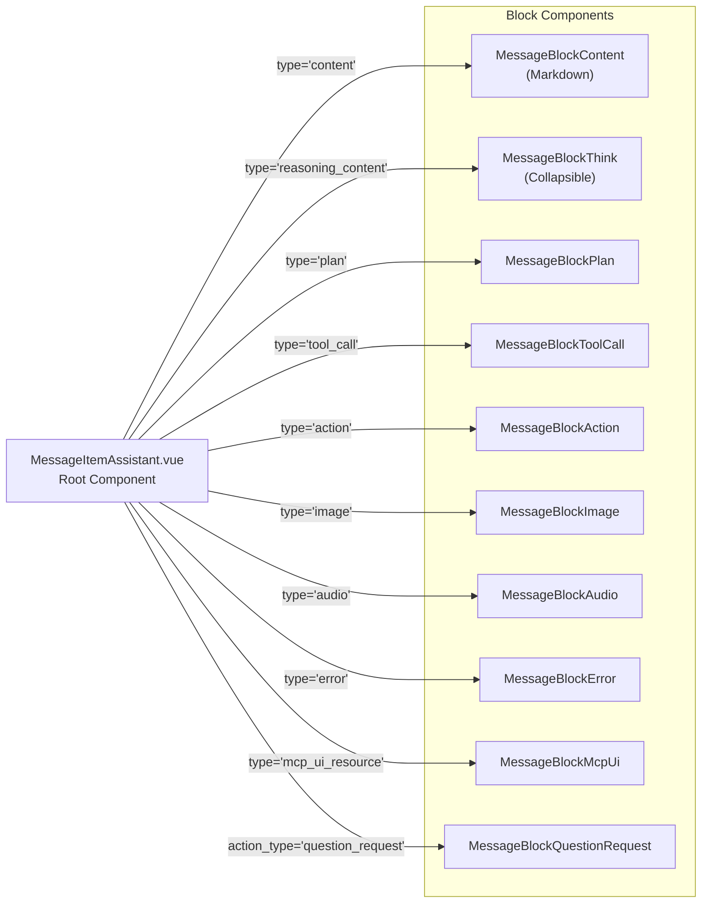
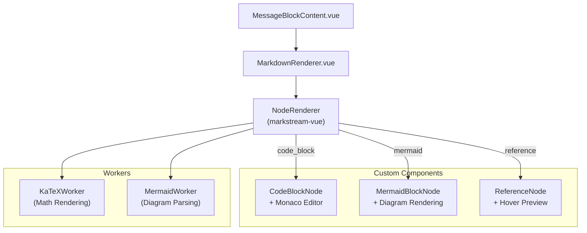
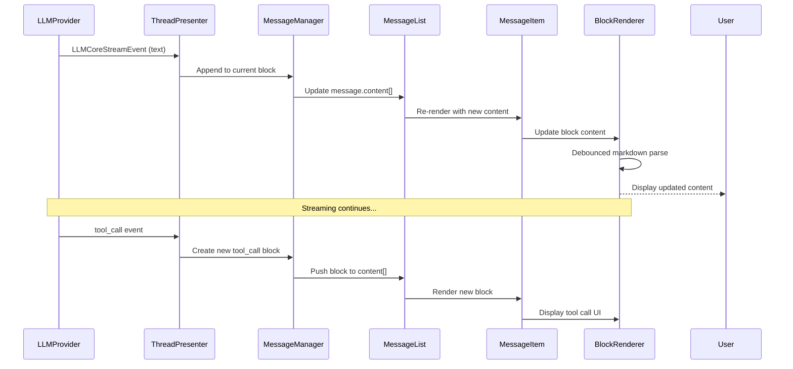

> 来源: [https://deepwiki.com/thinkinaixyz/deepchat/9.6-artifact-rendering-system](https://deepwiki.com/thinkinaixyz/deepchat/9.6-artifact-rendering-system)（Wayback 快照 2026-04-11 RSC payload 提取）
> DeepWiki thinkinaixyz/deepchat · 世代: 2026-04

# Message Rendering & Content Processing

<details>
<summary>Relevant source files</summary>

The following files were used as context for generating this wiki page:

- [electron.vite.config.ts](electron.vite.config.ts)
- [package.json](package.json)
- [src/main/presenter/mcpPresenter/index.ts](src/main/presenter/mcpPresenter/index.ts)
- [src/main/presenter/mcpPresenter/mcpClient.ts](src/main/presenter/mcpPresenter/mcpClient.ts)
- [src/main/presenter/mcpPresenter/serverManager.ts](src/main/presenter/mcpPresenter/serverManager.ts)
- [src/main/presenter/mcpPresenter/toolManager.ts](src/main/presenter/mcpPresenter/toolManager.ts)
- [src/main/presenter/proxyConfig.ts](src/main/presenter/proxyConfig.ts)
- [src/renderer/src/components/artifacts/ToolCallPreview.vue](src/renderer/src/components/artifacts/ToolCallPreview.vue)
- [src/renderer/src/components/markdown/MarkdownRenderer.vue](src/renderer/src/components/markdown/MarkdownRenderer.vue)
- [src/renderer/src/components/message/MessageItemAssistant.vue](src/renderer/src/components/message/MessageItemAssistant.vue)
- [src/renderer/src/composables/useArtifactCodeEditor.ts](src/renderer/src/composables/useArtifactCodeEditor.ts)
- [src/renderer/src/composables/useArtifacts.ts](src/renderer/src/composables/useArtifacts.ts)
- [src/renderer/src/main.ts](src/renderer/src/main.ts)
- [src/renderer/src/stores/mcp.ts](src/renderer/src/stores/mcp.ts)
- [src/shared/chat.d.ts](src/shared/chat.d.ts)

</details>


This document describes how DeepChat processes and renders assistant messages, which can contain diverse content types including text, reasoning traces, tool calls, images, audio, and interactive artifacts. The system uses a polymorphic block-based architecture to handle streaming content from LLM providers and transform it into a rich UI.

For information about how messages are created and persisted, see [Message Lifecycle & Streaming](#5.3). For information about message variants (alternative responses), see [Message Variants & Forking](#5.4).

---

## Message Data Structure

Assistant messages use a block-based content model where each message contains an array of typed content blocks.

### Core Types

```typescript
type AssistantMessage = {
  id: string
  role: 'assistant'
  content: AssistantMessageBlock[]  // Array of typed blocks
  model_name: string
  model_provider: string
  status: 'sent' | 'pending' | 'error'
  timestamp: number
  conversationId: string
  is_variant: number
  variants?: Message[]
  // ... usage statistics
}
```

**Sources:** [src/shared/chat.d.ts:39-42]()

### Block Type Enumeration

The system supports 11 distinct block types, each with specific rendering requirements:

| Block Type | Purpose | Status States |
|------------|---------|---------------|
| `content` | Standard text content (markdown) | `success`, `loading` |
| `reasoning_content` | Extended thinking / chain-of-thought | `success`, `loading` |
| `plan` | Structured plan or strategy | `success`, `loading` |
| `tool_call` | MCP tool execution with parameters | `success`, `loading`, `error`, `pending`, `granted`, `denied` |
| `action` | User interaction required | `success`, `loading`, `cancel`, `error` |
| `image` | Image content (base64 or URL) | `success`, `loading` |
| `audio` | Audio content | `success`, `loading` |
| `error` | Error messages | `error` |
| `artifact-thinking` | Artifact generation reasoning | `success`, `loading` |
| `mcp_ui_resource` | MCP UI resource (HTML, remote-dom) | `success`, `loading` |
| `search` | Web search results | `success`, `loading`, `error` |

**Sources:** [src/shared/chat.d.ts:84-152]()

---

## Content Parsing Pipeline

Raw content from LLM streams undergoes parsing to identify custom tags and structure the content into blocks.

### Parsing Flow



**Diagram: Content Parsing Pipeline**

The parser scans content sequentially from start to finish, detecting custom tags and splitting content into typed parts. When a tag is detected, it extracts attributes and content, creating structured `ProcessedPart` objects.

**Sources:** [src/renderer/src/composables/useArtifacts.ts:61-187](), [src/renderer/src/composables/useArtifacts.ts:196-235]()

### Tag Attribute Parsing

Custom tags support attributes in HTML-like syntax:

```typescript
// Example: <antArtifact type="text/html" identifier="chart-1" title="Sales Chart">
function parseAttributes(attributesStr?: string): Record<string, string> {
  const attributes: Record<string, string> = {}
  const attributeRegex = /(\w+)="([^"]*)"/g
  let match: RegExpExecArray | null
  while ((match = attributeRegex.exec(attributesStr)) !== null) {
    attributes[match[1]] = match[2]
  }
  return attributes
}
```

**Sources:** [src/renderer/src/composables/useArtifacts.ts:46-59]()

---

## Custom Tag Processing

The system recognizes several custom tags that structure LLM output into specific block types.

### Thinking Tags

```xml
<antThinking>
Extended reasoning or chain-of-thought content
</antThinking>
```

These tags mark reasoning traces that can be collapsed in the UI. The parser handles both closed and unclosed variants (for streaming scenarios).

**Sources:** [src/renderer/src/composables/useArtifacts.ts:66-85]()

### Artifact Tags

```xml
<antArtifact 
  type="application/vnd.ant.code" 
  identifier="unique-id" 
  title="Artifact Title"
  language="python">
Code or content here
</antArtifact>
```

Artifacts represent generated content (code, HTML, SVG, etc.) that can be previewed in a separate panel. The parser extracts:
- `type`: MIME type determining preview behavior
- `identifier`: Unique ID for artifact tracking
- `title`: Display name
- `language`: (optional) Programming language for syntax highlighting

**Sources:** [src/renderer/src/composables/useArtifacts.ts:86-145]()

### Tool Call Tags

Tool execution is marked by a sequence of tags:

```xml
<tool_call name="search_web">
Tool parameters and initial content
<tool_response>
Tool execution result
</tool_response>
<tool_call_end>
```

Or for errors:

```xml
<tool_call name="filesystem_write">
<tool_call_error error="Permission denied">
```

The parser maintains state across these tags, building up a single `tool_call` block with multiple status transitions.

**Sources:** [src/renderer/src/composables/useArtifacts.ts:148-186](), [src/renderer/src/composables/useArtifacts.ts:252-405]()

### Tag Processing State Machine



**Diagram: Tag Processing State Machine**

The parser maintains `currentToolCallIndex` to track the active tool call block, updating it as subsequent tags arrive during streaming.

**Sources:** [src/renderer/src/composables/useArtifacts.ts:196-420]()

---

## Polymorphic Block Rendering

`MessageItemAssistant` component maps block types to specialized rendering components.

### Rendering Component Map



**Diagram: Block Type to Component Mapping**

**Sources:** [src/renderer/src/components/message/MessageItemAssistant.vue:33-85]()

### Rendering Template

The main message component uses Vue template v-if/v-else-if chains for type-based rendering:

```vue
<template v-for="(block, idx) in currentContent" :key="`${message.id}-${idx}`">
  <MessageBlockContent
    v-if="block.type === 'content'"
    :block="block"
    :message-id="currentMessage.id"
    :thread-id="currentThreadId"
    :is-search-result="isSearchResult"
  />
  <MessageBlockThink
    v-else-if="block.type === 'reasoning_content' && block.content"
    :block="block"
    :usage="message.usage"
  />
  <MessageBlockPlan 
    v-else-if="block.type === 'plan'" 
    :block="block" 
  />
  <!-- ... additional block types ... -->
</template>
```

**Sources:** [src/renderer/src/components/message/MessageItemAssistant.vue:33-85]()

---

## Markdown Content Rendering

Standard text content blocks are rendered using an enhanced markdown processor with custom components.

### MarkdownRenderer Architecture



**Diagram: Markdown Rendering Pipeline**

**Sources:** [src/renderer/src/components/markdown/MarkdownRenderer.vue:1-134]()

### Custom Component Registration

The system uses `setCustomComponents()` from `markstream-vue` to override default rendering:

```typescript
setCustomComponents({
  code_block: (props) => {
    const isMermaid = props.node.language === 'mermaid'
    if (isMermaid) {
      return h(MermaidBlockNode, { ...props, isStrict: true })
    }
    return h(CodeBlockNode, {
      ...props,
      onPreviewCode(v) {
        artifactStore.showArtifact({
          id: v.id,
          type: v.artifactType,
          title: v.artifactTitle,
          language: v.language,
          content: v.node.code,
          status: 'loaded'
        }, messageId, threadId, { force: true })
      }
    })
  },
  reference: (props) => h(ReferenceNode, { 
    ...props, 
    onClick() { /* open URL */ },
    onMouseEnter() { /* show preview */ }
  })
})
```

**Sources:** [src/renderer/src/components/markdown/MarkdownRenderer.vue:62-130]()

### Web Worker Integration

Markdown rendering uses dedicated web workers for performance-intensive operations:

```typescript
// Global worker initialization
const globalScope = globalThis as typeof globalThis & {
  __markdownWorkers?: {
    katex: Worker
    mermaid: Worker
  }
}

if (!globalScope.__markdownWorkers) {
  const katex = new KatexWorker()
  const mermaid = new MermaidWorker()
  globalScope.__markdownWorkers = { katex, mermaid }
  setKaTeXWorker(katex)
  setMermaidWorker(mermaid)
}
```

Workers are terminated on window unload to prevent memory leaks.

**Sources:** [src/renderer/src/main.ts:25-50]()

---

## Block-Specific Rendering Logic

Each block type has specialized rendering logic beyond simple display.

### Content Block (Text/Markdown)

Standard markdown with artifact detection and search result highlighting. Uses `MarkdownRenderer` with debounced content updates (32ms, max 64ms) to prevent excessive re-renders during streaming.

**Sources:** [src/renderer/src/components/markdown/MarkdownRenderer.vue:43-60]()

### Reasoning/Thinking Block

Collapsible sections with:
- Automatic collapse state management
- Token usage display (if reasoning tokens are tracked)
- Timing information (`reasoning_time.start`, `reasoning_time.end`)

The collapse toggle emits `toggle-collapse` events to trigger UI layout adjustments.

**Sources:** [src/renderer/src/components/message/MessageItemAssistant.vue:42-46]()

### Tool Call Block

Complex rendering showing:
- Tool name with server icon
- Parameters (collapsed by default)
- Execution status indicator
- Response content (may include images/structured data)
- Permission request UI (if `requiresPermission` is true)

Tool calls can transition through multiple states: `pending` → `granted`/`denied` → `loading` → `success`/`error`.

**Sources:** [src/renderer/src/components/message/MessageItemAssistant.vue:48-53]()

### Image Block

Supports multiple image sources:
- Base64 data URLs
- File system paths (`imgcache://`)
- HTTP(S) URLs
- Local path references

Images are rendered with lazy loading and click-to-zoom functionality.

**Sources:** [src/renderer/src/components/message/MessageItemAssistant.vue:78-83]()

### Audio Block

Audio detection is heuristic-based:

```typescript
const AUDIO_EXTENSIONS = ['.mp3', '.wav', '.m4a', '.aac', '.flac', '.ogg', '.opus', '.webm']

const isAudioBlock = (block: AssistantMessageBlock): boolean => {
  if (block.type === 'audio') return true
  if (block.type !== 'image') return false
  
  // Check MIME type
  const mimeType = block.image_data?.mimeType?.toLowerCase() || ''
  if (mimeType.startsWith('audio/')) return true
  
  // Check data URL prefix
  const data = block.image_data?.data || ''
  if (data.startsWith('data:audio/')) return true
  
  // Check file extension in URL
  if (data.startsWith('imgcache://') || data.startsWith('http')) {
    return AUDIO_EXTENSIONS.some(ext => data.toLowerCase().includes(ext))
  }
  
  return false
}
```

This allows audio content to be properly rendered even when mislabeled as `image` blocks.

**Sources:** [src/renderer/src/components/message/MessageItemAssistant.vue:213-227]()

### MCP UI Resource Block

Renders MCP server-provided UI components:
- HTML content (sandboxed iframe)
- Remote DOM (interactive components)
- URI lists

Uses `@mcp-ui/client` library's `ui-resource-renderer` web component.

**Sources:** [src/renderer/src/components/message/MessageItemAssistant.vue:66-71](), [src/renderer/src/main.ts:14]()

### Action Block

Displays interactive prompts for:
- Tool call permissions (`action_type: 'tool_call_permission'`)
- Rate limit notifications (`action_type: 'rate_limit'`)
- Maximum tool calls reached (`action_type: 'maximum_tool_calls_reached'`)
- Question requests (`action_type: 'question_request'`)

Action blocks emit events (`continue`, `switchProvider`) to trigger user flows.

**Sources:** [src/renderer/src/components/message/MessageItemAssistant.vue:54-65](), [src/shared/chat.d.ts:139-143]()

---

## Content Block Extra Data

Blocks carry additional metadata in the `extra` field for UI functionality.

### Extra Field Structure

```typescript
type AssistantMessageExtra = Record<string, string | number | object[] | boolean> & {
  needsUserAction?: boolean
  permissionType?: 'read' | 'write' | 'all' | 'command'
  grantedPermissions?: PermissionType
  toolName?: string
  serverName?: string
  providerId?: string
  permissionRequestId?: string
  commandInfo?: string
  rememberable?: boolean
  
  // Question requests
  questionHeader?: string
  questionText?: string
  questionOptions?: Array<{ label: string; description?: string }> | string
  questionMultiple?: boolean
  questionCustom?: boolean
  questionResolution?: 'asked' | 'replied' | 'rejected'
  answerText?: string
  answerMessageId?: string
}
```

This enables complex UI interactions without modifying core block structure.

**Sources:** [src/shared/chat.d.ts:166-190]()

### Artifact Metadata

Artifact blocks carry rendering instructions:

```typescript
artifact?: {
  identifier: string        // Unique ID for tracking
  title: string            // Display name
  type:                    // MIME type for preview
    | 'application/vnd.ant.code'      // Code with syntax highlighting
    | 'text/markdown'                 // Rendered markdown
    | 'text/html'                     // Live HTML preview
    | 'image/svg+xml'                 // SVG rendering
    | 'application/vnd.ant.mermaid'   // Mermaid diagram
    | 'application/vnd.ant.react'     // React component
  language?: string        // Programming language (for code)
}
```

The artifact store (`useArtifactStore`) manages artifact display state and preview rendering.

**Sources:** [src/shared/chat.d.ts:111-122]()

---

## Streaming Updates & Real-Time Rendering

The rendering system handles incremental content updates as messages stream from LLM providers.

### Update Flow



**Diagram: Real-Time Content Update Flow**

The system uses Vue's reactivity to automatically re-render components as message content arrays are mutated. Debouncing (via `useDebounceFn`) prevents excessive re-renders during rapid streaming.

**Sources:** [src/renderer/src/components/markdown/MarkdownRenderer.vue:47-60]()

### Block Status Transitions

Blocks track their completion state through the `status` field:

| Status | Meaning | UI Indicator |
|--------|---------|--------------|
| `loading` | Content is still streaming | Spinner animation |
| `success` | Completed successfully | None (implicit) |
| `error` | Execution failed | Error icon & styling |
| `pending` | Awaiting user input | Warning icon |
| `granted` | Permission approved | Check icon |
| `denied` | Permission denied | X icon |

**Sources:** [src/shared/chat.d.ts:100-109]()

---

## Message Context Menu & Actions

Messages support context-sensitive actions based on content type and selection.

### Action Types

```typescript
type HandleActionType =
  | 'retry'              // Regenerate response
  | 'delete'             // Remove message
  | 'copy'               // Copy text to clipboard
  | 'prev'               // Previous variant
  | 'next'               // Next variant
  | 'copyImage'          // Copy message as image
  | 'copyImageFromTop'   // Copy conversation from top as image
  | 'fork'               // Create conversation branch
  | 'trace'              // Show trace/debug info
```

**Sources:** [src/renderer/src/components/message/MessageItemAssistant.vue:363-372]()

### Selection-Aware Context Menu

When text is selected within a message, the context menu shows additional options:

```vue
<template v-if="showSelectionMenu">
  <ContextMenuItem @select="handleSelectionCopy">
    {{ t('common.copy') }}
  </ContextMenuItem>
  <ContextMenuItem @select="handleSelectionTranslate">
    {{ t('contextMenu.translate.title') }}
  </ContextMenuItem>
  <ContextMenuItem @select="handleSelectionAskAI">
    {{ t('contextMenu.askAI.title') }}
  </ContextMenuItem>
</template>
```

Selection detection uses DOM APIs to verify the selection is within the current message component's root element.

**Sources:** [src/renderer/src/components/message/MessageItemAssistant.vue:111-121](), [src/renderer/src/components/message/MessageItemAssistant.vue:378-396]()

### Copy with Reasoning Toggle

The copy action respects the "copy with chain-of-thought" setting:

```typescript
window.api.copyText(
  currentContent.value
    .filter((block) => {
      if (
        (block.type === 'reasoning_content' || block.type === 'artifact-thinking') &&
        !uiSettingsStore.copyWithCotEnabled
      ) {
        return false
      }
      return true
    })
    .map((block) => {
      const trimmedContent = (block.content ?? '').trim()
      if (
        (block.type === 'reasoning_content' || block.type === 'artifact-thinking') &&
        uiSettingsStore.copyWithCotEnabled
      ) {
        return ``
      }
      return trimmedContent
    })
    .join('\n')
    .trim()
)
```

When enabled, reasoning blocks are wrapped in `<think>` tags for preservation.

**Sources:** [src/renderer/src/components/message/MessageItemAssistant.vue:461-484]()

---

## Performance Optimizations

### Debounced Markdown Rendering

Markdown content updates are debounced to prevent excessive parsing:

```typescript
const debouncedContent = ref(props.content)

const updateContent = useDebounceFn(
  (value: string) => {
    debouncedContent.value = value
  },
  32,     // 32ms debounce
  { maxWait: 64 }  // Maximum 64ms delay
)
```

This balances responsiveness with CPU efficiency during streaming.

**Sources:** [src/renderer/src/components/markdown/MarkdownRenderer.vue:42-53]()

### Virtual Scrolling

Message lists use `vue-virtual-scroller` for efficient rendering of long conversation histories, only mounting visible message components.

**Sources:** [package.json:184]()

### Code Editor Lazy Loading

Monaco editor instances for artifact code viewing are created on-demand when the artifact panel opens, and destroyed when closed to free memory.

**Sources:** [src/renderer/src/composables/useArtifactCodeEditor.ts:166-198]()

### Worker-Based Processing

CPU-intensive rendering tasks (KaTeX math, Mermaid diagrams) execute in web workers to prevent blocking the main thread.

**Sources:** [src/renderer/src/main.ts:22-50]()

---

## Error Handling

### Malformed Content Recovery

The tag parser includes defensive logic for incomplete or malformed tags:

- **Unclosed tags during streaming**: Parser creates blocks with `loading: true` flag
- **Missing required attributes**: Uses default values (e.g., `type: 'text/markdown'`)
- **Invalid tag sequences**: Skips unrecognized tags, treats as plain text
- **JSON parsing failures**: Attempts repair with `jsonrepair` library

**Sources:** [src/renderer/src/composables/useArtifacts.ts:108-145]()

### Error Block Rendering

Execution errors are captured in dedicated error blocks:

```typescript
{
  type: 'error',
  content: errorMessage,
  status: 'error',
  timestamp: Date.now()
}
```

These render with distinct error styling to clearly communicate failures.

**Sources:** [src/renderer/src/components/message/MessageItemAssistant.vue:84]()

---

## Integration Points

### Artifact Store

The artifact system integrates with message rendering through the `useArtifactStore`:

- **Detection**: Code blocks with preview buttons
- **Display**: Side panel with Monaco editor and live preview
- **Lifecycle**: Artifacts are tracked by `messageId` and `threadId`

**Sources:** [src/renderer/src/components/markdown/MarkdownRenderer.vue:14-15]()

### Reference Store

Search results with citation indices (`[1]`, `[2]`, etc.) integrate with hover previews:

- **Click**: Opens URL in new tab
- **Hover**: Shows preview card with title, URL, and snippet
- **Storage**: Maintained in `useReferenceStore` per message

**Sources:** [src/renderer/src/components/markdown/MarkdownRenderer.vue:15](), [src/renderer/src/components/markdown/MarkdownRenderer.vue:77-93]()

### MCP Tool Execution

Tool call blocks link to the MCP system (see [Model Context Protocol](#7)) for:
- Permission UI display
- Result rendering (text, images, structured data)
- Error handling and retry logic

**Sources:** [src/renderer/src/components/message/MessageItemAssistant.vue:48-53]()

---

This content processing architecture enables DeepChat to render rich, interactive messages with streaming updates, custom content types, and extensible block-based composition. The polymorphic rendering system cleanly separates concerns while maintaining type safety and performance.
2f:T8452,
