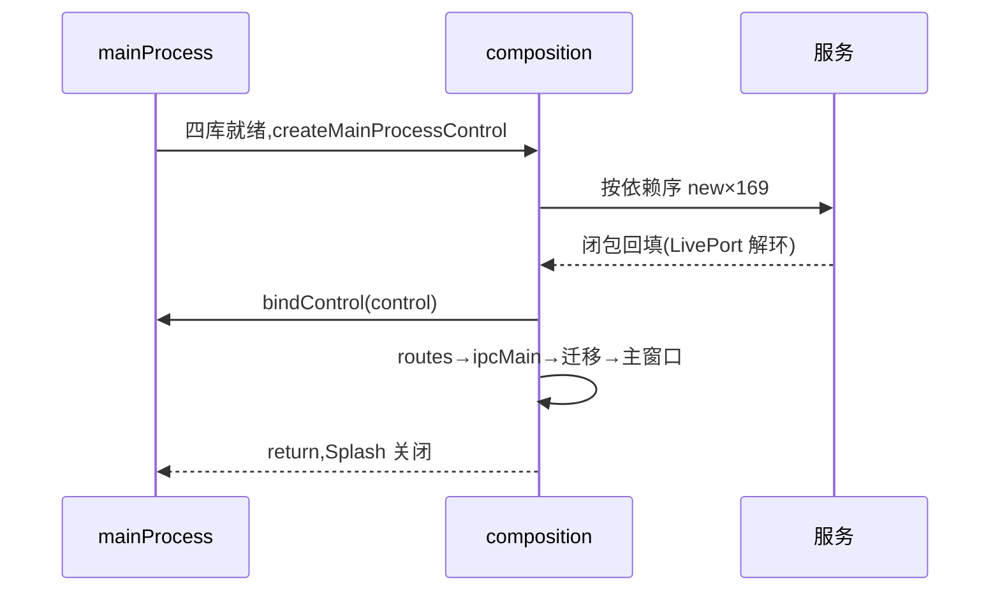

# 01 · 主进程组合根 composition.ts

> `src/main/app/composition.ts`（3953 行，dev 分支）｜图谱 step-2

## 一、角色定位

`mainProcess.ts` 是按电源键的手，本文件是主板，是**Composition Root**：主进程唯一集中实例化并接线全部子系统之处，169 处 `new`，把"如何构造、依赖谁"与"做什么"分离：服务文件只有纯业务逻辑，构造参数（闭包 port）由此供给。step-2 座右铭："找任何服务的构造处都应先来这里"。对外仅暴露 8 方法窄门面 `MainProcessControl`（L318）。

## 二、内部结构

约 130 条 import → 门面（L318）→ 辅助函数 → `createMainProcessControl`（L502-3953）。三阶段：

**1 前置声明（L527-600）**：约 90 个 `let xxx: XxxPort` 加三个生命周期状态机，即隐式依赖图。

**2 构造与接线（L608-3067）**：按依赖序 new——`WindowPresenter` 永远第一（L608），随后事件漏斗 `publishDeepchatEvent`（L772）、`McpService`（L1589）、Agent 心脏 `createDeepChatAgentHarness`（L2092）：

```ts
deepChatAgentHarness = createDeepChatAgentHarness({
  providerRuntime, database, toolService, publishEvent })
```

**3 启动序列（L3872-3953）**：组装 control → bindControl → registerRoutes → 迁移 → initializeSkills → 主窗口 → 托盘/cron → cliServer/syncHost → return。

三个专职子系统：`createLivePort`（L492）Proxy 惰性端口（访问才 resolve 真身），6 处解循环依赖；`registerRoutes`（L3068）汇 40 张 routeMap 入 `createRouteDispatcher`（L3390）经 `registerDeepchatRoutes(ipcMain,...)`（L3444）挂 IPC；`stop` 以 `runDestroyStep` 销毁约 40 组件并排空在途 Promise。

## 三、外部连接

**唯一调用方** `src/main/app/mainProcess.ts:108`：startMainProcess 先建 Splash、恢复循环启动 MainDatabase、派生四库、跑 migrateConfigStorage 后才调本工厂；bindControl 把 control 提前绑给外层变量。

**输入**：SettingsStore/SecretStore、各域 Settings、四库、DatabaseSecurityService。**被接线选录**：`@/agent/deepchat/harness`、`@/tool`、`@/mcp`、`../provider`、`../desktop/`（window/tab/tray 等）。**输出**：①门面；②routeDispatcher 渲染 RPC 与 CLI 共用（L664）；③事件流 publishDeepchatEvent→`@shared/contracts/events`→`sendToAllWindows(DEEPCHAT_EVENT_CHANNEL)`。

## 四、数据流（启动时序）



失败语义不对称：cliServer/syncHost 失败仅上报后继续；skills 迁移失败 startup-fatal（L3896 注释：迁移前渲染器不得读 manual Agent scope）。

## 五、设计决策

**组合根 vs 散装单例**：模块级单例依赖序隐式、测试 mock 全局、循环引用靠加载序赌博；显式 new+闭包注入使依赖图可读、单测可整层换 port、stop 有确定销毁清单。**3953 行权衡**：冲突热点是真实成本，但拆多装配文件会产生"装配文件间顺序"这个更难问题——用单文件长度换全进程可读性。**演进勘误**：deepwiki 2.1 的旧版中心 Presenter 单例（`src/main/presenter/index.ts`）已演进为组合根直接装配 Presenter、IPC 改 routeMap+dispatcher。**LivePort** 以 Proxy 推迟解析代替重排构造序——承认环，圈死在装配层。

## 六、新人提示

1. 找服务定义：`grep -n 'new Xxx' src/main/app/composition.ts` 三连跳（构造/routes/teardown）。
2. 新增服务四步：let 声明→构造→routeMap→runDestroyStep，缺一即泄漏或 404。
3. 顺序敏感：迁移先于渲染器；WindowPresenter 最先；hasInitialized 勿绕过。
4. CLI 陷阱：routeDispatcher 可选，早于 registerRoutes 调用撞 L664 throw。
5. 路由被拒查 databaseMaintenanceState；事件排障沿 L772→EVENT_CHANNEL→sendToAllWindows。

---

*understand-anything explain 阶段产出*
