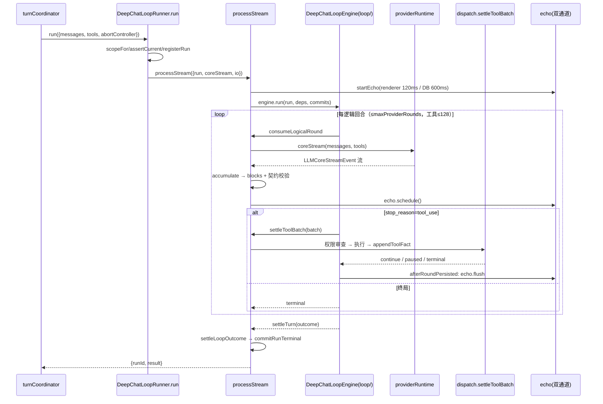

# 02 · Agent 运行时主循环：deepChatLoopRunner 与 process.ts

> 路径：`src/main/agent/deepchat/runtime/` 下 `deepChatLoopRunner.ts`（3004 行）、`process.ts`（1626 行）、`dispatch.ts`（3451 行）、`echo.ts`；`loop/deepChatLoopEngine.ts`（132 行）。

## 1. 角色定位

DeepChat 区别于聊天客户端的心脏：**带工具调用的多回合 agent 主循环**——流式回复、调工具、拿结果、再请求下一回合，直到终局或被截断。两文件是「runner 与执行体」：`DeepChatLoopRunner.run()`（L673）管回合前准备（会话水化、abort、prompt 组装、port 打包）；`processStream()`（L908）填充流消费与工具批回调，交给泛型骨架 `loop/deepChatLoopEngine.ts` 驱动，`settleLoopOutcome`（L704）终局结算。上层调用方 `turnCoordinator.ts`（L1146），组装在 `createDeepChatAgentHarness.ts`。

勘误：DeepWiki 5.3 的 `AgentLoopHandler`（presenter 层）是旧代架构，现役实现在 `agent/deepchat/{runtime,loop}/`。

## 2. 内部结构：主循环四阶段

**输入准入**：`run()` 过闸门——`scopeFor()`+`assertCurrent()`（旧 scope 迟到写被拒）、abort 链、空消息抛错、子代理必须带 `TaskContract`；排队输入经 `shouldYieldForPendingInput` 注入循环。

**流处理**（L1191）：每回合重置累积器，`for await` 消费 `LLMCoreStreamEvent`，`accumulate()` 把 11 类事件累积成 block 数组，每事件 `echo.schedule()`；步步查 `abortSignal`，中止即 halted。

**工具调用**（L1395→dispatch L2625）：流以 `tool_use` 结束后先做续写预算预检，再委托 dispatch 执行。三态出口：`continue`（`toolsChanged` 则刷新工具定义）/ `completed+terminalError` / `paused`（携 `executionState` 断点恢复）。`NoProgressToolLoopGuard` 监视重复批，屡犯熔断。

**回合协调**（L704）：五种 `DeepChatLoopOutcome` 翻译成 `ProcessResult` 并 commit 终局；工具上限 128 在引擎层。

## 3. 外部连接：ports 契约

`DeepChatLoopRunnerPorts`（L429）是唯一外部接口，全部构造注入：**provider**——`providerRuntime` 包成 `coreStream` 闭包（预算刷新、plugin 投影、trace）；**tape**——`DeepChatLoopTapePort`（`tape/ports/capabilities.ts` L342）聚合 13 个能力，工具批落盘 `appendToolFact` 以 provenance key 去重；**工具**——`toolResolver/toolExecutionPort/reviewToolPermission/sessionPermissionPort`；**会话**——`messageStore`、`runLifecycle`、`compactionService`（压力恢复限 3 次/run）；**观测**——`hookSink`。

## 4. 数据流：一轮对话

流结束还有契约校验（L1308）：ExecutionContract、ViewManifest、ToolSurface 的 requestSeq 失配即抛错，防迟到响应写入已换代会话视图。

## 5. 设计决策

**loop 与 runner 分层**：132 行 `DeepChatLoopEngine` 用四泛型把循环抽成纯协议（`consumeLogicalRound → updateOutput → settleToolBatch → afterRoundPersisted`），只管计数上限与 outcome 归并，业务全在 process.ts 回调，控制流可独立单测。

**echo 双通道异步差**：renderer 120ms（snapshot 推渲染进程）与 DB 600ms 两条节流线，渲染比持久化密 5 倍稀释 SQLite 写压；`dirty` 防空刷，终局 `flush()` 强制双写——「UI 延迟敏感、落盘可慢」。

**工具批 settle 语义**：每批必须结算成三态才进下一回合；`paused` 携可恢复 `executionState`，人工审批与子代理委托共用暂停通道，断点续跑而非重放。

**权限审查内联**：auto-approve 审查在 dispatch L1549 批执行路径内联调 `reviewToolPermission`（`ask_user/block/auto_allow` 三决策），代价是 dispatch 变大，收益是权限与执行同处一个事务边界。

## 6. 新人提示

1. 读码顺序：`deepChatLoopEngine.ts`（132 行拿协议）→ `process.ts` L908 → `deepChatLoopRunner.ts` L673 准备段、L1636 起 coreStream 闭包。
2. 「UI 有字但刷新后丢字」＝终局没走 `echo.flush()`；"Provider response does not match..." 抛错＝代际防串台保护，查 scope 是否被换代会话挤掉。
3. 新 port 保持「可选能力可选注入」惯例（如 `pruneClosedToolResults?`）。
