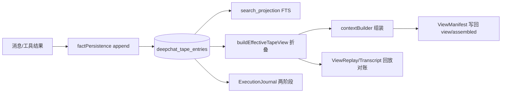

# 03 · Tape 事件溯源子系统（src/main/tape）

## 1. 角色定位：会话的事实账本

传统聊天应用用消息表持久化：编辑就 UPDATE、删除就 DELETE。DeepChat 的 Tape（约 2.2 万行）走**事件溯源**路线——`deepchat_tape_entries` 是只追加的事实日志；用户看到的会话是**回放折叠出的投影**。编辑=追加新 `message` 条目按 rank 覆盖；删除=追加 `message/retracted` 事件折叠时剔除；压缩/迁移/视图组装皆留痕。图谱 tour step-5 定性：`domain/entry.ts` 与 `domain/executionJournal.ts` 构成"发生过什么"的唯一事实源。换来审计取证、崩溃一致性（execution 事件两阶段落盘）、跨端复制（sync/replica 按条目复制）。

## 2. 内部结构：六边形四层

- **domain/**（纯逻辑）：`entry.ts` 定条目模型——kind 六种（event/anchor/message/tool_call/tool_result/context）、source_type 十种，行以 `session_id+entry_id` 为主键、`provenance_key` 幂等。`effectiveView.ts` 的 `buildEffectiveTapeView()` 是折叠核心；`viewManifest.ts` 与 `executionJournal.ts` 同级。
- **application/**：`sessionTape.ts` 的 `SessionTape` 是组合门面，聚合 `TapeFactService`（写入，`factPersistence.ts`）、`TapeRecallService`、`TapeViewReplayService`（1126 行）、`ExecutionJournalService` 等十余服务。
- **ports/**：`capabilities.ts` 约 30 个窄 Reader/Writer 接口；`storage.ts` 定 `TapeEntryStore`。
- **infrastructure/sqlite/**：`tapeEntryStore.ts`（2365 行，子系统最大）实现 entries 表+索引群；`tapeSearchProjectionStore.ts` 维护搜索投影+FTS。

## 3. 外部连接

**组装**：`src/main/session/data/index.ts:43` `new SessionTape(database)` 唯一构造。**写入方**：`agent/deepchat/runtime/contextBuilder.ts`（组装上下文并写回 ViewManifest）、`tool/codeMode/runCodeRuntimeManager.ts`、`startupMigrations/legacyChatImportService.ts`（migration 回填）。**回放方**：`session/data/transcript.ts` 的 `SessionTranscript`（66 方法）实现 `TapeTranscriptProjection`——对账"读投影表现状、回放 Tape 为准"；另有 memory、sync/replica。**SQLite 落点**：`deepchat_tape_entries` + `deepchat_tape_search_projection`（FTS5）。

## 4. 数据流

闭环自指：ViewManifest 以 `view/assembled` 事件写回 tape，又被列入 `DEFAULT_EXCLUDED_TAPE_EVENT_NAMES`，不污染下轮折叠。

## 5. 设计决策

**确定性回放**：凡影响"模型看到什么"的都进哈希链——`verifyTapeViewManifestHash()` 校验 `manifestHash` 且要求 `viewId=view_+hash前16位`；hashVersion 3/4/5 演进。回放是密码学可验证的等价重建。

**折叠语义**：`buildEffectiveTapeView()` 按 entry_id 单调扫描——`context` 条目跳过（行为证据不当内容）；retraction 删候选；message 按 rank 覆盖；tool 行随所属 message 存亡。簿记与内容严格分流。

**六边形 ports**：窄接口让消费方只声明最小依赖面，SQLite 适配器可替换；更关键是**事件名所有权**——每种审计事件由唯一严格写入器拥有（ExecutionJournal 独占三个 execution/* 事件），通用 append 通道无法伪造。

## 6. 新人提示

- 读码路线：`domain/entry.ts`（120 行）→ `effectiveView.ts` 折叠 → `sessionTape.ts` 门面 → 最后啃存储。
- **没有 UPDATE**：改数据=追加+折叠；直接 UPDATE entries 表破坏回放等价性。
- 改 ViewManifest 结构必须升 hashVersion。
- `kind='context'` 搜不到、折叠被丢是刻意设计。
- DeepWiki 未覆盖此子系统，背景读 `deepwiki/6.1-thread-and-message-management.md`。
