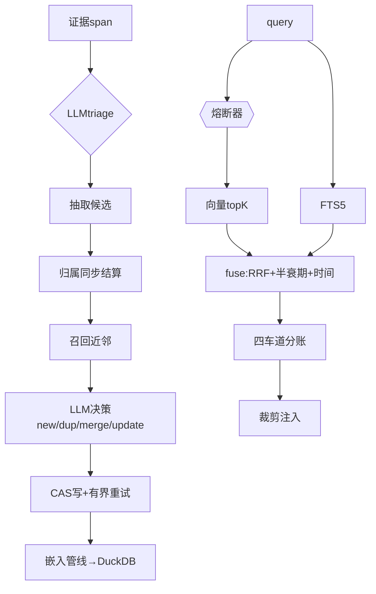

# 04 · 记忆子系统（src/main/memory/）

## 1. 角色定位

主进程的 Agent 长期记忆域：把会话事实抽取成带时间语义的 claims，持久化、打分、去冲突，每轮按 token 预算注入 prompt。经 `source_session`/`source_entry_ids` 血缘关联 Tape（第 03 篇）；与知识库（`src/main/knowledge/`）、云端记忆（`src/main/nowledgeMem/`）为三套并列来源，同汇入 Agent 上下文（tour step-6）。注意：**claims 主表在 SQLite，DuckDB 只做每 Agent 一个文件的向量库**。最大单文件 `data/tables/agentMemory.ts`（5271 行）。

## 2. 内部结构（六边形架构）

根文件：`ports.ts`（端口）、`index.ts:145`（组合根 `MemoryService`）、`routes.ts:337`（IPC 装配）、`context.ts`（执行代际+栅栏）。五层：

- **domain/**：`stateModel.ts` 状态机——kind 五类（episodic/semantic/reflection/persona/working）、lifecycle 三态、embedding 五态，`assertValidMemoryTransition` 把关。
- **data/**：`agentMemory.ts:1002` 的 `AgentMemoryTable implements MemoryRepositoryPort`；主表 CHECK 极严（scope、temporal 成组），配 tombstone/derivation/dirty 辅助表，FTS5 镜像用 `bm25()` 出词法分。
- **infra/**：`memoryVectorStore.ts` 每 Agent 独立 DuckDB（`memory_vector`+`embedding_meta`，格式版本 2）。**v1→v2 迁移**：旧库经 staging 中转、行数变动即中止，校验行数+WAL 后原子 rename 发布；失败走隔离或**从 SQLite 重建**——向量停用而 FTS 照常，降级不致死。`queryEmbeddingCircuit.ts` 查询嵌入熔断（三态）。
- **services/**：`WriteCoordinator`（写入决策内核，1627 行）、`RetrievalService`（召回，1198 行）领衔，另有 Conflict/Merge/Persona/Directive/Maintenance 等。
- **core/**：纯逻辑——`scoring.ts`（RRF）、`temporal.ts`、`contributionBudget.ts`、`injectionPort.ts`。

## 3. 外部连接

- **注入点**：适配层 `agent/deepchat/memory/memoryRuntimeCoordinator.ts` 实现 `MemoryPromptContributor`，每轮被 `runtime/promptAssemblyService.ts:162` 调 `contribute()`，经 `contextContributions.ts` 进 `contextBuilder.ts`；会话侧 ingestionObserver 切证据回调 `extractAndStore`。
- **IPC**：`src/shared/contracts/routes/memory.routes.ts` 定义 33 个 memory.* 通道（search/add/resolveConflict/directive/persona 等）。
- **上游**：`providerGateway.ts` 复用 Provider 层嵌入与文本生成。

## 4. 数据流：抽取 → 去重决策 → RRF 融合 → 注入

写路径全程持栅栏、代际过期即弃；落库后标 working dirty 并触发嵌入与巩固。

## 5. 设计决策

- **SQLite+DuckDB 分工**：事务/约束/FTS5 归前者，向量列与 VSS 归后者；按 Agent 分文件隔离爆炸半径，SQLite 是唯一真源，故迁移可弃可重建。
- **RRF 融合**（`core/scoring.ts:169`）：两路各出 `1/(rrfK+rank+1)`，最终序 `(retrievalScore + RRF) × temporalFactor`——主分携真实相似度、RRF 是小加项，强向量命中不被弱词法挤掉、双路胜单路；FTS 用基线 0.3。半衰期分层：semantic 14 天、episodic 30 天、reflection 60 天。
- **软截止+预算**：注入超时 4000ms 返回空贡献而非抛错——记忆是增强不是依赖；token 四车道（directive 512、persona 128-320、working 192-480、queryRecall 256）先保底再增长，段落超预算二分裁剪并记 manifest。
- **时间乘法门**：`temporal.ts` 出 scoreFactor（不确定 ×0.65、无日期 ×0.9），硬过滤仅置信 ≥0.8——过期知识降权淡出而非硬删。

## 6. 新人提示

1. 入口读 `index.ts:145` 构造器看依赖流向，再按 writeCoordinator→retrievalService→core/scoring 深入；agentMemory.ts 当 SQL 字典查。
2. 改 schema 先过 `domain/stateModel.ts` 与主表 CHECK；索引有 v1→v6 版本链。
3. 跨 await 写路径必须带 `captureOperationFence`，否则旧代际写入污染新配置。
4. 调试看 `MemoryInjectionManifest.dropped` 与 `infra/diagnostics/` 采集器；DeepWiki 8.x 只覆盖知识库 RAG，无本子系统专页，以源码为准。

---

*基于 dev 分支源码（2026-10-08）与 tour.json step-6 编写。*
