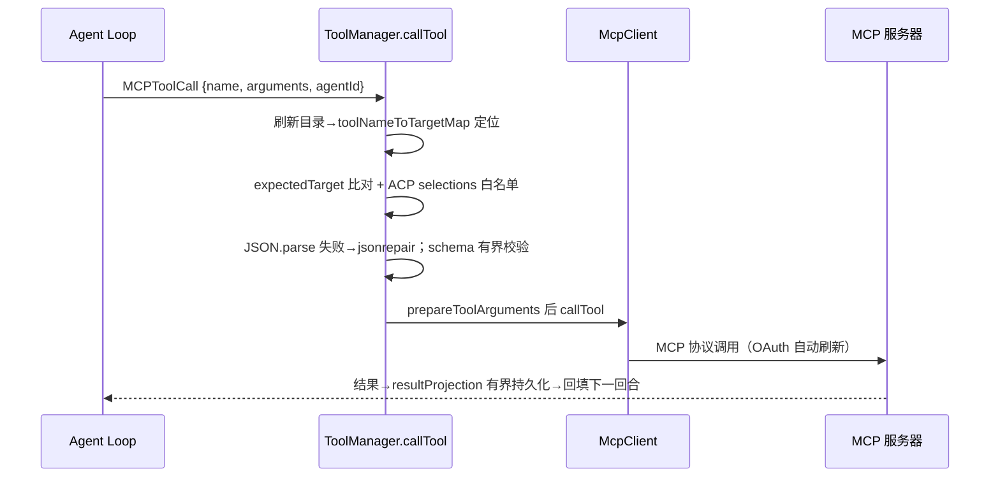

# 05 · MCP 子系统：src/main/mcp/

> `src/main/mcp/`（34 文件约 1.9 万行，dev 分支）｜图谱 step-10「工具、MCP 与扩展安全边界」｜DeepWiki 4.1-4.8 章（快照仍是旧路径 `src/main/presenter/mcpPresenter/*`，现已整体迁至 `src/main/mcp/*`）

## 1. 角色定位

DeepChat 从聊天客户端升级为 agent 平台的扩展面：搜索、知识库、Apple 原生应用、深度研究、第三方/插件 MCP 服务器，统一以 Model Context Protocol 工具形式接入。本目录是主进程侧的 MCP 总装车间：`index.ts` 的 `McpService`（L96，实现 `McpServicePort`）是唯一门面，约 45 个 async 方法覆盖服务器增删启停、工具列出与调用、OAuth/企业身份、采样与 elicitation、npm/uv 镜像管理；组合根 `src/main/app/composition.ts:1589` 实例化并注入 17 项依赖。Agent 运行时不认识任何具体服务器，只看到 `McpService` 投影出的工具目录——外部世界的复杂性终结在这道门面之后。

## 2. 内部结构

**连接层 `mcpClient.ts`**（2008 行，`McpClient` L288）：单服务器连接生命周期。四种传输按 `serverConfig.type` 分派（L556-715）：`inmemory` 走 `InMemoryTransport.createLinkedPair()`；`stdio` 用 `RegistryRecordedStdioTransport`（L260）——继承 SDK 的 `StdioClientTransport`，spawn 后立刻登记 pid 进 childProcessRegistry，连接失败/硬超时的孤儿进程仍可回收；`sse`/`http` 对应 `SSEClientTransport`、`StreamableHTTPClientTransport`。启动有 45s 软超时（L91）：到点返回 `soft-timeout-released`，UI 解锁而连接后台继续，慢服务器不阻塞应用。

**生命周期层 `serverManager.ts`**（`ServerManager` L32）：按名持有 `McpClient`，管启停、npm registry 测速、lastError。

**工具面 `toolManager.ts`**（1773 行，`ToolManager` L325）：`getAllToolDefinitions` 聚合活跃客户端工具去重成目录；`callTool`（L823）是执行主干（第 4 节）；`verifyCatalogTool`（L1225）对插件服务器做「打包目录 vs 在线 schema」逐工具比对。

**配置层 `settings.ts`**（1329 行）+ `data/settingsTable.ts`：electron-store 与 SQLite 双通道持久化。`environmentBindings.ts` 只替换显式声明的 `${env:VAR}` 且值不落盘；stdio 子进程 env 白名单仅 PATH/npm_config_* 加平台桌面变量（`processEnvironment.ts`）。

**安全附件**：`schemaValidation.ts` 对外来 schema 有界克隆（1MB/64 层/1 万键/10 万节点/256 组合分支上限）；`resultProjection.ts` 持久化结果截到 2MB；`apps/` 为 MCP Apps 沙箱（第 5 节）。

**10 种内置内存服务器**（`inMemoryServers/builder.ts` L85 工厂 switch 分派）：Bocha（bocha_web_search/bocha_ai_search）、Brave 搜索、DeepResearch（start_deep_research→execute_single_web_search→request_research_data→submit_reflection_results→generate_final_answer 五工具研究流水线）、Dify/Ragflow/FastGpt 三家外部知识库、builtinKnowledge（本地知识库）、auto-prompting、conversation-search（直查会话 SQLite 转录）、AppleServer（1933 行仅 macOS，calendar/contacts/mail/maps/messages/notes/reminders 七类原生应用，非 darwin 直接 throw）。

## 3. 外部连接

**Agent 侧唯一入口**：`src/main/agent/deepchat/runtime/toolAdapters.ts:69` 调 `getAllToolDefinitions(context)`（profile+fingerprint 缓存），执行走 `createToolExecutionPort` → `toolService.callTool`（含 `assertToolSurfaceAuthority` 权威闸）；`agentMcpFilter.ts` 按各 agent 的 MCP selections 裁剪可见服务器。**渲染进程**：`routes.ts` 注册约 60 条 `mcp*` IPC 路由映射到 `McpService` 方法，事件反向推送 `mcp.server.started/stopped`、`mcp.sampling.*`，由 `src/renderer/src/stores/mcp.ts` 消费。**OAuth/企业身份**：`mcpOAuthManager.ts`（1161 行）实现 MCP OAuth 2.1 全家桶——metadata 发现、authorization_code+PKCE、client_credentials（锚定草案修订 `fb374c7d…`）、private_key_jwt、cross_app_access；令牌经 `DeepChatMcpOAuthProvider` 落 `oauthCredentialStore.ts`（safe-storage）；`enterpriseIdentityManager.ts`（L238）在其上做可复用企业 profile，绑定变更即吊销凭证。**工具链**：stdio 命令经 `toolchains/service.ts` 的 `rewriteCommand`（L313）把 npx/uvx 等重写为托管工具链路径——npm 安装型服务器不依赖用户环境。

## 4. 数据流：一次工具调用的完整链路

执行前三重闸门：目标存在性 → 目标一致性（`McpExpectedToolTarget` 不符即拒，防「目录是 A、实际调到 B」）→ agent 级白名单（ACP 会话必须带 agentId 且服务器在 selections 内）。**采样反向流**最精巧：服务器想让 DeepChat 替它调 LLM 时，`mcpClient.ts:803` 注册的 `sampling/createMessage`（L1027）→ 委托 `McpService.handleSamplingRequest`（index.ts L1444）→ `mcp.sampling.request` 事件弹渲染层同意框 → `submitSamplingDecision` 解决挂起的 Promise → 批准且选了模型才走 `generateCompletionStandalone` 独立调用，拒绝抛 `ProtocolError('User rejected sampling request')`；elicitation（`elicitation/create`）同构。

## 5. 设计决策

**进程内 vs 外部服务器**：内置十种能力全走 `InMemoryTransport`——零 spawn 延迟、零孤儿进程、可注入主进程内部 port（conversation-search 直读 SessionDatabase）；用户/插件服务器才走 stdio/http 真连接，且有 pid 登记+启动 reap+关停逐个 stop 的完整回收链。**采样即用户主权**：pendingSamplingRequests 有容量断言（`assertInteractionCapacity`）防洪水弹窗；LLM 调用走独立通道不经过 agent 会话，服务器借采样也偷看不到会话上下文。**MCP Apps 沙箱**：`sandboxRegistry.ts` 定义私有 scheme `mcp-app://`，`sandboxProtocol.ts` 为每实例合成 CSP 与 Permissions-Policy、实例数有上限；`appHost.ts`（`McpAppHost` L188）把工具结果渲染成受控 HTML 应用（mime `text/html;profile=mcp-app`），模型上下文持久化须带 approvedHash 防篡改。**防工具漂移**：插件服务器工具须与打包 catalog 逐 schema 比对，不一致抛 `McpPreDispatchError('definition_changed')`——对「服务器热更新偷换工具签名」这一供应链攻击面的正面防御。

## 6. 新人提示

- 读码顺序：`index.ts` 的 `initialize`（L331：reap 孤儿→加载配置→npm 测速→拉起 inmemory）→ `serverManager.startServer` → `mcpClient` connect 分支（L556 起看四种传输最直观）。
- 「服务器起不来」先查 `getServerDiagnostics` 的 probe.outcome 与 `setServerLastError`；45s 软超时释放不是失败，`mcp.server.started` 会补发。
- 新增内置服务器要同步三处：`inMemoryServers/` 类 + `builder.ts` switch + `settings.ts` 两份清单，漏一处即「Unknown in-memory server」。
- 永远走 `ToolManager.callTool`，绕过它直接用 `McpClient` 会失去 ACP 访问控制与目录一致性校验。
- OAuth 升级 SDK 时重验 `MCP_CLIENT_CREDENTIALS_DRAFT_REVISION` 草案哈希锚点。
