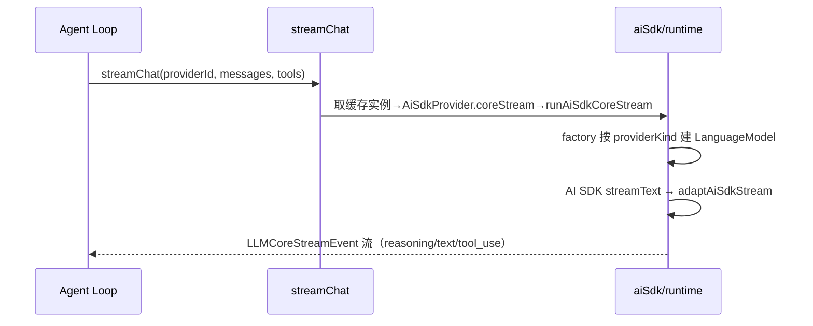

# 06 · Provider 模型接入层：BaseLLMProvider、AI SDK 运行时与 ProviderRuntime

> 路径：`src/main/provider/`——`baseProvider.ts`（948 行）、`index.ts`（1267 行，ProviderRuntime 门面）、`providerRegistry.ts`（69 个策略定义）、`aiSdk/`、`managers/`、`providers/`、`auth/`。

## 1. 角色定位

DeepChat 支持 90+ 供应商，全靠这一层把异构协议收敛成统一抽象：**所有供应商都是 `BaseLLMProvider` 子类，对上只暴露八个抽象方法**。它是主进程核心出网点——Agent 主循环（`deepChatLoopRunner.ts` L432 注入 `ProviderExecutionPort`）的每次模型调用、连通性检查、embedding 都经此出去。tour step-9 概括：注册表声明策略、AI SDK 工厂实例化、公共目录 DB 提供模型清单。

## 2. 内部结构：基类 → AiSdk 适配 → 运行时门面 → 管理器群

**抽象基类** `baseProvider.ts` L43（948 行），八个抽象方法：`fetchProviderModels`/`onProxyResolved`/`check`/`summaryTitles`/`completions`/`summaries`/`generateText`/`coreStream`（L769）。模板方法沉淀公共逻辑：`init`（L211）拉取缓存模型、`getFunctionCallWrapPrompt`+`parseFunctionCalls`（L425/L565）给无原生函数调用的模型套 XML 工具协议、`emitRequestTrace`（L825）请求追踪。

**AiSdk 适配系**：`providers/aiSdkProvider.ts`（2919 行）是「一拖九」主力——把请求转交 `aiSdk/runtime.ts` 四入口：`runAiSdkGenerateText`（L1326）、`runAiSdkCoreStream`（L1387）、`runAiSdkEmbeddings`（L1623）、`runAiSdkDimensions`（L1799，实跑一条测试 embedding 量出维度与归一化）。实例化在 `aiSdk/providerFactory.ts` L572 `createAiSdkProviderContext`：按 9 种 `AiSdkProviderKind`（openai-compatible 系四种、anthropic、gemini、azure、vertex、aws-bedrock）switch 出 AI SDK `LanguageModel`，配套 `messageMapper`/`toolMapper`/`streamAdapter` 与 legacyFunctionCall/reasoning 两个 middleware。

**运行时门面**：`index.ts` L128 `ProviderRuntime` 实现 `ProviderRuntimePort` 与三个 ACP 端口，是渲染层与 Agent 循环唯一入口；`streamChat`（L327）→ 取实例 → `coreStream`；standalone 图像/音频生成直调同一 `coreStream`。

**管理器群**（`managers/`）：`providerInstanceManager`（L353 `createProviderInstance` 特判 acp/github-copilot/voiceai/apimart/ollama/jev/workers-ai 七个专属子类，其余统一落 `AiSdkProvider`）、`rateLimitManager`、`modelManager`、`ollamaManager`、`embeddingManager`、`modelScopeSyncManager`。

## 3. 外部连接

**Agent loop 消费点**：`deepChatLoopRunner.ts` L2076 `provider.stream` 闭包调 `providerRuntime.streamChat(...)`，前置 L1999 `rateGate` 走 `executeWithRateLimit`；trace 经 `modelConfig.requestTraceContext` 回落消息层。**模型数据库**：`providerDbLoader.ts` 从 ThinkInAIXYZ/PublicProviderConf 拉 `all.json`（10MB 上限、原子写缓存）；`capabilityIdentity.ts` 裁决 openrouter/siliconflow 命名空间能力归属；`modelCapabilities.ts` 的 `ModelCapabilities` 单例是能力位总账。**IPC**：`providerFailure.ts` 把错误规范化为可跨进程元数据。**三系 OAuth**（`auth/`）：GitHub Copilot（OAuth+Device Flow）、OpenAI Codex（PKCE+credentialStore）、xAI Grok，共用 `oauthLoopbackCallback.ts` 回环捕获授权码；顶层还有 `openaiCodexAdapter.ts`/`xaiGrokAuthAdapter.ts`/`deepseekResponsesAdapter.ts` 协议适配器。

## 4. 数据流：一次流式生成

## 5. 设计决策

**基类抽象层级**：`BaseLLMProvider` 只锁「模型生命周期 + 五类调用」稳定面，鉴权/路由/能力差异下沉策略位，69 个注册定义才能共享一个 `AiSdkProvider`。**AI SDK 统一 vs 原生 SDK**：九种 runtimeKind 全走 Vercel AI SDK 换取流式/工具调用免维护，代价是 baseUrl/请求体怪癖要在 factory 逐家 normalize；Ollama/Copilot/ACP 差异过大者保留原生 SDK 子类。**策略位系统**：`AiSdkProviderDefinition` 用六个 strategy 字段（modelSource/check/credential/keyStatus/route/embedding）声明行为而非继承。**能力位**：能力查询与实例解耦（快照注入 runtime context），按快照动态裁剪请求参数。

## 6. 新人提示

加一个 OpenAI 兼容供应商：①`providerRegistry.ts` 加 `createDefinition({ runtimeKind: 'openai-compatible', ... })`；②`defaults.ts` 补内置条目与默认模型；③走公共目录则 `providerDbGroup` 对齐分组。调试三把刀：看不到实例查 `providerInstanceManager.ts` L406 分派总闸；流异常看 `streamAdapter.ts` 事件映射；请求没出去查 `providerTransport.ts` 的 routeStrategy。注意 `defaults.ts` 的 id 与注册表 apiType 必须一致，新增 OAuth 类要同步 `auth/index.ts`。
