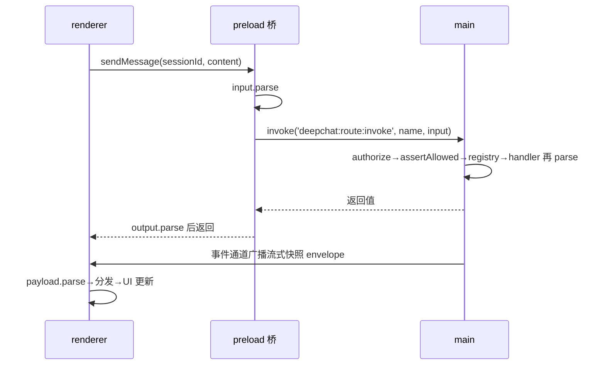

# 07 · IPC 契约体系与进程边界

> `src/shared/contracts/` + `src/preload/` + `src/renderer/api/`（dev 分支）｜图谱 step-3 / step-4

## 一、角色定位

Electron 三进程无共享内存，一切协作都要过 IPC 窄门。传统项目用"字符串 channel 加手写 listener"，拼错名字、payload 漂移都要到运行时才炸。本体系把进程边界**契约化**：契约目录用 zod 定义每条路由的输入输出与每个事件的负载，名字和形状在编译期锁死。这是全局地基而非工具层：它是图谱入度最高的一层，全仓 49 个路由模块、31 个事件模块、599 条路由、115 个事件契约的类型都从这里派生。渲染进程、CLI 控制面、内部调度器共用**同一套契约与分发管线**（`RouteCaller` 判别联合区分调用方），进程边界只有一条，没有平行小道。

## 二、内部结构

三层漏斗，自下而上：

**契约定义层**。`contract.ts` 的 `defineRouteContract` 是 identity 函数，靠 `const Name` 泛型把字面量名（`'chat.sendMessage'`）钉进类型，运行时零开销。每条契约就是名字加两个 zod schema；公共积木沉淀在 `common.ts`（实体 ID 等五十多个跨域 schema），域级在 `domainSchemas.ts`。聚合文件 `routes.ts` 把 49 个 `routes/*.routes.ts` 以 `[xxxRoute.name]: xxxRoute` 组装成 `DEEPCHAT_ROUTE_CATALOG`（599 条，PART_1~5 五块合并，显式注解避免巨型内联推断类型）；`events.ts` 同构出事件目录与 `createDeepchatEventEnvelope`（发布侧 parse）。物理通道恒为两条（`channels.ts`）：`deepchat:route:invoke` 与 `deepchat:event`。

**桥层**。`preload/createBridge.ts` 产出 `DeepchatBridge`（接口在 `contracts/bridge.ts`，仅 `invoke`/`on` 两方法）。`invoke` 四步：路由名合法性检查（`hasDeepchatRouteContract`）、入参 `input.parse`、`ipcRenderer.invoke` 单通道转发、出参 `output.parse`。`on` 用 WeakMap 维护每个 ipcRenderer 独立的事件 runtime：单一 listener 收事件通道，按 envelope 的 name 分发给订阅者集合，负载过 `payload.parse` 后回调，返回退订闭包。ipcRenderer 被抽象成三方法接口 `IpcRendererLike`，纯逻辑可单测。`preload/index.ts` 把冻结的桥经 `contextBridge.exposeInMainWorld('deepchat', ...)` 注入页面。preload 共五入口：主窗口 `index.ts`（兼管剪贴板与外链白名单的旧式 `window.api`）、`browser-overlay-preload.ts`、`floating-preload.ts`、`plugin-settings-preload.ts`、`splash-preload.ts`。

**客户端工厂层**。`renderer/api/` 共 44 个 `createXxxClient.ts` 工厂加 `core.ts`（从 `window.deepchat` 取桥）与桶导出 `index.ts`。工厂方法把契约当校验器又当类型源：`ChatClient.ts` 的 `sendMessage` 先用 `chatSendMessageRoute.input.parse` 组装入参，再 `bridge.invoke(chatSendMessageRoute.name, input)`，返回类型自动联动为该路由的输出类型。

## 三、外部连接

**主进程注册**：每域一个 `src/main/<域>/routes.ts`，如 `approval/routes.ts` 的 `createApprovalRoutes(dependencies)` 用 `createRouteMap` 把契约名映射到 handler——handler 内再次 parse 入出参、`requireRendererCaller` 校验调用方，依赖全走 Readonly 注入。组合根 `composition.ts` 的 `registerRoutes` 汇全部 routeMap 入 dispatcher，经 `src/main/routes/index.ts` 的 `registerDeepchatRoutes` 挂唯一的 `ipcMain.handle`；`dispatchDeepchatRoute` 先 `assertRouteAllowed`（维护窗口熔断）再查 `routeRegistry`，长任务经 `startupWorkloadCoordinator` 排期。**事件出口**：`composition.ts` 的 `publishDeepchatEvent` → `sessionEventRouter.publish` → 按 envelope 广播到各窗口。**渲染消费**：stores 与组件 import 各 client 工厂，事件订阅也挂在 client 上（ChatClient 同时引用 `chatStreamUpdatedEvent` 等四个流式事件契约）。**CLI 侧**：`src/main/cli/server.ts` 复用同一 dispatcher，只是 `RouteCaller` 换 cli 分支并带 scopes 校验。

## 四、数据流

一次 `chat.sendMessage` 往返：

同一契约在链路上被 parse 四次（preload 入、main 入、main 出、preload 出）——冗余是刻意的：任何一段被绕过（CLI 直入、内部调度器调用），校验依然完整。

## 五、设计决策

**zod 四点校验**：负载跨结构化克隆边界后类型归零，把 schema 与类型一体（`z.infer` 反推），每次跨界 parse，坏数据在最近一跳抛 ZodError，而非渲染层 undefined 三层之后才崩。**热路径例外**是成熟度标志：桥顶部的 `STREAM_VALIDATION_BYPASS_EVENTS` 只含 `chat.stream.updated`——它每约 120ms 重发全量块快照，逐 listener 深度 parse 是可测的性能税，而主进程发布前已 `cloneBlocksForRenderer` 校验过，故降级为三字段结构检查。**looseObject 前向兼容**：`config.routes.ts` 大量用宽松对象（未声明键不报错）——Agent 与 MCP 配置这类随版本增字段的负载，旧 renderer 收到新 main 的多余字段不会 parse 失败，跨版本升级（含 sync 双端异版本）不炸 IPC。**事件与路由双通道**：路由是请求响应（恰好一条回复），事件是广播流（多窗口多订阅者）；envelope `{name, payload}` 复用单一事件 channel，channel 数恒为二。**catalog 分块**：599 条契约的单巨型对象会让 tsc 类型爆炸，拆五块 `satisfies` 再显式注解交叉合并，路由名互不重叠有类型保证。

## 六、新人提示

加一条新 IPC（`foo.bar`）的完整改动清单：

1. **契约**：`contracts/routes/foo.routes.ts` 用 `defineRouteContract` 定义，复用 `common.ts` 既有 schema 勿重造；
2. **目录**：聚合文件 `routes.ts` 对应 PART 加 `[fooBarRoute.name]: fooBarRoute` 与 re-export——漏掉这步，`hasDeepchatRouteContract` 直接拒识；
3. **handler**：`src/main/foo/routes.ts` 写 `createFooRoutes`，`createRouteMap` 加入出参 parse 与 `requireRendererCaller`，到组合根 `registerRoutes` 汇入；
4. **客户端**：`renderer/api/FooClient.ts` 写工厂，进 `index.ts` 桶导出，业务经 store 消费；
5. **事件推送**（可选）：`events/foo.events.ts` 用 `defineEventContract`，入 `events.ts` 目录，主进程 `publishDeepchatEvent` 发、渲染层 `bridge.on` 收。

三条红线：别绕开桥自造 channel（旧式 `window.api` 是冻结的历史遗物，不是先例）；schema 默认严格 `z.object` 拒未知键，仅确需前向兼容的配置面用 `looseObject`；砍高频事件校验要先测再砍，参考流式旁路"主进程预校验加渲染层结构检查"的模式，勿默认全量 parse。
