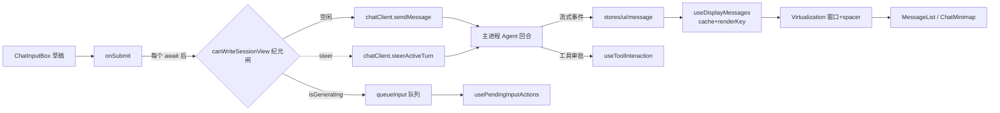

# 08 · 聊天主界面：ChatPage 与 composables

> `src/renderer/src/features/chat-page/`（ChatPage.vue 1759 行 + composables 12 个 + model 纯逻辑 8 个）｜图谱 step-13

## 一、角色定位

主窗口聊天 UI 的总装配中心，图谱 step-13 的判词就是"装配"：会话恢复纪元、滚动控制、消息虚拟化与 minimap、输入提交/队列/steer、工具交互审批，全在此接线。它是全仓最重的 Vue 组件，但走"厚装配 + 薄逻辑"路线：模板只是三行网格＝顶栏/滚动区/输入区，逻辑全部下沉到 `composables/` 与 `model/`。它几乎不拥有业务状态，拥有的是**视图写闸纪律**：异步结果只准写进"当前仍活跃的那个会话视图"。

## 二、内部结构

ChatPage.vue 的 props 只有 `sessionId` 与 `focusComposerOnMount`，script setup L504-L1630 按依赖顺序装配 14 个 composable（12 本目录+2 共享）：纪元（L504）→滚动（L520）→显示列表（L1031）→窗口与手势（L1071-1101）→搜索（L1183）→审批（L1356）→输入路由/语音/提交（L1418-1507）→动作与队列（L1572/1599）→事件桥（L1630）。

| 文件（composables/） | 行数 | 职责（据 JSDoc 钉版） |
|---|---|---|
| useComposerSubmit.ts | 1356 | 提交引擎：草稿与全部提交路径 send/queue/steer/斜杠/手动压缩 |
| useDisplayMessages.ts | 465 | 持久化+流式态归并成 `DisplayMessage[]`；identity cache 与 renderKey 交接 |
| useMessageActions.ts | 330 | 消息级动作：重试（含附件 fallback）、删除确认与刷新 |
| useChatSearch.ts | 321 | 会话内查找 Cmd/Ctrl+F：查询/命中索引/高亮/rAF 合并刷新 |
| useMessageVirtualization.ts | 294 | 虚拟化原子：几何 refs 算渲染窗口，测量合并单次 rAF，逻辑锚保持阅读位置 |
| useListGestures.ts | 252 | 手势原子：pointer/touch/wheel → 滚动中/活动手势/顶部上翻分页 |
| useToolInteraction.ts | 234 | 待处理工具交互的发现与响应提交；stale 交互剔除 |
| useVoiceInput.ts | 172 | 语音输入能力态 + 配置竞态 token |
| usePendingInputActions.ts | 167 | 已排队输入的编辑/删除（与提交引擎刻意分离） |
| useSessionRestore.ts | 122 | 会话恢复纪元（见第五节） |
| useComposerInputRouting.ts | 87 | 页面级 typing/paste 路由进 composer；NewThreadPage 复用 |
| useChatPageEventBridge.ts | 82 | 全局事件桥：右键 Ask AI、workspace 插引用；显式 start/stop |

`model/` 是纯函数层（无 Vue 依赖可直接单测）：`displayMessage.ts`（323 行）定义显示层消息模型（文本/reasoning/工具调用等 block），图谱 35 入度、全目录之最；另有草稿三件套、minimapTicks 等。三层：**model 纯逻辑 < composable 原子 < ChatPage 装配**。

## 三、外部连接

- **Pinia stores**：`stores/ui/` 下 session/message/pendingInput/attachmentPreparation/spotlight/sidepanel 六个，加 uiSettingsStore、modelStore、acpExtensionsStore；composable 里写 `ReturnType<typeof useMessageStore>` 别名、经 options 注入。
- **API 客户端**：ChatPage L452-455 创建 `createChatClient/createModelClient/createProviderClient/createSessionClient`（契约工厂，见 07 篇），分发给 useComposerSubmit（四个全要）等。
- **事件侧**：`WORKSPACE_EVENTS.INSERT_REFERENCE_REQUESTED` 与右键 Ask AI 走 useChatPageEventBridge；useComposerInputRouting 自监听 window `paste`。
- **共享 composables**（renderer 顶层）：`composables/chat/useChatScrollController`（滚动唯一调度器）、`composables/message/useMessageWindow`、`chatScrollState.requestChatScroll(...)`——搜索导航与锚点校正不与 auto-follow 抢滚动条。
- **下游组件**：MessageList、ChatInputBox、ChatMinimap、PendingInputLane、ChatToolInteractionOverlay 等。

## 四、数据流

一次"输入→提交→流式回显→虚拟列表渲染"链路：

1. **草稿**：ChatInputBox 输入进 useComposerSubmit 的 per-session 草稿（`sessionDrafts`+revision+fingerprint+技能选中），经 composerDraftPersistence 落盘，切会话无损还原。
2. **提交**（onSubmit，L1022）：`canSubmitNow`→防重入→捕获 `currentRestoreRequestId()`→`prepareFilesForCurrentModel`（按模型过滤音频/切视觉模型）→**每个 await 后复查** `canWriteSessionView`→斜杠分流（手动压缩）→生成中则 `queueInput` 入队，否则 `dispatchComposerAttempt('send')` 走 `chatClient.sendMessage`；steer 调 `chatClient.steerActiveTurn` 注入进行中回合。
3. **流式回显**：主进程流式事件更新 `stores/ui/message`→useDisplayMessages 重算；identity cache 使 token 级更新不重建已 settle 的行；提交瞬间先立的占位符经 **renderKey 交接**移交身份给真实流式行，同节点 patch 而非重挂。
4. **虚拟化渲染**：useMessageWindow+useMessageVirtualization 算出 `visibleDisplayMessages` 与前后 spacer，MessageList 只渲染窗口内消息；`__rate_limit__:` 前缀流式消息折成瞬态块 `ephemeralRateLimitBlock`。

## 五、设计决策

1. **巨型组件拆成 composable 原子**。每个 composable 的 JSDoc 钉死"Owns X, owns NO Y"（useListGestures 明言不拥有窗口/几何/历史态，靠回调回接），依赖全走 options 注入，提交引擎可独立测试演进。
2. **会话恢复纪元（epoch）是本目录的灵魂**。useSessionRestore 用单调递增 `restoreRequestId` 做 token：`beginSessionChange`/`deactivate` 时自增，旧会话（或已卸载页面）的旧 token 永远赢不了竞态；`canWriteSessionView` 五重校验（视图活跃、epoch 相等、props 与 messageStore 的 sessionId/committedSessionId 一致），被提交/审批/消息动作三处 composable 继承。首次恢复经 `scheduleStartupDeferredTask` 推迟到窗口 idle。
3. **send/queue/steer 分流单点**：只在 onSubmit 一处依据 `isGenerating` 判定，队列消费与 steer 去重（steeringSessionIds）在提交引擎内闭环。
4. **虚拟化与手势解耦**：virtualization 只读几何 refs；手势进行中冻结 windowing/measurement；阅读位置用**逻辑锚**（非 DOM rect）在消息高度变化后保持；无障碍模式 `disableWindowing` 全量渲染。
5. **审批防呆**：useToolInteraction 维护 `staleInteractionKeys`，把主进程已无法解析的交互（backing run 消失等）剔除，避免审批弹层卡死；响应被拒必须显式上报（`onResponseFailed`）。

## 六、新人提示

- 改提交流程先读 useComposerSubmit 的 `onSubmit → dispatchComposerAttempt` 主链（L1022/L848），别绕过 `canWriteSessionView`——新增 await 后不复查纪元，就会复现"写错会话"级 bug。
- 新增异步写入标准姿势：await 前捕获 `currentRestoreRequestId()`，await 后 `canWriteSessionView(sessionId, requestId)` 复查（参照 `refreshAfterRetryFailure`）。
- 路径易混：feature 内 composables 在 `features/chat-page/composables/`，共享滚动/窗口在 renderer 顶层 `composables/chat|message/`，别改错层。
- 渲染性能先看 ChatPage 注入的窗口三常量 `MESSAGE_WINDOWING_THRESHOLD / MESSAGE_INITIAL_WINDOW_COUNT / MESSAGE_WINDOW_OVERSCAN_PX`，调常量而非算法。
- `model/` 纯函数无 Vue 依赖，补单测首选；composable 层按 options 注入 mock store。
