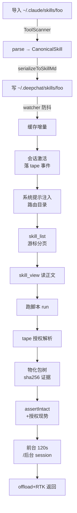

# 09 · Skill 技能子系统（src/main/skill/）

## 1. 角色定位：Agent 技能市场与跨工具互操作枢纽

`src/main/skill/` 约 1.5 万行，是 DeepChat 的技能中枢，一体四职：

- **技能市场**：`index.ts`（6,721 行）的 `SkillService`（L367）管全生命周期——发现/v1/v2→v3 迁移/按 agent 分配/草稿/多路安装/文件监听。
- **LLM 路由目录**：`routingCatalog.ts`（762 行）把技能目录投影成 token 受控路由卡片，供 LLM 的 `skill_list`/`skill_view` 按需检索，HMAC 签名游标分页。
- **脚本执行链**：`skillExecutionAuthority.ts` + `skillExecutionPackageTree.ts` + `skillExecutionService.ts` 三件套——tape 清单解析授权、物化带完整性校验的包树、前台/后台执行。
- **跨工具互操作**：`sync/` 下 12 个外部 AI 工具适配器 + `FormatConverter`，外部工具装的技能可直接互导。

定位：MCP 管外部工具，Skill 管领域知识包+附带脚本，共构成 Agent 可扩展能力面。

## 2. 内部结构

### 2.1 SkillService 与目录布局

根目录默认 `~/.deepchat/skills/`。`agentSkillRoots.ts` 定多 agent 布局：内置 agent `deepchat` 直接用根，其余落 `.agent-scopes/<agentId>/`；`assertSafeSkillAgentId` 正则白名单 + `realpathSync` 物理围栏，双重拒绝路径逃逸与 symlink。sidecar 在 `.deepchat-meta/`，草稿在 temp（留 7 天）。

关键状态：per-agent `metadataCache`/`contentCache`、`discoveryPromise` 防并发、`mutationTail` 把写操作串成承诺链、scope 删除前 drain waiters 排空。管理状态 `SkillManagementState`（v3）持久化绑定与同步配置；`migrateSharedSkills`（L702）以 staging+journal+recovery 幂等断点迁移。发现走 `discoveryWorker.ts` 内联 worker 扫 `*/SKILL.md`（六类警告含 unsafe-name 等）。安装面 `installFromFolder` L3333、`installFromZip` L3390、`installFromUrl` L3442、`installSkillsFromGit` L3517 等，均有 `...ForAgent` 变体进 scope 锁；监听 `watchSkillFiles` L5864，300ms 防抖批处理。

### 2.2 路由目录与 HMAC 游标

`SkillRoutingCard` 五档投影 `full|summary|name_only|omitted|absent`，预算 = min(2000 tokens, contextLength×0.02)。`buildSkillListResult`(L685)：查询归一→评分排序→游标解码取 offset→切页→逐档收缩 summary 塞进预算。游标 `{v,q,f,o}` + HMAC-SHA256 签名，密钥 `randomBytes(32)` 进程级随机（L77）。

### 2.3 执行链三件套

- **授权**：`SkillExecutionAuthorityResolver`(L190) 以 canonical 请求（sessionId/runId/manifestHash 等）从 tape 视图清单（V6/V7）解析 identity+executionPackage+environment，`cloneAndFreeze` 深冻。
- **包树**：物化到 `deepchat-skill-exec-*` 临时目录（0700/0600），descriptor 携 ownershipToken、packageHash 与逐文件 `{relativePath,byteCount,sha256}` 证据（UTF-8 字节序递增）；硬限 256 文件/512KB 单文件/4MB 总量。`assertIntact()` 随时复核。
- **执行**：`SkillExecutionService.execute`(L104)：限界→授权现势→物化→`buildSpawnPlan`（uv/python/node/shell）→RTK 改写（rewrite/direct/bypass）→前台（120s 超时、10k 字符 offload）或后台（`backgroundExecSessionManager`，返回 running sessionId）。dispatch 前 `assertReadyForDispatch` = 包树完整+授权现势+审计钩子三连闸。

### 2.4 sync/ 适配器群

`toolScanner.ts` 的 `EXTERNAL_TOOLS`（L56）声明 13 个扫描点（12 适配器+cursor-project 变体），各含 skillsDir/filePattern/capabilities。`security.ts` 定界：单文件 10MB、技能夹 50MB，`resolveSafePath`/`sanitizeSkillName` 防 `../` 逃逸与坏名。适配器实现 `IFormatAdapter`（`@shared/types/skillSync` L246），`adapters/index.ts` 注册进 Map。`FormatConverter` 以 `CanonicalSkill` 为中枢：parseExternal（含子目录装载）→ serializeToExternal / serializeToSkillMd（原生格式即 Claude Code SKILL.md），`getConversionWarnings` 预警数据丢失。

## 3. 外部连接

- **装配**：`src/main/app/composition.ts` L155-159 创建四服务，L116 接 `createSkillRoutes`（IPC 路由，487 行）。
- **Agent 运行时**：`src/main/agent/deepchat/resources/systemPromptBuilder.ts` 在 `isEnabled()` 闸门下注入 pinned 卡片+路由目录（降级码 `skill_agent_unavailable`）；`runtime/toolResolver.ts` 用 `normalizeSkillToolName` 归一工具名并校验 active-skill 快照；系统提示教 LLM"先 skill_list+skill_view 再干活"。
- **tape 事件溯源**：技能激活记为 tape 事件，执行授权即"重放当时视图"（`@/tape/domain/skillMaterialization`）。
- **同步双端**：`scanAndDetectNewDiscoveries` 扫到外部新技能发提醒；`previewSyncDirectoryExport`/`executeSyncDirectoryExport`(L3649) 反向导出。
- **其他**：`src/main/cli/skillService.ts` CLI 面、`pluginSkillContributions` 插件只读贡献、后台走 `src/main/agent/shared/process/backgroundExecSessionManager.ts`。

## 4. 数据流：从装一个技能到 Agent 调用

## 5. 设计决策

- **HMAC 游标**：不信任客户端状态——进程随机密钥、`q` 绑定查询哈希、`f` 绑定目录指纹（技能集一变旧游标自动作废）、canonical base64url 检查、`timingSafeEqual` 防时序侧信道。offset+指纹比"排序键编进游标"简单且天然防跨目录重放；代价是目录变更时分页整体失效。
- **包树完整性（TOCTOU 防护）**：不在源目录直接执行，而是物化到私有临时目录并逐文件 sha256，执行前后 `assertIntact()`；授权对象深冻。"授权（manifestHash）"与"内容（文件哈希）"分离，各管一段时间的完整性。
- **适配器继承体系**：`ClaudeCodeAdapter` 是事实基类，`CodexAdapter`/`AgentsAdapter`（agentskills.io 同构）直接 extends 只改 id/source；`KiroAdapter` 独立（steering 无 description，从 blockquote 提取，三档 inclusion）；Windsurf 纯 Markdown。`CanonicalSkill` 中枢+能力声明，不支持的字段显式出 warning 而非静默丢失。
- **巨型文件取舍**：index.ts 6,721 行是反巨型原则的例外，但执行/授权/路由/同步已拆独立文件，主文件只剩生命周期编排——改动优先新建协作模块。
- **迁移幂等**：journal 落盘 planned/committing，崩溃重启从 recovery targets 续跑，避免半迁移态损坏用户技能。

## 6. 新人提示

1. **读 index.ts 先看区带**：安装族 L2939-3560、同步目录 L3649 起、草稿 L2684 起、watch L5864 起、会话激活 L5633 起；先读 `src/shared/types/skill.ts` 的 Port 接口再看实现。
2. **skill_list 游标报错**：技能增删使目录指纹变化，旧游标抛 "cursor does not match" 是设计行为非 bug。
3. **执行失败排查顺序**：授权现势（tape manifest）→ 包树 sha256（不匹配多为并发写技能目录）→ spawn plan（uv 缺运行时会 fallback）。
4. **加新适配器**：`EXTERNAL_TOOLS` 扫描点 + `adapters/` 实现类（同构格式优先 extends ClaudeCodeAdapter）+ `adapters/index.ts` 注册，三处缺一不可；capabilities 须如实声明，否则 warning 与子目录装载失真。
5. **安全红线**：外部路径必过 `resolveSafePath`，skill 名走 `sanitizeSkillName`，勿绕过 `assertSafeSkillAgentId` 拼 agent 目录。
