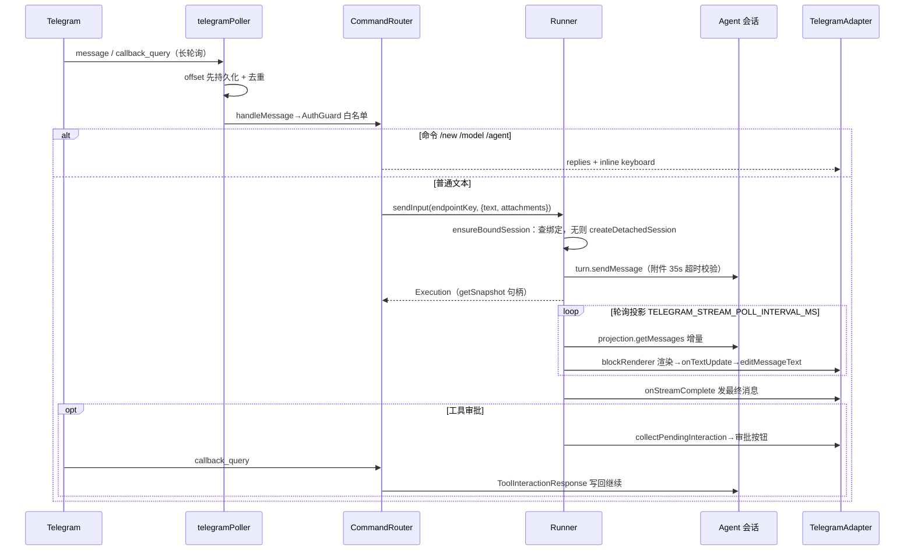

# 10. 远程控制子系统（src/main/remote/）

## 1. 角色定位：把桌面 Agent 变成 IM 机器人

`src/main/remote/`（约 23,000 行）把桌面 Agent 暴露成五个 IM 平台的机器人——手机上发一句话，家里跑 DeepChat 的电脑替你跑一轮 Agent 会话，结果渲染回聊天窗口。

| 渠道 | 接入方式 | 核心文件（`channels/` 下） |
|---|---|---|
| Telegram | Bot API 长轮询 | `telegram/telegramPoller.ts`（954 行） |
| 飞书 | OAuth + CardKit 流式卡片 | `feishu/feishuRuntime.ts`（1127 行）、`feishuAuth.ts` |
| QQBot | WebSocket 网关 + 被动回复 | `qqbot/qqbotRuntime.ts`、`qqbotGatewaySession.ts` |
| Discord | WS 网关（心跳/RESUME）+ REST | `discord/discordRuntime.ts`、`discordGatewaySession.ts` |
| 微信 iLink | 扫码换 bot_token + 加密媒体 | `weixinIlink/weixinIlinkRuntime.ts`、`weixinIlinkClient.ts` |

副线两条：CronJob 结果投递（`delivery/service.ts`）；"配对"安全机制——新设备先在桌面端 `createChannelPairCode` 生成配对码，IM 里发送后才建立绑定，防陌生人盗用。

## 2. 内部结构：适配器抽象 / 渠道实现 / 会话 runner

目录骨架：`index.ts`（RemoteService 门面 2730 行）、`types.ts`（1785 行类型中枢）、`ports.ts`（七个 Port 接口）、`routes.ts`（22 条 remoteControl* IPC 路由）、`runtime/`（抽象层）、`binding/store.ts`（RemoteBindingStore）、`conversation/`（runner 1381 行 · commandRouter 1078 行 · blockRenderer · interaction）、`channels/<五渠道>/`（adapter+Runtime+Client+commandRouter+Parser）。

**ChannelAdapter 抽象**（`runtime/adapter.ts:26`，`abstract class ... extends EventEmitter`）：模板方法 `connect()/disconnect()` 定流程，子类实现 `performConnect(signal)/performDisconnect()`；抽象方法 `sendMessage` 与 `sendTypingIndicator`；流式钩子 `onTextUpdate/onStreamComplete/onStreamError` 带默认空实现——支持"编辑消息"的渠道做增量更新，不支持的忽略；公共附件能力 `downloadImageAsBase64/downloadFileAsBase64`。

**双注册表**（`runtime/manager.ts`）：`AdapterRegistry` 按 `source:channelType` 管理 `ChannelFactory`（`'builtin' | 'plugin'` 双源，插件可注册新渠道不动主程序）；`ChannelManager` 按 `channelType:channelId` 管运行实例并转发 message/command 事件。

**RemoteService 门面**（`index.ts:216`）：每渠道 settings/status/bindings/配对 API、飞书 OAuth 三段式、微信扫码登录。两处细节：`index.ts:1226-1296` 注册五个 factory（Telegram 轮询器也包成标准 adapter）；启停全过 `enqueueRuntimeOperation`（`index.ts:2640`）串行化重建，且 `index.ts:1824` 对比配置签名，没变不重建连接。

## 3. 外部连接

**向内（六边形端口）**：`ports.ts` 七个窄接口，对 Agent 核心零反向依赖——`RemoteSessionLifecyclePort.createDetachedSession` 建无窗口会话；`RemoteSessionTurnPort.sendMessage` 送输入进 Agent loop；`RemoteSessionProjectionPort.getMessages` 轮询投影取增量；ACP Agent 强制渠道默认目录。

**向外（平台 API）**：Telegram `getUpdates` 长轮询（`telegramPoller.ts:135`，offset **先持久化再处理**防重放）；飞书需 `im:message` + `cardkit:card:write` 权限才能流式卡片；QQBot 回复须递增 `msgSeq`；Discord 心跳/RESUME/IDENTIFY 全套（`discordGatewaySession.ts:308-333`，断线用 `resume_gateway_url` 续会话）；微信 iLink 扫码状态机 `wait→scaned→confirmed`，CDN 媒体 AES-128-ECB 解密（`runner.ts:376`）。

**对渲染器**：`routes.ts` 22 条路由接 `@shared/contracts/routes` 契约。

## 4. 数据流：一条 Telegram 消息的完整往返

关键机制：`runner.ts:629` `sendInput` 记 `lastOrderSeq` 与 `previousActiveEventId` 作游标，发完用 `waitForAssistantMessage`（800ms 种子窗口）锁定本轮 assistant 消息、ID 存 bindingStore——多轮并发时精确切出"本轮新增"，不重发旧回复。

## 5. 设计决策

**ChannelAdapter 抽象 + 双源工厂**。五渠道连接拓扑差异极大，抽象层只收敛生命周期模板、出站发送、流式钩子三件事；复合 key 让插件与内置渠道共用事件管道。

**出站渲染统一切块**。`blockRenderer.ts` 把 `AssistantMessageBlock[]` 压成 IM 文本：工具参数预览 1,200 字符、结果 1,600、搜索 5 条（`blockRenderer.ts:6-9`），产出 `RemoteDeliverySegment`（`process | answer | terminal`）分段；渠道限额在 delivery 层收口（默认 4,000 字符、Discord 1,900）。

**QQBot 被动回复缓冲**。QQ 官方机器人被动回复窗口内只能发有限条消息（`QQBOT_MAX_PASSIVE_REPLIES = 5`）且 msgSeq 递增，与上游"流式编辑"模型冲突。`QQBotToolBufferState` 把过程段缓冲成批，流结束 `flushBufferedProcessMessages` 合并发出——把"编辑流"适配成"配额消息"。

**飞书流式卡片带降级**。优先 CardKit 卡片 patch 打字机效果，权限不足或失败降级 markdown 更新（`feishuRuntime.ts:37,650`），退出前先关卡片。其余一致性细节：入站去重（QQBot 500 条/10 分钟）；`FeishuRuntime` 自增 `runId` 让旧循环分支自失效；`RemoteDelivery` 投递前校验 `connected`。

## 6. 新人提示：如何加一个新渠道

1. 类型先行：`src/shared/types/remote` 加 `RemoteChannel` 字面量；`src/main/remote/types.ts` 仿 `DiscordInboundMessage` 定义 Inbound/Config/Target 三件套。
2. `channels/x/`：`XAdapter extends ChannelAdapter` 实现四个抽象方法 + `XClient`（HTTP/WS）+ `XRuntime`（后台循环），照抄 `qqbotRuntime.ts` 骨架——它对"不支持编辑消息"的渠道最典型。
3. 命令路由：每渠道一份 `commandRouter.ts`，鉴权统一走 `conversation/authGuard`。
4. 接入门面：`index.ts:1226-1296` 区域 `registerFactory`，补 settings/status/配对方法；`binding/store.ts` 加 config 分支。
5. 暴露 IPC：`shared/contracts/routes` 定义 `remoteControlGetXxx`，`routes.ts` 注册。不想动主程序则实现 `runtime/types.ts` 的 `ChannelPluginManifest`，以 `source: 'plugin'` 注册。
6. 踩坑预告：runtime 启停必须过 `enqueueRuntimeOperation`；轮询 offset 先持久化再处理；渠道有消息配额时学 QQBot 缓冲而不是硬发。

> 关键路径：抽象层 `src/main/remote/runtime/`；会话层 `src/main/remote/conversation/`；绑定 `src/main/remote/binding/store.ts`；门面 `src/main/remote/index.ts`；五渠道 `src/main/remote/channels/`。
