# 11. 基础组件库：shadcn 与 dc-ui 两层结构

> 代码位置：`src/shadcn/`（306 文件，vendored shadcn-vue）+ `src/dc-ui/`（45 文件，自有业务组件层）。图谱 tour step-15。

## 1. 角色定位：UI 原语层 vs 业务封装层

- **`src/shadcn/` 是 vendored（整拷进仓）的 shadcn-vue 组件库**——纯 UI 原语：button、dialog、select、tooltip 等不带业务语义的通用件。不是 npm 依赖，而是 shadcn CLI 把源码直接生成进仓（仓根 `components.json` 为证：style=new-york、baseColor=zinc、cssVariables=true，别名全指向 `@shadcn/*`）。真正的运行时依赖只有 `reka-ui`（无头组件）、`class-variance-authority`（cva）、`vee-validate`、`clsx`+`tailwind-merge` 几个小库。
- **`src/dc-ui/` 是 DeepChat 自有业务组件层**——在 shadcn 原语之上做"薄包装"：DcButton、DcStatusPill、DcForm 表单族、DcSheetPanel 等 18 个组件目录，把产品级约定（提交按钮的 pending/success/error 状态机、状态点语义色、面板统一布局）固化成可复用件。

一句话划界：**shadcn 回答"这个控件长什么样"，dc-ui 回答"DeepChat 的业务语义怎么落到控件上"**。前者可随上游重生成，后者是产品资产只能手工演进——两层物理分目录、分别名。

## 2. 内部结构

### 2.1 shadcn 侧：45 个组件族

`src/shadcn/components/ui/` 下每族一个目录（index.ts + 若干 .vue），从 accordion 到 toggle 全谱系：基础输入 14 族（button/checkbox/combobox/input/label/radio-group/select/slider/switch/textarea/toggle/calendar…）、布局容器 10 族（accordion/card/collapsible/separator/sheet/sidebar/table/tabs/scroll-area…）、浮层反馈 10 族（alert/alert-dialog/dialog/dropdown-menu/popover/hover-card/context-menu/menubar/navigation-menu/tooltip）、数据展示 10 族（avatar/badge/breadcrumb/chart/empty/item/kbd/progress/skeleton/spinner）、表单集成（form——直接 re-export vee-validate 的 `Form`/`Field`/`FieldArray`；field 为新版表单原语族）。

`src/shadcn/lib/utils.ts` 全文仅 6 行，却是整个体系的粘合剂：

```ts
export function cn(...inputs: ClassValue[]) {
  return twMerge(clsx(inputs))
}
```

`clsx` 条件拼接 class，`twMerge` 消解 Tailwind 类冲突（后者覆盖前者）——两层组件的 class 合并全走它。

### 2.2 dc-ui 侧：18 个组件目录

`src/dc-ui/components/` 下（index.ts 桶导出全部）：

| 组件 | 构成 | 包装的 shadcn 原语/职责 |
|---|---|---|
| button | DcButton/DcCopyButton/props.ts | reka-ui Primitive + Spinner + Tooltip；独立 cva |
| form | DcForm/DcFormField/DcSubmitButton + 两个 composable | shadcn form（vee-validate）+ 提交状态机 |
| choice-group | DcCheckboxGroup/DcRadioGroup | checkbox/radio-group 受控封装 |
| status-pill | DcStatusPill.vue | 无原语：语义色 dot（六态+语义词收敛） |
| toast | DcToast.ts（无 SFC） | 例外：不走 vue-sonner，调 `notifyRenderer` 通知端口 |
| confirm-dialog/sheet-panel/section-card/form-actions/toggle-row/dropdown-action-item | 各 1 SFC | alert-dialog/sheet/card/排布/switch/dropdown 的语义封装 |
| badge/skeleton/empty/popover/tooltip/inline-error | 各 1 SFC | 对应同名原语的薄包装 |

映射呈三类：多数是薄包装（badge/empty/tooltip）；form/button 深度重组（状态机、合成变体）；toast/status-pill 不依赖 shadcn，走自己通道。

## 3. 外部连接

- **别名双注册**：`electron.vite.config.ts` L77-78 注册 `@shadcn → src/shadcn`、`@dc-ui → src/dc-ui`；tsconfig 双文件同步路径映射。
- **引用面**：renderer 里 `@dc-ui` 出现在 77 个文件、`@shadcn` 87 个——dc-ui 未收口 shadcn，混用是常态（简单场景拿原语，要语义才上 Dc 前缀件）。
- **消费大户**：设置窗 `ModelConfigDialog.vue`、MCP 配置族（McpServerCard/McpToolPanel/McpResourceViewer）、插件 Skills 页（SkillInstallDialog 等）、侧栏 `BrowserPanel`——"表单+提交反馈"界面都是 DcForm 系阵地；DcStatusPill/DcSheetPanel 密集出现在 MCP 卡片。
- **唯一下游**：两层都只服务 renderer（主进程/preload 零引用）。样式落点 `src/renderer/src/assets/style.css`（CSS 变量宿主）。

## 4. 数据流：一个 DcForm 表单从原语到提交

```mermaid
flowchart TD
    A["业务页面 ModelConfigDialog.vue"] -->|"<DcForm @submit=handleSave>"| B["dc-ui DcForm.vue"]
    B -->|"re-export 自 vee-validate"| C["shadcn <Form>"]
    B -->|"useDcFormSubmit 状态机"| D["provide(DC_FORM_INJECTION_KEY)"]
    B -->|"拦截 attrs.onSubmit 包 run()"| E["handleSave(values, ctx)"]
    D -->|inject| F["DcSubmitButton：submitting=Spinner 成功✅失败⚠定时回落"]
    A -->|slot| G["DcFormField → shadcn FormItem/Label/Message"]
```

以 `ModelConfigDialog.vue` 为例（`<DcForm @submit="handleSave">`，L15-L519），链路：



关键机制三处：

1. **提交拦截**：DcForm 不声明 `submit` emit，调用方 `@submit` 留在 attrs 被取出、包进 `run()` 再交给 vee-validate 的 Form——任何业务提交自动获得状态跟踪，业务代码零侵入。
2. **状态机**（`useDcFormSubmit.ts`）：四态 `idle/submitting/success/error`；`run()` 防重入，成功保持 1800ms、失败 1200ms 后回落 idle，`onUnmounted` 清 timer。
3. **状态投递**：`provide` 出 `{ status, run, reset }`；DcSubmitButton 经 `useDcForm()` inject 读取（也可显式传 `status` prop 覆盖），据此切换图标与禁用态。

## 5. 设计决策

- **vendor 而非 npm 依赖 shadcn**：shadcn 官方哲学是"复制而非安装"——源码进仓可任意改，不受上游绑架。代价是升级只能按族重生成（`npx shadcn-vue@latest add button`）并人工 diff；收益是对 Electron 打包与深度定制的完全掌控，`components.json` 保留 CLI 再生能力。
- **薄包装模式**：dc-ui 普遍不重写渲染，而是 `inheritAttrs: false` + attrs 透传 + `cn()` 合并 class（DcButton、DcFormField 同款），shadcn 原语全部 props/事件透传不丢——调用方同时享受两层 API。
- **cva 变体双轨**：shadcn button 的 `buttonVariants`（variant × size 两维）是 cva 标准用法；DcButton 另起 `dcButtonVariants` 叠加 icon-only 档与 active 态，不篡改 vendored 文件——分层定制纪律。
- **toast 的例外**：vue-sonner 虽在 package.json，`DcToast.ts` 实际走 `notifyRenderer` 通知端口（带 uuid code），把 UI 反馈纳入通知子系统统一管理——封装层不等于必须包 shadcn，选通道也在此层决策。
- **状态语义收敛**：DcStatusPill 把 running/loading/error/auth-required/auth-error/offline/stopped 七种语义词收敛到六种视觉态，业务用语义词、组件管映射——防腐层思路。

## 6. 新人提示

1. **找组件先看两层**：通用控件查 `src/shadcn/components/ui/<族>/index.ts`（导出与 cva 变体）；带业务语义的（提交反馈/状态点/确认框）查 `src/dc-ui/components/`（入口桶 `components/index.ts`，renderer 一律 `import { DcButton } from '@dc-ui/components/button'`）。
2. **新加 dc 组件**：照抄现有件结构——`DcXxx.vue` + `index.ts`（导出组件与类型），再到 `components/index.ts` 挂桶导出；class 合并一律 `cn()`，props 留 `class` 口子。
3. **升级 shadcn**：以 `components.json` 跑 CLI 重生成对应族，diff 合入定制；别手改 vendored 做本应属 dc-ui 的事——定制放上层，原语层保持可替换。
4. **写表单直接用 DcForm**：`@submit` 里 await 异步保存即可，反馈自动驱动 DcSubmitButton；自定义时长传 `successDuration/errorDuration`，跨组件读状态用 `useDcForm()`。
5. **直接用 shadcn 是惯例**（见第 3 节引用面）；判定标准一条——是否需要业务语义（状态机/语义词/统一版式）。
