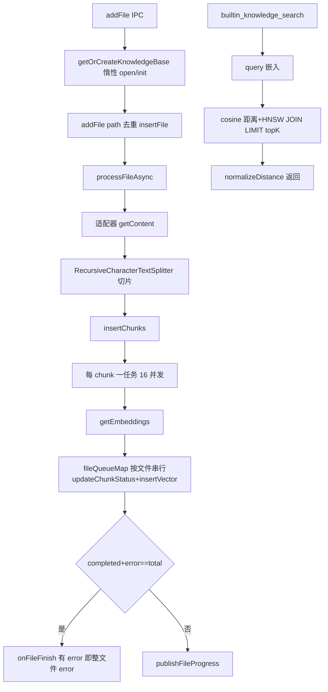

# 12 · 知识库 RAG 子系统（src/main/knowledge/ + file/ + textsplitters/）

## 1. 角色定位

DeepChat 的内置知识库域：把用户投喂的本地文件变成可检索的向量知识，一条从「文件拖入」到「检索结果注入对话」的完整 RAG 链。三段各管一段：`src/main/knowledge/`（2413 行）是六边形架构领域核心（KnowledgeBase 编排 + DuckDB 向量持久 + 任务队列 + IPC 路由）；`src/main/file/`（2745 行）是入库侧适配器体系（11 类格式提取）；`src/main/lib/textsplitters/`（715 行）是 langchain 移植的 5 个切分器。与记忆子系统（第 04 篇）为并列的两套 DuckDB 用法：记忆按 Agent 一库存 claims 向量，知识库按库存文档分片向量。Agent 侧消费不走 @提及注入，而是经 in-memory MCP 工具 `builtin_knowledge_search` 动态检索（第 3 节）。

## 2. 内部结构

**六边形骨架**：`ports.ts`（112 行）定义 7 个端口——`KnowledgeDatabasePort`（24 个方法的向量/文件/chunk CRUD）、TaskQueue/Config/File/Embedding/Dialog/EventPublisher 各一。`knowledgeBase.ts:24` 的 `KnowledgeBase` 构造器只收端口实例，零 Electron/DuckDB 直接依赖，切片编排/进度/检索/暂停恢复全在此。`index.ts:42` 的 `KnowledgeService` 是组合根：`knowledgeBases: Map` 缓存实例，`knowledgeBaseInitializations` 存初始化 Promise 防并发重复建库；库文件落 `userData/app_db/<id>`（`openKnowledgeDatabase` 按 exist 判断走 open 或 initialize）。`routes.ts` 装 14 个 zod contract IPC 通道；`settings.ts:8` 读 settingsStore 的 `knowledgeConfigs`（含 env 迁移）。

**DuckDB 持久层（database/knowledgeDatabase.ts，952 行模块最大）**：四张表——`metadata`（存 db_version，配套 MIGRATIONS 版本化迁移，当前 v1）、`file(id,name,path,mime_type,status,uploaded_at,metadata JSON)`、`chunk(id,file_id,content,status,chunk_index,error)`、`vector(id, embedding FLOAT[dimensions], file_id, chunk_id)` 定长向量列。vector 表建 `USING HNSW (embedding) WITH (metric, M=16, ef_construction=200)`，默认 cosine。vss 扩展优先从 `runtime/duckdb/extensions/` 离线加载、缺失才在线 INSTALL，且需 `SET hnsw_enable_experimental_persistence = true`；open 见 WAL 残留会 `repairIndex()` 重建 HNSW。

**文件适配器体系（src/main/file/）**：`adapters/BaseFileAdapter.ts` 抽象基类用模板方法——`processFile()` 统一 detectMimeType + 基本信息，子类实现 `getContent()/getLLMContent()/getThumbnail()/getFileDescription()` 四抽象方法。`mime.ts:16` 的 `getMimeTypeAdapterMap()` 是注册表：约 90 个 MIME 键映射 11 类适配器（Text/Csv/Rtf/Code/Audio/Image/Pdf/Doc/Ppt/Excel/OpenDocument，Code 含 30+ 语言 MIME），另有 UnsupportFileAdapter 兜底与 DirectoryAdapter。库选型：PDF 用 `pdf-parse-new`，Word 用 `mammoth`+`turndown`，Excel 用 `xlsx`，PPT 用 `fflate`+`xml2js` 解 OOXML——零重量级 Office 依赖。`index.ts:116` 的 `FileService` 选适配器并实现 `prepareFileCompletely`（'origin'/'llm-friendly' 两形态），`validation.ts:15` 做入库前校验。

**切分器**：index.ts 注释明说从 `@langchain/textsplitters@0.1.0` 抽核心精简（streamlined for size），保留 TextSplitter 基类、CharacterTextSplitter、RecursiveCharacterTextSplitter（separators 递归降级）、MarkdownTextSplitter、LatexTextSplitter 共 5 个，无 langchain 依赖链。

## 3. 外部连接

- **组合根**：`src/main/app/composition.ts:1571` `new KnowledgeService({config, storageRoot: app_db, files: fileService, dialog, embeddings: providerRuntime, events})`——嵌入复用 Provider 层，每库自配 `embedding.providerId/modelId` 与 dimensions。
- **Agent 检索通道**：`src/main/mcp/inMemoryServers/builtinKnowledgeServer.ts` 把每个 enabled 库包成 MCP 工具 `builtin_knowledge_search`（多库加 `_1/_2` 后缀），经 createInMemoryServerFactory 挂进 McpService；tools/call → `KnowledgeSearchPort.similarityQuery`（Pick 最窄接口）→ MCPTextContent 回给 Agent 循环（第 05 篇）。
- **IPC 14 通道**：`src/shared/contracts/routes/knowledge.routes.ts` 契约，覆盖 config 读写、文件增删/重加/列表、similarityQuery、validateFile、pause/resume 及元信息查询；渲染端 `src/renderer/api/KnowledgeClient.ts` 封装。
- **事件与 UI**：文件状态经 `publishDeepchatEvent('knowledge.file.updated'/'knowledge.file.progress')` 推给渲染进程；设置页 `renderer/settings/components/KnowledgeFile.vue:346` 检索测试框直接调 similarityQuery，是手测检索的入口。

## 4. 数据流：文件 → 适配器 → 切分 → 嵌入 → 入库 → 检索

入库是两级流水：文件级读取切片在 `processFileAsync` 异步跑（不入任务队列），产出 N 个 chunk 任务并发嵌入；chunk 完成回调更新 `fileProgressMap`，全部结算后落最终状态——**只要有一个 chunk 失败整文件就标 error**，不虚报完成。

## 5. 设计决策

- **DuckDB+VSS 选型**：嵌入式单文件（每库一文件，删库=删文件）、`FLOAT[n]` 定长向量列 + HNSW 原生索引、vss 扩展随应用打包全离线可用；检索 SQL 直接 LEFT JOIN chunk/file 出内容。代价：HNSW 持久化仍是实验特性，open 要处理 WAL 残留触发索引重建。
- **双队列并发模型**：`taskQueue`（默认 16 并发）管嵌入吞吐，AbortController 协作式取消（AbortError 归 onTerminate 而非 onError）；`fileQueueMap`（每文件一条 Promise 链）串行化同文件所有 DB 写，保证 DuckDB 单连接不被并发写踩——即注释里的「按文件队列保证 database 线程安全」。
- **可恢复的暂停语义**：pause=按库取消任务+chunk 状态落库 paused；resume=从 DB 反查 paused chunks 重建进度再入队，状态以数据库为准。
- **切分器移植而非引依赖**：砍掉 langchain 依赖树只留 5 类核心；separators 是配置项，`getSeparatorsForLanguage` 按语言给默认值。
- **领域纯度**：KnowledgeBase 只认 port，DuckDB/File/Embedding 全在组合根注入；Pick 窄接口让 MCP server 只拿最小能力面。

## 6. 新人提示

- 改表结构必须走 `MIGRATIONS` 数组加版本（文件留有 v2 示例），别直接改 initFileTable 等方法——老库不会重跑建表。
- `initialize` 对已存在路径抛 "Database already exists"，open/init 分流在 `openKnowledgeDatabase`，别绕过。
- 距离语义不统一：l2sq 越大越远、cosine/ip 需换算，出库必须过 `normalizeDistance`（`src/main/utils/vector.ts`），漏掉会反向排序。
- 换 embedding 模型=dimensions 变=须删库重建（reAddFile 只重切同库）。
- 升级 DuckDB 要同步重打包 `runtime/duckdb/extensions/` 的 vss 扩展——离线加载失败会静默落到在线 INSTALL，无网环境即坏。
- 调试：入库看 `[RAG]`/`[RAG TASK]` 日志，DB 层看 `[DuckDB]`；手测检索用设置页搜索框。关联：04 记忆、05 MCP、07 IPC 契约。
