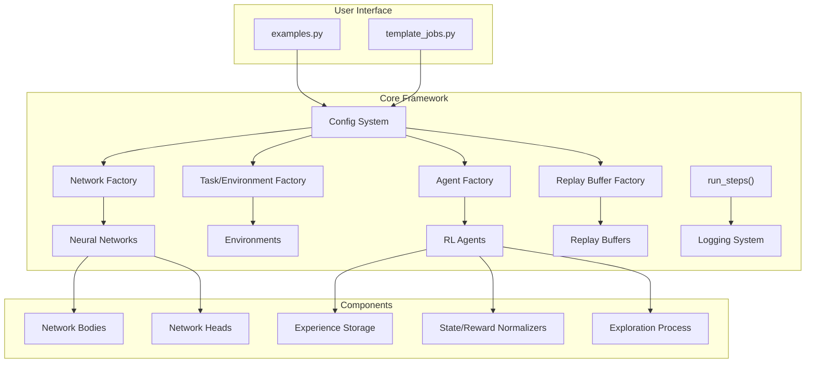
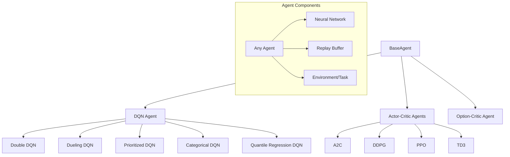
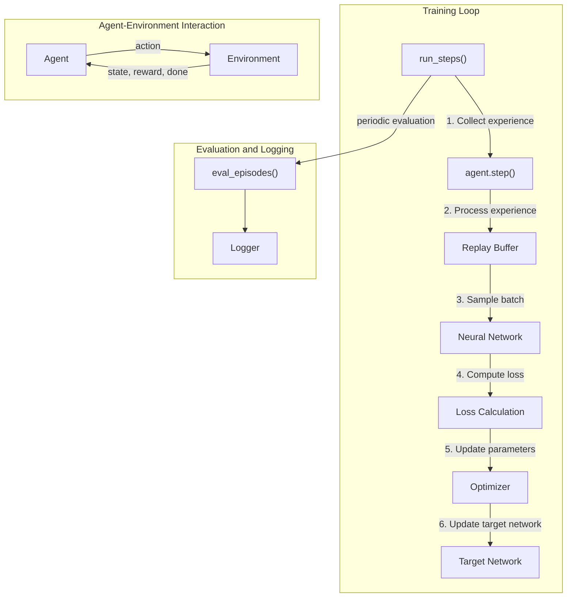

<!-- source: DeepWiki mcp.deepwiki.com · repo ShangtongZhang/DeepRL · page 1 Overview · fetched 2026-10-30 -->

# Overview

<details>
<summary>Relevant source files</summary>

The following files were used as context for generating this wiki page:

- [README.md](README.md)

</details>


This document provides an overview of the DeepRL repository, a modularized implementation of popular deep reinforcement learning algorithms in PyTorch. It introduces the purpose, architecture, and key features of the framework. For detailed information about specific components, please refer to their respective wiki pages.

## Purpose and Scope

DeepRL is a framework designed to facilitate research and experimentation with reinforcement learning algorithms. It provides:

- Modularized implementation of popular deep RL algorithms in PyTorch
- Easy switching between toy tasks and challenging games
- A consistent interface for implementing and testing new algorithms
- Tools for running experiments, collecting results, and visualizing performance

The framework supports a wide range of algorithms from value-based methods like DQN to policy-based methods like PPO, as well as actor-critic approaches and hierarchical reinforcement learning.

## Key Features

DeepRL implements numerous state-of-the-art reinforcement learning algorithms:

| Algorithm Family | Implementations |
|-----------------|-----------------|
| DQN Family | DQN, Double DQN, Dueling DQN, Prioritized DQN |
| Distributional RL | Categorical DQN (C51), Quantile Regression DQN (QR-DQN) |
| Policy Gradient | A2C (Continuous/Discrete) |
| N-Step Methods | N-Step DQN |
| Actor-Critic | DDPG, PPO, TD3 |
| Hierarchical RL | Option-Critic Architecture (OC) |

Additional features include:
- Asynchronous actors for data generation
- Asynchronous replay buffers for efficient GPU data transfer
- Comprehensive logging and visualization tools
- Docker support for reproducible experiments

Sources: [README.md:5-20]()

## System Architecture

The overall architecture of DeepRL follows a modular design pattern that separates different concerns into specialized components.

**High-Level System Architecture**



The system is centered around a configuration system that creates the necessary components through factory methods. Users interact with the system primarily through example scripts or batch jobs. Components are highly modularized to promote code reuse and flexibility.

Sources: [README.md]()

## Agent Hierarchy

DeepRL implements a variety of reinforcement learning agents, organized in a hierarchical structure with common functionality abstracted into base classes.



All agents inherit from a base agent class, with specialized implementations for different algorithms. The DQN family focuses on estimating action values, while actor-critic methods balance policy learning with value estimation. Each agent uses neural networks for function approximation and interacts with environments to collect experiences.

Sources: [README.md:8-18]()

## Training Process

The training process in DeepRL follows a standard reinforcement learning loop, with variations depending on the specific algorithm being used.



During training, agents interact with environments to collect experiences, which are stored in replay buffers. The agent periodically samples from these buffers to update its neural networks. For some algorithms like DQN, data collection and network updates can happen asynchronously for improved performance.

## Performance

Using modern hardware (e.g., 1 RTX 2080 Ti and 3 threads), the DQN agent in DeepRL can run for 10M steps (40M frames, 2.5M gradient updates) for Atari games like Breakout within 6 hours. The framework provides visualization tools to monitor and compare the performance of different algorithms.

Sources: [README.md:20-21](), [README.md:43-57]()

## Usage

The framework is designed to be easy to use, with examples provided for all implemented algorithms. Users can run predefined experiments or create their own by configuring the appropriate components.

```python
# Example usage pattern (conceptual)
config = Config()
config.task_fn = lambda: Task(...)
config.network_fn = lambda: Network(...)
config.replay_fn = lambda: Replay(...)
config.agent_fn = lambda: Agent(config)
agent = config.agent_fn()
runner = Runner(agent, config)
runner.run()
```

For more detailed examples and usage instructions, see [Example Usage](#1.3).

Sources: [README.md:27-30]()

## Dependencies

DeepRL requires PyTorch v1.5.1 and several other packages. A Docker environment is provided to ensure reproducibility across different systems. For detailed setup instructions, see [Getting Started](#1.2).

Sources: [README.md:24-25]()

## References and Citations

The repository implements algorithms from various published papers in the field of reinforcement learning. A comprehensive list of references is provided in the README.

Sources: [README.md:60-79]()

## Additional Research

The repository also contains implementations of novel algorithms from the author's research papers, located in separate branches. These implementations serve as good examples of how to use the codebase for research purposes.

Sources: [README.md:81-96]()

---

