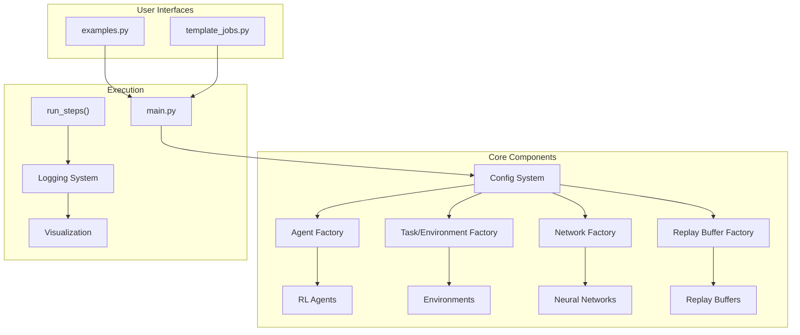
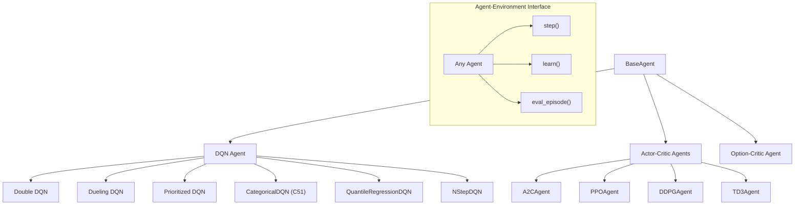
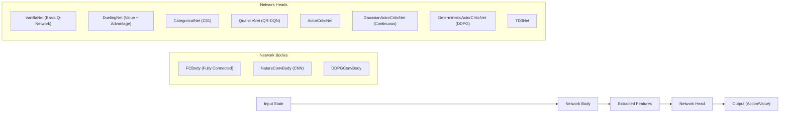
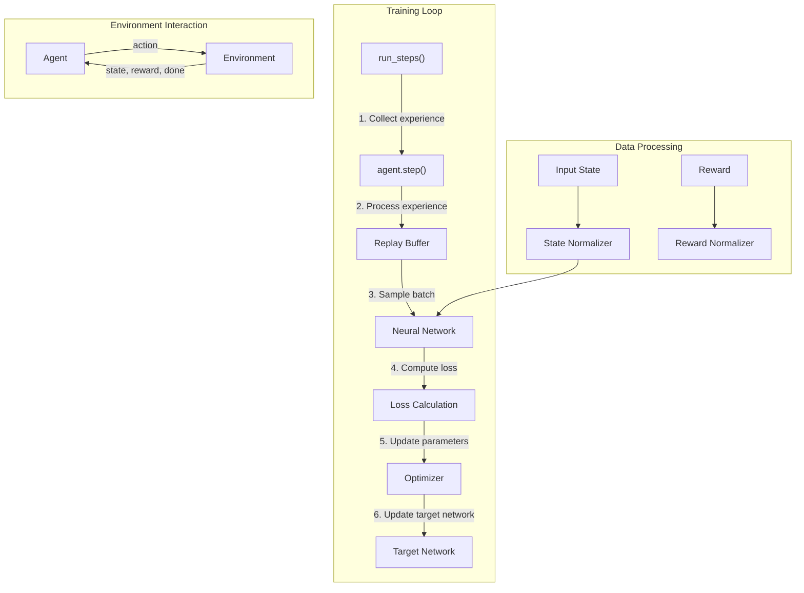
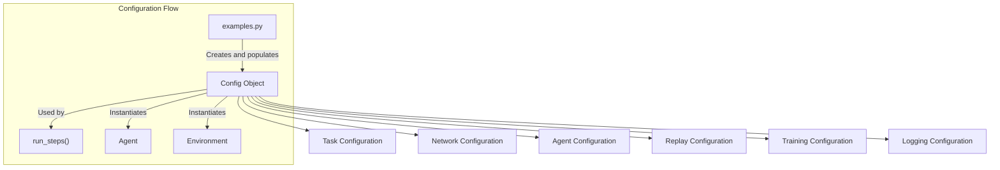
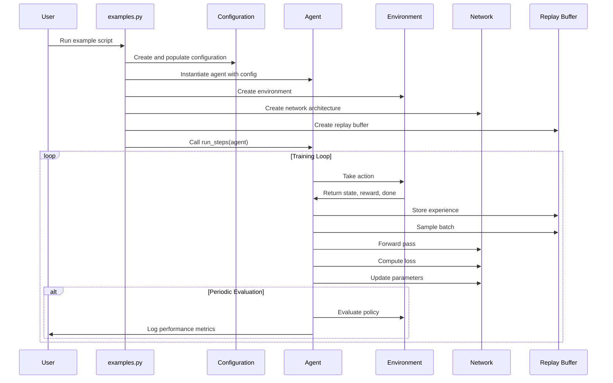

<!-- source: DeepWiki mcp.deepwiki.com · repo ShangtongZhang/DeepRL · page 1.1 Architecture · fetched 2026-10-30 -->

# Architecture

Relevant source files

The following files were used as context for generating this wiki page:

- [README.md](README.md)
- [examples.py](examples.py)

## Purpose and Scope

This document explains the overall architecture of the DeepRL framework, detailing how its various components interact to implement and run deep reinforcement learning algorithms. It covers the system's core structures, component relationships, and execution flow. For practical setup information, see [Getting Started](#1.2), and for example usage, see [Example Usage](#1.3).

## High-Level Architecture

The DeepRL framework follows a modular design pattern that separates core functionality into distinct components with standardized interfaces. This architecture enables easy implementation of new algorithms and environments while reusing existing infrastructure.

### Core Architecture Diagram

Sources: [examples.py:1-654](), [README.md:1-97]()

### Key Design Principles

1. **Factory Pattern**: Components are created through factory functions, allowing for easy configuration and instantiation.
2. **Composition over Inheritance**: Network architectures use composition (bodies + heads) rather than deep inheritance hierarchies.
3. **Configuration-Driven**: A unified configuration system controls all aspects of the algorithms and their execution.
4. **Modular Components**: Distinct components (agents, environments, networks, replay buffers) with standardized interfaces.
5. **Asynchronous Processing**: Parallel data collection and network updates for improved performance.

## Agent System Architecture

Agents are the core algorithmic components that implement reinforcement learning algorithms. Each agent follows a standard interface but implements algorithm-specific logic.

### Agent Hierarchy

Sources: [examples.py:10-617]()

### Agent Component Relationships

Each agent typically consists of:
1. A neural network (value function, policy, or both)
2. An experience replay buffer (for off-policy algorithms)
3. An optimizer 
4. State/reward normalizers
5. Exploration mechanisms

## Network Architecture

The network architecture follows a modular design that separates feature extraction (bodies) from action/value prediction (heads). This enables easy combination of different feature extractors with different prediction algorithms.

### Network Component Structure

Sources: [examples.py:20-26](), [examples.py:66-70](), [examples.py:109-110](), [examples.py:172-174](), [examples.py:204-205](), [examples.py:300-305](), [examples.py:350-351](), [examples.py:394-396](), [examples.py:566-571](), [examples.py:595-601]()

### Network Usage in Algorithms

| Algorithm | Network Type | Body | Head |
|-----------|--------------|------|------|
| DQN | VanillaNet | FCBody/NatureConvBody | Q-value output |
| Dueling DQN | DuelingNet | FCBody/NatureConvBody | Value + Advantage |
| C51 | CategoricalNet | FCBody/NatureConvBody | Categorical distribution |
| QR-DQN | QuantileNet | FCBody/NatureConvBody | Quantile values |
| A2C | ActorCriticNet | FCBody/NatureConvBody | Policy + Value |
| PPO | GaussianActorCriticNet | FCBody | Gaussian policy + Value |
| DDPG | DeterministicActorCriticNet | FCBody | Deterministic policy + Q-value |
| TD3 | TD3Net | FCBody | Policy + Dual Q-networks |

## Training Pipeline and Data Flow

The training pipeline orchestrates how data flows through the system, from environment interaction to network updates.

### Training Flow Diagram

Sources: [examples.py:52](), [examples.py:97](), [examples.py:127](), [examples.py:193](), [examples.py:227](), [examples.py:280](), [examples.py:336](), [examples.py:358](), [examples.py:446](), [examples.py:468](), [examples.py:492](), [examples.py:522](), [examples.py:550](), [examples.py:579](), [examples.py:617]()

## Configuration System

The configuration system is central to the framework's flexibility. It manages all parameters needed to instantiate and run the algorithms.

### Configuration Components

Sources: [examples.py:13-51](), [examples.py:57-97](), [examples.py:103-127](), [examples.py:132-160](), [examples.py:166-193](), [examples.py:198-227](), [examples.py:232-280](), [examples.py:283-336](), [examples.py:341-358](), [examples.py:362-381](), [examples.py:385-404](), [examples.py:409-424](), [examples.py:428-446](), [examples.py:450-468](), [examples.py:472-492](), [examples.py:497-522](), [examples.py:526-550](), [examples.py:554-579](), [examples.py:583-617]()

Example configuration parameters from the DQN implementation:
- Task configuration: `config.task_fn`, `config.eval_env`
- Network configuration: `config.network_fn`, `config.optimizer_fn`
- Replay configuration: `config.replay_fn`, `config.batch_size`, `config.history_length`
- Agent-specific parameters: `config.discount`, `config.target_network_update_freq`, `config.double_q`
- Training parameters: `config.max_steps`, `config.exploration_steps`, `config.eval_interval`
- Normalizers: `config.state_normalizer`, `config.reward_normalizer`

## Execution Flow

The typical execution flow in the DeepRL framework follows this pattern:

Sources: [examples.py:620-654]()

## Component Interaction Examples

Below are some examples showing how components interact in specific algorithms:

### DQN Component Interaction
1. The agent selects actions using an ε-greedy policy based on Q-values from the network
2. Experiences are stored in a replay buffer
3. Batches are sampled from the buffer for training
4. The network is updated to minimize TD error
5. Target network is periodically updated to stabilize learning

### A2C Component Interaction
1. Multiple parallel environments collect trajectories
2. The policy network outputs action probabilities
3. The value network estimates state values
4. Advantage estimates are computed using GAE (Generalized Advantage Estimation)
5. Both networks are updated to maximize policy performance

### PPO Component Interaction
1. Trajectories are collected using the current policy
2. Advantage estimates are computed
3. The policy is updated while constraining the policy change (via clipping or KL divergence)
4. The value function is updated to improve predictions
5. The process repeats with the updated policy

## Conclusion

The DeepRL framework provides a modular, flexible architecture for implementing and experimenting with deep reinforcement learning algorithms. Its design principles of separation of concerns, standard interfaces, and configuration-driven execution allow for easy extension and modification. The framework successfully abstracts the common components of reinforcement learning algorithms while allowing algorithm-specific optimizations and variations.

---

