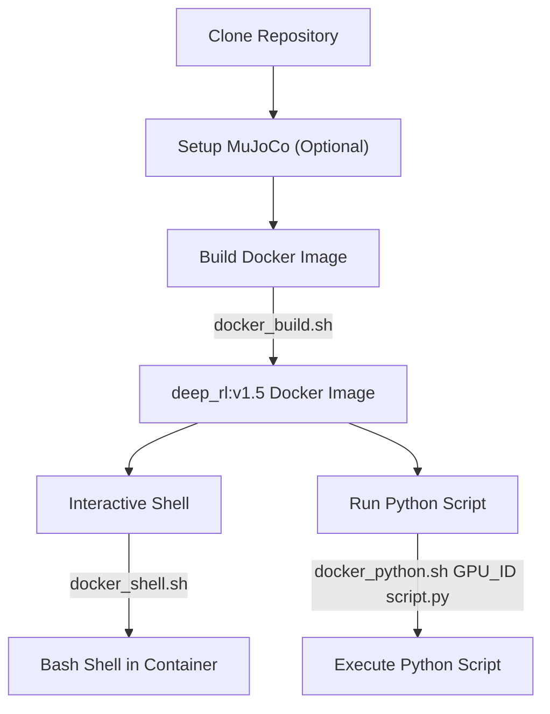
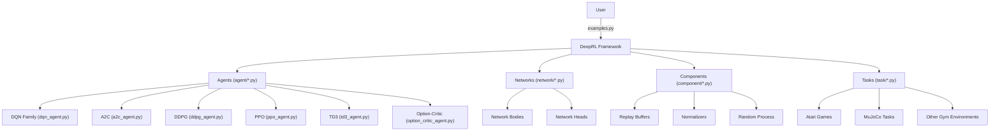
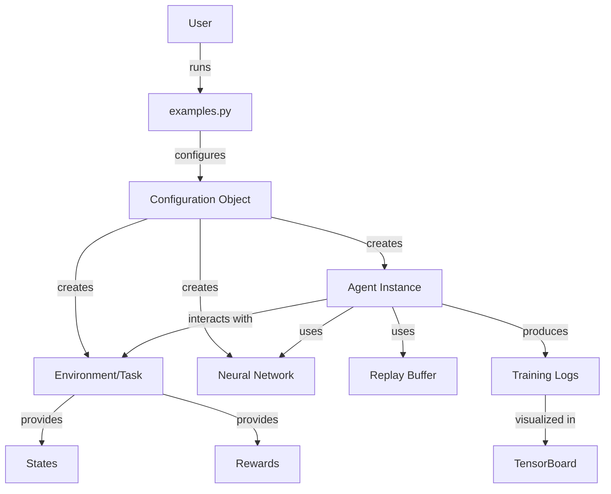

<!-- source: DeepWiki mcp.deepwiki.com · repo ShangtongZhang/DeepRL · page 1.2 Getting Started · fetched 2026-10-30 -->

# Getting Started

<details>
<summary>Relevant source files</summary>

The following files were used as context for generating this wiki page:

- [Dockerfile](Dockerfile)
- [README.md](README.md)
- [docker_build.sh](docker_build.sh)
- [docker_python.sh](docker_python.sh)
- [docker_shell.sh](docker_shell.sh)
- [requirements.txt](requirements.txt)

</details>


This guide walks you through the process of installing and configuring the DeepRL framework, a modularized implementation of popular deep reinforcement learning algorithms in PyTorch. For information on how to use the framework after installation, see [Example Usage](#1.3).

## Prerequisites

Before installing the DeepRL framework, ensure you have:

- Git installed for cloning the repository
- Docker installed (for the recommended Docker-based setup)
- NVIDIA GPU with compatible drivers (for optimal performance)
- Basic understanding of reinforcement learning concepts

## Installation Options

There are two primary methods to install and set up the DeepRL framework:

1. **Docker-based Setup** (Recommended): Provides a reproducible environment with all dependencies pre-configured
2. **Direct Installation**: Manual installation of all dependencies on your local system

The Docker approach is strongly recommended as it ensures consistent environment setup, avoiding compatibility issues that often arise with direct installation.

## Docker-based Setup (Recommended)

### Docker Workflow Overview

The following diagram illustrates the Docker setup and usage workflow:



Sources: [Dockerfile](), [docker_build.sh](), [docker_shell.sh](), [docker_python.sh]()

### Step-by-Step Docker Setup

1. **Clone the repository**:
   ```bash
   git clone https://github.com/ShangtongZhang/DeepRL.git
   cd DeepRL
   ```

2. **MuJoCo setup** (optional, for MuJoCo environments):
   - Obtain a MuJoCo license key (`mjkey.txt`)
   - Place it in the repository root directory
   - If you don't need MuJoCo, edit the Dockerfile and comment out line 35:
     ```bash
     # COPY ./mjkey.txt .mujoco/mjkey.txt
     ```

3. **Build the Docker image**:
   ```bash
   ./docker_build.sh
   ```
   This script creates a Docker image named `deep_rl:v1.5` containing all dependencies listed in `requirements.txt`.

4. **Use the Docker environment**:
   - For interactive development:
     ```bash
     ./docker_shell.sh
     ```
   - To run a specific script with GPU ID 0:
     ```bash
     ./docker_python.sh 0 examples.py
     ```
     The first parameter (`0`) specifies which GPU to use, and the second parameter is the Python script to execute.

Sources: [docker_build.sh](), [docker_shell.sh](), [docker_python.sh]()

### Docker Image Components

The Docker image contains all the necessary dependencies for running the DeepRL framework:

| Component | Version | Purpose |
|-----------|---------|---------|
| CUDA | 10.0 | GPU acceleration |
| Python | 3.6 | Programming language |
| PyTorch | 1.5.1 | Deep learning framework |
| OpenAI Gym | 0.10.8 | RL environments |
| TensorFlow | 1.15.0 | TensorBoard logging |
| MuJoCo | 150/200 | Physics engine (optional) |
| Atari-py | 0.1.7 | Atari environments |
| OpenCV | 4.0.0.21 | Image processing |

Sources: [Dockerfile:1-49](), [requirements.txt:1-14]()

## Direct Installation

If you prefer to install dependencies directly on your system:

1. **Clone the repository**:
   ```bash
   git clone https://github.com/ShangtongZhang/DeepRL.git
   cd DeepRL
   ```

2. **Install Python 3.6** (recommended version)

3. **Install PyTorch 1.5.1** following the official PyTorch installation instructions

4. **Install required packages**:
   ```bash
   pip install -r requirements.txt
   ```

5. **For MuJoCo environments** (optional):
   - Download MuJoCo binaries from the official website
   - Extract to `~/.mujoco/mjpro150` and `~/.mujoco/mujoco200_linux`
   - Add license key to `~/.mujoco/mjkey.txt`
   - Set environment variables:
     ```bash
     export LD_LIBRARY_PATH=$LD_LIBRARY_PATH:~/.mujoco/mjpro150/bin:~/.mujoco/mujoco200_linux/bin
     ```

6. **Install additional dependencies**:
   ```bash
   pip install glfw Cython imageio lockfile
   pip install mujoco-py==1.50.1.68
   pip install git+git://github.com/deepmind/dm_control.git@103834
   pip install git+https://github.com/ShangtongZhang/dm_control2gym.git@scalar_fix
   pip install git+git://github.com/openai/baselines.git@8e56dd#egg=baselines
   ```

Sources: [requirements.txt:1-14](), [Dockerfile:40-47]()

## Framework Components and Structure

After installation, you'll have access to the DeepRL framework with its modular architecture:



Sources: [README.md:5-21]()

## Supported Algorithms

The DeepRL framework implements numerous popular reinforcement learning algorithms:

| Algorithm Family | Implementations |
|------------------|-----------------|
| DQN Family | DQN, Double DQN, Dueling DQN, Prioritized DQN |
| Distributional RL | Categorical DQN (C51), Quantile Regression DQN (QR-DQN) |
| Advanced DQN | Rainbow DQN, N-Step DQN |
| Policy Gradient | A2C (Continuous/Discrete) |
| Actor-Critic | DDPG, PPO, TD3 |
| Hierarchical RL | Option-Critic Architecture |

Sources: [README.md:8-18]()

## Verifying Your Installation

To verify that your installation is working correctly:

1. **Run a simple example**:
   ```bash
   # If using Docker
   ./docker_python.sh 0 examples.py
   
   # If direct installation
   python examples.py
   ```

2. **Check for successful execution**: The script should start training an agent and display progress information.

## Data Flow and Execution Model

The following diagram illustrates how the execution model works after installation:



Sources: [README.md:20-21](), [README.md:27-31]()

## Next Steps

After successfully installing the DeepRL framework, you can:

1. Explore example implementations in [Example Usage](#1.3)
2. Learn about the architecture of different agents in [Agents](#2)
3. Discover how to run experiments in [Running Experiments](#5)

## Troubleshooting Common Issues

- **GPU-related errors**: Ensure your NVIDIA drivers are compatible with CUDA 10.0
- **MuJoCo license errors**: Verify your license key is valid and correctly placed
- **Package dependency conflicts**: The Docker approach helps avoid these issues
- **Memory errors**: Some environments and algorithms require significant RAM and GPU memory

Sources: [Dockerfile:1-49](), [requirements.txt:1-14]()

---

