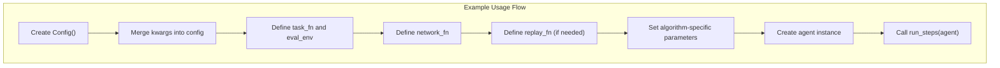
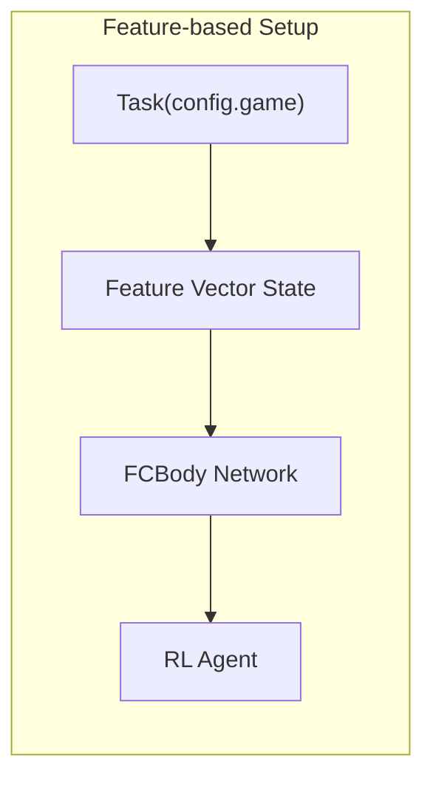
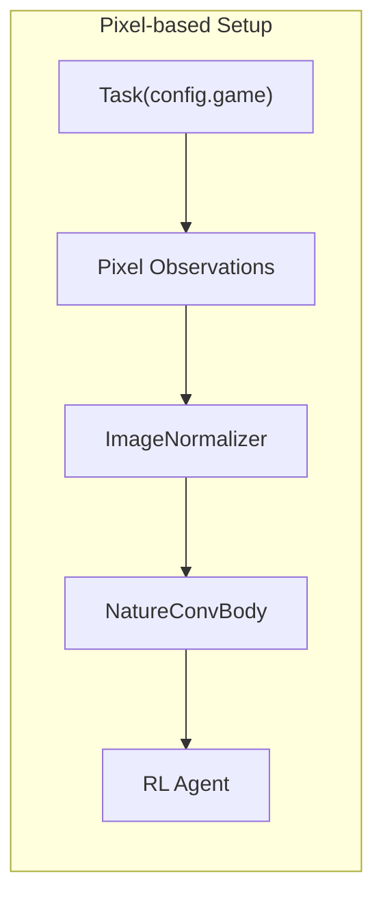
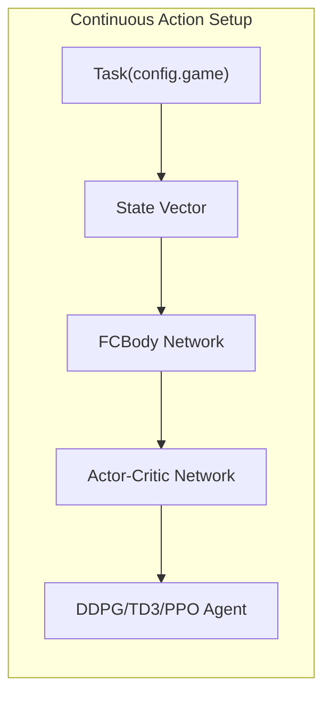
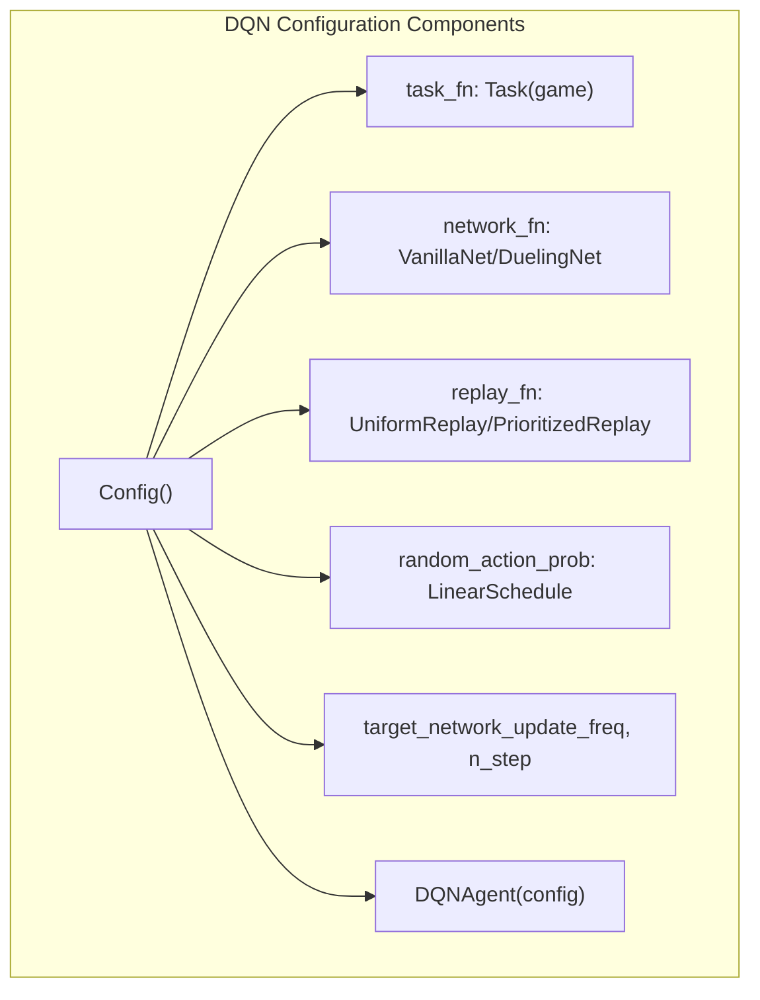
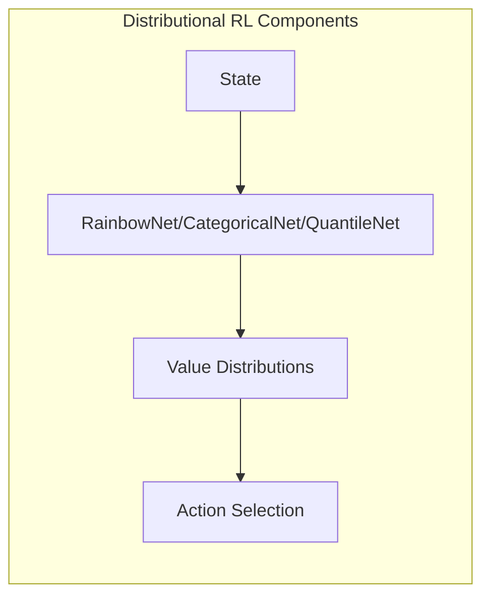
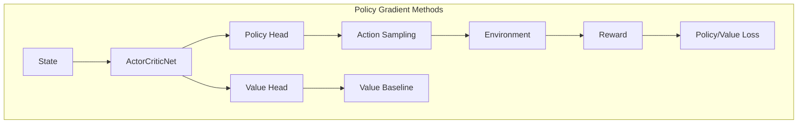
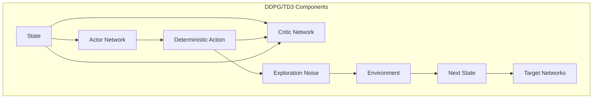
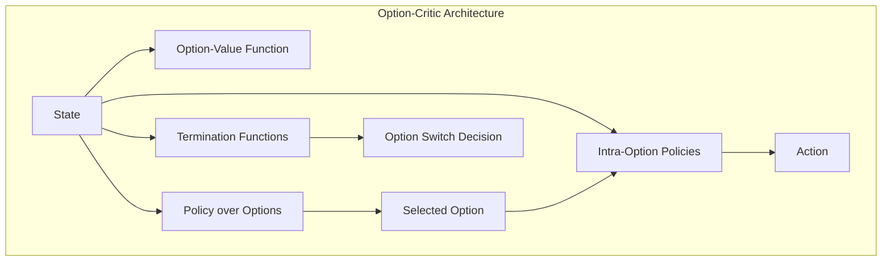
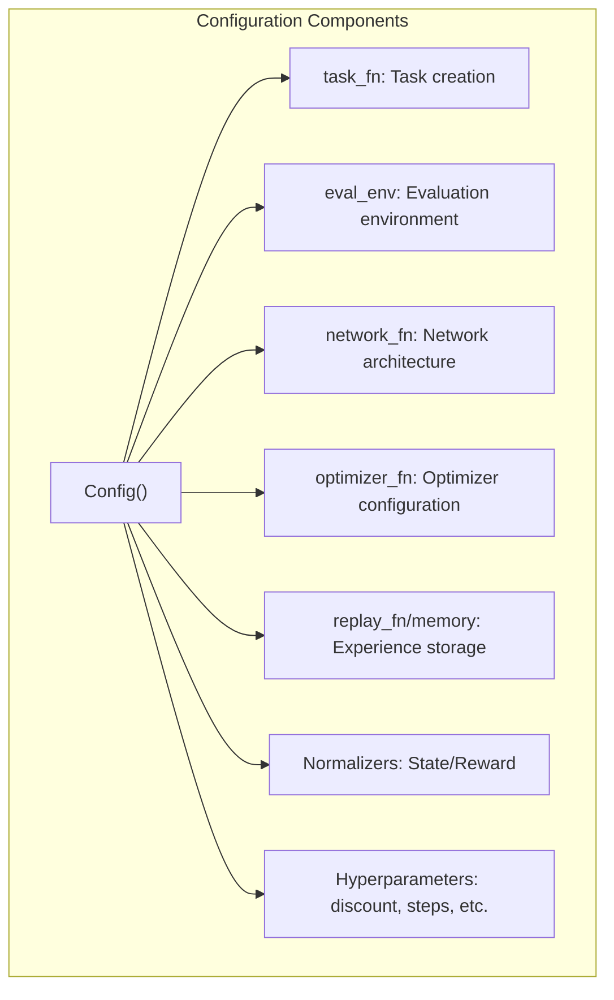

<!-- source: DeepWiki mcp.deepwiki.com · repo ShangtongZhang/DeepRL · page 1.3 Example Usage · fetched 2026-10-30 -->

# Example Usage

<details>
<summary>Relevant source files</summary>

The following files were used as context for generating this wiki page:

- [README.md](README.md)
- [examples.py](examples.py)

</details>


## Purpose and Scope

This document demonstrates how to use the DeepRL framework through practical examples for different reinforcement learning algorithms and environments. It covers basic usage patterns, specific algorithm configurations, and execution instructions. For installation instructions, see [Getting Started](#1.2). For detailed documentation of specific agents, see [Agents](#2).

## Basic Usage Pattern

The DeepRL framework follows a consistent pattern for running experiments:

1. Create a configuration object
2. Set environment/task parameters
3. Configure the neural network architecture
4. Configure algorithm-specific parameters
5. Create the agent and run training



Sources: [examples.py:11-52]()

## Environment Types

The framework organizes examples based on environment type and input representation:

### Feature-based Environments

These environments provide direct feature vectors as state representations (e.g., CartPole).



Sources: [examples.py:11-52](), [examples.py:101-127](), [examples.py:164-193]()

### Pixel-based Environments

These environments use image-based observations (e.g., Atari games).



Sources: [examples.py:55-97](), [examples.py:130-160](), [examples.py:196-227]()

### Continuous Action Environments

These environments have continuous action spaces (e.g., MuJoCo).



Sources: [examples.py:384-404](), [examples.py:496-522](), [examples.py:554-579](), [examples.py:583-617]()

## Running Specific Algorithms

### DQN and Variants

DQN is implemented with multiple variants including Double DQN, Dueling DQN, and N-Step DQN:



Key configuration parameters:
- `network_fn`: Network architecture (VanillaNet or DuelingNet)
- `replay_cls`: Replay buffer type (UniformReplay or PrioritizedReplay)
- `double_q`: Enable/disable double Q-learning
- `n_step`: Number of steps for multi-step bootstrap targets

Example usage:

```
# Basic DQN with feature input
dqn_feature(game='CartPole-v0')

# DQN with pixel input (Atari)
dqn_pixel(game='BreakoutNoFrameskip-v4')

# Options for variants
dqn_feature(game='CartPole-v0', double_q=True)  # Double DQN
dqn_feature(game='CartPole-v0', n_step=3)  # N-Step DQN
```

Sources: [examples.py:11-52](), [examples.py:55-97](), [examples.py:407-446]()

### Distributional RL Methods

C51, QR-DQN, and Rainbow implement distributional approaches to RL:



Key configuration parameters:
- `categorical_v_min/v_max`: Value bounds for C51
- `categorical_n_atoms`: Number of atoms for discretizing distribution
- `num_quantiles`: Number of quantiles for QR-DQN
- `noisy_linear`: Enable/disable NoisyNet for Rainbow

Example usage:

```
# Categorical DQN (C51)
categorical_dqn_pixel(game='BreakoutNoFrameskip-v4')

# Quantile Regression DQN
quantile_regression_dqn_pixel(game='BreakoutNoFrameskip-v4')

# Rainbow DQN
rainbow_pixel(game='BreakoutNoFrameskip-v4')
```

Sources: [examples.py:101-127](), [examples.py:130-160](), [examples.py:164-193](), [examples.py:196-227](), [examples.py:231-336]()

### Policy Gradient and Actor-Critic Methods

A2C and PPO implement policy gradient methods:



Key configuration parameters:
- `num_workers`: Number of parallel environments
- `entropy_weight`: Weight for entropy regularization
- `use_gae`: Enable/disable Generalized Advantage Estimation
- `gae_tau`: GAE parameter for bias-variance tradeoff
- `optimization_epochs`, `mini_batch_size`, `ppo_ratio_clip`: PPO-specific parameters

Example usage:

```
# A2C with feature input
a2c_feature(game='CartPole-v0')

# A2C with pixel input
a2c_pixel(game='BreakoutNoFrameskip-v4')

# A2C for continuous action spaces
a2c_continuous(game='HalfCheetah-v2')

# PPO for continuous action spaces
ppo_continuous(game='HalfCheetah-v2')
```

Sources: [examples.py:340-404](), [examples.py:496-550]()

### Deterministic Policy Gradient Methods

DDPG and TD3 implement deterministic policy gradients for continuous control:



Key configuration parameters:
- `random_process_fn`: Exploration noise process (OU or Gaussian)
- `target_network_mix`: Soft update parameter
- `td3_noise`, `td3_noise_clip`, `td3_delay`: TD3-specific parameters

Example usage:

```
# DDPG for continuous control
ddpg_continuous(game='HalfCheetah-v2')

# TD3 for continuous control
td3_continuous(game='HalfCheetah-v2')
```

Sources: [examples.py:554-617]()

### Hierarchical Reinforcement Learning

Option-Critic implements hierarchical RL with options:



Key configuration parameters:
- `num_options`: Number of options
- `termination_regularizer`: Regularization for option termination
- `entropy_weight`: Weight for entropy regularization

Example usage:

```
# Option-Critic with feature input
option_critic_feature(game='CartPole-v0')

# Option-Critic with pixel input
option_critic_pixel(game='BreakoutNoFrameskip-v4')
```

Sources: [examples.py:450-492]()

## Common Configuration Components

The configuration system uses a consistent pattern for setting up components:



Common configuration parameters:

| Parameter | Description | Example Value |
|-----------|-------------|---------------|
| `task_fn` | Function to create environment | `lambda: Task(config.game)` |
| `eval_env` | Environment for evaluation | `config.task_fn()` |
| `network_fn` | Function to create neural network | `lambda: VanillaNet(...)` |
| `optimizer_fn` | Function to create optimizer | `lambda params: torch.optim.Adam(params, lr=1e-3)` |
| `discount` | Discount factor | `0.99` |
| `batch_size` | Batch size for updates | `32` |
| `state_normalizer` | Normalizer for state observations | `ImageNormalizer()` |
| `max_steps` | Maximum training steps | `int(2e7)` |

Sources: [examples.py:11-52](), [examples.py:101-127](), [examples.py:231-280]()

## Running Examples

To run any of the example functions, you can modify the code in [examples.py:620-653]() and execute the script:

```bash
python examples.py
```

The script creates necessary directories, sets random seeds, selects the device (CPU/GPU), and runs the specified algorithm with the chosen game.

Example usage in [examples.py]():

```python
if __name__ == '__main__':
    mkdir('log')
    mkdir('tf_log')
    set_one_thread()
    random_seed()
    select_device(-1)  # -1 is CPU, a positive integer is the index of GPU
    
    # Select game and algorithm to run
    game = 'BreakoutNoFrameskip-v4'
    dqn_pixel(game=game, n_step=1, replay_cls=UniformReplay, async_replay=False)
    
    # Uncomment to run other algorithms
    # quantile_regression_dqn_pixel(game=game)
    # categorical_dqn_pixel(game=game)
    # rainbow_pixel(game=game, async_replay=False)
    # a2c_pixel(game=game)
    # n_step_dqn_pixel(game=game)
    # option_critic_pixel(game=game)
    # ppo_pixel(game=game)
    
    # For continuous control environments
    # game = 'HalfCheetah-v2'
    # a2c_continuous(game=game)
    # ppo_continuous(game=game)
    # ddpg_continuous(game=game)
    # td3_continuous(game=game)
```

To customize the examples, you can modify parameters by passing them as keyword arguments:

```python
# Modify hyperparameters
dqn_pixel(game='BreakoutNoFrameskip-v4', 
          n_step=3,  # Use 3-step returns
          replay_cls=PrioritizedReplay,  # Use prioritized replay
          async_replay=True)  # Use asynchronous replay
```

Sources: [examples.py:620-653]()

---

