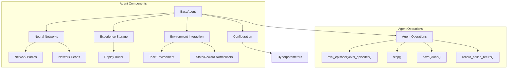
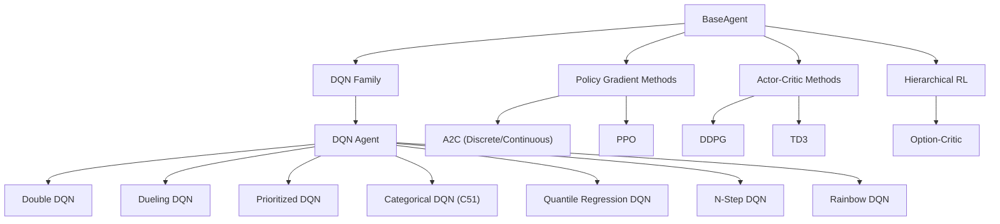
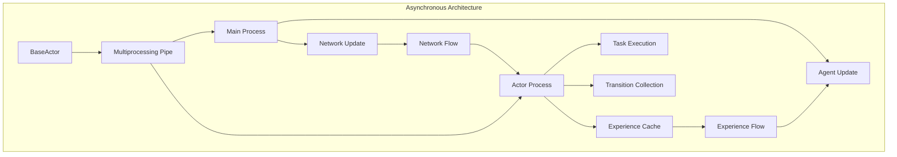

<!-- source: DeepWiki mcp.deepwiki.com · repo ShangtongZhang/DeepRL · page 2 Agents · fetched 2026-10-30 -->

# Agents

Relevant source files

The following files were used as context for generating this wiki page:

- [README.md](README.md)
- [deep_rl/agent/BaseAgent.py](deep_rl/agent/BaseAgent.py)

This document provides an overview of the agent implementations in the DeepRL framework. Agents are the core components that implement reinforcement learning algorithms, interact with environments, and learn optimal policies. For details about specific agent families, see [DQN Family](#2.2), [Policy Gradient Methods](#2.3), and [Actor-Critic Methods](#2.4).

## Agent Architecture Overview

Agents in the DeepRL framework share a common architecture while implementing algorithm-specific learning mechanisms. Each agent interacts with environments, manages neural networks, and stores experiences.

Sources: [deep_rl/agent/BaseAgent.py:15-106](). [README.md:8-18]().

## Agent Hierarchy

The DeepRL framework implements a variety of reinforcement learning algorithms through specialized agent classes that inherit from the BaseAgent class.

Sources: [README.md:8-18]().

## Common Agent Functionality

All agents inherit from the `BaseAgent` class, which provides common functionality:

| Method | Purpose |
|--------|---------|
| `__init__(config)` | Initializes agent with configuration |
| `save(filename)` | Saves agent model and normalizer states |
| `load(filename)` | Loads agent model and normalizer states |
| `eval_step(state)` | Performs a single evaluation step |
| `eval_episode()` | Runs a full evaluation episode |
| `eval_episodes()` | Runs multiple evaluation episodes and logs results |
| `record_online_return(info)` | Records and logs training returns |
| `switch_task()` | Switches to a new task if using curriculum learning |
| `record_episode(dir, env)` | Records video frames of an episode |

The `BaseAgent` provides the foundation for all agents with common utilities for evaluation, logging, and model management. Each specific agent implementation extends this class with algorithm-specific learning methods.

Sources: [deep_rl/agent/BaseAgent.py:15-106]().

## Asynchronous Actors

For efficient data collection, the DeepRL framework uses asynchronous actors that run in separate processes.

The `BaseActor` class provides:
- Asynchronous data collection through multiprocessing
- Communication between the agent and actors via pipes
- Caching of transitions to improve efficiency
- Option to run synchronously for debugging and small-scale experiments

Sources: [deep_rl/agent/BaseAgent.py:108-183]().

## Agent Implementations

The DeepRL framework implements a variety of reinforcement learning algorithms:

| Agent Family | Algorithms | Key Features |
|--------------|------------|--------------|
| DQN Family | DQN, Double DQN, Dueling DQN, Prioritized DQN, C51, QR-DQN, Rainbow, N-Step DQN | Value-based methods for discrete action spaces |
| Policy Gradient | A2C (Discrete/Continuous) | Advantage Actor-Critic methods with synchronous updates |
| PPO | PPO | Policy optimization with clipped objective function |
| Deterministic Policy | DDPG, TD3 | Deterministic policy optimization for continuous action spaces |
| Hierarchical RL | Option-Critic | Temporal abstraction using options framework |

The library features asynchronous data generation and processing for efficient training. The DQN agent and its variants have asynchronous actors for data generation and asynchronous replay buffers for transferring data to GPU, allowing for faster training on modern hardware.

Sources: [README.md:8-21]().

## Agent Usage Pattern

Agents in DeepRL follow a common usage pattern:

1. Create agent instance with configured hyperparameters
2. Interact with environments to collect experiences
3. Learn from collected experiences
4. Evaluate learned policies periodically
5. Save/load model checkpoints as needed

For specific configuration and usage examples, see [Example Usage](#1.3) and the implementation details of individual agent families.

Sources: [deep_rl/agent/BaseAgent.py:15-106]().

## Algorithm Research Extensions

The framework has been extended to implement many research algorithms beyond the standard implementations, including:

- Off-PAC-KL: Softmax Off-Policy Actor Critic
- TruncatedETD: Truncated Emphatic Temporal Difference methods
- DifferentialGQ: Average-reward off-policy evaluation
- MVPI: Mean-Variance Policy Iteration for risk-averse RL
- Bi-Res-DDPG: Deep Residual Reinforcement Learning
- ACE: Actor Ensemble Algorithm

These research extensions demonstrate the flexibility of the agent architecture in the DeepRL framework.

Sources: [README.md:80-96]().

---

